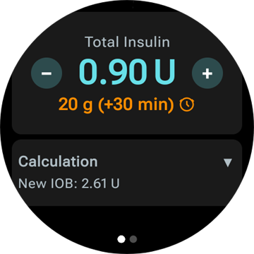
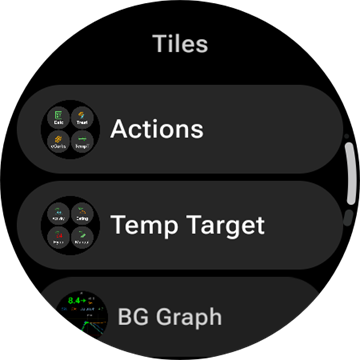
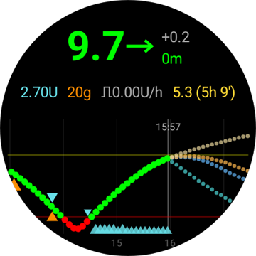
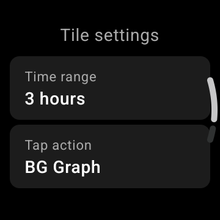

# Χειρισμός του AAPS από το έξυπνο ρολόι Wear OS

(Watchfaces-aaps-watchfaces)=

## Watchface του AAPS

```{warning}
Τα κλασικά watchface του **AAPS** λειτουργούν μόνο σε Wear OS 5 και παλαιότερα, και το Wear OS 5 ήδη τα περιορίζει. Σε **Wear OS 6 και νεότερα**, η εφαρμογή του ρολογιού εγκαθιστά αντί γι' αυτά ένα watchface σε μορφή Watch Face Format της Google: το προσαρμοσμένο watchface σας ως εικόνα ή το **Watchface με Complications**. Δείτε τις [αλλαγές στα watchface του Wear OS](#wearos-watchface-changes) για το τι δεν λειτουργεί σε κάθε έκδοση του Wear OS, και [το watchface που εγκαθιστά το AAPS](#wearos-aaps-v4-watchface) για το Wear OS 6.
```

Σε Wear OS 5 και παλαιότερα, η εφαρμογή ρολογιού του **AAPS** έχει ενσωματωμένα αρκετά κλασικά watchface. Δείχνουν την τιμή γλυκόζης με τη διαφορά (delta), το IOB, τον ενεργό βασικό ρυθμό και ένα γράφημα των μετρήσεων. Σε αυτές λειτουργούν δύο πατήματα:

* Διπλό πάτημα στην τιμή γλυκόζης ανοίγει το κύριο μενού του **AAPS**
* Διπλό πάτημα στο γράφημα αλλάζει το χρονικό του εύρος

Σε κάθε έκδοση του Wear OS, οι [επιπλοκές](#Watchfaces-complications) και τα [πλακίδια](#WearOsSmartwatch-wear-os-tiles) που περιγράφονται σε αυτή τη σελίδα λειτουργούν με κάθε watchface που έχει χώρο για αυτά.

## Διαμόρφωση

Ενεργοποιήστε το **Wear** στη [**Διαμόρφωση** > **Επικοινωνία**](#Config-Builder-wear).

Για να κάνετε bolus ή άλλες ενέργειες από το ρολόι, ενεργοποιήστε το **Έλεγχος από ρολόι**. Οι επιλογές του οδηγού bolus για το ρολόι ρυθμίζονται στο ίδιο σημείο: δείτε [Ρυθμίσεις > Wear](#preferences-wear). Όσο το **Έλεγχος από ρολόι** είναι απενεργοποιημένο, το τηλέφωνο απορρίπτει κάθε θεραπεία ή αλλαγή τρόπου λειτουργίας που στέλνει το ρολόι, και το ρολόι δείχνει *«Ο έλεγχος από το ρολόι είναι απενεργοποιημένος στις ρυθμίσεις Wear στο τηλέφωνο.»*

Με το **Άνοιγμα πρόσθετου** στην κάρτα **Wear** ανοίγετε την οθόνη Wear:


Η πάνω γραμμή δείχνει το όνομα του συνδεδεμένου ρολογιού ή **(Χωρίς Σύνδεση Ρολογιού)**. Από αυτή την οθόνη μπορείτε να

* Ξαναστείλετε όλα τα δεδομένα. Μπορεί να βοηθήσει αν το ρολόι δεν ήταν συνδεδεμένο για λίγο και θέλετε να στείλετε τις πληροφορίες στο ρολόι.
* Ανοίξτε τις ρυθμίσεις στο ρολόι σας απευθείας από το τηλέφωνό σας.
* επιλέξετε ποιο watchface εγκαθιστά το **AAPS** στο ρολόι (**Watchface εγκατεστημένο στο ρολόι**: το προσαρμοσμένο watchface σας ή το Watchface με Complications). Αυτή η κάρτα εμφανίζεται μόνο όσο είναι συνδεδεμένο ένα ρολόι με **Wear OS 6** ή νεότερο. Δείτε [το watchface που εγκαθιστά το AAPS](#wearos-aaps-v4-watchface).
* διαχειριστείτε το **Προσαρμοσμένο Watchface** (η κάρτα εμφανίζεται όσο είναι συνδεδεμένο ένα ρολόι): το **Φόρτωση Watchface** στέλνει ένα προσαρμοσμένο watchface στο ρολόι, το **Πληροφορίες Watchface** δείχνει τις λεπτομέρειες του φορτωμένου watchface και τα πεδία του, το **Περισσότερα Watchface** ανοίγει τον [ιστότοπο ανταλλαγής](../ExchangeSiteCustomWatchfaces/index.md) στον browser σας και το **Εξαγωγή Προτύπου** αποθηκεύει ένα πρότυπο που μπορείτε να επεξεργαστείτε. Κάτω από τα κουμπιά εμφανίζεται μια προεπισκόπηση του φορτωμένου watchface. Δείτε [Αλλαγή σε watchface του AAPS](#WearOS_changing-to-AAPS-watchface).

Βεβαιωθείτε ότι οι ειδοποιήσεις από το AAPS δεν είναι αποκλεισμένες στο ρολόι. Η επιβεβαίωση μιας ενέργειας (π.χ. bolus, προσωρινός στόχος) έρχεται ως ειδοποίηση. Πρέπει να τη σύρετε και να πατήσετε το σημάδι επιλογής.

## Πρόσβαση στο κύριο μενού του AAPS


Για να ανοίξετε το κύριο μενού του **AAPS**, χρησιμοποιήστε ένα από τα παρακάτω:

* ανοίξτε το **AAPS** από τη λίστα εφαρμογών του ρολογιού
* πατήστε μια επιπλοκή του **AAPS** που ανοίγει το μενού, δείτε [Ρυθμίσεις για τις επιπλοκές](#WearOsSmartwatch-complication-settings)
* πατήστε το πλακίδιο **Γράφημα BG** με την **Ενέργεια πατήματος** ορισμένη σε **Κύριο μενού**, δείτε [Ρυθμίσεις πλακιδίων](#WearOsSmartwatch-wear-os-tiles)
* σε ένα κλασικό watchface του **AAPS**, πατήστε δύο φορές την τιμή γλυκόζης

(WearOsSmartwatch-loop-status)=

## Οθόνη Κατάσταση κυκλώματος

Η οθόνη **Κατάσταση κυκλώματος** δίνει μια σύνοψη του τι κάνει το κύκλωμα, χωρίς να βγάλετε το τηλέφωνο. Ανοίξτε την από το κύριο μενού του AAPS (**Κατάσταση κυκλώματος** ή **Κατάσταση → Κύκλωμα**) ή πατώντας την επιπλοκή **Γλυκόζη αίματος**. Το μενού **Κατάσταση** έχει επίσης μια σελίδα **Αντλία** και μια σελίδα **TDD** με τις συνολικές ημερήσιες δόσεις.


Η οθόνη είναι μια λίστα από κάρτες. Κάντε κύλιση προς τα κάτω για να τις δείτε όλες:

* **Τρόπος λειτουργίας** — ο τρέχων τρόπος (κλειστό κύκλωμα, ανοιχτό κύκλωμα, LGS, σε αναστολή, αποσυνδεδεμένο…) και, για έναν προσωρινό τρόπο, πόσο χρόνο θα διαρκέσει ακόμα.
* **Αποτέλεσμα κυκλώματος** — πότε έτρεξε τελευταία φορά το κύκλωμα, και ο προσωρινός βασικός ρυθμός ή το SMB που ζήτησε.
* **Σενάριο** — μόνο όσο είναι ενεργό ένα [σενάριο](#scenes-from-watch): το όνομά του, ο χρόνος που απομένει (ή **Μέχρι τη λήξη** για σενάριο χωρίς ώρα λήξης) και το **Επόμενο σενάριο** που ξεκινά όταν λήξει.
* **Στόχοι** — ο στόχος σας και ο προσωρινός στόχος, αν υπάρχει ενεργός.
* **Προφίλ** — το όνομα του ενεργού προφίλ, με το **Ποσοστό** και τη **Χρονική μετατόπιση** όταν δεν έχουν τις προεπιλεγμένες τιμές. Μια προσωρινή αλλαγή προφίλ επισημαίνεται. Δείχνει πόσο χρόνο θα διαρκέσει ακόμα και το προφίλ στο οποίο επιστρέφει (**Επιστροφή σε**) όταν λήξει.
* **Ευαισθησία** — οι ίδιες γραμμές με το chip ευαισθησίας στην κύρια οθόνη του τηλεφώνου: η τιμή autosens και το ISF του προφίλ, το μεταβλητό και το πραγματικό ISF.

Ένα μικρό εικονίδιο σεναρίου δίπλα σε έναν τρόπο λειτουργίας, έναν προσωρινό στόχο ή μια αλλαγή προφίλ σημαίνει ότι αυτό **Ορίστηκε από το ενεργό σενάριο**. Το ίδιο εικονίδιο εμφανίζεται και στην επιλογή **Τρόπος λειτουργίας**.


(WearOsSmartwatch-bolus-calculator)=

## Ο υπολογιστής bolus στο ρολόι

Ανοίξτε τον **Υπολογιστής** από το κύριο μενού του **AAPS**, από το [πλακίδιο Ενέργειες](#WearOsSmartwatch-wear-os-tiles) ή από μια επιπλοκή που είναι ρυθμισμένη να ανοίγει τον οδηγό. Έχει μερικές σελίδες. Σύρετε από δεξιά προς τα αριστερά για να προχωρήσετε:

| Υδατάνθρακες                                                             | Αίτημα                                                                  | Αποτέλεσμα                                                                 | Υπολογισμός                                                                            | Επιβεβαίωση                                                                |
| ------------------------------------------------------------------------ | ----------------------------------------------------------------------- | -------------------------------------------------------------------------- | -------------------------------------------------------------------------------------- | -------------------------------------------------------------------------- |
|  |  |  |  |  |

1. **Υδατάνθρακες**: εισάγετε τους υδατάνθρακες με τα κουμπιά **+10**, **+5**, **−** και **+**.
2. **Αίτημα**: η τελευταία σελίδα πριν αναλάβει το τηλέφωνο. Δείχνει τι εισαγάγατε: τους υδατάνθρακες και, όταν τα χρησιμοποιείτε, τον τύπο γεύματος, τον χρόνο υδατανθράκων και το ποσοστό, δείτε [Προαιρετικές σελίδες](#WearOsSmartwatch-calculator-optional-pages). Πατήστε το σημάδι επιλογής για να το στείλετε στο τηλέφωνο, το οποίο κάνει τον υπολογισμό.
3. **Αποτέλεσμα**: το bolus που προτείνει το **AAPS**, με τους υδατάνθρακες από κάτω: τους υδατάνθρακες τώρα και τους eCarbs αργότερα, τον χρόνο υδατανθράκων και το καμπανάκι της υπενθύμισης φαγητού. Προσαρμόστε τη δόση με τα **−** και **+**, δείτε παρακάτω. Κάντε κύλιση προς τα κάτω για την κάρτα **Υπολογισμός**: πατήστε την για να δείτε κάθε γραμμή του υπολογισμού, όπως και στο τηλέφωνο.
4. **Επιβεβαίωση**: σύρετε στη δεύτερη σελίδα και πατήστε το σημάδι επιλογής. Το τηλέφωνο χορηγεί το bolus και καταγράφει τους υδατάνθρακες.

(WearOsSmartwatch-calculator-optional-pages)=

### Προαιρετικές σελίδες

Τρεις ρυθμίσεις του ρολογιού προσθέτουν η καθεμία μια σελίδα μετά τους **Υδατάνθρακες**. Είναι απενεργοποιημένες από προεπιλογή. Ανοίξτε το κύριο μενού του **AAPS**, μετά **Ρυθμίσεις** > **Περιβάλλον**, και ενεργοποιήστε αυτές που θέλετε. Όταν είναι ενεργές περισσότερες από μία, οι σελίδες έρχονται με τη σειρά **Τύπος γεύματος**, **Χρόνος υδατανθράκων**, **Ποσοστό**. Οι τελείες στο κάτω μέρος του υπολογιστή δείχνουν πόσες σελίδες έχει.

| Ρυθμίσεις                                                                              | Τύπος γεύματος                                                                 | Χρόνος υδατανθράκων                                                                 | Ποσοστό                                                                   |
| -------------------------------------------------------------------------------------- | ------------------------------------------------------------------------------ | ----------------------------------------------------------------------------------- | ------------------------------------------------------------------------- |
|  |  |  |  |

* **Τύπος γεύματος στον υπολογιστή δόσης**: **Ψωμί**, **Γλυκό** ή **Πίτσα**. Χωρίζει τους υδατάνθρακες ενός αργού γεύματος σε υδατάνθρακες τώρα και eCarbs αργότερα, δείτε [Επιλογή τύπου γεύματος](#WearOsSmartwatch-wizard-meal-type).
* **Ώρα υδατανθράκων στον υπολογιστή δόσης**: τα λεπτά μέχρι να φάτε, με ένα καμπανάκι **Ορισμός ειδοποίησης** για την υπενθύμιση φαγητού, δείτε [Χρόνος υδατανθράκων και υπενθύμιση φαγητού](#WearOsSmartwatch-wizard-carb-time).
* **Ποσοστό Υπολογιστή**: ένα ποσοστό του υπολογισμένου bolus, για παράδειγμα 70% όταν θέλετε μικρότερη δόση. Ξεκινά από το **Ποσοστό bolus** των [ρυθμίσεων του Οδηγού Bolus](#Preferences-deliver-this-part-of-bolus-wizard-result) στο τηλέφωνο, 100% αν δεν το έχετε αλλάξει. Δείτε επίσης τη σημείωση στην ενότητα [Προσαρμογή του bolus στη σελίδα αποτελέσματος](#WearOsSmartwatch-wizard-result).

(WearOsSmartwatch-wizard-result)=

### Προσαρμογή του bolus στη σελίδα αποτελέσματος

Η σελίδα αποτελέσματος δείχνει το bolus που προτείνει το **AAPS**, μαζί με ένα κουμπί **−** και ένα κουμπί **+**. Χρησιμοποιήστε τα για να προσαρμόσετε τη δόση πριν την επιβεβαιώσετε, χωρίς να επιστρέψετε στο τηλέφωνο.

| Προτεινόμενο                                                                         | Περισσότερο                                                                            | Λιγότερο                                                                                 |
| ------------------------------------------------------------------------------------ | -------------------------------------------------------------------------------------- | ---------------------------------------------------------------------------------------- |
|  |  |  |

* Κάθε πάτημα αλλάζει το bolus κατά **ένα βήμα της αντλίας σας**, έτσι οι ποσότητες ταιριάζουν πάντα με ό,τι μπορεί πραγματικά να χορηγήσει η αντλία σας.
* **Πατήστε παρατεταμένα** ένα κουμπί για να συνεχίσει να αλλάζει η τιμή. Όσο περισσότερο το κρατάτε, τόσο πιο γρήγορα αλλάζει.
* Δεν μπορείτε να πάτε κάτω από **0 U** ούτε πάνω από τη ρύθμιση **μέγιστο bolus**.

Το τρέχον σύνολο εμφανίζεται στη σελίδα αποτελέσματος, έτσι βλέπετε πάντα την ποσότητα που πρόκειται να επιβεβαιώσετε. Η αλλαγή εμφανίζεται μετά τους υδατάνθρακες, για παράδειγμα *(+0,20 U)*, και το κουμπί που χρησιμοποιήσατε γίνεται πράσινο για περισσότερο ή κόκκινο για λιγότερο.

Αν το **AAPS** χρειάστηκε να περιορίσει τη δόση, για παράδειγμα επειδή το υπολογισμένο bolus είναι πάνω από τη ρύθμιση **μέγιστο bolus**, μια πορτοκαλί γραμμή προειδοποίησης κάτω από το σύνολο το λέει (για παράδειγμα *«Ορίστηκε περιορισμός Bolus»*). Το ίδιο ισχύει για περιορισμένη ποσότητα υδατανθράκων.

```{admonition} Αυτό δεν είναι το ίδιο με το Ποσοστό Υπολογιστή :class: note Η ρύθμιση **Ποσοστό Υπολογιστή** σας επιτρέπει να εισάγετε ένα *ποσοστό* του υπολογισμένου bolus **πριν** εμφανιστεί η σελίδα αποτελέσματος. Τα κουμπιά **−** και **+** προσαρμόζουν την *τελική ποσότητα* **μέσα** στη σελίδα αποτελέσματος. Μπορείτε να χρησιμοποιήσετε και τα δύο.

    <br />(WearOsSmartwatch-wizard-meal-type)=
    
    ### Επιλογή τύπου γεύματος
    
    Ο υπολογιστής του ρολογιού μπορεί να χωρίσει τους υδατάνθρακες ενός αργού γεύματος σε υδατάνθρακες τώρα και eCarbs αργότερα, όπως ο [τύπος γεύματος](#AapsScreens-carbs-type) στον οδηγό του τηλεφώνου. Ενεργοποιήστε το **Τύπος γεύματος στον υπολογιστή δόσης** στο ρολόι, στις **Ρυθμίσεις** > **Περιβάλλον**. Η ρύθμιση είναι απενεργοποιημένη από προεπιλογή, και τότε η σελίδα **Τύπος γεύματος** παραλείπεται.
    
    * Αφού εισαγάγετε τους υδατάνθρακες, μια σελίδα **Τύπος γεύματος** δείχνει τρία εικονίδια: **Ψωμί**, **Γλυκό** και **Πίτσα**. Πατήστε ένα εικονίδιο: κάτω από τα εικονίδια εμφανίζεται το όνομά του και οι υδατάνθρακες που δίνει, για παράδειγμα *65 g* για ψωμί ή *52+22 g* για πίτσα (52 g τώρα και 22 g eCarbs αργότερα). Το **Ψωμί** είναι η προεπιλογή και κρατά όλους τους υδατάνθρακες για τώρα.
    * Οι σελίδες αιτήματος και επιβεβαίωσης δείχνουν τους υδατάνθρακες με τον ίδιο τρόπο (*52+22 g*). Η σελίδα αποτελέσματος δείχνει επίσης πότε ξεκινούν οι eCarbs και πόσο διαρκούν.
    * Το bolus υπολογίζεται μόνο για τους υδατάνθρακες που τρώτε τώρα. Ο διαχωρισμός χρησιμοποιεί τους ίδιους αριθμούς με τον οδηγό του τηλεφώνου.
    
    (WearOsSmartwatch-wizard-carb-time)=
    
    ### Χρόνος υδατανθράκων και υπενθύμιση φαγητού
    
    Όταν είναι ενεργοποιημένο το **Ώρα υδατανθράκων στον υπολογιστή δόσης** στο ρολόι, στις **Ρυθμίσεις** > **Περιβάλλον**, μετά τους υδατάνθρακες ακολουθεί μια σελίδα **Χρόνος υδατανθράκων**: τα λεπτά μέχρι να φάτε, όπως ο [χρόνος υδατανθράκων](#aaps-screens-bolus-wizard) στον οδηγό του τηλεφώνου. Το **Τώρα** είναι η προεπιλογή. Τα **−** και **+** τον αλλάζουν σε βήματα των 5 λεπτών, έως μία ώρα πριν ή μετά από τώρα. Ένας χρόνος στο παρελθόν είναι για υδατάνθρακες που έχετε ήδη φάει.
    
    Με έναν χρόνο στο μέλλον, εμφανίζεται ένα καμπανάκι **Ορισμός ειδοποίησης** κάτω από την τιμή. Είναι ενεργό από προεπιλογή. Πατήστε το για να το απενεργοποιήσετε. Οι σελίδες αιτήματος και αποτελέσματος δείχνουν τον χρόνο υδατανθράκων, για παράδειγμα *+30 λεπ.*, και το καμπανάκι. Το τηλέφωνο καταγράφει τους υδατάνθρακες σε αυτή την ώρα, μετακινεί μαζί και τους eCarbs του τύπου γεύματος, και ξεκινά την υπενθύμιση **Ώρα για φαγητό**.
    
    | Αποτέλεσμα | Γράφημα BG | Σε εξέλιξη | Ώρα για φαγητό |
    | --- | --- | --- | --- |
    |  |  |  |  |
    
    Η υπενθύμιση υπάρχει και στο ρολόι, έτσι χτυπά ακόμα και όταν το τηλέφωνο δεν είναι κοντά:
    
    * Η οθόνη **Γράφημα BG**, το πλακίδιο **Γράφημα BG** και το γράφημα του **Watchface με Complications** δείχνουν μια διακεκομμένη πορτοκαλί γραμμή εκεί που θα χτυπήσει η υπενθύμιση, με τα λεπτά που απομένουν δίπλα της.
    * Όσο τρέχει, μια αθόρυβη ειδοποίηση **Ώρα για φαγητό** με **Διακοπή** και **+5 λεπ.** μένει στη λίστα ειδοποιήσεων. Επανέρχεται αν τη σύρετε για να φύγει, μέχρι να τελειώσει η υπενθύμιση.
    * Όταν έρθει η ώρα, το ρολόι δονείται, και ξανά κάθε μισό λεπτό για πέντε λεπτά, μέχρι να απαντήσετε. Η ειδοποίηση προσφέρει **Σίγαση** και **+5 λεπ.**. Αν τη σύρετε για να φύγει, σιγεί επίσης.
    
    Τα **Διακοπή**, **Σίγαση** και **+5 λεπ.** κάνουν το ίδιο στο ρολόι, στο τηλέφωνο και σε ένα **AAPSClient**, και όλα δείχνουν την ίδια υπενθύμιση.
    
    (Watchfaces-complications)=
    
    ## Επιπλοκές
    
    Η _επιπλοκή_ (complication) είναι όρος από την παραδοσιακή ωρολογοποιία, όπου περιγράφει μια προσθήκη στην κύρια πλάκα του ρολογιού, όπως ένα μικρό παράθυρο ή ένα μικρό καντράν (με ημερομηνία, ημέρα της εβδομάδας, φάση της σελήνης κ.λπ.). Το Wear OS 2.0 χρησιμοποιεί αυτή την ιδέα, ώστε προσαρμοσμένοι πάροχοι δεδομένων (όπως καιρός, ειδοποιήσεις, μετρητές άσκησης και άλλα) να μπορούν να προστεθούν σε κάθε watchface που υποστηρίζει επιπλοκές.
    
    Η εφαρμογή Wear OS του AAPS υποστηρίζει επιπλοκές από την έκδοση `2.6` και επιτρέπει σε κάθε watchface τρίτου κατασκευαστή που υποστηρίζει επιπλοκές να ρυθμιστεί ώστε να δείχνει δεδομένα του AAPS (BG με την τάση, IOB, COB κ.λπ.).
    
    Οι επιπλοκές λειτουργούν επίσης ως **συντόμευση** σε λειτουργίες του AAPS. Αν τις πατήσετε, ανοίγουν μενού και διάλογοι του AAPS (ανάλογα με τον τύπο και τις ρυθμίσεις της επιπλοκής).
    
    
    
    ### Τύποι επιπλοκών
    
    Η εφαρμογή Wear OS του AAPS παρέχει μόνο ακατέργαστα δεδομένα, σύμφωνα με προκαθορισμένες μορφές. Το watchface τρίτου κατασκευαστή αποφασίζει πού και πώς θα δείξει τις επιπλοκές, μαζί με τη διάταξη, το περίγραμμα, το χρώμα και τη γραμματοσειρά. Από τους πολλούς διαθέσιμους τύπους επιπλοκών του Wear OS, το AAPS χρησιμοποιεί:
    
    * `SHORT TEXT` - Περιέχει δύο γραμμές κειμένου, 7 χαρακτήρων η καθεμία, που μερικές φορές λέγονται τιμή και ετικέτα. Συνήθως εμφανίζεται μέσα σε κύκλο ή μικρή κάψουλα, η μία κάτω από την άλλη ή η μία δίπλα στην άλλη. Είναι μια επιπλοκή με πολύ λίγο χώρο. Το AAPS προσπαθεί να αφαιρεί περιττούς χαρακτήρες για να χωρούν τα δεδομένα: στρογγυλοποιεί τιμές, αφαιρεί μηδενικά στην αρχή και στο τέλος των τιμών κ.λπ.
    * `LONG TEXT` - Περιέχει δύο γραμμές κειμένου, περίπου 20 χαρακτήρων η καθεμία. Συνήθως εμφανίζεται μέσα σε ορθογώνιο ή μακριά κάψουλα, η μία κάτω από την άλλη. Χρησιμοποιείται για περισσότερες λεπτομέρειες και για κατάσταση σε μορφή κειμένου.
    * `RANGED VALUE` - Για τιμές από προκαθορισμένο εύρος, όπως ένα ποσοστό. Περιέχει εικονίδιο και ετικέτα και συνήθως εμφανίζεται ως κυκλικός δείκτης προόδου.
    * `LARGE IMAGE` - Προσαρμοσμένη εικόνα που μπορεί να χρησιμοποιηθεί ως φόντο (όταν το υποστηρίζει το watchface).
    * `SMALL IMAGE` / `MONOCHROMATIC IMAGE` - Ένα μικρό εικονίδιο. Σε θέση `SMALL IMAGE` το AAPS το σχεδιάζει με το δικό του χρώμα. Σε θέση `MONOCHROMATIC IMAGE` το χρωματίζει το watchface.
    
    ### Ρύθμιση επιπλοκών
    
    Για να προσθέσετε μια επιπλοκή στο watchface, ρυθμίστε το με παρατεταμένο πάτημα και πατήστε το εικονίδιο με το γρανάζι από κάτω. Ανάλογα με το πώς τις ρυθμίζει το συγκεκριμένο watchface: είτε πατήστε στις κενές θέσεις είτε ανοίξτε το μενού ρύθμισης επιπλοκών του watchface. Οι επιπλοκές του AAPS είναι ομαδοποιημένες κάτω από την επιλογή μενού AAPS.
    
    Όταν ρυθμίζετε επιπλοκές στο watchface, το Wear OS δείχνει και φιλτράρει τη λίστα με τις επιπλοκές που χωρούν στην επιλεγμένη θέση του watchface. Αν μια συγκεκριμένη επιπλοκή δεν υπάρχει στη λίστα, ο λόγος είναι πιθανώς ότι ο τύπος της δεν μπορεί να χρησιμοποιηθεί σε αυτή τη θέση.
    
    ### Επιπλοκές που παρέχει το AAPS
    
    Το AAPS παρέχει τις παρακάτω επιπλοκές. Το «ανοίγει» είναι αυτό που κάνει ένα πάτημα όταν η **Ενέργεια Αφής Επιπλοκής** έχει μείνει στο **Προεπιλογή**, δείτε [Ρυθμίσεις για τις επιπλοκές](#WearOsSmartwatch-complication-settings).
    
    **Γλυκόζη**
    
    * **Γλυκόζη αίματος** (`SHORT TEXT`, ανοίγει _Κατάσταση κυκλώματος_): η τιμή γλυκόζης με το βέλος τάσης στην πρώτη γραμμή, η ηλικία της μέτρησης και η διαφορά (delta) στη δεύτερη.
    * **Γλυκόζη αίματος (μεγάλη)** (`SHORT TEXT`, ανοίγει _Γράφημα BG_): μόνο η τιμή γλυκόζης στην πρώτη γραμμή, ώστε το watchface να μπορεί να τη δείξει μεγάλη. Η ηλικία και το βέλος τάσης είναι στη δεύτερη γραμμή.
    * **Γράφημα BG** (`SMALL IMAGE` / `LARGE IMAGE`, ανοίγει _Γράφημα BG_): το γράφημα BG ως εικόνα, για watchface με θέση εικόνας. Αυτό είναι το γράφημα του **Watchface με Complications**.
    * **Πλήρης κατάσταση** (`LONG TEXT`, ανοίγει _Μενού_): τα περισσότερα δεδομένα σε μία γραμμή: η τιμή γλυκόζης με το βέλος τάσης, η διαφορά και η ηλικία της μέτρησης, μετά οι ενεργοί υδατάνθρακες, η ενεργή ινσουλίνη και ο βασικός ρυθμός.
    * **Πλήρης κατάσταση (ανεστραμμένη)** (`LONG TEXT`, ανοίγει _Μενού_): το ίδιο, με τις δύο γραμμές ανάποδα, για watchface που δείχνουν μόνο μία από τις δύο γραμμές μιας θέσης `LONG TEXT`.
    
    **Ινσουλίνη και υδατάνθρακες**
    
    * **Εικονίδιο IoB** (`SHORT TEXT`, ανοίγει _Bolus_): ενεργή ινσουλίνη με εικονίδιο σύριγγας.
    * **IoB λεπτομερώς** (`SHORT TEXT`, ανοίγει _Bolus_): η συνολική ενεργή ινσουλίνη στην πρώτη γραμμή, τα μέρη από bolus και βασικό ρυθμό στη δεύτερη.
    * **Εικονίδιο CoB** (`SHORT TEXT`, ανοίγει _Οδηγός_): ενεργοί υδατάνθρακες με εικονίδιο υδατανθράκων.
    * **CoB λεπτομερώς** (`SHORT TEXT`, ανοίγει _Οδηγός_): οι ενεργοί υδατάνθρακες τώρα στην πρώτη γραμμή, οι υδατάνθρακες που θα έρθουν ακόμα (eCarbs) στη δεύτερη.
    * **CoB & IoB** (`SHORT TEXT`, ανοίγει _Οδηγός_): ενεργή ινσουλίνη στην πρώτη γραμμή, ενεργοί υδατάνθρακες στη δεύτερη.
    
    **Βασικός ρυθμός και στόχος**
    
    * **Βασικός Ρυθμός** (`SHORT TEXT`, ανοίγει _Μενού_): ο τρέχων βασικός ρυθμός.
    * **BR & IoB** (`SHORT TEXT`, ανοίγει _Μενού_): ενεργή ινσουλίνη στην πρώτη γραμμή, ο βασικός ρυθμός στη δεύτερη.
    * **BR & Στόχος** (`SHORT TEXT`, ανοίγει _Προσωρινός στόχος_): ο στόχος στην πρώτη γραμμή, με τον χρόνο που απομένει όταν τρέχει προσωρινός στόχος, και ο βασικός ρυθμός στη δεύτερη.
    * **Στόχος** (`SHORT TEXT`, ανοίγει _Προσωρινός στόχος_): ο στόχος στην πρώτη γραμμή και, όσο τρέχει προσωρινός στόχος, ο χρόνος που του απομένει στη δεύτερη.
    * **BR, CoB & IoB** (`SHORT TEXT`, ανοίγει _Μενού_): ο βασικός ρυθμός στην πρώτη γραμμή, ενεργοί υδατάνθρακες και ενεργή ινσουλίνη στη δεύτερη.
    
    **Κύκλωμα και τηλέφωνο**
    
    * **Τρόπος λειτουργίας** (`SMALL IMAGE` / `ICON`, ανοίγει _Επιλογή τρόπου λειτουργίας_): ο τρέχων τρόπος του κυκλώματος ως εικονίδιο: κλειστό κύκλωμα, ανοιχτό κύκλωμα, αναστολή λόγω χαμηλής γλυκόζης, σε αναστολή, αποσυνδεδεμένο ή απενεργοποιημένο. Ένα πάτημα ανοίγει μια λίστα επιλογής με τις αλλαγές τρόπου που επιτρέπονται εκείνη τη στιγμή, για παράδειγμα **Αναστολή κυκλώματος**, **Αποσύνδεση αντλίας**, **Συνέχιση κυκλώματος** ή **Επανασύνδεση αντλίας**. Η ίδια λίστα επιλογής υπάρχει στο κύριο μενού του **AAPS**, στο **Τρόπος λειτουργίας**.
    * **Μπαταρία uploader/τηλεφώνου** (`RANGED VALUE` / `SHORT TEXT` / `ICON`, ανοίγει _Κατάσταση_): η μπαταρία του τηλεφώνου του **AAPS**, ως δείκτης με εικονίδιο μπαταρίας, ως αριθμός ή μόνο ως εικονίδιο. Ενημερώνεται μαζί με τα άλλα δεδομένα του **AAPS**, συνήθως κάθε 5 λεπτά με μια νέα μέτρηση.
    
    Η λίστα επιλογής **Τρόπος λειτουργίας**, όπως ανοίγει από την επιπλοκή, το κύριο μενού ή το πλακίδιο Τρόπος λειτουργίας:
    
    
    
    (WearOsSmartwatch-complication-settings)=
    
    ### Ρυθμίσεις για τις επιπλοκές
    
    Στο κύριο μενού του **AAPS** στο ρολόι, ανοίξτε **Ρυθμίσεις** > **Επιπλοκή**:
    
    
    
    * **Ενέργεια Αφής Επιπλοκής** (προεπιλογή `Προεπιλογή`): τι ανοίγει ένα πάτημα σε μια επιπλοκή του **AAPS**, για όλες τις επιπλοκές μαζί:
      * _Προεπιλογή_: ό,τι ανοίγει η ίδια η επιπλοκή, δείτε τη λίστα παραπάνω
      * _Μενού_: το κύριο μενού του **AAPS**
      * _Υπολογιστής_: ο υπολογιστής bolus
      * _Θεραπεία_: ο διάλογος θεραπείας, ινσουλίνη και υδατάνθρακες
      * _eCarbs_: ο διάλογος eCarbs
      * _Κατάσταση_: το μενού κατάστασης
      * _Τρόπος λειτουργίας_: η λίστα επιλογής τρόπου λειτουργίας. Χρειάζεται ενεργοποιημένο το **Έλεγχος από ρολόι** στις ρυθμίσεις Wear του τηλεφώνου, αλλιώς ανοίγει το κύριο μενού.
      * _Κανένα_: ένα πάτημα δεν κάνει τίποτα
    * **Εύρος χρόνου γραφήματος BG** (προεπιλογή `3 ώρες`): πόσες ώρες δείχνει η επιπλοκή **Γράφημα BG**, 1, 3 ή 6. Το πλακίδιο Γράφημα BG έχει δική του ρύθμιση.
    * **Unicode στις Επιπλοκές** (προεπιλογή `On`): οι επιπλοκές χρησιμοποιούν σύμβολα Unicode όπως `Δ` για τη διαφορά (delta), `⁞` ως διαχωριστικό και `⎍` για τον βασικό ρυθμό. Η εμφάνισή τους εξαρτάται από τη γραμματοσειρά του watchface. Ορίστε το σε `Off` όταν ένα watchface τα δείχνει ως κουτάκια ή κενά.
    
    (WearOsSmartwatch-wear-os-tiles)=
    
    ## Πλακίδια Wear OS
    
    Τα πλακίδια είναι οι σελίδες που βλέπετε όταν σύρετε από το watchface. Το **AAPS** έχει επτά πλακίδια, το καθένα με έως τέσσερα κουμπιά. Ένα πάτημα σε κουμπί ανοίγει τον αντίστοιχο διάλογο στο ρολόι ή σας ζητά επιβεβαίωση, και μετά το τηλέφωνο κάνει τη δουλειά. Ένα πλακίδιο είναι συντόμευση, όχι οθόνη κατάστασης: δεν κρατά την κατάσταση της εφαρμογής του τηλεφώνου.
    
    Πριν χρησιμοποιήσετε τα πλακίδια, ενεργοποιήστε το **Έλεγχος από ρολόι** στις [Ρυθμίσεις > Wear](#preferences-wear).
    
    ### Προσθήκη πλακιδίου
    
    Υπάρχουν δύο τρόποι, ανάλογα με το ρολόι και το τηλέφωνό σας:
    
    1. Στο ρολόι: σύρετε από το watchface πέρα από το τελευταίο πλακίδιο μέχρι το **Add tile** (Προσθήκη πλακιδίου) και επιλέξτε ένα πλακίδιο του **AAPS**. Στα περισσότερα ρολόγια, ένα παρατεταμένο πάτημα σε ένα πλακίδιο ανοίγει επίσης την προβολή προσθήκης και αφαίρεσης.
    2. Στο τηλέφωνο, στη συνοδευτική εφαρμογή του ρολογιού σας (**Galaxy Wearable** για Samsung, **Wear OS** για άλλες μάρκες): ανοίξτε τα **Tiles** (Πλακίδια), πατήστε **Add** (Προσθήκη) και επιλέξτε τα πλακίδια του **AAPS** που θέλετε. Μπορείτε να αλλάξετε τη σειρά των πλακιδίων σέρνοντάς τα.
    
    
    
    ### Ρυθμίσεις πλακιδίων
    
    Τα πλακίδια **Ενέργειες**, **Προσωρινός στόχος**, **Γράφημα BG** και **Σενάριο** έχουν ρυθμίσεις στο ρολόι. Ανοίξτε το κύριο μενού του **AAPS**, μετά **Ρυθμίσεις** > **Πλακίδια**, και επιλέξτε το πλακίδιο. Ένα παρατεταμένο πάτημα στο πλακίδιο ανοίγει επίσης τις ρυθμίσεις του, εκτός από τα ρολόγια Pixel. Τα άλλα τρία πλακίδια γεμίζουν από το τηλέφωνο και δεν έχουν τίποτα να ρυθμίσετε στο ρολόι.
    
    | Κύριο μενού | Ρυθμίσεις | Πλακίδια |
    | --- | --- | --- |
    |  |  |  |
    
    Οι ρυθμίσεις ενός πλακιδίου είναι μια λίστα με τις τέσσερις θέσεις του. Πατήστε μια θέση για να επιλέξετε τι δείχνει, ή **Κανένα** για να μείνει κενή.
    
    | Παρατεταμένο πάτημα στο πλακίδιο | Ρυθμίσεις του πλακιδίου Προσωρινός στόχος |
    | --- | --- |
    |  |  |
    
    Κάθε πλακίδιο έχει τέσσερις θέσεις. Ένα πλακίδιο με περισσότερες καταχωρίσεις δείχνει τις πρώτες τέσσερις.
    
    ### Πλακίδιο Ενέργειες
    
    
    
    Συντομεύσεις στους διαλόγους της εφαρμογής ρολογιού του **AAPS**. Επιλέξτε έως τέσσερα από αυτά στις ρυθμίσεις του πλακιδίου:
    
    * **Υπολογ**: ο υπολογιστής bolus, με εισαγωγή υδατανθράκων, προαιρετικό ποσοστό [1] και προαιρετικό τύπο γεύματος [2]
    * **Αντιμετώπιση-Θεραπεία**: ινσουλίνη και υδατάνθρακες μαζί
    * **Ινσουλίνη**: ένα bolus, σε μονάδες
    * **Υδατάνθρακες**: υδατάνθρακες, και εκτεταμένοι υδατάνθρακες. Γίνεται δεκτή και **αρνητική** ποσότητα, έως τους τρέχοντες COB σας, για να διορθώσετε υδατάνθρακες που εισαγάγατε νωρίτερα. Οι αφαιρέσεις υδατανθράκων εμφανίζονται στο γράφημα BG του ρολογιού.
    * **eCarbs**: εκτεταμένοι υδατάνθρακες
    * **Προσωρινός Στόχος**: προσωρινός στόχος με δικό σας στόχο και διάρκεια
    * **Αλλαγή Προφίλ**: αλλαγή προφίλ με ποσοστό, χρονική μετατόπιση και διάρκεια
    
    
    
    Οι διάλογοι που ανοίγουν τα κουμπιά. Σύρετε από δεξιά προς τα αριστερά για να πάτε στην επόμενη σελίδα ενός διαλόγου, και πατήστε το σημάδι επιλογής στην τελευταία σελίδα για να στείλετε το αίτημα στο τηλέφωνο:
    
    | Αντιμετώπιση-Θεραπεία | Ινσουλίνη | Υδατάνθρακες | eCarbs | Προσωρινός Στόχος | Αλλαγή Προφίλ |
    | --- | --- | --- | --- | --- | --- |
    |  |  |  |  |  |  |
    
    [1] Στο ρολόι, στις **Ρυθμίσεις** > **Περιβάλλον**, ενεργοποιήστε το **Ποσοστό Υπολογιστή** για να εμφανίζεται η εισαγωγή ποσοστού στον υπολογιστή bolus. The default percentage comes from the phone's ["Bolus percentage"](#Preferences-deliver-this-part-of-bolus-wizard-result). Οι άλλες ρυθμίσεις του υπολογιστή είναι αυτές του τηλεφώνου, στις **Ρυθμίσεις** > **Ρυθμίσεις Οδηγού Bolus**.
    
    [2] Στο ρολόι, στις **Ρυθμίσεις** > **Περιβάλλον**, ενεργοποιήστε το **Τύπος γεύματος στον υπολογιστή δόσης** για να εμφανίζεται η σελίδα **Τύπος γεύματος**, όπου επιλέγετε **Ψωμί**, **Γλυκό** ή **Πίτσα** για να χωρίσετε τους υδατάνθρακες ενός αργού γεύματος σε υδατάνθρακες τώρα και eCarbs αργότερα. Δείτε [Επιλογή τύπου γεύματος](#WearOsSmartwatch-wizard-meal-type).
    
    ### Πλακίδιο Προσωρινός στόχος
    
    
    
    Προσωρινοί στόχοι από τις προκαθορισμένες ρυθμίσεις του τηλεφώνου. Ορίστε τη διάρκεια και τον στόχο κάθε προκαθορισμένης ρύθμισης στο τηλέφωνο, στις **Ρυθμίσεις** > [Προεπιλεγμένοι προσωρινοί στόχοι](#Preferences-default-temp-targets). Επιλέξτε έως τέσσερα από αυτά στις ρυθμίσεις του πλακιδίου:
    
    * **Άσκηση**: για άθληση
    * **Φαγητό**: φαγητό σύντομα, χαμηλότερος στόχος ώστε να υπάρχει περισσότερη ενεργή ινσουλίνη στο γεύμα
    * **Υπογλυκαιμία**: υψηλότερος στόχος κατά την αντιμετώπιση υπογλυκαιμίας
    * **Χειροκίνητα**: δικός σας στόχος και διάρκεια
    * **Ακύρωση**: σταματά τον τρέχοντα προσωρινό στόχο. Το κουμπί εμφανίζεται μόνο όσο τρέχει προσωρινός στόχος.
    
    ### Πλακίδιο Γρήγορος Οδηγός
    
    
    
    Οι καταχωρίσεις [Γρήγορου Οδηγού](#quickwizards) του τηλεφώνου που έχουν ενεργοποιημένο το **Εμφάνιση στο ρολόι**, μέσα στις ώρες ισχύος τους. Μια καταχώριση υδατανθράκων δείχνει τους υδατάνθρακές της σε g, μια καταχώριση ινσουλίνης τη σταθερή της δόση σε U. Ένα πάτημα εκτελεί την καταχώριση μετά από επιβεβαίωση στο ρολόι. Δεν υπάρχει τίποτα να ρυθμίσετε στο ρολόι: επεξεργαστείτε τις καταχωρίσεις στο τηλέφωνο, και ενεργοποιήστε το **Εμφάνιση στο ρολόι** στην **Επιλογή συσκευής** για κάθε καταχώριση που θέλετε στο πλακίδιο. Έξω από τις ώρες ισχύος όλων των καταχωρίσεών σας, το πλακίδιο δείχνει **Δεν υπάρχουν διαθέσιμες ρυθμίσεις**.
    
    
    
    ### Πλακίδιο Σενάριο
    
    
    
    Τα [Σενάρια](#scenes-from-watch) του τηλεφώνου. Κάθε μία από τις τέσσερις θέσεις ορίζεται σε **Αυτόματο**, **Κανένα** ή ένα σενάριο στις ρυθμίσεις του πλακιδίου. Μια θέση **Αυτόματο** παίρνει το επόμενο σενάριο από τη λίστα του τηλεφώνου που δεν έχει πάρει άλλη θέση. Μια θέση ορισμένη σε σενάριο που δεν υπάρχει πια στο τηλέφωνο δείχνει **Μη διαθέσιμο**.
    
    
    
    ### Πλακίδιο Τρόπος λειτουργίας
    
    
    
    Οι [τρόποι λειτουργίας](#aaps-screens-running-mode) στους οποίους μπορείτε να αλλάξετε από τον τρέχοντα, με τα ίδια εικονίδια όπως στο τηλέφωνο: κλειστό κύκλωμα, αναστολή λόγω χαμηλής γλυκόζης, ανοιχτό κύκλωμα, απενεργοποίηση κυκλώματος, αναστολή κυκλώματος και αποσύνδεση αντλίας, ή επαναφορά και επανασύνδεση όσο τρέχει ένας από αυτούς. Τα **Αναστολή κυκλώματος** και **Αποσύνδεση αντλίας** ζητούν πρώτα διάρκεια. Το τηλέφωνο αποφασίζει ποιοι τρόποι προσφέρονται. Το ρολόι δείχνει τους πρώτους τέσσερις και παραλείπει το **Απενεργοποιήστε κύκλωμα** όταν το **Αναστολή κυκλώματος** είναι στη λίστα.
    
    ### Πλακίδιο Ενέργεια χρήστη
    
    
    
    Ένα κουμπί για κάθε [αυτοματισμό](#automations-automation-triggers) στο τηλέφωνο με έναυσμα **Ενέργεια χρήστη**. Ένα πάτημα σας ζητά επιβεβαίωση και μετά το τηλέφωνο εκτελεί τις ενέργειες του αυτοματισμού. Τα κουμπιά έχουν τα ονόματα των αυτοματισμών, γι' αυτό δώστε τους σύντομα ονόματα. Δεν υπάρχει τίποτα να ρυθμίσετε στο ρολόι.
    
    ### Πλακίδιο Γράφημα BG
    
    
    
    Η τιμή γλυκόζης με βέλος, διαφορά και ηλικία, από κάτω IOB, COB, βασικός ρυθμός και στόχος, και το γράφημα BG με προβλέψεις, bolus, υδατάνθρακες και SMB. Δύο ρυθμίσεις στο ρολόι: **Εύρος χρόνου** (1, 3 ή 6 ώρες) και **Ενέργεια πατήματος**, που ανοίγει το πλήρες **Γράφημα BG**, το **Κύριο μενού** ή την οθόνη **Κατάσταση κυκλώματος**.
    
    
    
    
    
    ## Always on (πάντα ενεργή οθόνη)
    
    Αυτή η ενότητα και η επόμενη ισχύουν για τα κλασικά watchface του **AAPS** σε Wear OS 5 και παλαιότερα. Στο Wear OS 6, το **Watchface με Complications** έχει δική του οθόνη always-on, δείτε [το watchface που εγκαθιστά το AAPS](#wearos-aaps-v4-watchface).
    
    Η μεγάλη διάρκεια μπαταρίας είναι πρόκληση για τα έξυπνα ρολόγια Android Wear OS. Μερικά έξυπνα ρολόγια αντέχουν έως και 30 ώρες πριν χρειαστούν φόρτιση. Για την καλύτερη εξοικονόμηση ενέργειας, η οθόνη πρέπει να σβήνει όταν δεν τη χρησιμοποιείτε. Τα περισσότερα ρολόγια υποστηρίζουν οθόνη «Always on» (πάντα ενεργή).
    
    Από την έκδοση 3 του AAPS μπορούμε να χρησιμοποιούμε την «Απλοποίηση UI» στη λειτουργία always-on. Αυτό το UI δείχνει μόνο τη γλυκόζη αίματος, την κατεύθυνση και την ώρα. Αυτό το UI είναι βελτιστοποιημένο για χαμηλή κατανάλωση: ενημερώνεται πιο σπάνια, δείχνει λιγότερες πληροφορίες και ανάβει λιγότερα pixel για να εξοικονομεί ενέργεια στις οθόνες OLED.
    
    Η απλοποιημένη λειτουργία UI είναι διαθέσιμη για τα watchface Digital Style και Custom. Το απλοποιημένο UI είναι προαιρετικό και ρυθμίζεται από τις ρυθμίσεις του watchface (πατήστε παρατεταμένα το watchface και πατήστε «edit» ή το εικονίδιο με το γρανάζι). Επιλέξτε τη ρύθμιση «Απλοποίηση UI» και ορίστε την σε «Λειτουργία Always On» ή «Πάντα Ενεργό και σε Φόρτιση».
    
    ### Νυχτερινή λειτουργία
    
    Κατά τη φόρτιση, θα βοηθούσε αν η οθόνη μπορούσε να μένει «always-on» και να δείχνει τη γλυκόζη αίματος κατά τη διάρκεια της νύχτας. Όμως τα κανονικά watchface είναι πολύ φωτεινές και έχουν πολλές πληροφορίες, και οι λεπτομέρειες διαβάζονται δύσκολα με νυσταγμένα μάτια. Γι' αυτό προσθέσαμε μια επιλογή ώστε το watchface να απλοποιεί το UI μόνο κατά τη φόρτιση, όταν αυτό έχει οριστεί στις ρυθμίσεις.
    
    Η απλοποιημένη λειτουργία UI είναι διαθέσιμη για τα watchface Digital Style και Custom. Το απλοποιημένο UI είναι προαιρετικό και ρυθμίζεται από τις ρυθμίσεις του watchface (πατήστε παρατεταμένα το watchface και πατήστε «edit» ή το εικονίδιο με το γρανάζι). Επιλέξτε τη ρύθμιση «Απλοποίηση UI» και ορίστε την σε «Κατά τη Φόρτιση» ή «Πάντα Ενεργό και σε Φόρτιση».
    
    Οι επιλογές για προγραμματιστές του Android επιτρέπουν στο ρολόι σας να μένει ενεργό κατά τη φόρτιση. Για να ενεργοποιήσετε τις επιλογές για προγραμματιστές, δείτε την [επίσημη τεκμηρίωση](https://developer.android.com/training/wearables/get-started/debugging). Set the “Stay awake when charging” to “on” in the developer options.
    
    Σημείωση: δεν αντέχουν όλες οι οθόνες καλά τη λειτουργία always-on. Μπορεί να προκαλέσει «κάψιμο» της οθόνης (burn-in), ειδικά στις παλαιότερες οθόνες OLED. Τα ρολόγια συνήθως χαμηλώνουν τη φωτεινότητα της οθόνης για να αποφύγουν το burn-in. Για συμβουλές, δείτε το εγχειρίδιο χρήσης, τον κατασκευαστή ή το διαδίκτυο.
    
    
    
    
    
    (WearOsSmartwatch-phone-alarms)=
    
    ## Συναγερμοί του τηλεφώνου στο ρολόι
    
    
    
    Το ρολόι δείχνει τους συναγερμούς του τηλεφώνου, έτσι βλέπετε γιατί κάνει ήχο το τηλέφωνο και μπορείτε να απαντήσετε από τον καρπό σας. Το ρολόι δονείται, και ξανά κάθε μισό λεπτό για πέντε λεπτά, μέχρι να απαντήσετε. Μια ειδοποίηση δείχνει τον τίτλο και το κείμενο του συναγερμού, με τις ίδιες απαντήσεις όπως η υπενθύμιση [ώρα για φαγητό](#WearOsSmartwatch-wizard-carb-time):
    
    * **Αθόρυβο**, ή σύρσιμο της ειδοποίησης: ο συναγερμός σταματά και η οθόνη συναγερμού στο τηλέφωνο κλείνει.
    * **Σίγαση 5 λεπ.**: ο συναγερμός σταματά και χτυπά ξανά μετά από πέντε λεπτά, στο τηλέφωνο και στο ρολόι.
    
    Στο ρολόι φτάνουν δύο είδη συναγερμών:
    
    * Η οθόνη συναγερμού του τηλεφώνου (σφάλματα αντλίας, συναγερμοί αυτοματισμών, συναγερμοί BG): **Αθόρυβο** και **Σίγαση 5 λεπ.**
    * Επείγουσες ειδοποιήσεις με ήχο, όπως *Η αντλία δεν είναι διαθέσιμη* ή ένας συναγερμός του Nightscout: μόνο **Αθόρυβο**. Το τηλέφωνο έχει μόνο **Παράβλεψη** για αυτές, και επανέρχονται μόνες τους όσο υπάρχει η αιτία τους.
    
    Η υπενθύμιση *ώρα για φαγητό* δεν στέλνεται με αυτόν τον τρόπο: το ρολόι τη χτυπά μόνο του.
    
    ## Συντόμευση Αναβολή Ειδοποίησης
    
    Το ρολόι [δείχνει τον συναγερμό](#WearOsSmartwatch-phone-alarms) μόνο του. Η συντόμευση είναι ένας δεύτερος τρόπος να τον σιγήσετε, με ένα πάτημα. Μπορείτε να δημιουργήσετε μια συντόμευση για αναβολή των ειδοποιήσεων/συναγερμών του AAPS. Η σίγαση του ήχου από το ρολόι είναι βολική και πιο γρήγορη, χωρίς να πιάσετε το τηλέφωνο. Note: you still have to check your alarm message on your phone and handle it accordingly, but you can check that later. Αν το ρολόι σας έχει δύο κουμπιά, μπορείτε να αντιστοιχίσετε ένα κουμπί στο πρόγραμμα `Αναβολή Ειδοποίησης AAPS`.
    
    Για να συνδέσετε το κουμπί στο Samsung Watch 4, πηγαίνετε στο `Settings > Advanced Features > Customize Buttons > Double press > AAPS Snooze Alert`
    
    Σε ένα watchface με επιπλοκές, μια επιπλοκή **App shortcut** (συντόμευση εφαρμογής) ορισμένη σε **Αναβολή Ειδοποίησης AAPS** κάνει το ίδιο με ένα πάτημα. Η [εναλλακτική ρύθμιση του Watchface με Complications](#wearos-complications-watchface-setup) χρησιμοποιεί την πάνω δεξιά θέση του για αυτό.
    
    ### Αναβολή xDrip
    
    Όταν χρησιμοποιείτε το xDrip και έχετε εγκατεστημένο το xDrip στο ρολόι, η συντόμευση «Αναβολή Ειδοποίησης AAPS» αναβάλλει επίσης κάθε συναγερμό του xDrip. 
    
    
    ## Συμβουλές για απόδοση και διάρκεια μπαταρίας
    
    Τα ρολόγια Wear OS είναι συσκευές με πολύ περιορισμένη ενέργεια. Το μέγεθος του ρολογιού περιορίζει τη χωρητικότητα της μπαταρίας του. Παρά τις πρόσφατες βελτιώσεις σε υλικό και λογισμικό, τα ρολόγια Wear OS χρειάζονται ακόμα φόρτιση κάθε μέρα.
    
    Αν η μπαταρία σας διαρκεί λιγότερο από μία μέρα (από το πρωί ως το βράδυ), εδώ είναι μερικές συμβουλές για να βρείτε το πρόβλημα.
    
    Οι κύριοι τομείς που καταναλώνουν μπαταρία είναι:
    
    * Η ενεργή οθόνη με αναμμένο οπίσθιο φωτισμό (για LED) ή σε πλήρη ένταση (για OLED)
    * Η σχεδίαση στην οθόνη
    * Η ασύρματη επικοινωνία μέσω Bluetooth
    
    Επειδή δεν μπορούμε να κάνουμε συμβιβασμούς στην επικοινωνία (χρειαζόμαστε ενημερωμένα δεδομένα) και θέλουμε να εμφανίζονται τα πιο πρόσφατα δεδομένα, οι περισσότερες βελτιστοποιήσεις μπορούν να γίνουν στον _χρόνο οθόνης_:
    
    * Τα ενσωματωμένα watchface είναι συνήθως καλύτερα βελτιστοποιημένα από τα προσαρμοσμένα που κατεβάζετε από το store.
    * Είναι καλύτερα να χρησιμοποιείτε watchface που περιορίζουν τα δεδομένα που εμφανίζονται σε κατάσταση αδράνειας / χαμηλής φωτεινότητας.
    * Προσέχετε όταν συνδυάζετε άλλες επιπλοκές, όπως widgets καιρού τρίτων ή άλλες που χρησιμοποιούν δεδομένα από εξωτερικές πηγές.
    * Ξεκινήστε με πιο απλά watchface. Προσθέστε μία επιπλοκή τη φορά και παρατηρήστε πώς επηρεάζει τη διάρκεια της μπαταρίας.
    * Χρησιμοποιήστε σκούρο θέμα στο watchface. Στις οθόνες OLED, λιγότερα αναμμένα pixel σημαίνουν λιγότερη κατανάλωση και λιγότερο burn-in.
    * Ελέγξτε τι λειτουργεί καλύτερα στο ρολόι σας: τα ενσωματωμένα watchface του AAPS ή άλλα watchface με επιπλοκές του AAPS.
    * Παρατηρήστε για λίγες μέρες, με διαφορετικά επίπεδα δραστηριότητας. Τα περισσότερα ρολόγια ανάβουν την οθόνη όταν τα κοιτάτε, όταν κινείστε και με άλλες ενέργειες χρήσης.
    * Ελέγξτε τις γενικές ρυθμίσεις του συστήματος που επηρεάζουν την απόδοση: ειδοποιήσεις, χρόνος λήξης οπίσθιου φωτισμού/ενεργής οθόνης, πότε ενεργοποιείται το GPS.
    * Δείτε τη [λίστα με δοκιμασμένα τηλέφωνα και ρολόγια](#Phones-list-of-tested-phones) και [ρωτήστε την κοινότητα](../GettingHelp/WhereCanIGetHelp.md) για τις εμπειρίες άλλων χρηστών και τη διάρκεια μπαταρίας που αναφέρουν.
    * **Δεν μπορούμε να εγγυηθούμε ότι τα δεδομένα που εμφανίζονται στο watchface ή στην επιπλοκή είναι ενημερωμένα**. Τελικά, το Wear OS αποφασίζει πότε θα ενημερώσει ένα watchface ή μια επιπλοκή. Ακόμα και όταν η εφαρμογή AAPS ζητά ενημέρωση, το σύστημα μπορεί να την αναβάλει ή να την αγνοήσει για να εξοικονομήσει μπαταρία. Αν έχετε αμφιβολίες και η μπαταρία του ρολογιού είναι χαμηλή, ελέγχετε πάντα και στην κύρια εφαρμογή AAPS στο τηλέφωνο.
    
    (Watchfaces-troubleshooting-the-wear-app)=
    
    ## Αντιμετώπιση προβλημάτων της εφαρμογής Wear
    
    Αν το ρολόι δεν δείχνει δεδομένα ή δείχνει παλιά δεδομένα, ελέγξτε πρώτα τη σύνδεση μεταξύ ρολογιού και τηλεφώνου, δείτε [Αντιμετώπιση προβλημάτων επικοινωνίας ρολογιού AAPS - τηλεφώνου AAPS](#wear-os-watch-phone-communication). Για ρολόι με Wear OS 5, δείτε επίσης τις [γενικές συστάσεις αντιμετώπισης προβλημάτων για το Wear OS 5](#wear-os-5-troubleshooting). Μια επιπλοκή που δεν ενημερώνεται έχει τις ίδιες αιτίες με ένα πλακίδιο ή ένα watchface που δεν ενημερώνεται, γι' αυτό ελέγξτε πρώτα αυτά.
    
    ## Είναι διαθέσιμα και άλλα προσαρμοσμένα watchface για το AAPS
    
    [Εδώ](../ExchangeSiteCustomWatchfaces/index.md) μπορείτε να κατεβάσετε αρχεία Zip με προσαρμοσμένα watchface που έφτιαξαν άλλοι χρήστες.
    
    ## Φτιάξτε το δικό σας watchface
    
    Αν θέλετε να φτιάξετε το δικό σας watchface, ακολουθήστε τον [οδηγό εδώ](../ExchangeSiteCustomWatchfaces/CustomWatchfaceReference.md).
    
    Once you have built a custom watchface, you can share your own **AAPS** custom watchface with others, the zip-file can be uploaded in the folder "ExchangeSiteCustomWatchfaces" via a Pull Request into GitHub. Κατά τη συγχώνευση του pull request, η ομάδα της τεκμηρίωσης θα εξαγάγει το αρχείο CustomWatchface.png και θα βάλει μπροστά στο όνομά του το όνομα του αρχείου Zip.
    
    (WearOsSmartwatch-complications-watchface-download)=
    
    ## Φτιάξτε τη δική σας έκδοση του Watchface με Complications
    
    Το **Watchface με Complications** που εγκαθιστά το **AAPS** σε Wear OS 6 (δείτε [το watchface που εγκαθιστά το AAPS](#wearos-aaps-v4-watchface)) είναι φτιαγμένο με το **Watch Face Studio** της Samsung. Το αρχείο του project διατίθεται δωρεάν, έτσι μπορείτε να το αλλάξετε όπως θέλετε ή να το χρησιμοποιήσετε σε ρολόι με Wear OS 5 ή παλαιότερο, όπου το **AAPS** δεν το εγκαθιστά:
    
    [Watchface με Complications (AAPS V4), zip](https://github.com/openaps/AndroidAPSdocs/raw/refs/heads/master/docs/_static/wearos/Complications_watchface_AAPS_V4.zip)
    
    Το zip περιέχει τέσσερα αρχεία:
    
    * `AAPS V4_0_2.wfs`: το project. Ανοίξτε το στο [Watch Face Studio](https://developer.samsung.com/watch-face-studio/download.html), αλλάξτε ό,τι θέλετε και εγκαταστήστε το στο ρολόι από εκεί.
    * `com.watchfacestudio.aapsv4.apk`: το watchface όπως είναι, έτοιμο για εγκατάσταση με [adb](https://developer.android.com/tools/releases/platform-tools): `adb install com.watchfacestudio.aapsv4.apk` με το ρολόι συνδεδεμένο μέσω εντοπισμού σφαλμάτων ADB.
    * `README.txt`: οι δύο προτεινόμενες ρυθμίσεις επιπλοκών, ίδιες με αυτές στη [σελίδα Wear OS](#wearos-complications-watchface-setup).
    * `AAPS V4.png`: μια προεπισκόπηση.
    
    ```{admonition} Αυτό δεν είναι προσαρμοσμένο watchface
    :class: note
    Το zip δεν είναι προσαρμοσμένο watchface για το **Φόρτωση Watchface** στο πρόσθετο **Wear**, και το τηλέφωνο δεν μπορεί να το εγκαταστήσει. Πρέπει να αποσυμπιεστεί και να εγκατασταθεί στο ρολόι με το Watch Face Studio ή το adb, όπως παραπάνω.