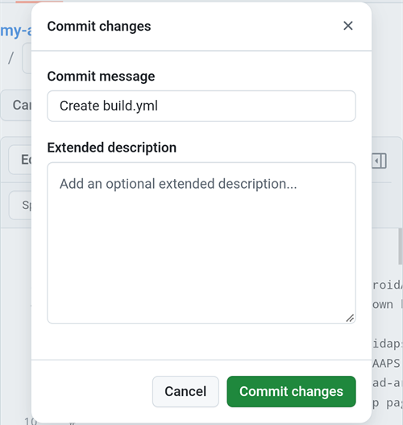
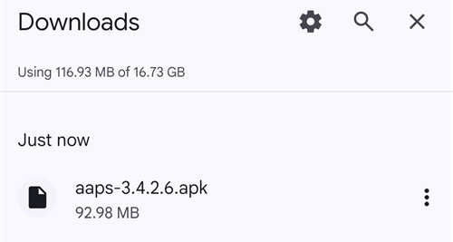

(aaps-builder)=

# Δημιουργία μέσω browser με το AAPS Builder

```{note}
Αυτός είναι ο προτεινόμενος τρόπος για να δημιουργήσετε το AAPS από ένα **τηλέφωνο Android**. Λειτουργεί επίσης από οποιονδήποτε browser σε υπολογιστή. Για τους άλλους τρόπους δημιουργίας από υπολογιστή ή iPhone, δείτε την επισκόπηση [Δημιουργία μέσω browser](BrowserBuild.md).
```

```{contents} In this page
:backlinks: entry
:depth: 2
```

Το **AAPS Builder** δημιουργεί την εφαρμογή AAPS για εσάς στο GitHub, τον δωρεάν ιστότοπο φιλοξενίας κώδικα. Δεν χρειάζεται να εγκαταστήσετε τίποτα στο τηλέφωνό σας και δεν υπάρχει αρχείο προετοιμασίας για να ανοίξετε.

Μια σελίδα ρύθμισης σε αυτόν τον ιστότοπο σας καθοδηγεί βήμα προς βήμα. Την πρώτη φορά χρειάζεται περίπου 10 λεπτά:

1. Δημιουργήστε ένα κενό **ιδιωτικό** αποθετήριο στον λογαριασμό σας στο GitHub: η σελίδα ρύθμισης ανοίγει το GitHub με όλα συμπληρωμένα, εσείς απλώς επιβεβαιώνετε.
2. Προσθέστε το **build workflow**, το αρχείο που λέει στο GitHub πώς να δημιουργήσει το AAPS.
3. Δημιουργήστε ή ανεβάστε το **κλειδί υπογραφής** σας (το keystore).
4. Δώστε το κλειδί στο αποθετήριό σας ως **secret** του GitHub.
5. Κάντε **build** της εφαρμογής. Ένα build διαρκεί 15 έως 30 λεπτά.
6. **Κατεβάστε και εγκαταστήστε** την εφαρμογή στο τηλέφωνό σας.

**Δεν** χρειάζεται να κάνετε fork το AndroidAPS: ο πηγαίος κώδικας του AAPS κατεβαίνει από το επίσημο αποθετήριο AndroidAPS σε κάθε build. Επίσης **δεν** χρειάζεστε το Google Drive: κατεβάζετε την εφαρμογή απευθείας από το GitHub.

```{admonition} Where the code comes from
:class: note

Η σελίδα ρύθμισης και το build workflow είναι μέρος αυτής της τεκμηρίωσης: συντηρούνται και ελέγχονται μαζί με αυτήν. Το <a href="../_static/aaps-builder/aaps-builder-build.yml">workflow</a> που προσθέτετε στο αποθετήριό σας είναι μικρό: εκτελεί τα [βήματα build](https://github.com/openaps/AndroidAPSdocs/blob/dev/.github/workflows/aaps-builder.yml) που φυλάσσονται στο αποθετήριο της τεκμηρίωσης, κλειδωμένα σε μία ελεγμένη έκδοση. Μπορείτε να διαβάσετε και τα δύο πριν τα χρησιμοποιήσετε. Κατά το build, το workflow κατεβάζει μόνο τον επίσημο πηγαίο κώδικα του AAPS και τα εργαλεία build του ίδιου του GitHub. Το keystore σας δεν φεύγει ποτέ από τον browser σας και το ιδιωτικό αποθετήριό σας.
```

(aaps-builder-before-you-start)=

## Πριν ξεκινήσετε

Θα χρειαστείτε:

- Έναν **λογαριασμό GitHub** (δωρεάν). Αν δεν έχετε, δημιουργήστε πρώτα έναν στο [github.com](https://github.com/signup).
- Έναν **browser**: το Chrome στο τηλέφωνό σας ή οποιονδήποτε browser σε υπολογιστή. Συνδεθείτε στο github.com σε αυτόν τον browser πριν ξεκινήσετε.
- **Έχετε την εφαρμογή GitHub στο τηλέφωνό σας;** Μπορείτε να την κρατήσετε. Τότε κάποια κουμπιά της σελίδας ρύθμισης ανοίγουν την εφαρμογή αντί για το Chrome. Το build λειτουργεί στην εφαρμογή, αλλά η εφαρμογή **δεν μπορεί να κατεβάσει** το έτοιμο AAPS: το [βήμα 6](#aaps-builder-step6) δείχνει πώς να περάσετε στο Chrome για τη λήψη.
- Το **υπάρχον keystore** σας (αρχείο `.jks`), τον κωδικό του και το alias του, αν έχετε δημιουργήσει το AAPS στο παρελθόν και θέλετε να το ενημερώσετε χωρίς επανεγκατάσταση.

```{warning}
**Το αποθετήριο build σας πρέπει να μείνει ιδιωτικό.** Ό,τι παράγει ένα build το βλέπει όποιος μπορεί να δει το αποθετήριο. Η σελίδα ρύθμισης δημιουργεί για εσάς ένα ιδιωτικό αποθετήριο. Μην το αλλάξετε ποτέ σε δημόσιο.

Ένα ιδιωτικό αποθετήριο έχει 2000 δωρεάν λεπτά GitHub Actions τον μήνα, που αρκούν για αρκετά builds.
```

```{warning}
**Νέο κλειδί ή υπάρχον κλειδί: αυτό αποφασίζει αν μπορείτε να ενημερώσετε το AAPS.**

- **Έχετε ήδη το AAPS στο τηλέφωνό σας, δημιουργημένο με ένα keystore που ακόμα έχετε**: επιλέξτε **I already have a keystore** (έχω ήδη keystore) στη σελίδα ρύθμισης και ανεβάστε το. Το επόμενο build σας θα ενημερώσει το υπάρχον AAPS. Δημιουργήσατε το AAPS με την προηγούμενη μέθοδο μέσω browser (το δικό σας fork); Το keystore σας βρίσκεται στο fork σας: [πάρτε πρώτα ένα αντίγραφό του](#aaps-builder-from-fork).
- **Δημιουργείτε το AAPS για πρώτη φορά ή χάσατε το keystore ή τον κωδικό του**: επιλέξτε **Create a new key** (δημιουργία νέου κλειδιού). Μια εφαρμογή υπογεγραμμένη με νέο κλειδί **δεν μπορεί να ενημερώσει** ένα AAPS υπογεγραμμένο με άλλο κλειδί. Πρέπει να εξαγάγετε τις ρυθμίσεις σας, να αντιγράψετε το αρχείο έξω από το τηλέφωνό σας, να απεγκαταστήσετε το παλιό AAPS, να εγκαταστήσετε το νέο και μετά να εισαγάγετε τις ρυθμίσεις σας: δείτε [Επανεγκατάσταση του AAPS με νέο keystore](#reinstall-aaps).

Μετά, χρησιμοποιείτε πάντα το ίδιο κλειδί. Όταν δημιουργείτε νέο κλειδί, κατεβάστε το αντίγραφο ασφαλείας που προσφέρει η σελίδα και φυλάξτε το μαζί με τον κωδικό του και το alias του (`key0`) σε ασφαλές μέρος, έξω από το τηλέφωνό σας.
```

(aaps-builder-from-fork)=

## Αν έρχεστε από την προηγούμενη μέθοδο μέσω browser (fork)

Παραλείψτε αυτή την ενότητα αν δεν έχετε δημιουργήσει ποτέ το AAPS με την προηγούμενη μέθοδο μέσω browser (το δικό σας αντίγραφο, ή fork, του AndroidAPS στο GitHub, με το αρχείο προετοιμασίας και το Google Drive).

Το keystore σας είναι αποθηκευμένο ως secrets στο fork σας. Το GitHub δεν δείχνει ποτέ ξανά ένα secret, οπότε δεν μπορείτε να το αντιγράψετε στο νέο σας αποθετήριο. Πάρτε πρώτα ένα αντίγραφο του keystore σας και μετά χρησιμοποιήστε το στο [βήμα 3](#aaps-builder-step3) με το **I already have a keystore**.

```{warning}
Μην επιλέξετε **Create a new key**. Ένα AAPS δημιουργημένο με νέο κλειδί δεν μπορεί να ενημερώσει το AAPS στο τηλέφωνό σας.
```

Ποια είναι η δική σας περίπτωση;

- **Χρησιμοποιήσατε την Επιλογή 2** (ανεβάσατε το δικό σας keystore από το Android Studio) και έχετε ακόμα το αρχείο `.jks`, τους κωδικούς του και το alias του: δεν χρειάζεται να κάνετε τίποτα εδώ. Χρησιμοποιήστε αυτό το αρχείο στο βήμα 3.
- **Χρησιμοποιήσατε την Επιλογή 1** (το αρχείο προετοιμασίας δημιούργησε το κλειδί σας) ή δεν έχετε πια το αρχείο του keystore: εξαγάγετέ το από το fork σας όπως παρακάτω.

Για να εξαγάγετε το keystore σας από το fork σας:

1. Στο fork σας, ανοίξτε **Settings** → **Secrets and variables** → **Actions** και προσθέστε ένα secret με όνομα `ZIP_PASSWORD`. Επιλέξτε έναν κωδικό μόνο με αγγλικά γράμματα και αριθμούς. Προστατεύει το αρχείο που θα δημιουργήσετε.
2. Ανοίξτε την καρτέλα **Actions** του fork σας, πατήστε **CI Keystore Export** και μετά **Run workflow**. Περισσότερες λεπτομέρειες: [Εξαγωγή του keystore σας](#ci-keystore-export).
3. Όταν η εκτέλεση έχει πράσινο τικ, ανοίξτε το Google Drive σας: το αρχείο `keystore.zip` βρίσκεται στον φάκελο **AAPS** → **KeyStore**. Αν η εκτέλεση αποτύχει στο βήμα του Google Drive, η πρόσβαση του fork σας στο Google Drive έχει λήξει: δείτε [Το Google Refresh Token έληξε](#aaps-ci-google-token-expired).
4. Κατεβάστε το `keystore.zip` και ανοίξτε το με το `ZIP_PASSWORD` σας: σε υπολογιστή ή στο τηλέφωνό σας με μια εφαρμογή διαχείρισης αρχείων που ανοίγει αρχεία ZIP με κωδικό. Περιέχει:
   - `keystore.jks`: το keystore σας,
   - `keyStoreInfo.txt`: τα `KEYSTORE_PASSWORD`, `KEY_PASSWORD` και `ALIAS` σας (συνήθως `key0`).
5. Αντιγράψτε το `keystore.jks` στο τηλέφωνό σας (ή στο Google Drive, για να το επιλέξετε από εκεί).

Στο [βήμα 3](#aaps-builder-step3) της σελίδας ρύθμισης:

1. Πατήστε **I already have a keystore**.
2. Στο **Keystore file**, επιλέξτε `keystore.jks`.
3. Στο **Keystore password**, πληκτρολογήστε το `KEYSTORE_PASSWORD` από το `keyStoreInfo.txt`.
4. Στο **Key alias**, επιλέξτε ή πληκτρολογήστε το `ALIAS` από το `keyStoreInfo.txt`.
5. Αν το `KEY_PASSWORD` είναι διαφορετικό από το `KEYSTORE_PASSWORD`, αποεπιλέξτε το **Key password is the same as the keystore password** και πληκτρολογήστε το `KEY_PASSWORD`.

Φυλάξτε το `keystore.zip` και το `ZIP_PASSWORD` του σε ασφαλές μέρος, έξω από το τηλέφωνό σας: είναι το αντίγραφο ασφαλείας του κλειδιού σας.

Ούτε η πρόσβαση του fork σας στο Google Drive μπορεί να αντιγραφεί. Για να αποθηκεύονται και τα builds του AAPS Builder στο Google Drive, κάντε το [βήμα 7](#aaps-builder-google-drive). Μπορείτε να κρατήσετε το fork σας μέχρι να εγκατασταθεί στο τηλέφωνό σας το AAPS που δημιουργήθηκε με το AAPS Builder.

## Ανοίξτε τη σελίδα ρύθμισης

**→ [Ανοίξτε τη σελίδα ρύθμισης του AAPS Builder](#aaps-builder-setup)**

Κρατήστε αυτή τη σελίδα της τεκμηρίωσης ανοιχτή: πατήστε παρατεταμένα τον παραπάνω σύνδεσμο και επιλέξτε **Open in new tab** (Άνοιγμα σε νέα καρτέλα). Τα παρακάτω βήματα εξηγούν πιο αναλυτικά κάθε μέρος της σελίδας ρύθμισης.

Η σελίδα ρύθμισης ανοίγει κάθε σελίδα του GitHub σε νέα καρτέλα του Chrome. Για να επιστρέψετε στη σελίδα ρύθμισης, πατήστε το κουμπί καρτελών δίπλα στη γραμμή διευθύνσεων του Chrome (το τετράγωνο με έναν αριθμό) και επιλέξτε τη σελίδα ρύθμισης του AAPS Builder.

Η σελίδα ρύθμισης λειτουργεί εξ ολοκλήρου στον browser σας: το κλειδί και οι κωδικοί σας δεν στέλνονται πουθενά, εκτός από το secret του GitHub στο οποίο τα επικολλάτε εσείς. Μόνο το όνομα χρήστη σας στο GitHub στέλνεται στο GitHub, για να ελεγχθεί ότι υπάρχει. Θυμάται το όνομα χρήστη σας στο GitHub και το όνομα του αποθετηρίου, ώστε να μπορείτε να επιστρέψετε οποιαδήποτε στιγμή για να ανοίξετε ξανά τη σελίδα των secrets ή τα builds σας.


(aaps-builder-step1)=

## Βήμα 1 – Δημιουργήστε το ιδιωτικό αποθετήριο build

Αυτό το βήμα δημιουργεί ένα κενό ιδιωτικό αποθετήριο στον λογαριασμό σας στο GitHub. Μόνο εσείς μπορείτε να δείτε το αποθετήριο και τις εφαρμογές που δημιουργεί.

1. Βεβαιωθείτε ότι είστε συνδεδεμένοι στο github.com σε αυτόν τον browser.

2. Στο **Your GitHub username** (το όνομα χρήστη σας στο GitHub), πληκτρολογήστε το όνομα χρήστη σας στο GitHub, όχι το e-mail σας. Η σελίδα το ελέγχει με το GitHub: το **✓ GitHub user found** (βρέθηκε ο χρήστης GitHub) σημαίνει ότι είναι σωστό.

3. Στο **Name of your repository** (όνομα του αποθετηρίου σας), αφήστε την πρόταση `my-aaps`. Αν έχετε ήδη δημιουργήσει το αποθετήριό σας με άλλο όνομα, πληκτρολογήστε ακριβώς αυτό το όνομα.

   ```{tip}
   **Έχετε ήδη δημιουργήσει μόνοι σας ένα κενό ιδιωτικό αποθετήριο;** Πληκτρολογήστε εδώ ακριβώς το όνομά του, μην πατήσετε **Create my private repository** και πηγαίνετε στο [βήμα 2](#aaps-builder-step2).
   ```

4. Ελέγξτε τη γραμμή **Your repository:** (το αποθετήριό σας): δείχνει `github.com/<your username>/my-aaps`.

5. Πατήστε **Create my private repository** (δημιουργία του ιδιωτικού μου αποθετηρίου).

   

6. Το GitHub ανοίγει σε νέα καρτέλα με τον λογαριασμό σας ως **Owner** (κάτοχος) και το όνομα που επιλέξατε.

   

   Κάντε κύλιση προς τα κάτω: τα **Private**, **No template** και **Add README: Off** είναι ήδη επιλεγμένα. Μην αλλάξετε τίποτα και μην προσθέσετε README ή άλλα αρχεία.

7. Κάντε κύλιση προς τα κάτω και πατήστε το πράσινο κουμπί **Create repository**.

   

   Το GitHub δείχνει το νέο, κενό αποθετήριό σας. **Επιστρέψτε στην καρτέλα της σελίδας ρύθμισης** για το βήμα 2: πατήστε το κουμπί καρτελών δίπλα στη γραμμή διευθύνσεων του Chrome και επιλέξτε τη σελίδα ρύθμισης.

(aaps-builder-step2)=

## Βήμα 2 – Προσθέστε το build workflow

Το build workflow είναι ένα μικρό αρχείο κειμένου που λέει στο GitHub πώς να δημιουργήσει το AAPS. Η σελίδα ρύθμισης το προσθέτει στο αποθετήριό σας μία φορά: εσείς απλώς το επιβεβαιώνετε.

1. Ελέγξτε ότι η σελίδα δείχνει **Workflow version … is ready** (η έκδοση του workflow είναι έτοιμη) και μετά πατήστε **Add the workflow to my repository** (προσθήκη του workflow στο αποθετήριό μου).

   

2. Το GitHub ανοίγει ένα νέο αρχείο στο αποθετήριό σας, που έχει ήδη το όνομα `.github/workflows/build.yml` και είναι ήδη συμπληρωμένο. Ελέγξτε το όνομα του αρχείου στο πάνω μέρος: πρέπει να είναι ακριβώς `.github/workflows/build.yml`. Μην αλλάξετε το κείμενο.

3. Πατήστε **Commit changes…**

   

4. και μετά ξανά **Commit changes** στο παράθυρο που ανοίγει.

   

   Το GitHub δείχνει το νέο αρχείο `build.yml` στον φάκελο `.github/workflows` του αποθετηρίου σας.

   

```{warning}
Μην πατήσετε το κουμπί **Back** (Πίσω) του τηλεφώνου σας και μην τραβήξετε τη σελίδα προς τα κάτω ενώ είναι ανοιχτός ο επεξεργαστής αρχείου: το GitHub φορτώνει ξανά τη σελίδα και το κείμενο χάνεται. Αν συμβεί αυτό, πατήστε **Restore** (επαναφορά) στη μπλε λωρίδα ή επιστρέψτε στη σελίδα ρύθμισης και πατήστε ξανά το κουμπί.
```

Αν το πλαίσιο κειμένου είναι κενό, πατήστε **Updating the workflow, or the text area is empty?** στο κάτω μέρος του βήματος 2 στη σελίδα ρύθμισης: πατήστε **Copy workflow** και επικολλήστε το στο πλαίσιο κειμένου (σε τηλέφωνο, με παρατεταμένο πάτημα).

```{warning}
Χρησιμοποιείτε μόνο το workflow από αυτή τη σελίδα ρύθμισης. Μην αντιγράψετε build workflow από άλλον ιστότοπο ή αποθετήριο: το workflow εκτελείται δίπλα στο κλειδί υπογραφής σας.
```

(aaps-builder-step3)=

## Βήμα 3 – Το κλειδί υπογραφής σας

Η εφαρμογή πρέπει να υπογραφεί με το δικό σας κλειδί. Επιλέξτε μία από τις δύο καρτέλες. Διαβάστε πρώτα την [προειδοποίηση για νέο ή υπάρχον κλειδί](#aaps-builder-before-you-start).


### I already have a keystore (έχω ήδη keystore)

1. Πατήστε **I already have a keystore**.
2. Στο **Keystore file** (αρχείο keystore), επιλέξτε το αρχείο `.jks` σας (ή `.keystore`, `.p12`, `.pfx`). Σε τηλέφωνο, αντιγράψτε πρώτα το αρχείο στο τηλέφωνό σας ή στο Google Drive.
3. Στο **Keystore password** (κωδικός keystore), πληκτρολογήστε τον κωδικό του keystore.
4. Στο **Key alias** (alias κλειδιού), επιλέξτε το alias σας από τη λίστα ή πληκτρολογήστε το αν δεν υπάρχει λίστα. Για keystore που δημιουργήθηκαν με το Android Studio είναι συνήθως `key0`.
5. Αν ο κωδικός του κλειδιού σας είναι διαφορετικός από τον κωδικό του keystore, αποεπιλέξτε το **Key password is the same as the keystore password** (ο κωδικός κλειδιού είναι ίδιος με τον κωδικό keystore) και πληκτρολογήστε τον κωδικό του κλειδιού.
6. Πατήστε **Check and continue** (έλεγχος και συνέχεια).

Η σελίδα ελέγχει τον κωδικό και το alias στη συσκευή σας. **Keystore OK! Continue with step 4.** σημαίνει ότι όλα είναι σωστά. Αν λέει ότι ο κωδικός θα ελεγχθεί κατά το build, συνεχίστε κανονικά: το build θα σας πει αν κάτι είναι λάθος.

### Create a new key (δημιουργία νέου κλειδιού)

1. Πατήστε **Create a new key**.

2. Επιλέξτε έναν κωδικό και πληκτρολογήστε τον δύο φορές. Κανόνες: τουλάχιστον 8 χαρακτήρες, μόνο τα γράμματα a–z και A–Z, τα ψηφία 0–9 και σύμβολα όπως `! ? #`. Χωρίς κενά, χωρίς γράμματα με τόνους και χωρίς τον χαρακτήρα `|`.

3. Πατήστε **Create key** (δημιουργία κλειδιού). Χρειάζονται λίγα δευτερόλεπτα μέχρι να εμφανιστεί το **Key created** (το κλειδί δημιουργήθηκε).

   

4. Πατήστε **Download backup (aaps-keystore.jks)** (λήψη αντιγράφου ασφαλείας). Αν το Chrome ρωτήσει **Download file again?** (Λήψη του αρχείου ξανά;), ένα παλαιότερο αντίγραφο ασφαλείας με το ίδιο όνομα υπάρχει ήδη στο τηλέφωνό σας: πατήστε **Download again** (Λήψη ξανά). Τότε το Chrome αποθηκεύει το νέο κλειδί ως `aaps-keystore (1).jks`: αυτό είναι το αρχείο που ανήκει σε αυτό το κλειδί· κρατήστε το και μην το μπερδέψετε με το παλαιότερο.

   Κρατήστε αυτά τα τρία μαζί, σε ασφαλές μέρος έξω από το τηλέφωνό σας (για παράδειγμα στον δικό σας χώρο αποθήκευσης στο cloud):

   - το αρχείο `aaps-keystore.jks`,
   - τον κωδικό σας,
   - το alias του κλειδιού: **`key0`**.

   Τα χρειάζεστε και τα τρία αν κάποτε δημιουργήσετε το AAPS με άλλον τρόπο, για παράδειγμα με το Android Studio. Τα κλειδιά που δημιουργήθηκαν με παλαιότερη έκδοση της σελίδας ρύθμισης έχουν το alias `aaps`.

   

(aaps-builder-step4)=

## Βήμα 4 – Δώστε το κλειδί στο αποθετήριό σας

Το βήμα 4 ξεκλειδώνει όταν ολοκληρωθεί το βήμα 3. Το κλειδί σας, οι κωδικοί του και το alias του συσκευάζονται σε μία τιμή, το secret `KEYSTORE_SET`.

1. Πατήστε **Open the secrets page** (άνοιγμα της σελίδας secrets).


2. Το GitHub ανοίγει τη σελίδα **New secret** του αποθετηρίου σας. Σε τηλέφωνο, βρίσκεται κάτω από το μενού ρυθμίσεων: κάντε κύλιση προς τα κάτω.


3. Πηγαίνετε στην καρτέλα της σελίδας ρύθμισης και πατήστε **Copy name** (αντιγραφή ονόματος). Γυρίστε στην καρτέλα του GitHub και επικολλήστε το στο μικρό πεδίο **Name**. Το όνομα είναι `KEYSTORE_SET`.

4. Πηγαίνετε στην καρτέλα της σελίδας ρύθμισης και πατήστε **Copy secret** (αντιγραφή secret). Γυρίστε στην καρτέλα του GitHub και επικολλήστε το στο μεγάλο πλαίσιο **Secret** (σε τηλέφωνο, με παρατεταμένο πάτημα). Το secret είναι ένας πολύ μεγάλος κωδικός, χιλιάδες χαρακτήρες: η σελίδα ρύθμισης δείχνει τους πρώτους χαρακτήρες του δίπλα στο κουμπί. Μην επικολλήσετε εκεί τη λέξη `KEYSTORE_SET`.

5. Πατήστε **Add secret**. Το `KEYSTORE_SET` εμφανίζεται τώρα στο **Repository secrets**.


Αυτό το κάνετε μόνο μία φορά.

```{tip}
Το GitHub δείχνει **Page not found** (404); Ελέγξτε πρώτα ότι είστε συνδεδεμένοι στο github.com σε αυτόν τον browser: το GitHub δείχνει 404 για ιδιωτικά αποθετήρια όταν δεν είστε συνδεδεμένοι. Αλλιώς, το όνομα χρήστη ή το όνομα του αποθετηρίου στο βήμα 1 δεν ταιριάζει με το αποθετήριό σας. Ελέγξτε το όνομα στο github.com, διορθώστε το στο βήμα 1 και πατήστε ξανά το κουμπί.
```

(aaps-builder-step5)=

## Βήμα 5 – Δημιουργήστε την εφαρμογή

1. Στη σελίδα ρύθμισης, πατήστε **Open the build page** (άνοιγμα της σελίδας build). Το GitHub ανοίγει τη σελίδα **Build AAPS** του αποθετηρίου σας.

   

   Αν ανοίξει η **εφαρμογή GitHub**: πατήστε **RUN WORKFLOW**, ελέγξτε την έκδοση και την παραλλαγή και πατήστε ξανά **RUN WORKFLOW**. Η εφαρμογή μπορεί να δείχνει ακόμα **Nothing to see here**: τραβήξτε τη λίστα προς τα κάτω για να ανανεωθεί και να δείτε το build σας. Μετά συνεχίστε με το βήμα 4 παρακάτω.

2. Αν το GitHub το ζητήσει, πατήστε το πράσινο κουμπί για να ενεργοποιήσετε τα workflows.
3. Πατήστε **Run workflow**. Ανοίγει μια μικρή φόρμα:
   - **Version** (έκδοση): αφήστε το `latest` για να δημιουργήσετε την πιο νέα έκδοση του AAPS ή πληκτρολογήστε έναν αριθμό έκδοσης, για παράδειγμα `3.3.2.1`.
   - **Variant** (παραλλαγή): αφήστε το `fullRelease` για κανονική χρήση με αντλία. Οι άλλες παραλλαγές εξηγούνται στις [παραλλαγές του build](#browserbuild-variant). Το `aapsclient3Release` δημιουργεί το **AAPSClient3**, που υπάρχει από την έκδοση 4.0 του **AAPS** (δείτε [Σχετικά με τα AAPSClient, AAPSClient2 και AAPSClient3](#remotecontrol-aapsclient-versions)).
   - Πατήστε το πράσινο κουμπί **Run workflow**.

   

4. Το build ξεκινά και δείχνει **In progress** (σε εξέλιξη), με δύο μέρη: πρώτα **AAPS / Check** και μετά **AAPS / Build AAPS**.

   

5. Περιμένετε 15 έως 30 λεπτά. Ένα πράσινο τικ σημαίνει ότι το build ολοκληρώθηκε. Ένας κόκκινος σταυρός σημαίνει ότι απέτυχε: ανοίξτε το build για να διαβάσετε το μήνυμα και μετά δείτε την [αντιμετώπιση προβλημάτων](#aaps-builder-troubleshooting).

   

   ```{tip}
   **E-mail όταν τελειώνει ένα build:** το GitHub σας στέλνει e-mail μόνο όταν ένα build αποτύχει. Για να παίρνετε e-mail και όταν πετυχαίνει: στο github.com, ανοίξτε την εικόνα του προφίλ σας → **Settings** → **Notifications** → **System** → **Actions** και αποεπιλέξτε το **Only notify for failed workflows**.
   ```

Αν δεν υπάρχει κουμπί **Build AAPS** ή **Run workflow**:

- Ανοίξτε το αποθετήριό σας και ελέγξτε ότι το αρχείο `.github/workflows/build.yml` υπάρχει. Αν λείπει ή έχει άλλο όνομα, κάντε ξανά το [βήμα 2](#aaps-builder-step2).
- Ανοίξτε την καρτέλα **Actions**. Αν λέει ότι τα workflows είναι απενεργοποιημένα, πατήστε το πράσινο κουμπί για να τα ενεργοποιήσετε και μετά πατήστε **Build AAPS** στη λίστα.

(aaps-builder-step6)=

## Βήμα 6 – Εγκαταστήστε την εφαρμογή στο τηλέφωνό σας

```{warning}
**Πριν από κάθε ενημέρωση**, [εξαγάγετε τις ρυθμίσεις σας](#ExportImportSettings-Automating-Settings-Export) στο AAPS και αντιγράψτε το αρχείο **έξω από το τηλέφωνο** (Google Drive, Dropbox…). Κρατήστε εκεί και αρκετές παλαιότερες εξαγωγές και τα αρχεία APK, ώστε να μπορείτε πάντα να επιστρέψετε σε προηγούμενη έκδοση.
```

1. Στο τηλέφωνό σας, ανοίξτε τη σελίδα ρύθμισης στο **Chrome**. Συνδεθείτε στο github.com αν σας ζητηθεί.
2. Πατήστε **Open my builds** (άνοιγμα των builds μου) και μετά το πιο νέο build με πράσινο τικ.

   ```{admonition} The GitHub app opened instead of Chrome?
   :class: note

   Η εφαρμογή GitHub δεν μπορεί να κατεβάσει builds. Στην εφαρμογή, ανοίξτε το πιο νέο build και μετά πατήστε **Artifacts ↗** ή πατήστε το εικονίδιο κοινοποίησης στο πάνω μέρος και επιλέξτε **Chrome** (ή **Copy link** και μετά επικολλήστε τον σύνδεσμο στη γραμμή διευθύνσεων του Chrome). Το build ανοίγει στο Chrome: συνεχίστε εκεί με το επόμενο βήμα.

   Για να μην ανοίγουν οι σύνδεσμοι του GitHub στην εφαρμογή: στο Android **Ρυθμίσεις** → **Εφαρμογές** → **GitHub** → **Άνοιγμα από προεπιλογή** → απενεργοποιήστε το **Άνοιγμα υποστηριζόμενων συνδέσμων**.
   ```

   

3. Κάντε κύλιση προς τα κάτω στη σύνοψη του build και πατήστε τον σύνδεσμο **Download AAPS**.

   

   ```{tip}
   Κάντε κύλιση με το δάχτυλο πάνω στο κείμενο, όχι πάνω στο διάγραμμα με τα βήματα του build: αλλιώς μετακινείται το διάγραμμα αντί για τη σελίδα.
   ```

   Μπορείτε επίσης να κάνετε κύλιση πιο κάτω στο **Artifacts** και να πατήσετε το εικονίδιο λήψης δίπλα στο `aaps-….apk`.

   

4. Όταν τελειώσει η λήψη, ανοίξτε το μενού του Chrome **⋮** → **Downloads** (Λήψεις), πατήστε `aaps-….apk` και επιλέξτε **Install** (Εγκατάσταση). Αν σας ζητηθεί, επιτρέψτε την εγκατάσταση εφαρμογών από αυτή την πηγή.

   

Το `aaps-wear-….apk` είναι η εφαρμογή για το έξυπνο ρολόι. Παραλείψτε το αν δεν χρησιμοποιείτε ρολόι.

Η εφαρμογή μένει στη σελίδα του build για **14 ημέρες**. Δεν εμφανίζεται στο **Code** του αποθετηρίου σας. Αντιγράψτε την σε ασφαλές μέρος, έξω από το τηλέφωνό σας, μαζί με τις εξαγωγές των ρυθμίσεών σας.

Για περισσότερους τρόπους εγκατάστασης της εφαρμογής, δείτε [Μεταφορά και εγκατάσταση του AAPS στο τηλέφωνό σας](TransferringAndInstallingAaps.md).

```{note}
Από τον Σεπτέμβριο του 2026, η [επαλήθευση προγραμματιστών Android](#android-developer-verification) της Google μπορεί να εμποδίζει την εγκατάσταση του APK με πάτημα στο αρχείο, ανάλογα με τη χώρα σας. Δωρεάν λύσεις εξηγούνται σε εκείνη τη σελίδα.
```

(aaps-builder-google-drive)=

## Βήμα 7 (προαιρετικό) – Αποθηκεύστε την εφαρμογή και στο Google Drive

Μπορείτε επίσης να αποθηκεύεται κάθε build στο Google Drive σας, στον φάκελο `AAPS/<version>`. Αυτό είναι προαιρετικό: η εφαρμογή είναι πάντα διαθέσιμη στη σελίδα του build.

Χρειάζεται ένα ακόμα secret, το `GDRIVE_OAUTH2`. Την τιμή του την παίρνετε με το αρχείο προετοιμασίας που χρησιμοποιούν οι άλλες μέθοδοι δημιουργίας μέσω browser:

1. Σε **υπολογιστή**, κατεβάστε το αρχείο προετοιμασίας και ανοίξτε το όπως περιγράφεται στην [Επιλογή 1 – Υπολογιστής](BrowserBuildO1Computer.md). Παραλείψτε το μέρος του keystore: έχετε ήδη το κλειδί σας.
2. Ακολουθήστε το [Βήμα 3 – Εξουσιοδότηση του Google Drive](#aaps-ci-google-drive-auth) για να πάρετε την τιμή `GDRIVE_OAUTH2`.
3. Στη σελίδα ρύθμισης, το βήμα 7 ανοίγει τη σελίδα των secrets σας.

   

   Πατήστε **Copy name** και μετά επικολλήστε το στο μικρό πεδίο **Name** (το όνομα είναι `GDRIVE_OAUTH2`). Επικολλήστε την τιμή `GDRIVE_OAUTH2` σας στο μεγάλο πλαίσιο **Secret** και πατήστε **Add secret**.

Από το επόμενο build, τα APK αποθηκεύονται και στο Google Drive.

Η Google σταματά την πρόσβαση αν δεν κάνετε build για 6 μήνες ή αν αλλάξετε τον κωδικό σας στη Google. Τότε το build θα σας το πει: κάντε ξανά αυτά τα βήματα. Δείτε [Το Google Refresh Token έληξε](#aaps-ci-google-token-expired).

(aaps-builder-updates)=

## Ενημέρωση AAPS

Το αποθετήριό σας δεν κάνει ποτέ build μόνο του: εσείς αποφασίζετε πότε θα γίνει build, ποια έκδοση και ποια παραλλαγή. Όταν βγει μια νέα έκδοση του AAPS:

1. [Κάντε αντίγραφο ασφαλείας των ρυθμίσεών σας](#aaps-builder-step6) όπως εξηγείται στο βήμα 6.
2. Δημιουργήστε τη νέα έκδοση όπως στο [βήμα 5](#aaps-builder-step5). Αφήστε το `latest` ή πληκτρολογήστε τον αριθμό της έκδοσης.
3. Κατεβάστε την και εγκαταστήστε την όπως στο [βήμα 6](#aaps-builder-step6).

**Ενημερώσεις του build workflow:** το αποθετήριό σας δεν κατεβάζει ποτέ μόνο του νέο workflow, και τα βήματα build που εκτελεί είναι κλειδωμένα σε μία ελεγμένη έκδοση. Όταν αλλάζει το workflow, η σελίδα [Ενημερώσεις και αλλαγές της τεκμηρίωσης](../Maintenance/DocumentationUpdate.md) το αναφέρει. Για ενημέρωση, ανοίξτε το βήμα 2 της σελίδας ρύθμισης και μετά πατήστε **Updating the workflow, or the text area is empty?**:

1. Πατήστε **Copy workflow** (αντιγραφή workflow) και μετά **Open my workflow file** (άνοιγμα του αρχείου workflow μου).
2. Αντικαταστήστε όλο το κείμενο με το workflow που αντιγράψατε (σε τηλέφωνο, παρατεταμένο πάτημα: **Select all** (Επιλογή όλων) και μετά **Paste** (Επικόλληση)).
3. Πατήστε **Commit changes…** και μετά **Commit changes**.

Η πρώτη γραμμή του αρχείου δείχνει την έκδοσή του.

(aaps-builder-troubleshooting)=

## Αντιμετώπιση προβλημάτων

Για να δείτε γιατί απέτυχε ένα build, [διαβάστε το log του build](#aaps-ci-read-the-logs): τα ονόματα των βημάτων είναι διαφορετικά, αλλά βρίσκετε το σφάλμα με τον ίδιο τρόπο. Με τον ίδιο τρόπο μπορείτε επίσης να [ενημερώσετε ένα secret](#aaps-ci-update-secret) και να [τρέξετε ξανά το build](#aaps-ci-rerun).

- **Το build σταματά με το μήνυμα "This repository is PUBLIC"**: στο αποθετήριό σας, ανοίξτε **Settings** → **General** → **Danger Zone** → **Change visibility** → **Private** και μετά κάντε ξανά build.
- **"Secret KEYSTORE_SET is missing"**: κάντε το βήμα 4 της σελίδας ρύθμισης.
- **"The secret is too short"**, **"The secret is not a valid code"** ή **"The secret does not contain a keystore"**: επικολλήθηκε λάθος κείμενο στο secret, συχνά η ίδια η λέξη `KEYSTORE_SET` ή μόνο ένα μέρος του κωδικού. Στο αποθετήριό σας, ανοίξτε **Settings** → **Secrets and variables** → **Actions**, επεξεργαστείτε το `KEYSTORE_SET` και επικολλήστε ξανά τον μεγάλο κωδικό από το **Copy secret** (αν κλείσατε τη σελίδα ρύθμισης, κάντε πρώτα ξανά το βήμα 3).
- **"Keystore, password or alias is wrong"**: ελέγξτε τον κωδικό και το alias του keystore σας και μετά κάντε ξανά τα βήματα 3 και 4 της σελίδας ρύθμισης.
- **"Version … does not exist"**: η έκδοση που πληκτρολογήσατε δεν είναι έκδοση του AAPS. Χρησιμοποιήστε `latest` ή ελέγξτε τον αριθμό της έκδοσης.
- **"Page not found" (404) όταν η σελίδα ρύθμισης ανοίγει το GitHub**: συνδεθείτε στο github.com στον ίδιο browser (το GitHub δείχνει 404 για ιδιωτικά αποθετήρια όταν δεν είστε συνδεδεμένοι). Αν είστε συνδεδεμένοι, το όνομα χρήστη ή το όνομα του αποθετηρίου στο βήμα 1 της σελίδας ρύθμισης δεν ταιριάζει με το αποθετήριό σας. Πληκτρολογήστε ακριβώς τα ονόματα.
- **"No GitHub user with this name"** στο βήμα 1: πληκτρολογήστε το όνομα χρήστη σας στο GitHub, όπως φαίνεται στο προφίλ σας στο GitHub, όχι το e-mail σας.
- **Δεν υπάρχει σύνδεσμος Download ή άνοιξε η εφαρμογή GitHub**: η εφαρμογή GitHub δεν μπορεί να κατεβάσει builds. Ανοίξτε το build στο Chrome όπως εξηγείται στο [βήμα 6](#aaps-builder-step6). Για να μην ανοίγουν οι σύνδεσμοι του GitHub στην εφαρμογή: στο Android **Ρυθμίσεις** → **Εφαρμογές** → **GitHub** → **Άνοιγμα από προεπιλογή** → απενεργοποιήστε το **Άνοιγμα υποστηριζόμενων συνδέσμων**.
- **"Could not read the workflow file"** στη σελίδα ρύθμισης: φορτώστε ξανά τη σελίδα και πατήστε ξανά το κουμπί. Η σελίδα ρύθμισης πρέπει να ανοίγει από αυτόν τον ιστότοπο τεκμηρίωσης.
- **Το GitHub λέει ότι το αρχείο υπάρχει ήδη** όταν κάνετε commit το workflow: το αποθετήριό σας έχει ήδη workflow. Ενημερώστε το αντί γι' αυτό, όπως εξηγείται στην [Ενημέρωση AAPS](#aaps-builder-updates).
- **"Google Drive access has expired or was revoked"**: κάντε ξανά το [βήμα 7](#aaps-builder-google-drive) και ενημερώστε το secret `GDRIVE_OAUTH2`.

Για άλλα προβλήματα με το GitHub και το Google Drive, δείτε [Δημιουργία μέσω browser: αντιμετώπιση προβλημάτων](../GettingHelp/BrowserBuildTroubleshooting.md).

```{toctree}
:hidden:

Σελίδα ρύθμισης του AAPS Builder <BrowserBuildAapsBuilderSetup.md>
```
