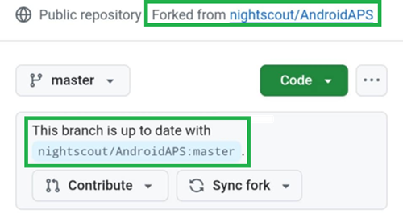

(github-fork)=

# Δημιουργία μέσω browser – Βήμα 1: Δημιουργία του fork σας στο GitHub

```{note}
Αυτό είναι το **Βήμα 1** της [Δημιουργίας μέσω browser](BrowserBuild.md).
```

Θα χρειαστεί να αποθηκεύσετε με ασφάλεια (ως secret) στο GitHub το προσωπικό σας κλειδί Android Java και τα στοιχεία του Google Drive σας (θα εξηγήσουμε πώς αργότερα).

Αυτό δεν γίνεται μέσα στο δημόσιο αποθετήριο του AndroidAPS, γι' αυτό πρέπει να φτιάξετε το δικό σας αντίγραφο του πηγαίου κώδικα (που λέγεται fork).

## Λογαριασμός GitHub

Πρέπει να [δημιουργήσετε έναν λογαριασμό GitHub](https://github.com/signup), αν δεν έχετε ακόμα.  
Μπορείτε να εγγραφείτε με το email σας ή με το Google. Ακολουθήστε τη διαδικασία εγγραφής και επαλήθευσης.

Όταν έχετε λογαριασμό, [συνδεθείτε στο GitHub](https://github.com/login).

## Fork του AndroidAPS

Ανοίξτε το επίσημο αποθετήριο του AndroidAPS από [αυτόν τον σύνδεσμο](https://github.com/nightscout/AndroidAPS).

Πατήστε το εικονίδιο fork. Αυτό δημιουργεί ένα αντίγραφο στον δικό σας λογαριασμό.


Κάντε κύλιση προς τα κάτω στην επόμενη οθόνη και πατήστε **Create Fork** (δημιουργία fork).


*Σημείωση: μπορείτε να **αποεπιλέξετε** το "Copy the master branch only" (αντιγραφή μόνο του κλάδου master), αν θέλετε να δημιουργείτε εκδόσεις για προγραμματιστές ή δικές σας παραλλαγές.*


```{note}
Δεν μπορείτε να κάνετε fork και βλέπετε αυτό;</br></br>
**`No available destinations to fork this repository.`**</br></br>
</br></br>
Αυτό σημαίνει ότι έχετε ήδη ένα fork του AndroidAPS.</br>
Βεβαιωθείτε ότι είναι ενημερωμένο και συνεχίστε με τα βήματα προετοιμασίας.
```

```{warning}
**Μη διαγράψετε ποτέ το fork σας χωρίς να έχετε κάνει αντίγραφο ασφαλείας των secrets σας!**
```

Το GitHub δείχνει τώρα το προσωπικό σας αντίγραφο του AndroidAPS. Αφήστε ανοιχτή αυτή την καρτέλα του browser.



----

**Επόμενο: [Βήμα 2 – Δημιουργία του keystore υπογραφής σας](BrowserBuildKeystore.md) →**
