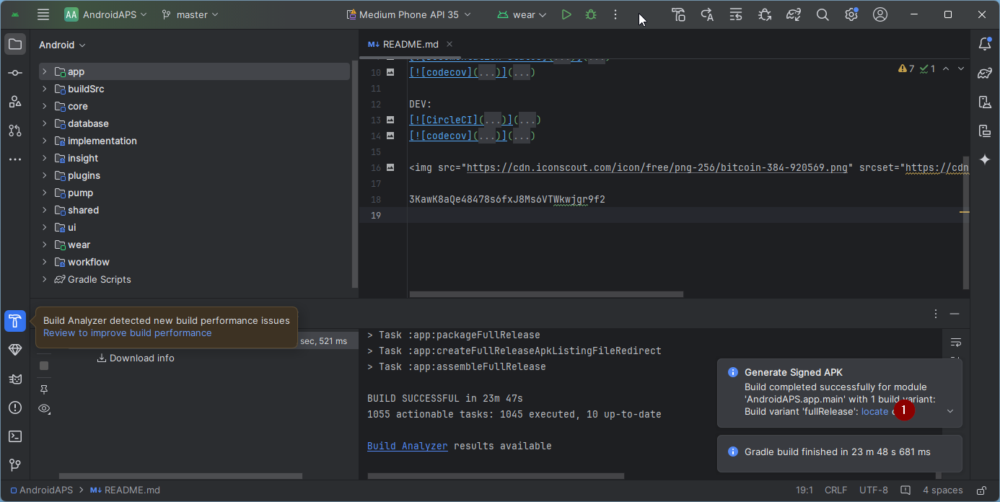

<!-- Android Studio Build, FKA Computer Build. Preserve filenames to avoid breaking URLs. -->

# Δημιουργία με το Android Studio

Αυτός είναι ο παραδοσιακός τρόπος για να δημιουργήσετε την εφαρμογή AAPS.

Μπορείτε να δημιουργήσετε την εφαρμογή χωρίς υπολογιστή με τη μέθοδο [Δημιουργία μέσω browser](./BrowserBuild.md).

## Φτιάξτε το μόνοι σας, αντί να το κατεβάσετε

**Η εφαρμογή AAPS (ένα αρχείο apk) δεν είναι διαθέσιμη για λήψη, λόγω των κανονισμών για τις ιατρικές συσκευές. Είναι νόμιμο να κάνετε build της εφαρμογής για δική σας χρήση, αλλά δεν πρέπει να δίνετε αντίγραφο σε άλλους!**

Δείτε τη σελίδα [Συχνές Ερωτήσεις](../UsefulLinks/FAQ.md) για λεπτομέρειες.

---

(Building-APK-recommended-specification-of-computer-for-building-apk-file)=
## Προδιαγραφές υπολογιστή και λογισμικού για τη δημιουργία του AAPS

* Για το build του apk μπορεί να χρειάζεται μια συγκεκριμένη έκδοση του **[Android Studio](https://developer.android.com/studio/)**. Δείτε τον πίνακα παρακάτω:

| Έκδοση AAPS             | Προτεινόμενη<br/>έκδοση<br/>Android Studio | Εναλλακτική<br/>έκδοση<br/>Android Studio | Gradle | JVM |
| ----------------------- | ------------------------------------------------------ | ----------------------------------------------------- | ------ |:--- |
| 2.6.2                   | 3.6.1                                                  |                                                       | 5.6.4  | 11  |
| 2.8.2.1                 | 4.1.1                                                  |                                                       | 6.1.1  | 13  |
| [3.1.0.3](#version3100) | 2020.3.1                                               | δοκιμάστηκε έως Quail 4                               | 7.3.3  | 17  |
| [3.2.0.4](#version3204) | Hedgehog (2023.1.1)                                    | δοκιμάστηκε έως Quail 4                               | 8.2    | 17  |
| [3.3.1.3](#version3300) | Ladybug Feature Drop (2024.2.2)                        | δοκιμάστηκε έως Quail 4                               | 8.10   | 21  |
| [3.3.2](#version3300)   | Meerkat (2024.3.1)                                     | δοκιμάστηκε έως Quail 4                               | 8.11.1 | 21  |
| [3.3.2.1](#version3321) | Narwhal (2025.1.2)                                     | δοκιμάστηκε έως Quail 4                               | 8.13   | 21  |
| [3.4.2.6](#version3426) | Panda 2 (2025.3.2)                                     | δοκιμάστηκε έως Quail 4                               | 9      | 21  |
| [4.0.0](#version400)    | Rabbit 2 (2026.2.2)                                    | Latest                                                | 9.8    | 21  |

Η «προτεινόμενη έκδοση» περιέχει ήδη την κατάλληλη έκδοση JVM. Η προτεινόμενη έκδοση είναι επίσης η ελάχιστη έκδοση που μπορείτε να χρησιμοποιήσετε για το build του **AAPS**. **ΔΕΝ** θα μπορείτε να κάνετε build με έκδοση παλαιότερη από την «προτεινόμενη». Αν χρησιμοποιείτε άλλη έκδοση, μπορεί να έχετε προβλήματα που σχετίζονται με την έκδοση του JVM. Δείτε τη σελίδα [Αντιμετώπιση προβλημάτων του Android Studio](#troubleshooting_androidstudio-uncommitted-changes) για να λύσετε αυτά τα προβλήματα. Αν η τρέχουσα έκδοση του Android Studio δεν υπάρχει στον πίνακα, πρέπει πρώτα να την ενημερώσετε.

Η έκδοση του Gradle συνδέεται με τον πηγαίο κώδικα. Θα παίρνετε πάντα τη σωστή έκδοση του Gradle όταν κατεβάζετε / ενημερώνετε τον πηγαίο κώδικα. Αναφέρεται εδώ μόνο για πληροφόρηση. Δεν χρειάζεται να κάνετε κάτι γι' αυτό.

* Τα [συστήματα Windows 32-bit](#troubleshooting_androidstudio-unable-to-start-daemon-process) δεν υποστηρίζονται από το Android Studio. Να θυμάστε ότι **και CPU 64 bit και λειτουργικό σύστημα 64 bit είναι υποχρεωτική προϋπόθεση.** Αν το σύστημά σας ΔΕΝ πληροί αυτή την προϋπόθεση, πρέπει να αλλάξετε το υλικό ή το λογισμικό που δεν την πληροί ή όλο το σύστημα.

<table class="tg">
<tbody>
  <tr>
    <th class="tg-baqh">Λειτουργικό σύστημα (μόνο 64 bit)</th>
    <td class="tg-baqh">Windows 10 or higher</td>
    <td class="tg-baqh">macOS 12 or higher</td>
    <td class="tg-baqh">Any Linux distribution that supports Gnome, KDE, or Unity DE;&nbsp;&nbsp;GNU C Library (glibc) 2.31 or later</td>
  </tr>
  <tr>
    <th class="tg-baqh"><p align="center">CPU (μόνο 64 bit)</th>
    <td class="tg-baqh">x86_64 CPU from 2017 or newer (Intel 8th generation Core i5, AMD Ryzen, or newer) with <a href="https://developer.android.com/studio/install" target="_blank" rel="noopener noreferrer">virtualization support</a> (Intel VT-x or AMD-V) enabled in the BIOS</td>
    <td class="tg-baqh">Apple Silicon (M1 or newer), or 6th generation Intel Core or newer (support for Intel Macs is being phased out)</td>
    <td class="tg-baqh">x86_64 CPU from 2017 or newer (Intel 8th generation Core i5, AMD Ryzen, or newer) with virtualization support (Intel VT-x or AMD-V) enabled in the BIOS</td>
  </tr>
  <tr>
    <th class="tg-baqh"><p align="center">RAM</th>
    <td class="tg-baqh" colspan="3"><p align="center">16GB or more (8GB is the strict minimum for Android Studio alone, 32GB is recommended)</td>
  </tr>
  <tr>
    <th class="tg-baqh"><p align="center">Δίσκος</th>
    <td class="tg-baqh" colspan="3"><p align="center">At least 32GB free space. Συνιστάται SSD.</td>
  </tr>
  <tr>
    <th class="tg-baqh"><p align="center">Ανάλυση οθόνης</th>
    <td class="tg-baqh" colspan="3"><p align="center">1280 x 800 minimum (1920 x 1080 recommended)<br></td>
  </tr>
  <tr>
    <th class="tg-baqh"><p align="center">Internet</th>
    <td class="tg-baqh" colspan="3"><p align="center">Ευρυζωνική σύνδεση</td>
  </tr>
</tbody>
</table>

**Συνιστάται έντονα (δεν είναι υποχρεωτικό) να χρησιμοποιείτε SSD (Solid State Disk) αντί για HDD (Hard Disk Drive), γιατί το build του αρχείου apk του AAPS θα διαρκεί λιγότερο.**  Μπορείτε όμως να χρησιμοποιήσετε και HDD για το build του αρχείου apk του **AAPS**. Αν το κάνετε, το build μπορεί να διαρκέσει πολύ. Όμως, όταν ξεκινήσει, μπορείτε να το αφήσετε να τρέχει χωρίς επίβλεψη.

## Βοήθεια και υποστήριξη κατά τη δημιουργία

Αν έχετε δυσκολίες στη δημιουργία της εφαρμογής **AAPS**, υπάρχει ειδική ενότητα [**Αντιμετώπιση προβλημάτων του Android Studio**](../GettingHelp/TroubleshootingAndroidStudio.md). Δείτε την πρώτα.

Αν πιστεύετε ότι κάτι στις οδηγίες build είναι λάθος, λείπει ή δεν είναι σαφές, ή αν συνεχίζετε να έχετε δυσκολίες, επικοινωνήστε με την ομάδα χρηστών του **AAPS** στο [Facebook](https://www.facebook.com/groups/AndroidAPSUsers) ή στο [Discord](https://discord.gg/4fQUWHZ4Mw). Αν θέλετε να αλλάξετε κάτι μόνοι σας (ενημέρωση στιγμιότυπων οθόνης _κ.λπ._), υποβάλετε ένα [pull request (PR)](../SupportingAaps/HowToEditTheDocs.md).

## Οδηγός βήμα προς βήμα για τη δημιουργία της εφαρμογής AAPS

```{admonition} WARNING
:class: warning
Αν έχετε ήδη δημιουργήσει το AAPS στο παρελθόν, δεν χρειάζεται να κάνετε ξανά όλα τα παρακάτω βήματα.
Πηγαίνετε κατευθείαν στον [οδηγό ενημέρωσης](../Maintenance/UpdateToNewVersion.md)!
```

```{contents} The overall steps for building the **AAPS** apk file
:depth: 1
:local: true
```

Σε αυτόν τον οδηγό θα βρείτε _παραδείγματα_ στιγμιότυπων οθόνης από τη δημιουργία του αρχείου apk του **AAPS**. Το **Android Studio** - το πρόγραμμα που χρησιμοποιούμε για να δημιουργήσουμε το apk του **AAPS** - ενημερώνεται συχνά. Γι' αυτό τα στιγμιότυπα μπορεί να μην είναι ίδια με τη δική σας εγκατάσταση, αλλά θα μπορείτε και πάλι να τα ακολουθήσετε.

Επειδή το **Android Studio** τρέχει σε Windows, Mac OS X και Linux, μπορεί να υπάρχουν και μικρές διαφορές στα βήματα για τις διάφορες πλατφόρμες.

(install-git-if-you-dont-have-it)=
### Εγκατάσταση του Git

```{admonition} Why Git? 
:class: dropdown

Το Git είναι γνωστό ως «_Σύστημα Ελέγχου Εκδόσεων_» (Versioning Control System, VCS).\
Το Git είναι ένα πρόγραμμα που σας επιτρέπει να παρακολουθείτε αλλαγές στον κώδικα και να συνεργάζεστε με άλλους. Θα χρησιμοποιήσετε το Git για να αντιγράψετε τον πηγαίο κώδικα του **AAPS** από τον ιστότοπο GitHub στον υπολογιστή σας. Μετά θα χρησιμοποιήσετε το Android Studio στον υπολογιστή σας για να δημιουργήσετε την εφαρμογή **AAPS** (apk). 
```

(BuildingAaps-steps-for-installing-git)=
#### Βήματα για την εγκατάσταση του Git

1.  Ελέγξτε αν έχετε ήδη εγκατεστημένο το **Git**. You can do this by typing “git” in the Windows search bar – if you see **“Git bash”** or some other form of Git, it is already installed and you can go straight to [installing Android Studio](#Building-APK-install-android-studio):


2. If you don’t have Git installed, download and install the latest version for your system from the "Download" section [**here**](https://git-scm.com/downloads). Κάθε πρόσφατη έκδοση του Git πρέπει να δουλεύει. Επιλέξτε τη σωστή έκδοση για το σύστημά σας: Mac, Windows ή Linux.

**Σημείωση για χρήστες Mac:** η σελίδα του Git θα σας ζητήσει επίσης να εγκαταστήσετε ένα επιπλέον πρόγραμμα, το "homebrew", που βοηθά στην εγκατάσταση. Αν εγκαταστήσετε το Git μέσω homebrew, δεν χρειάζεται να αλλάξετε καμία ρύθμιση.

(Make_a_note_of_Git_path)=

* Κατά την εγκατάσταση, όταν σας ζητηθεί "select destination location", σημειώστε _πού_ εγκαθίσταται το Git (τη «**διαδρομή εγκατάστασης**»). Θα τη χρειαστείτε για έλεγχο στο επόμενο βήμα. Θα είναι κάτι σαν "C:\Program Files\Git\cmd\git.exe"

*  Στα διάφορα βήματα της εγκατάστασης του Git, απλώς δεχτείτε όλες τις προεπιλεγμένες επιλογές.

*  Αν μετά την εγκατάσταση ξεχάσατε να σημειώσετε πού εγκαταστάθηκε το Git, μπορείτε να το βρείτε έτσι: γράψτε «git» στη γραμμή αναζήτησης του υπολογιστή, κάντε δεξί κλικ στο "Git bash", επιλέξτε "open file location" (άνοιγμα θέσης αρχείου) και περάστε το ποντίκι πάνω από το εικονίδιο "Git bash". Τότε θα δείτε πού είναι εγκατεστημένο.

* Κάντε επανεκκίνηση του υπολογιστή σας πριν από το επόμενο βήμα.

(Building-APK-install-android-studio)=
### Εγκατάσταση του Android Studio

- **Πρέπει να είστε συνεχώς συνδεδεμένοι στο internet στα επόμενα βήματα, γιατί το Android Studio κατεβάζει αρκετές ενημερώσεις**

```{admonition} What is Android Studio?
:class: dropdown
Το Android Studio είναι ένα πρόγραμμα που τρέχει στον υπολογιστή σας. Σας επιτρέπει να κατεβάσετε πηγαίο κώδικα από το internet (με το Git) και να δημιουργήσετε εφαρμογές για smartphone (και smartwatch). Δεν μπορείτε να «χαλάσετε» μια τρέχουσα έκδοση του **AAPS** που ίσως λειτουργεί σε κύκλωμα στο smartphone σας, όταν δημιουργείτε μια νέα ή ενημερωμένη εφαρμογή στον υπολογιστή σας με το Android Studio. Αυτές είναι εντελώς ξεχωριστές διαδικασίες. 
```

Ένα από τα πιο σημαντικά πράγματα όταν εγκαθιστάτε το Android Studio είναι: **κάντε υπομονή!** Κατά την εγκατάσταση και τη ρύθμιση, το Android Studio κατεβάζει πολλά αρχεία, και αυτό παίρνει χρόνο.

```{admonition} Different UI
:class: warning
Σημαντική σημείωση: Το Android Studio άλλαξε το UI του στις τελευταίες εκδόσεις. Αυτός ο οδηγός δείχνει τα βήματα με το *νέο UI*. Τα στιγμιότυπα οθόνης τραβήχτηκαν με το "Ladybug", οπότε οι νεότερες εκδόσεις μπορεί να φαίνονται λίγο διαφορετικές. Αν χρησιμοποιείτε ακόμη το παλιό UI, ίσως θέλετε πρώτα να αλλάξετε το Android Studio στο νέο UI, ακολουθώντας [αυτές τις οδηγίες](#computerbuild-NewUI).
```

Η έκδοση του Android Studio είναι πολύ σημαντική. Δείτε τις [οδηγίες παραπάνω](#Building-APK-recommended-specification-of-computer-for-building-apk-file) για να διαλέξετε τη σωστή έκδοση του Android Studio.

Κατεβάστε την [τρέχουσα έκδοση του Android Studio](https://developer.android.com/studio) ή μια παλαιότερη έκδοση από τα [**Archives**](https://developer.android.com/studio/archive) και αποδεχτείτε τους όρους λήψης.


Όταν τελειώσει η λήψη, ανοίξτε την εφαρμογή που κατεβάσατε για να την εγκαταστήσετε στον υπολογιστή σας. Ίσως χρειαστεί να αποδεχτείτε / επιβεβαιώσετε κάποιες προειδοποιήσεις των Windows για εφαρμογές που κατεβάσατε!

Εγκαταστήστε το Android Studio κάνοντας κλικ στο "Next", όπως φαίνεται στα επόμενα στιγμιότυπα οθόνης. **Δεν** χρειάζεται να αλλάξετε καμία ρύθμιση!


Αν θέλετε να εξοικονομήσετε χώρο στον σκληρό δίσκο, μπορείτε να ξετσεκάρετε το Android Virtual Device: δεν χρησιμοποιείται για τη δημιουργία του **AAPS**.


Τώρα κάντε κλικ στο "Install":


Όταν ολοκληρωθεί, πατήστε "Next"


In the last step, click on "Finish" to start Android Studio for the first time.


Θα σας ρωτήσει αν θέλετε να βοηθήσετε στη βελτίωση του Android Studio. Επιλέξτε ό,τι προτιμάτε. Δεν θα αλλάξει τίποτα στα επόμενα βήματα.


Η οθόνη υποδοχής σας καλωσορίζει στην εγκατάσταση του Android Studio. Πατήστε "Next".


Επιλέξτε "Standard" ως τύπο εγκατάστασης.


Επιβεβαιώστε τις ρυθμίσεις κάνοντας ξανά κλικ στο "Next".


Τώρα πρέπει να αποδεχτείτε τις άδειες χρήσης. Αριστερά υπάρχουν δύο ενότητες (1 + 3). Επιλέξτε τη μία μετά την άλλη και για την καθεμία επιλέξτε "Accept" (2 + 4) δεξιά.

Μετά μπορείτε να κάνετε κλικ στο κουμπί "Finish" (5).


Τώρα θα γίνει λήψη και εγκατάσταση κάποιων πακέτων Android. Κάντε υπομονή και περιμένετε.

Όταν τελειώσει, θα δείτε την παρακάτω οθόνη, όπου μπορείτε να επιλέξετε ξανά "Finish".


Τώρα θα δείτε την οθόνη Welcome του Android Studio.


(Building-APK-download-AAPS-code)=
### Λήψη του κώδικα του AAPS

```{admonition} Why can it take a long time to download the AAPS code?
:class: dropdown

Την πρώτη φορά που κατεβαίνει το **AAPS**, το Android Studio θα συνδεθεί μέσω internet στον ιστότοπο του Github για να κατεβάσει τον πηγαίο κώδικα του **AAPS**. Αυτό παίρνει περίπου 1 λεπτό. 

Μετά το Android Studio θα χρησιμοποιήσει το **Gradle** (ένα εργαλείο ανάπτυξης για εφαρμογές Android) για να βρει άλλα στοιχεία που χρειάζονται για τη δημιουργία στον υπολογιστή σας. 
```

Στην οθόνη Welcome του Android Studio, ελέγξτε ότι το "**Projects**" (1) είναι επιλεγμένο αριστερά.

Μετά κάντε κλικ στο "**Clone Repository**" (2) δεξιά:


Τώρα θα πούμε στο Android Studio από πού θα πάρει τον κώδικα:


* Αριστερά πρέπει να είναι επιλεγμένο (από προεπιλογή) το "Repository URL" (1).
* Ως version control (σύστημα ελέγχου εκδόσεων) πρέπει να είναι επιλεγμένο (από προεπιλογή) το "Git" (2).
* Τώρα αντιγράψτε αυτό το URL:
    ```
    https://github.com/nightscout/AndroidAPS.git
    ```
    και επικολλήστε το στο πεδίο URL (3).

* Ελέγξτε ότι ο (προεπιλεγμένος) φάκελος όπου θα αποθηκευτεί ο κώδικας που αντιγράφετε δεν υπάρχει ήδη στον υπολογιστή σας (4). Μπορείτε να το αλλάξετε σε κάποιον άλλο φάκελο, αλλά θυμηθείτε πού το αποθηκεύσατε!
* Τώρα κάντε κλικ στο κουμπί "Clone" (5).

```{admonition} INFORMATION
:class: note
Σημειώστε τον φάκελο. Εκεί αποθηκεύεται ο πηγαίος κώδικάς σας!
```

Τώρα θα δείτε μια οθόνη που λέει ότι το αποθετήριο (repository) αντιγράφεται:


Κάποια στιγμή το Android Studio θα κλείσει και θα ξεκινήσει ξανά. Μπορεί να σας ρωτήσει αν εμπιστεύεστε το project. Κάντε κλικ στο "Trust project":

  


Μόνο για χρήστες Windows: Αν το τείχος προστασίας σας ζητήσει άδεια, δώστε πρόσβαση:

 

Όταν το αποθετήριο αντιγραφεί με επιτυχία, το Android Studio θα ανοίξει το project που αντιγράφηκε.

(computerbuild-NewUI)=
```{admonition} New UI
:class: note
Το Android Studio άλλαξε πρόσφατα το UI του. Οι νέες εγκαταστάσεις του Android Studio χρησιμοποιούν το νέο UI από προεπιλογή!

Μόνο αν το Android Studio σας φαίνεται διαφορετικό, ίσως χρειαστεί να αλλάξετε στο νέο UI:
Κάντε κλικ στο μενού hamburger πάνω αριστερά και επιλέξτε **Settings** (ή **Preferences** σε υπολογιστές Apple).
Στο **Appearance & Behavior**, πηγαίνετε στο **New UI** και τσεκάρετε το **Enable new UI**. Μετά κάντε επανεκκίνηση του Android Studio για να αρχίσετε να το χρησιμοποιείτε.

Αν δεν βρίσκετε την επιλογή **New UI**, μην ανησυχείτε: ήδη τη χρησιμοποιείτε!
```


Όταν ανοίξει το Android Studio, περιμένετε υπομονετικά (αυτό μπορεί να πάρει μερικά λεπτά) και κυρίως **μην** ενημερώσετε το project, όπως προτείνεται στο αναδυόμενο παράθυρο.

Το Android Studio θα ξεκινήσει αυτόματα ένα "Gradle project sync" (συγχρονισμό του project με το Gradle), που θα χρειαστεί μερικά λεπτά για να τελειώσει. Μπορείτε να δείτε ότι (ακόμη) τρέχει:


```{admonition} NEVER UPDATE GRADLE!
:class: warning

Το Android Studio μπορεί να προτείνει ενημέρωση του συστήματος gradle. **Μην ενημερώνετε ποτέ το gradle!** Αυτό θα δημιουργήσει προβλήματα.
```

Μόνο σε υπολογιστές Windows: Μπορεί να δείτε μια ειδοποίηση ότι τρέχει το windows defender. Κάντε κλικ στο **Automatically** και επιβεβαιώστε. Έτσι η δημιουργία θα γίνει πιο γρήγορα!


Μπορείτε να αφήσετε το gradle sync να τρέχει και να συνεχίσετε ήδη με τα επόμενα βήματα.

(Building-APK-set-git-path-in-preferences)=
### Ορισμός της διαδρομής του Git στις ρυθμίσεις του Android Studio

Τώρα θα πούμε στο Android Studio πού θα βρει το Git, που εγκαταστήσατε [νωρίτερα](#install-git-if-you-dont-have-it).

* Μόνο για χρήστες Windows: Βεβαιωθείτε ότι έχετε κάνει επανεκκίνηση του υπολογιστή μετά την [εγκατάσταση του Git](#install-git-if-you-dont-have-it). Αν όχι, κάντε επανεκκίνηση τώρα και ανοίξτε ξανά το Android Studio

Πάνω αριστερά στο **Android Studio**, ανοίξτε το μενού hamburger και πηγαίνετε στο **File** > **Settings** (στα Windows) ή στο **Android Studio** > **Preferences** (στο Mac). Ανοίγει το παρακάτω παράθυρο. Κάντε κλικ για να ανοίξετε τη λίστα **Version Control** (1) και επιλέξτε **Git** (2)


Check if **Android Studio** can automatically locate the correct **Path to Git executable** by clicking the button "Test" (1):


Αν η αυτόματη ρύθμιση πετύχει, η τρέχουσα έκδοση του **Git** θα εμφανιστεί δίπλα στη διαδρομή.

   


Αν το **git.exe** δεν βρίσκεται αυτόματα, ή αν το κλικ στο "Test" δίνει σφάλμα, μπορείτε είτε
* να γράψετε χειροκίνητα τη διαδρομή που σημειώσατε [νωρίτερα](#BuildingAaps-steps-for-installing-git), ή
* να κάνετε κλικ στο εικονίδιο φακέλου (1) και να πάτε χειροκίνητα στον φάκελο όπου εγκαταστάθηκε [νωρίτερα](#BuildingAaps-steps-for-installing-git) το **git.exe**
* Ελέγξτε τις ρυθμίσεις σας με το κουμπί **Test**!

  

(Building-APK-generate-signed-apk)=
### Δημιουργία του «υπογεγραμμένου» APK του AAPS

```{admonition} Why does the AAPS app need to be "signed"?
:class: dropdown

Το Android απαιτεί κάθε εφαρμογή να είναι _υπογεγραμμένη_, ώστε να μπορεί αργότερα να ενημερωθεί μόνο από την ίδια αξιόπιστη πηγή που έβγαλε την αρχική εφαρμογή. Για περισσότερες πληροφορίες, ακολουθήστε [αυτόν τον σύνδεσμο](https://developer.android.com/studio/publish/app-signing.html#generate-key). 

Για εμάς αυτό σημαίνει απλώς ότι δημιουργούμε ένα αρχείο υπογραφής ή «keystore» και το χρησιμοποιούμε όταν δημιουργούμε την εφαρμογή **AAPS**.
```


**Σημαντικό: Βεβαιωθείτε ότι ο συγχρονισμός gradle (gradle sync) ολοκληρώθηκε με επιτυχία πριν συνεχίσετε!**


Κάντε κλικ στο μενού hamburger πάνω αριστερά για να ανοίξει η γραμμή μενού. Επιλέξτε **Build** (1) και μετά επιλέξτε **Generate Signed App Bundle / APK** (2)


Επιλέξτε "APK" (1) αντί για "Android App Bundle" και κάντε κλικ στο "Next" (2):


Στην επόμενη οθόνη, βεβαιωθείτε ότι το "Module" είναι "AndroidAPS.app" (1). Το μέρος πριν από το ".app" είναι το όνομα του φακέλου όπου αντιγράψατε (clone) τον κώδικα.

(Building-APK-wearapk)=
```{admonition} INFORMATION!
:class: note
Αν θέλετε να δημιουργήσετε το apk για το ρολόι σας, πρέπει τώρα να επιλέξετε AndroidAPS.wear!
```


Κάντε κλικ στο "Create new..." (2) για να ξεκινήσετε τη δημιουργία του key store σας.

```{admonition} INFORMATION!
:class: note
Θα χρειαστεί να δημιουργήσετε το keystore μόνο μία φορά.
Αν έχετε δημιουργήσει το AAPS στο παρελθόν, ΜΗ δημιουργήσετε νέο keystore. Επιλέξτε το υπάρχον και γράψτε τους κωδικούς του!
```

**_Σημείωση:_** Το key store (keystore) είναι ένα αρχείο όπου αποθηκεύονται οι πληροφορίες για την υπογραφή της εφαρμογής. Είναι κρυπτογραφημένο και οι πληροφορίες προστατεύονται με κωδικούς πρόσβασης.


* Κάντε κλικ στο σύμβολο «φάκελος» (1) για να επιλέξετε μια διαδρομή στον υπολογιστή σας για το key store σας.

  **Μην** χρησιμοποιήσετε τον φάκελο όπου αποθηκεύσατε τον πηγαίο κώδικα, αλλά έναν φάκελο που θα μεταφέρατε και σε έναν νέο υπολογιστή.

```{admonition} WARNING!
:class: warning
Σημειώστε κάπου πού είναι αποθηκευμένο το keystore σας. You will need it when you build the next AAPS update!
```

* Τώρα επιλέξτε έναν απλό κωδικό πρόσβασης (και σημειώστε τον), γράψτε τον στο πεδίο κωδικού (2) και επιβεβαιώστε τον (2).

  Οι κωδικοί για το key store και για το κλειδί δεν χρειάζεται να είναι πολύπλοκοι. Αν στο μέλλον χάσετε τον κωδικό σας, δείτε [Επανεγκατάσταση του AAPS με νέο keystore](#reinstall-aaps).

```{warning}
**Μη χρησιμοποιείτε ειδικούς χαρακτήρες στους κωδικούς σας.** Χρησιμοποιήστε μόνο γράμματα και ψηφία για τον κωδικό του keystore και του κλειδιού. Ειδικά, μη χρησιμοποιείτε `$`, backtick (ανάποδη απόστροφο), `"` ή `\`. Αν αργότερα περάσετε στη [Δημιουργία μέσω browser](#aaps-ci-option2) και χρησιμοποιήσετε ξανά αυτό το keystore, αυτοί οι χαρακτήρες μπορεί να κάνουν την υπογραφή να αποτύχει. Δείτε [Δημιουργία μέσω browser: αντιμετώπιση προβλημάτων](#aaps-ci-password-special-characters).
```

* Το προεπιλεγμένο alias (3) για το κλειδί σας είναι "key0". Μην το αλλάξετε.

* Τώρα χρειάζεστε έναν κωδικό πρόσβασης για το κλειδί σας. Για να είναι απλό, αν θέλετε, μπορείτε να χρησιμοποιήσετε τον ίδιο κωδικό που βάλατε παραπάνω για το keystore σας. Γράψτε έναν κωδικό πρόσβασης (4) και επιβεβαιώστε τον.

```{admonition} WARNING!
:class: warning
Σημειώστε αυτούς τους κωδικούς πρόσβασης! Θα τους χρειαστείτε όταν δημιουργήσετε την επόμενη ενημέρωση του AAPS!
```

* Η ισχύς είναι 25 χρόνια από προεπιλογή. Αφήστε την όπως είναι.

* Γράψτε το όνομα και το επώνυμό σας (5). Δεν χρειάζεται να προσθέσετε άλλες πληροφορίες, αλλά μπορείτε αν θέλετε (6-7).

* Κάντε κλικ στο "OK" (8) για να συνεχίσετε:


Στη σελίδα **Generate signed App Bundle or APK** θα εμφανίζεται τώρα η διαδρομή προς το keystore σας. Τώρα γράψτε ξανά τον κωδικό του Key Store (1) και τον κωδικό του Key (2), και τσεκάρετε το κουτί (3) για απομνημόνευση των κωδικών, ώστε να μη χρειάζεται να τους γράψετε ξανά την επόμενη φορά που θα δημιουργήσετε το apk (δηλαδή όταν ενημερώνετε σε νέα έκδοση του AAPS). Κάντε κλικ στο "Next" (4):


Στην επόμενη οθόνη, επιλέξτε build variant "fullRelease" (1) και κάντε κλικ στο "Create" (3). Θυμηθείτε τον φάκελο προορισμού που εμφανίζεται στο (2), γιατί εκεί θα βρείτε αργότερα το αρχείο apk που δημιουργήσατε!

   

Το Android Studio θα δημιουργήσει τώρα το apk του **AAPS**. Κάτω δεξιά θα εμφανιστεί "Gradle Build running" (2). Η διαδικασία παίρνει λίγο χρόνο, ανάλογα με τον υπολογιστή και τη σύνδεσή σας στο internet, οπότε **κάντε υπομονή!** Αν θέλετε να δείτε την πρόοδο της δημιουργίας, κάντε κλικ στο μικρό σφυρί "build" (1) στο κάτω μέρος του Android Studio:


Τώρα μπορείτε να παρακολουθήσετε την πρόοδο της δημιουργίας:


Όταν τελειώσει η δημιουργία, το Android Studio θα δείξει το μήνυμα "BUILD SUCCESSFUL". Μπορεί να δείτε μια αναδυόμενη ειδοποίηση, όπου μπορείτε να κάνετε κλικ και να επιλέξετε "locate". Αν σας ξεφύγει, κάντε κλικ στο εικονίδιο ειδοποιήσεων (1) για να ανοίξουν οι ειδοποιήσεις (Notifications) και μετά στο **locate** (2):


**_Αν η δημιουργία δεν πέτυχε, δείτε την ενότητα [Αντιμετώπιση προβλημάτων του Android Studio](../GettingHelp/TroubleshootingAndroidStudio.md)._**

Στο πλαίσιο Notifications (ειδοποιήσεις), κάντε κλικ στον μπλε σύνδεσμο "locate":

 Θα ανοίξει η διαχείριση αρχείων και θα σας δείξει το αρχείο apk που μόλις δημιουργήσατε.

   

Συγχαρητήρια! Τώρα που δημιουργήσατε το αρχείο apk του **AAPS**, στην επόμενη ενότητα της τεκμηρίωσης θα μεταφέρετε αυτό το αρχείο στο smartphone σας.

```{tip}
Αν πιστεύετε ότι ίσως θέλετε στο μέλλον να χρησιμοποιήσετε smartwatch Android Wear, τώρα είναι η καλύτερη στιγμή να δημιουργήσετε το apk του AAPS Wear, ώστε να είστε σίγουροι ότι θα συγχρονίζεται με το apk του AAPS σας.
```

Προχωρήστε στο επόμενο στάδιο: [Μεταφορά και εγκατάσταση του **AAPS** στο τηλέφωνό σας](../SettingUpAaps/TransferringAndInstallingAaps.md).


