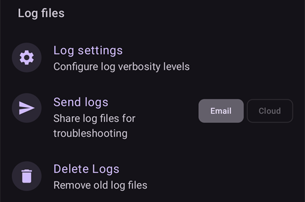

# Διαμόρφωση (Config Builder)

```{admonition} Έρχεστε από το AAPS v3; :class: note Το **Config Builder** ονομάζεται τώρα **Διαμόρφωση** και βρίσκεται στο **μενού** (☰). Δείτε [Τι άλλαξε στο AAPS v4](#v4-changes).

    <br />Στη **Διαμόρφωση** επιλέγετε ποια πρόσθετα είναι ενεργά (CGM, αντλία, αλγόριθμος APS, ευαισθησία, συγχρονισμός, …) και ανοίγετε κάθε πρόσθετο και τις ρυθμίσεις του. Η [περιγραφή βήμα προς βήμα](#configuration-v4) είναι παρακάτω. Το υπόλοιπο της σελίδας περιγράφει κάθε ενότητα αναλυτικά.
    
    (configuration-v4)=
    ## Διαμόρφωση στο AAPS v4
    
    Στο **AAPS** v4, πατήστε το **μενού** (☰) στην **πάνω αριστερή** γωνία της κύριας οθόνης και επιλέξτε **Διαμόρφωση** (*«Ρυθμίστε τη διαμόρφωσή σας (CGM, αντλία, …) και ενεργοποιήστε λειτουργίες»*).
    
    
    
    Τα πρόσθετα είναι ομαδοποιημένα σε **κατηγορίες** — για παράδειγμα *Εξομάλυνση*, *Βαθμονόμηση*, *Ανίχνευση ευαισθησίας*, *APS*, *Επικοινωνία* και *Γενικά*. Κάθε γραμμή δείχνει το όνομα της κατηγορίας και το **ενεργό τώρα** πρόσθετο (π.χ. *APS → OpenAPS SMB*). Πατήστε μια γραμμή για να ανοίξετε μια κατηγορία.
    
    
    
    Μέσα σε μια κατηγορία βλέπετε τα πρόσθετα που υπάρχουν για αυτήν. Στις κατηγορίες μίας επιλογής διαλέγετε το ενεργό πρόσθετο. Κάποιες κατηγορίες επιτρέπουν πολλές επιλογές (*«Επιλέξτε όσα ισχύουν.»*). Κάθε πρόσθετο έχει δύο ενέργειες:
    
    - **Άνοιγμα πρόσθετου** — ανοίγει την οθόνη του πρόσθετου.
    - **Ρυθμίσεις** — ανοίγει τις ρυθμίσεις του πρόσθετου (οι ρυθμίσεις μπορεί να είναι ομαδοποιημένες σε ενότητες που ανοίγουν).
    
    
    
    (configuration_sync_icon)=
    ### Το εικονίδιο κινητού — «συγχρονίζεται από την κύρια συσκευή»
    
    Ένα μικρό **εικονίδιο κινητού (τηλεφώνου)** δίπλα σε μια κατηγορία ή ρύθμιση σημαίνει ότι αυτό το στοιχείο **συγχρονίζεται από την κύρια συσκευή (master)** — η τιμή/επιλογή του έρχεται σε αυτή τη συσκευή μέσω του καναλιού NSClientV3 (Nightscout).
    
    Σε έναν **πελάτη** (**AAPSClient**) αυτά τα στοιχεία **μένουν συγχρονισμένα με την κύρια συσκευή**. Το εικονίδιο εμφανίζεται μόνο σε πελάτη. Γι' αυτό δεν φαίνεται στο παραπάνω στιγμιότυπο, που τραβήχτηκε στην κύρια εφαρμογή **AAPS**. Σε πελάτη εμφανίζεται συνήθως στα *Εξομάλυνση*, *Βαθμονόμηση*, *Ανίχνευση ευαισθησίας* και *APS*. Πώς ακριβώς μένουν συντονισμένοι η κύρια συσκευή και οι πελάτες — και ποιες ρυθμίσεις μπορείτε να αλλάξετε από κάθε πλευρά — περιγράφεται στο [Έλεγχος κύριας συσκευής ↔ πελάτη](#client-master-config-prefs).
    
    Το ίδιο εικονίδιο εμφανίζεται επίσης **μέσα στις ρυθμίσεις**, δίπλα σε κάθε επιλογή που συγχρονίζεται. Στο παρακάτω παράδειγμα το *Όριο απορρόφησης* έχει το εικονίδιο. Οι ρυθμίσεις χωρίς το εικονίδιο ορίζονται ξεχωριστά σε κάθε συσκευή:
    
    
    
    Τα στοιχεία **χωρίς** το εικονίδιο ορίζονται **ξεχωριστά σε κάθε συσκευή**. Το πιο σημαντικό παράδειγμα είναι η ίδια η σύνδεση **NSClientV3 (Επικοινωνία)** — η **Διεύθυνση Nightscout**, το **διακριτικό πρόσβασης (access token)** και τα **websockets** ορίζονται χωριστά σε κάθε τηλέφωνο. Γι' αυτό **δεν** έχουν το εικονίδιο κινητού.
    
    ---
    
    (Config-Builder-tab-or-hamburger-menu)=
    ## Άνοιγμα της οθόνης ενός πρόσθετου
    
    Κάθε οθόνη πρόσθετου ανοίγει με έναν από τους παρακάτω τρόπους (οι καρτέλες και το κουτάκι με το μάτι του **AAPS** v3 δεν υπάρχουν πια, δείτε [Τι άλλαξε στο AAPS v4](#v4-changes)):
    
    - **Διαμόρφωση** → η κατηγορία του πρόσθετου → **Άνοιγμα πρόσθετου**,
    - το φύλλο **Διαχείριση** στην κάτω γραμμή πλοήγησης, για τις οθόνες που χρησιμοποιείτε πιο συχνά (Προφίλ, Ρυθμίσεις ινσουλίνης, Αντλία, Αυτοματισμός, Τρόφιμα...),
    - ένα κουμπί [QuickLaunch](../DailyLifeWithAaps/QuickLaunch.md) που προσθέτετε μόνοι σας,
    - η **γραμμή αναζήτησης** στην κύρια οθόνη.
    
    ```{contents}
    :backlinks: entry
    :depth: 2
    

(ConfigBuilder_Profile)=

## Προφίλ

Αυτή η μονάδα δεν μπορεί να απενεργοποιηθεί, γιατί είναι βασικό μέρος του **AAPS**.

Δείτε [Το προφίλ σας στο AAPS](../SettingUpAaps/YourAapsProfile.md) για να καταλάβετε βασικά τι περιέχει το **Προφίλ** σας.

(insulin)= (Config-Builder-insulin)=

## Ινσουλίνη


Στο **AAPS** 4 η ινσουλίνη δεν είναι πια πρόσθετο που επιλέγεται στη **Διαμόρφωση**. Ανοίξτε **Διαχείριση → Ρυθμίσεις ινσουλίνης** για να ρυθμίσετε την ινσουλίνη που χρησιμοποιείτε.

Στον επεξεργαστή ινσουλίνης μπορείτε:

* να δώσετε στο προφίλ ένα **Ψευδώνυμο ινσουλίνης**, ώστε να το αναγνωρίζετε εύκολα,
* να ορίσετε την **Κορυφή** (χρόνος μέχρι τη μέγιστη δράση της ινσουλίνης, σε λεπτά) και τη **DIA** (διάρκεια δράσης της ινσουλίνης, σε ώρες), είτε γράφοντας την τιμή είτε με τα κουμπιά **–** / **+**,
* να πατήσετε ένα κουμπί προεπιλογής **Φόρτωση κορυφής από** — **Novorapid** (75 λεπ.), **Fiasp** (55 λεπ.) ή **Lyumjev** (45 λεπ.) — για να συμπληρώσετε με μία κίνηση τον τυπικό χρόνο κορυφής αυτής της ινσουλίνης.

Τα επιτρεπόμενα εύρη είναι τα ίδια, όποια ινσουλίνη κι αν χρησιμοποιείτε:

* **DIA**: 5 έως 9 ώρες (5 έως 10 ώρες αν ο τύπος ασθενούς είναι **Κύηση**). Δείτε [Διάρκεια δράσης ινσουλίνης (DIA) και κορυφή](#Config-Builder-insulin-dia) για να επιλέξετε μια τιμή.
* **Κορυφή**: 35 έως 120 λεπτά.

Οι καμπύλες **IOB** (ενεργή ινσουλίνη) και **Δράση** στο κάτω μέρος του επεξεργαστή αλλάζουν καθώς αλλάζετε τις τιμές. Έτσι βλέπετε αμέσως πώς οι ρυθμίσεις σας διαμορφώνουν τη δράση της ινσουλίνης.

Περισσότερες πληροφορίες για το προφίλ ινσουλίνης, όπως εμφανίζεται στο **AAPS**, θα βρείτε [εδώ](#AapsScreens-insulin-profile).

(Config-Builder-insulin-change-active)=

### Αλλαγή της ινσουλίνης σε χρήση (DIA ή κορυφή)

Η ινσουλίνη με την ένδειξη **ΕΝΕΡΓΟ** είναι αυτή που χρησιμοποιεί το τρέχον προφίλ σας. Τα πεδία της είναι γκρι: δεν μπορείτε να την επεξεργαστείτε ή να τη διαγράψετε. Έτσι, το όνομα ινσουλίνης που φαίνεται στο τρέχον προφίλ σας ταιριάζει πάντα με τις ρυθμίσεις που χρησιμοποιούνται πραγματικά.

Για να αλλάξετε τη DIA ή την κορυφή που χρησιμοποιείτε:

1. Ανοίξτε **Διαχείριση → Ρυθμίσεις ινσουλίνης**. Αν η οθόνη ανοίξει μόνο για ανάγνωση (ένα **✏️ μολύβι** στην πάνω γραμμή), πατήστε το μολύβι και ξεκλειδώστε τις ρυθμίσεις σας.
2. Πατήστε **+** (*Προσθήκη νέας ινσουλίνης*). Το **AAPS** δημιουργεί ένα αντίγραφο της ινσουλίνης που φαίνεται στην οθόνη.
3. Ορίστε τη νέα **Κορυφή** και/ή **DIA** και μετά πατήστε το εικονίδιο αποθήκευσης (πάνω δεξιά).
4. Πατήστε **▶** (*Ενεργοποίηση ινσουλίνης*) και επιβεβαιώστε. Η νέα ινσουλίνη έχει τώρα την ένδειξη **ΕΝΕΡΓΟ**.

```{admonition} Το όνομα περιέχει την κορυφή και τη DIA :class: note Το **AAPS** προσθέτει αυτόματα την κορυφή, τη DIA και τη συγκέντρωση στο όνομα της ινσουλίνης (για παράδειγμα *Fiasp 55m 8h U100*), ώστε να ξεχωρίζετε τις ρυθμίσεις σας με μια ματιά.

    <br />Μπορείτε να διαγράψετε την παλιά ινσουλίνη μόλις δεν είναι πια ενεργή.
    
    ### Οι προεπιλογές «Φόρτωση κορυφής από»
    
    Στο **AAPS** 4 δεν υπάρχει λίστα με τύπους ινσουλίνης για να διαλέξετε. Κάθε ινσουλίνη χρησιμοποιεί την ίδια εκθετική καμπύλη δράσης. Διαφέρουν μόνο η **Κορυφή** και η **DIA**. Οι προεπιλογές **Φόρτωση κορυφής από** στον επεξεργαστή ινσουλίνης συμπληρώνουν με ένα πάτημα τη συνιστώμενη κορυφή για τις πιο συνηθισμένες ινσουλίνες (το μικρό ⓘ δίπλα στο **Φόρτωση κορυφής από** τις δείχνει μαζί με τις τιμές κορυφής τους). Μπορείτε μετά να προσαρμόσετε την **Κορυφή** και τη **DIA**.
    
    Αλλάξτε την κορυφή από τη συνιστώμενη τιμή μόνο αν καταλαβαίνετε τι αποτέλεσμα θα έχει αυτό. Το [γράφημα της καμπύλης ινσουλίνης](#AapsScreens-insulin-profile) σας βοηθά να καταλάβετε τις καμπύλες.
    
    #### Novorapid
    
    
    
    * συνιστάται για Humalog, Novolog και Novorapid (στο **AAPS** v3 λεγόταν *Rapid-Acting Oref*)
    * Κορυφή = 75 λεπτά μετά την ένεση
    
    #### Fiasp
    
    
    
    * συνιστάται για Fiasp (στο **AAPS** v3 λεγόταν *Ultra-Rapid Oref*)
    * Κορυφή = 55 λεπτά μετά την ένεση
    
    (Config-Builder-lyumjev)=
    #### Lyumjev
    
    
    
    * συνιστάται για Lyumjev
    * Κορυφή = 45 λεπτά μετά την ένεση
    
    #### Προσαρμοσμένη κορυφή
    
    * Στο **AAPS** 4 δεν υπάρχει ξεχωριστός τύπος ινσουλίνης "Free-Peak Oref": γράψτε οποιαδήποτε **Κορυφή** (35 έως 120 λεπτά) απευθείας στον [επεξεργαστή ινσουλίνης](#Config-Builder-insulin), χωρίς προεπιλογή.
    * Μια προσαρμοσμένη κορυφή είναι χρήσιμη αν χρησιμοποιείτε ινσουλίνη που δεν είναι στη λίστα ή μείγμα από διαφορετικές ινσουλίνες.
    
    (Config-Builder-insulin-dia)=
    ### Διάρκεια δράσης ινσουλίνης (DIA) και κορυφή
    
    ```{warning}
    Στο κύκλωμα, η μείωση της DIA ή της κορυφής αυξάνει πάντα την ινσουλίνη που χορηγείται. Η DIA λειτουργεί διαφορετικά στο AAPS από ό,τι στα εμπορικά συστήματα AID. Απρόσεκτες αλλαγές σε αυτές τις ρυθμίσεις μπορεί να αλλάξουν τη δοσολογία της ινσουλίνης πολύ περισσότερο ή πολύ λιγότερο από ό,τι περιμένετε.
    

Το AAPS περιγράφει τη χρονική πορεία της δράσης της ινσουλίνης με έναν μαθηματικό τύπο, που ρυθμίζεται με τη **DIA** και τη στενά συνδεδεμένη ρύθμιση **κορυφή**. Η DIA είναι η θεωρητική διάρκεια μέχρι το IOB να φτάσει στο μηδέν και η κορυφή είναι η χρονική στιγμή που η δράση της ινσουλίνης είναι πιο ισχυρή. Από αυτά προκύπτει μια καμπύλη IOB και μια καμπύλη δράσης, η οποία είναι απλώς ο **ρυθμός** μείωσης του IOB.

Λάβετε υπόψη ότι, όταν το AAPS λειτουργεί σε κύκλωμα, είναι φυσιολογικό να υπάρχουν περίοδοι με [μηδενικό βασικό (zero temp)](#Open-APS-features-super-micro-bolus-smb). Αυτή η βασική ινσουλίνη που λείπει αφαιρείται πλήρως από το IOB. Αυτό εξηγεί γιατί στην πράξη το IOB φτάνει στο μηδέν πολλές ώρες νωρίτερα από τη DIA που έχετε ορίσει. Μπορείτε να δείτε χωριστά το [IOB του bolus και το IOB του βασικού ρυθμού](#aaps-screens-iob-cob-basal-sens) από την κύρια οθόνη.

Για να ρυθμίσετε τη DIA και την κορυφή, πατήστε **Διαχείριση** στην κύρια οθόνη και μετά πατήστε **Ρυθμίσεις ινσουλίνης**. Το AAPS δείχνει τη ρύθμιση της ενεργής ινσουλίνης έτσι:


Σε αυτό το παράδειγμα η κορυφή είναι 55 λεπτά, η DIA είναι 8 ώρες και η [συγκέντρωση ινσουλίνης](#Insulin-Concentration) είναι η τυπική 100 IU/mL.

Λόγω της επίδρασης του μηδενικού βασικού που εξηγήθηκε παραπάνω και του τύπου που χρησιμοποιεί το AAPS για τη μείωση του IOB, οι περισσότεροι χρήστες ορίζουν σαφώς μεγαλύτερη DIA από ό,τι στα εμπορικά συστήματα. Γενικά, πολλοί βρίσκουν ότι μια **DIA** 9 ωρών τους ταιριάζει καλά. Όταν αποκτήσετε περισσότερη εμπειρία με το AAPS και έχετε ένα καλά ρυθμισμένο προφίλ, μπορείτε να προσπαθήσετε να βρείτε προσωπικές ρυθμίσεις DIA και κορυφής με τις πληροφορίες παρακάτω.

````{admonition} Λεπτομέρειες για την επίδραση των ρυθμίσεων DIA και κορυφής :class: dropdown

Επειδή ο βασικός ρυθμός επηρεάζει έμμεσα τη μείωση του IOB στο AAPS, πολύ υψηλοί βασικοί ρυθμοί μπορεί να κρύψουν μια πολύ υψηλή DIA, και αντίστροφα. Έχει νόημα να ρυθμίσετε πρώτα προσεκτικά τους βασικούς ρυθμούς και μετά να προσαρμόσετε τη DIA και την κορυφή. Επίσης, λάβετε υπόψη ότι οι ρυθμίσεις DIA και κορυφής αλληλεπιδρούν: η επίδραση της DIA εξαρτάται από την κορυφή, και αντίστροφα.

Αυτά τα γραφήματα δείχνουν την ακριβή επίδραση της DIA και της κορυφής στις καμπύλες IOB, σε όλο το εύρος των επιτρεπόμενων τιμών.

Προσαρμογή της DIA:

```{image} ../images/iob_remaining_static_peak.png :width: 400px

    <br />Προσαρμογή της κορυφής:
    
    ```{image} ../images/iob_remaining_static_dia.png
    :width: 400px
    

Τέλος, μια σύγκριση με προσαρμογή της DIA και της κορυφής μαζί. Η λογική εδώ είναι ότι και οι δύο τιμές αλλάζουν κατά την ίδια αναλογία, ώστε `49/35 ~ 7/5`. Ή παρόμοια, `120/93 ~ 9/7`. Τα διαστήματα θα είναι ίδια, όποια κι αν είναι η αρχική DIA ή κορυφή, αρκεί η αναλογική αλλαγή να είναι ίδια και για τις δύο.

```{image} ../images/iob_remaining_uniform.png :width: 400px

    <br />Σημειώστε ότι, όταν η DIA και η κορυφή αλλάζουν με αυτόν τον τρόπο, κάθε σημείο της καμπύλης μετακινείται κατά την ίδια αναλογία.
    
    ````
    
    #### Περισσότερα για τις ρυθμίσεις DIA και κορυφής
    
    * [Τεχνικές λεπτομέρειες και ιστορικό από τον πρόγονο του AAPS, το OpenAPS](https://openaps.readthedocs.io/en/latest/docs/While%20You%20Wait%20For%20Gear/understanding-insulin-on-board-calculations.html#understanding-the-new-iob-curves-based-on-exponential-activity-curves).
    * [Why we are regularly wrong in the duration of insulin action (DIA) times we use, and why it matters…](https://www.diabettech.com/insulin/why-we-are-regularly-wrong-in-the-duration-of-insulin-action-dia-times-we-use-and-why-it-matters/) (γιατί κάνουμε συχνά λάθος στη διάρκεια δράσης ινσουλίνης (DIA) και γιατί αυτό έχει σημασία) στο Diabettech.
    * [Exponential Insulin Curves + Fiasp](https://web.archive.org/web/20220630154425/http://seemycgm.com/2017/10/21/exponential-insulin-curves-fiasp/) (εκθετικές καμπύλες ινσουλίνης + Fiasp) στο See My CGM (αρχείο).
    * [Revised Humalog model in a closed loop](https://bionicwookiee.com/2022/04/13/revised-humalog-model-in-a-closed-loop/) (αναθεωρημένο μοντέλο Humalog σε κλειστό κύκλωμα) και άλλα άρθρα στο Bionic Wookie, που συνιστούν DIA 9 ωρών για Lyumjev, Fiasp, NovoRapid, Humalog.
    
    (Config-Builder-bg-source)=
    ## Πηγή BG
    Επιλέξτε την πηγή γλυκόζης αίματος που χρησιμοποιείτε. Δείτε τη σελίδα [Πηγή BG](../Getting-Started/CompatiblesCgms.md) για περισσότερες πληροφορίες ρύθμισης.
    
    
    
    Κάντε κύλιση προς τα κάτω για να δείτε τις άλλες πηγές:
    
    
    
    
    
    * [xDrip+ BG](../CompatibleCgms/xDrip.md) - και για συμβατές εφαρμογές, όπως το [Juggluco](../CompatibleCgms/Juggluco.md)
    * [NSClient BG](../CompatibleCgms/CgmNightscoutUpload.md) - μόνο αν ξέρετε τι κάνετε, δείτε [Πηγή BG](../Getting-Started/CompatiblesCgms.md).
    * [MM640g](../CompatibleCgms/MM640g.md)
    * Glimp - υποστηρίζεται μόνο η έκδοση 4.15.57 και νεότερες
    * [BYODA (Build Your Own Dexcom App)](#DexcomG6-if-using-g6-with-build-your-own-dexcom-app).
    * MicroTech CGM App - για το CGM Aidex / LinX
    * [Poctech](../CompatibleCgms/PocTech.md)
    * Tomato (MiaoMiao) - εφαρμογή Tomato για τη συσκευή MiaoMiao
    * [Glunovo](https://infinovo.com/) - εφαρμογή Glunovo για το σύστημα CGM Glunovo
    * Intelligo - εφαρμογή Intelligo
    * Syai/Ottai - για τις εφαρμογές Syai και Ottai (δείτε [Syai Tag](../CompatibleCgms/SyaiTagX1.md) και [Ottai](../CompatibleCgms/OttaiM8.md))
    * SI App - τροποποιημένη (patched) εφαρμογή SI App ή εφαρμογή Sibionics για το CGM Sibionics
    * Sino App - τροποποιημένη (patched) εφαρμογή για το CGM Sinocare
    * Ανάγνωση ειδοποιήσεων - διαβάζει τιμές γλυκόζης από τις ειδοποιήσεις των επίσημων εφαρμογών CGM (Dexcom, Medtronic, Eversense κ.λπ.)
    * Instara - εφαρμογή Instara
    * Τυχαίες τιμές BG - δημιουργεί τυχαία δεδομένα BG για δοκιμές. Μπορεί να ενεργοποιηθεί μόνο σε έκδοση μηχανικού (engineering/developer build) με την **Εικονική Αντλία**. Έτσι, σε μια κανονική εγκατάσταση του **AAPS** δεν μπορεί να χρησιμοποιηθεί.
    
    ## Εξομάλυνση
    
    
    
    Δείτε [Εξομάλυνση των δεδομένων γλυκόζης στο αίμα](../CompatibleCgms/SmoothingBloodGlucoseData.md).
    
    ## Βαθμονόμηση
    
    Επιλέξτε πώς το **AAPS** χειρίζεται τις τιμές που λαμβάνει από τον αισθητήρα σας:
    
    - **Χωρίς βαθμονόμηση**: οι τιμές του αισθητήρα χρησιμοποιούνται όπως είναι. Χρησιμοποιήστε το όταν ο αισθητήρας είναι ήδη βαθμονομημένος από το εργοστάσιο και ακριβής. Αυτή είναι η προεπιλογή.
    - **Γραμμική βαθμονόμηση**: το **AAPS** διορθώνει τις τιμές του αισθητήρα με μια κλίση και μια μετατόπιση που υπολογίζει από τις μετρήσεις σας από το δάχτυλο.
    
    Πώς λειτουργεί η **Γραμμική βαθμονόμηση**:
    
    - Χρειάζεται να έχει καταγραφεί **αλλαγή αισθητήρα**, ώστε να ξέρει πότε ξεκίνησε η χρήση του αισθητήρα. Οι πρώτες 2 ώρες μετά την αλλαγή παραλείπονται ως προθέρμανση.
    - Χρειάζεται τουλάχιστον **2 μετρήσεις από το δάχτυλο**. Οι πρόσφατες μετρήσεις μετράνε περισσότερο από τις παλιές.
    - Η διόρθωση εφαρμόζεται μόνο όταν το αποτέλεσμα είναι σε ασφαλές εύρος. Αν οι μετρήσεις σας είναι πολύ κοντά μεταξύ τους, διορθώνεται μόνο η μετατόπιση.
    - Το **Άνοιγμα πρόσθετου** δείχνει την κατάσταση της βαθμονόμησης, την κλίση και τη διόρθωση που χρησιμοποιούνται, και τη λίστα με τις μετρήσεις από το δάχτυλο. Μπορείτε να προσθέσετε μια μέτρηση με **Προσθήκη βαθμονόμησης** και να αφαιρέσετε μια λάθος μέτρηση.
    
    ```{admonition} Βαθμονομήστε προσεκτικά
    :class: warning
    Μια λάθος τιμή από το δάχτυλο οδηγεί σε λάθος τιμές γλυκόζης και άρα σε λάθος δόσεις ινσουλίνης. Πλύνετε τα χέρια σας πριν από τη μέτρηση και μη βαθμονομείτε όταν η γλυκόζη σας αλλάζει γρήγορα.
    


(Config-Builder-pump)=

## Αντλία

Επιλέξτε την αντλία που χρησιμοποιείτε. Δείτε τη σελίδα [Συμβατές αντλίες](../Getting-Started/CompatiblePumps.md) για περισσότερες πληροφορίες ρύθμισης.


Κάντε κύλιση προς τα κάτω για να δείτε όλους τους οδηγούς αντλιών:


Όταν επιλέγετε άλλη αντλία, το **AAPS** σας ζητά να επιβεβαιώσετε την αλλαγή:


* [Dana R](../CompatiblePumps/DanaR-Insulin-Pump.md)
* Dana R Korean (για την εγχώρια αντλία DanaR της Κορέας)
* Dana Rv2 (αντλία DanaR με ανεπίσημη αναβάθμιση υλικολογισμικού)
* [Dana-i/RS](../CompatiblePumps/DanaRS-Insulin-Pump.md)
* [Accu Chek Insight](../CompatiblePumps/Accu-Chek-Insight-Pump.md)
* [Accu Chek Combo](../CompatiblePumps/Accu-Chek-Combo-Pump-v2.md)
* Omnipod για [Omnipod Eros](../CompatiblePumps/OmnipodEros.md)
* Dash για [Omnipod DASH](../CompatiblePumps/OmnipodDASH.md)
* [Medtronic](../CompatiblePumps/MedtronicPump.md)
* [Diaconn G8](../CompatiblePumps/DiaconnG8.md)
* [EOPatch2](../CompatiblePumps/EOPatch2.md)
* [Medtrum](../CompatiblePumps/MedtrumNano.md)
* [Equil 5.3](../CompatiblePumps/Equil5.3.md)
* [Carelevo](../CompatiblePumps/CareLevo.md)
* Εικονική αντλία: ανοιχτό κύκλωμα - μόνο προτάσεις του **AAPS** 
  * όταν κάνετε τα πρώτα σας βήματα με το **AAPS**, κατά τα πρώτα [Βήματα](../SettingUpAaps/CompletingTheObjectives.md)
  * για αντλία που δεν έχει ακόμα οδηγό (driver)

(config-builder-wrong-pump-data)=

### Μήνυμα: «Τα δεδομένα προέρχονται από διαφορετική αντλία»

Το **AAPS** θυμάται την αντλία με την οποία είναι συνδεδεμένο (τύπο αντλίας και σειριακό αριθμό). Αν λάβει δεδομένα από άλλη αντλία, για παράδειγμα αφού η αντλία σας αντικαταστάθηκε από μια νέα του ίδιου μοντέλου, δείχνει αυτό το μήνυμα και αγνοεί τα δεδομένα από εκείνη την αντλία:


Για να χρησιμοποιήσετε τη νέα αντλία, αλλάξτε τον οδηγό αντλίας: επιλέξτε **Εικονική Αντλία**, επιβεβαιώστε και μετά επιλέξτε ξανά την αντλία σας. Το **AAPS** καταχωρεί τότε την αντλία με την οποία είναι συνδεδεμένο τώρα.

(Config-Builder-sensitivity-detection)=

## Ανίχνευση ευαισθησίας


Επιλέξτε τον τύπο ανίχνευσης ευαισθησίας. Για περισσότερες λεπτομέρειες για τους διάφορους τύπους, [διαβάστε εδώ](../DailyLifeWithAaps/SensitivityDetectionAndCob.md). Αναλύει τα ιστορικά δεδομένα σε πραγματικό χρόνο και κάνει προσαρμογές, αν αναγνωρίσει ότι αντιδράτε στην ινσουλίνη πιο ευαίσθητα (ή αντίθετα, με μεγαλύτερη αντίσταση) από το συνηθισμένο. Περισσότερες λεπτομέρειες για το πώς υπολογίζεται ο ίδιος ο λόγος ευαισθησίας θα βρείτε στο [Βασικά χαρακτηριστικά του AAPS > Autosens](#Open-APS-features-autosens).

Μπορείτε να δείτε την ευαισθησία σας στην κύρια οθόνη σε ένα [πρόσθετο γράφημα](#AapsScreens-section-g-additional-graphs), αν επιλέξετε SEN και κοιτάξετε τη λευκή γραμμή. Σημείωση: πρέπει να βρίσκεστε στο [Βήμα 8](#objectives-objective8), ώστε η Ανίχνευση ευαισθησίας/το [Autosens](#Open-APS-features-autosens) να προσαρμόζει αυτόματα την ποσότητα ινσουλίνης που χορηγείται. Πριν φτάσετε σε αυτό το βήμα, το ποσοστό Autosens / η γραμμή στο γράφημά σας εμφανίζεται μόνο για πληροφόρηση.

### Ρύθμιση απορρόφησης

Αν χρησιμοποιείτε το Oref1 με **SMB**, πρέπει να αλλάξετε το **min_5m_carbimpact** σε 8. Η τιμή χρησιμοποιείται μόνο όταν λείπουν μετρήσεις **CGM** ή όταν η σωματική άσκηση «καταναλώνει» όλη την άνοδο της γλυκόζης αίματος που αλλιώς θα έκανε το **AAPS** να μειώνει τους COB. Όταν η [απορρόφηση υδατανθράκων](../DailyLifeWithAaps/CobCalculation.md) δεν μπορεί να υπολογιστεί δυναμικά από τις αντιδράσεις του αίματός σας, εφαρμόζει μια προεπιλεγμένη μείωση στους υδατάνθρακές σας. Ουσιαστικά είναι μια βαλβίδα ασφαλείας.

(Config-Builder-aps)=

## APS


Επιλέξτε τον αλγόριθμο APS που θέλετε για τις προσαρμογές της θεραπείας. Μπορείτε να δείτε τις τρέχουσες λεπτομέρειες του επιλεγμένου αλγορίθμου με το **Άνοιγμα πρόσθετου**.

* OpenAPS AMA 
  * Advanced Meal Assist: παλαιότερος αλγόριθμος που δεν συνιστάται πλέον.
  * Με απλά λόγια, το όφελος είναι ότι, αφού κάνετε bolus για ένα γεύμα, το σύστημα μπορεί να βάλει πιο γρήγορα υψηλό προσωρινό βασικό ρυθμό, ΑΝ καταχωρείτε τους υδατάνθρακες σωστά.
* [OpenAPS SMB](#Open-APS-features-super-micro-bolus-smb) 
  * Super Micro Bolus: ο πιο πρόσφατος αλγόριθμος, συνιστάται για όλους τους χρήστες.
  * Σε αντίθεση με το AMA, το SMB δεν χρησιμοποιεί προσωρινούς βασικούς ρυθμούς για να ελέγχει τη γλυκόζη, αλλά κυρίως μικρά **Super Micro Bolus**.
  * Σημείωση: συνιστάται να χρησιμοποιείτε αυτόν τον αλγόριθμο από την αρχή, παρόλο που στην πράξη δεν θα χορηγούνται SMB μέχρι το [Βήμα 9](#objectives-objective9).
* [Auto ISF](#Open-APS-features-auto-isf) 
  * Πειραματικός αλγόριθμος για προχωρημένους χρήστες. Εμφανίζεται στη λίστα μόνο αφού ολοκληρωθούν τα Βήματα.

Αν αλλάζετε από τον αλγόριθμο AMA στον SMB, το *min_5m_carbimpact* πρέπει να αλλάξει χειροκίνητα σε **8** (προεπιλεγμένη τιμή για το SMB) στις [Ρυθμίσεις → Ρύθμιση απορρόφησης](#Preferences-min_5m_carbimpact).

## Κύκλωμα

Αυτή η μονάδα δεν μπορεί να απενεργοποιηθεί, γιατί είναι βασικό μέρος του **AAPS**.


## Περιορισμοί


### Βήματα

Το **AAPS** έχει ένα πρόγραμμα εκμάθησης (μια σειρά από Βήματα) που πρέπει να ολοκληρώσετε βήμα προς βήμα. Αυτό θα σας καθοδηγήσει με ασφάλεια στη ρύθμιση ενός συστήματος κλειστού κυκλώματος.

Δείτε τη σελίδα [Βήματα](../SettingUpAaps/CompletingTheObjectives.md) για περισσότερες πληροφορίες.

## Επικοινωνία

Σε αυτή την κατηγορία (που στο **AAPS** v3 λεγόταν **Συγχρονισμός**) επιλέγετε αν και πού θέλετε το **AAPS** να στέλνει τα δεδομένα σας.


Κάντε κύλιση προς τα κάτω για να δείτε την υπόλοιπη λίστα:


### NSClientV3

Μπορεί να χρησιμοποιηθεί ως [διακομιστής αναφορών](../SettingUpAaps/SettingUpTheReportingServer.md) και/ή για [απομακρυσμένη παρακολούθηση](../RemoteFeatures/RemoteMonitoring.md), [απομακρυσμένο έλεγχο](../RemoteFeatures/RemoteControl.md).

Δείτε [Συγχρονισμός με τον διακομιστή αναφορών](#SetupWizard-synchronization-with-the-reporting-server-and-more) για να ρυθμίσετε τον συγχρονισμό NSClientV3.

### Tidepool

Μπορεί να χρησιμοποιηθεί ως [διακομιστής αναφορών](../SettingUpAaps/SettingUpTheReportingServer.md).

Δείτε [Tidepool](../SettingUpAaps/Tidepool.md).

### xDrip

Χρησιμοποιείται για να **στέλνει** δεδομένα, όπως τιμές γλυκόζης και θεραπείες, στο xDrip+ στο ίδιο τηλέφωνο. Οι ρυθμίσεις του περιέχουν επίσης την επιλογή **Αποστολή κατάστασης στο xDrip+**, μια γραμμή κατάστασης με IOB και COB που δείχνουν το xDrip+ και κάποιες συνοδευτικές εφαρμογές ρολογιού.

### Open Humans

Δείτε [Open Humans](../SupportingAaps/OpenHumans.md).

(Config-Builder-wear)=

### Wear

Παρακολουθήστε και ελέγξτε το **AAPS** από ένα ρολόι Wear OS. Η ρύθμιση του ρολογιού εξηγείται στη σελίδα [Ρύθμιση του AAPS στο ρολόι Wear OS σας](../WearOS/WearOsSmartwatch.md). Αφού ενεργοποιήσετε το πρόσθετο, επιλέξτε τις ρυθμίσεις του στις [Ρυθμίσεις > Wear](#preferences-wear). Η χρήση του ρολογιού εξηγείται στη σελίδα [Χειρισμός του AAPS από το έξυπνο ρολόι Wear OS](../RemoteFeatures/RemoteControlWearOS.md).

(external-companion-apps)=

### Εξωτερικές συνοδευτικές εφαρμογές

Μεταδίδει (broadcast) δεδομένα κατάστασης του **AAPS** στο τηλέφωνο, ώστε άλλες εφαρμογές που είναι εγκατεστημένες σε αυτό να μπορούν να τα δείχνουν — για παράδειγμα συνοδευτικές εφαρμογές ρολογιού ή widget. Η μετάδοση περιέχει γλυκόζη και τάση, IOB, COB, βασικό και προσωρινό βασικό ρυθμό, όνομα προφίλ, κατάσταση κυκλώματος, μπαταρία τηλεφώνου και αντλίας, επίπεδο δεξαμενής και πρόοδο του bolus. Ενεργοποιήστε το μόνο αν μια συνοδευτική εφαρμογή που χρησιμοποιείτε ζητά αυτά τα δεδομένα.

Εφαρμογές που διαβάζουν αυτή τη μετάδοση είναι το [WatchDrip+](https://bigdigital.home.blog/) (ρολόγια Xiaomi και Amazfit), το [GlucoDataHandler](https://github.com/pachi81/GlucoDataHandler) (complications και widget στο Wear OS, και Android Auto μέσω του GlucoDataAuto) και η εφαρμογή G-Watch. Η ρύθμισή τους περιγράφεται στη σελίδα [Έξυπνα ρολόγια και AAPS](#watches-external-companion-apps). Κάποιες από αυτές χρησιμοποιούν επίσης την επιλογή **Αποστολή κατάστασης στο xDrip+** του πρόσθετου **xDrip** παραπάνω, για μια γραμμή κατάστασης με IOB και COB.

Σε παλαιότερες εκδόσεις αυτό το πρόσθετο λεγόταν **Samsung Tizen**, από την [εφαρμογή G-Watch για ρολόγια Samsung Tizen](#Watchfaces-tizen) για την οποία φτιάχτηκε αρχικά.

### Garmin

Σύνδεση με συσκευή Garmin (Fenix, Edge...)

## Θεραπείες

Ανοίξτε το **μενού** (☰) και επιλέξτε [Ιστορικό θεραπειών](#aaps-screens-treatments) για να δείτε τις θεραπείες που έχουν καταγραφεί. Αν θέλετε να διορθώσετε ή να διαγράψετε μια καταχώρηση (π.χ. φάγατε λιγότερους υδατάνθρακες από ό,τι περιμένατε), επιλέξτε «Αφαίρεση» και καταχωρήστε τη νέα τιμή (αλλάξτε την ώρα αν χρειάζεται) από **Θεραπείες → Υδατάνθρακες** στην κάτω γραμμή πλοήγησης (δείτε [Υδατάνθρακες](#screens-bolus-carbs)).

## Γενικά

Στο **AAPS** 4 η κατηγορία **Γενικά** της **Διαμόρφωσης** περιέχει μόνο το **Autotune**. Οι άλλες λειτουργίες που περιγράφονται παρακάτω είναι πάντα διαθέσιμες και δεν χρειάζεται πια να ενεργοποιηθούν εδώ. Κάθε παράγραφος λέει πού θα τις βρείτε.


### Επισκόπηση

Η [κύρια οθόνη](#AapsScreens-the-homescreen) του **AAPS** δεν είναι πια πρόσθετο και δεν έχει δικές της ρυθμίσεις στη **Διαμόρφωση**. Οι επιλογές που υπήρχαν εδώ βρίσκονται τώρα στις **Ρυθμίσεις** (εικονίδιο με το γρανάζι): [Εμφάνιση σημειώσεων στους διαλόγους](#Preferences-show-notes-field-in-treatments-dialogs), [Ενδείξεις κατάστασης](#Preferences-status-lights) και το [Ποσοστό bolus](#Preferences-deliver-this-part-of-bolus-wizard-result) που χρησιμοποιεί ο οδηγός bolus. Η επιλογή super bolus του **AAPS** 3.x [δεν υπάρχει ως ρύθμιση](#Preferences-advanced-settings-overview) στο **AAPS** 4.

(Config-Builder-actions)=

### Ενέργειες

Η καρτέλα Ενέργειες του **AAPS** 3.x δεν υπάρχει πια. Τα κουμπιά της βρίσκονται τώρα στο φύλλο **Διαχείριση** — δείτε [Πού πήγε η καρτέλα Ενέργειες;](#screens-action-tab).

### Αυτοματισμός

Στο **Διαχείριση → Αυτοματισμός** διαχειρίζεστε τους [Αυτοματισμούς](../DailyLifeWithAaps/Automations.md) σας, από το [Βήμα 10](#objectives-objective10) και μετά.

(Config-Builder-sms-communicator)=

### Επικοινωνία με SMS

Επιτρέπει σε απομακρυσμένους φροντιστές να ελέγχουν κάποιες λειτουργίες του **AAPS** μέσω SMS. Δείτε [Εντολές SMS](../RemoteFeatures/SMSCommands.md) για περισσότερες πληροφορίες ρύθμισης.

### Τρόφιμα

Το **Διαχείριση → Τρόφιμα** δείχνει τις προεπιλογές τροφίμων που έχουν οριστεί στη βάση δεδομένων τροφίμων του Nightscout. Δείτε το [Nightscout Readme](https://github.com/nightscout/cgm-remote-monitor#food-custom-foods) για περισσότερες πληροφορίες ρύθμισης.

Σημείωση: οι καταχωρήσεις δεν μπορούν να χρησιμοποιηθούν στον υπολογιστή (calculator) του **AAPS**. (μόνο προβολή)

(Config-Builder-autotune)=

### Autotune

Μπορείτε να ενεργοποιήσετε το Autotune, δείτε [εδώ](../AdvancedOptions/Autotune.md).

### Συντήρηση

Ανοίξτε το **μενού** (☰) και επιλέξτε **Συντήρηση** για εξαγωγή / εισαγωγή ρυθμίσεων και διαχείριση των αρχείων καταγραφής.




### Διαμόρφωση

Ονομάζεται τώρα **Διαμόρφωση**: αυτή η σελίδα.