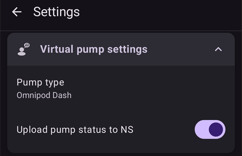

# Ρυθμίσεις

Στο **AAPS** v4 οι επιλογές βρίσκονται στην οθόνη **Ρυθμίσεις**. Υπάρχουν τρεις τρόποι για να φτάσετε σε αυτές – δείτε [Αλλαγές στη διαμόρφωση του AAPS](../SettingUpAaps/ChangeAapsConfiguration.md) για λεπτομέρειες:

1. Πατήστε το εικονίδιο **Ρυθμίσεις** (γρανάζι) πάνω δεξιά στην κύρια οθόνη: όλες οι ρυθμίσεις, ομαδοποιημένες σε ενότητες που ανοίγουν.
2. Στη **Διαμόρφωση**, πατήστε «**Ρυθμίσεις**» κάτω από ένα ενεργό πρόσθετο: μόνο οι ρυθμίσεις αυτού του πρόσθετου.
3. Χρησιμοποιήστε τη **γραμμή αναζήτησης** στο πάνω μέρος της κύριας οθόνης: απλώς αρχίστε να γράφετε μέρος του κειμένου που ψάχνετε. Έτσι βρίσκετε μεμονωμένες ρυθμίσεις (ακόμη και αυτές που δεν φαίνονται στην οθόνη Ρυθμίσεις), διαλόγους και τεκμηρίωση.


- Οι **ενότητες** ανοίγουν και κλείνουν όταν τις πατάτε. Οι ενότητες που βλέπετε εξαρτώνται από τα πρόσθετα που έχετε ενεργοποιήσει και από την [απλή λειτουργία](#preferences-simple-mode).


```{contents}
:backlinks: entry
:depth: 2
```

(Preferences-general)=
## Γενικά


**Μονάδες**

- Ορίστε τις μονάδες σε mmol/l ή mg/dl, όπως προτιμάτε.

**Γλώσσα**

- Νέα επιλογή για χρήση της προεπιλεγμένης γλώσσας του τηλεφώνου (συνιστάται).

- Αν θέλετε το **AAPS** σε άλλη γλώσσα από τη γλώσσα του τηλεφώνου σας, μπορείτε να επιλέξετε από πολλές γλώσσες.

- Όταν αλλάζετε τη γλώσσα, τα κείμενα του **AAPS** αλλάζουν αμέσως στη νέα γλώσσα. Αν κάποια κείμενα εμφανίζονται ακόμη στην παλιά γλώσσα, επανεκκινήστε το **AAPS**.
- Η ρύθμιση είναι κρυμμένη στην [απλή λειτουργία](#preferences-simple-mode).

(preferences-simple-mode)= **Απλή λειτουργία**

Η **απλή λειτουργία** είναι ενεργή από προεπιλογή όταν εγκαθιστάτε για πρώτη φορά το **AAPS**. Στην **απλή λειτουργία**, πολλές ρυθμίσεις είναι κρυμμένες και οι επιλογές αντικαθίστανται από προκαθορισμένες τιμές. Πρέπει να απενεργοποιήσετε την απλή λειτουργία μόλις εξοικειωθείτε με το περιβάλλον χρήσης και τις ρυθμίσεις του **AAPS**.

**Υποστήριξη συγκέντρωσης ινσουλίνης**

- Ενεργοποιεί την υποστήριξη για διαφορετικές συγκεντρώσεις ινσουλίνης (U50, U200, ...). Ενεργοποιήστε το μόνο αν πραγματικά χρησιμοποιείτε συγκέντρωση διαφορετική από U100, και διαβάστε προσεκτικά τις προειδοποιήσεις.
- Η ρύθμιση είναι κρυμμένη στην [απλή λειτουργία](#preferences-simple-mode).

**Οθόνη πάντα αναμμένη**

- Αναγκάζει το Android να κρατά την οθόνη πάντα αναμμένη. Αυτό είναι χρήσιμο για παρουσιάσεις κ.λπ. Αλλά καταναλώνει πολύ μπαταρία. Γι' αυτό συνιστάται να συνδέσετε το τηλέφωνο σε φορτιστή.

**Όνομα εγκατάστασης**

- Το όνομα του ατόμου που χρησιμοποιεί αυτό το τηλέφωνο. Ξεχωρίζει αυτή την εγκατάσταση του **AAPS** στις αναφορές και στον συγχρονισμό, για παράδειγμα αν δύο παιδιά με διαβήτη τύπου 1 στην οικογένειά σας χρησιμοποιούν το **AAPS**.
- Χρησιμοποιείται στα ονόματα των αρχείων ρυθμίσεων που εξάγονται.
- Εμφανίζεται στο [Dual Watchface](../WearOS/WearOsSmartwatch.md).

(Preferences-skin)=
### Θέμα

Η επιλογή θέματος του **AAPS** 3.x (Original, Low resolution, Large display...) δεν υπάρχει πια στο **AAPS** 4. Το νέο περιβάλλον προσαρμόζεται αυτόματα στην οθόνη σας, και τα χρώματα μπορείτε να τα αλλάξετε στην [Εμφάνιση](#preferences-appearance).

(preferences-appearance)=
## Εμφάνιση


(Preferences-range-for-visualization)=
### Εύρος εμφάνισης

Επιλέξτε το πάνω και το κάτω όριο για το γράφημα γλυκόζης στην κύρια οθόνη του **AAPS** και στο έξυπνο ρολόι. Είναι μόνο η απεικόνιση, όχι το εύρος στόχου για το BG σας. Παράδειγμα: 70 – 180 mg/dl ή 3,9 – 10 mmol/l

(Preferences-show-notes-field-in-treatments-dialogs)=
### Εμφάνιση σημειώσεων στους διαλόγους

Σας δίνει τη δυνατότητα να προσθέτετε σύντομες σημειώσεις στις θεραπείες σας (οδηγός bolus, υδατάνθρακες, ινσουλίνη...)

Η ρύθμιση είναι κρυμμένη στην [απλή λειτουργία](#preferences-simple-mode).

### Χρώματα εφαρμογής

Επιλέξτε ανάμεσα στο φωτεινό θέμα, στο σκούρο θέμα ή στη ρύθμιση συστήματος του τηλεφώνου.

(Preferences-protection)=
## Προστασία


(Preferences-master-password)=
### Κύριος κωδικός

Είναι υποχρεωτικός για να μπορείτε να κάνετε [εξαγωγή ρυθμίσεων](../Maintenance/ExportImportSettings.md), γιατί από την έκδοση 2.7 αυτές κρυπτογραφούνται.

**Η βιομετρική προστασία μπορεί να μη λειτουργεί σε τηλέφωνα OnePlus. Αυτό είναι γνωστό πρόβλημα της OnePlus σε ορισμένα τηλέφωνα.**


(Preferences-settings-protection)=
### Προστασία ρυθμίσεων

- Προστατέψτε τις ρυθμίσεις σας με κωδικό ή με τη βιομετρική πιστοποίηση του τηλεφώνου (π.χ. όταν [ένα παιδί χρησιμοποιεί το **AAPS**](../RemoteFeatures/RemoteMonitoring.md)). Αν ενεργοποιήσετε αυτή τη λειτουργία, θα σας ζητείται πιστοποίηση κάθε φορά που θέλετε να ανοίξετε οποιαδήποτε οθόνη που σχετίζεται με τις Ρυθμίσεις.

- Οι οθόνες διαχείρισης (**Προφίλ**, **Ρυθμίσεις ινσουλίνης**, **Προσωρινός στόχος**, **Γρήγορος Οδηγός**) ανοίγουν τότε **μόνο για ανάγνωση**. Μπορείτε ακόμη να ενεργοποιήσετε ή να χρησιμοποιήσετε μια εγγραφή, αλλά η προσθήκη, η επεξεργασία, η κλωνοποίηση και η διαγραφή είναι κρυμμένες μέχρι να ξεκλειδώσετε τις ρυθμίσεις σας. Δείτε [Η προστασία ρυθμίσεων κλειδώνει πλέον και τις οθόνες διαχείρισης](#v4changes-read-only-management).

- Χρησιμοποιήστε προσαρμοσμένο κωδικό αν θέλετε ο κύριος κωδικός να προστατεύει μόνο τις [ρυθμίσεις που εξάγετε](../Maintenance/ExportImportSettings.md), και έναν άλλο κωδικό για την αλλαγή των ρυθμίσεων.

- Αν χρησιμοποιείτε προσαρμοσμένο κωδικό, πατήστε στη γραμμή «Κωδικός ρυθμίσεων» για να ορίσετε τον κωδικό, όπως περιγράφεται [παραπάνω](#Preferences-master-password).

### Προστασία εφαρμογής

Αν η εφαρμογή είναι προστατευμένη, πρέπει να δώσετε τον κωδικό ή να χρησιμοποιήσετε τη βιομετρική πιστοποίηση του τηλεφώνου για να ανοίξετε το **AAPS**, και ξανά όταν επιστρέφετε σε αυτό μετά τον [χρόνο λήξης προστασίας](#Preferences-password-and-pin-retention).

Το **AAPS** θα κλείσει αμέσως αν δοθεί λάθος κωδικός – αλλά θα συνεχίσει να λειτουργεί στο παρασκήνιο αν είχε ανοίξει πριν με επιτυχία.

### Προστασία Bolus

- Η προστασία bolus μπορεί να είναι χρήσιμη αν το **AAPS** χρησιμοποιείται από μικρό παιδί και εσείς [δίνετε bolus μέσω SMS](../RemoteFeatures/SMSCommands.md).

- Η **Προστασία Bolus** μπορεί να επιλεγεί μόνο όταν έχει οριστεί η **Προστασία ρυθμίσεων** (Επίπεδο 2).

- Στο παρακάτω παράδειγμα, η προστασία bolus χρησιμοποιεί τον **Κύριο κωδικό**: το **AAPS** τον ζητά πριν ανοίξει έναν διάλογο θεραπείας, όπως **Ινσουλίνη**. Με τα **Βιομετρικά**, αν η βιομετρική πιστοποίηση δεν λειτουργεί, μπορείτε να δώσετε αντί γι' αυτήν τον κύριο κωδικό.


(Preferences-password-and-pin-retention)=
### Διατήρηση κωδικού πρόσβασης και PIN

Ο **Χρόνος λήξης προστασίας** ορίζει για πόσο χρόνο (σε δευτερόλεπτα) οι ρυθμίσεις ή οι λειτουργίες bolus μένουν ξεκλείδωτες αφού δώσετε σωστά τον κωδικό.

## Ασφάλεια θεραπείας


(preferences-patient-type)=
### Ηλικία ασθενή

- Τα όρια ασφαλείας ορίζονται με βάση την ηλικία που επιλέγετε σε αυτή τη ρύθμιση.
- Αν αρχίσετε να φτάνετε αυτά τα σταθερά όρια (όπως το μέγιστο bolus), είναι ώρα να ανεβείτε ένα επίπεδο.
- Είναι κακή ιδέα να επιλέξετε μεγαλύτερη ηλικία από την πραγματική, γιατί μπορεί να οδηγήσει σε υπερδοσολογία αν δώσετε λάθος τιμή στον διάλογο ινσουλίνης (για παράδειγμα, αν ξεχάσετε την υποδιαστολή).
- Αν θέλετε να μάθετε τις ακριβείς τιμές αυτών των σταθερών ορίων ασφαλείας, δείτε τη λειτουργία του αλγορίθμου που χρησιμοποιείτε σε [αυτή τη σελίδα](../DailyLifeWithAaps/KeyAapsFeatures.md).

(Preferences-maximum-bolus)=
### Μέγιστο bolus

- Ορίζει τη μέγιστη ποσότητα ινσουλίνης bolus, σε μονάδες ινσουλίνης, που επιτρέπεται να χορηγήσει το **AAPS** με μία φορά.
- Αυτή η ρύθμιση υπάρχει ως όριο ασφαλείας, για να αποτρέψει τη χορήγηση ενός πολύ μεγάλου bolus από λάθος εισαγωγή ή σφάλμα του χρήστη.
- Συνιστάται να το ορίσετε σε μια λογική ποσότητα που αντιστοιχεί περίπου στη μέγιστη ποσότητα ινσουλίνης bolus που πιθανόν να χρειαστείτε ποτέ για ένα γεύμα ή μια δόση διόρθωσης.
- Αυτός ο περιορισμός ισχύει και για τα αποτελέσματα του υπολογιστή bolus.

### Μέγιστοι επιτρεπόμενοι υδατάνθρακες

- Ορίζει τη μέγιστη ποσότητα υδατανθράκων, σε γραμμάρια, για την οποία επιτρέπεται να υπολογίσει δόση ο υπολογιστής bolus του **AAPS**.
- Αυτή η ρύθμιση υπάρχει ως όριο ασφαλείας, για να αποτρέψει τη χορήγηση ενός πολύ μεγάλου bolus από λάθος εισαγωγή ή σφάλμα του χρήστη.
- Συνιστάται να το ορίσετε σε ένα λογικό ποσό που αντιστοιχεί περίπου στη μέγιστη ποσότητα υδατανθράκων που πιθανόν να χρειαστείτε για ένα γεύμα.

## Πηγή BG

Οι ρυθμίσεις της [πηγής BG](#Config-Builder-bg-source) που έχετε επιλέξει εμφανίζονται σε δική τους ενότητα. Για παράδειγμα με το **xDrip+ BG**:


- **Αποστολή δεδομένων γλυκόζης στο NS**: το **AAPS** στέλνει στο Nightscout τις τιμές γλυκόζης που λαμβάνει. Ενεργοποιήστε το μόνο αν η ίδια η εφαρμογή του CGM δεν τις στέλνει ήδη.
- **Καταγραφή αλλαγής αισθητήρα**: δημιουργεί αυτόματα ένα συμβάν θεραπείας «αλλαγή αισθητήρα» όταν τοποθετείται ο αισθητήρας.

## Η κύρια οθόνη

Στο **AAPS** 3.x αυτές οι ρυθμίσεις ήταν ομαδοποιημένες σε μια ενότητα «Επισκόπηση». Στο **AAPS** 4 ρυθμίζονται απευθείας από τα στοιχεία της κύριας οθόνης στα οποία ανήκουν.

(Preferences-buttons)=
### Κουμπιά QuickLaunch

Ορίστε ποια κουμπιά ενεργειών εμφανίζονται στην κύρια οθόνη: πατήστε το μικρό **γρανάζι** κάτω στο κέντρο της κύριας οθόνης («Ρύθμιση QuickLaunch») και προσθέστε με **Προσθήκη** τις ενέργειες που θέλετε να έχετε πρόχειρες (θεραπείες, ενέργειες CGM, εγγραφές careportal...).


(Preferences-quick-wizard)=
### Γρήγορος Οδηγός

Δημιουργήστε δικά σας κουμπιά για ορισμένα συνηθισμένα γεύματα ή σνακ, που θα εμφανίζονται στην κύρια οθόνη. Χρήσιμο για συνηθισμένα γεύματα που τρώτε συχνά.

Για κάθε κουμπί ορίζετε τους υδατάνθρακες και τον τρόπο υπολογισμού του bolus. Μετά ορίζετε σε ποιο χρονικό διάστημα θα εμφανίζεται το κουμπί στην κύρια οθόνη σας – μόνο ένα κουμπί ανά διάστημα. Το κουμπί δεν θα εμφανίζεται εκτός του χρονικού διαστήματος που ορίσατε ή αν έχετε ήδη αρκετό IOB για να καλύψετε τους υδατάνθρακες του κουμπιού του Γρήγορου Οδηγού. Αν ορίσετε διαφορετικές ώρες για τα διάφορα γεύματα, θα έχετε πάντα στην κύρια οθόνη το κατάλληλο κουμπί γεύματος, ανάλογα με την ώρα της ημέρας.

Για να διαχειριστείτε τις προεπιλογές του Γρήγορου Οδηγού, γράψτε «Γρήγορος Οδηγός» (QuickWizard) στη γραμμή αναζήτησης της κύριας οθόνης και ανοίξτε το **Γρήγορος Οδηγός - Διαχείριση προεπιλογών Γρήγορου Οδηγού**.

Αν πατήσετε το κουμπί του Γρήγορου Οδηγού, το **AAPS** θα υπολογίσει και θα προτείνει ένα bolus για αυτούς τους υδατάνθρακες, με βάση τους τρέχοντες λόγους σας (λαμβάνοντας υπόψη την τιμή γλυκόζης αίματος ή την ενεργή ινσουλίνη, αν το έχετε ρυθμίσει).

Η πρόταση πρέπει να επιβεβαιωθεί πριν χορηγηθεί ινσουλίνη.

(Preferences-default-temp-targets)=
### Προεπιλεγμένοι προσωρινοί στόχοι

Οι [προσωρινοί στόχοι (TT)](../DailyLifeWithAaps/TempTargets.md) σας επιτρέπουν να αλλάξετε τον στόχο γλυκόζης αίματος για ένα ορισμένο χρονικό διάστημα. Αν ορίσετε έναν προεπιλεγμένο TT, μπορείτε εύκολα να αλλάξετε τον στόχο σας για άσκηση, για γεύμα σύντομα κ.λπ.

Πατήστε το **εύρος στόχου** στην κύρια οθόνη για να ανοίξετε την οθόνη **Προσωρινός στόχος**. Περάστε με σάρωση τις κάρτες προεπιλογών (Γεύμα Σύντομα, Άσκηση, Υπογλυκαιμία) και αλλάξτε τον στόχο και τη διάρκεια κάθε προεπιλογής στις **Ρυθμίσεις προεπιλογών**. Οι προκαθορισμένες τιμές είναι:

* Γεύμα Σύντομα: στόχος 90 mg/dl / 5,0 mmol/l, διάρκεια 45 λεπ.
* Άσκηση: στόχος 140 mg/dl / 7,8 mmol/l, διάρκεια 90 λεπ.
* Υπογλυκαιμία: στόχος 160 mg/dl / 8,9 mmol/l, διάρκεια 60 λεπ.


Δείτε πώς να [ενεργοποιήσετε προσωρινούς στόχους εδώ](#TempTargets-where-can-i-select-a-temp-target).

### Τυπικές ποσότητες ινσουλίνης για Πλήρωση/Γέμισμα

Αν θέλετε να γεμίσετε το σωληνάκι ή να κάνετε πλήρωση του καθετήρα μέσω του **AAPS**, μπορείτε να το κάνετε με τα κουμπιά **Πλήρωση/Γέμισμα** στο ανεπτυγμένο πλαίσιο κατάστασης της κύριας οθόνης.

Τις προεπιλεγμένες ποσότητες των τριών κουμπιών γεμίσματος μπορείτε να τις ορίσετε στις ρυθμίσεις **Πλήρωση/Γέμισμα**, ανάλογα με το μήκος του καθετήρα σας. Γράψτε «Πλήρωση» (prime) στη γραμμή αναζήτησης της κύριας οθόνης για να τις ανοίξετε.


(Preferences-status-lights)=
### Ενδείξεις κατάστασης

Οι ενδείξεις κατάστασης δίνουν οπτική προειδοποίηση για:

- Ηλικία αισθητήρα
- Ηλικία ινσουλίνης (ημέρες χρήσης της δεξαμενής)
- Επίπεδο δεξαμενής (μονάδες)
- Ηλικία καθετήρα
- Ηλικία μπαταρίας αντλίας
- Επίπεδο μπαταρίας αντλίας (%)

Αν ξεπεραστεί το όριο προειδοποίησης, οι τιμές εμφανίζονται με κίτρινο χρώμα. Αν ξεπεραστεί το κρίσιμο όριο, οι τιμές εμφανίζονται με κόκκινο χρώμα.

Για να αλλάξετε τα όρια, αναπτύξτε το πλαίσιο κατάστασης στην κύρια οθόνη (το βελάκι δεξιά στη γραμμή κατάστασης) και πατήστε το μικρό εικονίδιο **Ρυθμίσεις** δίπλα στο «Κατάσταση»:


Πατήστε ένα στοιχείο (**Καθετήρας**, **Ινσουλίνη**, **Αισθητήρας** ή **Μπαταρία αντλίας**) για να ανοίξετε τα όρια προειδοποίησης και τα κρίσιμα όριά του:


Η τελευταία επιλογή σας επιτρέπει να εισάγετε αυτές τις ρυθμίσεις από το Nightscout, αν έχουν οριστεί εκεί. Δείτε την [τεκμηρίωση του Nightscout](https://nightscout.github.io/nightscout/setup_variables/#age-pills) για περισσότερες πληροφορίες.

(Preferences-deliver-this-part-of-bolus-wizard-result)=
### Ρυθμίσεις οδηγού bolus

Γράψτε «bolus» στη γραμμή αναζήτησης της κύριας οθόνης για να ανοίξετε τις ρυθμίσεις του **Οδηγού Bolus**:


Το **Ποσοστό bolus** ορίζει το [προεπιλεγμένο ποσοστό](#AapsScreens-section-j) του bolus που υπολογίζεται όταν χρησιμοποιείτε τον οδηγό bolus.

Η προεπιλογή είναι 100%: καμία διόρθωση. Ακόμη κι αν ορίσετε εδώ άλλη τιμή, μπορείτε να την αλλάζετε κάθε φορά που χρησιμοποιείτε τον οδηγό bolus. Αν αυτή η ρύθμιση είναι 75% και χρειαζόσασταν bolus 10 U, ο οδηγός bolus θα προτείνει bolus γεύματος μόνο 7,5 μονάδων.

Όταν χρησιμοποιούν [SMB](#objectives-objective9), πολλοί άνθρωποι δεν δίνουν bolus γεύματος για το 100% της ινσουλίνης που χρειάζεται, αλλά μόνο για ένα μέρος της (π.χ. 75%), και αφήνουν τα SMB με UAM (ανίχνευση μη δηλωμένων γευμάτων) να κάνουν τα υπόλοιπα. Μια τιμή κάτω από 100% εδώ μπορεί να είναι χρήσιμη:
* για άτομα με αργή πέψη: αν δώσετε όλο το bolus από την αρχή, μπορεί να προκληθεί υπογλυκαιμία, επειδή η ινσουλίνη δρα πιο γρήγορα από την πέψη.
* για να αφήσετε στο **AAPS** περισσότερο περιθώριο να χειριστεί μόνο του την **άνοδο της γλυκόζης**. Και στις δύο περιπτώσεις, το **AAPS** θα αντισταθμίσει το μέρος του bolus που λείπει με SMB, αν/όταν το κρίνει κατάλληλο.

**Χρήση Συμβούλου Bolus**

Όταν είναι ενεργό και χρησιμοποιείτε τον οδηγό bolus ενώ έχετε υπεργλυκαιμία, θα λάβετε μια προειδοποίηση που σας ρωτά αν θέλετε να κάνετε pre-bolus και να φάτε αργότερα, όταν η **BG** σας επιστρέψει εντός στόχου.

(Preferences-advanced-settings-overview)=
### Superbolus

Η επιλογή Superbolus του **AAPS** 3.x δεν είναι διαθέσιμη ως ρύθμιση στο **AAPS** 4.

## Κύκλωμα

Δείτε [Οθόνες του AAPS > Η κύρια οθόνη > Κατάσταση κυκλώματος](#AapsScreens-loop-status) για να αλλάξετε τώρα τον τρόπο λειτουργίας του κυκλώματος.

(Preferences-minimal-request-change)=
### Ελάχιστη αλλαγή σε ανοιχτό κύκλωμα

Όταν χρησιμοποιείτε **Ανοιχτό κύκλωμα**, θα λαμβάνετε ειδοποίηση κάθε φορά που το **AAPS** προτείνει αλλαγή του βασικού ρυθμού. Για να μειώσετε τον αριθμό των ειδοποιήσεων, μπορείτε είτε να χρησιμοποιήσετε ένα [ευρύτερο εύρος στόχου γλυκόζης](#profile-glucose-targets) είτε να αυξήσετε το ποσοστό της ρύθμισης «**Ελάχιστη αλλαγή σε ανοιχτό κύκλωμα**». Αυτό καθορίζει τη σχετική αλλαγή που απαιτείται για την ενεργοποίηση μιας ειδοποίησης.


## Advanced Meal Assist (AMA) ή Super Micro Bolus (SMB)

Ανάλογα με τις ρυθμίσεις σας στο [Διαμόρφωση > APS](../SettingUpAaps/ConfigBuilder.md), μπορείτε να επιλέξετε ανάμεσα σε δύο αλγορίθμους:

- [Advanced meal assist (OpenAPS AMA)](#Open-APS-features-advanced-meal-assist-ama) – ο αλγόριθμος όπως ήταν το 2017
- [Super Micro Bolus (OpenAPS SMB)](#Open-APS-features-super-micro-bolus-smb) – ο πιο πρόσφατος αλγόριθμος, προτείνεται για αρχάριους

Από την [**AAPS** έκδοση 3.3](#version3300), η λειτουργία [Δυναμική ISF](../DailyLifeWithAaps/DynamicISF.md) έχει μεταφερθεί και είναι πλέον μέρος του OpenAPS SMB.

### OpenAPS AMA

Όλες οι ρυθμίσεις του OpenAPS AMA περιγράφονται στη σχετική ενότητα στο [Βασικές λειτουργίες του AAPS > Advanced Meal Assist (AMA)](#Open-APS-features-advanced-meal-assist-ama).

(Preferences-openaps-smb-settings)=
### OpenAPS SMB

Όλες οι ρυθμίσεις του OpenAPS SMB περιγράφονται στη σχετική ενότητα στο [Βασικές λειτουργίες του AAPS > Super Micro Bolus (SMB)](#Open-APS-features-super-micro-bolus-smb).

Η λίστα των ρυθμίσεων που βλέπετε εξαρτάται από την πρόοδό σας στα [Βήματα](../SettingUpAaps/CompletingTheObjectives.md) και από την [απλή λειτουργία](#preferences-simple-mode). Σε μια νέα εγκατάσταση εμφανίζεται μόνο η ρύθμιση **Χρήση δυναμικής ευαισθησίας**. Όταν ολοκληρωθούν τα βήματα, η ενότητα μοιάζει έτσι:


Οι **Ρυθμίσεις για Προχωρημένους** στο κάτω μέρος της ενότητας περιέχουν τιμές που κανονικά δεν χρειάζεται να αλλάξετε:


## Ρύθμιση απορρόφησης


(Preferences-min_5m_carbimpact)=
### SMB ελάχιστη επίδραση υδατανθράκων ανά 5 λεπ. (min_5m_carbimpact)

Η ρύθμιση είναι κρυμμένη στην [απλή λειτουργία](#preferences-simple-mode).

Ο αλγόριθμος χρησιμοποιεί το BGI (επίδραση στη γλυκόζη αίματος) για να καθορίσει πότε [απορροφώνται οι υδατάνθρακες](../DailyLifeWithAaps/CobCalculation.md).

Όταν η απορρόφηση των υδατανθράκων δεν μπορεί να υπολογιστεί δυναμικά από την αντίδραση του αίματός σας, το **AAPS** εφαρμόζει μια προεπιλεγμένη μείωση στους υδατάνθρακές σας. Ουσιαστικά είναι μια βαλβίδα ασφαλείας. Αυτή η τιμή χρησιμοποιείται μόνο όταν λείπουν μετρήσεις του **CGM** ή όταν η σωματική άσκηση «καταναλώνει» όλη την άνοδο της γλυκόζης που αλλιώς θα έκανε το **AAPS** να μειώσει τους COB.

Με απλά λόγια: ο αλγόριθμος «ξέρει» πώς *πρέπει* να συμπεριφέρεται η γλυκόζη αίματός σας υπό την επίδραση της τρέχουσας δόσης ινσουλίνης κ.λπ. Κάθε φορά που υπάρχει θετική απόκλιση από την αναμενόμενη συμπεριφορά, θεωρείται ότι κάποιοι υδατάνθρακες απορροφήθηκαν/μειώθηκαν. Μεγάλη αλλαγή = πολλοί υδατάνθρακες κ.λπ.

Το min_5m_carbimpact ορίζει την προεπιλεγμένη επίδραση της απορρόφησης υδατανθράκων ανά 5 λεπτά. Για την πλήρη περιγραφή της παραμέτρου δείτε την [τεκμηρίωση του OpenAPS για τις επιλογές και τις ρυθμίσεις ασφαλείας](https://openaps.readthedocs.io/en/latest/docs/While%20You%20Wait%20For%20Gear/preferences-and-safety-settings.html?highlight=carbimpact#min-5m-carbimpact).

Η τυπική τιμή για το AMA είναι 3, για το SMB είναι 8.

Το γράφημα COB στην κύρια οθόνη δείχνει πότε χρησιμοποιείται το min_5m_carbimpact, με πορτοκαλί κουκκίδες στο πάνω μέρος της καμπύλης COB.


### Όριο απορρόφησης

Ο χρόνος μετά τον οποίο κάθε γεύμα θεωρείται ότι έχει απορροφηθεί· οι υδατάνθρακες που απομένουν θα αφαιρεθούν. Εάν τρώτε συχνά γεύματα με πολλά λιπαρά ή πρωτεΐνες, θα χρειαστεί να αυξήσετε τον χρόνο απορρόφησης του γεύματος.

### Ρυθμίσεις για προχωρημένους – λόγος autosens


- Ορίστε τον ελάχιστο και τον μέγιστο λόγο [autosens](#Open-APS-features-autosens).
- Κανονικά οι τυπικές τιμές (μέγ. 1,2 και ελάχ. 0,7) δεν πρέπει να αλλάζουν.

## Αντλία


### BT Watchdog

Ενεργοποιήστε το BT watchdog αν χρειάζεται (π.χ. για αντλίες Dana). Απενεργοποιεί το Bluetooth για ένα δευτερόλεπτο αν δεν είναι δυνατή η σύνδεση με την αντλία. Αυτό μπορεί να βοηθήσει σε ορισμένα τηλέφωνα όπου το Bluetooth «κολλάει».

## Ρυθμίσεις αντλίας

Οι επιλογές εδώ διαφέρουν ανάλογα με τον οδηγό αντλίας που έχετε επιλέξει στο [Διαμόρφωση > Αντλία](#Config-Builder-pump). Κάντε σύζευξη και ρύθμιση της αντλίας σας σύμφωνα με τις [οδηγίες για τις αντλίες](../Getting-Started/CompatiblePumps.md).

Για παράδειγμα με την **Εικονική Αντλία**, η ενότητα λέγεται **Ρυθμίσεις Εικονικής αντλίας**. Επιλέγετε τον **Τύπο αντλίας** που μιμείται η εικονική αντλία, και αν η κατάστασή της στέλνεται στο Nightscout:



## Tidepool

Περισσότερες πληροφορίες στη σχετική σελίδα [Tidepool](../SettingUpAaps/Tidepool.md).

(Preferences-nsclient)=
## NSClient


Το πρόσθετο NSClient (εμφανίζεται ως **NSClientV3** στο μενού διαμόρφωσης) συγχρονίζει τα δεδομένα σας με το Nightscout. Χρησιμοποιεί το Nightscout API v3.

```{admonition} Data uploaders
:class: warning

Όταν χρησιμοποιείτε το NSClientV3, όλες οι εφαρμογές που στέλνουν δεδομένα (uploaders) πρέπει να χρησιμοποιούν το Nightscout API v3. Αν μια άλλη εφαρμογή αποστολής (για παράδειγμα η εφαρμογή του CGM σας) δεν υποστηρίζει το API v3, **αφήστε το AAPS να στέλνει όλα τα δεδομένα** (BG, θεραπείες, ...) στο Nightscout και απενεργοποιήστε εκείνη την εφαρμογή αποστολής.
```

- Ορίστε τη *Διεύθυνση Nightscout* σας (π.χ. <https://yoursitename.yourplatform.dom>).
- **Βεβαιωθείτε ότι η διεύθυνση URL είναι ΧΩΡΙΣ /api/v1/ στο τέλος.**
- Στο Nightscout, δημιουργήστε ένα *[Admin token](https://nightscout.github.io/nightscout/security/#create-a-token)* (χρειάζεται [Nightscout 15](https://nightscout.github.io/update/update/) για να χρησιμοποιηθεί το V3 API) και γράψτε το στο **Διακριτικό πρόσβασης Nightscout** (όχι το API Secret σας!). Στο **AAPSClient** μπορείτε αντί γι' αυτό να σαρώσετε τον κωδικό QR του κύριου τηλεφώνου, που ρυθμίζει ένα δικό του διακριτικό (token) για τον πελάτη. Ένας πελάτης που έκανε σύζευξη με το PIN παίρνει το δικό του διακριτικό από το κύριο τηλέφωνο μετά τη σύζευξη. Δείτε [Το δικό του διακριτικό Nightscout του πελάτη](#client-master-control-own-token).
- Αυτό επιτρέπει την ανάγνωση και την εγγραφή δεδομένων ανάμεσα στον ιστότοπο Nightscout και το **AAPS**.
- Ελέγξτε προσεκτικά για τυπογραφικά λάθη εδώ, αν έχετε κολλήσει στο Βήμα 1.
- Αφήστε ενεργό το «Χρήση websockets» (συνιστάται).

(Preferences-nsclient-synchronization)=
### Συγχρονισμός


Οι επιλογές συγχρονισμού εξαρτώνται από τον τρόπο που θέλετε να χρησιμοποιείτε το **AAPS**.

Μπορείτε να επιλέξετε ποια δεδομένα θέλετε να [στέλνετε στο Nightscout και να λαμβάνετε από αυτό](#Nightscout-aaps-settings).

Όσο είναι ενεργός ο έλεγχος από πελάτες (πάντα στην απλή λειτουργία), αυτές οι ρυθμίσεις είναι κρυμμένες: το **AAPS** είναι τότε σε [ενισχυμένη λειτουργία](#client-master-control-hardened-mode), δεν δέχεται αλλαγές που γίνονται απευθείας στο Nightscout και στέλνει όλα τα δεδομένα του.

### Επιλογές συναγερμού


- Οι επιλογές συναγερμού σας επιτρέπουν να επιλέξετε ποιους συναγερμούς του Nightscout θα χρησιμοποιεί η εφαρμογή. Το **AAPS** θα ηχήσει συναγερμό όταν ενεργοποιηθεί ένας συναγερμός του Nightscout.
- Για να ηχήσουν οι συναγερμοί, πρέπει να ορίσετε τις τιμές συναγερμού Urgent High, High, Low και Urgent Low στις [μεταβλητές του Nightscout](https://nightscout.github.io/nightscout/setup_variables/#alarms).
- Λειτουργούν μόνο όσο έχετε σύνδεση με το Nightscout και προορίζονται για γονείς/φροντιστές.
- Αν η πηγή **CGM** είναι στο τηλέφωνό σας (π.χ. xDrip ή BYODA), τότε χρησιμοποιήστε τους συναγερμούς της αντί για τους συναγερμούς του Nightscout.
- Οι Ανακοινώσεις NS εμφανίζουν τις [ανακοινώσεις](https://nightscout.github.io/nightscout/discover/#announcement) του Nightscout στις ειδοποιήσεις του **AAPS**.
- Μπορείτε να αλλάξετε τα όρια των συναγερμών για παλιά δεδομένα και για επείγοντα παλιά δεδομένα, όταν δεν λαμβάνονται δεδομένα από το Nightscout για ορισμένο χρόνο.

### Απομακρυσμένος έλεγχος

Ο διακόπτης «**Να επιτρέπεται ο έλεγχος από πελάτες**» δεν βρίσκεται πια σε αυτές τις ρυθμίσεις: είναι στο πάνω μέρος του **Διαχείριση → Εξουσιοδοτημένοι πελάτες**, όπου διαχειρίζεστε τους συζευγμένους πελάτες. Δείτε τη σχετική σελίδα [Έλεγχος κύριας συσκευής ↔ πελάτη](../RemoteFeatures/ClientMasterControl.md), μαζί με την [ενισχυμένη λειτουργία](#client-master-control-hardened-mode), που ενεργοποιεί αυτός ο διακόπτης.

### Ρυθμίσεις σύνδεσης


- Οι ρυθμίσεις σύνδεσης ορίζουν πότε θα είναι ενεργή η σύνδεση με το Nightscout.
- Περιορίστε την αποστολή στο Nightscout μόνο σε Wi-Fi ή ακόμη και σε συγκεκριμένα Wi-Fi SSID.
- Αν θέλετε να χρησιμοποιείτε μόνο ένα συγκεκριμένο δίκτυο Wi-Fi, μπορείτε να γράψετε το Wi-Fi SSID του.
- Μπορείτε να χωρίσετε πολλά SSID με τον χαρακτήρα «;» (semicolon).
- Για να διαγράψετε όλα τα SSID, γράψτε ένα κενό διάστημα στο πεδίο.

(Preferences-advanced-settings-nsclient)=
### Ρυθμίσεις για προχωρημένους (NSClient)


Οι επιλογές στις ρυθμίσεις για προχωρημένους εξηγούνται μόνες τους.

## Επικοινωνία με SMS

Περισσότερες πληροφορίες στη σχετική σελίδα [Εντολές SMS](../RemoteFeatures/SMSCommands.md).

(preferences-wear)=
## Wear

Αυτή η ενότητα εμφανίζεται όταν το πρόσθετο **Wear** είναι ενεργό στο [Διαμόρφωση > Επικοινωνία](#Config-Builder-wear). Περισσότερες πληροφορίες στις σχετικές σελίδες [Ρύθμιση του AAPS στο ρολόι Wear OS σας](../WearOS/WearOsSmartwatch.md) και [Χειρισμός του AAPS από το έξυπνο ρολόι Wear OS](../RemoteFeatures/RemoteControlWearOS.md).


- **Έλεγχος από ρολόι**: επιτρέπει την αποστολή θεραπειών και άλλων ενεργειών από το ρολόι. Χωρίς αυτό, το ρολόι μόνο εμφανίζει δεδομένα: το τηλέφωνο απορρίπτει κάθε εντολή από το ρολόι, και αν πατήσετε ένα complication που θα άνοιγε μια οθόνη ελέγχου, ανοίγει αντί γι' αυτό το μενού του **AAPS** στο ρολόι.

Οι **Ρυθμίσεις Οδηγού Bolus στο ρολόι** ορίζουν ποιοι υπολογισμοί περιλαμβάνονται στο αποτέλεσμα του οδηγού bolus στο ρολόι. Στο ρολόι γράφετε μόνο τους υδατάνθρακες· αυτοί οι διακόπτες αντικαθιστούν τις επιλογές που θα κάνατε στον οδηγό bolus στο τηλέφωνο:

- **Γλυκόζη στον οδηγό**: προσθέτει διόρθωση για τη διαφορά ανάμεσα στην τρέχουσα γλυκόζη σας και τον στόχο σας.
- **Προσωρινός στόχος στον οδηγό**: χρησιμοποιεί τον ενεργό προσωρινό στόχο αντί για τον στόχο του προφίλ για αυτή τη διόρθωση.
- **Τάση στον οδηγό**: λαμβάνει υπόψη την τρέχουσα τάση της γλυκόζης.
- **COB στον οδηγό**: προσθέτει ινσουλίνη για τους υδατάνθρακες που είναι ακόμη ενεργοί (COB).
- **IOB στον οδηγό**: αφαιρεί την ινσουλίνη που είναι ακόμη ενεργή (IOB).


Οι **Προσαρμοσμένες Ρυθμίσεις Watchface** περιέχουν την επιλογή **Εξουσιοδότηση προσαρμοσμένων Watchface**. Ένα αρχείο προσαρμοσμένου watchface μπορεί να περιέχει τιμές για ορισμένες ρυθμίσεις του ρολογιού. Όταν αυτός ο διακόπτης είναι ενεργός, η φόρτωση ενός τέτοιου watchface μπορεί να αλλάξει αυτές τις ρυθμίσεις στο ρολόι· όταν είναι ανενεργός, το watchface φορτώνεται αλλά οι ρυθμίσεις μένουν όπως είναι:


Οι **Γενικές Ρυθμίσεις** περιέχουν την επιλογή **Ειδοποίηση για SMB**, για να λαμβάνετε ειδοποίηση στο ρολόι κάθε φορά που χορηγείται ένα SMB:


## Autotune

Αυτή η ενότητα εμφανίζεται όταν το πρόσθετο **Autotune** είναι ενεργό στο [Διαμόρφωση > Γενικά](#Config-Builder-autotune). Οι ρυθμίσεις περιγράφονται στη σχετική σελίδα [Autotune](../AdvancedOptions/Autotune.md).


## Αυτοματισμός


Επιλέξτε ποια υπηρεσία τοποθεσίας θα χρησιμοποιείται:

- Χρήση παθητικής τοποθεσίας: το **AAPS** παίρνει την τοποθεσία μόνο όταν τη ζητούν άλλες εφαρμογές
- Χρήση τοποθεσίας δικτύου: η τοποθεσία του Wi-Fi σας
- Χρήση τοποθεσίας GPS (Προσοχή! Μπορεί να αδειάζει πολύ γρήγορα την μπαταρία!)

## Τοπικές ειδοποιήσεις


Οι ρυθμίσεις εξηγούνται μόνες τους.

(preferences-maintenance-settings)=
## Ρυθμίσεις συντήρησης


**Παραλήπτης email**: ο τυπικός παραλήπτης των αρχείων καταγραφής είναι το <logs@aaps.app>.

**Αριθμός αρχείων καταγραφής για αποστολή**: πόσα από τα πιο πρόσφατα αρχεία καταγραφής επισυνάπτονται όταν στέλνετε αρχεία καταγραφής.

**Επιλογές δεδομένων**


Μπορείτε να βοηθήσετε στην ανάπτυξη του **AAPS** στέλνοντας αναφορές σφαλμάτων στους προγραμματιστές.

**Αυτοματοποιημένη εξαγωγή ρυθμίσεων**<br/> Αν ενεργοποιήσετε αυτή τη λειτουργία, επιτρέπετε στο **AAPS** να κάνει εξαγωγή ρυθμίσεων χωρίς ενέργεια του χρήστη. Για τον σκοπό αυτό ο κύριος κωδικός αποθηκεύεται με ασφάλεια στο τηλέφωνό σας (μόνο εκεί) στην επόμενη χειροκίνητη εξαγωγή. Ο αποθηκευμένος κωδικός θα χρησιμοποιείται για έως 4 εβδομάδες. Μετά από 4 εβδομάδες θα λάβετε ειδοποίηση ότι ο κωδικός πρόκειται να λήξει. Σε μια περίοδο χάριτος 1 εβδομάδας, μπορείτε να ανανεώσετε τον κωδικό κάνοντας χειροκίνητη εξαγωγή ρυθμίσεων από το μενού συντήρησης.

Όταν περάσει η περίοδος χάριτος της 1 εβδομάδας, ο αποθηκευμένος κωδικός λήγει και κάθε αυτόματη εξαγωγή ρυθμίσεων θα διακόπτεται με ειδοποίηση προς τον χρήστη, που θα του ζητά να δώσει ξανά τον κωδικό. Οι [(**αυτόματες εξαγωγές ρυθμίσεων**)](../DailyLifeWithAaps/Automations.md#automating-preference-settings-export) θα καταγράφονται στις λίστες 'Careportal' και 'Καταχώρηση χρήστη' του **AAPS**, στις Θεραπείες.

Αφού ενεργοποιήσετε αυτή την επιλογή, κάντε μία χειροκίνητη εξαγωγή ρυθμίσεων, όπου θα σας ζητηθεί ο κωδικός σας, ώστε το **AAPS** να μπορέσει να τον αποθηκεύσει.

### Αρχεία καταγραφής

Το AAPS αποθηκεύει αρχεία καταγραφής για την αντιμετώπιση προβλημάτων.

Μην απενεργοποιείτε αυτή τη λειτουργία: βοηθά να βρεθούν οι αιτίες, αν κάτι πάει στραβά.

Αν χρειάζεται να στείλετε τα αρχεία καταγραφής στους προγραμματιστές, περιγράψτε με ακρίβεια το πρόβλημα στο email. Είναι καλύτερο να στέλνετε αρχεία καταγραφής μόνο όταν σας ζητηθεί, μετά από μια [αναφορά προβλήματος στο GitHub](https://github.com/nightscout/AndroidAPS/issues).

Τα αρχεία καταγραφής του AAPS βρίσκονται στη μνήμη του τηλεφώνου σας -> Android -> data -> info.nightscout.androidaps -> files.

Η διαχείριση των αρχείων καταγραφής (ρυθμίσεις, αποστολή και διαγραφή αρχείων καταγραφής) και η διαχείριση αρχείων βρίσκονται στην οθόνη **Συντήρηση**, που ανοίγει από το **μενού** (☰) πάνω αριστερά στην κύρια οθόνη:


(preferences-maintenance-logdirectory)=

### Ορισμός του τοπικού φακέλου AAPS

Η οθόνη **Συντήρηση** περιέχει επίσης τον **Φάκελο AAPS**. Αυτή η ρύθμιση επιτρέπει στον χρήστη να επιλέξει έναν φάκελο στο τηλέφωνό του, όπου το **AAPS** θα αποθηκεύει ρυθμίσεις, αρχεία καταγραφής και άλλα αρχεία. Όταν επιλέξετε φάκελο, η διαδρομή του (για παράδειγμα `Documents/AAPS`) εμφανίζεται κάτω από το **Φάκελος AAPS**, ώστε να βλέπετε πάντα πού αποθηκεύονται τα αρχεία σας.

Συνιστάται έντονα να χρησιμοποιείτε έναν φάκελο απευθείας στην κύρια θέση της μνήμης του τηλεφώνου σας. Η προεπιλογή είναι AAPS.


Αν επιλέξετε έναν υποφάκελο του AAPS, θα δείτε ένα μήνυμα σφάλματος. Πατήστε «OK» και δοκιμάστε ξανά, επιλέγοντας τον σωστό φάκελο (ένα επίπεδο πιο πάνω). Μην επιλέξετε «DISMISS» αν δεν ξέρετε καλά τι κάνετε.


Το Android μπορεί να αφαιρέσει σιωπηλά την άδεια για τον φάκελο, για παράδειγμα αφού επανεγκαταστήσετε το **AAPS** ή διαγράψετε τα δεδομένα αποθήκευσής του. Όταν συμβεί αυτό, το **AAPS** εμφανίζει μια μόνιμη ειδοποίηση **Χάθηκε η πρόσβαση στον φάκελο AAPS** και η τοπική εξαγωγή ρυθμίσεων σταματά να λειτουργεί, μέχρι να επιστρέψετε εδώ και να επιλέξετε ξανά τον φάκελο. Κάντε το γρήγορα, αλλιώς τα αντίγραφα ασφαλείας στο τηλέφωνο δεν ανανεώνονται πια.

(preferences-maintenance-cloud)=

### Ορισμός φακέλου cloud

Μπορείτε να κάνετε εξαγωγή των ρυθμίσεων, των αρχείων καταγραφής και των δεδομένων CSV σε μια υπηρεσία cloud.

1. Ανοίξτε το **μενού** (☰), επιλέξτε **Συντήρηση** και πατήστε **Φάκελος cloud** (στη **Διαχείριση αρχείων**).

   

2. Στο **Επιλογή τύπου αποθήκευσης**, επιλέξτε **Google Drive**.

   

3. Ανοίγει μια σελίδα σύνδεσης της Google. Επιλέξτε τον λογαριασμό Google που θα κρατά τα αντίγραφα ασφαλείας σας (μπορείτε να χρησιμοποιήσετε έναν [ξεχωριστό λογαριασμό Google](../UsefulLinks/DedicatedGoogleAccountForAaps.md)).

   

4. Ελέγξτε ότι ο λογαριασμός είναι ο σωστός και πατήστε **Συνέχεια** (Continue) για να δώσετε πρόσβαση στο **AAPS**. Αν είχατε ρυθμίσει τον φάκελο cloud και παλιότερα, η σελίδα λέει ότι το **AAPS** έχει ήδη κάποια πρόσβαση.

   

5. Πίσω στο **AAPS**, το μήνυμα **Η πιστοποίηση στην αποθήκευση cloud έγινε με επιτυχία** εμφανίζεται στο κάτω μέρος της κύριας οθόνης:

   

   Στο μενού **Συντήρηση**, ο **Φάκελος cloud** έχει τώρα μια πράσινη κουκκίδα, και τα κουμπιά **Cloud** δίπλα στα **Αποστολή αρχείων καταγραφής**, **Εξαγωγή ρυθμίσεων**, **Εισαγωγή ρυθμίσεων** και **Εξαγωγή καταχωρήσεων χρήστη σε Excel (csv)** είναι διαθέσιμα.

   

Για να σταματήσετε την εξαγωγή στο cloud, πατήστε το εικονίδιο **✕** (**Διαγραφή ρυθμίσεων**) στο τέλος της γραμμής **Φάκελος cloud** στο μενού **Συντήρηση** (εμφανίζεται όταν έχει ρυθμιστεί μια υπηρεσία cloud) και επιβεβαιώστε τη **Διαγραφή ρυθμίσεων cloud**. Έτσι επιστρέφετε στην τοπική αποθήκευση και η εξουσιοδότηση διαγράφεται.

## Open Humans

Μπορείτε να βοηθήσετε την κοινότητα, αν δωρίσετε τα δεδομένα σας σε ερευνητικά προγράμματα! Λεπτομέρειες θα βρείτε στη [σελίδα του Open Humans](../SupportingAaps/OpenHumans.md).

Στις **Ρυθμίσεις → Open Humans**, μπορείτε να ορίσετε πότε θα ανεβαίνουν τα δεδομένα
- μόνο όταν υπάρχει σύνδεση σε Wi-Fi
- μόνο κατά τη φόρτιση
