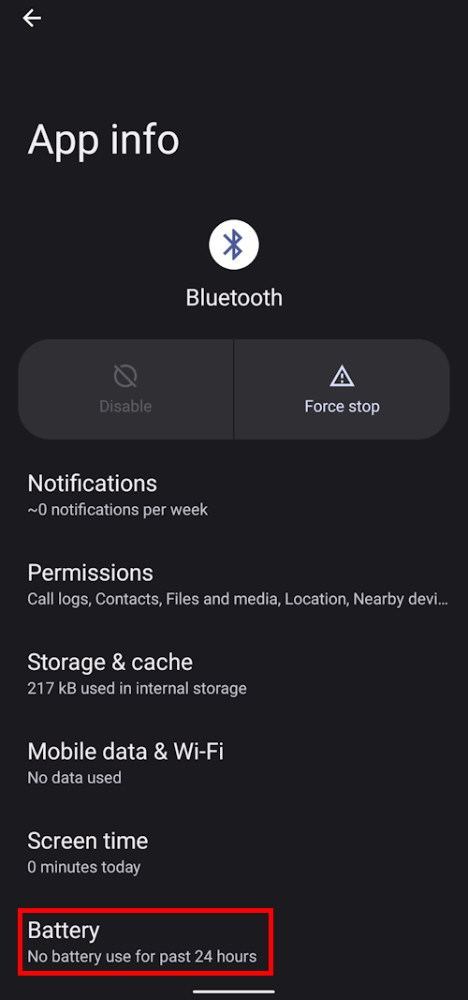
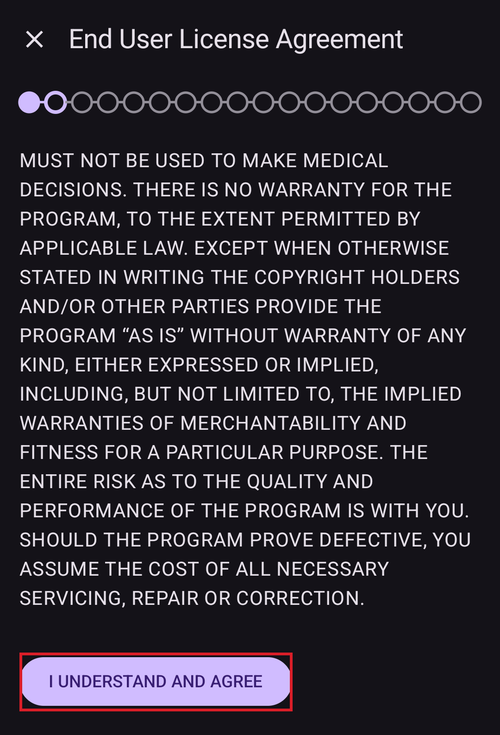
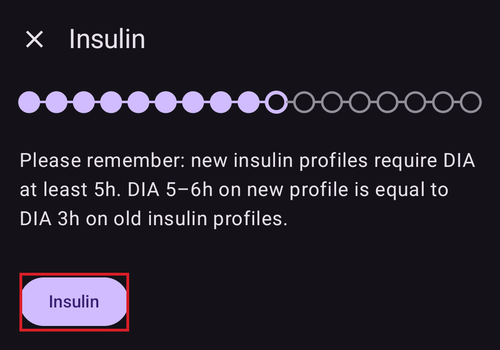
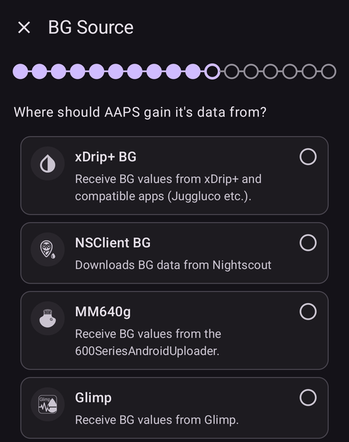
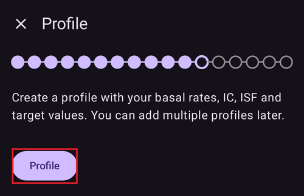
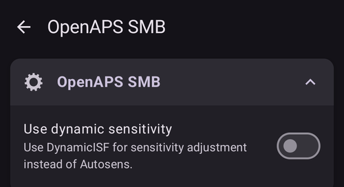
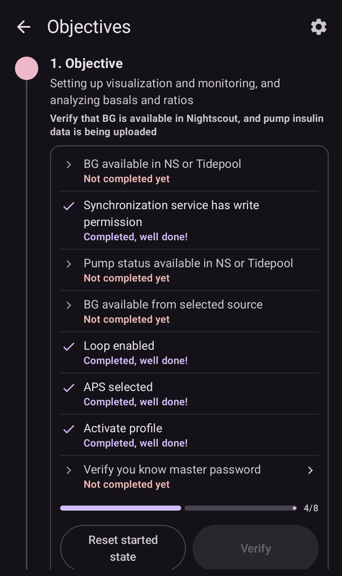

# Οδηγός εγκατάστασης του AAPS

```{contents} In this page
:backlinks: entry
:depth: 2
```

Όταν ξεκινάτε το **AAPS** για πρώτη φορά, σας καθοδηγεί ο «**Οδηγός εγκατάστασης**», ώστε να κάνετε γρήγορα όλες τις βασικές ρυθμίσεις της εφαρμογής με μία φορά. Ο **Οδηγός εγκατάστασης** σας καθοδηγεί, για να μην ξεχάσετε κάτι σημαντικό. Για παράδειγμα, οι **ρυθμίσεις αδειών** είναι βασικές για τη σωστή ρύθμιση του **AAPS**.

Όμως δεν είναι υποχρεωτικό να ρυθμίσετε τα πάντα πλήρως την πρώτη φορά που χρησιμοποιείτε τον **Οδηγό εγκατάστασης**. Μπορείτε εύκολα να βγείτε από τον Οδηγό και να επιστρέψετε αργότερα. Μετά τον **Οδηγό εγκατάστασης** υπάρχουν τρεις τρόποι για να βελτιώσετε ή να αλλάξετε περισσότερο τη διαμόρφωση. Αυτά θα εξηγηθούν στην επόμενη ενότητα. Γι' αυτό δεν πειράζει αν παραλείψετε κάποια σημεία στον Οδηγό εγκατάστασης· μπορείτε εύκολα να τα ρυθμίσετε αργότερα.

Κατά τη διάρκεια και αμέσως μετά τη χρήση του **Οδηγού εγκατάστασης** μπορεί να μη δείτε σημαντικές αλλαγές στο **AAPS**. Για να ενεργοποιήσετε το κύκλωμα του **AAPS**, πρέπει να ακολουθήσετε τα **Βήματα**, που ενεργοποιούν τη μία λειτουργία μετά την άλλη. Θα ξεκινήσετε το **Βήμα 1** στο τέλος του Οδηγού εγκατάστασης. Εσείς ελέγχετε το **AAPS**, όχι το αντίθετο.

```{admonition} Preview Objectives
:class: note
Αν θέλετε να μάθετε τη δομή των Βημάτων, διαβάστε τη σελίδα [Βήματα](../SettingUpAaps/CompletingTheObjectives.md), αλλά μετά επιστρέψτε εδώ για να ολοκληρώσετε πρώτα τον Οδηγό εγκατάστασης.

```

Από την εμπειρία γνωρίζουμε ότι οι νέοι χρήστες συχνά πιέζουν τον εαυτό τους να ρυθμίσουν το **AAPS** όσο πιο γρήγορα γίνεται. Αυτό μπορεί να φέρει απογοήτευση, γιατί υπάρχουν πολλά να μάθετε.

Γι' αυτό, αφιερώστε τον χρόνο που χρειάζεται για να ρυθμίσετε το κύκλωμά σας. Τα οφέλη ενός κυκλώματος **AAPS** που λειτουργεί καλά είναι τεράστια.

```{admonition} Ask for Help
:class: note
Αν υπάρχει λάθος στην τεκμηρίωση ή έχετε καλύτερη ιδέα για το πώς μπορεί να εξηγηθεί κάτι, μπορείτε να ζητήσετε βοήθεια από την κοινότητα, όπως εξηγείται στην ενότητα [Επικοινωνία με άλλους χρήστες](../GettingHelp/WhereCanIGetHelp.md).
```
## Μήνυμα καλωσορίσματος

Όταν ανοίγει ο Οδηγός εγκατάστασης, σας καλωσορίζει με ένα σύντομο μήνυμα και αμέσως δείχνει ένα πλαίσιο «**Απαιτούνται άδειες**» στο κάτω μέρος της οθόνης (δείτε την επόμενη ενότητα).

Αφού δώσετε τις άδειες, το πλαίσιο κλείνει και η οθόνη καλωσορίσματος δείχνει ένα κουμπί «**Επόμενο**». Πατήστε «**ΕΠΟΜΕΝΟ**» για να συνεχίσετε:


## Απαιτούμενες άδειες

Το **AAPS** χρειάζεται μερικές άδειες για να λειτουργεί σωστά. Ο Οδηγός τις συγκεντρώνει σε ένα πλαίσιο «**Απαιτούνται άδειες**», η καθεμία με το δικό της κουμπί «**Παραχώρηση**». Δώστε τις μία μία — το εικονίδιο δίπλα σε κάθε άδεια γίνεται τικ όταν ολοκληρωθεί.


### Βελτιστοποίηση μπαταρίας

Η κατανάλωση μπαταρίας στα smartphone είναι σημαντική, γιατί η απόδοση των μπαταριών είναι ακόμα αρκετά περιορισμένη. Γι' αυτό το λειτουργικό σύστημα Android στο smartphone σας περιορίζει τις εφαρμογές στο να εκτελούνται και να χρησιμοποιούν χρόνο CPU, άρα και μπαταρία.

Όμως το **AAPS** πρέπει να εκτελείται τακτικά, _π.χ._ για να λαμβάνει τις τιμές γλυκόζης κάθε λίγα λεπτά και μετά να εφαρμόζει τον αλγόριθμο, ώστε να αποφασίσει τι θα κάνει με τη γλυκόζη σας, με βάση τις ρυθμίσεις σας. Γι' αυτό πρέπει να εξαιρεθεί από τη βελτιστοποίηση μπαταρίας.

Πατήστε «**Παραχώρηση**» δίπλα στο «**Βελτιστοποίηση μπαταρίας**» και μετά επιλέξτε «**Να επιτρέπεται**» (Allow) στο παράθυρο «Να εκτελείται πάντα η εφαρμογή στο παρασκήνιο;»:


(SetupWizard-StoragePermission)=

### Φάκελος AAPS

Το **AAPS** πρέπει να αποθηκεύει τις ρυθμίσεις του και πληροφορίες καταγραφής στη μόνιμη μνήμη του smartphone σας. Μόνιμη αποθήκευση σημαίνει ότι τα δεδομένα θα υπάρχουν ακόμα και μετά την επανεκκίνηση του τηλεφώνου σας. Οι άλλες πληροφορίες απλώς χάνονται, γιατί δεν αποθηκεύονται σε μόνιμη μνήμη.

Πατήστε «**Παραχώρηση**» δίπλα στο «**Φάκελος AAPS**». Αυτό ανοίγει τα αρχεία του τηλεφώνου σας και σας αφήνει να επιλέξετε πού θα αποθηκεύει το **AAPS** τις πληροφορίες του.

```{tip}
Προτείνεται να επιλέξετε τον προεπιλεγμένο φάκελο AAPS.</br>
**Μην** επιλέξετε υποφάκελο του AAPS.
```

Ο προεπιλεγμένος φάκελος είναι ο **AAPS**, αλλά μπορείτε να χρησιμοποιήσετε όποιον ξεχωριστό φάκελο θέλετε. Δημιουργήστε τον φάκελο αν χρειάζεται, μπείτε σε αυτόν και επιλέξτε «**ΧΡΗΣΗ ΑΥΤΟΥ ΤΟΥ ΦΑΚΕΛΟΥ**» (USE THIS FOLDER):


Επιβεβαιώστε με «**ΝΑ ΕΠΙΤΡΕΠΕΤΑΙ**» (ALLOW) ότι θέλετε να δώσετε στο **AAPS** πρόσβαση στον επιλεγμένο φάκελο:


### Ειδοποιήσεις

Το Android απαιτεί ειδική άδεια για τις εφαρμογές που θέλουν να σας στέλνουν ειδοποιήσεις.

Είναι καλό να απενεργοποιείτε τις ειδοποιήσεις, _π.χ._ από εφαρμογές κοινωνικής δικτύωσης, αλλά είναι απαραίτητο να επιτρέψετε στο **AAPS** να σας στέλνει ειδοποιήσεις.

Πατήστε «**Παραχώρηση**» δίπλα στο «**Ειδοποιήσεις**» και επιλέξτε «**Να επιτρέπεται**» (Allow) στο μήνυμα του συστήματος:


### Ξυπνητήρια και υπενθυμίσεις

Στο **Android 14 και νεότερο**, το **AAPS** χρειάζεται την άδεια «**Ξυπνητήρια και υπενθυμίσεις**», ώστε οι συναγερμοί να ανάβουν την οθόνη ενώ το **AAPS** είναι στο παρασκήνιο και οι υπενθυμίσεις (για παράδειγμα από έναν **Αυτοματισμό**) να χτυπούν στην ώρα τους.

Αυτή η άδεια εμφανίζεται μόνο όταν χρειάζεται. Όταν το **AAPS** εξαιρεθεί από τη βελτιστοποίηση μπαταρίας (δείτε παραπάνω), το Android δίνει αυτόματα την άδεια για ακριβή ξυπνητήρια και η άδεια εξαφανίζεται από τη λίστα. Αν εμφανίζεται ακόμα, πατήστε «**Παραχώρηση**» δίπλα στο «**Ξυπνητήρια και υπενθυμίσεις**». Αυτό ανοίγει μια οθόνη ρυθμίσεων του συστήματος για το **AAPS**. Ενεργοποιήστε τον διακόπτη και επιστρέψτε στο **AAPS**. Στο Android 13 και παλαιότερο αυτή η άδεια δεν εμφανίζεται και δεν χρειάζεται να κάνετε τίποτα.

Όταν όλες οι άδειες δείχνουν τικ (τρεις, ή τέσσερις στο Android 14 και νεότερο), το πλαίσιο «**Απαιτούνται άδειες**» κλείνει μόνο του και μπορείτε να πατήσετε «**ΕΠΟΜΕΝΟ**» στην οθόνη καλωσορίσματος για να συνεχίσετε.

(setup-wizard-bluetooth-battery-optimisation)=
### Βελτιστοποίηση μπαταρίας του Bluetooth

```{admonition} Extra Android setting, not part of the Wizard
:class: note
Τα παρακάτω είναι πρόσθετη ρύθμιση του Android, που γίνεται έξω από τον Οδηγό εγκατάστασης. Δεν είναι ένα από τα κουμπιά «Παραχώρηση» παραπάνω, αλλά είναι σημαντικό για αξιόπιστη σύνδεση με την αντλία.
```

Οι νεότερες εκδόσεις του Android εφαρμόζουν βελτιστοποίηση μπαταρίας και στην εφαρμογή συστήματος Bluetooth.

Εκτός από την απενεργοποίηση της βελτιστοποίησης μπαταρίας για το **AAPS**, πιθανότατα πρέπει να την απενεργοποιήσετε και για την εφαρμογή συστήματος Bluetooth. Αν δεν το κάνετε, μπορεί να έχετε διακοπές και προβλήματα στη σύνδεση με την αντλία.

***ΣΗΜΕΙΩΣΗ: Η τεκμηρίωση του xDrip εξηγεί πώς να το κάνετε εδώ: [τεκμηρίωση του xDrip](https://navid200.github.io/xDrip/docs/BluetoothBatteryOpt.html)***

Ακολουθήστε αυτά τα βήματα στο Android 16. Σε άλλες εκδόσεις οι οθόνες θα είναι λίγο διαφορετικές από τις εικόνες:

1. Ανοίξτε τις ρυθμίσεις του Android, αναζητήστε **Εφαρμογές** (Apps) και ανοίξτε τις ρυθμίσεις εφαρμογών.

   

2. Θα δείτε τις ρυθμίσεις εφαρμογών. Πρέπει όμως να εμφανίσετε όλες τις εφαρμογές: πατήστε **Εμφάνιση όλων των εφαρμογών** (See all apps).

   

3. Η εφαρμογή Bluetooth είναι εφαρμογή συστήματος και είναι κρυφή από προεπιλογή, οπότε πρέπει να εμφανίσουμε τις εφαρμογές συστήματος. Πατήστε τις **τρεις τελείες** (⋮) πάνω δεξιά (1). Μετά πατήστε **Εμφάνιση συστήματος** (Show system) (2).

   

4. Αναζητήστε την εφαρμογή `Bluetooth` και πατήστε `Bluetooth` ή/και `Legacy Bluetooth`. Αν υπάρχουν και οι δύο, κάντε τη διαδικασία και για τις δύο.

   ***ΣΗΜΕΙΩΣΗ: Μπορείτε να αγνοήσετε την `Bluetooth MIDI Service`, δεν τη χρησιμοποιεί το AAPS***

           

   1. On Android 12 click on `Battery`, on Android 13+ click on `App battery usage`.

      

5. Στο Android 12+ επιλέξτε `Unrestricted` (Χωρίς περιορισμούς). Στο Android 15+ πρέπει να ανοίξετε τη ρύθμιση `Allow background usage` (Να επιτρέπεται η χρήση στο παρασκήνιο): πατήστε την περιοχή με το κόκκινο πλαίσιο και μετά ακολουθήστε το βήμα 6 για να ολοκληρώσετε.

       

6. Στο Android 16 επιλέξτε `Unrestricted` (Χωρίς περιορισμούς)

   

## Άδεια χρήσης

Η άδεια χρήσης τελικού χρήστη περιέχει σημαντικές πληροφορίες για τα νομικά θέματα της χρήσης του **AAPS**. Διαβάστε την προσεκτικά.

Αν δεν καταλαβαίνετε ή δεν μπορείτε να συμφωνήσετε με την άδεια χρήσης τελικού χρήστη, μη χρησιμοποιήσετε καθόλου το **AAPS**!

Αν καταλαβαίνετε και συμφωνείτε, πατήστε το κουμπί «**ΚΑΤΑΛΑΒΑ ΚΑΙ ΣΥΜΦΩΝΩ**» και ακολουθήστε τον Οδηγό εγκατάστασης:



Όταν συμφωνήσετε, εμφανίζεται ένα κουμπί «**Επόμενο**». Πατήστε «**ΕΠΟΜΕΝΟ**».

Η επόμενη οθόνη, «**Άδειες**», δείχνει ξανά τις άδειες. Όλες πρέπει να δείχνουν τικ, αφού τις δώσατε στην αρχή. Αν λείπει κάποια, πατήστε «**Παραχώρηση**» δίπλα της. Πατήστε «**ΕΠΟΜΕΝΟ**» για να συνεχίσετε:


## Κύριος κωδικός

Η διαμόρφωση του **AAPS** περιέχει κάποια ευαίσθητα δεδομένα (_π.χ._ το διακριτικό πρόσβασης για τον διακομιστή Nightscout σας). Γι' αυτό κρυπτογραφείται με έναν κωδικό που ορίζετε εδώ.

Ο Οδηγός δείχνει «**Ο κωδικός δεν ορίστηκε**». Πατήστε «**Ορισμός**»:


Αυτό ανοίγει την οθόνη «**Προστασία**». Πατήστε «**Κύριος κωδικός**» (με την ένδειξη «Ο κωδικός δεν ορίστηκε»):


Εισάγετε τον ίδιο κωδικό και στα δύο πεδία και πατήστε «**OK**»:


Επιστρέψτε με το βέλος πάνω αριστερά. Ο Οδηγός τώρα δείχνει «**Ο κωδικός ορίστηκε!**»:


```{admonition} Do not lose your Master Password
:class: danger
**ΜΗ ΧΑΣΕΤΕ ΤΟΝ ΚΥΡΙΟ ΚΩΔΙΚΟ ΣΑΣ**. Σημειώστε τον κάπου, _π.χ._ στο Google Drive. Είναι καλή θέση, γιατί η Google κρατά αντίγραφα ασφαλείας για εσάς. Το τηλέφωνο ή ο υπολογιστής σας μπορεί να χαλάσει και να μην έχετε κανένα αντίγραφο. Αν ξεχάσετε τον Κύριο κωδικό σας, μπορεί να είναι δύσκολο να ανακτήσετε αργότερα τις ρυθμίσεις του προφίλ σας και την πρόοδό σας στα **Βήματα**.
```

Όταν τελειώσετε, πατήστε «**ΕΠΟΜΕΝΟ**» για να πάτε στην επόμενη οθόνη.

(setup-wizard-import-settings)=
## Εισαγωγή ρυθμίσεων

Αυτή η οθόνη εμφανίζεται μόνο όταν το **AAPS** βρει ρυθμίσεις που εξάγατε παλαιότερα στον φάκελο **AAPS** («Βρέθηκαν αποθηκευμένες ρυθμίσεις»), για παράδειγμα όταν εγκαθιστάτε ξανά την εφαρμογή ή περνάτε σε νέο τηλέφωνο.

- Για να επαναφέρετε την προηγούμενη διαμόρφωσή σας, πατήστε «**Εισαγωγή ρυθμίσεων**» — δείτε [Εξαγωγή και εισαγωγή ρυθμίσεων](../Maintenance/ExportImportSettings.md).
- Για να ξεκινήσετε με νέα διαμόρφωση, πατήστε «**ΕΠΟΜΕΝΟ**» και συνεχίστε με τον Οδηγό.


## Μονάδες (mg/dl <-> mmol/l)

Επιλέξτε αν οι τιμές γλυκόζης σας είναι σε mg/dl ή mmol/l και μετά πατήστε το κουμπί «**ΕΠΟΜΕΝΟ**»:


## Ρυθμίσεις Εμφάνισης

Εδώ ορίζετε το «**ΧΑΜΗΛΟ σημείο**» και το «**ΥΨΗΛΟ σημείο**» για την εμφάνιση της γλυκόζης του αισθητήρα. Οι τιμές γλυκόζης ανάμεσα σε αυτά τα δύο σημεία εμφανίζονται ως «εντός στόχου». Μπορείτε να αφήσετε τις προεπιλεγμένες τιμές (72 και 180 mg/dl) προς το παρόν και να τις αλλάξετε αργότερα.

Οι τιμές που επιλέγετε επηρεάζουν μόνο την εμφάνιση του γραφήματος και τίποτε άλλο.

Ο στόχος γλυκόζης σας, _π.χ._, ρυθμίζεται χωριστά στο προφίλ σας.

Το εύρος σας για την ανάλυση του TIR (χρόνος εντός εύρους) ρυθμίζεται χωριστά στον διακομιστή αναφορών σας.

Αλλάξτε τα σημεία με τα κουμπιά «−» / «+» αν χρειάζεται και μετά πατήστε το κουμπί «**ΕΠΟΜΕΝΟ**»:


(SetupWizard-synchronization-with-the-reporting-server-and-more)=
## Επικοινωνία

Η οθόνη «**Επικοινωνία**» δείχνει τα πρόσθετα που χρησιμοποιούνται για την αποστολή, τον συγχρονισμό και τη μετάδοση των δεδομένων σας:

- **Επικοινωνία με SMS** – απομακρυσμένος έλεγχος του **AAPS** με εντολές SMS
- **NSClientV3** – συγχρονίζει τα δεδομένα σας με το Nightscout μέσω του API v3
- **Tidepool** – στέλνει δεδομένα στο Tidepool
- **xDrip** – στέλνει δεδομένα στο xDrip
- **Open Humans** – ανεβάστε και δωρίστε τα δεδομένα του διαβήτη σας σε επιστημονικά έργα
- **Wear** – παρακολούθηση και έλεγχος του **AAPS** από ρολόι WearOS
- **Εξωτερικές συνοδευτικές εφαρμογές** – μετάδοση δεδομένων σε διάφορες εξωτερικές εφαρμογές
- **Garmin** – σύνδεση με συσκευή Garmin


Κάντε κύλιση προς τα κάτω για να δείτε την υπόλοιπη λίστα:


Μπορείτε να ρυθμίσετε αρκετά από αυτά τώρα, αλλά την πρώτη φορά θα ασχοληθούμε μόνο με τον διακομιστή αναφορών. Αν δεν μπορείτε να τον ρυθμίσετε τώρα, παραλείψτε το προς το παρόν — μπορείτε να το ρυθμίσετε αργότερα.

Σε αυτό το παράδειγμα χρησιμοποιούμε το Nightscout ως διακομιστή αναφορών. Επιλέξτε το κουτάκι δεξιά από το «**NSClientV3**» για να το ενεργοποιήσετε. Για το Tidepool είναι ακόμα πιο απλό, γιατί χρειάζεστε μόνο τα προσωπικά σας στοιχεία σύνδεσης.

Αφού το ενεργοποιήσετε, πατήστε «**Ρυθμίσεις**» κάτω από το NSClientV3 για να το ρυθμίσετε:


Εδώ ρυθμίζετε τον διακομιστή αναφορών Nightscout. Οι ρυθμίσεις του NSClientV3 εμφανίζονται σε μία σελίδα που κυλά:


Πατήστε «**Διεύθυνση Nightscout**» και εισάγετε τη διεύθυνση του προσωπικού σας διακομιστή Nightscout (τη διεύθυνση URL που ρυθμίσατε μόνοι σας ή που σας έδωσε ο πάροχός σας). Επιβεβαιώστε με «**OK**».

Πατήστε «**Διακριτικό πρόσβασης Nightscout**» και εισάγετε το διακριτικό πρόσβασης (access token) για τον διακομιστή Nightscout σας. Χωρίς αυτό το διακριτικό η πρόσβαση δεν θα λειτουργήσει. Αν δεν το έχετε ακόμα, δείτε την τεκμηρίωση για τη ρύθμιση του διακομιστή αναφορών.

Αφήστε ενεργό το «**Χρήση websockets**» για επικοινωνία σε πραγματικό χρόνο με το Nightscout.

Οι υπόλοιπες ενότητες μπορούν να μείνουν με τις προεπιλογές προς το παρόν. Τις περιγράφουμε εδώ για να ξέρετε πού θα τις βρείτε αργότερα:

**Επιλογές συναγερμού** — συναγερμοί Nightscout, ανακοινώσεις και όρια για παλιά δεδομένα. Αφήστε τους διακόπτες απενεργοποιημένους προς το παρόν. Τις ανοίγουμε μόνο για να ξέρετε ότι υπάρχουν αυτές οι επιλογές.

**Ρυθμίσεις σύνδεσης** — επιλέξτε πώς μεταφέρονται τα δεδομένα. Οι φροντιστές πρέπει να ενεργοποιήσουν το «**Χρήση δεδομένων κινητής**». Αλλιώς το τηλέφωνο του ατόμου που φροντίζουν (_π.χ._ ενός παιδιού) δεν μπορεί να στείλει δεδομένα έξω από την εμβέλεια του Wi-Fi, _π.χ._ στον δρόμο για το σχολείο. Οι άλλοι χρήστες μπορούν να απενεργοποιήσουν τη μεταφορά μέσω κινητής για να εξοικονομήσουν δεδομένα ή μπαταρία. Αν έχετε αμφιβολίες, αφήστε τα όλα ενεργά.


**Ρυθμίσεις για Προχωρημένους** — ενεργοποιήστε το «**Καταγραφή εκκίνησης εφαρμογής**» αν θέλετε να βλέπετε στο Nightscout πότε ξεκινά ξανά η εφαρμογή (χρήσιμο για φροντιστές). Αφήστε ενεργά τα «**Ανακοινώσεις από σφάλματα**» και «**Ανακοινώσεις από απαιτούμενους υδατάνθρακες**». Αφήστε ανενεργό το «**Αργός συγχρονισμός**». Το χρησιμοποιείτε μόνο αν ο διακομιστής Nightscout επεξεργάζεται αργά μεγάλο όγκο δεδομένων.


Επιστρέψτε στη λίστα των πρόσθετων και πατήστε «**ΕΠΟΜΕΝΟ**» για να πάτε στην επόμενη οθόνη.

## Έλεγχος από πελάτες

Από την έκδοση 4 του **AAPS**, συσκευές-πελάτες με το **AAPSClient** μπορούν να κάνουν **σύζευξη** με αυτό το τηλέφωνο (την **κύρια συσκευή**) και να το ελέγχουν με υπογεγραμμένες εντολές μέσω Nightscout. Αυτός είναι ο νέος προτεινόμενος τρόπος για απομακρυσμένο έλεγχο του **AAPS** — δείτε [Έλεγχος κύριας συσκευής ↔ πελάτη](../RemoteFeatures/ClientMasterControl.md) για την πλήρη εξήγηση και τη ρύθμιση.

Δεν χρειάζεται να ρυθμίσετε τίποτα σε αυτή την οθόνη τώρα. Μπορείτε να κάνετε σύζευξη πελατών οποιαδήποτε στιγμή αργότερα από **Διαχείριση → Εξουσιοδοτημένοι πελάτες**. Εκεί προσθέτετε έναν πελάτη με **κωδικό QR** (ρυθμίζει και το Nightscout στον πελάτη) ή με **PIN** και του δίνετε έναν **ρόλο**.

- «**Εξουσιοδοτημένοι πελάτες**» — διαχείριση των συζευγμένων συσκευών-πελατών που επιτρέπεται να ελέγχουν αυτή την κύρια συσκευή.
- «**Αποδοχή δεδομένων Nightscout**» — η αποδοχή θεραπειών και δεδομένων που εισάγονται απευθείας στο Nightscout (ο παλιός, λιγότερο ασφαλής τρόπος) είναι πλέον απενεργοποιημένη από προεπιλογή. Ανοίξτε αυτές τις ρυθμίσεις μόνο αν τη χρειάζεστε ακόμα, _π.χ._ για να εισάγετε δεδομένα μέσω Nightscout ή εφαρμογών τρίτων.

Όταν ο έλεγχος από πελάτες είναι ήδη ενεργός — πάντα στην [Απλή λειτουργία](#preferences-simple-mode) — αυτό το τηλέφωνο είναι σε [ενισχυμένη λειτουργία](#client-master-control-hardened-mode): δέχεται αλλαγές μόνο από συζευγμένους πελάτες. Γι' αυτό η οθόνη εξηγεί την ενισχυμένη λειτουργία αντί να δείχνει τις ρυθμίσεις «**Αποδοχή δεδομένων Nightscout**».


Το «**Αποδοχή δεδομένων Nightscout**» ανοίγει τις ρυθμίσεις «**Συγχρονισμός**», όπου κάθε είδος δεδομένων που λαμβάνεται από το Nightscout έχει τον δικό του διακόπτη:


Πατήστε «**ΕΠΟΜΕΝΟ**» για να πάτε στην επόμενη οθόνη.

(setup-wizard-instance-name)=
## Ποιος χρησιμοποιεί αυτό το τηλέφωνο;

Εδώ εισάγετε το όνομα του ατόμου που χρησιμοποιεί αυτό το τηλέφωνο. Ξεχωρίζει αυτή την εγκατάσταση του **AAPS** από άλλες στις αναφορές και στον συγχρονισμό, για παράδειγμα αν δύο παιδιά στην οικογένειά σας χρησιμοποιούν **AAPS**. Χρησιμοποιείται επίσης στα ονόματα των αρχείων εξαγόμενων ρυθμίσεων και εμφανίζεται στο ρολόι.

Μπορεί να είναι οτιδήποτε. Μπορείτε να το αλλάξετε αργότερα στις **Ρυθμίσεις → Γενικά → Όνομα εγκατάστασης**.

Πατήστε «**ΕΠΟΜΕΝΟ**» για να πάτε στην επόμενη οθόνη.


## Τύπος ασθενή

Εδώ επιλέγετε τον «Τύπος ασθενή». Αυτό είναι σημαντικό, γιατί το λογισμικό **AAPS** έχει διαφορετικά όρια ανάλογα με την ηλικία του ασθενή. Αυτό είναι σημαντικό για λόγους ασφάλειας.

Εδώ ρυθμίζετε επίσης το **μέγιστο επιτρεπτό bolus** για ένα γεύμα. Δηλαδή το μεγαλύτερο bolus που χρειάζεστε για να καλύψετε τα συνηθισμένα γεύματά σας. Είναι μια λειτουργία ασφαλείας που βοηθά να αποφύγετε κατά λάθος υπερδοσολογία όταν κάνετε bolus για ένα γεύμα.

Το δεύτερο όριο είναι παρόμοιο, αλλά αφορά τη μέγιστη ποσότητα υδατανθράκων που περιμένετε να φάτε.

Αφού ορίσετε αυτές τις τιμές, πατήστε «**ΕΠΟΜΕΝΟ**» για να πάτε στην επόμενη οθόνη:


## Ινσουλίνη

Εδώ ρυθμίζετε την ινσουλίνη που χρησιμοποιείτε στην αντλία σας. Τα νέα προφίλ ινσουλίνης απαιτούν **DIA τουλάχιστον 5 ωρών**.

Πατήστε το κουμπί «**Ινσουλίνη**» για να ανοίξετε τον επεξεργαστή ινσουλίνης:



Στον επεξεργαστή μπορείτε να δώσετε στην ινσουλίνη ένα **ψευδώνυμο** και να ορίσετε την **Κορυφή** της (σε λεπτά) και τη **DIA** (σε ώρες). Ο πιο γρήγορος τρόπος είναι να φορτώσετε μια έτοιμη ρύθμιση με το «**Φόρτωση κορυφής από**» — επιλέξτε **Novorapid**, **Fiasp** ή **Lyumjev** — και η κορυφή συμπληρώνεται αυτόματα. Το γράφημα στο κάτω μέρος δείχνει την καμπύλη δράσης της ινσουλίνης που προκύπτει.


Επιλέξτε την έτοιμη ρύθμιση που ταιριάζει με την ινσουλίνη σας, για παράδειγμα **Fiasp**:


```{admonition} Use your insulin brand's preset peak
:class: danger
Μην αλλάζετε την κορυφή αν δεν είστε ειδικός — συνήθως οι έτοιμες τιμές λειτουργούν καλά για κάθε εμπορική ινσουλίνη.
```

Αν είστε νέος χρήστης του **AAPS**, ορίστε τη **DIA** στις 9 ώρες — δείτε [Διάρκεια δράσης ινσουλίνης (DIA) και κορυφή](#Config-Builder-insulin-dia) για να καταλάβετε γιατί.

```{admonition} "Insulin configuration changed" dialog
:class: note
Αν ένας συζευγμένος πελάτης (_π.χ._ ένα άλλο τηλέφωνο) έχει αλλάξει τη διαμόρφωση της ινσουλίνης, εμφανίζεται ένα παράθυρο. Πατήστε **OK** για να φορτώσετε τις αλλαγές του ή **Ακύρωση** για να συνεχίσετε την επεξεργασία (η επόμενη αποθήκευσή σας θα αντικαταστήσει τις δικές του).
```


Πατήστε το εικονίδιο αποθήκευσης (πάνω δεξιά) και μετά πατήστε «**ΕΠΟΜΕΝΟ**» για να πάτε στην επόμενη οθόνη.

## Πηγή γλυκόζης αίματος

Εδώ επιλέγετε από πού παίρνει το **AAPS** τα δεδομένα γλυκόζης. Διαβάστε την τεκμηρίωση για την [πηγή BG](../Getting-Started/CompatiblesCgms.md) σας.

Υπάρχουν πολλές πηγές — κυλήστε τη λίστα και επιλέξτε αυτή που χρησιμοποιείτε:



Όταν επιλέξετε μια πηγή, η κάρτα της ανοίγει και δείχνει δύο κουμπιά: «**Ρυθμίσεις**» για να ρυθμίσετε πώς λαμβάνονται τα δεδομένα και «**Άνοιγμα πρόσθετου**» για να ανοίξετε την οθόνη της πηγής. Στο παρακάτω παράδειγμα είναι επιλεγμένο το **BYODA**. Κάποιες πηγές δεν έχουν τίποτα να ρυθμίσετε σε αυτό το στάδιο, οπότε συνήθως μπορείτε να πάτε κατευθείαν στην επόμενη οθόνη:


Αφού κάνετε την επιλογή σας, πατήστε «**ΕΠΟΜΕΝΟ**» για να πάτε στην επόμενη οθόνη.

(setup-wizard-profile)=
## Προφίλ

Τώρα φτάνουμε σε ένα πολύ σημαντικό μέρος του Οδηγού εγκατάστασης.

Διαβάστε την τεκμηρίωση για τα [προφίλ](../SettingUpAaps/YourAapsProfile.md) πριν προσπαθήσετε να εισάγετε τα στοιχεία του προφίλ σας στην επόμενη οθόνη.

```{admonition} Working profile required - no exceptions here !
:class: danger
Ένα ακριβές προφίλ είναι απαραίτητο για την ασφαλή λειτουργία του **AAPS**.

Πρέπει να έχετε καθορίσει και συζητήσει το προφίλ σας με τον γιατρό σας και να έχει αποδειχθεί ότι λειτουργεί, με επιτυχημένους ελέγχους του βασικού ρυθμού, του ISF και του IC!

Αν ένα ρομπότ πάρει λάθος δεδομένα, θα αποτύχει - κάθε φορά. Το **AAPS** μπορεί να δουλέψει μόνο με τις πληροφορίες που του δίνετε. Αν το προφίλ σας είναι πολύ ισχυρό, κινδυνεύετε με υπογλυκαιμία. Αν είναι πολύ αδύναμο, κινδυνεύετε με υπεργλυκαιμία. 
```

Πατήστε το κουμπί «**Προφίλ**» για να ανοίξετε τον επεξεργαστή προφίλ:



Ο επεξεργαστής ανοίγει άδειος («Δεν υπάρχουν διαθέσιμες εγγραφές»). Πατήστε το κουμπί «**+**» στο κάτω μέρος για να δημιουργήσετε ένα νέο προφίλ:


Μακροπρόθεσμα μπορείτε να έχετε πολλά προφίλ, αν χρειάζεται. Εδώ δημιουργούμε μόνο ένα.

```{admonition} Profile only for tutorial - not for your usage
:class: note
Το προφίλ του παραδείγματος υπάρχει μόνο για να σας δείξει πώς να εισάγετε δεδομένα.

Δεν είναι ένα ακριβές ή καλά βελτιστοποιημένο προφίλ, γιατί οι ανάγκες κάθε ατόμου είναι πολύ διαφορετικές.

Μην το χρησιμοποιείτε για πραγματικό κύκλωμα!
```

Το νέο προφίλ (για παράδειγμα «**LocalProfile1**») έχει τέσσερις καρτέλες: **IC**, **ISF**, **BAS** και **ΣΤΟΧΟΣ**. Πατήστε το μολύβι δίπλα στο όνομα του προφίλ για να το μετονομάσετε. Συμπληρώστε κάθε καρτέλα — μια καρτέλα μένει κόκκινη και δείχνει μήνυμα σφάλματος μέχρι να έχει έγκυρες τιμές:


Πατήστε «**IC**» και εισάγετε τις τιμές [IC](#your-aaps-profile-insulin-to-carbs-ratio) σας. Χρησιμοποιήστε το κουμπί «**+**» για να προσθέσετε περισσότερα χρονικά διαστήματα:


Πατήστε «**ISF**» και εισάγετε τις [τιμές ISF](#your-aaps-profile-insulin-sensitivity-factor) σας:


Πατήστε «**BAS**» και εισάγετε τις [τιμές βασικού ρυθμού](#your-aaps-profile-basal-rates) σας:


Πατήστε «**ΣΤΟΧΟΣ**» και εισάγετε τις τιμές στόχου γλυκόζης αίματος.

Στο ανοιχτό κύκλωμα αυτός ο στόχος μπορεί να είναι ένα ευρύτερο εύρος. Αλλιώς το **AAPS** θα σας ειδοποιεί συνέχεια να αλλάξετε τον προσωρινό βασικό ρυθμό ή κάποια άλλη ρύθμιση, κάτι που μπορεί να είναι κουραστικό.

Αργότερα, για το κλειστό κύκλωμα, θα έχετε συνήθως μόνο μία τιμή για το πάνω και το κάτω όριο. Έτσι το **AAPS** πετυχαίνει πιο εύκολα τον στόχο και σας δίνει καλύτερο συνολικό έλεγχο του διαβήτη.


Όταν και οι τέσσερις καρτέλες είναι έγκυρες, το **εικονίδιο αποθήκευσης** (πάνω δεξιά) ενεργοποιείται. Πατήστε το για να αποθηκεύσετε το προφίλ:


Κλείστε τον επεξεργαστή με το «**X**» πάνω αριστερά. Η σύνοψη του προφίλ δείχνει τότε το όνομά του, τον συνολικό ημερήσιο βασικό ρυθμό (∑), τις μονάδες και τις τιμές IC και ISF με τα γραφήματά τους:


```{admonition} Several defined but only one active profile
:class: note
Μπορείτε να έχετε πολλά προφίλ, αλλά μόνο ένα ενεργό προφίλ κάθε φορά.
```

Πατήστε το κουμπί «**▶**» (ενεργοποίηση) κάτω δεξιά. Ανοίγει η οθόνη «**Ενεργοποίηση**». Επειδή δεν χρησιμοποιείται ακόμα καμία ινσουλίνη, σας ζητά πρώτα να επιλέξετε την ινσουλίνη που χρησιμοποιείτε, ώστε η αλλαγή προφίλ να την καταγράψει. Το κουμπί «**Ενεργοποίηση**» μένει γκρι μέχρι να το κάνετε:


Πατήστε «**Επιλογή ινσουλίνης**» και επιλέξτε την ινσουλίνη που ρυθμίσατε νωρίτερα. Αφήστε το ποσοστό στο 100% και πατήστε «**Ενεργοποίηση**»:


Εμφανίζεται ένα παράθυρο αλλαγής προφίλ. Σε αυτή την περίπτωση αφήστε τις προεπιλογές και επιβεβαιώστε με «**OK**»:

```{admonition} Profile switch dialog
:class: note
Αργότερα θα μάθετε πώς να χρησιμοποιείτε αυτό το γενικό παράθυρο σε καταστάσεις όπως ασθένεια ή άθληση, όπου πρέπει να αλλάξετε το προφίλ σας ανάλογα με τις συνθήκες.
```


Το προφίλ σας είναι τώρα ενεργό. Πατήστε «**ΕΠΟΜΕΝΟ**» για να πάτε στην επόμενη οθόνη.

## Αντλία ινσουλίνης

Τώρα επιλέγετε την αντλία ινσουλίνης σας. Διαβάστε την τεκμηρίωση για την [αντλία ινσουλίνης](../Getting-Started/CompatiblePumps.md) σας.

Κυλήστε τη λίστα και επιλέξτε την αντλία σας. Σε αυτό το παράδειγμα χρησιμοποιούμε την «**Εικονική Αντλία**», που είναι χρήσιμη όσο ακόμα μαθαίνετε και δεν έχετε συνδέσει πραγματική αντλία:


Υποστηρίζονται πολλές αντλίες — κυλήστε προς τα κάτω για να βρείτε τη δική σας:


Όταν επιλέγετε μια πραγματική αντλία, το **AAPS** ζητά επιβεβαίωση, γιατί θα αντιγράψει τους βασικούς ρυθμούς του προφίλ σας στην αντλία και θα αντικαταστήσει τους βασικούς ρυθμούς που είναι αποθηκευμένοι εκεί. Πατήστε «**OK**» μόνο αν οι βασικοί ρυθμοί στο προφίλ σας στο **AAPS** είναι σωστοί. Αλλιώς πατήστε «**Ακύρωση**» και αλλάξτε στην αντλία αργότερα:


If the pump you select communicates over Bluetooth, **AAPS** asks for permission to connect to nearby devices once you finish the Wizard (see [Bluetooth permission](#setup-wizard-bluetooth-permission)).

Αν έχετε ήδη ρυθμίσει το προφίλ σας και ξέρετε πώς να συνδέσετε την αντλία σας, μπορείτε να τη συνδέσετε τώρα. Αλλιώς αφήστε την **Εικονική Αντλία** προς το παρόν — μπορείτε να την αλλάξετε οποιαδήποτε στιγμή. Ή βγείτε από τον Οδηγό εγκατάστασης με το βέλος πάνω αριστερά και αφήστε το **AAPS** να σας δείξει πρώτα κάποιες τιμές γλυκόζης αίματος.

Πατήστε «**ΕΠΟΜΕΝΟ**» για να πάτε στην επόμενη οθόνη.

## Ο αλγόριθμος του APS

Χρησιμοποιήστε τον αλγόριθμο OpenAPS SMB ως αλγόριθμο APS. Παρά το όνομα, η λειτουργία SMB του αλγορίθμου είναι απενεργοποιημένη μέχρι να εξοικειωθείτε με το AAPS και να ολοκληρώσετε τα πρώτα Βήματα. Το OpenAPS SMB είναι έτσι κι αλλιώς νεότερο και γενικά καλύτερο από το OpenAPS AMA.

Το SMB είναι απενεργοποιημένο στην αρχή, γιατί η λειτουργία SMB αντιδρά πιο γρήγορα στην άνοδο της γλυκόζης αίματος, με ένα Super Micro Bolus αντί να αυξάνει το ποσοστό του βασικού ρυθμού. Επειδή στην αρχή το προφίλ σας συνήθως δεν είναι τόσο καλό όσο μετά από κάποια εμπειρία, η λειτουργία είναι αρχικά απενεργοποιημένη.

```{admonition} Only use the older algorithm **OpenAPS AMA** if you know what you are doing
:class: note
Το OpenAPS AMA είναι ο πιο βασικός αλγόριθμος και δεν υποστηρίζει μικρά bolus (micro bolus) για τη διόρθωση υψηλών τιμών. Μπορεί να υπάρχουν περιπτώσεις όπου είναι καλύτερο να χρησιμοποιήσετε αυτόν τον αλγόριθμο, αλλά δεν είναι η σύστασή μας.
```

Επιλέξτε «**OpenAPS SMB**» και μετά πατήστε «**Ρυθμίσεις**» για να δείτε τις λεπτομέρειες:


Η μόνη επιλογή εδώ είναι το «**Χρήση δυναμικής ευαισθησίας**». Αφήστε το απενεργοποιημένο και μην αλλάξετε τίποτα προς το παρόν — απλώς διαβάστε το κείμενο.

Λόγω των περιορισμών των **Βημάτων**, έτσι κι αλλιώς δεν μπορείτε να χρησιμοποιήσετε ακόμα ούτε «κλειστό κύκλωμα» ούτε «λειτουργίες SMB».

Επιστρέψτε και πατήστε «**ΕΠΟΜΕΝΟ**» για να πάτε στην επόμενη οθόνη:



## Ανίχνευση ευαισθησίας

Αφήστε επιλεγμένο το «**Ευαισθησία Oref1**» ως το βασικό πρόσθετο ευαισθησίας:


Αν πατήσετε «**Ρυθμίσεις**», μπορείτε να δείτε τις ρυθμίσεις απορρόφησης. Οι προεπιλογές (_π.χ._ όριο απορρόφησης 6 ώρ.) είναι καλές προς το παρόν.


Πατήστε «**ΕΠΟΜΕΝΟ**» για να πάτε στην επόμενη οθόνη.

## Έναρξη του 1ου Βήματος

Τώρα μπαίνετε στα Βήματα — τα προσόντα που χρειάζεστε για πρόσβαση σε περισσότερες λειτουργίες του **AAPS**.

Πατήστε «**Άνοιγμα Βημάτων**»:


Εδώ ξεκινάμε το 1ο Βήμα, παρόλο που αυτή τη στιγμή η εγκατάστασή μας δεν είναι ακόμα πλήρως έτοιμη για να ολοκληρώσουμε με επιτυχία αυτό το Βήμα. Αλλά αυτή είναι η αρχή.

Press the "**Start**" button of **Objective 1**:


Το Βήμα ανοίγει και δείχνει τους επιμέρους ελέγχους του. Μπορείτε να δείτε ότι έχετε ήδη κάνει κάποια πρόοδο, ενώ άλλα στοιχεία μένουν ακόμα να γίνουν:



Επιστρέψτε και μετά πατήστε «**ΤΕΛΟΣ**» για να ολοκληρώσετε τον Οδηγό εγκατάστασης:


Αφού πατήσετε «**ΤΕΛΟΣ**», φτάνετε στην κύρια οθόνη του **AAPS**. Μπορεί να ανοίξει ένα πλαίσιο «**Ειδοποίηση**» με ενημερωτικά μηνύματα, για παράδειγμα για την αλλαγή προφίλ που μόλις κάνατε — πατήστε «**Παράβλεψη**» κάτω από κάθε μήνυμα για να το αφαιρέσετε.

Αν κατά λάθος βγείτε από τον Οδηγό εγκατάστασης σε οποιοδήποτε σημείο, μπορείτε απλώς να ξεκινήσετε ξανά τον Οδηγό ή να αλλάξετε χειροκίνητα τη [διαμόρφωση του κυκλώματος AAPS](../SettingUpAaps/ChangeAapsConfiguration.md).

(setup-wizard-bluetooth-permission)=
## Άδεια Bluetooth

Αν επιλέξετε αντλία που συνδέεται μέσω Bluetooth (για παράδειγμα **Omnipod Dash**), ένα μήνυμα σας θυμίζει ότι το **AAPS** χρειάζεται άδεια Bluetooth. Μπορείτε να πατήσετε «**Παράβλεψη**» προς το παρόν — η άδεια δίνεται αφού τελειώσετε τον Οδηγό:


Όταν τελειώσει ο Οδηγός εγκατάστασης, η κύρια οθόνη του **AAPS** δείχνει ένα πλαίσιο «**Απαιτούνται άδειες**». Οι άλλες άδειες έχουν ήδη δοθεί. Πατήστε «**Παραχώρηση**» δίπλα στο «**Bluetooth**»:


Επιλέξτε «**Να επιτρέπεται**» (Allow), ώστε το **AAPS** να μπορεί να βρει την αντλία σας και να συνδεθεί με αυτήν:


Αν το κύκλωμα **AAPS** είναι τώρα πλήρως ρυθμισμένο, συνεχίστε στην επόμενη ενότητα [«Βήματα»](../SettingUpAaps/CompletingTheObjectives.md).
