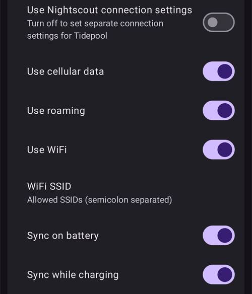

# Tidepool

Το Tidepool είναι εργαλείο τρίτου μέρους που συλλέγει δεδομένα για τη γλυκόζη αίματος (BG), την ινσουλίνη και τους υδατάνθρακες (και τις σημειώσεις που προσθέτετε στις θεραπείες σας). Με αυτό μπορείτε να αναλύσετε αυτά τα δεδομένα και να τα μοιραστείτε με την ιατρική σας ομάδα. Από την έκδοση 3.2 του AAPS, το Tidepool μπορεί να χρησιμοποιηθεί αντί για το Nightscout για ένα μέρος του Βήματος 1. Μπορεί επίσης να χρησιμοποιηθεί μαζί με το Nightscout ως εναλλακτική πλατφόρμα αναφορών, που ταιριάζει καλά με το κλινικό περιβάλλον. Αυτή μπορεί να είναι η κατάλληλη επιλογή για παιδιά που χρησιμοποιούν το AAPS και θέλουν την απομακρυσμένη παρακολούθηση και τον απομακρυσμένο έλεγχο του Nightscout, αλλά και μια πλατφόρμα αναφορών με την οποία η ιατρική τους ομάδα νιώθει πιο άνετα.

Είναι σημαντικό να καταλάβετε ότι το Tidepool χρησιμεύει μόνο για αναφορές. ΔΕΝ είναι εφαρμογή παρακολούθησης σε πραγματικό χρόνο. Αν χρειάζεστε ακόλουθους (followers) εκτός από το κύριο τηλέφωνο του AAPS, πρέπει να ρυθμίσετε επίσης το Nightscout.

Σημείωση: ο οργανισμός Tidepool έφερε στην αγορά το προϊόν iOS Loop με έγκριση του FDA. Αυτή η προσπάθεια δεν έχει καμία σχέση με την πλατφόρμα αναφορών δεδομένων τους ή με το AAPS.

## Βήμα 1 - Δημιουργία λογαριασμού Tidepool

- Μεταβείτε στο [tidepool.org](https://www.tidepool.org/)

- Επιλέξτε “Personal Sign Up” ή “Sign Up”

- Δημιουργήστε ένα email και έναν κωδικό πρόσβασης και σημειώστε τα

- Επιλέξτε “Personal Account” και πατήστε “Continue”

- Συμπληρώστε τα στοιχεία του ασθενή και αποδεχθείτε τους όρους χρήσης

- Επιβεβαιώστε τη διεύθυνση email σας με τις οδηγίες που θα λάβετε στο email σας

## Βήμα 2 - Σύνδεση του AAPS με το Tidepool

- Ανοίξτε το **μενού** (☰) πάνω αριστερά στην κύρια οθόνη και επιλέξτε «**Διαμόρφωση**»

- Ανοίξτε την κατηγορία «**Επικοινωνία**» και ενεργοποιήστε το «**Tidepool**»:

- Πατήστε «**Άνοιγμα πρόσθετου**» κάτω από το Tidepool και μετά πατήστε το εικονίδιο **Σύνδεση** (ένα βέλος που μπαίνει σε πόρτα) πάνω δεξιά

- Ανοίγει ένα παράθυρο του προγράμματος περιήγησης με τη σελίδα σύνδεσης του Tidepool. Συνδεθείτε με τη διεύθυνση email και τον κωδικό πρόσβασης που δημιουργήσατε στο Βήμα 1 παραπάνω:

- Μετά από επιτυχή σύνδεση, το πρόγραμμα περιήγησης κλείνει και η οθόνη του Tidepool δείχνει την κατάσταση «**Συνδέθηκε**». Το αρχείο καταγραφής από κάτω δείχνει τις αποστολές δεδομένων. Αν η σύνδεση αποτύχει, ελέγξτε ότι τα στοιχεία σας είναι σωστά και ότι έχετε επιβεβαιώσει τη διεύθυνση email σας στο Tidepool.

- Στις «**Ρυθμίσεις**» του πρόσθετου Tidepool, ανοίξτε τις «**Ρυθμίσεις σύνδεσης**». Από προεπιλογή η επιλογή «**Χρήση ρυθμίσεων σύνδεσης του Nightscout**» είναι ενεργή, οπότε το Tidepool στέλνει δεδομένα με τις ίδιες συνθήκες που ορίσατε για το Nightscout. Απενεργοποιήστε την αν θέλετε ξεχωριστές συνθήκες για το Tidepool, για παράδειγμα για αποστολή στο Tidepool μόνο μέσω Wi-Fi και κατά τη φόρτιση, ενώ το Nightscout χρησιμοποιεί και δεδομένα κινητής τηλεφωνίας.

 

Για περισσότερη βοήθεια σχετικά με τη χρήση των δεδομένων σας μετά την αποστολή τους στο Tidepool, επισκεφθείτε: [https://www.tidepool.org/viewing-your-data](https://www.tidepool.org/viewing-your-data)

(tidepool-menu)=
## Τα κουμπιά του Tidepool

Πάνω δεξιά στην οθόνη του Tidepool:

- Το εικονίδιο **Σύνδεση** ή **Αποσύνδεση** — σύνδεση ή αποσύνδεση από τον λογαριασμό σας στο Tidepool. Εμφανίζεται μόνο ένα από τα δύο: **Σύνδεση** όταν δεν είστε συνδεδεμένοι, **Αποσύνδεση** όταν είστε συνδεδεμένοι. Το **AAPS** σας ζητά επιβεβαίωση πριν σας αποσυνδέσει.
- Το εικονίδιο με το γρανάζι — οι ρυθμίσεις του Tidepool.

Τα κουμπιά στο κάτω μέρος της οθόνης του Tidepool:

- «**Ανέβασμα τώρα**» — στέλνει αμέσως τα νέα δεδομένα αντί να περιμένει την επόμενη αυτόματη αποστολή.
- «**Πλήρης συγχρονισμός**» — στέλνει ξανά όλα τα δεδομένα που είναι αποθηκευμένα στο **AAPS**.
- «**Διαγραφή όλων των δεδομένων**» — διαγράφει **όλα** τα δεδομένα που έχει στείλει το **AAPS** στον λογαριασμό σας στο Tidepool. Αυτό δεν μπορεί να αναιρεθεί. Χρησιμοποιήστε το μόνο για να αφαιρέσετε λάθος ή διπλά δεδομένα και μετά εκτελέστε «**Πλήρης συγχρονισμός**» για να στείλετε ξανά τα δεδομένα σας.
- «**Διαγραφή αρχείου καταγραφής**» — αδειάζει το αρχείο καταγραφής που εμφανίζεται στην οθόνη του Tidepool.

Στο Tidepool, τα δεδομένα που στέλνει το **AAPS** 4 εμφανίζονται με το όνομα συσκευής **AAPS**. Δείτε [Τι άλλαξε στο AAPS v4](#v4changes-tidepool) αν χρησιμοποιούσατε το Tidepool με παλαιότερη έκδοση. 
