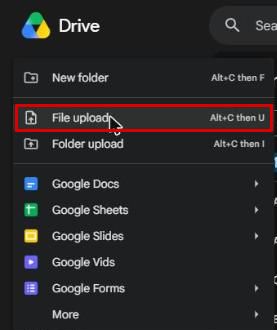
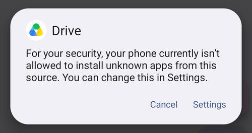
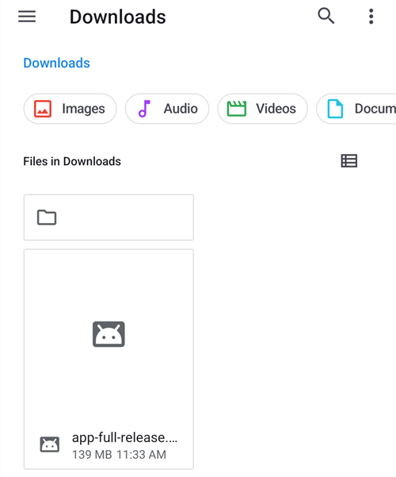
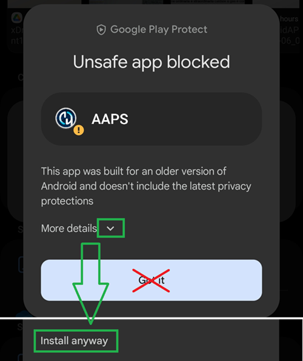

# Μεταφορά και εγκατάσταση του AAPS στο τηλέφωνό σας

Στην προηγούμενη ενότητα, [Δημιουργία του **AAPS**](../SettingUpAaps/BuildingAaps.md), δημιουργήσατε την εφαρμογή **AAPS** (ένα αρχείο .apk) σε έναν υπολογιστή.

Τα επόμενα βήματα είναι να **μεταφέρετε** το αρχείο APK του **AAPS** (καθώς και άλλες εφαρμογές που μπορεί να χρειάζεστε, όπως το BYODA, το xDrip ή άλλη εφαρμογή λήψης CGM) στο τηλέφωνό σας Android και μετά να **εγκαταστήσετε** την εφαρμογή (ή τις εφαρμογές). Μετά την εγκατάσταση του **AAPS** στο τηλέφωνο, μπορείτε να προχωρήσετε στη [**ρύθμιση του κυκλώματος AAPS**](../SettingUpAaps/SetupWizard.md).

Αυτή η σελίδα εξηγεί επίσης την [επαλήθευση προγραμματιστή Android](#android-developer-verification), μια αλλαγή που η Google εισάγει σταδιακά από τον Σεπτέμβριο του 2026 και που επηρεάζει την εγκατάσταση εφαρμογών που δημιουργείτε μόνοι σας, καθώς και τους [δωρεάν τρόπους εγκατάστασης](#android-developer-verification-free-methods) που συνεχίζουν να λειτουργούν μετά την αλλαγή.

```{contents} Table of contents
:depth: 1
:local: true
```

## Εγκατάσταση του AAPS με πάτημα στο αρχείο APK

Σήμερα, εγκαθιστάτε το **AAPS** μεταφέροντας το αρχείο APK στο τηλέφωνό σας και ανοίγοντάς το (με ένα «πάτημα»). Υπάρχουν διάφοροι τρόποι για να μεταφέρετε το αρχείο APK του **AAPS** από τον υπολογιστή σας στο τηλέφωνο. Εδώ εξηγούμε δύο διαφορετικούς τρόπους:

* Επιλογή 1 -  Χρησιμοποιήστε το Google Drive σας (Gdrive)
* Επιλογή 2 -  Χρησιμοποιήστε καλώδιο USB

Σημειώστε ότι η μεταφορά με email μπορεί να δημιουργήσει προβλήματα και δεν συνιστάται.

```{admonition} Android developer verification
:class: warning
Η Google εισάγει σταδιακά την [επαλήθευση προγραμματιστή Android](#android-developer-verification) από τον Σεπτέμβριο του 2026 (ξεκινά στη Βραζιλία, την Ινδονησία, τη Σιγκαπούρη και την Ταϊλάνδη· σε όλο τον κόσμο το 2027). Όπου εφαρμόζεται, η εγκατάσταση ενός APK με πάτημα στο αρχείο —όπως περιγράφεται και στις δύο επιλογές παρακάτω— μπλοκάρεται. Σε αυτή την περίπτωση, χρησιμοποιήστε έναν από τους [δωρεάν τρόπους εγκατάστασης](#android-developer-verification-free-methods) πιο κάτω σε αυτή τη σελίδα.
```

### Επιλογή 1. Χρησιμοποιήστε το Google Drive για τη μεταφορά αρχείων

Ανοίξτε το [Google.com](https://www.google.com/) στο πρόγραμμα περιήγησης και συνδεθείτε στον λογαριασμό σας Google.

Πάνω δεξιά, στο μενού της Google, επιλέξτε την εφαρμογή Drive.


Κάντε κλικ στο **Νέο** (New) πάνω αριστερά (ή κάντε δεξί κλικ σε μια κενή περιοχή κάτω από τα αρχεία και τους φακέλους σας) και επιλέξτε **Μεταφόρτωση αρχείου** (File upload).



Το αρχείο apk θα πρέπει τώρα να έχει ανέβει στο Google Drive.

#### Χρησιμοποιήστε την εφαρμογή Google Drive για να ανοίξετε το αρχείο apk και να το εγκαταστήσετε

Πηγαίνετε στο κινητό σας και ανοίξτε την εφαρμογή Google Drive. Είναι προεγκατεστημένη εφαρμογή και θα τη βρείτε εκεί που βρίσκονται οι άλλες εφαρμογές της Google ή αναζητώντας το όνομα της εφαρμογής.


Ξεκινήστε την εγκατάσταση του apk πατώντας το όνομα του αρχείου στην εφαρμογή Google Drive στο κινητό.


Αν εμφανιστεί ειδοποίηση ασφαλείας ότι αυτή τη στιγμή δεν επιτρέπεται η εγκατάσταση εφαρμογών από το Google Drive, πατήστε «Ρυθμίσεις» και επιτρέψτε την για αυτή τη σύντομη στιγμή. Μετά απαγορεύστε την ξανά, γιατί είναι κίνδυνος ασφαλείας να μένει ενεργή συνέχεια.




Όταν τελειώσει η εγκατάσταση, έχετε ολοκληρώσει αυτό το βήμα.

Θα πρέπει να βλέπετε το εικονίδιο του **AAPS** και να μπορείτε να ανοίξετε την εφαρμογή.

```{warning}
**ΣΗΜΑΝΤΙΚΗ ΕΙΔΟΠΟΙΗΣΗ ΑΣΦΑΛΕΙΑΣ**
Θυμηθήκατε να απαγορεύσετε ξανά την εγκατάσταση από το Google Drive;
```

Συνεχίστε με τη [ρύθμιση του κυκλώματος AAPS](../SettingUpAaps/SetupWizard.md).

### Επιλογή 2. Χρησιμοποιήστε καλώδιο USB για τη μεταφορά αρχείων

Ο δεύτερος τρόπος για να μεταφέρετε το αρχείο apk του AAPS είναι με ένα [καλώδιο USB](https://support.google.com/android/answer/9064445?hl=en).

Μεταφέρετε το αρχείο από τη θέση του στον υπολογιστή σας στον φάκελο «downloads» (λήψεις) του τηλεφώνου.

Στο τηλέφωνό σας θα πρέπει να επιτρέψετε την εγκατάσταση από άγνωστες πηγές. Οδηγίες για το πώς γίνεται αυτό θα βρείτε στο διαδίκτυο (_π.χ._ [εδώ](https://www.expressvpn.com/de/support/vpn-setup/enable-apk-installs-android/) ή [εδώ](https://www.androidcentral.com/unknown-sources)).

Αφού μεταφέρετε το αρχείο σύροντάς το, ανοίξτε τον φάκελο «Λήψεις» (Downloads) στο τηλέφωνο και πατήστε το αρχείο apk του AAPS:



Την πρώτη φορά, το Android σας λέει ότι το τηλέφωνο δεν επιτρέπεται να εγκαθιστά άγνωστες εφαρμογές από αυτή την πηγή. Πατήστε «**Ρυθμίσεις**»:


Ενεργοποιήστε το «**Να επιτρέπεται από αυτή την πηγή**» (Allow from this source) και μετά πηγαίνετε πίσω:


Πατήστε ξανά το αρχείο apk και επιλέξτε «**Εγκατάσταση**»:


Όταν τελειώσει η εγκατάσταση, πατήστε «**Άνοιγμα**» για να ξεκινήσει το **AAPS** ή «**Τέλος**» για να το ανοίξετε αργότερα:


```{warning}
**ΣΗΜΑΝΤΙΚΗ ΕΙΔΟΠΟΙΗΣΗ ΑΣΦΑΛΕΙΑΣ**
Θυμηθείτε να απενεργοποιήσετε ξανά το «Να επιτρέπεται από αυτή την πηγή» μετά την εγκατάσταση, γιατί είναι κίνδυνος ασφαλείας να μένει ενεργό συνέχεια.
```

Συνεχίστε με τη [ρύθμιση του κυκλώματος AAPS](../SettingUpAaps/SetupWizard.md).

(transferring-installing-play-protect-warning)=
## Προειδοποίηση του Google Play Protect

Όταν εγκαθιστάτε το **AAPS**, το Google Play Protect μπορεί να σας προειδοποιήσει ότι η εφαρμογή δεν είναι ασφαλής, ότι δημιουργήθηκε για παλαιότερη έκδοση του Android και ότι δεν περιέχει τις πιο νέες προστασίες απορρήτου.



Αυτό είναι αναμενόμενο για μια εφαρμογή που δημιουργήσατε μόνοι σας. Πατήστε **Περισσότερες λεπτομέρειες** (More details) και μετά **Εγκατάσταση ούτως ή άλλως** (Install anyway).

Αν η εγκατάσταση **μπλοκάρεται** με μήνυμα για μη επαληθευμένο προγραμματιστή (και όχι μόνο μια προειδοποίηση), δείτε την [Επαλήθευση προγραμματιστή Android](#android-developer-verification) παρακάτω.

(android-developer-verification)=

## Επαλήθευση προγραμματιστή Android

Η Google εισάγει την **επαλήθευση προγραμματιστή Android** (Android developer verification): στα περισσότερα τηλέφωνα Android, οι εφαρμογές θα εγκαθίστανται μόνο αν έχουν καταχωριστεί στη Google από έναν επαληθευμένο προγραμματιστή. Αυτό ισχύει και για εφαρμογές που εγκαθίστανται από αρχείο APK («sideloading») — με αυτόν τον τρόπο εγκαθιστάτε την εφαρμογή **AAPS** που δημιουργήσατε μόνοι σας.

### Τι αλλάζει

Όταν εγκαθιστάτε το **AAPS** σε τηλέφωνο με υπηρεσίες Google (μια «πιστοποιημένη» συσκευή Android — σχεδόν κάθε τηλέφωνο που πωλείται με το Play Store), το Android θα ελέγχει αν η εφαρμογή προέρχεται από προγραμματιστή καταχωρισμένο στη Google. Αν όχι, η κανονική εγκατάσταση με πάτημα στο αρχείο APK μπλοκάρεται.

**Ο έλεγχος γίνεται όταν μια εφαρμογή εγκαθίσταται ή ενημερώνεται.** Δεν αφαιρεί εφαρμογές που είναι ήδη εγκατεστημένες και λειτουργούν.

Η Google το εισάγει σταδιακά:

| Πότε                | Τι συμβαίνει                                                                                                                                                                       |
| ------------------- | ---------------------------------------------------------------------------------------------------------------------------------------------------------------------------------- |
| Αύγουστος 2026      | Οι δωρεάν λογαριασμοί προγραμματιστή «περιορισμένης διανομής» (limited distribution) είναι ανοιχτοί σε όλο τον κόσμο, και το «advanced flow» αρχίζει να φτάνει στα τηλέφωνα        |
| 30 Σεπτεμβρίου 2026 | Η επαλήθευση εφαρμόζεται στη **Βραζιλία, την Ινδονησία, τη Σιγκαπούρη και την Ταϊλάνδη**, για εφαρμογές που εγκαθίστανται από το Google Play και μερικά άλλα καταστήματα εφαρμογών |
| 2027                | Η εφαρμογή επεκτείνεται **σε όλο τον υπόλοιπο κόσμο** και σε **όλες τις εγκαταστάσεις**, μαζί και τα αρχεία APK                                                                    |

Η Google δημοσιεύει τις λεπτομέρειες στις σελίδες [Android developer verification](https://developer.android.com/developer-verification), μαζί με ένα [FAQ](https://developer.android.com/developer-verification/guides/faq) (συχνές ερωτήσεις). Η Google μπορεί ακόμα να αλλάξει ημερομηνίες και λεπτομέρειες· αυτή η σελίδα θα ενημερώνεται όσο προχωρά η εφαρμογή της αλλαγής.

### Με επηρεάζει αυτό;

- **Η δημιουργία του AAPS δεν επηρεάζεται καθόλου.** Η [δημιουργία μέσω browser](#browser-build), η [δημιουργία με το Android Studio](ComputerBuild.md) και η [δημιουργία από τη γραμμή εντολών (CLI)](CLIBuild.md) λειτουργούν ακριβώς όπως πριν, και το keystore σας δεν αλλάζει.
- **Το AAPS που έχετε τώρα συνεχίζει να λειτουργεί.** Η επαλήθευση ελέγχεται μόνο όταν εγκαθιστάτε ή ενημερώνετε μια εφαρμογή.
- **Αν ζείτε στη Βραζιλία, την Ινδονησία, τη Σιγκαπούρη ή την Ταϊλάνδη:** από τις 30 Σεπτεμβρίου 2026, η επαλήθευση εφαρμόζεται για εφαρμογές που εγκαθίστανται από το Google Play και μερικά άλλα καταστήματα εφαρμογών. Η Google λέει ότι η απευθείας εγκατάσταση αρχείου APK δεν περιλαμβάνεται σε αυτό το πρώτο βήμα, οπότε το **AAPS** θα πρέπει να εγκαθίσταται ακόμα κανονικά. Παρ' όλα αυτά, ετοιμάστε από τώρα έναν από τους [δωρεάν τρόπους εγκατάστασης](#android-developer-verification-free-methods) παρακάτω, ώστε να μη βρεθείτε απροετοίμαστοι αν αυτό αλλάξει.
- **Αν ζείτε οπουδήποτε αλλού:** τίποτα δεν αλλάζει για εσάς πριν από το 2027, και μπορείτε κανονικά να μην κάνετε τίποτα προς το παρόν. Όμως ρυθμίστε έναν από τους [δωρεάν τρόπους εγκατάστασης](#android-developer-verification-free-methods) παρακάτω όσο όλα λειτουργούν: η χειρότερη στιγμή για να ανακαλύψετε το μπλοκάρισμα είναι τη μέρα που μια ενημέρωση απορρίπτεται, με την αναμονή 24 ωρών του [advanced flow](#android-developer-verification-advanced-flow) μπροστά σας.
- **Παλιά τηλέφωνα:** η επαλήθευση ισχύει για τηλέφωνα με Android 7 ή νεότερο, δηλαδή για κάθε τηλέφωνο που μπορεί να τρέξει το **AAPS**.

(android-developer-verification-free-methods)=

## Δωρεάν τρόποι εγκατάστασης του AAPS

**Δεν** χρειάζεται να πληρώσετε τίποτα στη Google για να συνεχίσετε να χρησιμοποιείτε το **AAPS**. Υπάρχουν διάφοροι δωρεάν τρόποι· διαλέξτε αυτόν που ταιριάζει στην περίπτωσή σας.

```{admonition} Which method should I use?
:class: tip
- Έχετε **υπολογιστή** (όποιον τρόπο κι αν χρησιμοποιήσατε για να δημιουργήσετε το **AAPS**): χρησιμοποιήστε το [ADB](#android-developer-verification-adb) ή, αν προτιμάτε να αποφύγετε τη γραμμή εντολών, το [πρόγραμμα εγκατάστασης web](#android-developer-verification-web). Και οι δύο τρόποι εξαιρούνται από την επαλήθευση, δεν έχουν περιορισμούς και δεν χρειάζονται λογαριασμό Google.
- **Δεν έχετε καθόλου υπολογιστή**: χρησιμοποιήστε το [advanced flow](#android-developer-verification-advanced-flow) στο τηλέφωνό σας.
- Προτιμάτε να εγγραφείτε στη Google ώστε να συνεχίσει να λειτουργεί η κανονική εγκατάσταση με «πάτημα στο APK»: υπάρχει ένας [δωρεάν λογαριασμός περιορισμένης διανομής](#android-developer-verification-limited-account), αλλά δεν έχει δοκιμαστεί με το **AAPS**.
```

(android-developer-verification-adb)=

### Επιλογή 1: Εγκατάσταση με ADB (χρειάζεται υπολογιστής)

Το ADB (Android Debug Bridge) είναι το επίσημο εργαλείο της Google για την εγκατάσταση εφαρμογών από υπολογιστή σε τηλέφωνο με καλώδιο USB. Η Google έχει επιβεβαιώσει ότι **οι εφαρμογές που εγκαθίστανται με ADB δεν χρειάζονται επαλήθευση** — δεν υπάρχει χρόνος αναμονής, όριο συσκευών ούτε εγγραφή.

Προετοιμασία (μία φορά μόνο):

1. Στο τηλέφωνό σας, ενεργοποιήστε τις κρυφές επιλογές προγραμματιστή: πηγαίνετε στο **Ρυθμίσεις** > **Πληροφορίες τηλεφώνου** (About phone) (σε μερικά τηλέφωνα **Πληροφορίες λογισμικού** (Software information)) και πατήστε επτά φορές το **Αριθμός έκδοσης** (Build number), μέχρι το τηλέφωνο να επιβεβαιώσει ότι είστε προγραμματιστής.
1. Επιστρέψτε στο κύριο μενού **Ρυθμίσεις**, ανοίξτε το νέο στοιχείο **Επιλογές προγραμματιστή** (Developer options) και ενεργοποιήστε το **Εντοπισμός σφαλμάτων USB** (USB debugging).
1. Στον υπολογιστή σας, βεβαιωθείτε ότι το ADB είναι διαθέσιμο:
   - Αν χρησιμοποιείτε το **Android Studio**, το ADB είναι ήδη εγκατεστημένο μαζί του.
   - Αλλιώς, κατεβάστε τα δωρεάν [SDK Platform Tools](https://developer.android.com/tools/releases/platform-tools) της Google και αποσυμπιέστε τον φάκελο. Δεν χρειάζεται εγκατάσταση· το ADB είναι το πρόγραμμα `adb` μέσα σε αυτόν τον φάκελο.

Εγκατάσταση (και αργότερα ενημέρωση) του **AAPS**:

1. Συνδέστε το τηλέφωνο στον υπολογιστή με ένα καλώδιο USB. Δεν χρειάζεται να μεταφέρετε πρώτα το αρχείο APK στο τηλέφωνο: το ADB το στέλνει απευθείας από τον υπολογιστή.
1. Στο τηλέφωνο, αποδεχτείτε την ερώτηση **Να επιτρέπεται ο εντοπισμός σφαλμάτων USB;** (Allow USB debugging?) (μόνο την πρώτη φορά).
1. Στον υπολογιστή, ανοίξτε ένα τερματικό (γραμμή εντολών) στον φάκελο που περιέχει το ADB και το αρχείο APK του **AAPS** και εκτελέστε:

   ```
   adb install -r app-full-release.apk
   ```

   Αντικαταστήστε το `app-full-release.apk` με το πραγματικό όνομα του αρχείου APK σας. Η επιλογή `-r` ενημερώνει ένα ήδη εγκατεστημένο **AAPS** και κρατά όλα τα δεδομένα και τις ρυθμίσεις του.

1. Περιμένετε μέχρι να εμφανιστεί το `Success`. Το **AAPS** είναι πλέον εγκατεστημένο στο τηλέφωνό σας.

Η ίδια εντολή χρησιμοποιείται για κάθε μελλοντική ενημέρωση. Οι [σελίδες για το Wear OS](../WearOS/WearOsSmartwatch.md) χρησιμοποιούν ήδη το ADB με τον ίδιο τρόπο για την εγκατάσταση της εφαρμογής του ρολογιού.

Αν δεν θέλετε να χρησιμοποιήσετε καλώδιο: στο Android 11 και νεότερο, ο **ασύρματος εντοπισμός σφαλμάτων** (wireless debugging, επίσης στις **Επιλογές προγραμματιστή**) κάνει το ίδιο μέσω Wi-Fi, μετά από μια σύζευξη μίας φοράς με έναν κωδικό που εμφανίζεται στο τηλέφωνο.

(android-developer-verification-web)=

### Επιλογή 2: Εγκατάσταση από μια ιστοσελίδα (υπολογιστής, χωρίς γραμμή εντολών)

Αν η γραμμή εντολών δεν είναι για εσάς, μια ιστοσελίδα μπορεί να κάνει ακριβώς ό,τι κάνει το ADB, απευθείας από το πρόγραμμα περιήγησης. Επειδή επικοινωνεί με το τηλέφωνο με τον ίδιο μηχανισμό όπως το ADB, έχει την **ίδια εξαίρεση από την επαλήθευση** — αλλά δεν χρειάζεται να κατεβάσετε τίποτα, να αποσυμπιέσετε φάκελο ή να πληκτρολογήσετε εντολή.

Αυτός είναι ο πιο εύκολος δρόμος αν χρησιμοποιήσατε τη [δημιουργία μέσω browser](#browser-build) και δεν έχετε ανοίξει ποτέ γραμμή εντολών.

1. Ενεργοποιήστε τον **Εντοπισμό σφαλμάτων USB** στο τηλέφωνο (βήματα 1 και 2 της [μεθόδου ADB](#android-developer-verification-adb) παραπάνω — ρύθμιση μίας φοράς).
1. Ανοίξτε το **[Πρόγραμμα εγκατάστασης web του AAPS](#web-installer)** στο πρόγραμμα περιήγησης.
1. Συνδέστε το τηλέφωνο με ένα καλώδιο USB και ακολουθήστε τις οδηγίες στη σελίδα: σύνδεση, επιλογή του αρχείου APK και εγκατάσταση.

Τρία πράγματα που πρέπει να ξέρετε:

- Λειτουργεί μόνο σε **Chrome, Edge ή Opera**. Ο Firefox και ο Safari δεν μπορούν να επικοινωνήσουν με συσκευές USB.
- Μόνο ένα πρόγραμμα κάθε φορά μπορεί να χρησιμοποιεί τη σύνδεση ADB του τηλεφώνου, γι' αυτό **κλείστε το Android Studio** (ή οτιδήποτε άλλο χρησιμοποιεί ADB) πριν συνδεθείτε.
- Μια ιστοσελίδα που συνδέεται με αυτόν τον τρόπο αποκτά πλήρη έλεγχο του τηλεφώνου σας. **Χρησιμοποιείτε μόνο την παραπάνω διεύθυνση**, από την τεκμηρίωση του **AAPS** — ποτέ μια σελίδα εγκατάστασης που βρήκατε μέσω μηχανής αναζήτησης. Το πρόγραμμα εγκατάστασης web του **AAPS** τρέχει εξ ολοκλήρου στο πρόγραμμα περιήγησής σας: το αρχείο APK σας δεν ανεβαίνει πουθενά.

```{admonition} No computer? A second phone works too
:class: tip
Το πρόγραμμα εγκατάστασης web λειτουργεί και από το **Chrome σε άλλο τηλέφωνο Android** με καλώδιο USB-C σε USB-C — έτσι ένας γονέας μπορεί να εγκαταστήσει το **AAPS** στο τηλέφωνο του παιδιού χωρίς να υπάρχει υπολογιστής στο σπίτι.
```

(android-developer-verification-advanced-flow)=

### Επιλογή 3: Το «advanced flow» στο τηλέφωνό σας (δεν χρειάζεται υπολογιστής)

Η Google προσφέρει μια διέξοδο για έμπειρους χρήστες που καταλαβαίνουν τους κινδύνους της εγκατάστασης μη επαληθευμένων εφαρμογών, που λέγεται **advanced flow** (προχωρημένη διαδικασία). Η Google άρχισε να το στέλνει στα τηλέφωνα τον Αύγουστο του 2026, πριν από την εφαρμογή της επαλήθευσης, οπότε μπορείτε να το ρυθμίσετε από τώρα. Είναι μια ρύθμιση μίας φοράς στο ίδιο το τηλέφωνο, που **χρειάζεται 24 ώρες** για να ολοκληρωθεί:

1. Ενεργοποιήστε τις κρυφές επιλογές προγραμματιστή (δείτε το βήμα 1 της μεθόδου ADB παραπάνω) και μετά ανοίξτε **Ρυθμίσεις** > **Επιλογές προγραμματιστή** > **Εφαρμογές από μη επαληθευμένους προγραμματιστές** (Apps from unverified developers).
1. Ενεργοποιήστε το **Να επιτρέπονται εφαρμογές από μη επαληθευμένους προγραμματιστές** (Allow apps from unverified developers). Το τηλέφωνο ζητά το κλείδωμα οθόνης σας, για να επιβεβαιώσει ότι είστε εσείς.
1. Το τηλέφωνο ρωτά αν κάποιος σας ζητά να ενεργοποιήσετε αυτή τη ρύθμιση και εξηγεί ότι τράπεζες, δημόσιες υπηρεσίες ή η αστυνομία δεν θα σας ζητούσαν ποτέ κάτι τέτοιο. Διαβάστε την προειδοποίηση και επιβεβαιώστε ότι κανείς δεν σας πιέζει ή σας καθοδηγεί (αυτό είναι προστασία από απατεώνες).
1. **Κάντε επανεκκίνηση του τηλεφώνου σας.** Έτσι ξεκινά μια **περίοδος αναμονής 24 ωρών**, μία φορά μόνο.
1. Μετά από 24 ώρες, πηγαίνετε ξανά στο **Ρυθμίσεις** > **Επιλογές προγραμματιστή** > **Εφαρμογές από μη επαληθευμένους προγραμματιστές** για να ολοκληρώσετε τη ρύθμιση.
1. Επιλέξτε αν θα επιτρέπονται οι μη επαληθευμένες εφαρμογές για **7 ημέρες** ή **επ' αόριστον** (indefinitely). Για το **AAPS**, επιλέξτε **επ' αόριστον**, αλλιώς η επόμενη ενημέρωσή σας θα μπλοκαριστεί μόλις περάσουν οι 7 ημέρες.

Μετά από αυτή τη ρύθμιση, η εγκατάσταση ή η ενημέρωση του APK του **AAPS** λειτουργεί όπως σήμερα, με μια επιπλέον προειδοποίηση ότι η εφαρμογή είναι από μη επαληθευμένο προγραμματιστή — πατήστε **Εγκατάσταση ούτως ή άλλως** (Install anyway).

Καλό είναι να ξέρετε:

- Μπορείτε να απενεργοποιήσετε ξανά τις **Επιλογές προγραμματιστή** μετά: το advanced flow μένει ενεργό. Επίσης, η Google δεν δίνει στις εφαρμογές (όπως εφαρμογές τραπεζών) κανέναν τρόπο να ανιχνεύσουν ότι το advanced flow είναι ενεργό.
- Αν απενεργοποιήσετε το advanced flow, η εγκατάσταση **ή η ενημέρωση** του **AAPS** μπλοκάρεται ξανά (το εγκατεστημένο **AAPS** σας συνεχίζει να λειτουργεί). Έχετε 10 λεπτά για να το ενεργοποιήσετε ξανά· μετά από αυτό, η περίοδος αναμονής 24 ωρών ξεκινά από την αρχή.
- Η αλλαγή του ρολογιού του τηλεφώνου δεν μικραίνει την περίοδο αναμονής, και το ADB δεν μπορεί να την παρακάμψει.
- Η Google λέει ότι η επιλογή σας ακολουθεί τον λογαριασμό σας Google στις άλλες συσκευές σας, οπότε ένα νέο τηλέφωνο δεν θα πρέπει να σημαίνει νέα αναμονή 24 ωρών.
- Αν δεν βρίσκετε το **Εφαρμογές από μη επαληθευμένους προγραμματιστές** στις επιλογές προγραμματιστή, το τηλέφωνό σας δεν έχει λάβει ακόμα τη λειτουργία. Την παρέχει ένα στοιχείο του συστήματος που λέγεται **Android Developer Verifier**, το οποίο η Google στέλνει σταδιακά μέσω του Play Store. Μπορείτε να βοηθήσετε να έρθει πιο γρήγορα ανοίγοντας το **Android Developer Verifier** στο Play Store.

```{note}
Η Google το περιγράφει ως πρώτη έκδοση και μπορεί ακόμα να αλλάξει τις οθόνες και τα βήματα· αυτή η ενότητα θα ενημερωθεί με στιγμιότυπα οθόνης μόλις είναι διαθέσιμη η τελική έκδοση.
```

(android-developer-verification-limited-account)=

### Επιλογή 4: Εγγραφή στη Google (δωρεάν λογαριασμός περιορισμένης διανομής)

Η Google προσφέρει έναν **δωρεάν** τύπο λογαριασμού προγραμματιστή για χομπίστες και προσωπική χρήση, που λέγεται **λογαριασμός περιορισμένης διανομής** (limited distribution account) και είναι ανοιχτός σε όλους από τον Αύγουστο του 2026:

- **Χωρίς κρατική ταυτότητα** και **χωρίς χρέωση** (σε αντίθεση με τον πληρωμένο λογαριασμό προγραμματιστή, που δεν χρειάζεται για προσωπική χρήση του **AAPS**). Χρειάζεστε όμως λογαριασμό Google με επαλήθευση σε 2 βήματα, ένα προφίλ πληρωμών Google με το νόμιμο όνομα και τη διεύθυνσή σας, και μια διεύθυνση email επικοινωνίας.
- Καταχωρίζετε το όνομα πακέτου (package name) της εφαρμογής σας στο Android Developer Console της Google και εξουσιοδοτείτε τα τηλέφωνα στα οποία μπορεί να εγκατασταθεί, έως **20 συσκευές**, μέσω μιας σύνδεσης με κωδικό QR ή σύνδεσμο ανάμεσα στο τηλέφωνο και στο console.
- Μετά την καταχώριση, η κανονική εγκατάσταση (με πάτημα στο αρχείο APK) λειτουργεί ξανά στα εξουσιοδοτημένα τηλέφωνα, χωρίς ADB και χωρίς το advanced flow.
- Ένας λογαριασμός περιορισμένης διανομής μπορεί αργότερα να αναβαθμιστεί σε πλήρη λογαριασμό, αλλά όχι αντίστροφα.

```{warning}
Η Google δεν έχει εξηγήσει πώς λειτουργεί η καταχώριση όταν πολλοί άνθρωποι δημιουργούν την ίδια εφαρμογή ανοιχτού κώδικα: κάθε **AAPS** που δημιουργείτε μόνοι σας έχει το ίδιο όνομα πακέτου (`info.nightscout.androidaps`) με διαφορετικό κλειδί υπογραφής, και το FAQ της Google λέει ότι ένα όνομα πακέτου που ήδη χρησιμοποιούν άλλοι δεν μπορεί να διεκδικηθεί απευθείας και χρειάζεται επιπλέον έλεγχο. Το αποτέλεσμα ενός τέτοιου ελέγχου είναι άγνωστο, και ο πληρωμένος λογαριασμός προγραμματιστή (25 $ και κρατική ταυτότητα) δεν βοηθά εδώ: η πληρωμή αφαιρεί μόνο το όριο των 20 συσκευών, όχι τον έλεγχο του ονόματος πακέτου.

Για αυτόν τον λόγο, δεν μπορούν ακόμα να γραφτούν οδηγίες βήμα προς βήμα. Αυτή η ενότητα θα συμπληρωθεί μόλις η καταχώριση δοκιμαστεί με το **AAPS**. Μέχρι τότε, το ADB, το πρόγραμμα εγκατάστασης web και το advanced flow παραπάνω είναι αξιόπιστες εναλλακτικές.
```

## Τι δεν αλλάζει

- Η δημιουργία του **AAPS** από εσάς, με οποιονδήποτε από τους τρεις [τρόπους δημιουργίας](BuildingAaps.md).
- Ο λογαριασμός σας GitHub, το αποθετήριο build σας (AAPS Builder) ή το fork σας, και το keystore σας.
- Η εγκατεστημένη εφαρμογή **AAPS**, οι ρυθμίσεις σας και τα [Βήματά](CompletingTheObjectives.md) σας.
- Τα τηλέφωνα χωρίς υπηρεσίες Google, και γενικά οι [εγκαταστάσεις με ADB](#android-developer-verification-adb).

## Πού θα βρείτε βοήθεια

1. **Διαβάστε** το [FAQ για την επαλήθευση προγραμματιστή](https://developer.android.com/developer-verification/guides/faq) της Google για ερωτήσεις σχετικά με την ίδια την επαλήθευση.
2. **Ρωτήστε** στο κανάλι *#AAPS* στο [Discord](https://discord.gg/4fQUWHZ4Mw) ή σε ένα από τα άλλα [κανάλια της κοινότητας](../GettingHelp/WhereCanIGetHelp.md), αν μια εγκατάσταση μπλοκάρεται.
3. Όταν ζητάτε βοήθεια, αναφέρετε τη μάρκα και το μοντέλο του τηλεφώνου σας, την έκδοση Android, τη χώρα σας και το ακριβές μήνυμα που εμφανίζεται όταν η εγκατάσταση αποτυγχάνει.

```{toctree}
:hidden:

Πρόγραμμα εγκατάστασης web του AAPS <WebInstaller.md>
```
