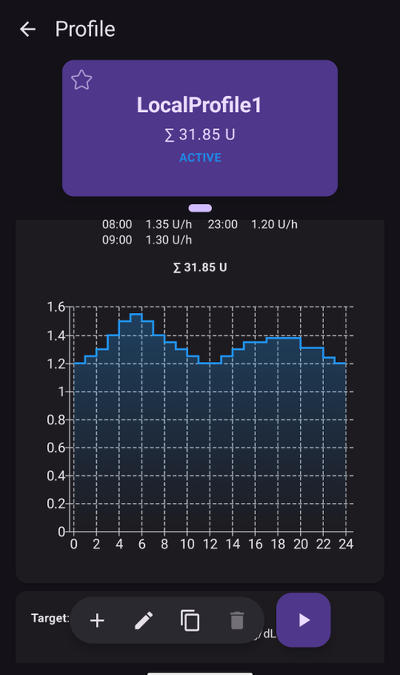

# Το προφίλ σας στο AAPS

Το **Προφίλ του AAPS** σας είναι ένα σύνολο τεσσάρων βασικών παραμέτρων, που ορίζουν πώς το **AAPS** δίνει ινσουλίνη ανάλογα με τις τιμές γλυκόζης του αισθητήρα σας. Αυτές είναι οι κύριες παράμετροι πάνω στις οποίες βασίζεται το **AAPS**. Καθώς προχωράτε στα **Βήματα**, θα ξεκλειδώνετε επιπλέον παραμέτρους που μπορείτε να αλλάξετε (π.χ. ρυθμίσεις SMB). Όμως αυτές οι λειτουργίες δουλεύουν καλά μόνο αν το βασικό σας **Προφίλ** είναι σωστό. Το **Προφίλ** περιλαμβάνει:
* [στόχους γλυκόζης](#profile-glucose-targets),
* [βασικούς ρυθμούς](#your-aaps-profile-basal-rates) (BR),
* [συντελεστές ευαισθησίας στην ινσουλίνη](#your-aaps-profile-insulin-sensitivity-factor) (ISF) και
* [αναλογίες ινσουλίνης προς υδατάνθρακες](#your-aaps-profile-insulin-to-carbs-ratio) (IC ή ICR).

```{admonition} Where did DIA go?
:class: note
Η **διάρκεια δράσης της ινσουλίνης (DIA)** δεν είναι πια μέρος του **Προφίλ** σας. Ορίζεται πλέον για κάθε ινσουλίνη χωριστά — δείτε [Διαχείριση → Ρυθμίσεις ινσουλίνης](#Config-Builder-insulin-dia).
```

Ως μέρος της διαχείρισης του **AAPS**, οι χρήστες πρέπει να ελέγχουν συνεχώς και προσεκτικά αν οι ρυθμίσεις του **Προφίλ** τους είναι σωστές. Συνιστάται να ρυθμίσετε τις τιμές με τη σειρά που παρουσιάζονται εδώ. Προσπαθήστε να θέσετε σωστά την κάθε ρύθμιση προτού προχωρήσετε στην επόμενη. Δοκιμάστε να κάνετε μικρά βήματα αντί να κάνετε πολλές και μεγάλες αλλαγές μαζικά. Μην ξεχάσετε να ενεργοποιείτε το νέο προφίλ μετά από κάθε αλλαγή. Κάνετε τακτικά [αντίγραφο ασφαλείας των ρυθμίσεων του **Προφίλ** σας](#YourAapsProfile_Profile-backup) με εξαγωγή των ρυθμίσεων.

Οι ρυθμίσεις του **Προφίλ** σας επηρεάζουν η μία την άλλη. Μπορεί να έχετε «λάθος» ρυθμίσεις που δουλεύουν καλά μαζί σε ορισμένες περιπτώσεις, αλλά όχι σε άλλες. Για παράδειγμα, όταν ένας πολύ υψηλός βασικός ρυθμός συμπίπτει με ένα πολύ υψηλό **CR**. Αυτό σημαίνει ότι πρέπει να εξετάσετε κάθε ρύθμιση χωριστά και να ελέγξετε ότι λειτουργούν σωστά μαζί σε διάφορες καταστάσεις.

Μπορείτε να χρησιμοποιήσετε το [Autotune](https://autotuneweb.azurewebsites.net/) για να σας καθοδηγήσει, αλλά μην το ακολουθείτε στα τυφλά: μπορεί να μη λειτουργεί καλά για εσάς ή σε όλες τις περιπτώσεις.

```{admonition} Your diabetes may vary
:class: note
Τα **προφίλ** διαφέρουν πολύ από άτομο σε άτομο.

Για τους βασικούς ρυθμούς (BR), τους συντελεστές ευαισθησίας στην ινσουλίνη (ISF) και τις αναλογίες ινσουλίνης προς υδατάνθρακες (IC ή ICR), οι απόλυτες τιμές και οι τάσεις στις ανάγκες ινσουλίνης διαφέρουν πολύ από άτομο σε άτομο. Εξαρτώνται από τη βιολογία σας, το φύλο, την ηλικία, τη φυσική κατάσταση κ.λπ., αλλά και από βραχυπρόθεσμους παράγοντες, όπως μια ασθένεια ή πρόσφατη άσκηση. Για περισσότερη καθοδήγηση, το βιβλίο [“Bright Spots and Landmines”](https://diatribe.org/bright-spots-and-landmines/) του Adam Brown είναι εξαιρετικό.

```

Οι τέσσερις τελευταίες παράμετροι (στόχοι γλυκόζης, βασικοί ρυθμοί, συντελεστές ευαισθησίας στην ινσουλίνη και αναλογίες ινσουλίνης προς υδατάνθρακες) μπορούν να έχουν διαφορετικές τιμές μέσα στο 24ωρο, που αλλάζουν ακόμη και κάθε ώρα αν χρειάζεται.


Παρακάτω φαίνονται εικόνες από το **AAPS** με ένα _παράδειγμα_ προφίλ. Σημειώστε ότι το παρακάτω παράδειγμα προφίλ έχει πολλά χρονικά σημεία. Όταν ξεκινάτε με το **AAPS**, το προφίλ σας θα είναι πιθανώς πολύ πιο απλό.



(profile-glucose-targets)=
## Στόχοι γλυκόζης

### Περιγραφή

Ο **στόχος γλυκόζης (BG)** είναι μια βασική τιμή και όλοι οι υπολογισμοί του **AAPS** βασίζονται σε αυτόν. Είναι διαφορετικός από το εύρος στόχου, μέσα στο οποίο συνήθως προσπαθείτε να κρατάτε τις τιμές γλυκόζης σας. Ο στόχος χρησιμοποιείται στους υπολογισμούς του **AAPS**: αν το **AAPS** προβλέπει ότι η **BG** σας θα βγει έξω από το εύρος στόχου, θα κάνει ενέργειες για να σας φέρει πίσω σε αυτό το εύρος.

Οι στόχοι μπορούν να οριστούν μέσα σε αυτά τα όρια:

|          | _Κάτω_ στόχος         | _Άνω_ στόχος            |
| -------- | --------------------- | ----------------------- |
| Ελάχιστο | 4,4 mmol/l ή 80 mg/dl | 5 mmol/l ή 90 mg/dl     |
| Μέγιστο  | 10 mmol/l ή 180 mg/dl | 11,1 mmol/l ή 200 mg/dl |

### Επίδραση

Αν ο στόχος στο **Προφίλ** σας είναι πολύ πλατύς (π.χ. 3 mmol/l ή περισσότερο [50 mg/dl ή περισσότερο]), συχνά θα δείτε ότι το **AAPS** κάνει λίγες ενέργειες. Ο λόγος είναι ότι το επίπεδο της **BG** προβλέπεται να είναι κάπου μέσα σε αυτό το μεγάλο εύρος, και έτσι το **AAPS** σπάνια θα ορίσει προσωρινό βασικό ρυθμό.

### Πώς να το ρυθμίσετε

Η **παρακάτω εικόνα** δείχνει ένα παράδειγμα για το πώς μπορεί να οριστεί ο στόχος σε ένα προφίλ του **AAPS**.


Οι στόχοι **BG** ορίζονται ανάλογα με τις προσωπικές σας προτιμήσεις και ανάγκες. Για παράδειγμα, αν ανησυχείτε για υπογλυκαιμίες τη νύχτα, μπορείτε να ορίσετε τον στόχο λίγο πιο ψηλά, στα 117 mg/dl (6,5 mmol/l), από τις 21:00 έως τις 07:00. Αν θέλετε να έχετε αρκετή ενεργή ινσουλίνη (IOB) το πρωί πριν κάνετε bolus για το πρωινό, μπορείτε να ορίσετε χαμηλότερο στόχο 81 mg/dl (4,5 mmol/l) από τις 7 έως τις 8 το πρωί.

Σε [Ανοιχτό Κύκλωμα](#KeyAapsFeatures-OpenLoop), ειδικά όταν προχωράτε στα [πρώτα βήματα](../SettingUpAaps/CompletingTheObjectives.md), ένας στόχος με μεγάλο εύρος μπορεί να είναι καλή επιλογή, όσο μαθαίνετε πώς συμπεριφέρεται το **AAPS** και προσαρμόζετε το **Προφίλ** σας.<br/> Σε [Κλειστό Κύκλωμα](#KeyAapsFeatures-ClosedLoop) (από το **[Βήμα 6](#objectives-objective6)** και μετά), συνιστάται να μικρύνετε το εύρος μέχρι να έχετε έναν μόνο στόχο για κάθε ώρα της ημέρας (_Κάτω_ στόχος = _Άνω_ στόχος), ώστε το **AAPS** να αντιδρά γρήγορα στις αλλαγές της **BG**.

(your-aaps-profile-basal-rates)=

## Βασικοί ρυθμοί

### Περιγραφή

Ο βασικός ρυθμός ινσουλίνης (μονάδες/ώρα) δίνει την ινσουλίνη υποβάθρου, που κρατά τη γλυκόζη σας σταθερή όταν δεν τρώτε και δεν γυμνάζεστε.

Η αντλία ινσουλίνης δίνει μικρές ποσότητες ινσουλίνης ταχείας δράσης κάθε λίγα λεπτά, ώστε το ήπαρ να μην απελευθερώνει πολλή γλυκόζη και η γλυκόζη να περνά στα κύτταρα του σώματος. Η βασική ινσουλίνη είναι συνήθως 40–50% της συνολικής ημερήσιας δόσης (TDD), ανάλογα με τη διατροφή σας, και συνήθως ακολουθεί έναν κιρκάδιο ρυθμό, με μία κορυφή και ένα χαμηλό σημείο στις ανάγκες ινσουλίνης μέσα στο 24ωρο. Για περισσότερες πληροφορίες, το κεφάλαιο 6 του βιβλίου [“Think like a Pancreas”](https://amzn.eu/d/iVU0RGe) του Gary Scheiner είναι πολύ χρήσιμο.

Οι περισσότεροι εκπαιδευτές για τον διαβήτη τύπου 1 (και οι άνθρωποι με διαβήτη τύπου 1!) συμφωνούν ότι πρέπει πρώτα να διορθώσετε τους βασικούς σας ρυθμούς και μετά να προσπαθήσετε να βελτιώσετε το ISF και το ICR.

### Επίδραση

Με σωστούς βασικούς ρυθμούς ξυπνάτε μέσα στο εύρος στόχου και μπορείτε να παραλείψετε γεύματα - ή να φάτε - νωρίτερα ή αργότερα μέσα στην ημέρα, χωρίς να ανεβείτε πολύ ή να πέσετε χαμηλά.

Πολύ υψηλός βασικός ρυθμός μπορεί να οδηγήσει σε χαμηλές τιμές γλυκόζης (BG). Και αντίστροφα.

Το **AAPS** παίρνει ως βάση αναφοράς τον προεπιλεγμένο βασικό ρυθμό. Αν ο βασικός ρυθμός είναι πολύ υψηλός, ένας «μηδενικός προσωρινός ρυθμός» θα μετρηθεί ως μεγαλύτερο αρνητικό IOB από ό,τι θα έπρεπε. Αυτό θα κάνει το **AAPS** να δώσει στη συνέχεια περισσότερες διορθώσεις από όσες πρέπει, για να φέρει τελικά το IOB στο μηδέν.

Έτσι, ένας πολύ υψηλός βασικός ρυθμός θα προκαλέσει χαμηλές τιμές **BG** τόσο με τον προεπιλεγμένο ρυθμό, όσο και μερικές ώρες αργότερα, όταν το **AAPS** διορθώνει προς τον στόχο.

Αντίθετα, ένας πολύ χαμηλός βασικός ρυθμός μπορεί να οδηγήσει σε υψηλές τιμές BG και σε αποτυχία να κατέβουν οι τιμές στον στόχο.

### Πώς να το ρυθμίσετε

Η **παρακάτω εικόνα** δείχνει ένα παράδειγμα για το πώς μπορούν να οριστούν οι βασικοί ρυθμοί σε ένα προφίλ του **AAPS**.


Οι σωστοί βασικοί ρυθμοί βρίσκονται με δοκιμή και λάθος, και πρέπει να ορίζονται μαζί με την ομάδα του διαβήτη σας.

Υπάρχουν μέθοδοι ελέγχου του βασικού ρυθμού, όπου συνήθως παρακολουθείτε τους βασικούς ρυθμούς και τις ανάγκες σε ινσουλίνη κατά τη διάρκεια μιας <u>διαλειμματικής</u> νηστείας μέσα σε 24 ώρες. Παρόλο που πρέπει να ελέγξετε τους βασικούς ρυθμούς για όλη την ημέρα, δεν συνιστάται να νηστεύετε 24 ώρες συνεχόμενα. Ο λόγος είναι ότι το σώμα ενεργοποιεί μηχανισμούς, όπως ορμόνες, για να αντισταθμίσει. Ένας συνιστώμενος τρόπος είναι να νηστέψετε 3 διαφορετικές ημέρες για 8 ώρες.

Η συνιστώμενη μέθοδος είναι να κάνετε αναστολή του κυκλώματος (για ασφάλεια μπορείτε να βάλετε το AAPS σε [**LGS**](#KeyAapsFeatures-LGS) για να αποφύγετε τις υπογλυκαιμίες, όπως στο [βήμα 6](#objectives-objective6)). Έτσι η αντλία γυρίζει στον προεπιλεγμένο βασικό ρυθμό. Παρατηρήστε πώς αλλάζει η **BG** σας: αν πέφτει, ο βασικός ρυθμός είναι πολύ υψηλός. Και αντίστροφα.<br/> Μια άλλη μέθοδος (μπορεί να είναι πιο δύσκολη) είναι να αφήσετε το κύκλωμα να λειτουργεί και να παρακολουθείτε πώς αλλάζει το **IOB**. Αν το **IOB** είναι αρνητικό, ο βασικός σας ρυθμός είναι πολύ υψηλός. Και αντίστροφα. Προσοχή: αυτή η μέθοδος βασίζεται στο **ISF** για να διορθώσει τη **BG**, άρα για να πετύχει πρέπει και οι άλλες τιμές να είναι αρκετά σωστές.<br/> Ένας άλλος τρόπος για να προσαρμόσετε τους βασικούς ρυθμούς είναι να παρακολουθείτε τι κάνει το κύκλωμα κατά τη διάρκεια της νύχτας, όταν όλοι οι COB έχουν απορροφηθεί. Αυτή η μέθοδος είναι ιδιαίτερα χρήσιμη για παιδιά, όταν η νηστεία είναι δύσκολη ή οι ανάγκες σε ινσουλίνη αλλάζουν συχνά. Ο [Dr Saleh Adi από το Tidepool](https://www.youtube.com/watch?v=-fpWnGRhLSo) δίνει χρήσιμους τρόπους για να αναλύσετε τις νυχτερινές γραμμές BG, ώστε να βελτιώσετε τους βασικούς σας ρυθμούς.

Δείτε [εδώ](../GettingHelp/ProfileTuning.md) πώς να προσαρμόσετε το προφίλ βασικού ρυθμού, αναλύοντας τα μοτίβα στο κλειστό κύκλωμα.

Όταν κάνετε αλλαγές με βάση το αποτέλεσμα του ελέγχου βασικού ρυθμού, οι αλλαγές στο **Προφίλ** πρέπει να γίνονται 1 έως 2 ώρες (ανάλογα με τον τύπο της ινσουλίνης σας) πριν από την άνοδο/πτώση. Επαναλάβετε τη δοκιμή όσες φορές χρειάζεται, μέχρι να είστε σίγουροι για τις ρυθμίσεις των **βασικών ρυθμών** σας.

(your-aaps-profile-basal-not-compatible)=
#### Μήνυμα: «Ο βασικός ρυθμός δεν είναι συμβατός με την τρέχουσα αντλία»

Κάθε αντλία έχει όρια: έναν ελάχιστο και έναν μέγιστο βασικό ρυθμό που μπορεί να δώσει. Σε μερικές αντλίες (για παράδειγμα Dana, Accu-Chek Combo, Medtronic και Diaconn G8), οι βασικοί ρυθμοί μπορούν να αλλάζουν μόνο σε ακέραιη ώρα. Το **AAPS** ελέγχει το προφίλ σας για την αντλία που χρησιμοποιείτε, **αφού** εφαρμόσει το ποσοστό που επιλέξατε.

Αν ένας βασικός ρυθμός είναι έξω από αυτά τα όρια, η οθόνη **Ενεργοποίηση** δείχνει αυτό το μήνυμα και το κουμπί **Ενεργοποίηση** μένει γκρι:


Για παράδειγμα, με βασικό ρυθμό 0,10 U/h τη νύχτα και ποσοστό προφίλ 35%, το **AAPS** θα έπρεπε να δώσει 0,035 U/h. Αυτό είναι λιγότερο από όσο μπορεί να δώσει μια αντλία Dana (0,04 U/h).

Για να το λύσετε, μπορείτε είτε:

* να επιλέξετε άλλο ποσοστό: **υψηλότερο** αν ένας βασικός ρυθμός γίνεται πολύ χαμηλός, **χαμηλότερο** αν ένας βασικός ρυθμός γίνεται πολύ υψηλός, είτε
* να [επεξεργαστείτε το προφίλ](#your-aaps-profile-create-and-edit-profiles) και να αλλάξετε τον βασικό ρυθμό.

Ο επεξεργαστής προφίλ σας αφήνει να ξεκινάτε βασικούς ρυθμούς μόνο σε ακέραιη ώρα. Ένας βασικός ρυθμός που ξεκινά π.χ. στις 06:30 μπορεί να προέρχεται μόνο από ένα παλαιότερο προφίλ, για παράδειγμα αφού αλλάξετε σε αντλία που δεν το υποστηρίζει.

(your-aaps-profile-insulin-sensitivity-factor)=

## Συντελεστής ευαισθησίας στην ινσουλίνη (ISF)

### Περιγραφή

Ο συντελεστής ευαισθησίας στην ινσουλίνη (λέγεται και συντελεστής διόρθωσης) δείχνει πόσο θα μειωθεί η γλυκόζη αίματός σας με 1 μονάδα ινσουλίνης.

**Σε μονάδες mg/dl:** Αν έχετε **ISF** 40, κάθε μονάδα ινσουλίνης θα μειώσει τη γλυκόζη αίματος κατά περίπου 40 mg/dl (για παράδειγμα, η γλυκόζη θα πέσει από 140 mg/dl σε 100 mg/dl).

**Σε μονάδες mmol/l:** Αν έχετε **ISF** 1,5, κάθε μονάδα ινσουλίνης θα μειώσει τη γλυκόζη αίματος κατά περίπου 1,5 mmol/l (για παράδειγμα από 8 mmol/l σε 6,5 mmol/l).

Από αυτά τα παραδείγματα βλέπετε ότι όσο _μικρότερη_ είναι η τιμή του **ISF**, τόσο λιγότερο ευαίσθητοι είστε στην ινσουλίνη. Έτσι, αν μειώσετε το ISF από 40 σε 35 (mg/dl) ή από 1,5 σε 1,3 (mmol/l), αυτό συχνά λέγεται ενίσχυση του **ISF**. Αντίθετα, αν αυξήσετε την τιμή του **ISF** από 40 σε 45 (mg/dl) ή από 1,5 σε 1,8 (mmol/l), αποδυναμώνετε το **ISF** σας.

### Επίδραση

A **lower / stronger ISF** (e.g. 40 instead of 50) means insulin drops your **BG** less per unit. Αυτό οδηγεί σε πιο επιθετική / ισχυρότερη διόρθωση από το κύκλωμα, με **περισσότερη ινσουλίνη**. Αν το **ISF** σας είναι πολύ ισχυρό (μικρή τιμή), μπορεί να οδηγήσει σε χαμηλή **BG**.

A **higher / weaker ISF** (e.g. 45 instead of 35) means insulin drops your **BG** more per unit. Αυτό οδηγεί σε λιγότερο επιθετική / ασθενέστερη διόρθωση από το κύκλωμα, με **λιγότερη ινσουλίνη**. Αν το **ISF** σας είναι πολύ ασθενές (μεγάλη τιμή), μπορεί να οδηγήσει σε υψηλή **BG**.

**Παράδειγμα:**
* Η **BG** είναι 190 mg/dl (10,5 mmol/l) και ο στόχος είναι 100 mg/dl (5,6 mmol/l).
* Άρα θέλετε διόρθωση κατά `190 - 100 = 90 mg/dL` ή `10.5 - 5.6 = 4.9 mmol/L`
* Αν `ISF = 30` -> `90 / 30 = 3` ή `ISF = 1.63` -> `4.9 / 1.63 = 3`: 3 μονάδες ινσουλίνης
* Αν `ISF = 45` -> `90 / 45 = 2` ή `ISF = 2.45` -> `4.9 / 2.45 = 2`: 2 μονάδες ινσουλίνης

Ένα **ISF** που είναι πολύ χαμηλό (άρα πιο επιθετικό, κάτι όχι σπάνιο) μπορεί να οδηγήσει σε «υπερδιορθώσεις», γιατί το **AAPS** υπολογίζει ότι χρειάζεστε περισσότερη ινσουλίνη για να διορθώσετε μια υψηλή **BG** από όση χρειάζεται πραγματικά. Αυτό μπορεί να οδηγήσει σε τιμές BG σαν «τρενάκι» (ειδικά όταν νηστεύετε), όπως φαίνεται στην παρακάτω εικόνα. Σε αυτή την περίπτωση, η τιμή του **ISF** πρέπει να αυξηθεί, ώστε το **AAPS** να γίνει λιγότερο επιθετικό. Έτσι το **AAPS** θα δίνει μικρότερες δόσεις διόρθωσης και θα αποφεύγει να υπερδιορθώνει μια υψηλή **BG**, κάτι που θα έφερνε χαμηλή **BG**.


Αντίθετα, ένα **ISF** που είναι πολύ υψηλό μπορεί να οδηγήσει σε ανεπαρκείς διορθώσεις. Αυτό σημαίνει ότι η **BG** σας μένει πάνω από τον στόχο – κάτι που φαίνεται ιδιαίτερα τη νύχτα.

### Πώς να το ρυθμίσετε

Δείτε την **παρακάτω εικόνα** για ένα παράδειγμα του πώς μπορούν να οριστούν οι τιμές ISF σε ένα προφίλ του **AAPS**.


Ένα απλό σημείο εκκίνησης για να βρείτε το ISF της ημέρας είναι να το υπολογίσετε από τη συνολική ημερήσια δόση (TDD) με τον κανόνα του 1.700 (94). Περισσότερες λεπτομέρειες θα βρείτε στο κεφάλαιο 7 του βιβλίου [“Think like a Pancreas”](https://amzn.eu/d/iVU0RGe) του Gary Scheiner.

| 1700 (αν μετράτε σε mg/dl) ή 94 (mmol/l) / TDD = περίπου ISF.<br/><br/>Παράδειγμα: TDD = 40 U<br/>Περίπου ISF (mg/dl) = 1700/40 = 43<br/>Περίπου ISF (mmol/l) = 94/40 = 2,4 |
| --------------------------------------------------------------------------------------------------------------------------------------------------------------------------------------------------- |
|                                                                                                                                                                                                     |

Αν οι βασικοί σας ρυθμοί είναι σωστοί, μπορείτε να το ελέγξετε ως εξής: κάντε αναστολή του κυκλώματος, ελέγξτε ότι το **IOB** είναι μηδέν και πάρτε μερικά δισκία γλυκόζης για να φτάσετε σε ένα σταθερό «υψηλό» επίπεδο.

Στη συνέχεια, πάρτε μια εκτιμώμενη ποσότητα ινσουλίνης (με βάση το τρέχον 1/ISF) για να φτάσετε στον στόχο BG.

Να είστε προσεκτικοί, καθώς αυτό είναι αρκετά συχνά ρυθμισμένο πολύ χαμηλά. Πολύ χαμηλό σημαίνει ότι 1 U θα ρίξει τη BG πιο γρήγορα από το αναμενόμενο.

(your-aaps-profile-insulin-to-carbs-ratio)=

## Αναλογία ινσουλίνης προς υδατάνθρακες (ICR)

### Περιγραφή

Το **ICR** δείχνει πόσα γραμμάρια υδατανθράκων καλύπτει μία μονάδα ινσουλίνης.

Μερικοί χρησιμοποιούν επίσης τη συντομογραφία **I:C** αντί για **ICR**, ή μιλούν για αναλογία υδατανθράκων: **CR**.

Για παράδειγμα, αναλογία ινσουλίνης προς υδατάνθρακες 1 προς 10 (1:10) σημαίνει ότι παίρνετε 1 U ινσουλίνης για κάθε 10 γραμμάρια υδατανθράκων που τρώτε. Ένα γεύμα με 25 g υδατανθράκων θα χρειαζόταν 2,5 U ινσουλίνης.

Αν το **ICR** σας είναι ασθενέστερο (υψηλότερη τιμή), π.χ. 1:20, θα χρειαζόσασταν μόνο 0,5 U ινσουλίνης για να καλύψετε 10 g υδατανθράκων. Ένα γεύμα με 25 g υδατανθράκων θα χρειαζόταν 25/20 = 1,25 U ινσουλίνης.

Συχνά το **ICR** είναι διαφορετικό σε διαφορετικές ώρες της ημέρας, λόγω των ορμονών και της σωματικής δραστηριότητας. Πολλοί βλέπουν ότι έχουν το χαμηλότερο/ισχυρότερο **ICR** γύρω από την ώρα του πρωινού, γιατί τότε έχουν συνήθως μεγαλύτερη αντίσταση στην ινσουλίνη. Για παράδειγμα, το **ICR** ενός ενήλικα μπορεί να είναι 1:8 για το πρωινό, 1:10 για το μεσημεριανό και 1:10 για το βραδινό. Όμως αυτό δεν ισχύει για όλους: μερικοί έχουν μεγαλύτερη αντίσταση στην ινσουλίνη το βράδυ και τότε χρειάζονται ισχυρότερο/μικρότερο **ICR**.

> **ΣΗΜΕΙΩΣΗ:**
> 
> Σε μερικές ευρωπαϊκές χώρες χρησιμοποιούνταν οι μονάδες άρτου (BU) για να υπολογιστεί πόση ινσουλίνη χρειάζεται για το φαγητό. Στην αρχή 1 μονάδα άρτου ήταν ίση με 12 g υδατανθράκων. Αργότερα κάποιοι την άλλαξαν σε 10 g υδατανθράκων.
> 
> Σε αυτό το μοντέλο η ποσότητα των υδατανθράκων ήταν σταθερή και η ποσότητα της ινσουλίνης μεταβλητή. («Πόση ινσουλίνη χρειάζεται για να καλύψει μία μονάδα άρτου;»)
> 
> Με το **ICR** η ποσότητα της ινσουλίνης είναι σταθερή και η ποσότητα των υδατανθράκων μεταβλητή. («Πόσα g υδατανθράκων καλύπτει μία μονάδα ινσουλίνης;»)
> 
> Παράδειγμα:
> 
> Συντελεστής μονάδας άρτου (BU = 12 g υδατανθράκων): 2,4 U/BU -> Χρειάζεστε 2,4 μονάδες ινσουλίνης όταν τρώτε μία μονάδα άρτου.
> 
> Αντίστοιχο **ICR**: 12g / 2,4 U = 5,0 g/U -> 5,0 g υδατανθράκων καλύπτονται με μία μονάδα ινσουλίνης.
> 
> Συντελεστής BU 2,4 U / 12g   ===>   IC = 12g / 2,4 U = 5,0 g/U
> 
> Conversion tables are available online, e.g. [here](https://www.mylife-diabetescare.com/files/media/03_Documents/11_Software/FAS/SOF_FAS_App_KI-Verha%CC%88ltnis_MSTR-DE-AT-CH.pdf).

### Επίδραση

Ένα **χαμηλότερο / ισχυρότερο ICR** σημαίνει λιγότερο φαγητό ανά μονάδα, δηλαδή παίρνετε περισσότερη ινσουλίνη για μια σταθερή ποσότητα υδατανθράκων. Μπορεί επίσης να ονομάζεται "πιο επιθετική". Αν το IC σας είναι πολύ ισχυρό, παίρνετε πολλή ινσουλίνη και αυτό μπορεί να οδηγήσει σε χαμηλές τιμές **BG**.

Ένα **υψηλότερο / ασθενέστερο ICR** = περισσότερο φαγητό ανά μονάδα, δηλαδή παίρνετε λιγότερη ινσουλίνη για μια σταθερή ποσότητα υδατανθράκων. Μπορεί επίσης να ονομάζεται "λιγότερο επιθετική". Αν το IC σας είναι πολύ ασθενές, παίρνετε λιγότερη ινσουλίνη από όση χρειάζεστε και αυτό μπορεί να οδηγήσει σε υψηλές τιμές **BG**.

### Πώς να το ρυθμίσετε

Η **παρακάτω εικόνα** δείχνει ένα παράδειγμα του **ICR** ενός χρήστη και πώς μπορεί να οριστεί σε ένα **Προφίλ του AAPS**. Όταν βάζουμε αυτές τις τιμές, βάζουμε το τελευταίο μέρος της αναλογίας. Έτσι, μια αναλογία ινσουλίνης προς υδατάνθρακες 1:3,5 μπαίνει απλώς ως «3,5».


Αν, αφού χωνευτεί ένα γεύμα και το **IOB** γυρίσει στο μηδέν, η **BG** σας μένει υψηλότερη από πριν το φαγητό, τότε πιθανώς το **ICR** σας είναι πολύ ασθενές (_δηλαδή_ ο αριθμός είναι πολύ μεγάλος και πρέπει να μειωθεί σταδιακά). Αντίθετα, αν η **BG** σας είναι χαμηλότερη από πριν το φαγητό, το **ICR** είναι πολύ ισχυρό (_δηλαδή_ ο αριθμός είναι πολύ μικρός και πρέπει να αυξηθεί σταδιακά).

Αν οι βασικοί σας ρυθμοί είναι σωστοί, μπορείτε να το ελέγξετε ως εξής: ελέγξτε ότι το **IOB** είναι μηδέν και ότι είστε μέσα στο εύρος, φάτε υδατάνθρακες σε ποσότητα που ξέρετε ακριβώς και πάρτε μια εκτιμώμενη ποσότητα ινσουλίνης με βάση την τρέχουσα αναλογία ινσουλίνης προς υδατάνθρακες. Το καλύτερο είναι να φάτε φαγητό που τρώτε συνήθως εκείνη την ώρα της ημέρας και να μετρήσετε με ακρίβεια τους υδατάνθρακές του.

## Συχνές ερωτήσεις για το προφίλ

```{contents} Common questions related to the Profile
:depth: 1
:local: true
```

### Γιατί είναι σημαντικό να έχετε σωστό προφίλ

**Γιατί πρέπει να προσπαθήσω να έχω σωστές ρυθμίσεις προφίλ; Δεν μπορεί το κύκλωμα απλώς να το φροντίσει;**

Ένα υβριδικό κλειστό κύκλωμα _μπορεί_ να προσπαθήσει να προσαρμόσει τη χορήγηση ινσουλίνης, για να μειώσει τον κακό γλυκαιμικό έλεγχο που προκαλούν λάθος τιμές στο **Προφίλ**. Μπορεί να το κάνει αυτό, για παράδειγμα, σταματώντας τη χορήγηση ινσουλίνης αν πρόκειται να πάθετε υπογλυκαιμία. Όμως μπορείτε να έχετε πολύ καλύτερο γλυκαιμικό έλεγχο αν οι ρυθμίσεις του **Προφίλ** σας είναι ήδη όσο πιο κοντά γίνεται σε αυτό που χρειάζεται το σώμα σας. Αυτός είναι ένας από τους λόγους που το **AAPS** χρησιμοποιεί βήματα (objectives), για να περάσετε σταδιακά από την αντλία με ανοιχτό κύκλωμα στο υβριδικό κλειστό κύκλωμα. Επιπλέον, θα υπάρξουν στιγμές που θα χρειαστεί να ανοίξετε το κύκλωμα (προθέρμανση αισθητήρα, βλάβη αισθητήρα _κ.λπ._), μερικές φορές στη μέση της νύχτας. Τότε θα θέλετε να έχετε σωστές ρυθμίσεις.

Αν ξεκινάτε με το **AAPS** αφού χρησιμοποιήσατε άλλο σύστημα αντλίας με ανοιχτό ή κλειστό κύκλωμα, θα έχετε ήδη μια λογική ιδέα για τις τιμές των βασικών ρυθμών (**BR**), των συντελεστών ευαισθησίας στην ινσουλίνη (**ISF**) και των αναλογιών ινσουλίνης προς υδατάνθρακες (**ICR**).

Αν περνάτε από τις ενέσεις (MDI) στο **AAPS**, καλό είναι να διαβάσετε πρώτα πώς γίνεται η μετάβαση από τις ενέσεις στην αντλία. Σχεδιάστε και κάντε την αλλαγή προσεκτικά, μαζί με την ομάδα του διαβήτη σας. Τα βιβλία ["Pumping insulin"](https://amzn.eu/d/iaCsFa2) των John Walsh & Ruth Roberts και [“Think like a Pancreas”](https://amzn.eu/d/iVU0RGe) του Gary Scheiner είναι πολύ χρήσιμα.

### Τι προκαλεί υψηλές μεταγευματικές κορυφές σε κλειστό κύκλωμα;
Πρώτα απ 'όλα, ελέγξτε το βασικό σας ρυθμό και κάντε δοκιμασία βασικού ρυθμού χωρίς υδατάνθρακες. Αν είναι σωστό και η **BG** σας πέφτει και φτάνει στον στόχο αφού απορροφηθούν πλήρως οι υδατάνθρακες, δοκιμάστε να ορίσετε έναν προσωρινό στόχο «Γεύμα Σύντομα» στο **AAPS** λίγο πριν από το γεύμα, ή συζητήστε με τον ενδοκρινολόγο σας τον σωστό χρόνο για ένα bolus πριν το γεύμα (pre-bolus). <br/> Αν η **BG** σας είναι πολύ υψηλή μετά το γεύμα και μένει πολύ υψηλή και αφού απορροφηθούν πλήρως οι υδατάνθρακες, σκεφτείτε μαζί με τον ενδοκρινολόγο σας να μειώσετε το **ICR**. Αν η **BG** σας είναι πολύ υψηλή όσο υπάρχουν **COB** και πολύ χαμηλή αφού απορροφηθούν πλήρως οι υδατάνθρακες, σκεφτείτε μαζί με τον ενδοκρινολόγο σας να αυξήσετε το **ICR** και να βρείτε τον σωστό χρόνο για το bolus πριν το γεύμα.

### Η γλυκόζη μου μένει ψηλά και το κύκλωμα δεν την κατεβάζει
Οι πιθανοί λόγοι για τους οποίους το **AAPS** δεν δίνει αρκετή ινσουλίνη είναι:
* Το **ISF** δεν είναι αρκετά ισχυρό
* Ο βασικός ρυθμός μπορεί να μην είναι αρκετά ισχυρός
* Μπορεί να ενεργοποιηθεί μια ρύθμιση ασφαλείας, όπως το **maxIOB**. Ή το **SMB** είναι απενεργοποιημένο αυτή την ώρα, ανάλογα με τις ρυθμίσεις σας.
* Έχει οριστεί ένας αυτοματισμός που παρακάμπτει το **AAPS**.

Δείτε επίσης [Βελτίωση του προφίλ του AAPS](../GettingHelp/ProfileTuning.md).

### Έχω αρνητικό IOB. Είναι πρόβλημα;
Αρνητικό **IOB** σημαίνει ότι η συνολική ποσότητα ινσουλίνης (βασικός ρυθμός + bolus) στο σώμα σας είναι μικρότερη από τον βασικό ρυθμό. Αυτό θα κάνει το **AAPS** να στείλει περισσότερη ινσουλίνη μόλις η **BG** αρχίσει να ανεβαίνει, γιατί θεωρεί ότι λείπει ινσουλίνη. Αυτό μπορεί να φέρει χαμηλή **BG** αργότερα.

Εδώ είναι μερικοί λόγοι για τους οποίους μπορεί να έχετε αρνητικό IOB, και τι να κάνετε:
* πολύ ισχυρός βασικός ρυθμός: προσαρμόστε το **Προφίλ** σας
* πολύ μεγάλο bolus στο προηγούμενο γεύμα: προσαρμόστε το **Προφίλ** σας ή ελέγξτε αν κάνετε το bolus τη σωστή στιγμή.
* Η DIA για τον τύπο της ινσουλίνης σας είναι πολύ μικρή και η ινσουλίνη συσσωρεύεται: προσαρμόστε την στο [Διαχείριση → Ρυθμίσεις ινσουλίνης](#Config-Builder-insulin-dia)
* σωματική δραστηριότητα: την επόμενη φορά, σκεφτείτε να χρησιμοποιήσετε χαμηλότερο [ποσοστό προφίλ](../DailyLifeWithAaps/ProfileSwitch-ProfilePercentage.md) κατά τη δραστηριότητα, λόγω της αυξημένης ευαισθησίας.

## Διαχείριση των προφίλ σας

```{contents} Operations that you can perform on your **Profiles** in **AAPS**
:depth: 1
:local: true
```
(your-aaps-profile-create-and-edit-profiles)=
### Δημιουργία και επεξεργασία προφίλ

Στο **AAPS** v4 τα προφίλ σας βρίσκονται στην οθόνη **Διαχείριση** (κάτω μενού πλοήγησης) → **Προφίλ**. Εμφανίζονται ως κάρτες που αλλάζετε με σάρωση, με μια γραμμή ενεργειών (**➕ Προσθήκη**, **✏️ Επεξεργασία**, **⧉ Κλώνος**, **🗑️ Διαγραφή**, **▶ Ενεργοποίηση**). Για τη διαχείριση και την ενεργοποίηση ενός προφίλ, δείτε [Διαχείριση και ενεργοποίηση προφίλ](#ProfileSwitch-manage-v4). Έρχεστε από το **AAPS** v3, όπου τα προφίλ είχαν δική τους καρτέλα; Δείτε [Τι άλλαξε στο AAPS v4](#v4changes-manage).

Πατώντας **✏️ Επεξεργασία** ανοίγει ο επεξεργαστής. Ορίστε το **όνομα** και τις **μονάδες** του προφίλ και μετά συμπληρώστε τα τέσσερα προγράμματα στις καρτέλες:

- **IC** — αναλογία ινσουλίνης προς υδατάνθρακες (g/U)
- **ISF** — συντελεστής ευαισθησίας στην ινσουλίνη
- **BAS** — βασικοί ρυθμοί
- **ΣΤΟΧΟΣ** — εύρος στόχου


Κάθε πρόγραμμα είναι μια λίστα από **χρονικά διαστήματα**: προσθέστε ένα διάστημα, ορίστε την ώρα έναρξης και την τιμή του και μετά πατήστε **Αποθήκευση**.

Αν κάνετε αλλαγές στο **Προφίλ** σας, βεβαιωθείτε ότι επεξεργάζεστε το σωστό **Προφίλ**: η κάρτα του προφίλ που χρησιμοποιείται έχει την ένδειξη **ΕΝΕΡΓΟ**, αλλά η κάρτα που είναι επιλεγμένη στην οθόνη μπορεί να είναι άλλη.

(your-aaps-profile-profile-from-scratch-for-a-kid)=
### Δημιουργία προφίλ από την αρχή για παιδί

Ο [Βοηθός ρύθμισης προφίλ](#aaps-screens-profile-helper) (μενού ☰ → **Βοηθός ρύθμισης προφίλ**) μπορεί να σας βοηθήσει να δημιουργήσετε προφίλ για παιδί (έως 18 ετών).

**Σημαντική Σημείωση:**

**Ο Βοηθός ρύθμισης προφίλ σας βοηθά να βρείτε το αρχικό προφίλ για το παιδί σας. Αν και βασίζεται σε δεδομένα από δύο διαφορετικά νοσοκομεία, πάντα να συζητάτε με την ιατρική σας ομάδα πριν χρησιμοποιήσετε ένα νέο προφίλ!**

Ο Βοηθός ρύθμισης προφίλ προσφέρει δεδομένα για παιδιά από δύο διαφορετικά νοσοκομεία, για να βρείτε το αρχικό προφίλ για το παιδί σας, έως 18 ετών.


1. Βεβαιωθείτε ότι είστε στην καρτέλα **Προφίλ 1**.
2. Στο **Τύπος προφίλ**, βεβαιωθείτε ότι έχετε επιλέξει «Προεπιλεγμένο προφίλ».
3. Προσαρμόστε το Προεπιλεγμένο προφίλ (με βάση τα δεδομένα του νοσοκομείου) βάζοντας την ηλικία του παιδιού και είτε το TDD σύνολο **είτε** το βάρος.
4. Πηγαίνετε στην καρτέλα **Προφίλ 2**.
5. Πατήστε **Τύπος προφίλ** και επιλέξτε «Προεπιλεγμένο προφίλ DPV».
6. Προσαρμόστε το Προεπιλεγμένο προφίλ DPV (με βάση τα δεδομένα ενός άλλου νοσοκομείου) βάζοντας την ηλικία του παιδιού, το TDD σύνολο και το ποσοστό του βασικού ρυθμού. Σημειώστε ότι τα δεδομένα DPV δίνουν μόνο **βασικούς ρυθμούς**, γι' αυτό το IC και το ISF φαίνονται μηδέν σε αυτό το προφίλ.
7. Open the **Comparison** tab. Θα εμφανιστεί η σύγκριση των δύο προσαρμοσμένων προφίλ (δείτε την παρακάτω εικόνα).
8. Αν θέλετε να αρχίσετε να προσαρμόζετε το προφίλ σας με βάση μία από αυτές τις προτάσεις, πατήστε το κουμπί **Κλώνος** κάτω από τη σύγκριση.


### Αλλαγή προφίλ

Δείτε [Αλλαγή προφίλ και ποσοστό προφίλ](../DailyLifeWithAaps/ProfileSwitch-ProfilePercentage.md).

(your-aaps-profile-clone-profile-switch)=
### Κλωνοποίηση μιας αλλαγής προφίλ σε νέο προφίλ


Το [Ιστορικό θεραπειών](#aaps-screens-treatments) δείχνει όλες τις προηγούμενες **Αλλαγές Προφίλ**. Στην καρτέλα **Αλλαγή Προφίλ**, μπορείτε να χρησιμοποιήσετε μια προηγούμενη **Αλλαγή Προφίλ** ως βάση για να δημιουργήσετε ένα νέο **Προφίλ**. Σε αυτή την περίπτωση, η χρονική μετατόπιση και το ποσοστό θα εφαρμοστούν στο νέο τοπικό προφίλ. Πατήστε το κουμπί **Κλώνος** στη γραμμή **2**.

Τώρα μπορείτε να πάτε στην [οθόνη Προφίλ](#your-aaps-profile-create-and-edit-profiles) (**Διαχείριση → Προφίλ**) για να επεξεργαστείτε το νέο προφίλ.

(YourAapsProfile_Profile-backup)=
### Αντίγραφο ασφαλείας προφίλ

Τα **Προφίλ** σας είναι βασική ρύθμιση του συστήματος κυκλώματος. Είναι πολύ ευαίσθητα δεδομένα και σίγουρα δεν θέλετε να τα χάσετε.

* Τα **Προφίλ** σας αποθηκεύονται στη βάση δεδομένων του **AAPS**.
* Όταν έχει ρυθμιστεί το **NSClientV3** (δείτε [Συγχρονισμός](#SetupWizard-synchronization-with-the-reporting-server-and-more)), τα **Προφίλ** σας ανεβαίνουν και στο Nightscout αυτόματα.
* Είναι επίσης μέρος των [ρυθμίσεων που εξάγετε](../Maintenance/ExportImportSettings.md). Γι' αυτό φροντίστε να έχετε ένα αντίγραφο ασφαλείας σε ασφαλές μέρος.

### Επεξεργασία προφίλ από το Nightscout

Αν είναι ενεργοποιημένο, το **AAPS** μπορεί να λαμβάνει αλλαγές **Προφίλ** που έγιναν απευθείας στο Nightscout. Η ρύθμιση λέγεται «**Λήψη αποθήκης προφίλ από το NS**» και είναι μέρος των επιλογών **Αποδοχή δεδομένων Nightscout** (η αποδοχή δεδομένων από το Nightscout είναι απενεργοποιημένη από προεπιλογή, δείτε το [βήμα «Έλεγχος από πελάτες» του Οδηγού εγκατάστασης](../SettingUpAaps/SetupWizard.md)). Μπορείτε να τη βρείτε γρήγορα με τη **γραμμή αναζήτησης** στην κύρια οθόνη. Όσο ο έλεγχος από πελάτες είναι ενεργός, η ρύθμιση είναι κρυμμένη και το **AAPS** δεν δέχεται αλλαγές προφίλ από το Nightscout ([ενισχυμένη λειτουργία](#client-master-control-hardened-mode)). Αντί γι' αυτό, επεξεργαστείτε το προφίλ σε έναν συζευγμένο client ή φορτώστε το μία φορά με **Πλήρη συγχρονισμό**.

Αυτό μπορεί να βοηθήσει όταν πρόκειται να κάνετε μεγάλες αλλαγές σε ένα πιο σύνθετο **Προφίλ**. Μπορείτε να τα εισάγετε πιο εύκολα από τη σελίδα web, _π.χ._ για να αντιγράψετε χειροκίνητα δεδομένα από ένα υπολογιστικό φύλλο.

Για να γίνει αυτό, όμως, είναι σημαντικό να κλωνοποιήσετε ολόκληρη την **εγγραφή της βάσης δεδομένων**, που περιέχει πολλά προφίλ, στον επεξεργαστή του Nightscout (μπλε βέλος στην παρακάτω εικόνα). Οι νέες εγγραφές της βάσης δεδομένων έχουν τότε την τρέχουσα ημερομηνία. Μετά την αποθήκευση, το αλλαγμένο/νέο **Προφίλ** μπορεί να ενεργοποιηθεί στο **AAPS** με μια κανονική [αλλαγή προφίλ](../DailyLifeWithAaps/ProfileSwitch-ProfilePercentage.md).


(your-aaps-profile-compare-profiles)=
### Σύγκριση δύο προφίλ

Μπορείτε επίσης να χρησιμοποιήσετε τον [Βοηθό ρύθμισης προφίλ](#aaps-screens-profile-helper) (μενού ☰ → **Βοηθός ρύθμισης προφίλ**) για να συγκρίνετε δύο διαφορετικά προφίλ ή αλλαγές προφίλ (ποσοστό ενός από τα προφίλ σας που χρησιμοποιήσατε πριν σε μια [αλλαγή προφίλ](../DailyLifeWithAaps/ProfileSwitch-ProfilePercentage.md)).


1. Βεβαιωθείτε ότι είστε στην καρτέλα **Προφίλ 1**.
2. Στο **Τύπος προφίλ**, επιλέξτε «Διαθέσιμα προφίλ» για να διαλέξετε ανάμεσα σε όλα τα αποθηκευμένα **Προφίλ**.
3. Επιλέξτε το **Προφίλ** από το οποίο θέλετε να ξεκινήσει η σύγκριση.
4. Πηγαίνετε στην καρτέλα **Προφίλ 2**.
5. Στο **Τύπος προφίλ**, επιλέξτε «Αλλαγή Προφίλ» για να διαλέξετε από το ιστορικό όλων των **Αλλαγών Προφίλ** σας.
6. Επιλέξτε την **Αλλαγή Προφίλ** με την οποία θέλετε να το συγκρίνετε.
7. Open the **Comparison** tab. Θα εμφανιστεί η σύγκριση των δύο προφίλ (δείτε την παρακάτω εικόνα).


