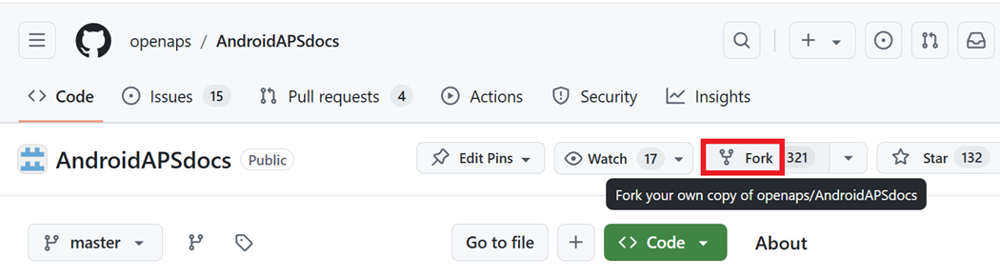
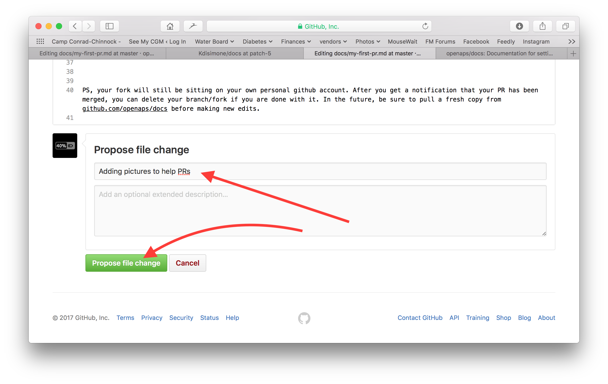
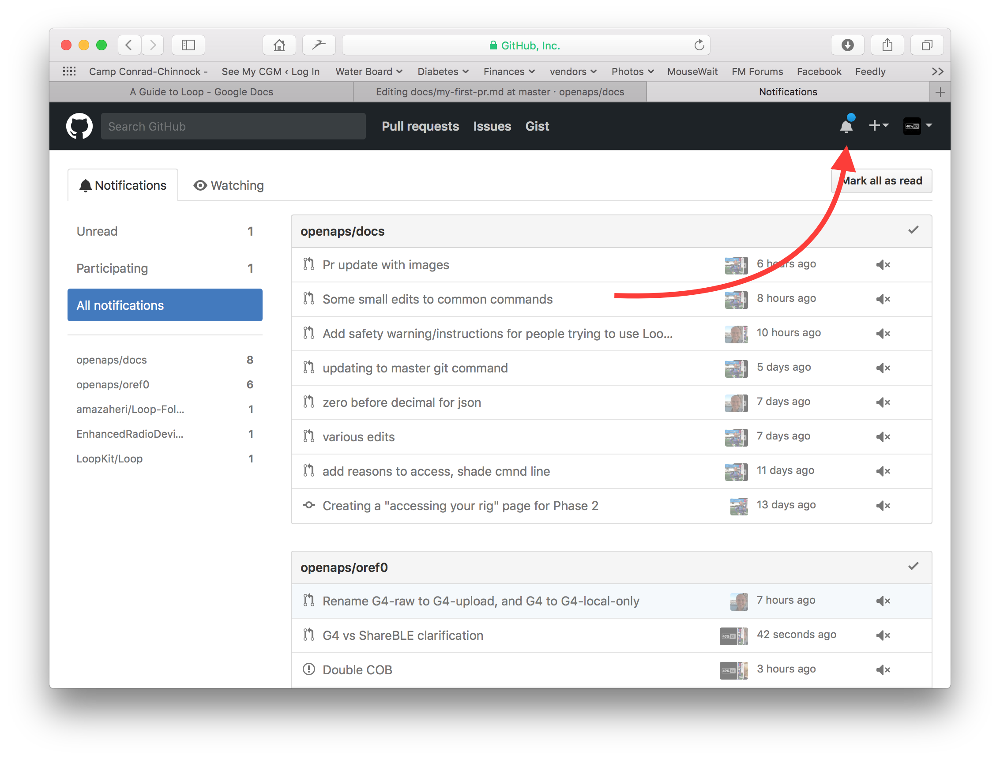

# Πώς να επεξεργαστείτε την τεκμηρίωση

**Αυτή η περιγραφή αφορά μόνο την επεξεργασία της αγγλικής τεκμηρίωσης. Όλες οι νέες πληροφορίες πρέπει να προστίθενται πρώτα στα αγγλικά. Αν θέλετε να μεταφράσετε σε άλλες γλώσσες (σας ευχαριστούμε), χρησιμοποιήστε το [crowdin](https://crowdin.com/project/androidapsdocs).**

Για οδηγίες για τη μορφοποίηση του κειμένου (επικεφαλίδες, έντονα...) και για τους συνδέσμους, δείτε την ενότητα [«Σύνταξη κώδικα»](#code-syntax) σε αυτή τη σελίδα.

## Γενικά

Για κάθε ερώτηση, σχόλιο ή νέα ιδέα μπορείτε να επικοινωνήσετε με την ομάδα της τεκμηρίωσης μέσω [discord](https://discord.gg/4fQUWHZ4Mw).

Κάποια στιγμή θα σας προτείνουν να κάνετε ένα pull request (PR). Με αυτόν τον τρόπο οι αλλαγές σας στην τεκμηρίωση μπαίνουν πραγματικά στις ιστοσελίδες του AAPS, που είναι αποθηκευμένες στο GitHub. Δεν είναι πολύ δύσκολο να κάνετε ένα PR και είναι ένας πολύ καλός τρόπος να βοηθήσετε. Διαβάζετε αυτή την τεκμηρίωση τώρα επειδή άνθρωποι σαν εσάς έκαναν PR. Μην ανησυχείτε μήπως κάνετε κάποιο λάθος ή επεξεργαστείτε κατά λάθος τα λάθος έγγραφα. Οι αλλαγές σας ελέγχονται πριν συγχωνευθούν στο «επίσημο» αποθετήριο της τεκμηρίωσης του AAPS. Δεν μπορείτε να χαλάσετε τα πρωτότυπα κατά λάθος σε αυτή τη διαδικασία. Η γενική διαδικασία είναι:

- Κάντε τροποποιήσεις και βελτιώσεις σε κώδικα ή τεκμηρίωση με επεξεργασία του υπάρχοντος περιεχομένου.
- Ελέγξτε ξανά ότι οι επεξεργασίες σας φαίνονται καλές σε εσάς.
- Δημιουργήστε μερικές σημειώσεις για το τι άλλαξε, ώστε οι άνθρωποι να κατανοήσουν τις αλλαγές.
- Δημιουργήστε ένα pull request, που ζητά από τους διαχειριστές να χρησιμοποιήσουν τις αλλαγές σας.
- Θα κάνουν έναν έλεγχο και (1) θα συγχωνεύσουν (merge) τις αλλαγές σας, (2) θα σας γράψουν σχόλια για τις αλλαγές σας ή (3) θα ξεκινήσουν ένα νέο έγγραφο με τις αλλαγές σας.

(Σημείωση: Αν μαθαίνετε καλύτερα με εικόνα, υπάρχει ένα βίντεο στο YouTube [εδώ](https://youtu.be/4b6tsL0_kzg) που δείχνει τη διαδικασία του PR.)

Για παράδειγμα, πρόκειται να κάνουμε μια επεξεργασία στο AndroidAPSdocs. Αυτό μπορεί να γίνει σε οποιοδήποτε υπολογιστή με Windows, Mac, κλπ. (οποιοσδήποτε υπολογιστής με πρόσβαση στο Internet).

1. Πηγαίνετε στο <https://github.com/openaps/AndroidAPSdocs> και πατήστε «Fork» πάνω δεξιά για να φτιάξετε το δικό σας αντίγραφο του αποθετηρίου.



2. Πηγαίνετε σε οποιαδήποτε σελίδα και μεταβείτε στη σελίδα που θέλετε να επεξεργαστείτε. Μπορείτε να κάνετε κλικ στον σύνδεσμο «Edit in GitHub» πάνω δεξιά. Αυτό γίνεται μόνο για τις αγγλικές σελίδες. 


Ή κάντε κλικ στο εικονίδιο με το μολύβι που εμφανίζεται στην πάνω γραμμή του περιεχομένου της σελίδας που θέλετε να επεξεργαστείτε. Για να το κάνετε αυτό, πρέπει να έχετε ήδη συνδεθεί στον λογαριασμό σας στο GitHub (αν δεν έχετε λογαριασμό, η δημιουργία του είναι εύκολη).


3. Και οι δύο επιλογές στο Βήμα 2 θα δημιουργήσουν έναν νέο κλάδο (branch) στο ΔΙΚΟ ΣΑΣ αποθετήριο, όπου θα αποθηκευτούν οι αλλαγές σας. Κάντε τις αλλαγές σας στο αρχείο.

Χρησιμοποιούμε markdown για τις σελίδες της τεκμηρίωσης. Τα αρχεία έχουν την κατάληξη ".md". Η προδιαγραφή του Markdown δεν είναι σταθερή και προς το παρόν χρησιμοποιούμε το myst_parser για τα αρχεία markdown. Προσέξτε να χρησιμοποιείτε τη σωστή σύνταξη, όπως [περιγράφεται παρακάτω](#code-syntax).


4. Δουλεύετε στην καρτέλα «<>Edit file» (επεξεργασία αρχείου). Επιλέξτε την καρτέλα «Preview changes» (προεπισκόπηση αλλαγών) για να δείτε με καθαρό μάτι ότι όλα όσα αλλάξατε φαίνονται όπως τα θέλατε (και ελέγξτε για τυπογραφικά λάθη). Αν βλέπετε μια απαραίτητη βελτίωση, επιστρέψτε στην καρτέλα επεξεργασίας για να κάνετε περισσότερες βελτιώσεις. 


5. Όταν τελειώσετε τις επεξεργασίες σας, μεταβείτε στο κάτω μέρος της σελίδας. Στο πλαίσιο στο κάτω μέρος, γράψτε τα σχόλιά σας στο πεδίο κειμένου που γράφει «Add an optional extended description...» (προσθέστε μια προαιρετική εκτενή περιγραφή). Ο προεπιλεγμένος τίτλος έχει το όνομα του αρχείου. Προσπαθήστε να γράψετε μια πρόταση που εξηγεί τον **λόγο** της αλλαγής. Αν γράψετε τον λόγο, οι ελεγκτές καταλαβαίνουν καλύτερα τι θέλετε να κάνετε με το PR.



6. Κάντε κλικ στο πράσινο κουμπί «Propose file changes» ή «Commit changes». Στη σελίδα που εμφανίζεται, κάντε κλικ στο «Create Pull Request» και ξανά στην επόμενη σελίδα κάντε κλικ στο «Create Pull Request».


7. Έτσι ολοκληρώνεται το άνοιγμα ενός pull request (PR). Το GitHub δίνει στο PR έναν αριθμό, που βρίσκεται μετά τον τίτλο και το σύμβολο #. Γυρίστε σε αυτή τη σελίδα για να δείτε αν υπάρχουν σχόλια (ή, αν λαμβάνετε τις ειδοποιήσεις του GitHub με email, θα λαμβάνετε email για κάθε δραστηριότητα στο PR). Η αλλαγή σας είναι τώρα σε μια λίστα με PR που η ομάδα θα ελέγξει και ίσως σας δώσει σχόλια, πριν μπει στην κύρια τεκμηρίωση του AAPS! Αν θέλετε να ελέγξετε την πρόοδο του PR, μπορείτε να κάνετε κλικ στο εικονίδιο με το καμπανάκι πάνω δεξιά στον λογαριασμό σας στο GitHub και να δείτε όλα τα PR σας.



Υ.Γ.: Το fork και ο κλάδος σας θα μείνουν στον προσωπικό σας λογαριασμό στο GitHub. Όταν λάβετε ειδοποίηση ότι το PR σας έχει συγχωνευθεί (merged), μπορείτε να διαγράψετε τον κλάδο σας, αν δεν τον χρειάζεστε πια (η περιοχή ειδοποιήσεων του Βήματος 8 θα σας δώσει έναν σύνδεσμο για να διαγράψετε τον κλάδο, όταν κλείσει ή συγχωνευθεί). Για μελλοντικές αλλαγές, αν ακολουθήσετε αυτή τη διαδικασία, οι αλλαγές θα ξεκινούν πάντα από μια ενημερωμένη έκδοση των αποθετηρίων του AndroidAPSdocs. Αν επιλέξετε άλλο τρόπο για να ξεκινήσετε ένα PR (π.χ. επεξεργασία με αφετηρία τον κλάδο master του δικού σας fork), πρέπει να βεβαιωθείτε ότι το αποθετήριό σας είναι ενημερωμένο: κάντε πρώτα ένα «compare» (σύγκριση) και συγχωνεύστε όλες τις αλλαγές που έγιναν από την τελευταία φορά που ενημερώσατε το fork σας. Επειδή συχνά ξεχνάμε να ενημερώσουμε τα αποθετήριά μας, προτείνουμε να χρησιμοποιείτε τη διαδικασία PR που περιγράφεται παραπάνω, μέχρι να εξοικειωθείτε με τα «compare».

(edit-the-docs-code-syntax)=

## Σύνταξη κώδικα

Χρησιμοποιούμε markdown για τις σελίδες της τεκμηρίωσης. Τα αρχεία έχουν την κατάληξη ".md".

Το markdown είναι μια πολύ απλή γλώσσα μορφοποίησης κειμένου, που χωρίζει το περιεχόμενο του κειμένου από τη μορφοποίησή του.

Ο συγγραφέας απλώς σημειώνει π.χ. μια επικεφαλίδα ως επικεφαλίδα επιπέδου 1 και ο επεξεργαστής markdown δημιουργεί τον απαραίτητο κώδικα HTML για να εμφανίσει την επικεφαλίδα σε HTML.

Η ιδέα πίσω από αυτό είναι ότι

- ο συγγραφέας πρέπει να σκέφτεται πρώτα το κείμενο και όχι τη μορφοποίηση,
- το κείμενο markdown μπορεί να μεταφερθεί ανάμεσα σε διαφορετικά εργαλεία markdown, αντί για π.χ. κλειστά (proprietary) εργαλεία όπως τα Microsoft Windows και
- μπορείτε να δημιουργήσετε διάφορες μορφές εξόδου από ένα αρχείο markdown.

Το markdown δεν είναι ένα 100% σταθερό πρότυπο και προσπαθούμε να μένουμε όσο πιο κοντά γίνεται στο πρότυπο, για να

- μένουμε ευέλικτοι να αλλάξουμε εργαλεία markdown όταν χρειάζεται ή όταν μας αναγκάζει η εξέλιξη των εργαλείων markdown και των υπηρεσιών markdown SaaS και
- μπορούμε να χρησιμοποιούμε υπηρεσίες μετάφρασης για να μεταφράζουμε το αγγλικό κείμενο σε μια άλλη γλώσσα, όπως γαλλικά ή γερμανικά. Αυτές δουλεύουν με markdown, αλλά όχι με σύνθετους κώδικες μορφοποίησης, γιατί δεν μπορούν να ξεχωρίσουν το περιεχόμενο από τη διάταξη, και αυτό μπορεί να είναι καταστροφικό.

### Επικεφαλίδες

- Επικεφαλίδα 1: `# headline`
- Επικεφαλίδα 2: `## headline`
- Επικεφαλίδα 3: `### headline`
- Επικεφαλίδα 4: `#### headline`

Προσπαθούμε να αποφεύγουμε περισσότερα επίπεδα επικεφαλίδων.

### Μορφή κειμένου

- **έντονα**: `**text**`
- *πλάγια*: `*text*`
- ***έντονα πλάγια***: `***text***`

### Αριθμημένη λίστα

    1. πρώτο
    1. δεύτερο
    1. τρίτο
    

1. πρώτο
2. δεύτερο
3. τρίτο

### Λίστα χωρίς αρίθμηση

    - ένα στοιχείο
    - άλλο ένα στοιχείο
    - και άλλο ένα στοιχείο
    

- ένα στοιχείο
- άλλο ένα στοιχείο
- και άλλο ένα στοιχείο

### Λίστα πολλών επιπέδων

Μπορείτε να βάλετε λίστες μέσα σε λίστες, αν μετακινήσετε το επόμενο επίπεδο 4 κενά πιο δεξιά από το προηγούμενο.

    1. πρώτο
    1. δεύτερο
    1. τρίτο
      1. ένα στοιχείο
      1. άλλο ένα στοιχείο
      1. και άλλο ένα στοιχείο
    1. τέσσερα
    1. πέντε
    1. έξι
    

1. πρώτο
2. δεύτερο
3. τρίτο 
    1. ένα στοιχείο
    2. άλλο ένα στοιχείο
    3. και άλλο ένα στοιχείο
4. τέσσερα
5. πέντε
6. έξι

### Εικόνες

Για να προσθέσετε εικόνες, χρησιμοποιήστε αυτή τη σύνταξη markdown.

- εικόνες: ``

Ο τύπος της εικόνας πρέπει να είναι PNG ή JPEG.

Τα ονόματα των εικόνων πρέπει να ακολουθούν έναν από τους παρακάτω κανόνες ονομασίας. Στο παράδειγμα χρησιμοποιώ png ως κατάληξη. Αν χρησιμοποιείτε JPEG, χρησιμοποιήστε την κατάληξη jpeg.

- `filename-image-xx.png` όπου xx είναι ένας μοναδικός διψήφιος αριθμός για τις εικόνες σε αυτό το αρχείο.
- `filename-image-xx.png` όπου xx είναι ένα όνομα με νόημα, που επιλέγει ο συγγραφέας του αρχείου md.

Οι εικόνες βρίσκονται στον φάκελο images για την αγγλική γλώσσα και το Crowdin τις περνάει αυτόματα στις άλλες γλώσσες. Δεν χρειάζεται να κάνετε τίποτα για αυτό!

Προς το παρόν δεν μεταφράζουμε τις εικόνες: οι εικόνες πρέπει να έχουν **όσο λιγότερο κείμενο γίνεται**, ώστε να τις καταλαβαίνουν και όσοι δεν διαβάζουν αγγλικά.

(make-a-PR-image-size)= Χρησιμοποιήστε λογικό μέγεθος για τις εικόνες, ώστε να διαβάζονται σε υπολογιστή, tablet και κινητό.

- Οι εικόνες με στιγμιότυπα οθόνης από ιστοσελίδες πρέπει να έχουν πλάτος έως **1050 pixel**.
- Τα διαγράμματα ροής διαδικασιών πρέπει να έχουν πλάτος έως **1050 pixel**.
- Τα στιγμιότυπα οθόνης από την εφαρμογή πρέπει να έχουν πλάτος έως **500 pixel**. Μην τα βάζετε το ένα δίπλα στο άλλο, αν δεν χρειάζεται.
- Τα στιγμιότυπα οθόνης από το ρολόι (**Wear OS**) πρέπει να έχουν πλάτος έως **360 pixel**. Ποτέ μη μεγεθύνετε ένα μικρότερο στιγμιότυπο οθόνης.

### Σύνδεσμοι

#### Εξωτερικοί σύνδεσμοι

Οι εξωτερικοί σύνδεσμοι είναι σύνδεσμοι σε εξωτερικές ιστοσελίδες.

- εξωτερικός σύνδεσμος: `[alt text](www.url.tld)`

#### Εσωτερικοί σύνδεσμοι στην αρχή ενός αρχείου md

Οι εσωτερικοί σύνδεσμοι σε σελίδες είναι σύνδεσμοι στην αρχή ενός αρχείου md που φιλοξενείται στον δικό μας διακομιστή.

- εσωτερικός σύνδεσμος σε σελίδα .md: `[alt text](../folder/file.md)`

#### Εσωτερικοί σύνδεσμοι σε ονομασμένες αναφορές μέσα στο κείμενο

Οι εσωτερικοί σύνδεσμοι σε ονομασμένες αναφορές είναι σύνδεσμοι σε οποιοδήποτε σημείο ενός αρχείου md που φιλοξενείται στον δικό μας διακομιστή και όπου έχει οριστεί μια αναφορά για σύνδεση.

Προσθέστε μια ονομασμένη αναφορά στο σημείο του αρχείου md όπου θέλετε να μεταφέρεται ο σύνδεσμος.

`(name-of-my-md-file-this-is-my-fancy-named-reference)=`

Η ονομασμένη αναφορά πρέπει να είναι μοναδική σε όλα τα αρχεία md του AndroidAPSDocs και όχι μόνο στο αρχείο md όπου βρίσκεται!

Γι' αυτό είναι καλή πρακτική να ξεκινάτε με το όνομα του αρχείου και μετά να βάζετε το όνομα της αναφοράς που επιλέγετε.

Χρησιμοποιήστε μόνο πεζά γράμματα και ενώστε τις λέξεις με παύλα.

Μετά βάλτε σύνδεσμο σε αυτή την αναφορά στο κείμενο που γράφετε, με τον παρακάτω τύπο συνδέσμου.

- Εσωτερικοί σύνδεσμοι σε ονομασμένες αναφορές: `[alt text](name-of-my-md-file-this-is-my-fancy-named-reference)`

### Σημειώσεις, προειδοποιήσεις, σημειώσεις που κλείνουν

Μπορείτε να προσθέσετε πλαίσια σημειώσεων και προειδοποιήσεων στην τεκμηρίωση.

Επιπλέον, μπορείτε να προσθέσετε σημειώσεις που κλείνουν για αναλυτικές πληροφορίες, ώστε όσοι δεν ενδιαφέρονται για τις λεπτομέρειες να μην αποθαρρύνονται από το κείμενο. Χρησιμοποιήστε τα προσεκτικά, γιατί η τεκμηρίωση πρέπει να διαβάζεται όσο πιο εύκολα γίνεται.

#### Σημειώσεις

    ```{admonition} Επικεφαλίδα σημείωσης
    :class: note
    Αυτή είναι μια σημείωση.
    ```
    

```{admonition} Επικεφαλίδα σημείωσης :class: note Αυτή είναι μια σημείωση.

    <br />#### Προειδοποιήσεις
    
    ````
    ```{admonition} Προειδοποίηση
    :class: warning
    Αυτή είναι μια προειδοποίηση.
    

    ```{admonition} Επικεφαλίδα προειδοποίησης
    :class: warning
    Αυτή είναι μια προειδοποίηση.
    ```
    
    #### Σημειώσεις που κλείνουν
    
    

    {admonition} περισσότερες λεπτομέρειες για όσους ενδιαφέρονται
    :class: dropdown
    
    Αυτό το πλαίσιο είναι κλειστό,
    δηλαδή μπορείτε να βάλετε εδώ μεγαλύτερο κείμενο,
    χωρίς να πιάνει πολύ χώρο στη σελίδα.
    

````

```{admonition} περισσότερες λεπτομέρειες για όσους ενδιαφέρονται :class: dropdown Αυτό το πλαίσιο είναι κλειστό, δηλαδή μπορείτε να βάλετε εδώ μεγαλύτερο κείμενο, χωρίς να πιάνει πολύ χώρο στη σελίδα.

```

## Πίνακες

Αποφεύγετε πίνακες με μεγάλα κείμενα: το περιεχόμενο είναι δύσκολο να μπει σε Markdown, συνήθως δεν χωρούν στο πλάτος της οθόνης ενός κινητού και πιθανόν δεν θα εμφανίζονται το ίδιο μετά τη μετάφραση.

## Οδηγός ύφους

### Περιεχόμενα

1. Συμβουλές για τη γραφή στα αγγλικά

2. Σημειώσεις γραφής ειδικά για το AAPS

3. Χρήσιμες αναφορές

###  1\. Συμβουλές για τη γραφή στα αγγλικά

#### Χρησιμοποιήστε γλώσσα που ταιριάζει στον αναγνώστη

Χρησιμοποιήστε απλά αγγλικά όπου γίνεται. Αυτό βοηθά όσους δεν έχουν τα αγγλικά ως μητρική γλώσσα και κάνει πιο εύκολη τη μετάφραση των κειμένων του AAPS σε άλλες γλώσσες. Γράψτε σαν να μιλάτε με τον χρήστη: φανταστείτε ότι κάθεστε απέναντι από το άτομο για το οποίο γράφετε. Θυμηθείτε: οι περισσότεροι χρήστες του AAPS δεν έχουν γνώσεις προγραμματισμού. Και ο ίδιος ο διαβήτης έχει πολλούς ειδικούς όρους και συντομογραφίες. Να θυμάστε ότι κάποιοι μπορεί να έχουν διαγνωστεί πρόσφατα, να μην έχουν τόση εμπειρία με τον διαβήτη όση εσείς ή να έχουν λάβει διαφορετική εκπαίδευση για τον διαβήτη. Αν χρησιμοποιείτε μια συντομογραφία, γράψτε την ολόκληρη την πρώτη φορά και βάλτε τη συντομογραφία αμέσως μετά σε παρένθεση, όπως “super micro bolus (SMB)”. Επίσης, βάλτε σύνδεσμο προς το γλωσσάριο. Ειδικοί τεχνικοί όροι που ίσως δεν γνωρίζει ο αναγνώστης μπορούν επίσης να μπουν σε παρένθεση.

Αντί για: *“What causes high postprandial BG peaks in closed loop?"*

Γράψτε: *“What causes a high BG peak **after lunch** (postprandial) in closed loop?"*

##### Χρησιμοποιήστε απλές λέξεις που όλοι καταλαβαίνουν

Ένα αλφαβητικό κατάλογο (A-Z) με εναλλακτικές λέξεις, που κάνουν το κείμενό σας πιο κατανοητό, θα βρείτε εδώ:

<https://www.plainenglish.co.uk/the-a-z-of-alternative-words.html>

#### Θέματα ιδιωτικότητας και αδειών χρήσης:

Ειδικά αν καταγράφετε βίντεο ή στιγμιότυπα οθόνης, προσέξτε να μη δείξετε προσωπικά σας στοιχεία (κλειδί API, κωδικούς πρόσβασης). Βεβαιωθείτε ότι το περιεχόμενο στο YouTube δεν είναι δημόσια ορατό στη λίστα (unlisted) και ότι χρειάζεται σύνδεσμο από την τεκμηρίωση για να το δει κανείς. Μην τραβάτε την προσοχή σε υλικό που παραβιάζει πνευματικά δικαιώματα (BYODA κ.λπ.).

#### Γράφετε σύντομες προτάσεις, πηγαίνετε κατευθείαν στο θέμα

- Ένα σαφές κείμενο έχει κατά μέσο όρο προτάσεις 15 έως 20 λέξεων.

- Αυτό δεν σημαίνει ότι κάθε πρόταση πρέπει να έχει το ίδιο μήκος. Γράφετε δυναμικά. Αλλάζετε το κείμενό σας: βάζετε σύντομες προτάσεις (όπως η προηγούμενη) μαζί με μεγαλύτερες (όπως αυτή).

- Βάζετε μία κύρια ιδέα σε κάθε πρόταση και ίσως ένα ακόμα σχετικό σημείο.

- Μπορεί και πάλι να γράψετε κάποια μεγάλη πρόταση, ειδικά όταν εξηγείτε κάτι δύσκολο. Όμως οι περισσότερες μεγάλες προτάσεις μπορούν να χωριστούν με κάποιον τρόπο.

- Αφαιρέστε τις αδύναμες λέξεις: “you can”, “there is/are/were”, “in order to”.

- Βάζετε τις λέξεις-κλειδιά κοντά στην αρχή των τίτλων, των προτάσεων και των παραγράφων.

- Δείξτε το με εικόνες! Όπου γίνεται, δώστε ένα σύντομο διάγραμμα, στιγμιότυπο οθόνης ή βίντεο.

#### Μη φοβάστε να δίνετε οδηγίες

Οι εντολές είναι ο πιο γρήγορος τρόπος για να δώσετε οδηγίες, αλλά οι συγγραφείς μερικές φορές φοβούνται να δίνουν εντολές και γράφουν “you should do this” αντί για απλώς “do this”. Ίσως φοβούνται ότι οι εντολές ακούγονται πολύ σκληρές. Συχνά αυτό λύνεται αν βάλετε μπροστά τη λέξη 'please'. Όμως, αν κάτι πρέπει οπωσδήποτε να γίνει, είναι καλύτερα να μη γράψετε ‘please’, γιατί έτσι ο αναγνώστης έχει την επιλογή να αρνηθεί.

Αντί για: *“You should just think of it as a complete statement."*

Γράψτε: *“Think of it as a complete statement.”*

#### Χρησιμοποιείτε κυρίως ενεργητική φωνή αντί για παθητική

Παράδειγμα **ενεργητικής φωνής**:

- *“The pump (subject) delivers (verb) the insulin (object).”*

Εδώ το “delivers” είναι σε ενεργητική φωνή. Η πρόταση λέει πρώτα ποιος κάνει τη χορήγηση και μετά τι χορηγείται.

Παράδειγμα **παθητικής φωνής**:

- *“The insulin (subject) is delivered (verb) by the pump (object)”*

Εδώ το *“delivered”* είναι σε παθητική φωνή. Το υποκείμενο και το αντικείμενο έχουν αλλάξει θέση σε σχέση με την πρόταση με ενεργητική φωνή. Η πρόταση έγινε μεγαλύτερη, γιατί χρειάστηκε να προσθέσουμε τα “is” και “by the”. Σκεφτείτε επίσης να ξεκινάτε με το ρήμα σε ενεργητική φωνή.

Αντί για: *“You can connect your pump with the phone through the AAPS pump menu, and there are a number of pumps available for you to connect with.”*

Γράψτε: *“Connect your desired pump to the phone through the AAPS pump menu.”*

Η παθητική φωνή μπορεί να δημιουργήσει προβλήματα:

- Μπορεί να μπερδεύει.

- Συχνά κάνει το κείμενο πιο φλύαρο.

- Κάνει το κείμενο λιγότερο ζωντανό.

##### Πότε η παθητική φωνή είναι καλή

Υπάρχουν φορές που ίσως είναι σωστό να χρησιμοποιήσετε παθητική φωνή.

- Για να κάνετε κάτι λιγότερο επιθετικό - το 'this bill has not been paid' (παθητική) είναι πιο ήπιο από το 'you have not paid this bill' (ενεργητική).

- Για να μη ρίξετε την ευθύνη σε κάποιον - 'a mistake was made' (παθητική) αντί για 'You made a mistake' (ενεργητική).

- Όταν δεν ξέρετε ποιος ή τι κάνει την πράξη - 'the England team has been picked'.

- Αν απλώς ακούγεται καλύτερα.

#### Αποφεύγετε τα ουσιαστικά που προέρχονται από ρήματα

Ένα τέτοιο ουσιαστικό (nominalisation) είναι το όνομα για κάτι που δεν είναι φυσικό αντικείμενο, όπως μια διαδικασία, μια τεχνική ή ένα συναίσθημα. Τα ουσιαστικά αυτά (nominalizations) σχηματίζονται από ρήματα.

Για παράδειγμα:

| Ρήμα      | Ουσιαστικό από ρήμα |
| --------- | ------------------- |
| complete  | completion          |
| introduce | introduction        |
| provide   | provision           |
| fail      | failure             |

Συχνά χρησιμοποιούνται **αντί** για τα ρήματα από τα οποία προέρχονται, αλλά μπορεί να ακούγονται σαν να μη γίνεται στην πραγματικότητα τίποτα. Αν είναι πολλά, το κείμενο γίνεται πολύ βαρετό και κουραστικό.

Αντί για: *“The implementation of the method has been done by a team.”*

Γράψτε: *“A team has implemented the method.”*

#### Χρησιμοποιείτε λίστες όπου ταιριάζουν

Οι λίστες είναι πολύ καλές για να χωρίζετε τις πληροφορίες. Υπάρχουν δύο κύριοι τύποι λίστας:

- Μια συνεχής πρόταση, με διάφορα σημεία της λίστας στην αρχή, στη μέση ή στο τέλος.

- Ξεχωριστές κουκκίδες με μια εισαγωγική πρόταση.

Στη λίστα με κουκκίδες παραπάνω, κάθε σημείο είναι πλήρης πρόταση, γι' αυτό κάθε σημείο ξεκινά με κεφαλαίο γράμμα και τελειώνει με τελεία. Χρησιμοποιείτε κουκκίδες αντί για αριθμούς ή γράμματα, γιατί τραβούν την προσοχή σε κάθε σημείο χωρίς να δίνουν επιπλέον πληροφορίες για επεξεργασία.

#### Μύθοι που καταρρίπτονται

- Μπορείτε να ξεκινήσετε μια πρόταση με **and, but, because, so ή however**.

- Μπορείτε να χωρίσετε τα απαρέμφατα (split infinitives). Έτσι μπορείτε να γράψετε **“to boldly go”**.

- Μπορείτε να τελειώσετε μια πρόταση με πρόθεση. Στην πραγματικότητα, είναι κάτι **we should stand up for**.

- Και **μπορείτε** να χρησιμοποιήσετε την ίδια **λέξη** δύο φορές σε μια πρόταση, αν **δεν** βρίσκετε καλύτερη **λέξη**.

#### Βελτίωση του ύφους γραφής ανάλογα με τον σκοπό

Για να μένει η τεκμηρίωση σαφής και σύντομη, γράφουμε διαφορετικά τμήματά της με διαφορετικό ύφος.

Το ύφος «επεξήγηση» χρησιμοποιείται για τα τμήματα με την εισαγωγή, το υπόβαθρο και την ανάπτυξη γνώσεων.

Το ύφος «οδηγός How-to» (με ελάχιστες εξηγήσεις) χρησιμοποιείται για τη δημιουργία (build) και τη ρύθμιση του AAPS και για κάποια τμήματα αντιμετώπισης προβλημάτων.

Ένα tutorial (μάθημα βήμα προς βήμα) βοηθά τον μαθητή να αποκτήσει βασικές ικανότητες. Ο χρήστης θα **μάθει κάνοντας**.


#####  Tutorials (π.χ. μαθαίνετε σε ένα παιδί να χτυπά ασπράδια αυγών)

- ο αφηγητής μιλά απευθείας στον αναγνώστη: In this tutorial **you** will το (we) μπορεί να χρησιμοποιηθεί σε λίγες περιπτώσεις, για να δείξει ότι «είμαστε σε αυτό μαζί»

- Μέλλοντας -> για να δείξετε τον τελικό στόχο

- Προστακτική -> για να γίνουν οι εργασίες -> Συγκεκριμένα βήματα - αποφεύγετε αφηρημένες έννοιες

- Αόριστος -> για να δείξετε εργασίες που ολοκληρώθηκαν -> Γρήγορα και αμέσως ορατά αποτελέσματα

- Ελάχιστες εξηγήσεις -> μόνο ό,τι χρειάζεται για να ολοκληρωθεί η εργασία - **τι και γιατί**

- Αγνοήστε επιλογές/εναλλακτικές/…. Καμία ασάφεια

- Μεταβάσεις βημάτων: τελειώστε ένα βήμα με μια πρόταση που οδηγεί λογικά στο επόμενο βήμα. Example: *You have now installed the Let’s Encrypt client, but before obtaining certificates, you need to make sure that all required ports are open. To do this, you will update your firewall settings in the next step.*

- Τίτλος **Tutorial** (επικεφαλίδα επιπέδου 1)

- Εισαγωγή (χωρίς επικεφαλίδα)

- Προϋποθέσεις (επικεφαλίδα επιπέδου 2)

- Βήματα:

- Βήμα 1 — Κάνουμε το πρώτο πράγμα (επικεφαλίδα επιπέδου 2)

- Βήμα 2 — Κάνουμε το επόμενο πράγμα (επικεφαλίδα επιπέδου 2)

- Βήμα n — Κάνουμε το τελευταίο πράγμα (επικεφαλίδα επιπέδου 2)

- Συμπέρασμα (επικεφαλίδα επιπέδου 2)
    
    - **Η γλώσσα των tutorials**
        
        *In this tutorial, you will…*
        
        Περιγράψτε τι θα πετύχει αυτός που μαθαίνει (προσοχή - όχι: “you will learn…”).
        
        *First, do x. Now, do y. Now that you have done y, do z.*
        
        Καμία θέση για ασάφεια ή αμφιβολία.
        
        *We must always do x before we do y because… (see Explanation for more details).*
        
        Εξηγήστε τις ενέργειες όσο λιγότερο γίνεται, με την πιο απλή γλώσσα. Βάλτε σύνδεσμο σε πιο αναλυτική επεξήγηση.
        
        *The output should look something like this…*
        
        Δώστε σε αυτόν που μαθαίνει σαφείς προσδοκίες.
        
        *Notice that… Remember that…*
        
        Δώστε σε αυτόν που μαθαίνει πολλά σημάδια, ώστε να επιβεβαιώνει ότι είναι στον σωστό δρόμο και να προσανατολίζεται.
        
        *You have built a secure, three-layer hylomorphic stasis engine…*
        
        Περιγράψτε (και θαυμάστε, με μέτρο) τι πέτυχε αυτός που μαθαίνει (προσοχή - όχι: “you have learned…”)

#####  Οδηγοί How-To (π.χ. μια συνταγή)

Ο σκοπός ενός οδηγού how-to είναι να βοηθήσει έναν χρήστη, που ήδη ξέρει τα βασικά, να κάνει σωστά μια συγκεκριμένη εργασία.

- HOW-to

- ο αφηγητής μιλά απευθείας στον αναγνώστη: In this tutorial **you** will

- Μέλλοντας -> για να δείξετε τον τελικό στόχο

- Προστακτική με συνθήκη -> για να πετύχετε X κάντε y -> Συγκεκριμένα βήματα - αποφεύγετε αφηρημένες έννοιες

- Ελάχιστες εξηγήσεις -> μόνο ό,τι χρειάζεται για να ολοκληρωθεί η εργασία -> **τι και γιατί**

- Αγνοήστε επιλογές/εναλλακτικές/…. Καμία ασάφεια, αλλά μπορείτε να βάλετε σύνδεσμο στο λήμμα αναφοράς ή στο λήμμα επεξήγησης

- **How-to**: Τίτλος (επικεφαλίδα επιπέδου 1)

- Εισαγωγική παράγραφος

- Προαιρετικές προϋποθέσεις (παράγραφος ή επικεφαλίδα επιπέδου 2, αν είναι περισσότερες από 1)

- Βήματα:

- Βήμα 1 — Κάνουμε το πρώτο πράγμα (επικεφαλίδα επιπέδου 2)

- Βήμα 2 — Κάνουμε το επόμενο πράγμα (επικεφαλίδα επιπέδου 2)

- Βήμα n — Κάνουμε το τελευταίο πράγμα (επικεφαλίδα επιπέδου 2)

- Τελική παράγραφος
    
    - **Η γλώσσα των οδηγών How-To**
        
        *This guide shows you how to…*
        
        Περιγράψτε καθαρά το πρόβλημα ή την εργασία που ο οδηγός δείχνει στον χρήστη πώς να λύσει.
        
        *If you want x, do y. To achieve w, do z.*
        
        Χρησιμοποιείτε προστακτική με συνθήκη.
        
        *Refer to the x reference guide for a full list of options.*
        
        Μη γεμίζετε τον πρακτικό οδηγό how-to με κάθε πιθανό πράγμα που μπορεί να κάνει ο χρήστης σχετικά με το x.

#####  Επεξήγηση (π.χ. η επιστήμη πίσω από το γιατί τα ασπράδια σφίγγουν όταν τα χτυπάτε)

Μια επεξήγηση ξεκαθαρίζει, εμβαθύνει και διευρύνει την κατανόηση του αναγνώστη για ένα θέμα.

- ΓΙΑΤΙ

- Ξεκινήστε με **About**

- Δώστε το πλαίσιο, βάλτε σύνδεσμο σε ΟΛΕΣ τις σχετικές αναφορές

- Συζητήστε επιλογές/εναλλακτικές

- Μη δίνετε οδηγίες ή υλικό αναφοράς (βάλτε σύνδεσμο σε αυτά)

- Αναφέρετε τα άγνωστα, τους στόχους που αλλάζουν κ.λπ.…

- Τίτλος **About** (επικεφαλίδα επιπέδου 1)

- Εισαγωγή (χωρίς επικεφαλίδα)

- Προαιρετικές προϋποθέσεις (επικεφαλίδα επιπέδου 2)

- Υποθέμα 1 (επικεφαλίδα επιπέδου 2)

- Συμπέρασμα (επικεφαλίδα επιπέδου 2)
    
    - **Η γλώσσα της επεξήγησης**
    
    *The reason for x is because historically, y…*
    
    Εξηγήστε.
    
    *W is better than z, because…*
    
    Δώστε κρίσεις, ακόμα και απόψεις, όπου ταιριάζει.
    
    *An x in system y is analogous to a w in system z. However…*
    
    Δώστε πλαίσιο που βοηθά τον αναγνώστη.
    
    *Some users prefer w (because z). This can be a good approach, but…*
    
    Συγκρίνετε τις εναλλακτικές.
    
    *An x interacts with a y as follows:…*
    
    Αποκαλύψτε τα εσωτερικά μυστικά του μηχανισμού, για να γίνει κατανοητό γιατί κάτι κάνει αυτό που κάνει.

### 2\. Σημειώσεις για τη γραφή/ενημέρωση ειδικά για το AAPS

#### Συγγραφέας & επιμελητής

Για τη γραφή/ενημέρωση της τεκμηρίωσης του AAPS, σκεφτείτε ότι η διαδικασία έχει δύο στάδια. Αυτά μπορεί να τα κάνει το ίδιο άτομο σε διαφορετικές στιγμές ή περισσότερα από ένα άτομα.

Ένας **συγγραφέας (π.χ. εσείς!)** γράφει/αλλάζει ένα τμήμα της τεκμηρίωσης με σύντομο, φιλικό ύφος και μετά το δίνει στον επιμελητή.

Ο **επιμελητής (π.χ. ένας άλλος χρήστης του AAPS ή το άτομο που λαμβάνει το pull request)** ελέγχει αν τηρείται ο οδηγός ύφους, διορθώνει το τμήμα ώστε να είναι σαφές και εύκολο στην ανάγνωση και αφαιρεί όσο περισσότερες λέξεις γίνεται (ειδικά για τα τμήματα tutorial/how-to). Μπορεί να βοηθήσει αν διαβάσετε το κείμενο δυνατά.

#### Γενικά σημεία για το AAPS

- Για τις τιμές γλυκόζης, γράφετε κάθε φορά και mg/dL και mmol/L (σκεφτείτε το αυτό και για τα στιγμιότυπα οθόνης, αν γίνεται).

- Για λόγους συνέπειας, γράφετε “AAPS” και όχι “Android APS”.

- Γράψτε καθαρά την έκδοση του Android Studio/AAPS για την οποία γράφετε ή από την οποία είναι τα στιγμιότυπα οθόνης.

### 3\. Χρήσιμες αναφορές

<https://dev.readthedocs.io/en/latest/style-guide.html>

[Diátaxis (diataxis.fr)](https://diataxis.fr/)

[Technical Writer Style Guide Examples | Technical Writer HQ](https://technicalwriterhq.com/writing/technical-writing/technical-writer-style-guide/)

[DigitalOcean's Technical Writing Guidelines | DigitalOcean](https://www.digitalocean.com/community/tutorials/digitalocean-s-technical-writing-guidelines)

[Top 10 tips for Microsoft style and voice - Microsoft Style Guide | Microsoft Learn](https://learn.microsoft.com/en-us/style-guide/top-10-tips-style-voice?source=recommendations)

<https://www.plainenglish.co.uk/how-to-write-in-plain-english.html>

<https://developers.google.com/style>

<https://www.mongodb.com/docs/meta/style-guide/screenshots/screenshot-guidelines/>