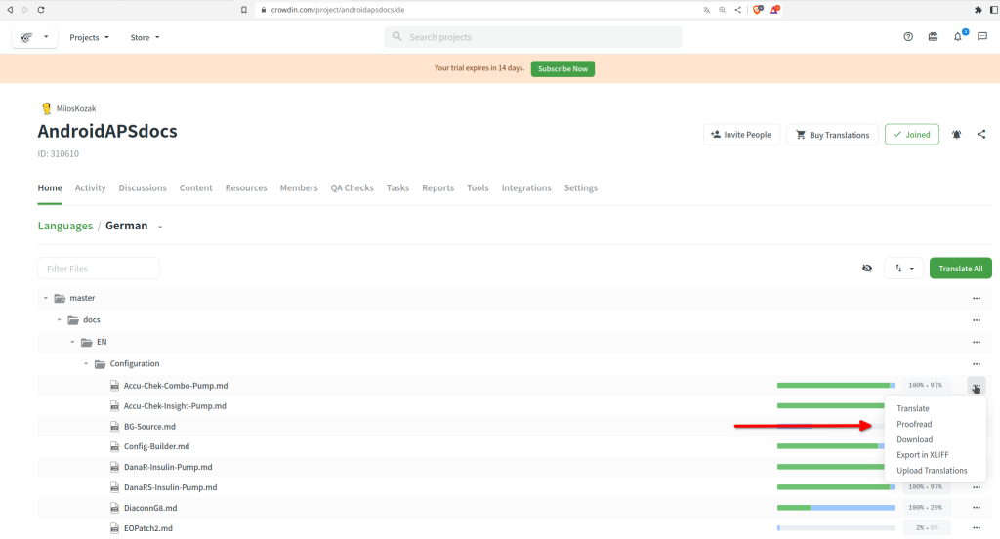

# Πώς να μεταφράσετε κείμενα της εφαρμογής AAPS ή της τεκμηρίωσης

* Για τα κείμενα της εφαρμογής, πηγαίνετε στο <https://crowdin.com/project/androidaps> και συνδεθείτε με τον λογαριασμό σας στο GitHub
* Για την τεκμηρίωση, επισκεφθείτε το <https://crowdin.com/project/androidapsdocs> και συνδεθείτε με τον λογαριασμό σας στο GitHub

* Στείλτε ένα αίτημα συμμετοχής στην ομάδα της τεκμηρίωσης. Για να το κάνετε, κάντε κλικ στη σημαία της γλώσσας που θέλετε και μετά στο κουμπί «Join» (συμμετοχή) πάνω δεξιά στην επόμενη σελίδα. Γράψτε τη γλώσσα, δώστε μερικές πληροφορίες για εσάς και την εμπειρία σας με το AAPS και πείτε αν θέλετε να γίνετε μεταφραστής ή επιμελητής (μόνο για άτομα με εμπειρία στη μετάφραση + προχωρημένους χρήστες του AAPS).

```{admonition} Χρόνος για την έγκριση :class: note

Η έγκριση είναι ένα χειροκίνητο βήμα. Ως μη κερδοσκοπικός οργανισμός δεν δίνουμε εγγυήσεις χρόνου (SLA), αλλά συνήθως η έγκριση γίνεται σε λιγότερο από 1 ημέρα. Αν όχι, επικοινωνήστε με την ομάδα της τεκμηρίωσης μέσω Facebook ή Discord.

    <br />* Όταν σας εγκρίνουμε, κάντε κλικ στη σημαία
       
    
    ## Μετάφραση της εφαρμογής
    
    (translations-translate-strings-for-AAPS-app)=
    ### Μετάφραση κειμένων της εφαρμογής AAPS
    
    * Αν δεν σας ενδιαφέρει ποια κείμενα θα μεταφράσετε, απλώς πατήστε το κουμπί «Translate All» (μετάφραση όλων) για να ξεκινήσετε. Θα σας δείξει τα κείμενα που χρειάζονται μετάφραση.
    
       
    
    * Αν θέλετε να μεταφράσετε ένα συγκεκριμένο αρχείο, βρείτε το με την αναζήτηση ή στη δομή δέντρου και κάντε κλικ στο όνομα του αρχείου για να ξεκινήσετε τη μετάφραση των κειμένων του.
    
       
    
    * Μεταφράστε τις προτάσεις στην αριστερή πλευρά: γράψτε νέο μεταφρασμένο κείμενο ή χρησιμοποιήστε & διορθώστε μια πρόταση
    
       
    
    
    ### Επιμέλεια κειμένων της εφαρμογής AAPS
    
    * Οι επιμελητές ξεκινούν επιλέγοντας «Proofread» (επιμέλεια) στην αρχική οθόνη της γλώσσας.
    
       
    
    
      και εγκρίνουν τα μεταφρασμένα κείμενα
    
       
    
    Όταν ένας επιμελητής εγκρίνει μια μετάφραση, αυτή θα μπει στην επόμενη έκδοση του AAPS.
    
    (translations-translation-of-the-documentation)=
    ## Μετάφραση της τεκμηρίωσης
    
    * Κάντε κλικ στο όνομα της σελίδας της τεκμηρίωσης που θέλετε να μεταφράσετε
    
    
    
    
    * Μεταφράστε πρόταση προς πρόταση
    
        1. Το κίτρινο κείμενο είναι το κείμενο στο οποίο δουλεύετε αυτή τη στιγμή.
    
        1. Το πράσινο κείμενο είναι ήδη μεταφρασμένο. Δεν χρειάζεται να το ξανακάνετε.
    
        1. Το κόκκινο κείμενο είναι το κείμενο που μένει ακόμα να μεταφραστεί.
    
        1. Αυτό είναι το αρχικό κείμενο πάνω στο οποίο εργάζεστε αυτή τη στιγμή
    
        1. Αυτή είναι η μετάφραση που προετοιμάζετε. Μπορείτε να αντιγράψετε το κείμενο από πάνω ή να διαλέξετε μία από τις παρακάτω προτάσεις.
    
        1. Αυτές είναι οι προτάσεις για μια μετάφραση. Εδώ βλέπετε κυρίως πόσο καλά ταιριάζει η πρόταση κατά το Crowdin, ή αν το κείμενο είχε ήδη μεταφραστεί στο παρελθόν και εμφανίστηκε ξανά μόνο επειδή μετακινήθηκε, όχι επειδή άλλαξε.
        1. Πατήστε το κουμπί «Save» (αποθήκευση) για να αποθηκεύσετε μια πρόταση μετάφρασης. Μετά θα περάσει σε έναν επιμελητή για τον τελικό έλεγχο.
    
    
    
    * Μια μεταφρασμένη σελίδα δεν θα δημοσιευτεί στην τεκμηρίωση πριν
    
        1. η μετάφραση έχει περάσει επιμέλεια
    
        1. τελειώσει ο συγχρονισμός μεταξύ Crowdin και GitHub (μία φορά την ώρα), που δημιουργεί ένα PR στο GitHub.
    
        1. εγκριθεί το PR στο GitHub.
    
    Συνήθως αυτό χρειάζεται 1–3 ημέρες, αλλά σε περιόδους διακοπών μπορεί να πάρει λίγο περισσότερο.
    
    ### Μετάφραση συνδέσμων
    
    ```{admonition} Οι σύνδεσμοι δεν μεταφράζονται πια
    :class: note
    
    Οι σύνδεσμοι δεν μεταφράζονται πια. Παλιότερα υπήρχε εδώ μια ενότητα για αυτό. Δεν χρειάζεται πια: με τη μετάβαση στο Markdown και στο myst_parser δημιουργούμε ρητά ετικέτες (labels) στο αγγλικό κείμενο και αυτές περνούν αυτόματα στις άλλες γλώσσες.
    
    

Μεταφράζετε το κείμενο που εμφανίζεται ως σύνδεσμος. Προσέξτε **να μη** διαγράψετε τον σύνδεσμο, που φαίνεται ως ένα ζευγάρι ετικετών `<0></0>` ή, αν υπάρχουν περισσότεροι σε μία παράγραφο, με άλλους αριθμούς.

Οι επιμελητές πρέπει να το ελέγχουν αυτό με ιδιαίτερη προσοχή!

### Επιμέλεια

* Οι επιμελητές (proofreaders) πρέπει να αλλάξουν σε λειτουργία επιμέλειας (Proofreading mode)
    
    
    
    και να εγκρίνουν μεταφρασμένα κείμενα
    
    

* Όταν ένας επιμελητής εγκρίνει μια μετάφραση, αυτή θα μπει στο επόμενο build της τεκμηρίωσης. Αυτό γίνεται χωρίς σταθερό πρόγραμμα, όταν χρειάζεται, αλλά περίπου μία φορά την εβδομάδα, εκτός από τις περιόδους διακοπών. Για να γίνει πιο γρήγορα η διαδικασία, μπορείτε να ενημερώσετε την ομάδα της τεκμηρίωσης για νέες μεταφράσεις.