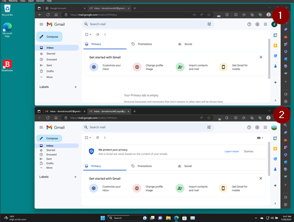

# A dedicated Google account for AAPS (optional)

Μερικοί χρήστες του **AAPS** προτιμούν να χρησιμοποιούν τον κύριο λογαριασμό email τους και για το **AAPS**. Άλλοι χρήστες του **AAPS** (ή οι φροντιστές τους) δημιουργούν έναν ξεχωριστό λογαριασμό email μόνο για το **AAPS**. Αυτό είναι προαιρετικό. Παρακάτω δίνουμε ένα παράδειγμα για το πώς γίνεται.

Αν δεν θέλετε να δημιουργήσετε ξεχωριστό λογαριασμό Gmail για το **AAPS**, μπορείτε να πάτε κατευθείαν στην επόμενη ενότητα, [Δημιουργία του AAPS](../SettingUpAaps/BuildingAaps.md).

```{admonition} Advantages of a dedicated Google account for AAPS
:class: dropdown

- Με ξεχωριστό χώρο στο Google Drive δεν κινδυνεύετε να γεμίσει το όριο του προσωπικού σας Google Drive με την **Εξαγωγή ρυθμίσεων**.
- Κάθε έκδοση του **AAPS** (και βοηθητικών εφαρμογών όπως xDrip, BYODA κ.λπ.) θα αποθηκεύεται σε ένα μόνο σημείο, ανεξάρτητα από τον υπολογιστή σας. Αν ο υπολογιστής ή το τηλέφωνό σας κλαπεί, χαθεί ή χαλάσει, θα έχετε ακόμη πρόσβαση.
- Όταν όλοι έχουν την ίδια ρύθμιση, με παρόμοια δομή φακέλων, η βοήθεια μέσω διαδικτύου γίνεται πιο απλή.
- Ανάλογα με τη ρύθμιση (δείτε παρακάτω), θα έχετε μια ξεχωριστή ταυτότητα (ψευδώνυμο) για να επικοινωνείτε στην κοινότητα, κάτι που μπορεί να προστατεύσει την ιδιωτικότητά σας. 
- Τα παιδιά με διαβήτη τύπου 1 μπορούν να κρατήσουν τον δικό τους «καθημερινό» λογαριασμό email ως ανήλικοι, ενώ χρησιμοποιούν το **AAPS** και σχετικές λειτουργίες που χρειάζονται λογαριασμό ενήλικα.
- Το Gmail σας επιτρέπει να καταχωρίσετε έως 4 λογαριασμούς με τον ίδιο αριθμό τηλεφώνου.
```

## How to set up a dedicated Google account for AAPS

(⌛About 10 minutes)


Requirements:

* Έχετε έναν υπολογιστή Windows (Windows 10 ή νεότερο) και ένα τηλέφωνο Android (Android 12 ή νεότερο) όπου θα τρέχει η εφαρμογή **AAPS**. These both have all the latest security updates, internet access and admin privileges, since some steps require downloading and installing programs.
* Το τηλέφωνο Android είναι ήδη ρυθμισμένο με την προσωπική, «καθημερινή» σας διεύθυνση email, για παράδειγμα έναν λογαριασμό Gmail.

```{admonition} Things to consider when setting up your new account
:class: dropdown
- Για λόγους ιδιωτικότητας μπορείτε να χρησιμοποιήσετε ένα όνομα διαφορετικό από το δικό σας, που να ταιριάζει στον λογαριασμό (π.χ. t1dsuperstar). Έτσι μπορείτε να το χρησιμοποιείτε στα δημόσια φόρουμ του **AAPS** και να κρατάτε κρυφή την πραγματική σας ταυτότητα. Επειδή η Google ζητά email ανάκτησης και αριθμό τηλεφώνου, ο λογαριασμός μπορεί και πάλι να συνδεθεί με εσάς.
- Ο νέος λογαριασμός **AAPS** θα χρησιμοποιεί για επαλήθευση τον ίδιο αριθμό τηλεφώνου με τον «_καθημερινό_» σας λογαριασμό. Θα χρησιμοποιεί την «καθημερινή» διεύθυνση email για επαλήθευση·
- Θα ρυθμίσουμε προώθηση email, ώστε κάθε email που στέλνεται στον νέο λογαριασμό AAPS να προωθείται στον κύριο λογαριασμό (έτσι δεν χρειάζεται να ελέγχετε δύο διαφορετικά γραμματοκιβώτια)·
- Χρησιμοποιήστε διαφορετικούς κωδικούς πρόσβασης για τον _καθημερινό_ λογαριασμό Gmail και για τον λογαριασμό Gmail του AAPS
- Αν χρησιμοποιείτε την «επαλήθευση σε 2 βήματα» της Google (έλεγχος ταυτότητας πολλών παραγόντων) για έναν λογαριασμό Gmail, καλό είναι να τη χρησιμοποιείτε και στους δύο.
- Αν σκοπεύετε να χρησιμοποιήσετε τα «Passkeys» της Google, καταχωρίστε πολλές συσκευές. Έτσι δεν θα κλειδωθείτε έξω από τον λογαριασμό σας. Κάντε το μόνο σε συσκευές στις οποίες δεν έχει πρόσβαση κανείς άλλος (_δηλ._ όχι σε υπολογιστή με κοινόχρηστο λογαριασμό που μπορούν να ξεκλειδώσουν άλλοι).
```


```{admonition} Video Walkthrough!
:class: note
Κάντε κλικ [εδώ](<https://drive.google.com/file/d/1dMZTIolO-kd2eB0soP7boEVtHeCDEQBF/view?usp=drive_link>) για ένα βίντεο που δείχνει πώς να δημιουργήσετε ξεχωριστό λογαριασμό Google.
```

 These are the steps outlined in the video:

Σε αυτό το παράδειγμα: 
- Ο υπάρχων «_καθημερινός_» σας λογαριασμός Google είναι ο <donald.muck42@gmail.com> · 
- Ο νέος σας λογαριασμός Gmail για το «_AAPS_» θα είναι: <donald.muck42.aaps@gmail.com>· 


### Μεταβείτε στο <https://account.google.com> 

 Αν είστε ήδη συνδεδεμένοι στη Google, θα μεταφερθείτε στη σελίδα **My Account** του «καθημερινού» σας λογαριασμού. (1) Κάντε κλικ πάνω δεξιά στη σελίδα, στην εικόνα προφίλ σας (εδώ, ένα απλό  (2) επιλέξτε «_add another account_» (προσθήκη άλλου λογαριασμού).


### Εισαγάγετε τα στοιχεία του ΝΕΟΥ ξεχωριστού λογαριασμού σας: 

- Εισαγάγετε τον νέο λογαριασμό: 
- Create Account
- for my personal use (για προσωπική χρήση). 


### Enter your persona:
 - Enter firstname
 - lastname
 - birthdate (needs to be an Adult age)

### Επιλέξτε τη ΝΕΑ σας διεύθυνση email και τον κωδικό πρόσβασης

Σε αυτό το παράδειγμα προστίθεται το «.AAPS» στο υπάρχον όνομα του Donald Muck…\
Ορίστε έναν κωδικό πρόσβασης

### Εισαγάγετε έναν αριθμό τηλεφώνου που μπορεί να λάβει το SMS επαλήθευσης

Gmail will now send you a unique code to enter for validation.

### Εισαγάγετε τη διεύθυνση email ανάκτησης

Εδώ θα είναι η υπάρχουσα «_καθημερινή_» σας διεύθυνση email…

### Finish setting up the account

Gmail will display the account name. Θα σας ζητηθεί να αποδεχτείτε τους όρους και τις προϋποθέσεις του Gmail και να επιβεβαιώσετε τις ρυθμίσεις εξατομίκευσης.

### Customize the new profile display

Τώρα θα πρέπει να βρίσκεστε στη σελίδα MyAccount του Gmail, όπου φαίνεται ο νέος σας λογαριασμός email για το **AAPS**. The profile picture will be set by default to the first letter of your name. Αλλάξτε την σε κάτι μοναδικό για να μην μπερδεύεστε… σε αυτό το παράδειγμα, το Donald.Muck.AAPS αντικατέστησε το  με 

\


### Open the Gmail website on both windows to configure the new account

Για να μη χρειάζεται να ελέγχετε ξεχωριστό λογαριασμό email, προωθήστε όλα τα email από τον νέο λογαριασμό **AAPS** στον καθημερινό σας λογαριασμό\
Αυτό το μέρος μπορεί να μπερδέψει λίγο, γιατί θα πρέπει να αλλάζετε συνέχεια ανάμεσα στους δύο λογαριασμούς. To make it easier, open 2 separate browser windows on top of each other:

1. Μετακινήστε το ανοιχτό παράθυρο του browser στο πάνω μέρος της οθόνης και αλλάξτε το μέγεθός του, ώστε να πιάνει περίπου το πάνω μισό της οθόνης…
2. Κάντε δεξί κλικ στο εικονίδιο του browser στη γραμμή εργασιών
3. Από το μενού επιλέξτε «New Window» (Νέο παράθυρο)... και ρυθμίστε το ώστε να πιάνει μόνο το κάτω μισό της οθόνης.

Ανοίξτε το <https://gmail.com> σε κάθε παράθυρο του browser. Βεβαιωθείτε ότι ο προσωπικός σας λογαριασμός είναι στο πάνω παράθυρο και ο νέος λογαριασμός **AAPS** στο κάτω, και ότι τον αναγνωρίζετε εύκολα από την εικόνα προφίλ πάνω δεξιά. (if needed you can always switch accounts by clicking on the profile picture and selecting the correct one.


Οι αρχικές σελίδες του Gmail θα πρέπει να μοιάζουν έτσι:\


 ### Στον νέο λογαριασμό Gmail (κάτω παράθυρο), ανοίξτε τις ρυθμίσεις του Gmail…

- Κάντε κλικ στο γρανάζι αριστερά από την εικόνα προφίλ
- και μετά επιλέξτε «**See all Settings**» (Εμφάνιση όλων των ρυθμίσεων)


### Setup forwarding…

- Click on the “Forwarding and POP/IMAP” Setting tab
- Click on “add a forwarding address”
- Add your “everyday” email address
- Το Gmail θα στείλει έναν κωδικό επαλήθευσης στην «καθημερινή» σας διεύθυνση email.
- You will switch back to your everyday profile and click on the link to verify that you accept the forwarding (or get the code from Gmail’s verification email in your “everyday” Gmail window and cut and paste it in your “new AAPS dedicated” Gmail window).

There is quite a bit of back and forth between the windows but this will ensure that when you check your “everyday” account emails you will also see the emails forwarded from your AAPS dedicated account such as Gmail alerts.


### Verify the forwarded email address

- Στο «καθημερινό» Gmail (πάνω παράθυρο) θα λάβετε το email «Gmail forwarding Confirmation» (επιβεβαίωση προώθησης).
- Open it and “click the link to confirm the request”

### Archive forwarded emails in the new dedicated Gmail account (bottom window)

<!---->

1. Refresh the bottom window
2. Check “forward incoming email”
3. And archive Gmail’s copy (to keep your new dedicated mailbox clean)
4. Κάντε κύλιση μέχρι το τέλος της σελίδας για να αποθηκεύσετε τις αλλαγές σας\
   


Συγχαρητήρια! Now you have created an AAPS-dedicated Google account. Το επόμενο βήμα είναι να [δημιουργήσετε την εφαρμογή AAPS](../SettingUpAaps/BuildingAaps.md).