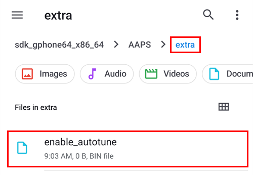
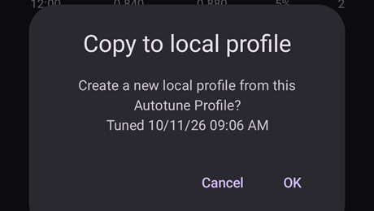
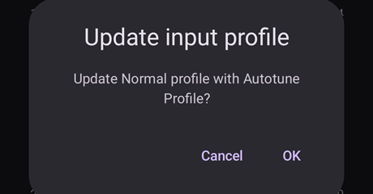
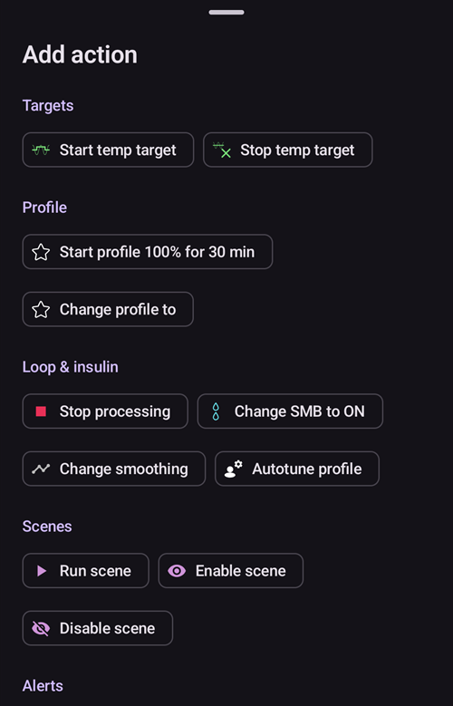

# Cómo usar el complemento Autotune

El complemento Autotune es una implementación del algoritmo autotune de OpenAPS dentro de AAPS. Analiza tu historial reciente de AAPS para proponer ajustes de tus dosis basales, ISF y ratio de carbohidratos.

Autotune Plugin is available in AAPS releases since [3.4](#version3400) but is hidden by default.

(autotune-how-autotune-calculates-adjustments)=
## Cómo calcula Autotune los ajustes

Autotune revisa tu historial reciente de AAPS (lecturas del MCG, bolos, carbohidratos y basales temporales) y calcula dónde tu **Perfil** (dosis basales, ISF, ratio de carbohidratos) no coincide del todo con lo que de verdad le pasó a tu glucosa.

Para cada dato de 5 minutos, compara el **cambio real de glucosa** con el cambio que predijo tu perfil, y pone la desviación resultante en uno de tres grupos:

* desviaciones que ocurrieron sin carbohidratos activos y sin actividad de insulina (se usan para ajustar las **dosis basales**, hora a hora),
* desviaciones que ocurrieron después de un bolo o una corrección sin carbohidratos (se usan para ajustar el **ISF**), o
* desviaciones que ocurrieron mientras se absorbían carbohidratos (se usan para ajustar el **ratio de carbohidratos**).

Después mira el patrón de las desviaciones de cada grupo (usa percentiles en lugar de una media simple, para que unos pocos datos con ruido no distorsionen el resultado) y propone un nuevo valor para esa hora o ese parámetro.

Para que una sola ejecución no corrija de más, cada ejecución de Autotune solo mueve un valor una parte del camino hacia lo que indican los datos: hasta un 10 % para el ISF y el ratio de carbohidratos, y hasta un 20 % para cada segmento de basal. El cambio total también está limitado por los ajustes **Autosens máximo** / **Autosens mínimo** (ver [Otros ajustes](#autotune-other-settings) más abajo), los mismos límites que tiene Autosens. Por eso Autotune está pensado para ejecutarse muchas veces (día tras día, o cada noche) y no para confiar en él después de una sola ejecución: los resultados deben acercarse poco a poco, y un salto grande en una ejecución es una señal para revisar tus datos (carbohidratos olvidados, un mal día del sensor, _etc._) y no para confiar en él a ciegas.

Autotune se puede ejecutar de tres formas: manualmente una sola vez desde el complemento (como se describe abajo), automáticamente cada noche con una [regla de automatización](#autotune-run-autotune-with-an-automation-rule), o, totalmente fuera de AAPS, como herramienta de línea de comandos independiente con datos exportados. Así describen algunas guías de la comunidad cómo usarlo sin un teléfono que ejecute AAPS.

*Para ver el algoritmo oref0 en el que se basa, con todos los detalles matemáticos, consulta la [documentación de Autotune de OpenAPS](https://openaps.readthedocs.io/en/latest/docs/Customize-Iterate/autotune.html).*

## Mostrar el complemento Autotune

Crea un archivo vacío llamado `enable_autotune` en la subcarpeta `extra` del [directorio de AAPS](#preferences-maintenance-settings) de tu teléfono.

***NOTA: comprueba en los ajustes de AAPS dónde está tu directorio de AAPS y que has puesto el archivo en el correcto. Varias personas han puesto el archivo en la carpeta equivocada.***



Reinicia **AAPS**. Después abre el **menú** (☰), elige **Configuración**, luego la categoría **General**, y marca **Autotune**. La tarjeta muestra entonces **Ajustes** y **Abrir complemento**:


## Interfaz de usuario de Autotune

Toca **Abrir complemento** en la tarjeta **Autotune** para abrir la pantalla de Autotune:


- En el menú desplegable Perfil puedes elegir el perfil de entrada que quieres ajustar (por defecto está elegido tu perfil activo actual)
  - Nota: cada vez que eliges un nuevo perfil, los resultados anteriores se borran y el **Número de días de datos** vuelve a su valor por defecto
- Después, en **Número de días de datos** (llamado **Días de ajuste** en versiones antiguas) eliges el número de días que se usan en el cálculo para ajustar tu perfil. El valor mínimo es 1 día y el máximo 30 días. Este número no debe ser demasiado pequeño para obtener resultados iterativos y suaves correctos (más de 7 días en cada cálculo)
  - Nota: cada vez que cambias el **Número de días de datos**, los resultados anteriores se borran
- Última ejecución es un enlace que recupera tu último cálculo válido. Si no has ejecutado Autotune en el día actual, o si los resultados anteriores se borraron al cambiar un parámetro de cálculo de arriba, puedes recuperar los parámetros y los resultados de la última ejecución correcta.
- La advertencia te muestra, por ejemplo, información sobre el perfil elegido (si tienes varios valores de IC o varios valores de ISF)
  - Nota: el cálculo de Autotune funciona solo con un único valor de IC y un único valor de ISF. Actualmente no existe ningún algoritmo de Autotune para ajustar un IC circadiano o un ISF circadiano. Si tu perfil de entrada tiene varios valores, en la sección de advertencia puedes ver el valor medio que se usa para ajustar tu perfil.
- El botón «Comprobar el perfil de entrada» abre el visor de perfiles para que puedas comprobar rápido tu perfil (unidades, IC, ISF, basal y objetivo)
  - Nota: Autotune solo ajusta tu IC (valor único), tu ISF (valor único) y la basal (con variación circadiana). Las unidades y el objetivo no cambian en el perfil de salida.

- «Ejecutar Autotune» inicia el cálculo de Autotune con el perfil elegido y el número de días de datos elegido
  - Nota: el cálculo de Autotune puede tardar mucho tiempo. Una vez iniciado, puedes cambiar a otra vista (inicio, ...) y volver más tarde al complemento Autotune para ver los resultados

  

- Después, durante la ejecución, verás abajo los resultados intermedios

  - Nota: durante la ejecución los ajustes están bloqueados, así que ya no puedes cambiar el perfil de entrada elegido ni el número de días. Si quieres iniciar otra ejecución con otros parámetros, tendrás que esperar a que termine el cálculo actual.

  

- Cuando termina el cálculo de Autotune, verás el resultado (perfil ajustado) y cuatro botones debajo.

  

- Es importante comparar siempre el perfil de entrada (columna «Perfil»), el perfil de salida (columna «Ajustado») y el porcentaje de variación de cada valor (columna «%»).

- Para las dosis basales también tienes el número de «días que faltan». Faltan días cuando Autotune no tiene suficientes datos clasificados como «Basal» para ajustar la dosis basal de ese periodo (por ejemplo, después de cada comida, cuando se absorben carbohidratos). Este número debe ser lo más bajo posible, sobre todo cuando la basal es importante (por ejemplo, durante la noche o al final de la tarde)

- El botón «Comparar perfiles» abre la vista de comparación de perfiles. El perfil de entrada está en azul y el perfil de salida (llamado «Ajustado») está en rojo.

  - Nota: en el ejemplo de abajo, el perfil de entrada tiene variación circadiana de IC e ISF, pero el perfil de salida calculado tiene un único valor. Si para ti es importante obtener un perfil de salida circadiano, consulta [Perfil de IC o ISF circadiano](#autotune-circadian-ic-or-isf-profile) más abajo.

  

- Si confías en los resultados (bajo porcentaje de variación entre el perfil de entrada y el de salida), puedes pulsar el botón «Activar perfil» y luego pulsar OK para confirmar.

  - "Activate profile" will automatically create a new profile "Tuned" in your profile list (**Manage → Profile**).
  - Si ya tienes un perfil llamado «Ajustado» en **Administrar → Perfil**, este perfil se actualizará con el perfil calculado por Autotune antes de activarse

  

- Si crees que el perfil ajustado se debe corregir (por ejemplo, si crees que algunas variaciones son demasiado grandes), puedes pulsar el botón «Copiar al perfil local»

  - Se creará un nuevo perfil con el prefijo «Ajustado» y la fecha y hora de la ejecución en **Administrar → Perfil**

  

- Después puedes editar el perfil ajustado: abre **Administrar** > **Perfil**, desliza hasta la tarjeta llamada «Ajustado» con la fecha y hora de la ejecución, y toca el botón **Editar** (lápiz)

  - los valores del perfil se redondearán en la interfaz de usuario según las capacidades de tu bomba

  

- Si quieres sustituir tu perfil de entrada por el resultado de Autotune, pulsa el botón «Actualizar perfil de entrada» y confirma la ventana emergente con OK

  - Nota: si pulsas «Activar perfil» después de «Actualizar perfil de entrada», activarás tu perfil actualizado y no el perfil «Ajustado» por defecto.

  

- Si has actualizado tu perfil de entrada, el botón «Actualizar perfil de entrada» se sustituye por el botón «Revertir perfil de entrada» (ver la captura de pantalla de abajo). Así puedes ver enseguida si tu perfil de entrada actual en **Administrar → Perfil** ya incluye el resultado de la última ejecución o no. Con este botón también puedes recuperar tu perfil de entrada sin el resultado de Autotune

  


## Ajustes de Autotune

(autotune-plugin-settings)=

### Ajustes del complemento Autotune

  

```{admonition} Only DEV
:class: note
La función **Cambio automático de perfil** solo está disponible en el modo Dev/de ingeniería.
```

- **Cambio automático de perfil** (por defecto desactivado): consulta [Ejecutar Autotune con una regla de automatización](#autotune-run-autotune-with-an-automation-rule) más abajo. Si activas este ajuste, el perfil de entrada se actualizará automáticamente con el perfil ajustado y se activará.
  - **Ten cuidado: después de actualizar y activar el perfil ajustado sin cambios, debes confiar y comprobar durante los días siguientes que mejora tu lazo**

- **Categorize UAM as basal** (default Off): This setting is for the users using AAPS without any carbs entered (Full UAM). Cuando está desactivado, evita que UAM se clasifique como basal.
  - Nota: si durante un día se detecta al menos una hora de absorción de carbohidratos, todos los datos clasificados como «UAM» se clasificarán como basal, sea cual sea este ajuste (activado o desactivado)
- **Días predeterminados de ajuste** (por defecto 5): con este ajuste puedes definir el valor por defecto. Cada vez que eliges un nuevo perfil en el complemento Autotune, el **Número de días de datos** se sustituye por este valor por defecto
- **Usar ratios IC/ISF basados en el ritmo circadiano** (por defecto desactivado): consulta [Perfil de IC o ISF circadiano](#autotune-circadian-ic-or-isf-profile) más abajo.

(autotune-other-settings)=
### Otros ajustes

- Autotune también usa la relación máxima de Autosens y la relación mínima de Autosens para limitar la variación. Puedes ver y cambiar estos valores en [**Ajustes** > **Ajustes de absorción** > **Ajustes avanzados**](../SettingUpAaps/Preferences.md) (**Autosens máximo** y **Autosens mínimo**).

  


## Función avanzada

(autotune-circadian-ic-or-isf-profile)=

### Perfil de IC o ISF circadiano

- Si tienes una variación importante del IC y/o del ISF en tu perfil, y confías por completo en tus horas y variaciones circadianas, puedes activar **Usar ratios IC/ISF basados en el ritmo circadiano** (llamado «Apply average result in circadian IC/ISF» en versiones antiguas)

  - Ten en cuenta que el cálculo de Autotune siempre se hace con un único valor y que Autotune no ajusta la variación circadiana. Este ajuste solo aplica la variación media calculada para IC y/o ISF a tus valores circadianos

- En la captura de pantalla de abajo ves el perfil ajustado con «aplicar variación media» desactivado (a la izquierda) y activado (a la derecha)

  


### Ajustar días concretos de la semana

- Si tocas el icono del **ojo** a la derecha del campo **Número de días de datos**, verás la selección de días. Puedes indicar qué días de la semana se incluyen en el cálculo de Autotune (en la captura de pantalla de abajo ves un ejemplo para «días laborables», con el sábado y el domingo quitados del cálculo de Autotune)
  - Si el número de días incluidos en el cálculo de Autotune es menor que el **Número de días de datos**, verás cuántos días se incluirán a la derecha del selector de días (10 días en el ejemplo de abajo)
  - Este ajuste solo da buenos resultados si el número de días que quedan no es demasiado pequeño (por ejemplo, si ajustas un perfil concreto para el fin de semana con solo el domingo y el sábado marcados, debes poner el **Número de días de datos** en al menos 21 o 28 para tener 6 u 8 días incluidos en el cálculo de Autotune)

  

- Durante el cálculo de Autotune puedes ver el progreso de los cálculos («Resultado parcial día 1 / 4 afinado» en el ejemplo de abajo, con el sábado y el domingo excluidos)

  


(autotune-run-autotune-with-an-automation-rule)=

## Ejecutar Autotune con una regla de automatización

```{admonition} Only DEV
:class: note
La función **Cambio automático de perfil** solo está disponible en el modo Dev/de ingeniería.
```

El primer paso es definir el disparador correcto para una regla de automatización con Autotune:

Nota: para más información sobre cómo crear una regla de automatización, consulta [aquí](../DailyLifeWithAaps/Automations.md).

- Debes elegir el disparador de hora de repetición: ejecuta Autotune solo una vez al día. Autotune está pensado para ejecutarse a diario (con cada nueva ejecución avanzas un día y los cambios del perfil deberían ser muy pequeños enseguida)

  

- Al principio es mejor ejecutar Autotune durante el día para poder comprobar los resultados. Si quieres ejecutar Autotune durante la noche, en el disparador tienes que elegir las 4 de la mañana o más tarde para incluir el día actual en el siguiente cálculo de Autotune.

  

- Then you can select the **Run Autotune** action (in the **Loop & insulin** group)

  

- Después puedes ajustar los parámetros de la acción para tu ejecución. En una acción nueva, **Selecciona el perfil para ajustar** muestra el primer perfil de tu lista de perfiles locales, el campo **Días de ajuste** está vacío y todos los días están marcados. Elige el perfil que quieres ajustar e introduce el número de **Días de ajuste** (de 1 a 30).

  

- Después de unos días, si confías por completo en los resultados de Autotune y el porcentaje de cambio es bajo, puedes activar en los [ajustes de Autotune](#autotune-plugin-settings) la opción «**Cambio automático de perfil**» para actualizar y activar automáticamente el perfil ajustado después del cálculo.

Nota: si quieres ajustar automáticamente perfiles para días concretos de la semana (por ejemplo, un perfil para «fin de semana» y otro para «días laborables»), crea una regla para cada perfil y elige los mismos días en el disparador y en la acción de Autotune. Los días de ajuste deben ser suficientes para asegurar que el ajuste se hace con al menos 6 u 8 días, y no olvides elegir una hora después de las 4 de la mañana en el disparador...

- Abajo ves un ejemplo de regla que se ejecuta cada día laborable (de lunes a viernes) a las 04:00 y ajusta el perfil «Normal» con 14 **Días de ajuste**, solo días laborables (así que solo se incluyen 10 días en el cálculo de Autotune).

  


## Consejos y trucos

Autotune trabaja con la información que hay en tu base de datos. Si acabas de instalar AAPS en un teléfono nuevo, tendrás que esperar varios días antes de poder ejecutar Autotune con suficientes días para obtener resultados útiles.

Autotune es solo una ayuda. Es importante comprobar con regularidad si estás de acuerdo con el perfil calculado. Si tienes alguna duda, cambia los ajustes de Autotune (por ejemplo, el número de días) o copia los resultados en un perfil local y ajusta el perfil antes de usarlo.

Usa siempre Autotune manualmente durante varios días para comprobar los resultados antes de aplicarlos. And it's only when you fully trust Autotune results, and when variation becomes tiny between previous profile and calculated profile then you start to use Automation (Never before)

- Autotune puede funcionar muy bien para algunas personas y no para otras, así que **si no confías en el resultado de Autotune, no lo uses**

También es importante analizar los resultados de Autotune para entender (o intentar entender) por qué Autotune propone esos cambios

- puede haber un aumento o una disminución general de la fuerza de tu perfil (por ejemplo, un aumento de la basal total junto con una disminución de los valores de ISF e IC). puede ir unido a varios días seguidos con corrección de Autosens por encima del 100 % (hace falta más agresividad) o por debajo del 100 % (eres más sensible)
- A veces Autotune propone un equilibrio diferente entre las dosis basales y el IC/ISF (por ejemplo, basal más baja e IC/ISF más agresivos)

Te recomendamos no usar Autotune en los siguientes casos:

- No introduces todos tus carbohidratos
  - Si no introduces los carbohidratos de corrección de una hipoglucemia, Autotune verá una subida inesperada de tu glucosa y aumentará tus dosis basales 4 horas antes. Eso puede ser lo contrario de lo que necesitas para evitar la hipoglucemia, sobre todo en mitad de la noche. Por eso es importante introducir todos los carbohidratos, sobre todo los de corrección de una hipoglucemia.
- Tienes muchos periodos con UAM detectados durante el día.
  - ¿Has introducido todos tus carbohidratos y has calculado bien tus carbohidratos?
  - Todos los periodos UAM (salvo que no introduzcas carbohidratos durante un día y «Categorizar UAM como basal» esté desactivado) se clasificarán como basal. Esto puede aumentar mucho tu basal (mucho más de lo necesario)

- Tu absorción de carbohidratos es muy lenta: si la mayor parte de tu absorción de carbohidratos se calcula con el parámetro min_5m_carbimpact (puedes ver esos periodos con un pequeño punto naranja en la parte superior de la curva de COB), el cálculo de COB puede ser incorrecto y dar resultados incorrectos.
  - Cuando haces deporte, normalmente eres más sensible y tu glucosa no sube mucho, así que durante o después del ejercicio es habitual ver algunos periodos con carbohidratos lentos. Pero si tienes con demasiada frecuencia una absorción de carbohidratos lenta inesperada, quizá necesites ajustar el perfil (un valor de IC más alto) o tu min_5m_carbimpact es un poco demasiado alto.
- Tienes «días muy malos», por ejemplo, varias horas atascado en hiperglucemia con una gran cantidad de insulina para poder bajar al rango, o largos periodos con valores de glucosa incorrectos después de un cambio de sensor. Si en las últimas semanas solo tienes uno o 2 «días malos», puedes desactivar manualmente esos días en el cálculo de Autotune para excluirlos, y de nuevo **comprueba con cuidado si puedes confiar en los resultados**
- Si el porcentaje de cambio es demasiado grande
  - Puedes intentar aumentar el número de días para obtener resultados más suaves
