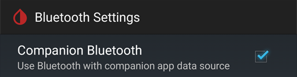

# Dexcom G7, ONE+ y Stelo


## Fundamental por adelantado

Es importante saber que los sistemas G7, ONE+ y Stelo, a diferencia del G6, no suavizan los valores, ni en la app ni en el receptor. Más detalles al respecto [aquí](https://www.dexcom.com/en-us/faqs/why-does-past-cgm-data-look-different-from-past-data-on-receiver-and-follow-app).

```{admonition} Smoothing method 
Lee las sugerencias de [Método de suavizado](../CompatibleCgms/SmoothingBloodGlucoseData.md) para usar con Dexcom G7/ONE+/Stelo
```

## 1. xDrip (conexión directa a G7, ONE+ o Stelo)

- xDrip se conecta directamente al sensor: desinstala la app de Dexcom, porque solo una app puede conectarse al sensor. Para conservar la app de Dexcom, usa en su lugar la [app complementaria de xDrip (Companion App)](#DexcomG7-xdrip-companion-app).
- Sigue las instrucciones de aquí: [xDrip G7, ONE+ y Stelo](https://navid200.github.io/xDrip/docs/Dexcom/G7.html). Se necesita una versión reciente de xDrip: consulta la versión mínima en la página enlazada.
- Selecciona xDrip en [**Configuración → Fuente de glucosa**](#Config-Builder-bg-source).

- Ajusta la configuración de xDrip según las explicaciones de la página de ajustes de xDrip: [Ajustes de xDrip](../CompatibleCgms/xDrip.md)

## 2. Build Your Own Dexcom App (solo G7)

```{admonition} Old app version
:class: warning
Dexcom BYODA es ahora una versión muy antigua de la app y no se puede actualizar. No disponible para ONE+ ni Stelo.
```

-   [Build Your Own Dexcom App](https://docs.google.com/forms/d/e/1FAIpQLScD76G0Y-BlL4tZljaFkjlwuqhT83QlFM5v6ZEfO7gCU98iJQ/viewform?fbzx=2196386787609383750) (BYODA) permite el envío local (local broadcast) a AAPS

-   Esta app te permite usar tu Dexcom G7 con cualquier teléfono Android.
-   Desinstala la app original de Dexcom
-   Instala el apk descargado
-   Introduce el código del sensor en la app parcheada
-   Después de poco tiempo, BYODA debería captar la señal del transmisor

(DexcomG7-xdrip-companion-app)=

## 3. App complementaria de xDrip (Companion App) (G7, ONE+ y Stelo)

La app oficial de Dexcom sigue conectada al sensor. xDrip lee los valores de glucosa de las notificaciones de la app de Dexcom y los envía a **AAPS**.

```{admonition} Not a trusted data source
:class: note
**AAPS** no considera xDrip en modo Companion App como una [fuente de datos de glucosa de confianza](#GettingStarted-TrustedBGSource): los SMB no se permiten todo el tiempo.
```

### Leer las notificaciones de la app de Dexcom

- Mantén la app de Dexcom instalada y conectada al sensor. Sus notificaciones deben seguir visibles: no las silencies ni las ocultes.
- Descarga e instala [xDrip](https://github.com/NightscoutFoundation/xDrip). Usa en xDrip las mismas unidades de glucosa que en la app de Dexcom.
- En xDrip, ve a **Settings** (Ajustes) > **Hardware Data Source** (fuente de datos) y selecciona **Companion App**.

  

- xDrip pide permiso para leer las notificaciones. Pulsa **OK**, luego selecciona **xDrip** en la lista y activa **Permitir acceso a notificaciones**.

  

- Si **Permitir acceso a notificaciones** está en gris (*Controlado por un ajuste restringido*), Android lo bloquea porque xDrip no se instaló desde Play Store:

  

  Abre la información de la app xDrip (mantén pulsado el icono de xDrip > **Información de la app**), pulsa el menú de tres puntos arriba a la derecha y selecciona **Permitir ajustes restringidos**. Después vuelve a la pantalla de acceso a notificaciones y permítelo.

  

  

- Las lecturas aparecen en xDrip cuando la app de Dexcom muestra un valor nuevo. Si no aparece nada, puede que tengas que iniciar un sensor en xDrip: esto no afecta al sensor real. En este modo, Stelo da una lectura cada 15 minutos.

### Companion Bluetooth (G7)

Cuando la app de Dexcom está conectada a un sensor G7, xDrip también puede escuchar por Bluetooth las lecturas que el sensor envía a la app de Dexcom. xDrip no se empareja con el sensor y no necesitas introducir el código del sensor: la app de Dexcom sigue al mando.

Con **Companion Bluetooth**, xDrip obtiene del sensor la hora exacta y la tendencia de cada lectura, en lugar de la hora en que apareció la notificación, y rellena los huecos cuando el teléfono estaba fuera de alcance (backfill).

- En xDrip, ve a **Settings** > **Less common settings** > **Bluetooth Settings** y activa **Companion Bluetooth**.

  

- Esto no funciona en todos los teléfonos ni en todas las versiones de Android. Desactívalo si ves problemas.
- Si un sensor Dexcom antiguo sigue en la lista de Bluetooth del teléfono, xDrip podría escuchar al sensor equivocado: en Android, en **Ajustes** > **Dispositivos conectados**, olvida los sensores que ya no usas.
- Companion Bluetooth está hecho para el G7. Con ONE+ y Stelo, usa las notificaciones.

### Configuración en AAPS

- Selecciona xDrip en [**Configuración → Fuente de glucosa**](#Config-Builder-bg-source).
- Ajusta la configuración de xDrip según las explicaciones de la página de ajustes de xDrip: [Ajustes de xDrip](../CompatibleCgms/xDrip.md).

## 4. Juggluco (G7 y ONE+)

Se necesita la versión 9.0 o superior

- Desactiva la app que estaba conectada antes al sensor: desinstala la app o usa «Forzar detención». Desactiva el permiso «Dispositivos cercanos» en los ajustes de la app. Limita el uso de batería de la app.

- Olvida el sensor en los ajustes de Bluetooth: en los ajustes de Android, busca el sensor en los dispositivos vinculados y selecciona «Olvidar». Los nombres de los sensores Dexcom G7 empiezan por DXCM.

- Evita interferencias de otros sensores: mantén los sensores Dexcom antiguos fuera del alcance del Bluetooth.

- Conecta el sensor G7 a Juggluco: abre Juggluco → menú de la izquierda → Photo. Escanea el código Data Matrix del aplicador del sensor G7. Espera hasta 5 minutos a que Juggluco encuentre el sensor.

- Requisitos para el emparejamiento: acepta emparejar el sensor con Juggluco. Asegúrate de que la pantalla no esté bloqueada durante el emparejamiento. Si el emparejamiento falla, espera 5 minutos antes de volver a intentarlo.

- Excepción: los relojes Wear OS pueden vincularse sin pulsar un botón de aceptar.
