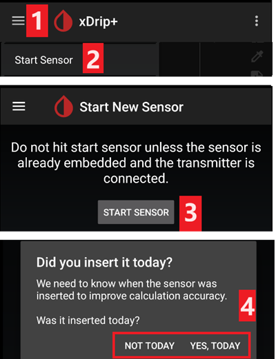

# Freestyle Libre 2 y 2+

El sensor Freestyle Libre 2 ahora es un MCG real, incluso con la app oficial. Aun así, LibreLink no puede enviar datos a AAPS. Hay varias formas de usarlo con AAPS.

## 1. Usar un puente Bluetooth y OOP

Los transmisores Bluetooth se pueden usar con el Libre 2 (EU) o 2+ (EU) y una app con algoritmo externo (out of process, OOP). Puedes recibir valores de glucosa cada 5 minutos, como con el [Libre 1](./Libre1.md).

Comprueba que el puente y la app que quieres usar son compatibles con tu sensor y con xDrip.

Libre2 OOP (encuéntralo [aquí](#Libre2_OOP2)) crea las mismas lecturas de glucosa que el lector original. AAPS con Libre 2 hace un suavizado de 10 a 25 minutos para evitar ciertos saltos. Mira más abajo [Suavizado de valores y valores en bruto](#libre2-value-smoothing-raw-values). OOP genera lecturas cada 5 minutos con la media de los últimos 5 minutos. Por eso las lecturas de glucosa no son tan suaves, pero coinciden con el lector original y siguen más rápido las lecturas de glucosa «reales». Si quieres usar el lazo con OOP, activa todos los ajustes de suavizado en xDrip.

Hay algunas buenas razones para usar un transmisor Bluetooth:

-   Puedes elegir varias estrategias de calibración OOP2 (1): tener los valores del lector con "no calibration", calibrar el sensor como un Libre 1 con "calibrate based on raw" o, por último, calibrar los valores tipo lector con "calibrate based on glucose".  
  Deja OOP1 desactivado (2).

    → Menú hamburguesa → Settings → Less common settings → Other misc. options


-   El sensor Libre 2 se puede usar 14,5 días, como el Libre 1
-   El relleno de 8 horas de datos pasados funciona por completo

Nota: el transmisor se puede usar a la vez que la app LibreLink sin interferir con ella.

### Iniciar Sensor

- → Menú hamburguesa (1) → Start sensor (2) → Start sensor (3) → Responde "Not Today" (4).



Esto no inicia físicamente ningún sensor Libre2 ni interactúa con él de ninguna forma. Esto solo sirve para indicar a xDrip que un nuevo sensor está enviando valores de glucosa. Si puedes, introduce dos valores medidos en sangre para la calibración inicial. Ahora los valores de glucosa deberían aparecer en xDrip cada 5 minutos. Los valores que faltan, por ejemplo porque estabas demasiado lejos de tu teléfono, no se rellenan después.

Después de cambiar el sensor, xDrip detecta el nuevo sensor automáticamente y borra todos los datos de calibración. Puedes comprobar tu glucosa después de la activación y hacer una nueva calibración inicial.

### Configurar AAPS (solo para el lazo)

-   En **AAPS**, abre el **Menú** (☰) en la esquina superior izquierda, ve a **Configuración** > **Fuente de glucosa** y selecciona **xDrip+**


-   If AAPS does not receive BG values when phone is in airplane mode, use 'Identify receiver' as described on [xDrip settings page](#xdrip-identify-receiver).

## 2. Usar la conexión directa de xDrip

```{admonition} Libre 2 EU only
:class: warning
xDrip no es compatible con la conexión directa a Libre 2 US y AUS.
Solo los modelos Libre 2 y 2+ **EU**.
```

- Sigue [estas instrucciones](./Libre2MinimalL00per.md) para configurar xDrip, porque la documentación original enlaza a una versión obsoleta de OOP2.
- Sigue las instrucciones de configuración de la [página de ajustes de xDrip](../CompatibleCgms/xDrip.md).

-   Selecciona xDrip+ en [Configuración > Fuente de glucosa](#Config-Builder-bg-source).

(libre2-value-smoothing-raw-values)=

### Suavizado de valores y valores en bruto

Técnicamente, el valor actual de glucosa se envía a xDrip cada minuto. Por defecto, un filtro de media ponderada calcula un valor suavizado de los últimos 25 minutos. Puedes cambiar el periodo en el menú NFC Scan features.

→ Menú hamburguesa → Settings → NFC Scan features → Smooth libre 3 data when using xxx method


Esto es obligatorio para usar el lazo. Las curvas se ven suaves y los resultados del lazo son muy buenos. Los valores en bruto en los que se basan las alarmas saltan un poco más, pero coinciden con los valores que también muestra el lector. Además, los valores en bruto se pueden mostrar en el gráfico de xDrip para poder reaccionar a tiempo a cambios rápidos. Activa Less Common Settings \> Advanced Settings for Libre2 \> "show Raw values" y "show Sensors Infos" (ajustes de xDrip). Así los valores en bruto se muestran además como pequeños puntos blancos y hay más información del sensor en el menú del sistema.

Los valores en bruto son muy útiles cuando la glucosa cambia rápido. Even if the dots are jumpier you would detect the tendency much better than using the smoothed line to make proper therapy decisions.

→ Menú hamburguesa → Settings → Less common settings → Advanced settings for Libre 2


#### Calibración

You can calibrate the Libre2 **with an offset of -40 mg/dL to +20 mg/dL \[-2.2 mmol/L to +1.1 mmol/L\]** (intercept). La pendiente no se puede cambiar. Compruébalo con una medición capilar después de poner un sensor nuevo. Ten en cuenta que puede no ser exacto en las primeras 12 horas después de insertarlo. Como puede haber grandes diferencias con las mediciones en sangre, comprueba cada 24 horas y calibra si es necesario. Si el sensor está totalmente desviado después de unos días, debes cambiarlo.

## 3. Usar Diabox

- Instala [Diabox](https://www.bubblesmartreader.com/_files/ugd/6afd37_f183eabd4fbd44fcac4b1926a79b094f.pdf). En Settings, Integration, activa Share data with other apps (ajustes de Diabox: compartir datos con otras apps).


- Selecciona xDrip+ en [Configuración > Fuente de glucosa](#Config-Builder-bg-source).

## 4. Usar Juggluco

Mira [aquí](./Juggluco.md).
