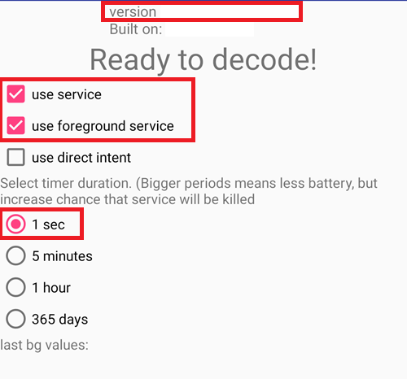
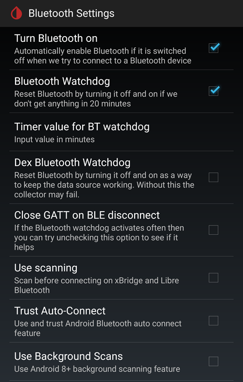
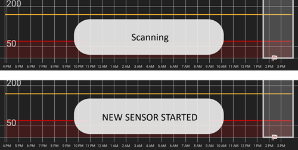
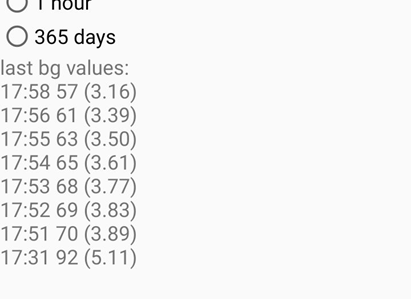

# Cómo configurar FSL 2 y OOP2 para usar una conexión Bluetooth directa en xDrip

Pasado de [MinimalL00per](https://www.minimallooper.com/post/how-to-setup-freestyle-libre-2-and-oop2-to-use-a-native-Bluetooth-connection-in-xdrip) a markdown y **revisado/actualizado**: 25 de agosto de 2025, psonnera

Al final de este documento hay una lista de definiciones. Si no conoces algún término o abreviatura, puedes *[saltar abajo](#minimallooper-definitions)* para verlo.

 

## Configuración

### Hardware

- *FSL2 y 2+* **NOTA: las versiones de EE. UU., CAN, NZ y AUS NO son compatibles**

**(OPCIONAL) Lector** (no compatible con FSL2+)

- Lector 1 (con el firmware actualizado)

- Lector 2

*NOTA: si quieres usar el lector en esta solución, DEBES INICIAR el sensor PRIMERO CON EL LECTOR. Si no lo haces, no podrás usar el lector para obtener lecturas del sensor activado. Cuando el sensor se haya calentado, puedes hacer lecturas con la aplicación LL o con xDrip.*

### Software

**OOP** - Out of Process Algorithm (algoritmo externo), una aplicación APK externa de Android que ayuda a obtener los datos en bruto del sensor para calcular los valores de glucosa. xDrip envía a OOP los datos en bruto BT recogidos del FSL2, y OOP devuelve los valores de glucosa a xDrip.

- **OOP2**

  - **Funciona solo con sensores FSL2/2+ europeos**

  - Código cerrado (no está en GitHub)

  - Su función es descifrar los valores en bruto cifrados del sensor y devolverlos a xDrip. Después, xDrip se puede usar con los datos en bruto, que necesitan calibración, o con valores de glucosa parecidos a los del lector 1.

[***xDrip***](https://jamorham.github.io/)

- [*Nightly*](https://github.com/NightscoutFoundation/xDrip/releases): el código fuente más reciente, compilado cada noche. No probada a fondo

- [*Stable*](https://xdrip-plus-updates.appspot.com/stable/xdrip-plus-latest.apk): la última versión estable y probada.

- **NOTA: los sensores nuevos necesitan una app OOP2 actualizada. Para ello se recomienda usar como mínimo la última versión publicada de xDrip (Stable), que corresponde a la última OOP2.**

 

## Proceso

- *Primero descarga e instala las apps de abajo*
- *Desinstalar apps que pueden causar conflictos*
- *Cómo iniciar un sensor FSL2 en modo Bluetooth directo con LL y xDrip
  - [*Paso 1: instalar y configurar las aplicaciones*](#minimallooper-step1)
  - [*Paso 2: configurar los ajustes de xDrip*](#minimallooper-step2)
  - [*Paso 3: insertar físicamente el sensor*](#minimallooper-step3)
  - [*Paso 4: abrir la app LL e iniciar el sensor con el primer escaneo NFC*](#minimallooper-step4)
  - [*Paso 5: abrir xDrip y hacer un ESCANEO NFC del sensor FSL2*](#minimallooper-step5)
  - [*Paso 6: iniciar el sensor nuevo en xDrip*](#minimallooper-step6)
  - [*Paso 7: esperar 60 segundos y escanear el sensor de nuevo por NFC*](#minimallooper-step7)
  - [*Paso 8: recogida de datos entre 3 y 15 minutos*](#minimallooper-step8)
  - [*Paso 9: comprobar que el sensor está conectado y envía datos*](#minimallooper-step9)

- *[Notas](#minimallooper-notes)*
- *[Ventajas](#minimallooper-advantages)*
- *[Desventajas](#minimallooper-disadvantages)*
- <u>*\[Solución de problemas\](#minimallooper-troubleshooting)*</u>

## Antes de empezar

Te recomendamos mucho seguir este proceso con un **sensor nuevo**. Aunque se ha informado de que se puede conectar con un sensor que ya funciona (***mira [más abajo](#minimallooper-started-sensor)***), es muy probable que la app LL o el lector creen una nueva clave privada compartida para la comunicación durante la conexión. Esto significa que, después de la vinculación, xDrip no conoce la nueva clave y no podrá comunicarse con el sensor. Si intentas conectar con un sensor que ya funciona, lo haces bajo tu propio riesgo; mejor hacia el final de la vida del sensor.

### Primero descarga e instala las apps de abajo

(Libre2_OOP2)=

- **OOP2** - Las versiones de oop2 están en:

  (*Nota: necesitas haber iniciado sesión en Google para abrir el enlace.*)

*[oop2.apk](https://drive.google.com/file/d/1106h2s12b3Ev9gKCTU2G75q8h9ChHjcz/view?usp=sharing)* - OOP2_21_09_25 (05d1989) **2025.09.21** (última versión)

- **xDrip** - la **<u>última versión</u>** (versión mínima 2025.09.26) está en:

[*xDrip.apk*](https://github.com/NightscoutFoundation/xDrip/releases)

(minimallooper-started-sensor)=

### ¿Y si mi sensor ya está iniciado? Can I still get readings in xDrip? ¡SÍ!

Mucha gente ha preguntado si este método se puede usar con un sensor que ya está activo, y puedo decir con un claro **SÍ**: puedes iniciar un sensor que ya está funcionando.

1.  **PRIMERO**, asegúrate de haber hecho los cambios de configuración y los ajustes en xDrip, y de haber instalado y configurado OOP2 como se muestra abajo.

2.  **DESPUÉS**, ve al *Paso 5* y **ASEGÚRATE** de haber forzado el cierre de LL antes de empezar. Después sigue el proceso hasta el final.

*NOTA: no podrás usar tu sensor FSL2 activado con el FSLReader SI no lo iniciaste primero con el FSLReader. Si SÍ se inició primero con el FSLReader, podrás **escanear** el sensor y obtener lecturas tanto del sensor como de apps como LL y xDrip.*

## Cómo iniciar un sensor FSL2 en modo Bluetooth directo con LL y xDrip

*NOTA: si en las capturas de pantalla hay ajustes que no están marcados con un RECUADRO y están DESMARCADOS (es decir, desactivados), MANTENLOS DESACTIVADOS. Las capturas de pantalla muestran una configuración que funciona para TODOS los ajustes que aparecen. If you want to experiment turning other features on/off after you have a working sensor, you are free to do so at your own risk.*

(minimallooper-step1)=

### Paso 1: instalar y configurar las aplicaciones

**Instala y configura OOP2** y comprueba que funciona solo con abrir la app.


**Ajustes**

- *Use service* **on**

- *Use foreground service* **on**

- *Timer Duration* **5 minutes**

  - Cámbialo a **1 sec** si no recibes resultados lo bastante rápido (la captura de pantalla de abajo muestra este ajuste).

**Versión 2: 93e5cac-2020.12.08 (última versión)**



**Instala xDrip**, versión mínima: la última versión publicada. Hay más documentación sobre la instalación y configuración de xDrip [*aquí*](../CompatibleCgms/xDrip.md).

(minimallooper-step2)=

### Paso 2: configurar los ajustes de xDrip

**Hardware Data Source**: Libre Bluetooth


**NFC Scan features**: *los ajustes que no se mencionan deben estar desactivados.*

- *Use NFC feature*: **on**
- *Sensor Age or Expiry*: **on**
- *Scan when not in xDrip*: **on**
- *Use Any-tag optimized reading method*: **off**, pero prueba **on** si tienes problemas al escanear


- *Starting Bluetooth connection with FSL2 sensor*: **Always connect to libre2 sensors**


- *Smooth libre 3 data when using xxx method*: deja el valor por defecto. Sube el valor para sensores con ruido y bájalo cuando son estables.


**Less Common Settings -\> Bluetooth Settings** (*son importantes y pueden cambiar según tu teléfono o configuración*)

- *Turn Bluetooth on*: **on**
- *Trust Auto-Connect*: **on**
- *Use Background Scans*: **on**
- *Always discover services*: **on**

Puedes configurar xDrip con el código QR de abajo. Tienes que escanearlo (o cargar la imagen) en xDrip -> Auto Configure.

```{admonition} QR Code
:class: dropdown


```


Después de escanear el código QR de arriba, si tienes un teléfono Samsung (también es útil para muchas marcas chinas), escanea el otro código QR de abajo para cambiar los ajustes y tener una conexión más fiable:

- *Trust Auto-Connect*: **off**
- *Use Background Scans*: **off**

```{admonition} QR Code
:class: dropdown


```



**Advanced settings for FSL2** (*opcional pero útil*)

- *show Raw values in Graph*: **on**

- *show Sensor info in Status*: **on**


**Extra Logging Settings** (*necesario para buscar errores si no funciona bien*)

- *Extra tags for logging*: introduce este valor

`BgReading:d,jamorham librereceiver:v,LibreOOPAlgorithm:v,jamorham nsemulator:v,DexCollectionService:v`


(minimallooper-OOPsettings)=

**Less Common Settings -\> Other misc options**

> **Ajustes para la configuración de OOP2**

- *Out of process Libre algorithm*: **OFF**

(*¡ASEGÚRATE DE QUE ESTÁ EN **OFF** PARA OOP2, SI NO, NO RECIBIRÁS LECTURAS!*)


(minimallooper-step3)=

### Paso 3: insertar físicamente el sensor

(minimallooper-step4)=

### Paso 4: abrir la app LL e iniciar el sensor con el primer escaneo NFC

Abre la app LL, escanea el sensor recién insertado y después cierra y desactiva o desinstala la app LL. **Aun así, tienes que esperar los 60 minutos completos de calentamiento del sensor antes de seguir e iniciar el sensor en xDrip**. No te fíes de las lecturas de antes, porque el sensor todavía se está calibrando por dentro y los valores cambian mucho.

#### Paso 4a (OPCIONAL, usar el FSLReader):

**Inicia el sensor FSL2 (no 2+) escaneándolo con el FSLReader en el primer escaneo NFC**

Si quieres poder usar el **FSLReader** además de la app LL o xDrip para leer valores del sensor FSL2, **tienes que escanear el sensor FSL2 recién insertado PRIMERO con el lector FSL.** Cuando termine el calentamiento del sensor, puedes usar la app LL o xDrip para escanear lecturas.

*NOTA: la app LL solo se necesita para el PRIMER escaneo NFC después de insertar el sensor. Sirve para enviar la señal de inicio del calentamiento; después, la app DEBE desactivarse (ajustes de la app -\> forzar cierre) o desinstalarse. Puedes usar la app parcheada 2.3 o las versiones oficiales, da igual. Lo principal es evitar que la app LL esté funcionando cuando xDrip intenta iniciar la vinculación BT con el sensor, porque la app LL interfiere con la reconexión Bluetooth y corta la comunicación.*

*Se ha informado de que basta con desactivar el **permiso de ubicación** de la app LL en los ajustes del sistema Android para que no interfiera con la conexión. Algunos usuarios dicen que les ha funcionado. De nuevo, **recomiendo desactivar o desinstalar la app**, pero puedes probar esto si quieres experimentar.*

(minimallooper-step5)=

### Paso 5: abrir xDrip y hacer un ESCANEO NFC del sensor FSL2

(*¡Recuerda! Asegúrate de que LL está desactivada (ubicación desactivada) o desinstalada Y de que has esperado los 60 minutos completos para que el sensor se caliente y se calibre por dentro.*)

Haz un **ESCANEO NFC** del sensor FSL2 con xDrip. Esto envía una señal al sensor para que active el emparejamiento Bluetooth y así empiece el proceso de vinculación. Aparecerá brevemente una pequeña notificación en la parte de abajo de la pantalla principal de xDrip con el texto **Scanning** y después la notificación **Scanned OK!** cuando el escaneo NFC del sensor FSL 2 haya funcionado.


(minimallooper-step6)=

### Paso 6: iniciar el sensor nuevo en xDrip

En la **pantalla principal de xDrip**, pulsa el **menú hamburguesa** en la esquina superior izquierda. Después elige **Start Sensor**.

En la pantalla **Start New Sensor**, pulsa **Start Sensor**. Aparecerá la pregunta **Did you insert it today?** (¿lo insertaste hoy?). Responde pulsando **NOT TODAY**.


*NOTA: si pulsaste por error "YES, TODAY", tendrás que hacer "stop sensor" desde el menú principal de xDrip y después "start sensor" repitiendo el paso 5.*

(minimallooper-step7)=

### Paso 7: esperar 60 segundos y escanear el sensor de nuevo por NFC

A second NFC scan is needed in order to **ADD** the sensor as the Bluetooth device that xDrip will use to retrieve the readings. Al terminar, verás una notificación que dice **NEW SENSOR STARTED**.



Hay que esperar 60 segundos porque, durante este proceso, el sensor no se puede escanear más de una vez por minuto. Si escaneas el sensor demasiado pronto, aparece el aviso **Not so quickly, wait 60 seconds** en la pantalla principal de xDrip.


Abre los registros de eventos de xDrip y comprueba que el sensor se emparejó bien con xDrip.


(minimallooper-step8)=

### Paso 8: recogida de datos entre 3 y 15 minutos

Entre 3 y 15 minutos se recogen datos suficientes para mostrar los primeros valores. *Si en ese momento todavía no recibes lecturas, a veces ayuda reiniciar el teléfono.*

Si usas un Samsung (o muchos teléfonos de marcas chinas) y tienes problemas para recibir datos, escanea el código QR de abajo en xDrip -> Auto Configure.

```{admonition} QR Code
:class: dropdown


```

Cambiará los ajustes Bluetooth de xDrip a:

- *Trust Auto-Connect*: **off**
- *Use Background Scans*: **off**

(minimallooper-step9)=

### Paso 9: comprobar que el sensor está conectado y envía datos

Pulsa el menú hamburguesa en la parte superior izquierda de la pantalla principal de xDrip y selecciona **System Status**. En la pantalla System Status, el campo activo **Bluetooth Device:** muestra el nombre Bluetooth del FSL2 con el formato **ABB___XXXXXXXXXXX**, donde las X son el número de serie del sensor. The **Connection Status** field displays **Connected** and the **Sensor Start:** field displays the time the sensor was started.


En la pantalla **BT Device** (desliza a la izquierda) puedes ver más detalles de la conexión del sensor. También puedes usar esta pantalla para resolver problemas de conexión. Abajo hay una lista de campos y para qué sirven, como ayuda para resolver problemas de conexión.

*NOTA: **<u>NO TOQUES</u> NI CAMBIES Bluetooth Pairing de <u>Disabled</u>** en esta ventana. Si lo haces, se intentará un emparejamiento directo, fallará (Not bonded) y tendrás que empezar el proceso otra vez desde el paso 5.*


- **Phone Service State:** la última vez que el teléfono hizo una conexión BT con el sensor (debe ser hace menos de 5 minutos)
- **Bluetooth Device:** muestra el estado actual de la conexión (**Connected** o **Disconnected**)
- **Device Mac Address**: es el ID de hardware del sensor
- **Bluetooth Pairing**: This should be **<u>Disabled, tap to enable</u>**. Ten cuidado de NO tocarlo. Si lo tocas por error, tócalo de nuevo hasta que vuelva a desactivado.
- **Slowest wake up**: puedes ignorarlo. xDrip doesn't spend its time waiting for readings: it will start expecting them after a certain time (traditionally 5 minutes). Si en ese momento no llegan datos, verás "Woke up early", que significa que xDrip esperaba que hubiera datos, pero no hay ninguno. Slowest wake up es el mayor retraso que hubo antes de recibir datos con normalidad.
- **Next Wake up**: debe decir 5 minutos


(minimallooper-notes)=

### Notas

- **Usar escaneos NFC de LL DESPUÉS de completar la vinculación/emparejamiento en xDrip**: puedes hacer escaneos NFC, pero primero tiene que terminar el proceso de vinculación/emparejamiento con xDrip. Mira siempre xDrip y comprueba si está cerca de la lectura de 5 minutos (por ejemplo, hace 4 minutos). Si está cerca de 5 min, espera a que llegue la nueva lectura BT y después haz el escaneo NFC. Si lo haces en mal momento, alterarás el proceso BT de xDrip y no recibirás lecturas BT. Puede tardar un rato en volver a vincularse y transmitir, y a veces LL puede «robar» la conexión BT del sensor. Sin embargo, entre estas lecturas por BT no he tenido problemas al hacer un escaneo NFC y desactivar la app justo después. No sé si hay que desactivar LL cada vez, pero yo la desactivo para ir sobre seguro.

- **What is going on?** When a Bluetooth connection is made a private shared key is created that is needed to allow communication between the sensor and the calling application/device. Es muy probable que la app LL o el lector creen una nueva clave privada compartida para la comunicación durante la conexión. Esto significa que, después de la vinculación, xDrip no conoce la nueva clave y no podrá comunicarse con el sensor.

  - Varios usuarios han informado de que la app LL se puede volver a iniciar después de iniciar bien el sensor y recibir lecturas en xDrip. En los permisos de Android de la app LL, solo tienes que desactivar el ajuste **Allow Location** (permitir ubicación). Cuando esté hecho, deberías poder usar la app LL y xDrip a la vez. Te recomiendo no elegir una app predeterminada para el escaneo NFC, sino elegir en cada escaneo NFC qué app quieres que lea el sensor. Además, NO OLVIDES forzar el cierre de la app LL en el próximo cambio de sensor, después del escaneo NFC inicial de calentamiento del sensor nuevo. Cuando el sensor esté configurado y recibiendo lecturas en xDrip, puedes volver a iniciar la app LL.

&nbsp;

- **Reiniciar el teléfono**: después de reiniciar, y después de desactivar o forzar el cierre de la app, RECUERDA comprobar que la app LL NO está funcionando. Te sugiero probar un reinicio para ver si LL se vuelve a iniciar sola. Puedes mirarlo en los ajustes de la app LL, en los ajustes de aplicaciones de Android de tu teléfono. Si sigue activada, desactiva la app LL otra vez; puede que desinstalar la app LL sea la única forma de evitarlo. Así evitas que LL te quite por error la vinculación BT. Además, después de reiniciar, las lecturas BT del sensor tardan otra vez de 3 a 15 minutos. Ten paciencia y tenlo en cuenta si reinicias cerca de un momento en que necesitas una lectura de glucosa para un bolo, una comida, etc.

&nbsp;

- **Ajustes de optimización de batería**: asegúrate de EXCLUIR estas apps de los ajustes de optimización de batería de tu teléfono

  - xDrip

  - OOP 2

  - LL

  - AAPS

&nbsp;

- **Usar el modo avión:** en algunas situaciones hay que activar el modo avión (cuando vas en avión ;-), o por la noche si no quieres señales de Wi-Fi o datos móviles con el teléfono cerca de la cabeza), y esto puede causar problemas con la comunicación Bluetooth al activar el modo avión. Si activas el modo avión en el teléfono y después activas Bluetooth, se pierden las lecturas de glucosa. La única solución es reiniciar el colector en xdrip+ -\> System Status -\> Classic Status Page. Después de reiniciar el colector, las lecturas de glucosa volvieron a aparecer.

 

(minimallooper-advantages)=

### Ventajas

- **Ya no hace falta la app LL parcheada** Ya no necesitas una versión parcheada de la app LL para obtener valores del sensor FSL2. Aunque puedes usar la app LL parcheada, las versiones oficiales de la app LL pueden hacer el primer escaneo NFC de inicio igual que la app parcheada. No hay ninguna diferencia en el escaneo NFC de inicio para arrancar el sensor.

&nbsp;

- **Ya no hace falta un lector NFC de terceros** Los lectores NFC de terceros como Miaomiao, Bubble o Blucon ya no son necesarios *(pero se pueden seguir usando)* para recoger lecturas, porque ahora el propio sensor puede enviarlas por Bluetooth. Menos hardware significa menos cosas que pueden fallar, menos dispositivos que cargar y una configuración más sencilla.

&nbsp;

- **Podrás seguir haciendo lecturas por escaneo NFC con el lector FSL2 (versión 1 con firmware actualizado o versión 2) SI el sensor FSL2 se inició PRIMERO con el lector FSL.** El lector FSL2 independiente se puede seguir usando para escanear lecturas del sensor activo cuando ya está vinculado por Bluetooth a xDrip.

  - **DEBES** iniciar el sensor con el primer escaneo NFC, que empieza el calentamiento del sensor, **PRIMERO con el lector FSL**. A partir de este momento, otras aplicaciones también podrán hacer lecturas NFC del sensor ya activado.
- Según entiendo, el sensor FSL2 (mientras no haya establecido ni esté intentando establecer una conexión) anuncia siempre su presencia (y disponibilidad) por BLE exactamente cada 2 minutos (visible en cualquier dispositivo Bluetooth que pueda buscar dispositivos Bluetooth). El primer dispositivo que responde a este anuncio gana la carrera y es el *único* que puede conectarse y leer el sensor, porque durante el proceso de conexión por escaneo NFC se crea una clave privada compartida que se usa para descifrar la comunicación del FSL 2. Después, el sensor no está disponible para otros dispositivos que no tienen esta clave privada compartida y que quizás también intentan conectarse. Parece que el lector FSL 2 siempre gana esta carrera, sea cual sea el «rival».

&nbsp;

- **Configuración con el mínimo de dispositivos** Mi objetivo siempre ha sido llevar en el cuerpo el menor número posible de dispositivos médicos. El FSL2 junto con el sistema Omnipod cumplió este objetivo. Esto es aún más importante cuando viajo (distancias cortas y largas), porque hay menos cosas que llevar y menos cambios de equipo, así que tengo más espacio para otras cosas en el equipaje. Ojalá en el futuro haya una bomba parche con solo un depósito que se pueda cambiar, y con el chip y el motor en una pieza que se pueda guardar y reutilizar. Esto reduciría los residuos y los envases en los cambios de sitio, lo que de nuevo deja más espacio en mi maleta para otras cosas.

&nbsp;

- **No más huecos de una hora al cambiar de sensor** Como puedes iniciar otro sensor con la app LL mediante un escaneo NFC inicial, el sensor actual puede seguir funcionando y enviando lecturas por Bluetooth al mismo tiempo. Después de 20 minutos puedes obtener lecturas del sensor nuevo, pero es mejor esperar 1 hora para que el sensor se calibre bien por dentro. Esto significa que puedes detener el sensor actual e iniciar el nuevo (después de colocarlo y calentarlo con el escaneo NFC de LL una hora antes) y en 3 a 15 minutos tendrás tus calibraciones y lecturas iniciales.

&nbsp;

(minimallooper-disadvantages)=

### Desventajas

- **Reinicio del teléfono:** como el proceso Bluetooth tiene que empezar de nuevo cuando el teléfono se reinicia, primero tienes que asegurarte de desactivar a mano la app LL (si no la desinstalaste) y esperar con paciencia las primeras lecturas (de 3 a 15 min). Esto significa elegir bien el momento de reiniciar el teléfono, para que no sea en momentos importantes como bolos de corrección, comidas o tentempiés.

&nbsp;

- **No puedes usar LL y xDrip a la vez para lecturas por Bluetooth**. LL siempre intentará «robar» la conexión Bluetooth con el sensor y la vinculación. Si pasa eso, te quedas con LL durante el resto de la vida del sensor. Así que usar las apps a la vez no funciona siempre. Como digo más abajo, puedes activar la app LL y hacer un escaneo NFC para obtener la lectura de LL (si necesitas comparar, o quieres obtener el historial para ti o para los informes del endocrinólogo). Pero debes desactivarla en cuanto tengas tu lectura y no intentarlo en el minuto antes de que xDrip vaya a recibir su lectura por Bluetooth. No sé cómo funciona el lector FSL2 mientras haces esto, pero lo probaré más adelante.
- Varios usuarios han informado de que la app LL se puede volver a iniciar después de iniciar bien el sensor y recibir lecturas en xDrip. En los permisos de Android de la app LL, solo tienes que desactivar el ajuste **Allow Location** (permitir ubicación). Cuando esté hecho, deberías poder usar la app LL y xDrip a la vez. Te recomiendo no elegir una app predeterminada para el escaneo NFC, sino elegir en cada escaneo NFC qué app quieres que lea el sensor. Además, NO OLVIDES forzar el cierre de la app LL en el próximo cambio de sensor, después del escaneo NFC inicial de calentamiento del sensor nuevo. Cuando el sensor esté configurado y recibiendo lecturas en xDrip, puedes volver a iniciar la app LL.

&nbsp;

- **Los lectores NFC de terceros se pueden seguir usando**. Sí, lo puse como desventaja, pero también quería señalar que, si algo va mal con el sensor y LL toma el control, siempre puedes volver a poner un lector NFC sobre el sensor para recibir lecturas en xDrip. También puedes usar este dispositivo en lugar de una conexión Bluetooth directa si te sientes más cómodo con una configuración con un lector NFC de terceros (Miaomiao, Bubble, Blucon). A veces algunos teléfonos no funcionan bien con la vinculación Bluetooth directa del sensor y la recogida de datos. Puedes usar estos dispositivos como respaldo o de forma normal; en cualquier caso, sigues teniendo esta opción.
- Si quieres usar el **lector FSL** como dispositivo de escaneo NFC para hacer lecturas, DEBES iniciar el sensor FSL2 con el **PRIMER escaneo NFC** para calentar el sensor **PRIMERO CON EL LECTOR**.

&nbsp;

- **Los datos de LV no se suben automáticamente** Como la app LL no tiene una conexión Bluetooth constante (porque LL no debe funcionar a la vez que xDrip cuando el sensor ya envía lecturas por Bluetooth), no recibe lecturas del sensor automáticamente. Esto significa que los datos de glucosa no se suben automáticamente a LV ni, por tanto, a otros teléfonos con LL. Lo marco como desventaja porque sé que muchos padres dependen de esta función, igual que las personas que tienen que usar los informes de LV para su equipo médico. Todavía puedes abrir la app LL y escanear cada 8 horas para pasar a LL los datos guardados en el sensor (3 veces al día, como mínimo cada 8 horas, aunque probablemente necesites más escaneos para tener los datos de las 24 horas), pero de nuevo es un proceso manual.

&nbsp;

(minimallooper-definitions)=

### Definiciones

- **BT** - Bluetooth

- **BLE** - Bluetooth Low Energy (Bluetooth de bajo consumo)

- **FSL** - FreeStyle Libre
  - **Libre 1 (FSL1)** - Solo NFC. Primera versión del sensor

  - **Libre 2 (FSL2)** - Bluetooth and NFC. Segunda versión del sensor.

  - **Libre 3 (FSL3)** - Bluetooth y NFC. Tercera versión del sensor, más pequeña. OOP2 no es compatible con él (mira Juggluco).

- **LL** - LibreLink, **aplicación** que se usa para iniciar el sensor con el escaneo NFC inicial

- **LV** - LibreView, servicio en la nube para compartir datos con tu equipo de endocrinología (puedes usar Tidepool o Nightscout en su lugar)

- **MM** - MiaoMiao, nombre y fabricante de un lector NFC de terceros que envía lecturas por Bluetooth a xDrip.

- **NFC** - Near Field Communication (comunicación de campo cercano), una acción física en la que acercas el sensor NFC de tu teléfono a tu sensor para hacer una lectura. A menudo se llama «escanear el sensor», «escaneo del sensor» o «escaneo NFC». Este proceso no usa Bluetooth de ninguna forma.

- **OOP1** - Out of Process Algorithm versión 1 (algoritmo externo), la app de terceros que recibe los valores en bruto (enviados por el sensor a xDrip por Bluetooth o escaneo NFC) y después usa un algoritmo (muy parecido al algoritmo de hardware del chip del sensor) para procesar los valores en bruto. Devuelve a xDrip un valor de glucosa calibrado (por el algoritmo OOP1, no por las calibraciones propias de xDrip), para mostrarlo o, si hace falta, procesarlo más con la calibración de xDrip (con una medición capilar).

- **OOP2** - Out of Process Algorithm version 2, the 3rd party app that receives encrypted data delivered from the FSL 2 sensor (by Bluetooth or NFC scan) and then decrypts the encrypted data. Una vez descifrados, los datos se envían a xDrip.

 

(minimallooper-troubleshooting)=

### Solucionando problemas

#### No se puede escanear el sensor por NFC

- Asegúrate de que el lector NFC de tu teléfono está activado en los ajustes de Android.
- El lector NFC debe ser compatible con etiquetas **ISO 15693**. Algunos teléfonos Cubot son muy difíciles de usar.
- Busca en la documentación de tu teléfono dónde está la antena NFC. Acércalo al sensor y mantenlo 10 segundos: la lectura NFC de xDrip tarda más que la app del fabricante o el lector.
- Intenta cerrar xDrip antes de escanear el sensor.
- Asegúrate de que ninguna otra app quiere leer el sensor (al escanear puede aparecer una lista de apps para elegir: selecciona xDrip, pero no muevas el teléfono).
- Prueba todas las combinaciones de los ajustes NFC de xDrip *Use faster multi-block reading method* y *Use Any-tag optimized reading method*. Los escaneos NFC suelen ser más fiables con las dos opciones en **off**.

#### Se queda en la recogida de las lecturas iniciales

*Nota: el FSL 2 no se reconoce como fuente de datos fiable cuando se calibra a mano.*

Pon la estrategia de [calibración OOP2](#minimallooper-OOPsettings) en "No calibration" hasta que todo funcione.

Después puedes decidir si calibrar o no.


#### El sensor aparece como FSL1


Asegúrate de usar las últimas versiones de xDrip y OOP2.

#### La conexión con el sensor falla

- Comprueba que OOP1 está desactivado (mira [aquí](#minimallooper-OOPsettings))


- Comprueba que las apps y ajustes de ahorro de batería del teléfono no ponen OOP2 en reposo
- Comprueba que Google Play Protect está desactivado, porque cierra OOP2
- ¿Cambiaste Bluetooth Pairing en System Status? Tócalo otra vez para volver a **<u>Disabled</u>**


#### Lecturas perdidas

Asegúrate de que OOP2 muestra valores que no son 0 ni -1; si no, puede ser señal de que tu sensor está fallando (ejemplo abajo en mmol/l).



Si la edad del sensor no avanza, también puede ser señal de que tu sensor tiene problemas. Esto significa que xDrip recibió un valor, pero lo descartó porque no era aceptable (error del sensor).


#### Volver a emparejar el sensor desde cero

1. Menú de xDrip -> Stop sensor (no detiene el FSL2, solo cambia el estado de xDrip a no iniciado)
2. Menú de xDrip -> System status -> Forget device
3. Escanea el sensor con el NFC de xDrip. Espera al menos un minuto
4. Menú de xDrip -> Start sensor. Espera al menos un minuto
5. Scan the sensor with xDrip NFC, a few times, always waiting at least one minute between two scans.
