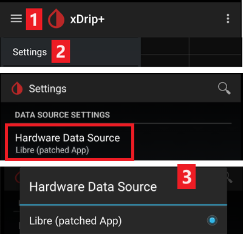

# Ajustes de xDrip

Si todavía no lo tienes, descarga e instala la última versión de xDrip desde la [página de versiones de xDrip](https://github.com/NightscoutFoundation/xDrip/releases).

Desactiva la optimización de batería y permite la actividad en segundo plano para la app xDrip.

## Configuración básica para todos los sistemas MCG y FGM

### Desactivar la subida a Nightscout

No debes dejar que ninguna otra app suba datos (glucosa y tratamientos) a Nightscout.

→ Menú hamburguesa (1) → Settings (2) → Cloud Upload (3) -> Nightscout Sync (REST-API)(4) → Pon `Enabled` en **OFF** (5)

#### Desactivar la calibración automática y los tratamientos

Asegúrate de que `Automatic Calibration` (7) está desactivado. Si la casilla `Automatic Calibration` está marcada, activa `Download treatments` (6) una vez, luego desmarca la casilla `Automatic Calibration` y vuelve a desactivar `Download treatments`.

Toca `Extra Options`(8)

    {admonition} Advertencia de seguridad
    :class: warning
    Debes desactivar «Upload treatments» en xDrip. Si no, los tratamientos pueden aparecer dos veces en AAPS y dar valores falsos de COB e IOB.

Desactiva `Upload treatments`(9) y asegúrate de que **NO** vas a usar `Back-fill data` (11).

La opción `Alert on failures` también debe estar desactivada (10). Si no, recibirás una alarma cada 5 minutos si hay problemas de Wi-Fi o de red móvil, o si el servidor no está disponible.

### **Inter-app Settings** (transmisión, broadcast)

Si vas a usar AAPS y los datos se deben enviar, por ejemplo, a AAPS, tienes que activar la transmisión (broadcast) en xDrip en Inter-App settings.

→ Menú hamburguesa (1) → Settings (2) → Inter-app settings (3) → Broadcast locally **ON** (4)

Para que los valores en AAPS sean iguales que en xDrip, debes activar `Send the displayed glucose value` (5).

Activa Compatible Broadcast (6).

Si también has activado `Accept treatments` en xDrip y `Enable broadcasts to xDrip` en el complemento xDrip de AAPS, xDrip recibirá de AAPS la información de insulina, carbohidratos y dosis basal.

Si activas `Accept Calibrations`, xDrip usará las calibraciones de AAPS. Ten cuidado si usas esta función con sensores Dexcom: lee primero [esto](https://navid200.github.io/xDrip/docs/Calibrate-G6.html).

Recuerda desactivar Import Sounds para que xDrip no haga sonar un tono cada vez que AAPS envía un cambio de basal o de perfil.

(xdrip-identify-receiver)=

#### Identificar receptor

- Si tienes problemas con la transmisión local (AAPS no recibe valores de glucosa de xDrip), ve a → Menú hamburguesa (1) Settings (2) → Inter-app settings (3) → Identify receiver (7) e introduce `info.nightscout.androidaps` para la compilación de AAPS (si usas la compilación PumpControl, introduce `info.nightscout.aapspumpcontrol` en su lugar).
- Importante: la corrección automática a veces tiende a cambiar la "i" de "info" por una mayúscula. **Debes usar solo letras minúsculas** al escribir `info.nightscout.androidaps` (o `info.nightscout.aapspumpcontrol` para PumpControl). Una I mayúscula impediría que la app reciba valores de glucosa de xDrip.
    
    

## Usar AAPS para calibrar en xDrip

- Si quieres poder calibrar con AAPS, en xDrip ve a Settings → Interapp Compatibility → Accept Calibrations y elige ON. 
- Puede que también quieras revisar las opciones en Settings → Less Common Settings → Advanced Calibration Settings.

## Sensores Dexcom

Todo lo relacionado con el sensor y el transmisor Dexcom (iniciar, detener, cambiar, calibrar, solucionar problemas) está documentado y actualizado en la [documentación de xDrip para Dexcom](https://navid200.github.io/xDrip/docs/Dexcom_page.html). Sigue esas instrucciones para el sensor; los ajustes que conectan xDrip con **AAPS** (descritos arriba en esta página) son la única parte específica de AAPS.

### Dexcom G6 y ONE

- Configura xDrip siguiendo los [ajustes recomendados](https://navid200.github.io/xDrip/docs/G6-Recommended-Settings.html).
- Los transmisores Dexcom G6 y ONE pueden estar conectados a la vez al receptor Dexcom (o a la bomba t:slim) y a una app en tu teléfono.
- Si usas xDrip como receptor, desinstala primero la app de Dexcom. **¡No puedes conectar xDrip y la app de Dexcom con el transmisor al mismo tiempo!**
- Si necesitas Clarity y quieres aprovechar las funciones de xDrip, usa la [app Build Your Own Dexcom App](#DexcomG6-if-using-g6-with-build-your-own-dexcom-app) con transmisión local a xDrip, o usa xDrip como app complementaria que recibe las notificaciones de la app oficial de Dexcom (con posibles retrasos en los valores de glucosa).

#### Reinicios del sensor

- Con los transmisores actuales, xDrip siempre usa el [algoritmo nativo](https://navid200.github.io/xDrip/docs/Native-Algorithm.html) del transmisor; no hay motivo para desactivarlo.
- Los [reinicios preventivos](https://navid200.github.io/xDrip/docs/Preemptive-Restart.html) solo funcionan en transmisores antiguos (firmware 1.6.5.25 o anterior), donde son necesarios para evitar que el sensor se detenga a los 10 días. Los transmisores recientes (Firefly) los ignoran.
- Para reiniciar un sensor con un transmisor Firefly hay que [quitar el transmisor](https://navid200.github.io/xDrip/docs/Remove-transmitter.html), y después del reinicio los valores pueden tener errores importantes, lo que es peligroso con el lazo: lee entera la página [Reiniciar un sensor](https://navid200.github.io/xDrip/docs/Restart-G6-sensor.html) y [calibra con cuidado](https://navid200.github.io/xDrip/docs/Calibrate-after-G6Restart.html).

(xdrip-connect-g6-transmitter-for-the-first-time)=

#### Iniciar, detener y cambiar sensores

Sigue las instrucciones:

- [Iniciar un transmisor G6 o ONE](https://navid200.github.io/xDrip/docs/Starting-G6.html)
- [Detener e iniciar un sensor G6 o ONE](https://navid200.github.io/xDrip/docs/Dexcom/StartG6Sensor.html)
- [Quitar el transmisor de un sensor](https://navid200.github.io/xDrip/docs/Remove-transmitter.html)
- La [vida útil del transmisor](https://navid200.github.io/xDrip/docs/Transmitter-lifetime.html) solo se puede alargar ([reinicio completo](https://navid200.github.io/xDrip/docs/Hard-Reset.html)) en transmisores con batería cambiada o modificados, no en Firefly.

(xdrip-replace-transmitter)=

#### Cambiar un transmisor

- Apaga el receptor original de Dexcom (si lo usas) y no lo vuelvas a encender antes de que xDrip muestre valores.
- Olvida el dispositivo en xDrip (System Status → Forget Device) Y en los ajustes de Bluetooth del teléfono (aparece como DexcomXX, donde XX son los dos últimos dígitos del número de serie del transmisor).
- Mantén el transmisor antiguo fuera del alcance del Bluetooth para evitar que se vuelva a conectar.
- Después sigue [Iniciar un transmisor G6 o ONE](https://navid200.github.io/xDrip/docs/Starting-G6.html).

### Dexcom G7, ONE+ y Stelo

- Sigue las [instrucciones para G7, ONE+ y Stelo](https://navid200.github.io/xDrip/docs/Dexcom/G7.html) (hace falta una versión reciente de xDrip; mira la página enlazada).
- Mira también la [página de Dexcom G7, ONE+ y Stelo](../CompatibleCgms/DexcomG7.md) para ver las configuraciones disponibles con **AAPS**.

(xdrip-troubleshooting-dexcom-g5-g6-and-xdrip)=

### Solución de problemas de Dexcom y xDrip

- [Solución de problemas de conexión de G6/ONE](https://navid200.github.io/xDrip/docs/Connectivity-troubleshoot.html)
- [Solución de problemas de G7/ONE+/Stelo](https://navid200.github.io/xDrip/docs/Dexcom/G7_Troubleshooting.html)
- [Problema al iniciar un sensor nuevo](https://navid200.github.io/xDrip/docs/Dexcom/SensorFailedStart.html)
- Lista completa: mira **Troubleshooting** en la [página de xDrip para Dexcom](https://navid200.github.io/xDrip/docs/Dexcom_page.html).

## Libre 1

- Configura en xDrip tu puente de NFC a Bluetooth
    
    → Menú hamburguesa (1) → Settings (2) → Less common settings (3) → Bluetooth Settings (4)

- En Bluetooth Settings, marca las casillas exactamente como en las capturas de pantalla de abajo (5)
    
    - Desactiva los watchdogs, porque reinician el Bluetooth del teléfono e interrumpen la conexión con tu bomba.
    
    

- Puedes probar a activar estos ajustes (7)
    
    - Usar escaneo
    - Trust Auto-Connect
    - Use Background Scans

- Si pierdes la conexión con el puente con facilidad o te cuesta recuperarla, **DESACTÍVALOS** (8).
    
    

- Deja todas las demás opciones desactivadas, salvo que sepas por qué quieres activarlas.
    
    

### Nivel de batería del lector inteligente del Libre

- El nivel de batería de puentes como MiaoMiao y Bubble se puede mostrar en AAPS (no el de Blucon).
- Puedes encontrar los detalles en la [página de capturas de pantalla](#screens-sensor-level-battery).

### Conectar el transmisor Libre e iniciar el sensor

- Si tu sensor lo necesita (Libre 2 EU y Libre 1 US), instala el último algoritmo «out of process».

- Tu sensor ya debe estar iniciado con la app del fabricante o con el lector (xDrip no puede iniciar ni detener sensores Libre).

- Configura la fuente de datos como Libre Bluetooth.
    
    → Menú hamburguesa (1) → Settings (2) → Elige Libre Bluetooth en Hardware Data source (3)
    
    

- Busca por Bluetooth y conecta el puente.
    
    → Menú hamburguesa (1) → Scan Bluetooth (2) → Scan (3)
    
    - Si xDrip no encuentra el puente, asegúrate de que no está conectado a la app del fabricante. Ponlo a cargar y reinícialo.
    
    

- Inicia el sensor en xDrip.
    
        {admonition} Advertencia de seguridad
        :class: warning
        No uses los datos del sensor antes de que termine la hora de calentamiento: los valores pueden ser muy altos y causar decisiones erróneas en AAPS.
    
    → Menú hamburguesa (1) → Start sensor (2) → Start sensor (3) → Pon la hora exacta en que lo iniciaste con el lector o con la app del fabricante. Si no lo iniciaste hoy, responde «Not Today» (4).

(xdrip-libre2-patched-app)=

## App parcheada de Libre 2

- Configura la fuente de datos como app parcheada de Libre.
    
    → Menú hamburguesa (1) → Settings (2) → Elige Libre (patched App) en Hardware Data source (3)
    
    

- Puedes añadir `BgReading:d,xdrip libre_receiver:v` en Less Common Settings->Extra Logging Settings->Extra tags for logging. Esto registrará mensajes de error adicionales ante problemas.

