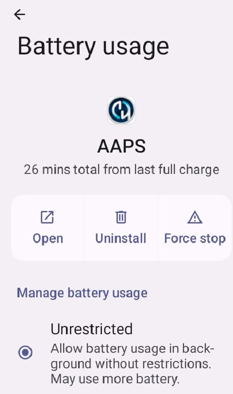

# Jelly

## Jelly Star Mini

**Funciones**

* Android 13
* 8 GB de RAM

**Ventajas**

* Es realmente pequeño.
* Aunque se lo digas a la gente, puede que no lo vean como un smartphone normal y lo acepten más fácilmente como excepción donde los teléfonos normalmente no están permitidos.

**Desventajas**

* Recommended only for experienced loopers. Some settings are not easy to recognize: you have to know from experience with a big Android AAPS phone how and where things are located. Some AAPS buttons are small and hard to tap: you need a precise touch, not stubby fingers.
* Sólo se puede utilizar como LooperPhone. Es mejor tener un smartphone normal en tu bolsillo. 

### Optimización de la duración de la batería

El Jelly tiene funciones de optimización fuertes que **deben** desactivarse para AAPS (y para otras apps DIY como BYODA, xDrip, OOP2, Juggluco, etc.).

Puedes dejar activada la asistencia inteligente (Intelligent assistance), pero **debe estar desactivada para las apps DIY**.

Puedes activar NFC para los sensores Libre.

### Optimización de la duración de la batería

Para evitar problemas con **AAPS**, desactiva el «uso de batería» del Jelly Star seleccionando «sin restricciones» para **AAPS** (y para otras **apps DIY** como BYODA, xDrip, OOP2, Juggluco, etc.).

### Google Play Protect

Recuerda desactivar Google Play Protect.

### Conexión remota para la apk Wear

For certain smart watches, like the Samsung Galaxy, 'Remote connection' under Advanced features in the Galaxy Wearable app must be switched **on** to use the Jelly, **Wear.apk** & **AAPS** remotely via Wi-Fi.

