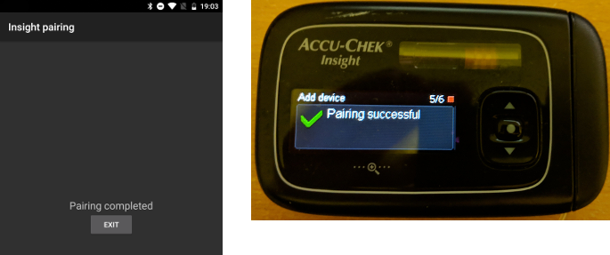

# Accu-Chek Insight

**Este software es parte de una solución de páncreas artificial «hágalo usted mismo» (DIY) y no es un producto, sino que requiere que TÚ leas, aprendas y entiendas el sistema, incluido cómo usarlo. No es algo que haga por ti todo el control de tu diabetes, pero te permite mejorar tu diabetes y tu calidad de vida, si estás dispuesto a dedicarle el tiempo necesario. No te precipites, date tiempo para aprender. Solo tú eres responsable de lo que haces con él.**

```{admonition} Accu-Chek Insight deja de venderse :class: note

Roche se retira del mercado de bombas de insulina para centrar su oferta para la diabetes en el MCG Accu-Chek SmartGuide. Ha anunciado el fin de la venta de las bombas Accu-Chek Combo y Accu-Chek Insight; su otra bomba, la microbomba Accu-Chek Solo, también se está retirando (últimas entregas en Alemania a finales de 2025). El cambio se hace por regiones: empieza en Alemania y se espera que sigan otros mercados europeos. El soporte de la Insight ya aparece como terminado (consulta [Bombas que ya no se venden](./Future-possible-Pump-Drivers.md)). Si dependes de esta bomba, planifica con tiempo el paso a una bomba compatible.

    <br />```{note}
    Antes de que **AAPS** tuviera un controlador propio para la Insight, la Insight se controlaba con la app aparte [SightRemote](https://github.com/TebbeUbben/SightRemote). SightRemote ya no hace falta y ya no se mantiene: si aún la tienes instalada de aquella época, desinstálala y usa una versión actual de **AAPS**.
    

```{contents} Índice :depth: 1 :local: true

    <br />## Funciones de la bomba con AAPS
    
    * Se comunica con **AAPS** por el Bluetooth propio del teléfono, sin un dispositivo de comunicación adicional.
    * Gestión automática del horario de verano y de la zona horaria.
    
    ## Requisitos de hardware y software
    
    * Una bomba Roche Accu-Chek Insight (cualquier firmware, todos funcionan)
    
    Nota: AAPS siempre escribe los datos en el **primer perfil de dosis basal de la bomba**.
    
    * Un teléfono Android con Android 12 o posterior (consulta [Teléfonos](../Getting-Started/Phones.md))
    * La app AAPS instalada en tu teléfono
    
    ## Configuración
    
    * La bomba Insight solo debe estar conectada a un dispositivo a la vez. Si antes has usado el mando a distancia de la Insight (medidor), tienes que quitar el medidor de la lista de dispositivos emparejados de tu bomba: **Menu** > **Settings** > **Communication** > **Remove device**.
    
       
    
    * En [Configuración > Bomba](#Config-Builder-pump), selecciona la tarjeta **Accu-Chek Insight**. Solo puede haber una bomba activa a la vez.
    
       
    
       Cuando está seleccionada, la tarjeta **Accu-Chek Insight** muestra dos botones, **Ajustes** y **Abrir complemento**:
    
       
    
       **Ajustes** abre los ajustes del controlador de Accu-Chek Insight (consulta [Ajustes en AAPS](#Accu-Chek-Insight-Pump-settings-in-aaps)).
    
       **Abrir complemento** (o **Administrar → Bomba**) abre la pantalla de la bomba Accu-Chek Insight. Antes de emparejar una bomba, se ve así:
    
       
    
    (accu-chek-insight-pairing)=
    ### Emparejamiento
    
    * En la pantalla de la bomba, toca **Emparejar Insight**. Se abre el asistente de emparejamiento y busca dispositivos Bluetooth cercanos (parte superior de la imagen de abajo).
    * En la bomba Insight, ve a **Menu** > **Settings** > **Communication** > **Add Device**. La bomba muestra la siguiente pantalla (parte inferior de la imagen de abajo) con el número de serie de la bomba.
    
       
    
    * De vuelta en tu teléfono, toca el número de serie de la bomba en la lista de dispositivos Bluetooth. Si Android te pide que confirmes el emparejamiento, toca **Vincular**.
    
       
    
    * La bomba y el teléfono muestran un código. Comprueba que los códigos son iguales en los dos dispositivos. Confirma en la bomba y toca **Sí** en el teléfono. (Toca **No** si los códigos no coinciden.)
    
       
    
    * El teléfono muestra **Emparejamiento completado**. Toca **Salir** para volver a la pantalla de la bomba.
    
       
    
    * Para comprobar que todo está bien, mira la pantalla de la bomba (**Administrar → Bomba**). Cuando la bomba está emparejada, muestra información sobre la bomba, como **Número de serie**, **Fecha de fabricación**, **Versión de software** y **Dirección Bluetooth**.
    
       
    
       ```{admonition} Captura de pantalla antigua
       :class: note
       Salvo la parte superior de la primera imagen, las capturas de pantalla del emparejamiento de arriba son de una versión anterior de **AAPS** y pueden verse diferentes en **AAPS** 4.
       ```
    
    * Para quitar el emparejamiento, toca **Desvincular** en la pantalla de la bomba y confirma **¿Restablecer la información de emparejamiento?**. Después vuelve a aparecer el botón **Emparejar Insight**.
    
    Nota: no hay una conexión permanente entre la bomba y el teléfono. **AAPS** solo se conecta cuando hace falta (por ejemplo, para poner una dosis basal temporal, dar un bolo o leer el historial de la bomba). Si no, las baterías del teléfono y de la bomba se gastarían demasiado rápido.
    
    (Accu-Chek-Insight-Pump-settings-in-aaps)=
    ## Ajustes en AAPS
    
    Abre los ajustes con **Ajustes** en la tarjeta **Accu-Chek Insight** en **Configuración** > **Bomba**, o con el icono del engranaje en la esquina superior derecha de la pantalla de la bomba.
    
    
    
    En los ajustes de la Insight en **AAPS** puedes activar estas opciones:
    
    * **Registrar cambios de cartucho**: registra automáticamente un cambio de cartucho de insulina cuando ejecutas el programa "fill cannula" (llenar la cánula) en la bomba.
    
    * **Registrar cambios de tubo**: añade una nota a la base de datos de **AAPS** cuando ejecutas el programa "tube filling" (llenado del tubo) en la bomba.
    
    * **Registrar cambios de cánulas**: añade una nota a la base de datos de **AAPS** cuando ejecutas el programa "cannula filling" (llenado de la cánula) en la bomba. **Nota: un cambio de cánula también reinicia Autosens.**
    
    * **Registrar cambios de batería**: registra un cambio de batería cuando pones una batería nueva en la bomba.
    
    * **Registrar cambios del modo de funcionamiento**: añade una nota a la base de datos de **AAPS** cada vez que inicias, detienes o pausas la bomba.
    
    * **Registro de alarmas**: añade una nota a la base de datos de **AAPS** cada vez que la bomba emite una alerta (salvo recordatorios y cancelaciones de bolo y de TBR, que no se registran).
    
    * **Activar emulación de dosis basal temporal**: la bomba Insight solo puede poner dosis basales temporales (TBR) de hasta el 250 %. Para evitar este límite, la emulación de TBR le dice a la bomba que administre un bolo extendido para la insulina extra si se pide una TBR de más del 250 %.
    
      **Nota: usa solo un bolo extendido a la vez. Varios bolos extendidos al mismo tiempo pueden causar errores.**
    
    * **Desactivar las vibraciones en la administración de bolos manuales**: evita que la bomba Insight vibre cuando administra un bolo manual (o un bolo extendido). Solo disponible con el firmware 3.x de la Insight.
    
    * **Desactivar las vibraciones en la administración de bolos automáticos**: evita que la bomba Insight vibre cuando administra un bolo automático (SMB o basal temporal con emulación de TBR). Solo disponible con el firmware 3.x de la Insight.
    
    * **Mínima duración de la recuperación [s]** y **Máxima duración de la recuperación [s]**: cuánto tiempo espera **AAPS** antes de volver a intentarlo después de un intento de conexión fallido. Puedes elegir entre 0 y 20 segundos. Si tienes problemas de conexión, elige un tiempo de espera más largo.
        <br><br>Ejemplo con mín. duración de la recuperación = 5 y máx. duración de la recuperación = 20
        <br><br>sin conexión -> esperar <b>5</b> s.
          <br>  reintento -> sin conexión -> esperar <b>6</b> s.
          <br>  reintento -> sin conexión -> esperar <b>7</b> s.
          <br>  reintento -> sin conexión -> esperar <b>8</b> s.
          <br>...
          <br>reintento -> sin conexión -> esperar <b>20</b> s.
          <br>reintento -> sin conexión -> esperar <b>20</b> s.
          <br>...
    
    * **Retraso de desconexión [s]**: cuánto tiempo (en segundos) espera **AAPS** antes de desconectarse de la bomba cuando termina una operación. Puedes elegir entre 0 y 15 segundos. El valor por defecto es 5 segundos.
    
    Para los periodos en que la bomba estuvo detenida, **AAPS** registra una dosis basal temporal del 0 %.
    
    ### La pantalla de la bomba
    
    La pantalla de la bomba Accu-Chek Insight (**Administrar → Bomba**) muestra el estado actual de la bomba, por ejemplo **Estado**, **Última conexión**, **Modo de funcionamiento**, **Batería**, **Nivel del reservorio**, las dosis totales diarias de hoy (**Bolo TDD**, **Basal TDD**), las dosis basales y el último bolo. Cuando la bomba está emparejada, tiene estos botones:
    
    * **Actualizar**: actualiza el estado de la bomba.
    * **Activar notificación del final de TBR (configuración de bomba)** / **Desactivar notificación del final de TBR (configuración de bomba)**: una bomba Insight estándar suena con una alarma cuando termina una TBR. Este botón activa o desactiva esa alarma sin necesidad de software de configuración.
    * **Desvincular**: quita el emparejamiento con la bomba (consulta [Emparejamiento](#accu-chek-insight-pairing)).
    
    
    
    ```{admonition} Captura de pantalla antigua
    :class: note
    La captura de pantalla de arriba es de una versión anterior de **AAPS**. En **AAPS** 4, la pantalla de la bomba se ve diferente y también tiene un botón **Desvincular**.
    

## Configuración de la bomba

Configura las alarmas de la bomba así:

* Menu > Settings > Device settings > Mode settings > Quiet > Signal > Sound
* Menu > Settings > Device settings > Mode settings > Quiet > Volume > 0 (quita todas las barras)
* Menu > Modes > Signal mode > Quiet

Así se silencian todas las alarmas de la bomba, y AAPS decide si una alarma es importante para ti. Si AAPS no confirma una alarma, su volumen aumentará (primero pitido, luego vibración).

(Accu-Chek-Insight-Pump-vibration)=

### Vibración

Según la versión de firmware de tu bomba, la Insight vibrará brevemente cada vez que se administre un bolo (por ejemplo, cuando AAPS da un SMB o cuando la emulación de TBR administra un bolo extendido).

* Firmware 1.x: Sin vibración por diseño.
* Firmware 2.x: La vibración no se puede inhabilitar.
* Firmware 3.x: AAPS administra el bolo sin vibración.

La versión de firmware se puede encontrar en el menú.

## Reemplazo de la batería

Con el lazo, la batería de la Insight dura entre 10 y 14 días, máx. 20 días. El usuario que informa de esto está utilizando las baterías de litio de Energizer.

La bomba Insight tiene una pequeña batería interna que mantiene funciones esenciales, como el reloj, mientras cambias la batería extraíble. Si el cambio de batería tarda demasiado, esta batería interna se puede quedar sin carga, el reloj se reinicia y, después de poner una batería nueva, tendrás que introducir de nuevo la hora y la fecha. Si esto pasa, todas las entradas de AAPS anteriores al cambio de batería dejan de usarse en los cálculos, porque no se puede saber la hora correcta.

(Accu-Chek-Insight-Pump-insight-specific-errors)=

## Errores específicos de Insight

### Bolo extendido

Usa solo un bolo extendido a la vez, porque varios bolos extendidos al mismo tiempo pueden causar errores.

### Tiempo de espera agotado (Time out)

A veces la bomba Insight no responde mientras **AAPS** establece la conexión. Entonces **AAPS** muestra la notificación "Tiempo de emparejamiento excedido - Reiniciar bluetooth".


Si esto pasa, apaga el Bluetooth en la bomba Y en el teléfono durante unos 10 segundos y luego vuelve a encenderlo.

## Cruzando zonas horarias con la bomba Insight

Para más información sobre viajes entre zonas horarias, consulta la sección [Viajes entre zonas horarias con bombas](#timezone-traveling-insight).

## Dónde obtener ayuda

El desarrollo del controlador de Insight lo hace la comunidad de forma **voluntaria**. Antes de pedir ayuda:

1. **Lee** la sección de esta documentación sobre el tema para confirmar cómo debe funcionar la función.
2. **Pregunta** en el canal *#AAPS* de [Discord](https://discord.gg/4fQUWHZ4Mw) o en uno de los otros [canales de la comunidad](../GettingHelp/WhereCanIGetHelp.md).
3. **Informa de un error**: busca primero en las [issues existentes](https://github.com/nightscout/AndroidAPS/issues); si el tuyo no aparece, abre una [nueva issue](https://github.com/nightscout/AndroidAPS/issues) y adjunta tus [archivos de registro](../GettingHelp/AccessingLogFiles.md).

Cuando pidas ayuda, indica la marca y el modelo de tu teléfono, la versión de Android, la versión de **AAPS** y una descripción sencilla del problema (qué cambió, cuándo funcionó por última vez).