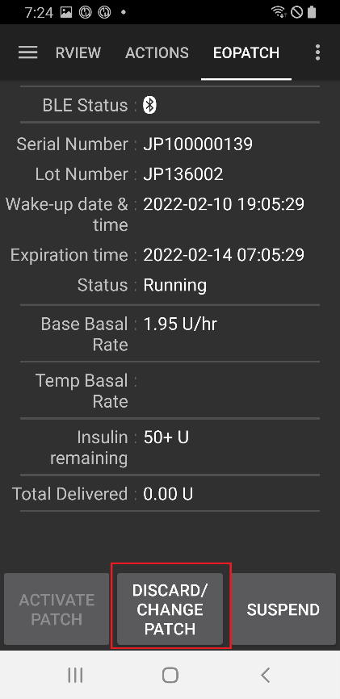

# EOPatch2

El parche necesita insulina de acción rápida U-100, como NovoRapid o Humalog. Usa la insulina de acción rápida que te ha recetado tu médico.

La dosis más pequeña que puede administrar el parche es 0,05 U. Pon cada dosis basal de tu **Perfil** en al menos 0,05 U/h, en pasos de 0,05 U/h. Si no, **AAPS** redondea cada dosis al valor de 0,05 U/h más cercano (nunca a 0) y usa las dosis que el parche da de verdad, así que la insulina total por día es un poco distinta de la de tu **Perfil**. De la misma forma, los bolos deben ser de al menos 0,05 U.

```{contents} Table of contents
:depth: 1
:local: true
```

## Funciones de la bomba con AAPS

* Se comunica con **AAPS** mediante el Bluetooth propio del teléfono, sin un dispositivo de comunicación adicional.
* Los cambios de horario de verano (DST) y de zona horaria se deben hacer a mano.

## Configurar la bomba

1. Abre el **menú** (☰) en la esquina superior izquierda de la pantalla principal de **AAPS** y selecciona **Configuración**.
1. En la sección **Bomba**, selecciona **EOPatch2**.
1. Pulsa la tecla Atrás para volver a la pantalla principal.

 

Cuando está seleccionado, la tarjeta **EOPatch2** muestra dos botones, **Ajustes** y **Abrir complemento**:


## Ajustes

Abre los ajustes de EOPatch2 de una de estas dos formas:

* pulsa **Ajustes** en la tarjeta **EOPatch2** de **Configuración**, o
* abre la pantalla de la bomba (**Administrar** → **Bomba**) y pulsa el icono de rueda dentada en la esquina superior derecha.

Hay tres ajustes:


### Alertas de reservorio bajo

Aparece una advertencia cuando la insulina que queda en el parche baja a esta cantidad o menos. Puedes ponerlo entre 10 y 50 U, en pasos de 5 U. El valor predeterminado es 10 U.

### Recordatorio de expiración del parche

Te recuerda cuánto tiempo queda hasta que caduque el parche actual. Puedes ponerlo entre 1 y 24 horas, en pasos de 1 hora. El valor predeterminado es 4 horas.

### Recordatorios de sonidos del parche

Si está activado, el parche pita cuando empieza y cuando termina un bolo, un bolo extendido o una basal temporal. No afecta a tu basal normal. El valor predeterminado es desactivado.

## Activar un parche nuevo

### Abrir el asistente de activación

Abre la pantalla de la bomba con **Administrar** → **Bomba** (o pulsa **Abrir complemento** en la tarjeta **EOPatch2** de **Configuración**). Cuando no hay ningún parche activo, la pantalla muestra **No activado** y un botón **Activar parche** en la parte inferior.

Pulsa **Activar parche** para iniciar el asistente.


El asistente te guía por cada paso. La fila de puntos de la parte superior muestra en qué paso estás.

```{note}
Si nunca has activado un **Perfil** en **AAPS**, el asistente muestra primero una página **Perfil requerido**. Selecciona el perfil que quieres usar y pulsa **Activar perfil**.
```

### Llenado de insulina

Introduce la aguja de la jeringa en el puerto de llenado de insulina del parche. Empuja el émbolo despacio para llenar el parche. Cuando hay más de 80 U en el parche, pita una vez y se enciende (arranca).

Cuando oigas el pitido, pulsa **Iniciar el emparejamiento**.


```{warning}
- No gires la palanca de la aguja hasta que el asistente te lo diga. Si la giras demasiado pronto, puede causar problemas graves durante el llenado o la revisión de seguridad.
- El parche admite de 80 a 200 U. Si pones menos de 80 U, el parche no funciona.
- Saca la insulina de la nevera de 15 a 30 minutos antes de llenar, para que llegue a temperatura ambiente. La insulina debe estar al menos a 10 °C.
```

### Emparejamiento del parche

Ahora **AAPS** intenta emparejarse con el parche de forma automática. Durante el emparejamiento aparecen dos solicitudes de emparejamiento Bluetooth de Android. Pulsa **OK** en la primera. Vuelve a pulsar **OK** en la segunda, que muestra una clave de acceso.

```{warning}
- Mantén el parche y el teléfono a menos de 30 cm el uno del otro durante el emparejamiento.
- Después de arrancar, el parche pita cada 3 minutos hasta que termina el emparejamiento.
- Debes terminar de activar el parche en los 60 minutos siguientes a su arranque. Si no puedes, descarta el parche.
```

  

```{admonition} Older screenshot
:class: note
Las dos capturas del emparejamiento Bluetooth son de una versión anterior de **AAPS**: la pantalla de **AAPS** detrás de la solicitud de emparejamiento de Android se ve distinta en **AAPS** 4.
```

### Seleccionar insulina

Selecciona la insulina con la que has llenado el parche y pulsa **Siguiente**. **AAPS** aplica un cambio de perfil con esta insulina después de la activación.

### Prepárate para colocar el parche

Quita la cinta adhesiva del parche y luego pulsa **Siguiente**.

Si sale una aguja, o si el parche está mojado o sucio o su cinta adhesiva está doblada, pulsa **Descartar** y usa un parche nuevo.


### Ubicación de la zona

Este paso solo aparece si **Gestionar la rotación del lugar de inserción de la bomba** está activado en los ajustes de rotación de zonas. Toca en el dibujo del cuerpo el lugar donde vas a colocar el parche y pulsa **Siguiente**, o pulsa **Omitir**.

### Coloca el parche en tu cuerpo

La insulina debe ir a un lugar con tejido graso bajo la piel, pero con pocos nervios o vasos sanguíneos. El abdomen, el brazo o el muslo son buenas opciones. Limpia y seca la zona y luego pega el parche en la piel.

Revisa el lugar de infusión y luego pulsa **Empezar la revisión de seguridad**.

```{warning}
- Presiona los bordes de la cinta del parche de forma uniforme, para que todo el parche quede bien pegado a la piel.
- Si el parche no se pega por completo, puede entrar aire entre el parche y la piel. Esto debilita el adhesivo y la resistencia al agua del parche.
```


### Comprobaciones de seguridad

La revisión de seguridad dura unos 30 segundos. Cuando termina, el parche pita una vez. Si falla, pulsa **Reintentar**.

```{warning}
Para un uso seguro, no gires la palanca de la aguja hasta que termine la revisión de seguridad.
```

 

```{admonition} Older screenshot
:class: note
Las capturas desde **Prepárate para colocar el parche** hasta **Comprobaciones de seguridad** son de una versión anterior de **AAPS** y pueden verse distintas en **AAPS** 4.
```

### Inserción de la aguja

Sujeta el parche con firmeza. Gira la palanca de la aguja hacia arriba más de 100° para insertar la aguja. El parche pita una vez cuando la aguja está bien insertada. Después sigue girando la palanca hasta el final para quitarla. Pulsa **Siguiente**.

```{caution}
Si pasas al siguiente paso sin oír el pitido, aparece un **Error de inserción de la aguja**. Comprueba el pitido y pulsa **Reintentar**. Si el error sigue, pulsa **Descartar** para desactivar el parche.
```

### Activación del parche completada

La última página confirma que el parche está activo y que te avisará cuando se acerque su fecha de caducidad. Pulsa **Finalizar** para volver a la pantalla de la bomba.

## Descartando el parche

Cambia el parche cuando le quede poca insulina, cuando caduque o si falla. Te recomendamos usar cada parche como máximo 84 horas desde su arranque.

1. Abre la pantalla de la bomba (**Administrar** → **Bomba**). Mientras hay un parche activo, pulsa **Descartar parche**.
1. La página **Descartar parche** muestra el tiempo y la insulina que le quedan al parche. Pulsa **Descartar parche**.
1. Un cuadro de diálogo te pide que lo confirmes. Vuelve a pulsar **Descartar parche**.
1. Cuando el parche se ha desactivado, el asistente muestra **El parche se ha desactivado por completo.** Quítate el parche del cuerpo y pulsa **Confirmar**.

Después, el asistente pasa directamente a activar un parche nuevo (ver arriba). Pulsa la flecha atrás si quieres parar aquí.

Mientras no hay ningún parche activo, **AAPS** muestra la bomba como suspendida y registra una basal temporal de 0 U/h, así que no se cuenta insulina basal en la IOB hasta que se active el siguiente parche.

   

```{admonition} Older screenshot
:class: note
Las capturas de pantalla de arriba son de una versión anterior de **AAPS**. En **AAPS** 4 la pantalla de la bomba se abre desde **Administrar** → **Bomba**, y su botón se llama **Descartar parche**.
```

```{admonition} If the patch does not respond
:class: warning
Si **AAPS** no puede comunicarse con el parche, puede mostrar una página sobre cómo apagar a mano la alarma del parche: quítate el parche del cuerpo, despega la cinta adhesiva y usa un clip para presionar con fuerza en el agujero que está junto al puerto de llenado de insulina.

La página **Descartar parche** también tiene un botón **Reinicio forzado**. Solo borra el parche de **AAPS**, sin enviar ninguna orden al parche. El parche sigue administrando insulina hasta que se agote su batería o lo apagues a mano. Úsalo solo si falla el descarte normal, y quítate el parche del cuerpo.
```

## Suspender y reanudar la administración de insulina

Al suspender la administración de insulina también se cancela cualquier bolo extendido y basal temporal. Cuando reanudas, **no** se vuelven a iniciar. Mientras la administración de insulina está suspendida, el parche pita cada 15 minutos.

### Suspender la administración de insulina

1. Abre la pantalla de la bomba (**Administrar** → **Bomba**) y pulsa **Suspender bomba**.
1. Un cuadro de diálogo explica qué se va a suspender. Pulsa **Confirmar**.
1. En el cuadro **Tiempo de suspensión basal**, elige cuánto tiempo suspender: 30 min, 1 h, 1 h 30 min o 2 h. Pulsa **Confirmar**.

La administración de insulina se suspende durante el tiempo que elegiste.

  

```{admonition} Older screenshot
:class: note
Las capturas de pantalla de arriba son de una versión anterior de **AAPS**. En **AAPS** 4 la pantalla de la bomba se abre desde **Administrar** → **Bomba**, y su botón se llama **Suspender bomba**.
```

### Reanudación de la administración de insulina

1. Abre la pantalla de la bomba (**Administrar** → **Bomba**) y pulsa **Reanudar bomba**.
1. En el cuadro **Reanudar la administración de insulina**, pulsa **Confirmar**.

 

```{admonition} Older screenshot
:class: note
Las capturas de pantalla de arriba son de una versión anterior de **AAPS**. En **AAPS** 4 la pantalla de la bomba se abre desde **Administrar** → **Bomba**, y su botón se llama **Reanudar bomba**.
```

```{warning}
Cuando termina el tiempo de suspensión, **AAPS** muestra una advertencia **Fin de la suspensión de insulina**. La administración de insulina **no** se reanuda hasta que lo confirmes. Si no lo haces, podrías tener una hiperglucemia.
```

(eopatch2-alarms-and-warnings)=

## Alarmas y advertencias

### Alarmas

Las alarmas son para situaciones urgentes y de máxima prioridad, y necesitan que actúes enseguida. **AAPS** hace sonar una alarma que no para hasta que la confirmas, y muestra el mensaje como notificación en la pantalla **Inicio**. Una alarma significa que hay un problema con el parche en uso. En muchos casos hay que descartar el parche y cambiarlo por uno nuevo.

Cuando pulsas **Confirmar** en la notificación, **AAPS** gestiona la alarma. En la mayoría de las alarmas, esto desactiva el parche. En la alarma **Temperatura inadecuada**, el botón es **Reintentar**.

 

```{admonition} Older screenshot
:class: note
Las capturas de las alarmas son de una versión anterior de **AAPS** y pueden verse distintas en **AAPS** 4.
```

Las distintas alarmas se explican a continuación.

| Alarma                             | Explicación                                                                                                                                                              |
| ---------------------------------- | ------------------------------------------------------------------------------------------------------------------------------------------------------------------------ |
| Reservorio vacío                   | El parche se ha quedado sin insulina.                                                                                                                                    |
| Parche caducado                    | El tiempo de uso del parche ha terminado y ya no puede administrar más insulina.                                                                                         |
| Oclusión                           | Parece que el conducto de insulina del parche está bloqueado.                                                                                                            |
| Fallo en el auto-test de encendido | El parche ha encontrado un error inesperado en su autoprueba después de arrancar.                                                                                        |
| Temperatura inadecuada             | El parche está fuera de su temperatura normal de funcionamiento mientras lo activas o lo usas. Lleva el parche a un lugar con una temperatura adecuada (de 4,4 a 37 °C). |
| Error de inserción de la aguja     | La aguja no se insertó bien durante la activación. Comprueba que el borde de inserción de la aguja del parche y la palanca de la aguja están en línea recta.             |
| Error de la batería del parche     | La batería interna del parche está a punto de agotarse y el parche se apagará.                                                                                           |
| Error de activación del parche     | El parche no se activó por completo en los 60 minutos siguientes a su arranque.                                                                                          |
| Error del parche                   | El parche ha encontrado un error inesperado mientras se activaba o se usaba.                                                                                             |

### Advertencias

Las advertencias son para situaciones de prioridad media o baja. Una advertencia aparece como notificación en la pantalla **Inicio**.


```{admonition} Older screenshot
:class: note
Esta captura es de una versión anterior de **AAPS**: en **AAPS** 4 la advertencia aparece en la pantalla principal, que se ve distinta.
```

Las distintas advertencias se explican a continuación.

| Advertencia                           | Explicación                                                                                                                                               |
| ------------------------------------- | --------------------------------------------------------------------------------------------------------------------------------------------------------- |
| Fin de la suspensión de insulina      | El tiempo de suspensión que elegiste ha terminado. Pulsa **Reanudar bomba** en la notificación para reanudar la administración de insulina.               |
| Reservorio bajo                       | La insulina que queda en el parche está por debajo de la cantidad fijada en **Alertas de reservorio bajo**.                                               |
| Expiración de la vida útil del parche | El periodo de uso del parche ha terminado.                                                                                                                |
| El parche caducará pronto             | El parche debe descartarse en 1 hora.                                                                                                                     |
| Activación incompleta del parche      | La activación del parche se interrumpió durante más de 3 minutos después del emparejamiento. Abre la pantalla de la bomba y termina de activar el parche. |
| Batería del parche baja               | La batería del parche está baja.                                                                                                                          |

## Dónde obtener ayuda

El desarrollo del driver de EOPatch2 lo hace la comunidad de forma **voluntaria**. Antes de pedir ayuda:

1. **Lee** la sección correspondiente de esta documentación para confirmar cómo debe funcionar la función.
2. **Pregunta** en el canal *#AAPS* de [Discord](https://discord.gg/4fQUWHZ4Mw) o en uno de los otros [canales de la comunidad](../GettingHelp/WhereCanIGetHelp.md).
3. **Informa de un error** buscando primero en los [problemas existentes](https://github.com/nightscout/AndroidAPS/issues); si el tuyo no aparece, abre un [nuevo problema](https://github.com/nightscout/AndroidAPS/issues) y adjunta tus [archivos de registro](../GettingHelp/AccessingLogFiles.md).

Cuando pidas ayuda, indica la marca y el modelo de tu teléfono, la versión de Android, la versión de **AAPS** y una descripción sencilla del problema (qué cambió y cuándo funcionó por última vez).
