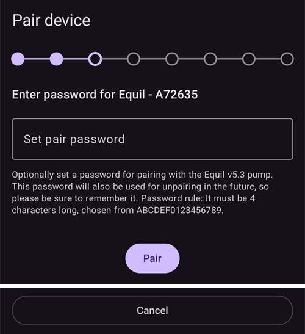

# Equil

Estas instrucciones sirven para configurar la bomba de insulina Equil.

```{contents} Table of contents
:depth: 1
:local: true
```

## Funciones de la bomba con AAPS

* Bomba parche sin tubo que se comunica con **AAPS** mediante el Bluetooth propio del teléfono, sin un dispositivo de comunicación adicional.
* **AAPS** trata la Equil como una bomba parche con un reservorio de 200 U: la pantalla principal muestra las luces de estado de bomba parche, y no se ofrecen **Cebar/Llenar** ni **Cambio de batería de la bomba**. El llenado, el cebado y el cambio de batería se hacen en los asistentes de la bomba.
* Mientras la bomba está suspendida o parada, **AAPS** registra una basal temporal de 0 U/h, así que no se cuenta insulina basal en la IOB.
* Los cambios de horario de verano (DST) y de zona horaria se deben hacer a mano.

## Requisitos de hardware y software
* **Hardware Equil compatible**

  Por ahora se admiten Equil 5.3 y 5.4.

* **AAPS** compilado e instalado según las instrucciones de [Compilar AAPS](../SettingUpAaps/BuildingAaps.md)

## Configuración

### Seleccionar la bomba Equil

Abre el **menú** (☰) en la esquina superior izquierda, elige **[Configuración](#Config-Builder-pump)** y, en **Bomba**, selecciona **Equil**.

Cuando está seleccionado, la tarjeta **Equil** muestra dos botones, **Ajustes** y **Abrir complemento**:


**Abrir complemento** (o **Administrar** → **Bomba**) abre la pantalla de la bomba Equil. Antes de emparejar una bomba, se ve así:


### Ajustes

Abre los ajustes de Equil con **Ajustes** en la tarjeta **Equil**, o con el icono de rueda dentada en la esquina superior derecha de la pantalla de la bomba.


* **Alarma de batería baja**: te avisa cuando la batería de la bomba está baja.
* **Alarma de reservorio bajo**: te avisa cuando queda poca insulina en el reservorio.
* **Tono de alerta**: cómo te avisa la bomba: **Silenciar**, **Sólo vibrar**, **Sólo sonido** o **Vibración y sonido**.
* **Velocidad del bolo**: la velocidad a la que se da un bolo: **1,5 U/min (estándar)**, **3 U/min**, **6 U/min** o **12 U/min**. Un bolo más rápido puede dar más alarmas de oclusión.


```{admonition} Max basal and max bolus on the patch
:class: note
El propio parche rechaza cualquier dosis basal por encima de un máximo que **AAPS** programa en él. **AAPS** toma el valor más alto entre tu [ajuste](../SettingUpAaps/Preferences.md) de **basal máxima** y la dosis basal por hora más alta de tu **Perfil**, así el parche siempre acepta tu perfil y las basales temporales que pide el lazo. **AAPS** también envía al parche tu bolo máximo permitido.

Cuando cambias tu **basal máxima** o tu **bolo máximo**, **AAPS** envía los nuevos valores al parche de forma automática. También se envían con cada cambio de perfil. No hay nada que ajustar en el propio parche.
```

### Emparejar la bomba

En la pantalla de la bomba, pulsa **Emparejar**. Un asistente te guía por cada paso. La fila de puntos de la parte superior muestra en qué paso estás.

Si Android pregunta si **AAPS** puede encontrar dispositivos cercanos y conectarse a ellos, pulsa **Permitir**. **AAPS** lo necesita para encontrar la bomba.


El asistente tiene estos pasos. Pulsa **Siguiente** para seguir o **Cancelar** para salir del asistente.

1. **Perfil requerido**: solo aparece si nunca has activado un **Perfil** en **AAPS**. Selecciona el perfil que quieres usar y pulsa **Activar perfil**.
1. **Montar la bomba**: une la bomba, el reservorio lleno y la batería cargada.

   

1. **Buscar bomba**: **AAPS** busca bombas Equil cercanas. Selecciona tu bomba en la lista.

   
1. **Emparejar dispositivo**: puedes introducir una contraseña de emparejamiento en **Establecer la contraseña de emparejamiento**. Debe tener 4 caracteres, elegidos entre `ABCDEF0123456789`. Pulsa **Emparejar**.

   

1. **Seleccionar insulina**: solo aparece si tienes más de una insulina configurada. Selecciona la insulina que hay en el reservorio.
1. **Cebado / Llenado**: la bomba **no** debe estar en su placa base. Pulsa **Cebar/Llenar** y ceba el reservorio hasta que haya una gota de insulina en la punta de la aguja. Pulsa **Siguiente**.

   
1. **Rotación del sitio**: solo aparece si **Gestionar la rotación del lugar de inserción de la bomba** está activado en los ajustes de rotación de zonas. Toca el lugar donde vas a colocar la bomba o pulsa **Omitir**.
1. **Acoplar la bomba**: coloca la bomba en su placa base.

   
1. **Cebado de la cánula**: cuando la bomba esté en la placa base, pulsa **Purgar aire** para quitar el aire de la cánula. Pulsa **Siguiente**.

   

1. **Confirmar**: ponte la bomba en el cuerpo y pulsa **Finalizar**.

   

```{warning}
Si pones tu propia contraseña de emparejamiento (recomendado por tu seguridad), guárdala en un lugar seguro. La contraseña se guarda en la bomba. La bomba la pide en cada nuevo emparejamiento hasta que la desemparejes correctamente en **AAPS**. Hasta entonces, la bomba tampoco se puede usar con el mando original (PDA).
```

### Pantalla de la bomba después del emparejamiento

Cuando la bomba está emparejada, la pantalla de la bomba muestra estos botones:

* **Actualizar**: lee ahora el estado y el historial de la bomba.
* **Suspender** / **Reanudar la entrega**: para o reanuda la administración de insulina.
* **Cambiar reservorio**: te guía para quitar la bomba, poner un reservorio nuevo (y, si hace falta, una batería nueva), cebarla y volver a colocarla. El primer paso pregunta *¿Vas a poner también un equipo de infusión nuevo (placa base y cánula)?*
  * **Sí, nuevo equipo de infusión**: eliges el lugar, se ceba la cánula y **AAPS** registra un cambio de insulina y un cambio de cánula.
  * **No, solo reservorio o batería**: no se ceba la cánula y **AAPS** registra solo un cambio de insulina.

  Después de cambiar el reservorio, el nivel de batería muestra **-** hasta que **AAPS** lo vuelve a leer de la bomba.

  

* **Historial**: muestra los eventos registrados por la bomba.
* **Desemparejar dispositivo**: te guía para quitar la bomba y desemparejarla de **AAPS**. Esto detiene la administración de insulina, vuelve a llevar el émbolo de la bomba al fondo y borra el emparejamiento.

### Alarmas

* La alarma de poca insulina suena una vez en cada nivel (10 U, 5 U y 2 U) y cuando el reservorio está vacío. La alarma de batería baja suena una vez al 10 % y otra vez al 5 %. Cada nivel avisa solo una vez hasta el siguiente cambio de reservorio.
* Las alarmas y paradas de la bomba también se registran como anuncios en los tratamientos, a la hora en que la bomba las registró, para que luego puedas ver cuándo y por qué se paró la bomba.
* Si el reservorio se vacía durante un bolo, **AAPS** registra solo la insulina dada hasta ese momento y te muestra las dos cantidades.

## Dónde obtener ayuda

El desarrollo del driver de Equil lo hace la comunidad de forma **voluntaria**. Antes de pedir ayuda:

1. **Lee** la sección correspondiente de esta documentación para confirmar cómo debe funcionar la función.
2. **Pregunta** en el canal *#AAPS* de [Discord](https://discord.gg/4fQUWHZ4Mw) o en uno de los otros [canales de la comunidad](../GettingHelp/WhereCanIGetHelp.md).
3. **Informa de un error** buscando primero en los [problemas existentes](https://github.com/nightscout/AndroidAPS/issues); si el tuyo no aparece, abre un [nuevo problema](https://github.com/nightscout/AndroidAPS/issues) y adjunta tus [archivos de registro](../GettingHelp/AccessingLogFiles.md).

Cuando pidas ayuda, indica la marca y el modelo de tu teléfono, la versión de Android, la versión de **AAPS** y una descripción sencilla del problema (qué cambió y cuándo funcionó por última vez).
