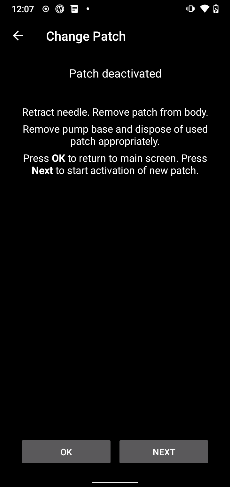
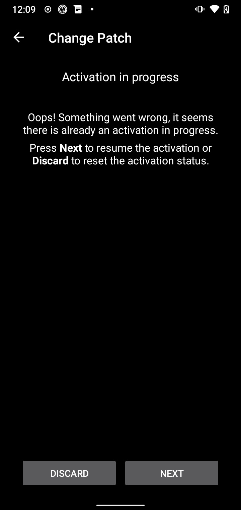
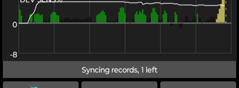

(medtrum-nano-300u)=
# Medtrum Nano 200U / 300U

Estas instrucciones sirven para configurar la bomba de insulina Medtrum.

```{contents} Table of contents
:depth: 1
:local: true
```

## Funciones de la bomba con AAPS
* Todas las funciones del lazo son compatibles (SMB, TBR, etc.)
* Cambio automático de horario de verano y de zona horaria
* El controlador de AAPS no admite el bolo extendido

## Requisitos de hardware y software
* **Bases de bomba y parches con reservorio de Medtrum compatibles**
    - Modelos compatibles ahora:
        - Medtrum TouchCare Nano 200U con bases de bomba ref.: **MD0201** y **MD8201**.
        - Medtrum TouchCare 300U con base de bomba ref.: **MD8301**.
        - Si tienes un modelo no compatible y quieres donar el equipo o ayudar con las pruebas, contacta con nosotros por Discord [aquí](https://discordapp.com/channels/629952586895851530/1076120802476441641).
* **AAPS compilado e instalado** siguiendo las instrucciones de [Compilar AAPS](../SettingUpAaps/BuildingAaps.md).
* **Un teléfono Android compatible** con conexión Bluetooth BLE
    - Consulta las [Notas de la versión](../Maintenance/ReleaseNotes.md) de AAPS

## Antes de empezar

**LA SEGURIDAD ES LO PRIMERO** No hagas este proceso en un lugar donde no puedas solucionar un error (es imprescindible tener parches de reserva, insulina y dispositivos para controlar la bomba).

**El PDM y la app de Medtrum no funcionarán con un parche activado por AAPS.** Antes quizá usabas el PDM o la app de Medtrum para enviar órdenes a tu bomba. Por seguridad, solo puedes usar el parche activado con el dispositivo o la app que lo activó.

*Esto NO significa que debas tirar tu PDM. Se recomienda guardarlo en un lugar seguro como reserva para emergencias, por ejemplo si pierdes el teléfono o AAPS no funciona bien.*

**Tu bomba no deja de administrar insulina cuando no está conectada a AAPS** Las tasas basales por defecto se programan en la bomba tal como están definidas en el perfil activo. Mientras AAPS funcione, enviará órdenes de basal temporal que duran como máximo 120 minutos. Si por algún motivo la bomba no recibe nuevas órdenes (por ejemplo, porque se perdió la comunicación por la distancia entre la bomba y el teléfono), la bomba vuelve a la tasa basal por defecto programada en ella cuando termina la basal temporal.

**El perfil de AAPS no admite tasas basales en periodos de 30 minutos** Si eres nuevo en AAPS y configuras tu perfil basal por primera vez, ten en cuenta que no se admiten tasas basales que empiezan a la media hora, y tendrás que ajustar tu perfil basal para que empiece en la hora en punto. Por ejemplo, si tienes una tasa basal de 1,1 unidades que empieza a las 09:30 y dura 2 horas hasta las 11:30, esto no funcionará. Tendrás que cambiar esta tasa basal de 1,1 unidades a un periodo de 9:00–11:00 o de 10:00–12:00. Aunque el equipo de la bomba Medtrum admite pasos de 30 minutos en el perfil basal, AAPS por ahora no puede tenerlos en cuenta en sus algoritmos.

**AAPS NO admite tasas basales de 0 U/h en el perfil** Aunque la bomba Medtrum admite una tasa basal cero, AAPS usa múltiplos de la tasa basal del perfil para decidir los tratamientos automáticos y por eso no puede funcionar con una tasa basal cero. La tasa basal mínima del perfil es 0,05 U/h.

Puedes conseguir una basal temporal a cero con la función «Desconectar bomba» o con una combinación de Desactivar lazo/basal temporal o Suspender lazo/basal temporal.

## Configuración

```{caution}
Cuando activas un parche con **AAPS**, **DEBES** apagar todos los demás dispositivos que pueden comunicarse con la base de la bomba Medtrum, por ejemplo un PDM activo o la app de Medtrum.
```

### Paso 1: Selecciona la bomba Medtrum

#### Opción 1: Instalaciones nuevas

Si instalas **AAPS** por primera vez, el **Asistente de configuración** te guía en la configuración. Selecciona **Medtrum** cuando llegues al paso **Bomba**.

Si tienes dudas, también puedes seleccionar **Bomba virtual** y seleccionar **Medtrum** más tarde, después de configurar **AAPS** (ver opción 2).


#### Opción 2: La pantalla Configuración

En una instalación existente puedes seleccionar la bomba **Medtrum** en [Configuración > Bomba](#Config-Builder-pump):

Abre el **menú** (☰) arriba a la izquierda, toca **Configuración** > **Bomba** y selecciona la tarjeta **Medtrum**. Solo puede haber una bomba activa a la vez.


Una vez seleccionada, la tarjeta **Medtrum** muestra dos botones, **Ajustes** y **Abrir complemento**:


**Abrir complemento** (o **Administrar → Bomba**) abre la pantalla de la bomba Medtrum. La usas para cambiar parches y ver el estado de la bomba. Antes de activar un parche, se ve así:


(medtrum-step-2)=
### Paso 2: Cambia los ajustes de Medtrum

Toca **Ajustes** en la tarjeta **Medtrum** en **Configuración** > **Bomba**. También puedes tocar el icono del engranaje arriba a la derecha en la pantalla de la bomba Medtrum. Así se abren los **Ajustes de la bomba Medtrum**:


```{note}
Ya no existe el ajuste **Número de serie**. **AAPS** encuentra tu base de bomba con una búsqueda por Bluetooth la primera vez que activas un parche (ver [Paso 3](#medtrum-activate-patch)) y recuerda su número de serie. Para usar otra base de bomba, consulta [Desemparejar](#medtrum-unpair).
```

#### Ajustes de las alarmas

***Por defecto: Pitido.***

Este ajuste cambia la forma en que la bomba te avisa cuando hay una advertencia o un error.

- **Pitido**: el parche pita con las alarmas y advertencias.
- **Silencio**: el parche no te avisa de las alarmas y advertencias.

Nota: en modo silencio, **AAPS** sigue haciendo sonar la alarma, según los ajustes de volumen de tu teléfono. Si no respondes a la alarma, al final el parche pita.

#### Notificación sobre advertencia de la bomba

***Por defecto: activado.***

Este ajuste cambia la forma en que **AAPS** muestra notificaciones para advertencias no críticas de la bomba. Si está activado, se muestra una notificación en el teléfono cuando hay una advertencia de la bomba, por ejemplo:
- Batería baja
- Reservorio bajo (20 unidades)
- El parche caduca pronto

Recomendamos dejarlo activado cuando las alarmas de la bomba están en **Silencio**. En ambos casos, estas advertencias también se muestran en la pantalla de la bomba Medtrum en [Alarmas activas](#medtrum-active-alarms).

(medtrum-patch-expiration)=
#### Caducidad del parche

***Por defecto: activado.***

Este ajuste cambia el comportamiento del parche. Si está activado, el parche caduca a los 3 días y da un aviso sonoro si tienes el sonido activado. A los 3 días y 8 horas, el parche deja de funcionar.

Si este ajuste está desactivado, el parche no te avisa antes de dejar de funcionar. Con el firmware reciente de la base de la bomba, un parche funciona como máximo 5 días.

#### Aviso de expiración de la bomba [horas]

***Por defecto: 72 horas.***

Este ajuste cambia el momento del aviso de caducidad. Si [Caducidad del parche](#medtrum-patch-expiration) está activado, **AAPS** muestra una notificación cuando pasan este número de horas desde la activación.

#### Insulina máxima por hora [Unidades]

***Por defecto: 25 U.***

Este ajuste cambia la cantidad máxima de insulina que se puede administrar en una hora. Si se supera este límite, el parche se suspende y da una alarma. Puedes restablecer la alarma con el botón **Restablecer alarmas** en la pantalla de la bomba, ver [Restablecer alarmas](#nano-reset-alarms).

Pon un valor razonable para tus necesidades de insulina.

#### Insulina máxima diaria [Unidades]

***Por defecto: 80 U.***

Este ajuste cambia la cantidad máxima de insulina que se puede administrar en un día. Si se supera este límite, el parche se suspende y da una alarma. Puedes restablecer la alarma con el botón **Restablecer alarmas** en la pantalla de la bomba, ver [Restablecer alarmas](#nano-reset-alarms).

Pon un valor razonable para tus necesidades de insulina.

#### Escanear por error de conexión

***Por defecto: desactivado.***

Se encuentra en **Ajustes avanzados**.

Activa esto solo si tienes problemas de conexión. Si está activado, el controlador vuelve a buscar la bomba antes de intentar reconectarse a ella. Asegúrate de que el permiso de ubicación de **AAPS** está en «Permitir todo el tiempo».

### Paso 2b: Ajustes de alertas de AAPS

Estos ajustes no forman parte del controlador de Medtrum. Ábrelos con el icono de **Ajustes** (engranaje) arriba a la derecha de la pantalla principal. Consulta [Ajustes](../SettingUpAaps/Preferences.md) para más información.

#### Guardián BT

Abre **Ajustes** > **Bomba**:


**Guardián BT** apaga el Bluetooth del teléfono durante un segundo si **AAPS** no puede conectarse a la bomba. Esto puede ayudar en algunos teléfonos en los que el Bluetooth se bloquea.

Activa este ajuste si a menudo tienes problemas de conexión con tu bomba.

#### Alertas locales

Abre **Ajustes** > **Alertas locales**:


##### Alerta si la bomba no es alcanzable

***Por defecto: activado.***

Este ajuste se activa de forma obligatoria cuando el controlador de Medtrum está activado. Te avisa cuando la bomba no es alcanzable. Esto puede pasar cuando la bomba está fuera de alcance, o cuando no responde por un parche o una base de bomba defectuosos, por ejemplo cuando entra agua entre la base de la bomba y el parche.

Por seguridad, este ajuste no se puede desactivar.

##### Umbral de bomba no alcanzable

***Por defecto: 30 min.***

Este ajuste cambia cuánto tiempo espera **AAPS** antes de avisarte de que la bomba no es alcanzable.

Puedes cambiar este ajuste cuando usas la bomba Medtrum, pero por seguridad recomendamos dejarlo en 30 minutos.

(medtrum-activate-patch)=
### Paso 3: Activa el parche

**Antes de continuar:**
- Ten preparados la base de la bomba Medtrum y un parche con reservorio nuevo.
- Apaga los demás dispositivos que pueden comunicarse con la bomba Medtrum (PDM y app de Medtrum).
- Lo ideal es que **AAPS** esté configurado y que haya un [perfil activado](../DailyLifeWithAaps/ProfileSwitch-ProfilePercentage.md). Si no hay ningún perfil activo, la activación empieza con un paso **Perfil requerido** en el que eliges el perfil que quieres activar.

#### Iniciar la activación

Abre la [pantalla de la bomba Medtrum](#nano-overview) (**Administrar → Bomba**) y toca **Cambiar parche**. Si has configurado la [protección de los ajustes](#Preferences-protection), primero debes introducir tu contraseña o PIN.

Si ya hay un parche activo, se te pide que lo desactives primero, ver [Desactivar el parche](#nano-deactivate-patch).

La activación es un asistente paso a paso. Sigue las instrucciones para llenar y activar un parche nuevo. Toca **Cancelar** en cualquier paso para parar.

```{important}
Pon el parche en el cuerpo e inserta la cánula solo cuando el asistente te lo diga (después de que termine el purgado).
```

Los primeros pasos que ves dependen de tu configuración:

1. **Perfil requerido**: solo si no hay ningún perfil activo. Selecciona el perfil que quieres aplicar y continúa.
2. **Buscar bomba**: solo la primera vez, o después de usar [Desemparejar](#medtrum-unpair). Conecta la base de la bomba a un parche nuevo para encenderla. **AAPS** busca bases de bomba Medtrum cercanas (sus nombres empiezan por `MT`). Toca la tuya en la lista. **AAPS** guarda su número de serie y pasa directamente al llenado del parche.

   

3. **Activar parche**: solo si **AAPS** ya conoce tu base de bomba. La pantalla dice «No hay ningún parche activo. Presiona **Siguiente** para iniciar el proceso de activación». Asegúrate de que la base de la bomba **no** está conectada todavía al parche y toca **Siguiente**.


#### Conectar y llenar el parche


Conecta la base de la bomba al parche, elimina el aire residual y llena el parche con insulina. Se necesitan como mínimo 70 unidades para la activación. La pantalla muestra el nivel del reservorio. No pegues todavía el parche al cuerpo.

Cuando el parche se detecta y está lleno, aparece el botón **Siguiente**. Tócalo.

#### Seleccionar insulina

Este paso solo aparece si tienes más de una insulina configurada en **AAPS**. Selecciona la insulina con la que llenas el parche. **AAPS** aplica un cambio de perfil con esta insulina después de la activación.

#### Purgar el parche


**No** quites el cierre de seguridad. Pulsa hasta la mitad el botón de la aguja del parche y luego toca **Siguiente** para iniciar el purgado.


Espera a que termine el purgado.


Cuando termine el purgado, toca **Siguiente** para continuar.

#### Rotación del sitio

Este paso solo aparece si gestionas los lugares de la bomba con [Rotación del sitio](#Aapsscreens-site-rotation) (ajuste **Gestionar la rotación del lugar de inserción de la bomba**). Elige dónde pones el parche en el cuerpo, o salta este paso.

#### Colocar el parche


Limpia la piel y quita los adhesivos. Quita el cierre de seguridad, pega el parche al cuerpo y pulsa el botón de la aguja para insertar la cánula.

Toca **Siguiente** para activar el parche.

#### Activar el parche


**AAPS** activa la bomba y ajusta la tasa basal inicial. Espera, por favor. Cuando termina la activación, aparece esta pantalla:


```{admonition} Older screenshot
:class: note
Excepto **Buscar bomba**, las capturas de pantalla de la activación de arriba son de una versión anterior de **AAPS** y pueden verse diferentes en **AAPS** 4.
```

Muestra cuántas unidades quedan en el parche. Toca **OK** para volver a la pantalla de la bomba.

```{tip}
Después de una nueva activación, [exporta tus ajustes](../Maintenance/ExportImportSettings.md). Así puedes recuperar esta sesión del parche más tarde, por ejemplo en un teléfono nuevo.
```

(nano-deactivate-patch)=

### Desactivar el parche

Para desactivar el parche activo, abre la [pantalla de la bomba Medtrum](#nano-overview) (**Administrar → Bomba**) y toca **Cambiar parche**.


Se te pide que confirmes que quieres desactivar el parche actual. **Esto no se puede deshacer.** Toca **Siguiente** para desactivar, o **Cancelar** para volver a la pantalla de la bomba.


Si **AAPS** no puede desactivar el parche (por ejemplo, porque la base de la bomba ya se ha quitado del parche), toca **Descartar** para olvidar la sesión del parche actual. Después puedes activar un parche nuevo.



Cuando termina la desactivación, retira la aguja y quita el parche del cuerpo. Quita la base de la bomba y desecha el parche usado. Toca **OK** para volver a la pantalla de la bomba, o **Siguiente** para empezar a activar un parche nuevo.

(nano-resume-interrupted-activation)=

### Reanudar una activación interrumpida

Si se interrumpe la activación de un parche, por ejemplo porque se agota la batería del teléfono, puedes reanudarla. Abre la [pantalla de la bomba Medtrum](#nano-overview) (**Administrar → Bomba**) y toca **Cambiar parche**.



Toca **Siguiente** para reanudar la activación. Toca **Descartar** para restablecer el estado de activación y poder activar un parche nuevo.


```{admonition} Older screenshot
:class: note
Las capturas de pantalla de **Desactivar el parche** y **Reanudar una activación interrumpida** son de una versión anterior de **AAPS** y pueden verse diferentes en **AAPS** 4.
```

El controlador lee el estado de activación de la bomba. Si funciona, el asistente continúa en el paso donde se paró.

(nano-overview)=

## Pantalla de la bomba

La pantalla de la bomba Medtrum (**Administrar → Bomba**) muestra el estado actual del parche Medtrum. También tiene botones para cambiar el parche, restablecer las alarmas y actualizar el estado. Un aviso en la parte superior muestra estados importantes, por ejemplo **Parche no activado** o **Bomba suspendida**.


La pantalla puede mostrar estas filas. Algunas filas solo aparecen cuando tienen un valor.

- **Última conexión**: cuánto tiempo hace que **AAPS** se conectó por última vez a la bomba.
- **Último bolo**: el último bolo administrado.
- **Batería**: la tensión actual de la batería del parche.
- **Reservorio**: el nivel actual del reservorio.
- **Número de serie**: el número de serie de tu base de bomba.
- **Estado de la bomba**: el estado actual de la bomba. Por ejemplo **Activo** (el parche está activado y funciona con normalidad) o **Detenido** (el parche no está activado).
- **Dosis basal base**: la tasa basal de tu perfil que funciona ahora.
- **Basal temporal**: la tasa basal temporal, si hay una en curso.
- **Bolo activo**: el bolo que se está administrando ahora mismo.
- **Alarmas activas**: ver [más abajo](#medtrum-active-alarms).
- **Tipo de bomba**: el modelo de tu base de bomba.
- **Versión de firmware**: la versión del firmware de la base de la bomba.
- **Parche n°**: el número de orden del parche activado. Sube en uno cada vez que activas un parche nuevo.
- **Activación**: la fecha y hora en que se activó el parche, y cuánto tiempo hace de eso.
- **El parche expira**: la fecha y hora en que caduca el parche. Muestra **No habilitado** si [Caducidad del parche](#medtrum-patch-expiration) está desactivado.

(medtrum-active-alarms)=
### Alarmas activas

Esta fila muestra las alarmas que están activas ahora mismo, por ejemplo un reservorio bajo o un parche que va a caducar.

### Actualizar

Este botón actualiza el estado del parche. Solo está disponible cuando hay un parche activo y **AAPS** no está conectado a la bomba en ese momento.

### Cambiar parche

Este botón inicia el asistente para cambiar el parche. Consulta [Activar el parche](#medtrum-activate-patch) para más información.

(medtrum-unpair)=
### Desemparejar

Este botón solo aparece cuando **AAPS** conoce una base de bomba. Borra el número de serie guardado de la base de la bomba y desconecta. La próxima vez que actives un parche, **AAPS** vuelve a buscar una base de bomba (el paso **Buscar bomba**). Usa esto si cambias a otra base de bomba. Hazlo solo cuando no haya ningún parche activo.

(nano-reset-alarms)=

### Restablecer alarmas

El botón **Restablecer alarmas** solo aparece en la pantalla de la bomba cuando el parche se ha suspendido solo, por ejemplo después de una alarma de máximo diario de insulina. Tócalo para restablecer las alarmas y reanudar la administración de insulina.


```{admonition} Older screenshot
:class: note
La captura de pantalla de arriba es de una versión anterior de **AAPS**. En **AAPS** 4 la pantalla de la bomba se ve diferente, pero el botón **Restablecer alarmas** funciona igual.
```

## Cambiar de teléfono, exportar/importar ajustes

Cuando cambies a un teléfono nuevo, haz lo siguiente:
* [Exportar ajustes](../Maintenance/ExportImportSettings.md) en tu teléfono antiguo.
* Pasa el archivo de ajustes del teléfono antiguo al nuevo e impórtalo en **AAPS**. Marca **También reemplazar la configuración de la bomba** en la pantalla de importación; si no, la sesión del parche no se pasa al teléfono nuevo.

El archivo de ajustes importado debe ser de la sesión del parche que usas ahora; si no, el parche no se conectará (ver [Bombas sin tubo](#ExportImportSettings-tubeless-pumps)).

Después de importar los ajustes, el controlador sincroniza el historial con la bomba. Esto puede tardar un rato, según la antigüedad del archivo de ajustes. El progreso («Sincronizando registros, quedan ...») se muestra en la pantalla principal:



(medtrum-nano-troubleshooting)=

## Solucionando problemas

### Problemas de conexión

Si tienes tiempos de espera agotados u otros problemas de conexión:
- En los ajustes de la app de Android para **AAPS**, pon el permiso de ubicación en «Permitir todo el tiempo».
- Prueba a activar **Escanear por error de conexión** (ajustes de Medtrum > **Ajustes avanzados**) y **Guardián BT** (**Ajustes** > **Bomba**), ver [Paso 2](#medtrum-step-2).

### Problemas de Bluetooth
Para problemas conocidos con conexiones Bluetooth, cortes de conexión de la bomba o del pod, o problemas de activación y conexión, consulta [Solución de problemas de Bluetooth](../GettingHelp/BluetoothTroubleshooting.md)

### Activación interrumpida

Si se interrumpe la activación, por ejemplo porque la batería del teléfono se agota o el teléfono falla, puedes reanudarla. Toca **Cambiar parche** en la pantalla de la bomba y sigue los pasos de [Reanudar una activación interrumpida](#nano-resume-interrupted-activation).

### Evitar fallos del parche

El parche puede dar varios errores. Para evitar errores frecuentes:
- Asegúrate de que la base de la bomba está bien encajada en el parche y de que no se ven huecos.
- Al llenar el parche, no hagas demasiada fuerza con el émbolo. No intentes llenar el parche por encima del máximo de tu modelo.

## Dónde obtener ayuda

Todo el desarrollo del controlador de Medtrum lo hace la comunidad de forma **voluntaria**; te pedimos que lo tengas en cuenta y sigas estas pautas antes de pedir ayuda:

-  **Nivel 0:** Lee la sección de esta documentación sobre tu problema, para entender bien cómo debe funcionar la función que te da problemas.
-  **Nivel 1:** Si sigues teniendo problemas que no puedes resolver con este documento, ve al canal *#Medtrum* en **Discord** con [este enlace de invitación](https://discord.gg/4fQUWHZ4Mw).
-  **Nivel 2:** Busca en las incidencias existentes para ver si tu problema ya se ha informado en [Issues](https://github.com/nightscout/AAPS/issues) si existe, confirma, comenta o añade información sobre tu problema. Si no existe, crea una [nueva incidencia](https://github.com/nightscout/AndroidAPS/issues) y adjunta [tus archivos de registro](../GettingHelp/AccessingLogFiles.md).
-  **Ten paciencia: la mayoría de los miembros de nuestra comunidad son voluntarios con buena voluntad, y resolver problemas a menudo requiere tiempo y paciencia tanto de los usuarios como de los desarrolladores.**