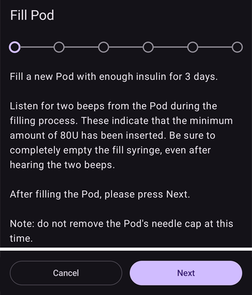
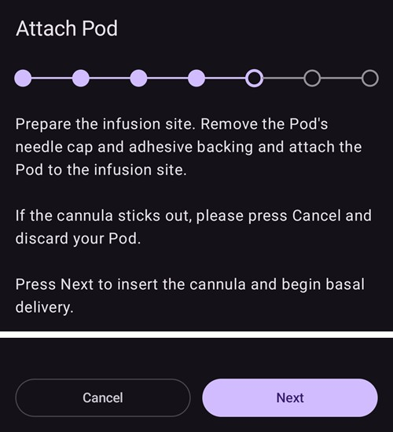
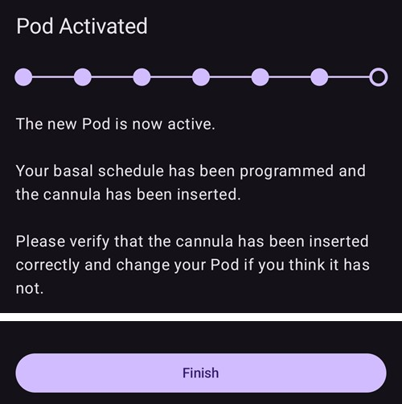
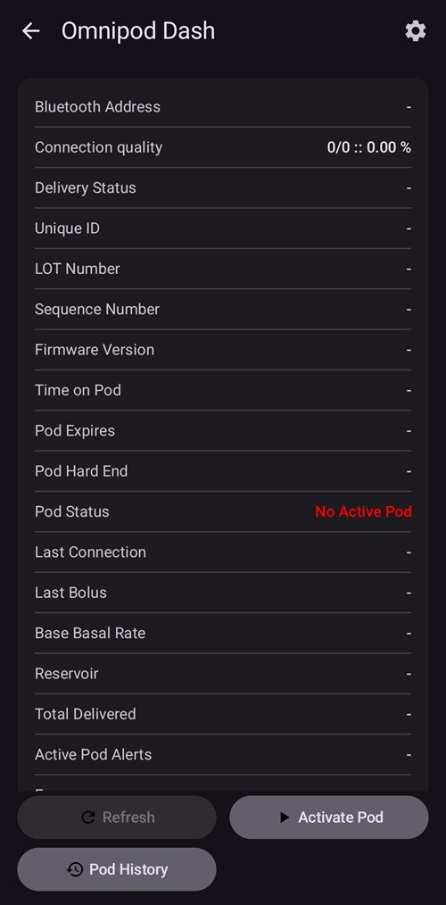
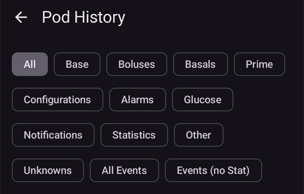
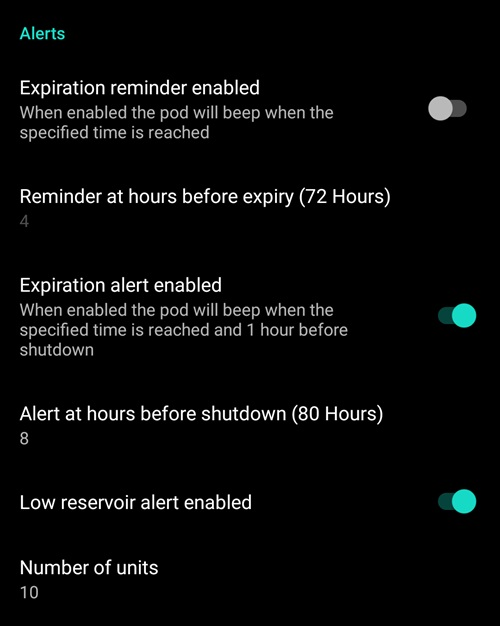

# Omnipod DASH

Estas instrucciones son para configurar la bomba de la generación **Omnipod DASH** **(NO Omnipod Eros)**. El driver de DASH es una forma bien probada de usar el lazo con Omnipod.

```{contents} Table of contents
:depth: 1
:local: true
```

## Especificaciones de Omnipod DASH

Características principales de **Omnipod DASH** («DASH»):

- Los pods DASH se reconocen por la **tapa azul de la aguja** (el pod EROS, más antiguo, tiene una tapa transparente). Por lo demás, los pods son idénticos en tamaño físico.
- DASH no necesita un dispositivo puente BLE (NO hace falta RileyLink, OrangeLink ni EmaLink).
- La conexión Bluetooth de DASH solo se usa al enviar un comando (p. ej. un bolo) y se desconecta justo después de enviarlo.
- **AAPS** esperará a que el pod esté accesible para enviar comandos.
- Al activar un pod, **AAPS** buscará un pod DASH nuevo y se conectará a él.
- Alcance esperado desde el teléfono: 5–10 metros (puede variar).

(omnipod-dash-constraints)=

## Restricciones y problemas conocidos de Omnipod DASH en AAPS
- En general se recomienda usar **AAPS** con Android 14 o 16. La comunidad ha informado de muchos [problemas](https://github.com/nightscout/AndroidAPS/issues/3471) con Android 15. Pero si usas Android 15, probablemente tendrás que activar **Vinculación Bluetooth** (en la sección **Ajustes avanzados** de los [ajustes de Dash](#omnipod-dash-advanced-settings)) para poder activar y usar los pods; consulta [Solución de problemas](../GettingHelp/GeneralTroubleshooting.md) para más información sobre los ajustes de vinculación.
- Los cambios de horario de verano y de zona horaria no se aplican automáticamente. Después de un cambio de hora debes actualizar el pod a mano: pulsa **Actualizar** en la pantalla de la bomba DASH y después pulsa **Ajustar la hora** (aparece cuando la zona horaria del pod y la del teléfono son distintas) o haz un **Cambio de perfil** (consulta [Cambio de zona horaria con Omnipod Dash](#timezone-traveling-with-pumps)).
- Dash solo admite la tasa basal en pasos de 0,05 U/h. Si intentas poner la basal en pasos de 0,01 en tu **perfil de AAPS**, AAPS no mostrará ningún aviso, aunque el pod redondeará la tasa hacia arriba a pasos de 0,05. Si abres **Historial de Pod** en la pantalla de la bomba DASH, verás que se puso una basal de 0,05. Esto también significa que la tasa basal más baja que permite DASH en **AAPS** es 0,05 U/h.
- El archivo de ajustes contiene la sesión del pod activo. Exporta tus ajustes después de cada activación de pod, y lee [Exportar e importar ajustes](#omnipod-dash-export-import) antes de importar ajustes.
- Al poner un nuevo perfil basal, DASH suspende la administración antes de poner el nuevo **Perfil** basal. Si hay una interrupción de la comunicación o un error, el perfil basal no se reinicia automáticamente. Consulta la sección [Reanudar la administración de insulina](#omnipod-dash-resuming-insulin-delivery) para más detalles.
- Si las alertas están configuradas y el pod está a punto de caducar, el pod seguirá pitando hasta que se silencien las alertas; consulta [Silenciar alertas del pod](#omnipod-dash-silencing-pod-alerts) para más detalles.
- Hay varios problemas conocidos con Bluetooth que pueden causar problemas al activar el pod. Consulta [Solución de problemas de Bluetooth](../GettingHelp/BluetoothTroubleshooting.md) para el problema conocido y las soluciones a estos problemas.

(hardware-software-requirements)=

(omnipod-dash-hardware-software-requirements)=
## Requisitos de hardware y software

- Omnipod DASH se reconoce por la tapa azul de la aguja.


- **Un teléfono Android compatible** con Bluetooth de baja energía (BLE) (consulta [Teléfonos](../Getting-Started/Phones.md) para más información); además, la siguiente información te ayudará con otros puntos importantes para activar y usar bien DASH en un teléfono compatible:
    -  El driver Omnipod Dash de **AAPS** se conecta con el pod DASH por Bluetooth.  
      **AAPS** abre automáticamente una nueva conexión Bluetooth con el pod cada vez que necesita enviar un comando (p. ej. un bolo); después de enviar el comando, la conexión Bluetooth se desconecta enseguida.
       - **NOTA:**
         - La conexión Bluetooth puede interrumpirse o verse afectada por otros dispositivos Bluetooth conectados al teléfono que ejecuta **AAPS**, como auriculares, etc. En algunos modelos de teléfono, estos dispositivos pueden causar errores de conexión o problemas al activar el pod. Al elegir el teléfono para usar con Omnipod DASH, es buena idea revisar la lista de [configuraciones de hardware probadas](https://docs.google.com/spreadsheets/u/1/d/e/2PACX-1vScCNaIguEZVTVFAgpv1kXHdsHl3fs6xT6RB2Z1CeVJ561AvvqGwxMhlmSHk4J056gMCAQE02sAWJvT/pubhtml?gid=683363241&single=true), que funcionan bien.
         - Hay varios problemas conocidos con Bluetooth que pueden causar problemas al activar el pod (consulta [Solución de problemas](#troubleshooting) para consejos sobre otros problemas de Bluetooth), en concreto la sección [Problemas relacionados con Bluetooth](#omnipod-dash-bluetooth-related-issues).
    - El teléfono debe tener **Android 12 o más nuevo**, con **AAPS** compilado e instalado según las instrucciones de [**Compilar AAPS**](../SettingUpAaps/BuildingAaps.md). Usa siempre la última versión publicada.
- Un [**monitor continuo de glucosa (MCG)**](../Getting-Started/CompatiblesCgms.md) compatible

Las instrucciones de abajo explican cómo activar una nueva sesión de pod con **AAPS**. Espera a que tu pod actual esté cerca de caducar, porque tendrás que activar un pod nuevo con **AAPS**. Cuando un pod se desactiva, no se puede volver a usar ni a activar: la desactivación es definitiva.

## Antes de empezar

Asegúrate de haber leído y entendido toda esta guía, la sección **Antes de empezar** y también **[Restricciones y problemas de Omnipod y AAPS](#omnipod-dash-constraints)**, para no encontrarte con un problema conocido.

### **LA SEGURIDAD ES LO PRIMERO**: **NO DEBES** intentar conectar **AAPS** a un pod por primera vez sin tener a mano todo lo siguiente:
1. Pods de reserva (3 o más)
2. Insulina de reserva y material para múltiples inyecciones diarias (MDI)
3. Un PDM de Omnipod que funcione (por si **AAPS** falla)
4. ¡Es obligatorio usar un teléfono compatible! (Consulta [Requisitos de hardware y software](#hardware-software-requirements))
5. La versión correcta de AAPS compilada e instalada

### Tu PDM de Omnipod Dash ya no será necesario después de que el driver Dash de AAPS active tu pod.
- Antes de usar **AAPS**, tú o tu cuidador manejabais el pod con el PDM de Omnipod (o en algunas regiones con una app del teléfono) para enviar comandos a tu DASH (p. ej. un bolo).
- DASH solo admite la conexión de un único dispositivo Bluetooth (p. ej. PDM o teléfono) para manejarlo y enviarle comandos.
- El dispositivo que activa el pod con éxito es, desde ese momento, el único que puede comunicarse con ese pod. Esto significa que, cuando activas un DASH con tu teléfono Android usando **AAPS**, **¡ya no podrás usar tu PDM con ese pod!** Mientras ese pod esté activo, el driver Dash de **AAPS** en tu teléfono Android es el nuevo PDM de tu pod.
- **¡NO tires tu PDM!** Se recomienda guardarlo como reserva y para emergencias, por ejemplo si pierdes el teléfono o **AAPS** no funciona bien.

### Tu pod **NO** deja de administrar insulina cuando no está conectado a AAPS.
Al activar el pod, se programan en él las tasas basales por defecto según el [**Perfil**](../SettingUpAaps/YourAapsProfile.md) activo actual.  
Mientras **AAPS** funcione, enviará comandos de ajuste de la tasa basal que duran como máximo 120 minutos.  
Si por algún motivo el pod no recibe comandos nuevos (por ejemplo, porque se perdió la comunicación por la distancia entre el pod y el teléfono), el pod vuelve automáticamente a las tasas basales por defecto definidas en tu [**Perfil**](../SettingUpAaps/YourAapsProfile.md).

### Los perfiles de AAPS no admiten periodos de tasa basal de 30 minutos
Si eres nuevo en **AAPS** y vas a configurar tu [**Perfil**](../SettingUpAaps/YourAapsProfile.md) de tasa basal por primera vez, ten en cuenta que no se admiten tasas basales que empiecen a la media hora. Por ejemplo, si en tu PDM de Omnipod tienes una tasa basal de 1,1 unidades que empieza a las 09:30 y dura 2 horas hasta las 11:30, no es posible copiar exactamente este **Perfil** basal en **AAPS**.  
Tendrás que cambiar esta tasa basal de 1,1 unidades a un periodo de 9:00–11:00 o de 10:00–12:00. Aunque el hardware de DASH admite pasos de 30 minutos en el **Perfil** de tasa basal, **AAPS** NO admite esta función.

### Las tasas basales de 0 U/h en el perfil NO se admiten en AAPS
Aunque DASH admite una tasa basal de cero, **AAPS** usa múltiplos de la tasa basal del **Perfil** del usuario para calcular el tratamiento automático; no puede funcionar con una tasa basal de cero.  
En su lugar, se puede conseguir una tasa basal temporal de cero con la función «Desconectar bomba», o combinando Desactivar lazo/Tasa basal temporal o Suspender lazo/Tasa basal temporal.  
**NOTA:** La tasa basal más baja que permite DASH en **AAPS** es 0,05 U/h.

## Seleccionar Dash en AAPS

Hay **dos** formas de seleccionar el driver de Omnipod DASH en **AAPS**:

### Opción 1: Instalaciones nuevas

Cuando instalas **AAPS** por primera vez, el **Asistente de configuración** te guía por las funciones principales y los requisitos de instalación de **AAPS**. Cuando llegues al paso **Bomba**, selecciona **Omnipod Dash**.


Si todavía no estás seguro, puedes seleccionar **Bomba virtual** por ahora y seleccionar **Omnipod Dash** más tarde, después de configurar **AAPS** (consulta la opción 2).

(omnipod-dash-option-2-config-builder)=
### Opción 2: La pantalla Configuración

En una instalación existente puedes seleccionar la bomba **Omnipod Dash** en la pantalla **Configuración**:

1. Abre el **menú** (☰) en la esquina superior izquierda de la pantalla principal y selecciona **Configuración**.
2. Toca **Bomba** y marca el botón de opción de **Omnipod Dash** (*«Integración de bombas de insulina Omnipod Dash (el nuevo modelo, con bluetooth habilitado de tapa azul)»*).

3. Cuando está seleccionada, la tarjeta **Omnipod Dash** muestra dos botones:
   - **Ajustes** abre los [ajustes de Dash](#omnipod-dash-settings).
   - **Abrir complemento** abre la [pantalla de la bomba DASH](#omnipod-dash-tab).

   

### Comprobar la selección del driver de Omnipod

Para comprobar que **Omnipod Dash** está seleccionada, abre **Administrar** (navegación inferior de la pantalla principal) y toca **Bomba**. Se abre la pantalla de la bomba DASH, como se ve en la siguiente sección.

(omnipod-dash-tab)=

## La pantalla de la bomba DASH

En la pantalla de la bomba DASH manejas tus pods: activarlos y desactivarlos, actualizar el estado del pod, silenciar alertas y ver el historial del pod. Ábrela con **Administrar** > **Bomba**, o con **Abrir complemento** en la tarjeta **Omnipod Dash** de **Configuración** > **Bomba**.

Esta es la pantalla sin un pod activo:


Y esta es la pantalla con un pod activo:


El icono **Ajustes** (engranaje) de la esquina superior derecha abre los [ajustes de Dash](#omnipod-dash-settings).

***NOTA:** Si un campo de la pantalla de la bomba muestra (incierto), pulsa **Actualizar** para actualizar el estado del pod.*

### Campos

- **Dirección bluetooth:** La dirección Bluetooth del pod.

- **Calidad de la conexión:** Lo fiable que es la conexión de **AAPS** con el pod, mostrado como *conexiones con éxito / todos los intentos de conexión :: tasa de éxito*, por ejemplo `412/420 :: 98.10 %`. Después de más de 50 conexiones con éxito, el valor se pone amarillo por debajo del 90 % y rojo por debajo del 70 %. Un valor bajo indica un problema de Bluetooth (consulta [Problemas relacionados con Bluetooth](#omnipod-dash-bluetooth-related-issues)).

- **Estado de entrega:** El estado de administración sin procesar que informa el pod. Este campo solo se muestra en compilaciones con modo de ingeniería.

- **ID Único:** El ID único que **AAPS** dio al pod durante la activación.

- **Número de Lote:** El número de lote de fabricación del pod.

- **Número de secuencia:** El número de secuencia del pod.

- **Versión de Firmware:** Las versiones del firmware y de Bluetooth del pod.

- **Hora en el Pod:** La hora actual del pod, con su zona horaria. El texto se pone rojo cuando la zona horaria del pod es distinta de la del teléfono, y amarillo cuando la hora del pod difiere en más de 10 minutos.

- **El Pod caduca:** La fecha y hora en que caduca el pod (72 horas después de la activación). El texto se pone amarillo en las últimas 4 horas antes de esa hora. Nunca se pone rojo, porque el pod sigue administrando insulina después.

- **Fin de vida del Pod:** El final del periodo de gracia del pod (8 horas después de **El Pod caduca**, para una vida máxima del pod de 80 horas). El texto se pone amarillo cuando empieza el periodo de gracia (en **El Pod caduca**) y rojo en las últimas 4 horas antes del fin de vida. Durante el periodo de gracia también muestra el tiempo que queda, por ejemplo *(17m restantes)*. El pod deja de administrar insulina al llegar al fin de vida y hay que cambiarlo.

- **Estado del Pod:** El estado del pod: **Ningún Pod activo**, **Configuración en curso**, **Funcionando**, **Suspendido** o, después de un fallo del pod, **ALARM**.

- **Última conexión:** Hace cuánto tiempo se comunicó **AAPS** con el pod por última vez.

  - *Hace un momento*: hace menos de 10 segundos.

  - *Hace menos de un minuto*: hace entre 10 y 60 segundos.

  - *hace XX minutos*: hace más de 1 minuto (y *hace X horas y XX minutos* después de una hora).

- **Último bolo:** La cantidad del último bolo enviado al pod y hace cuánto tiempo se administró. Un bolo no confirmado se marca como (incierto).

- **Tasa basal base:** La tasa basal programada para la hora actual en tu **Perfil** basal.

- **Tasa basal temporal:** La tasa basal temporal (TBR) que está en curso, con su hora de inicio y su duración. Este campo solo se muestra mientras hay una TBR en curso.

- **Reservorio:** Muestra *Más de 50 U restantes* cuando quedan más de 50 unidades en el reservorio. Por debajo de 50 unidades se muestra la cantidad exacta. El valor se pone rojo por debajo de 20 unidades.

- **Total entregado:** La cantidad total de insulina administrada desde el reservorio. Incluye la insulina usada para el cebado.

- **Alertas de Pod activas:** Alertas que están activas en el pod, por ejemplo *Pod a punto de caducar* o *Reservorio bajo*.

- **Errores:** El fallo del pod, si el pod ha fallado, mostrado en rojo como *Error del Pod:* seguido del código y el nombre del fallo, por ejemplo *Error del Pod: 020 ALARM_OCCLUDED*. Revisa el [Historial de Pod](#omnipod-dash-view-pod-history) y los archivos de registro para ver errores anteriores e información más detallada. Consulta [Fallos del pod](#omnipod-dash-pod-failures).

- **Notificación del PDM:** Solo se muestra después de un fallo del pod. Muestra el fallo como lo habría mostrado el PDM de Omnipod: un título (por ejemplo *Oclusión detectada*, *Depósito vacío* o *POD caducado*), lo que pasó (por ejemplo *Administración de insulina detenida. Cambia el POD ahora*) y un código *Ref:*.

### Botones

Los botones de la parte inferior de la pantalla de la bomba cambian según el estado del pod. Solo se muestran los botones que tienen sentido en ese momento.

- **Actualizar:** Pide al pod su estado actual.
  - *Úsalo para actualizar el estado del pod y para limpiar los campos que muestran (incierto).*
  - *Consulta la sección [Solución de problemas](#omnipod-dash-troubleshooting) más abajo para más información.*

- **Silenciar alertas:** Para los pitidos de alerta del pod (por ejemplo, caducidad del pod o reservorio bajo). Solo se muestra mientras el pod tiene una alerta activa. Consulta [Silenciar alertas del pod](#omnipod-dash-silencing-pod-alerts).

- **Reanudar la entrega:** Reanuda la administración de insulina en un pod suspendido. Solo se muestra cuando la administración está suspendida. Consulta [Reanudar la administración de insulina](#omnipod-dash-resuming-insulin-delivery).

- **Ajustar la hora:** Pone el pod en la zona horaria de tu teléfono enviando otra vez tu **Perfil** basal. Solo se muestra cuando la zona horaria del pod es distinta de la de tu teléfono.

- [**Activar Pod**](#omnipod-dash-activate-pod): ceba y activa un pod nuevo. Se muestra cuando no hay ningún pod activo.

- [**Desactivar Pod**](#omnipod-dash-deactivate-pod): Desactiva el pod activo. Se muestra en cuanto un pod está emparejado con **AAPS**, también cuando una activación se paró a medias (por ejemplo, porque el pod falló durante la activación). **AAPS** te pide confirmación antes de desactivar el pod.

- **Reproducir sonido de prueba:** Hace que el pod emita un solo pitido de prueba.

- [**Historial de Pod**](#omnipod-dash-view-pod-history): Muestra el historial de actividad del pod activo.

- **Descartar Pod:** Quita de **AAPS** un pod sin terminar. Solo se muestra cuando una activación de pod se paró a medias. **AAPS** te pide confirmación. Después de descartarlo, **AAPS** ya no puede comunicarse con ese pod: quítatelo del cuerpo.


```{admonition} Older screenshot
:class: note
La captura de pantalla de arriba es de una versión anterior de **AAPS**, que tenía un menú **Gestión del Pod** (Pod Management) separado. En **AAPS** 4 todas estas acciones, incluidas **Activar Pod**, **Desactivar Pod**, **Reproducir sonido de prueba** e **Historial de Pod**, son botones con texto directamente en la pantalla de la bomba.
```

(omnipod-dash-activate-pod)=

## Activar Pod

1. Abre la pantalla de la bomba DASH (**Administrar** > **Bomba**) y pulsa **Activar Pod**. Se abre el asistente de activación.

   

   ```{admonition} Older screenshot
   :class: note
   La captura de pantalla de arriba es de una versión anterior de **AAPS**. En **AAPS** 4, **Activar Pod** es un botón directamente en la pantalla de la bomba DASH, en lugar de estar en el menú **Gestión del Pod**.
   ```

   Si nunca has activado un **Perfil** en **AAPS**, el asistente muestra primero el paso **Perfil requerido**: selecciona el perfil que se aplicará en la activación y continúa.

2. Se muestra el paso **Llenar Pod**. Llena un pod nuevo con insulina suficiente para 3 días, **al menos 80 unidades**. Escucha dos pitidos del pod: significan que se ha llenado la cantidad mínima de 80 unidades. Vacía la jeringa de llenado por completo, también después de oír los dos pitidos. No quites todavía la tapa de la aguja del pod.

   ***NOTA:** Al calcular la cantidad de insulina que necesitas para 3 días, recuerda que el cebado del pod usa unas 3–10 unidades.*

   

   

   Asegúrate de que el pod nuevo y el teléfono con **AAPS** están cerca uno del otro y pulsa **Siguiente**.

3. Si usas más de una insulina en **AAPS**, se muestra el paso **Seleccionar insulina**. Muestra la insulina **Activo actualmente**. Si llenaste el pod con otra insulina, pulsa **Cambiar** y selecciónala. **AAPS** aplica un **Cambio de perfil** con esta insulina cuando termina la activación. Pulsa **Siguiente**.

   

4. En el paso **Inicializar Pod**, **AAPS** se empareja con el pod nuevo y lo ceba. Oirás un clic seguido de una serie de tictacs mientras el pod se ceba. Cuando termina con éxito, aparece el botón **Siguiente**. Pulsa **Siguiente**.

       

   ***NOTA**: Si aparece un mensaje de error como _Error de escaneo_ o _'Could not find an available pod for activation'_ (puede pasar), no te asustes. Pulsa **Reintentar**. En la mayoría de los casos, la activación sigue después sin problemas.*

   

   Si el pod ha fallado (por ejemplo, porque se superó su tiempo de activación), se muestra **Desactivar Pod** en lugar de **Reintentar**. Úsalo y empieza otra vez con un pod nuevo.

   Si pulsas **Cancelar** antes de que termine la activación, **AAPS** te pide confirmar que quieres salir. Pulsa **OK** para salir del asistente, o **Cancelar** para quedarte.

   

5. Si gestionas la rotación del lugar de inserción en **AAPS** (**Gestionar la rotación del lugar de inserción de la bomba** en los ajustes de [Rotación del sitio](#Aapsscreens-site-rotation)), se muestra el paso **Ubicación de la zona**. Selecciona en el diagrama del cuerpo dónde vas a colocar el pod y pulsa **Siguiente**, o pulsa **Omitir**.

   

6. Después, prepara el lugar de infusión para el pod nuevo. Lávate las manos para evitar cualquier riesgo de infección. Limpia el lugar de infusión con agua y jabón o con una toallita con alcohol, y deja que la piel se seque al aire por completo antes de seguir. Si el adhesivo te irrita la piel, puedes usar una toallita o un spray de barrera.

   En el paso **Insertar el Pod**, quita la tapa azul de plástico de la aguja del pod. Si la cánula u otra cosa sobresale del pod, o si tiene un aspecto raro, **PARA**: pulsa **Cancelar** y empieza otra vez con un pod nuevo. Si todo está **bien**, quita el papel blanco del adhesivo y pega el pod en el lugar elegido del cuerpo.

   Cuando termines, pulsa **Siguiente**.

   

7. Aparece un diálogo de confirmación: *Al pulsar OK, se insertará la cánula.* **¡Pulsa OK SOLO si estás listo para insertar la cánula!**

   

8. En el paso **Insertar cánula**, **AAPS** programa tu horario basal y el pod inserta la cánula. Esto puede tardar un poco (como máximo 1–2 minutos). **¡Ten paciencia!**

   ***NOTA:** Es buena práctica pellizcar la piel cerca del punto de inserción de la cánula antes de que se inserte. Esto ayuda a que la aguja entre suavemente y reduce la posibilidad de oclusiones (bloqueos).*

       

9. Cuando la cánula se ha insertado con éxito, aparece el botón **Siguiente**. Pulsa **Siguiente**.

   

10. Se muestra el paso **Pod activado**. Comprueba que la cánula se ha insertado bien, y cambia el pod si crees que no.

    Pulsa **Finalizar**.

    ¡Enhorabuena! Has iniciado una nueva sesión de pod.

    

11. Vuelves a la pantalla de la bomba DASH. Ahora muestra la información de tu pod activo, incluidos la tasa basal actual, el nivel del reservorio, la insulina administrada, los errores del pod y las alertas. **Activar Pod** se sustituye por **Desactivar Pod**: no puedes activar otro pod sin desactivar antes el pod activo.

    ***NOTA:** Para más detalles sobre la información que se muestra, consulta [La pantalla de la bomba DASH](#omnipod-dash-tab).*

    

    ***NOTA:** Es buena práctica exportar tus ajustes DESPUÉS de activar el pod. Exporta tus ajustes después de cada cambio de pod y una vez al mes. Copia el archivo de ajustes exportado a un almacenamiento en la nube (por ejemplo Google Drive) o a otro lugar fuera de tu teléfono, por si lo pierdes (consulta [**Exportar ajustes**](../Maintenance/ExportImportSettings.md)).*

Si una activación anterior se paró después de cebar el pod, al pulsar **Activar Pod** se continúa desde el paso **Insertar el Pod**.

(omnipod-dash-deactivate-pod)=

## Desactivar Pod

En condiciones normales, un pod dura tres días (72 horas), más un periodo de gracia de 8 horas después del aviso de caducidad del pod: 80 horas en total.

Para desactivar un pod (porque ha caducado o porque ha fallado):

1. Abre la pantalla de la bomba DASH (**Administrar** > **Bomba**) y pulsa **Desactivar Pod**.

   

2. En el paso **Desactivar Pod**, pulsa **Siguiente**. Un diálogo pregunta *Un POD desactivado no se puede volver a utilizar. ¿Quieres desactivar este POD ahora?* Pulsa **OK** para empezar a desactivar el pod, o **Cancelar** para conservarlo. La desactivación suspende toda la administración de insulina y no se puede deshacer.

   

3. Se muestra el paso **Desactivando el Pod** mientras **AAPS** desactiva el pod. El pod pita para confirmar que la desactivación se hizo con éxito.

   

   ```{admonition} Older screenshot
   :class: note
   La captura de pantalla de arriba es de una versión anterior de **AAPS**. En **AAPS** 4, el asistente muestra su progreso como una fila de puntos arriba, en lugar de una barra de progreso.
   ```

   Cuando la desactivación termina con éxito, aparece el botón **Siguiente**. Pulsa **Siguiente**.

   

   Si la desactivación falla, se muestran un mensaje de error y un botón **Descartar Pod**. Lee [Descartar un pod](#omnipod-dash-discard-pod) más abajo antes de usarlo. También puedes pulsar **Cancelar** e intentar **Desactivar Pod** otra vez más tarde.

4. Se muestra el paso **Pod desactivado**. Quítate el pod del cuerpo y pulsa **Finalizar**.

   

5. Vuelves a la pantalla de la bomba DASH. Comprueba que el campo **Estado del Pod** muestra **Ningún Pod activo** y que el botón **Activar Pod** se muestra de nuevo.

   

(omnipod-dash-discard-pod)=

### Descartar un pod

Descarta un pod solo cuando toda la comunicación con él sigue fallando. Si **AAPS** todavía puede comunicarse con el pod, usa **Desactivar Pod** en su lugar.

- **AAPS** te pide confirmación antes de descartar el pod.
- Después de eso, **AAPS** ya no puede comunicarse con ese pod.
- **La administración de insulina NO se ha suspendido**, porque el pod no se desactivó correctamente. **¡Quítate el pod del cuerpo!**
- El paso **Pod descartado** confirma que el estado del pod se ha descartado. Pulsa **Finalizar**. Ahora puedes activar un pod nuevo.

(omnipod-dash-resuming-insulin-delivery)=

## Reanudar la administración de insulina

**NOTA**: Durante los **Cambios de perfil**, igual que con el PDM, **AAPS** debe suspender la administración en el pod antes de poner el nuevo **Perfil** basal. Si la comunicación falla entre los comandos de suspender y reanudar, la administración puede quedar suspendida. Lee [**Administración suspendida**](#omnipod-dash-delivery-suspended) en la sección de solución de problemas para más detalles.

Cuando la administración de insulina está suspendida, tienes que decirle al pod que la reanude. Cuando el comando se procesa con éxito, el pod vuelve a administrar insulina con la tasa basal de la hora actual de tu **Perfil** basal activo. El pod vuelve a aceptar comandos de bolo, **TBR** y **SMB**.

1. Abre la pantalla de la bomba DASH y comprueba que el campo **Estado del Pod** muestra **Suspendido**. Pulsa **Reanudar la entrega** para decirle al pod que reanude la administración normal de insulina.

   

2. Cuando el comando tiene éxito, el campo **Estado del Pod** muestra **Funcionando** y el botón **Reanudar la entrega** desaparece.

   

   

   ```{admonition} Older screenshot
   :class: note
   Las capturas de pantalla de arriba son de una versión anterior de **AAPS**, que mostraba un diálogo de confirmación. En **AAPS** 4 compruebas el resultado en la pantalla de la bomba DASH: el campo **Estado del Pod** muestra **Funcionando** y el botón **Reanudar la entrega** ya no está.
   ```

   Si el comando falla, **AAPS** muestra un diálogo de aviso que empieza con *Error al reanudar la entrega*. Pulsa **Actualizar** e inténtalo otra vez.

   

(omnipod-dash-silencing-pod-alerts)=

## Silenciar alertas del pod

Esta sección explica cómo parar los pitidos del pod cuando el pod se acerca al final de su vida. Cuándo empiezan estos pitidos depende de los ajustes de **Alertas** (consulta [Ajustes de Dash](#omnipod-dash-settings)):

- **Recordatorio horas antes de la expiración (72 horas):** cuántas horas antes de la caducidad a las 72 horas empieza a pitar el pod.
- **Alerta horas antes del apagado (80 horas):** cuántas horas antes del apagado a las 80 horas vuelve a pitar el pod.

La vida máxima de un pod es de 80 horas (3 días y 8 horas). Pero el fabricante del pod recomienda no pasar de 72 horas (3 días).

***NOTA**: El botón **Silenciar alertas** solo se muestra en la pantalla de la bomba DASH mientras el pod tiene una alerta activa, por ejemplo caducidad del pod o reservorio bajo. Si no se muestra el botón **Silenciar alertas** pero oyes pitar el pod, pulsa **Actualizar**.*

1. Cuando llega la hora del recordatorio, el pod pita para decirte que caducará pronto y que tienes que cambiarlo. En la pantalla de la bomba DASH, el campo **El Pod caduca (1)** muestra la hora exacta en que caducará el pod (72 horas después de la activación). El texto se pone amarillo 4 horas antes de esa hora. Después, **Fin de vida del Pod** se pone amarillo y muestra el tiempo que queda hasta que el pod deje de administrar insulina. El campo **Alertas de Pod activas (2)** muestra **Pod a punto de caducar** y se muestra el botón **Silenciar alertas (3)**.

   

2. Pulsa **Silenciar alertas**. **AAPS** envía al pod el comando para parar los pitidos de caducidad.

   

   ```{admonition} Older screenshot
   :class: note
   La captura de pantalla de arriba es de una versión anterior de **AAPS**, en la que esta pantalla era la pestaña **DASH**. En **AAPS** 4 el botón **Silenciar alertas** está en la pantalla de la bomba DASH (**Administrar** > **Bomba**).
   ```

3. Cuando las alertas se han silenciado, la alerta ya no se muestra en el campo **Alertas de Pod activas**, el botón **Silenciar alertas** desaparece y el pod deja de dar los pitidos de caducidad.

   

   ```{admonition} Older screenshot
   :class: note
   La captura de pantalla de arriba es de una versión anterior de **AAPS**, que mostraba un diálogo de confirmación. En **AAPS** 4 compruebas el resultado en la pantalla de la bomba DASH: la alerta ya no está en el campo **Alertas de Pod activas**.
   ```

   Si el comando falla, **AAPS** muestra un diálogo de aviso que empieza con *Error al silenciar las alertas*. Pulsa **Actualizar** e inténtalo otra vez.

La alerta de reservorio bajo funciona igual. Cuando la insulina que queda en el pod baja al **Número de unidades** configurado en los ajustes de **Alertas**, el pod pita. El campo **Reservorio** muestra la cantidad que queda, el campo **Alertas de Pod activas** muestra **Reservorio bajo** y se muestra el botón **Silenciar alertas**. Pulsa **Silenciar alertas** para parar los pitidos y planifica tu próximo cambio de pod.


(omnipod-dash-view-pod-history)=

## Ver el historial del pod

Esta sección explica cómo ver el historial de tu pod activo y filtrarlo por tipo de acción. El historial del pod muestra los comandos enviados a tu pod activo y sus resultados durante su vida de tres días (72–80 horas).

Es útil para revisar los bolos, las TBR y los comandos de basal que se enviaron al pod. Las otras categorías ayudan a solucionar problemas y muestran el orden de los eventos que llevaron a un fallo.

**NOTA:** **Solo el último comando puede ser incierto**. Los comandos nuevos *no se envían* hasta que el **último comando «incierto» pasa a «confirmado» o «rechazado»**. Para «arreglar» un comando incierto, pulsa **Actualizar** en la pantalla de la bomba DASH.

1. Abre la pantalla de la bomba DASH y pulsa **Historial de Pod**.

   

   ```{admonition} Older screenshot
   :class: note
   La captura de pantalla de arriba es de una versión anterior de **AAPS**. En **AAPS** 4, **Historial de Pod** es un botón directamente en la pantalla de la bomba DASH, en lugar de estar en el menú **Gestión del Pod**.
   ```

2. La pantalla **Historial de Pod** se abre con el filtro **Todo** seleccionado. Muestra cada comando con su hora y su resultado, primero los más nuevos, agrupados por día. Usa los botones de filtro de arriba (por ejemplo **Bolos** o **Basales**) para mostrar solo un tipo de comando. Pulsa la flecha atrás para volver a la pantalla de la bomba DASH.

    

   ```{admonition} Older screenshot
   :class: note
   La segunda captura de pantalla de arriba es de una versión anterior de **AAPS**, en la que el tipo de comando se elegía en una lista **Type**. En **AAPS** 4 usas los botones de filtro que se ven en la primera captura de pantalla.
   ```

   En los bolos, después de la cantidad aparece el tipo de bolo cuando no es un bolo normal, por ejemplo *0,05 U (SMB)* o *0,05 U (Corrección basal)*. Una corrección basal es un bolo muy pequeño (un pulso del pod, 0,05 U) que el driver envía por sí solo; tú no lo pediste.

   ```{admonition} Why basal corrections happen
   :class: note
   El pod administra la insulina basal en pulsos de 0,05 U, marcados por un reloj interno. Cada vez que cambia la tasa basal (por ejemplo, cuando el lazo pone una nueva **TBR**), el pod reinicia este reloj, y se pierde el pulso que estaba contando. Como el lazo cambia la tasa basal a menudo, sobre todo por la noche, el pod puede acabar administrando menos insulina basal de la esperada.

   **AAPS** compara la insulina basal que el pod informa como administrada con la que debería haber administrado. Cuando la falta llega a medio pulso o más, el driver administra un pulso extra como corrección basal, para que recibas igualmente la insulina basal que pidieron tu perfil y el lazo. No se envía ninguna corrección mientras el pod está suspendido o mientras hay una **TBR** a cero en curso.
   ```

(omnipod-dash-settings)=

## Ajustes de Dash

Hay dos formas de abrir los ajustes del driver de Dash:

- Pulsa el icono **Ajustes** (engranaje) en la esquina superior derecha de la [pantalla de la bomba DASH](#omnipod-dash-tab).
- Abre el **menú** (☰) en la esquina superior izquierda de la pantalla principal y selecciona **Configuración** > **Bomba**. En la tarjeta **Omnipod Dash**, pulsa **Ajustes**.

Los ajustes están agrupados en cuatro secciones desplegables: **Sonido de confirmación**, **Alertas**, **Notificaciones** y **Ajustes avanzados**. Toca una sección para abrirla:


La mayoría de los ajustes son interruptores de encendido/apagado.

### Sonido de confirmación


Pitidos de confirmación del pod para la administración y los cambios de bolo, basal, SMB y TBR.

**Sonidos de bolo habilitados:**    El pod pita cuando se administra un bolo. Activado por defecto.

**Sonidos de basales habilitados:**    El pod pita cuando se pone una nueva tasa basal, o cuando la tasa basal activa se cancela o se cambia. Desactivado por defecto.

**Sonidos de SMB habilitados:**  El pod pita cuando se administra un SMB. Activado por defecto.

**Sonidos de TBR activados:**  El pod pita cuando se pone o se cancela una TBR. Desactivado por defecto.

### Alertas



```{admonition} Older screenshot
:class: note
La captura de pantalla de arriba es de una versión anterior de **AAPS**. En **AAPS** 4 estos ajustes están en la sección desplegable **Alertas**.
```

Alertas del pod para la caducidad, el apagado y el reservorio bajo. Cuando cambias estos ajustes con un pod activo, **AAPS** envía los nuevos ajustes de alerta al pod.

***NOTA:** SIEMPRE se muestra una notificación de **AAPS** para cualquier alerta, en cuanto **AAPS** se ha comunicado con el pod después de que saltara la alerta. Descartar la notificación NO para la alerta del pod. Para parar la alerta, abre la pantalla de la bomba DASH y pulsa **Silenciar alertas**.*

**Recordatorio de expiración activado:**    Si está activado, el pod pita cuando llega la hora del recordatorio. Activado por defecto.

**Recordatorio horas antes de la expiración (72 horas):** Cuántas horas antes de la caducidad del pod a las 72 horas empieza el recordatorio (de 1 a 24 horas; por defecto 4).

**Alerta de expiración activada:**   Si está activado, el pod pita cuando llega la hora de la alerta, y otra vez 1 hora antes del apagado. Activado por defecto.

**Alerta horas antes del apagado (80 horas):**  Cuántas horas antes del apagado del pod a las 80 horas empieza la alerta (de 1 a 8 horas; por defecto 8).

**Alerta de reservorio bajo habilitada:**    El pod te avisa cuando la insulina que queda en el reservorio baja al valor de **Número de unidades**. Activado por defecto.

**Número de unidades:**    El número de unidades al que salta la alerta de reservorio bajo (de 5 a 50 unidades; por defecto 20).

### Notificaciones


Elige si **AAPS** reproduce un sonido con sus notificaciones cuando no está seguro de si se administró una TBR, un SMB o un bolo, y cuando la administración está suspendida.

***NOTA:** Son solo notificaciones del teléfono; el pod no pita.*

**Sonido para notificaciones TBR inciertas habilitadas:**  Reproduce un sonido con la notificación cuando **AAPS** no está seguro de si se puso una TBR.

**Sonido de notificaciones de SMB inciertos habilitado:**  Reproduce un sonido con la notificación cuando **AAPS** no está seguro de si se administró un SMB.

**Sonido para notificaciones de bolo incierto activadas:**    Reproduce un sonido con la notificación cuando **AAPS** no está seguro de si se administró un bolo.

**Sonido cuando la notificación de entrega suspendida está activada:**     Reproduce un sonido con la notificación cuando la administración de insulina está suspendida.

(omnipod-dash-advanced-settings)=

### Ajustes avanzados


**Vinculación Bluetooth:**  Vincula el pod con el teléfono por Bluetooth. Pruébalo solo si el pod no puede mantener una conexión estable, por ejemplo con Android 15 (consulta [Restricciones y problemas conocidos de Omnipod DASH en AAPS](#omnipod-dash-constraints)). Si está activado, el teléfono muestra solicitudes de emparejamiento que debes aceptar. Déjalo desactivado si el pod se conecta bien. No tiene efecto con versiones anteriores a Android 15. Desactivado por defecto.

## Edad de la insulina y de la cánula

La [fila de estado](#screens-sensor-level-battery) de la pantalla principal muestra la edad de tu insulina y de tu cánula. Con Omnipod funcionan un poco distinto que con las bombas con tubo.

**AAPS** registra automáticamente un cambio de cánula y un cambio de insulina cada vez que activas un pod. Esto pone a cero las edades de **Insulina** y **Cánula** después de cada cambio de pod. No necesitas registrarlos tú con **Cebar/Llenar**. Esto es porque el pod inserta la cánula directamente en la piel donde está pegado: Omnipod no usa tubo.

No se informa la edad de la **Batería de la bomba**: la batería y el reservorio de insulina están dentro de cada pod, y la batería siempre dura más que el propio pod (máximo 80 horas).


```{admonition} Older screenshot
:class: note
La captura de pantalla de arriba es de una versión anterior de **AAPS**, en la que estas edades se mostraban en la sección **Portal de cuidados** de la pestaña **Acciones**. En **AAPS** 4 se muestran en la fila de estado de la pantalla principal.
```

### Nivel

**Nivel de insulina**

El nivel de insulina que se muestra es la cantidad que informa el pod. Pero el pod solo informa el nivel real del reservorio cuando está por debajo de 50 unidades. Hasta entonces se muestra *Más de 50 U restantes*. La cantidad informada no es exacta: cuando el pod informa «vacío», en la mayoría de los casos al reservorio todavía le quedan unas pocas unidades de insulina.

La pantalla de la bomba DASH muestra el nivel así:

  * **Más de 50 U restantes**: el pod informa más de 50 unidades en el reservorio.
  * **Por debajo de 50 unidades**: la cantidad exacta de insulina que queda en el reservorio, según informa el pod.

Nota adicional:
  * **SMS**: devuelve el valor, o 50+U si hay más de 50 unidades, en las respuestas SMS.
  * **Nightscout**: sube a Nightscout un valor de 50 cuando hay más de 50 unidades (versión 14.07 y anteriores). Las versiones más nuevas informan un valor de 50+ cuando hay más de 50 unidades.

(omnipod-dash-troubleshooting)=

## Solucionando problemas

Esta sección trata problemas conocidos frecuentes y sus soluciones al usar Omnipod DASH con AAPS. En la documentación también hay una sección de [Solución de problemas](../GettingHelp/GeneralTroubleshooting.md) que conviene revisar, porque trata temas útiles también para algunos problemas del pod.

---

(omnipod-dash-bluetooth-related-issues)=

## Problemas relacionados con Bluetooth

Para problemas conocidos con conexiones Bluetooth, cortes de conexión de la bomba o del pod, o problemas de activación y conexión, consulta [Solución de problemas de Bluetooth](../GettingHelp/BluetoothTroubleshooting.md)

---

(omnipod-dash-delivery-suspended)=

### Administración suspendida

  - Ya no hay botón de suspender. Si quieres «suspender» el pod, puedes poner una **TBR** a cero durante x minutos.
  - Durante los **Cambios de perfil**, DASH debe suspender la administración antes de poner el nuevo **Perfil** basal. Si la comunicación falla entre los dos comandos, la administración puede quedar suspendida. Cuando esto pasa:
     - No habrá administración de insulina: ni basal, ni SMB, ni bolo manual, etc.
     - Puede aparecer una notificación de que uno de los comandos no está confirmado: depende de cuándo ocurrió el fallo.
     - **AAPS** intentará poner el nuevo perfil basal cada 15 minutos.
     - **AAPS** mostrará cada 15 minutos una notificación de que la administración está suspendida, si sigue suspendida (falló la reanudación de la administración).
     - El botón [**Reanudar la entrega**](#omnipod-dash-resuming-insulin-delivery) se muestra en la pantalla de la bomba DASH si quieres reanudar la administración a mano.
     - Si **AAPS** no consigue reanudar la administración por sí solo (pasa si el pod no está accesible, el sonido está silenciado, etc.), el pod empezará a pitar 4 veces por minuto durante 3 minutos; esto se repite cada 15 minutos si la administración sigue suspendida más de 20 minutos.
  - Para los comandos no confirmados, pulsa **Actualizar** en la pantalla de la bomba DASH para confirmarlos o rechazarlos.

*****NOTA:** Cuando oigas pitidos del pod, no des por hecho que la administración seguirá sin mirar el teléfono: la administración podría seguir suspendida, ***¡así que tienes que comprobarlo!******

---
(omnipod-dash-pod-failures)=

### Fallos del pod

- Los pods fallan a veces por varios motivos, también por problemas de hardware del propio pod.
- Es mejor no abrir casos de soporte o de reemplazo con Insulet, porque AAPS no es una forma aprobada de usar los pods.
- Hay una lista de códigos de error [**aquí**](https://github.com/openaps/openomni/wiki/Fault-event-codes) para ayudar a encontrar la causa.

Cuando un pod falla, deja de administrar insulina y pita sin parar. **AAPS** muestra una notificación en la pantalla principal con el código y el nombre del fallo, y el código *Ref:*, por ejemplo *Error del Pod: 020 ALARM_OCCLUDED*. Pulsa **Descartar** para cerrar la notificación. Esto no para los pitidos del pod.


En la pantalla de la bomba DASH, el campo **Estado del Pod** muestra **ALARM**, el campo **Errores** muestra el fallo del pod y el campo **Notificación del PDM** lo explica, por ejemplo *Oclusión detectada. Administración de insulina detenida. Cambia el POD ahora. Comprueba tu glucemia*.


Un pod que ha fallado no se puede volver a usar. Comprueba tu glucosa y después [desactiva el pod](#omnipod-dash-deactivate-pod) y activa uno nuevo.

---
### Prevenir los fallos del pod por error 49

Este fallo está relacionado con un estado incorrecto del pod para un comando o con un error durante un comando de administración de insulina. Es cuando el driver y el pod no están de acuerdo sobre el estado real. El pod (por una medida de seguridad interna) responde entonces con un código de error no recuperable 49 (0x31) y acaba en lo que se conoce como «screamer»: un pitido largo y molesto que solo se puede parar haciendo un agujero en el lugar correcto de la parte trasera del pod. El origen exacto de un «fallo 49 del pod» a menudo es difícil de encontrar. En situaciones en las que se sospecha que puede ocurrir este fallo (por ejemplo, cuando la aplicación se bloquea, al usar una versión de desarrollo o al reinstalar).

---

### Alertas de bomba no alcanzable

Cuando no se puede establecer comunicación con el pod durante un tiempo configurado, aparece una alerta de «Bomba no alcanzable». Las alertas de bomba no alcanzable se pueden configurar pulsando el icono **Ajustes** (engranaje) arriba a la derecha de la pantalla principal y seleccionando **Alertas locales** ➜ **Umbral de bomba no alcanzable**. El valor recomendado es avisar después de **120** minutos.

---
(omnipod-dash-export-import)=
### Exportar e importar ajustes

Exportar los ajustes de **AAPS** te permite restaurar todos tus ajustes y los Objetivos, por ejemplo después de reinstalar **AAPS** o en un teléfono nuevo. **Exporta tus ajustes justo después de cada activación de pod** y copia el archivo a un lugar seguro fuera de tu teléfono (por ejemplo Google Drive), para poder restaurar también el pod activo. Consulta [Crear y restaurar copias de seguridad](#ExportImportSettings-Settings-Export).

```{admonition} Importing settings can end your active Pod
:class: warning
En el teléfono que ya maneja el pod, deja **También reemplazar la configuración de la bomba** sin marcar: la sesión del pod se conserva y solo se importan los demás ajustes. Márcalo solo en un teléfono nuevo, con un archivo exportado durante el pod que llevas ahora. Consulta [Bombas sin tubo](#ExportImportSettings-tubeless-pumps).
```

Si los ajustes importados contienen un pod que ya no está activo, consulta la siguiente sección.

---
### Importar ajustes que contienen el estado de un pod inactivo

Al importar ajustes que contienen datos de un pod que ya no está activo, AAPS intentará conectarse con él, lo que por supuesto fallará. En esta situación no puedes activar un pod nuevo.

Para eliminar la sesión del pod anterior:
1. En la pantalla de la bomba DASH, pulsa **Desactivar Pod**. Lo más probable es que la desactivación falle.
2. Cuando falle, pulsa **Descartar Pod** y confirma (consulta [Descartar un pod](#omnipod-dash-discard-pod)).
3. Cuando el pod anterior se ha eliminado, puedes activar un pod nuevo.

### Generic error: java.lang.IllegalStateException: Trying to set a Bluetooth Address to ***, but it is already set to ***.

Si recibes este error al intentar inicializar un pod nuevo, **AAPS** falla porque todavía tiene guardados en la configuración los ajustes de un pod anterior.


Esto puede pasar si restauras desde una copia de seguridad o si falla la desactivación de un pod.

Para resolverlo, pulsa **Cancelar** para salir de la activación. En la pantalla de la bomba DASH, pulsa **Descartar Pod** si se muestra. Si no, pulsa **Desactivar Pod** y, cuando la desactivación falle, pulsa **Descartar Pod** (consulta [Descartar un pod](#omnipod-dash-discard-pod)).

Ahora deberías poder activar un pod nuevo.

---
### Reinstalar AAPS

Al desinstalar **AAPS** perderás todos tus ajustes, los objetivos y la sesión actual del pod. **¡Para restaurarlos, asegúrate de tener un archivo de ajustes exportado reciente!**

Con un pod activo, usa una exportación hecha durante la sesión actual del pod (consulta [Exportar e importar ajustes](#omnipod-dash-export-import)).

1. Exporta tus ajustes y guarda una copia en un lugar seguro (p. ej. Google Drive).
2. Desinstala **AAPS** y reinicia tu teléfono.
3. Instala la nueva versión de **AAPS**.
4. Importa tus ajustes.
5. Comprueba todas las preferencias (si quieres, importa los ajustes otra vez).
6. Activa un pod nuevo.
7. Al terminar: exporta los ajustes actuales.

---
### Actualizar AAPS a una versión más nueva

En la mayoría de los casos no hace falta desinstalar. Puedes hacer una instalación «encima» de la actual: solo empieza la instalación de la nueva versión. Esto también es posible con una sesión de pod activa.

1. Exporta tus ajustes.
2. Instala la nueva versión de **AAPS**.
3. Comprueba que la instalación se hizo bien.
4. REANUDA el pod o activa un pod nuevo.
5. Al terminar: exporta los ajustes actuales.

---
### Alertas del driver de Omnipod

El driver de Omnipod Dash muestra varias alertas propias en la **pantalla principal**; la mayoría son informativas y se pueden descartar, mientras que algunas piden al usuario una acción para resolver la causa de la alerta.

Abajo tienes un resumen de las alertas principales que puedes encontrar:

- *Error del Pod: XXX NOMBRE*, seguido de *Ref: ...*: el pod ha fallado y ha dejado de administrar insulina. Cambia el pod. Consulta [Fallos del pod](#omnipod-dash-pod-failures).
- *Ningún Pod activo*: no se encontró ninguna sesión de pod. Esta notificación vuelve a aparecer hasta que actives un pod nuevo. Cuando se activa un pod, desaparece automáticamente.
- *Suspendida la entrega de insulina*: el pod ha suspendido la administración de insulina. Consulta [Reanudar la administración de insulina](#omnipod-dash-resuming-insulin-delivery).
- *El ajuste del perfil basal puede haber fallado. ¡La administración puede estar suspendida! Actualiza manualmente el estado del Pod desde la pestaña Omnipod y reanuda el suministro si es necesario* Puede que haya fallado la programación del **Perfil** basal en el pod. Pulsa **Actualizar** en la pantalla de la bomba DASH (el mensaje todavía dice «pestaña Omnipod») y pulsa **Reanudar la entrega** si se muestra.
- *No se puede verificar si el SMB (X U) tuvo éxito. Actualiza el estado del Pod para confirmar o denegar este comando.* **AAPS** no pudo confirmar que el **SMB** se administró. Pulsa **Actualizar** en la pantalla de la bomba DASH y revisa el campo **Último bolo**.
- *Estado de entrega de bolo incierto. Actualiza el estado del bolo para confirmarlo o rechazarlo* Lo mismo para un bolo normal: pulsa **Actualizar** en la pantalla de la bomba DASH.
- *La zona horaria en pod es diferente de la zona horaria del teléfono. La tasa basal no es correcta. Se debe cambiar el perfil para corregirlo* Consulta la nota sobre horario de verano y zona horaria en [Restricciones y problemas conocidos de Omnipod DASH en AAPS](#omnipod-dash-constraints).

(omnipod-dash-where-to-get-help-for-dash)=

## Dónde obtener ayuda

Todo el trabajo de desarrollo para DASH lo hace la comunidad de forma **voluntaria**; tenlo en cuenta y sigue estas pautas antes de pedir ayuda:

-  **Nivel 0:** Lee la sección de esta documentación sobre tu problema, para entender bien cómo debe funcionar la función que te da problemas.
-  **Nivel 1:** Si todavía tienes problemas que no puedes resolver con este documento, ve al canal *#AAPS* en **Discord** con [este enlace de invitación](https://discord.gg/4fQUWHZ4Mw). También hay muchos grupos de Facebook y otros donde puedes preguntar (consulta [**¿Dónde puedo obtener ayuda?**](../GettingHelp/WhereCanIGetHelp.md))
-  **Nivel 2:** Busca en las incidencias existentes si tu problema ya se ha informado en [Issues](https://github.com/nightscout/AndroidAPS/issues) si existe, confirma, comenta o añade información sobre tu problema. Si no existe, crea una [nueva incidencia](https://github.com/nightscout/AndroidAPS/issues) y adjunta [tus archivos de registro](../GettingHelp/AccessingLogFiles.md).
-  **Ten paciencia: la mayoría de los miembros de nuestra comunidad son voluntarios con buena voluntad, y resolver problemas a menudo requiere tiempo y paciencia tanto de los usuarios como de los desarrolladores.**

Cuando pidas ayuda, ten preparada la siguiente información, para que la comunidad pueda ayudarte con tus preguntas y problemas concretos:
- Marca y modelo del teléfono Android
- Versión de Android (p. ej. 15 o 16)
  - ¿Has actualizado hace poco la versión de Android?
- La versión de **AAPS** que usas
- Descripción sencilla del problema que tienes, teniendo en cuenta algunas de estas cosas
   - ¿Funcionaba antes?
   - ¿Cuándo funcionaba y cuándo no?
   - ¿Has hecho cambios en la configuración o en los ajustes del perfil?
   - ¿Has emparejado un dispositivo Bluetooth nuevo?
   - ¿Has actualizado o instalado una app nueva?
   - ¿Cuánto tiempo funcionó antes de dejar de funcionar?
