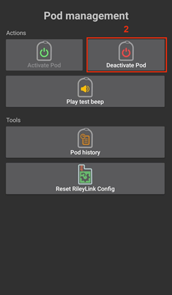
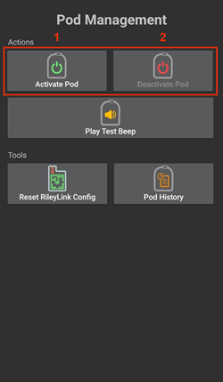
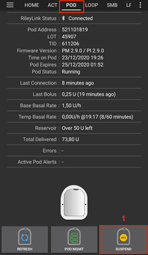
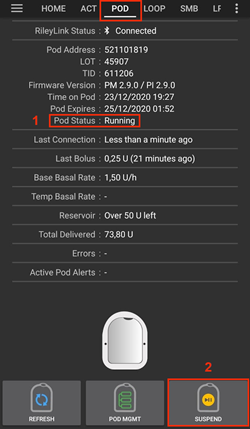
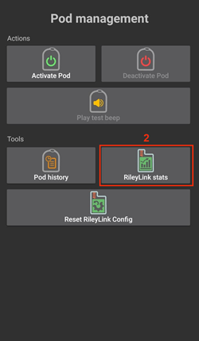

# Omnipod Eros

Estas instrucciones son para configurar la bomba Omnipod de la generación Eros (**NO Omnipod Dash**).

```{admonition} Omnipod Eros is being phased out
:class: note

El [sistema Omnipod](https://www.omnipod.com/current-podders/resources/omnipod-system) (el Omnipod original, formado por el gestor personal de diabetes (PDM) y el pod) se deja de fabricar, y la fecha final depende del país. Por ejemplo, en Canadá dejará de estar disponible después del 30 de junio de 2026. Si dependes de la bomba Eros, planifica con tiempo el cambio a una bomba compatible.
```

**Este software es parte de una solución de páncreas artificial «hazlo tú mismo» (DIY). No es un producto: requiere que TÚ leas, aprendas y entiendas el sistema, también cómo usarlo. Solo tú eres responsable de lo que haces con él.**

```{contents} Table of contents
:depth: 1
:local: true
```

## Requisitos de hardware y software

- **Dispositivo de comunicación con el pod**

> Componente que conecta tu teléfono con AAPS con los pods de la generación Eros.
> 
> > -   [Web de OrangeLink](https://getrileylink.org/product/orangelink)
> > -  [RileyLink de 433 MHz](https://getrileylink.org/product/rileylink433)
> > -   [Web de Emalink](https://github.com/sks01/EmaLink) - [Contacto](mailto:getemalink@gmail.com)
> > -   DiaLink - [Contacto](mailto:Boshetyn@ukr.net)
> > -   [Web de LoopLink](https://www.getlooplink.org/) - [Contacto](https://jameswedding.substack.com/) - Sin probar

-   **Teléfono móvil**

> Componente que ejecuta AAPS y envía los comandos de control al dispositivo de comunicación con el pod.
> 
> > - Un [teléfono Android](#Phones-list-of-tested-phones) compatible con **AAPS** y los componentes relacionados configurados.

-   **Dispositivo de administración de insulina**

> Componente que interpreta los comandos que recibe del dispositivo de comunicación con el pod y que vienen de tu teléfono con AAPS.
> 
> > - Un pod Omnipod nuevo (generación Eros - **NO DASH**)

Estas instrucciones suponen que empiezas una nueva sesión de pod. Si no es así, ten paciencia y empieza este proceso en tu próximo cambio de pod.

En esta página, **RileyLink** significa cualquiera de los dispositivos de comunicación con el pod de la lista de arriba.

## Antes de empezar

**LA SEGURIDAD ES LO PRIMERO** - no hagas este proceso en un lugar donde no puedas solucionar un error (pods de reserva, insulina, RileyLink cargado y teléfono son imprescindibles).

**Tu PDM de Omnipod dejará de funcionar después de que el controlador Omnipod de AAPS active tu pod**. Antes usabas tu PDM de Omnipod para enviar comandos a tu pod Omnipod Eros. Un pod Omnipod Eros solo permite que un único dispositivo se comunique con él. El dispositivo que activa el pod con éxito es, desde ese momento, el único dispositivo que puede comunicarse con él. Esto significa que, cuando activas un pod Omnipod Eros con tu RileyLink a través del controlador Omnipod de AAPS, **ya no podrás usar tu PDM con ese pod**. El controlador Omnipod de AAPS con el RileyLink es ahora tu PDM. *Esto NO significa que debas tirar tu PDM. Te recomendamos guardarlo como reserva y para emergencias, cuando AAPS no funcione bien.*

**Solo un RileyLink a la vez puede comunicarse con un pod.** **AAPS** recuerda un RileyLink emparejado. Si emparejas otro distinto, sustituye al anterior.

**Tu pod no se apagará cuando el RileyLink esté fuera de alcance.** Cuando tu RileyLink está fuera de alcance o la señal no llega al pod activo, tu pod sigue administrando la insulina basal. Al activar un pod, el perfil basal definido en AAPS se programa en el nuevo pod. Si pierdes el contacto con el pod, este volverá a este perfil basal. No podrás enviar nuevos comandos hasta que el RileyLink vuelva a estar dentro del alcance y se restablezca la conexión.

**Los perfiles con tasas basales de 30 min NO son compatibles con AAPS.** Si eres nuevo en AAPS y configuras tu perfil de tasa basal por primera vez, ten en cuenta que las tasas basales que empiezan a la media hora no son compatibles. Tendrás que ajustar tu perfil de tasa basal para que empiece a la hora en punto. Por ejemplo, si tienes una tasa basal de 1,1 unidades que empieza a las 09:30 y dura 2 horas, hasta las 11:30, esto no funcionará.  Tendrás que cambiar esta tasa basal de 1,1 unidades a un intervalo de 9:00–11:00 o de 10:00–12:00.  Aunque el propio hardware de Omnipod admite tramos de 30 min en el perfil basal, por ahora AAPS no puede tenerlos en cuenta en sus algoritmos.

## Activar el controlador Omnipod en AAPS

Puedes activar el controlador Omnipod en AAPS de **dos formas**:

### Opción 1: el Asistente de configuración

Después de instalar una nueva versión de AAPS, el **Asistente de configuración** se inicia automáticamente. Si ya exportaste tus ajustes de una instalación anterior, puedes importarlos en el asistente. Para instalaciones nuevas, sigue leyendo abajo.

Sigue el [Asistente de configuración](../SettingUpAaps/SetupWizard.md) hasta llegar al paso **Bomba** y luego selecciona **Omnipod Eros** (la descripción dice «Integración de bombas de insulina Omnipod Eros»).


El Asistente de configuración no empareja tu RileyLink. Al terminar el asistente, abre la pantalla de la bomba Omnipod y empareja el RileyLink como se describe en la [sección Configuración del RileyLink](#OmnipodEros-rileylink-setup).

**O**

### Opción 2: La pantalla Configuración

Abre el **menú** (☰) de arriba a la izquierda > **Configuración** > **Bomba** y marca el **botón de opción** de **Omnipod Eros**.

Cuando está seleccionada, la tarjeta **Omnipod Eros** muestra dos botones, **Ajustes** y **Abrir complemento**:


**Ajustes** abre los ajustes del controlador Omnipod (ver [Ajustes de Omnipod](#OmnipodEros-omnipod-settings)):


**Abrir complemento** abre la pantalla de la bomba Omnipod. También puedes abrirla en cualquier momento desde la pantalla principal con **Administrar** > **Bomba**. En esta página la llamamos **pantalla de la bomba Omnipod**. Antes de emparejar un RileyLink y activar un pod, se ve así:


### Comprobar la selección del driver de Omnipod

Para comprobar que has activado el controlador Omnipod, abre **Administrar** > **Bomba** desde la pantalla principal. Deberías ver la pantalla de la bomba **Omnipod Eros** que se muestra arriba. Si todavía no has emparejado un RileyLink, **Estado RileyLink** muestra **No iniciado** y **Estado del Pod** muestra **Ningún Pod activo**.

## Configuración de Omnipod

Todas las funciones del pod y del RileyLink son botones en la [pantalla de la bomba Omnipod](#OmnipodEros-omnipod-pod-tab) (**Administrar** > **Bomba**). Algunos botones solo aparecen en ciertas situaciones, por ejemplo cuando hay un pod activo.

>  Actualizar la conexión y el estado del pod
> 
>  Gestión del pod (activar, desactivar, reproducir sonido de prueba, estadísticas de RileyLink e historial del pod)

```{admonition} Older screenshot
:class: note
Las capturas de pantalla de arriba son de una versión anterior de **AAPS**. En **AAPS** 4 no hay botón **POD MGMT** ni menú de gestión del pod: **Actualizar** y todas las acciones de gestión del pod son botones en la pantalla de la bomba Omnipod.
```

(OmnipodEros-rileylink-setup)=

### Configuración del RileyLink

Si ya has emparejado tu RileyLink, sigue con la [sección Activar un pod](#OmnipodEros-activating-a-pod) de abajo.

*Nota: una buena señal visual de que el RileyLink no está conectado es que faltan los botones de tratamiento (barra de Lanzamiento rápido) en la pantalla principal. Esto también pasa durante los primeros 30 segundos después de iniciar AAPS, porque AAPS se está conectando al RileyLink.*

1. Asegúrate de que tu RileyLink está totalmente cargado y encendido.

2. Coloca el RileyLink [cerca de tu teléfono](#OmnipodEros-optimal-omnipod-and-rileylink-positioning) (unos 30 cm o menos).

3. Abre la pantalla de la bomba Omnipod (**Administrar** > **Bomba**) y pulsa **Emparejar RileyLink**.

4. La pantalla **Emparejar RileyLink** empieza a buscar dispositivos Bluetooth enseguida. Toca tu RileyLink en la lista de dispositivos encontrados.

   

5. Cuando aparezca **RileyLink emparejado correctamente** con el nombre y la dirección de tu dispositivo, pulsa **OK**.

6. De vuelta en la pantalla de la bomba Omnipod, comprueba que **Estado RileyLink** cambia a **Conectado**. **Estado del Pod** debe mostrar **Ningún Pod activo**. Si el RileyLink no se conecta, pulsa **Restablecer RileyLink** o reinicia **AAPS**.

 

 


```{admonition} Older screenshot
:class: note
Las seis capturas de pantalla de arriba (después del paso 6) son de una versión anterior de **AAPS**. En **AAPS** 4 emparejas el RileyLink con el botón **Emparejar RileyLink** de la pantalla de la bomba Omnipod, en lugar de **Configuración de RileyLink** en los ajustes de Omnipod, y la búsqueda empieza automáticamente.
```

```{note}
Para cambiar a otro RileyLink (por ejemplo, un dispositivo de reserva), pulsa otra vez **Emparejar RileyLink** y selecciona el nuevo dispositivo. Sustituye al que estaba emparejado antes. No hace falta quitar primero el dispositivo antiguo.
```

(OmnipodEros-activating-a-pod)=

### Activar un pod

Antes de poder activar un pod, asegúrate de que tu RileyLink está emparejado y de que **Estado RileyLink** muestra **Conectado**. El botón **Activar Pod** sigue desactivado hasta que el RileyLink está listo.

*RECUERDA: durante la activación (emparejamiento) del pod, la comunicación con el pod solo funciona a poca distancia, por medidas de seguridad. Antes del emparejamiento, la señal de radio del pod es más débil. Después del emparejamiento funciona con toda la potencia de señal. Durante estos procesos, asegúrate de que tu pod está* [muy cerca](#OmnipodEros-optimal-omnipod-and-rileylink-positioning) *(unos 30 cm o menos), pero no encima ni justo al lado del RileyLink.*

01. Abre la pantalla de la bomba Omnipod (**Administrar** > **Bomba**) y pulsa **Activar Pod**.

    Si nunca has activado un perfil, primero aparece el paso **Perfil requerido**. Selecciona el perfil que se aplicará al activar el pod.

    >   
    > 
    > ```{admonition} Older screenshot
    >     :class: note
    >     Las capturas de pantalla de arriba son de una versión anterior de **AAPS**. En **AAPS** 4, **Activar Pod** es un botón en la pantalla de la bomba Omnipod, en lugar de estar en el menú **POD MGMT**.
    > ```

02. Se muestra la pantalla **Llenar Pod**. Llena un pod nuevo con insulina suficiente para 3 días y espera a oír dos pitidos. Significan que se ha llenado la cantidad mínima de 80 unidades. Vacía la jeringa de llenado por completo, también después de oír los dos pitidos. Al calcular la cantidad total de insulina que necesitas para 3 días, ten en cuenta que el cebado del pod usa de 12 a 15 unidades. No quites todavía la tapa de la aguja del pod.

    > 
    > 
    > Asegúrate de que el pod nuevo y el RileyLink están muy cerca el uno del otro (unos 30 cm o menos) y pulsa **Siguiente**.

03. **Seleccionar insulina** (solo aparece si tienes más de una insulina configurada): selecciona la insulina con la que llenas el pod y pulsa **Siguiente**. Después de la activación se aplica un cambio de perfil con esta insulina.

04. En la pantalla **Inicializar Pod**, el pod empieza el cebado (oirás un clic y después una serie de tics mientras el pod se ceba). Si el RileyLink está fuera del alcance del pod que activas, recibirás el mensaje de error **Sin respuesta del Pod**. Si pasa esto, [acerca el RileyLink](#OmnipodEros-optimal-omnipod-and-rileylink-positioning) al pod (unos 30 cm o menos), pero no encima ni justo al lado, y pulsa **Reintentar**.

    >  

05. Cuando el cebado termina con éxito, aparece una marca verde y el botón **Siguiente** se activa. Pulsa **Siguiente**.

    > 

06. **Ubicación de la zona** (solo aparece si **Gestionar la rotación del lugar de inserción de la bomba** está activado en [Rotación del sitio](#Aapsscreens-site-rotation)): selecciona dónde colocas el pod en tu cuerpo y pulsa **Siguiente**.

07. Se muestra la pantalla **Insertar el Pod**. Prepara el lugar de infusión del pod nuevo. Quita el capuchón de plástico de la aguja del pod y el papel blanco del adhesivo, y coloca el pod en el lugar de tu cuerpo que has elegido. Si la cánula sobresale, pulsa **Cancelar** y desecha el pod. Cuando termines, pulsa **Siguiente**.

    > 

08. Aparece un diálogo de confirmación: «Al pulsar OK, se insertará la cánula». **Pulsa OK SOLO si estás listo para insertar la cánula**.

    > 

09. En la pantalla **Insertar cánula**, el Omnipod puede tardar un poco en responder e insertar la cánula (1–2 minutos como máximo), así que ten paciencia.

    > Si el RileyLink está fuera del alcance del pod que activas, recibirás el mensaje de error **Sin respuesta del Pod**. Si pasa esto, acerca el RileyLink al pod (unos 30 cm o menos), pero no encima ni justo al lado, y pulsa **Reintentar**.
    > 
    > Si el RileyLink está fuera del alcance Bluetooth o no tiene una conexión activa con el teléfono, recibirás el mensaje de error **No hay respuesta de RileyLink**. Si pasa esto, acerca el RileyLink al teléfono y pulsa **Reintentar**.
    > 
    > *NOTA: antes de insertar la cánula, es buena idea pellizcar la piel cerca del punto de inserción. Así la aguja entra con suavidad y bajan las posibilidades de que se produzcan oclusiones.*
    > 
    > 
    > 
    >  

10. Cuando la cánula se ha insertado bien, aparece una marca verde y el botón **Siguiente** se activa. Pulsa **Siguiente**.

    > 

11. Se muestra la pantalla **Pod activado**. Comprueba que la cánula se ha insertado bien y cambia el pod si crees que no es así. Pulsa **Finalizar**. ¡Enhorabuena! Has iniciado una nueva sesión de pod activo.

    >  
    > 
    > ```{admonition} Older screenshot
    >     :class: note
    >     Las capturas de pantalla de los pasos 2 a 11 son de una versión anterior de **AAPS** y pueden verse diferentes en **AAPS** 4. Los pasos **Seleccionar insulina** y **Ubicación de la zona** no aparecen en las imágenes.
    > ```

12. Vuelves a la pantalla de la bomba Omnipod. El botón **Activar Pod** se sustituye por **Desactivar Pod**, porque no puedes activar otro pod sin desactivar antes el pod activo.

    La pantalla de la bomba muestra ahora información sobre tu pod activo, por ejemplo la tasa basal actual, el nivel del reservorio, la insulina administrada, los errores y las alertas del pod. Para más detalles, consulta la sección [Pantalla de la bomba Omnipod](#OmnipodEros-omnipod-pod-tab).

     

    ```{admonition} Older screenshot
    :class: note
    Las capturas de pantalla de arriba son de una versión anterior de **AAPS**. En **AAPS** 4 no hay menú de gestión del pod: vuelves directamente a la pantalla de la bomba Omnipod, donde **Desactivar Pod** sustituye a **Activar Pod**.
    ```

```{note}
Si la activación se interrumpió después del cebado (por ejemplo, porque se cerró la app), pulsa otra vez **Activar Pod**. El asistente sigue desde los pasos de inserción de la cánula.
```

### Desactivar un pod

En condiciones normales, un pod dura tres días (72 horas) y 8 horas más después del aviso de caducidad, en total 80 horas de uso.

Para desactivar un pod (porque ha caducado o porque ha fallado):

1. Abre la pantalla de la bomba Omnipod (**Administrar** > **Bomba**) y pulsa **Desactivar Pod**.

   >   
   > 
   > ```{admonition} Older screenshot
   >    :class: note
   >    Las capturas de pantalla de arriba son de una versión anterior de **AAPS**. En **AAPS** 4, **Desactivar Pod** es un botón en la pantalla de la bomba Omnipod, en lugar de estar en el menú **POD MGMT**.
   > ```

2. En la pantalla **Desactivar Pod**, primero asegúrate de que el RileyLink está muy cerca del pod, pero no encima ni justo al lado del pod. Después pulsa **Siguiente**. Un diálogo pregunta *Un POD desactivado no se puede volver a utilizar. ¿Quieres desactivar este POD ahora?* Pulsa **OK** para empezar a desactivar el pod, o **Cancelar** para conservarlo. La desactivación suspende toda la administración de insulina y no se puede deshacer.

   > 

3. Aparece la pantalla **Desactivando el Pod** y el pod emite un pitido de confirmación de que la desactivación ha tenido éxito.

   > 
   > 
   > **SI la desactivación falla** y no oyes el pitido de confirmación, puede aparecer el mensaje **No hay respuesta de RileyLink** o **Sin respuesta del Pod**. Pulsa **Reintentar** para intentar la desactivación otra vez. Si la desactivación sigue fallando, pulsa **Descartar Pod** y confirma. Entonces **AAPS** olvida el pod. La administración de insulina **no** se ha suspendido, así que quítate el pod del cuerpo. Si tu pod tiene una alarma continua, puede que tengas que silenciarla manualmente (con un alfiler o un clip), porque **Descartar Pod** no la silencia.
   > 
   > >   

4. Cuando la desactivación tiene éxito, aparece una marca verde. Pulsa **Siguiente** para ver la pantalla **Pod desactivado**. Ya puedes quitarte el pod, porque la sesión activa se ha desactivado.

   > 

5. Pulsa **Finalizar** para volver a la pantalla de la bomba Omnipod.

   >  
   > 
   > ```{admonition} Older screenshot
   >    :class: note
   >    Las capturas de pantalla de los pasos 2 a 5 son de una versión anterior de **AAPS** y pueden verse diferentes en **AAPS** 4.
   > ```

6. En la pantalla de la bomba Omnipod, comprueba que **Estado RileyLink** muestra **Conectado** y que **Estado del Pod** muestra **Ningún Pod activo**.

   >    
   > 
   > ```{admonition} Older screenshot
   >    :class: note
   >    Las capturas de pantalla de arriba son de una versión anterior de **AAPS**. En **AAPS** 4, **Finalizar** te lleva directamente a la pantalla de la bomba Omnipod; no hay menú de gestión del pod ni pestaña **Omnipod (POD)**.
   > ```

### Suspender y reanudar la administración de insulina

El proceso de abajo te muestra cómo suspender y reanudar la administración de insulina.

*NOTA - si no ves el botón **Suspender***, es porque está oculto por defecto. Activa **Mostrar el botón Suspender Entrega en la pestaña Omnipod** en los [ajustes de Omnipod](#OmnipodEros-omnipod-settings), en **Otros**.

#### Suspender la administración de insulina

Usa este comando para poner el pod activo en estado suspendido. En estado suspendido, el pod no administra nada de insulina. Este comando imita la función de suspender que el PDM original de Omnipod envía a un pod activo.

1. Abre la pantalla de la bomba Omnipod (**Administrar** > **Bomba**) y pulsa **Suspender**. El comando de suspender se envía a través del RileyLink al pod activo.

2. Cuando el pod ha suspendido toda la administración de insulina, **Estado del Pod** muestra **Suspendido** y el botón **Suspender** se sustituye por **Reanudar la entrega**.

   >  
   > 
   > 
   > 
   >  
   > 
   > ```{admonition} Older screenshot
   >    :class: note
   >    Las capturas de pantalla de arriba son de una versión anterior de **AAPS**. En **AAPS** 4 estos pasos se hacen en la pantalla de la bomba Omnipod, en lugar de en la pestaña **Omnipod (POD)**, y el resultado se muestra en **Estado del Pod**.
   > ```

Si el comando falla, un diálogo **Advertencia** muestra «Error al suspender la entrega» con el motivo. Comprueba la conexión del RileyLink e inténtalo otra vez.

#### Reanudar la administración de insulina

Usa este comando para que el pod activo, ahora suspendido, reanude la administración de insulina. Cuando el comando se procesa con éxito, la insulina vuelve a administrarse con normalidad, con la tasa basal actual del perfil basal activo según la hora actual. El pod vuelve a aceptar comandos de bolo, TBR y SMB.

1. Abre la pantalla de la bomba Omnipod y comprueba que **Estado del Pod** muestra **Suspendido**. Pulsa **Reanudar la entrega**.

2. Cuando el comando tiene éxito, **Estado del Pod** vuelve a mostrar **Funcionando** y el botón **Reanudar la entrega** desaparece (el botón **Suspender** vuelve a aparecer si lo has activado).

   >  
   > 
   > 
   > 
   >  
   > 
   > ```{admonition} Older screenshot
   >    :class: note
   >    Las capturas de pantalla de arriba son de una versión anterior de **AAPS**. En **AAPS** 4 estos pasos se hacen en la pantalla de la bomba Omnipod, en lugar de en la pestaña **Omnipod (POD)**, y el resultado se muestra en **Estado del Pod**.
   > ```

Si el comando falla, un diálogo **Advertencia** muestra «Error al reanudar la entrega» con el motivo. Comprueba la conexión del RileyLink e inténtalo otra vez.

### Silenciar alertas del pod

*NOTA - El botón **Silenciar alertas** solo aparece en la pantalla de la bomba Omnipod mientras el pod tiene una alerta activa (por ejemplo, la alerta de caducidad del pod o de reservorio bajo), y solo si **Silenciar automáticamente las alertas de POD** está desactivado.*

El proceso de abajo te muestra cómo silenciar los pitidos del pod que empiezan cuando el pod llega a la hora de aviso antes de caducar. Esta hora de aviso se define con **Alerta horas antes del apagado (80 horas)** en los ajustes de **Alertas** de Omnipod. La vida máxima de un pod es de 80 horas (3 días y 8 horas), pero Insulet recomienda no pasar del límite de 72 horas (3 días).

*NOTA - Si has activado **Silenciar automáticamente las alertas de POD** en los ajustes de **Alertas** de Omnipod, **AAPS** silencia la alerta automáticamente en la siguiente comunicación con el pod, y NO tienes que hacerlo manualmente.*

1. Cuando se llega a la hora de aviso, el pod pita para avisarte de que pronto caducará y hay que cambiarlo. En la pantalla de la bomba Omnipod, **El Pod caduca** muestra la hora exacta en que caduca el pod (72 horas después de la activación); se pone de color **amarillo** 4 horas antes. **Fin de vida del Pod** muestra cuándo el pod deja de administrar insulina. **Alertas de Pod activas** muestra **Pod a punto de caducar** y aparece el botón **Silenciar alertas**. **AAPS** también muestra una notificación sobre la próxima caducidad del pod.

   >   
   > 
   > ```{admonition} Older screenshot
   >    :class: note
   >    Las capturas de pantalla de arriba son de una versión anterior de **AAPS**. En **AAPS** 4 el botón **ACK ALERTS** se llama **Silenciar alertas** y está en la pantalla de la bomba Omnipod.
   > ```

2. Pulsa **Silenciar alertas**. El RileyLink envía al pod el comando para parar los pitidos de aviso de caducidad.

   >  
   > 
   > ```{admonition} Older screenshot
   >    :class: note
   >    La captura de pantalla de arriba es de una versión anterior de **AAPS**. En **AAPS** 4 el botón se llama **Silenciar alertas**.
   > ```

3. Cuando las alertas se silencian, el pod pita dos veces. **Alertas de Pod activas** ya no muestra el aviso, el botón **Silenciar alertas** desaparece y el pod deja de emitir los pitidos de aviso de caducidad.

   >  
   > 
   > ```{admonition} Older screenshot
   >    :class: note
   >    La captura de pantalla de arriba es de una versión anterior de **AAPS**. En **AAPS** 4 el resultado se muestra en la pantalla de la bomba Omnipod: el aviso desaparece de **Alertas de Pod activas**.
   > ```

Si el comando falla (por ejemplo, el RileyLink está fuera del alcance del pod), un diálogo **Advertencia** muestra «Error al silenciar las alertas» con el motivo. Acerca el RileyLink al pod e inténtalo otra vez.


```{admonition} Older screenshot
:class: note
La captura de pantalla de arriba es de una versión anterior de **AAPS**. En **AAPS** 4 el diálogo **Advertencia** muestra «Error al silenciar las alertas» con el motivo.
```

(OmnipodEros-view-pod-history)=

### Ver el historial del pod

Esta sección te muestra cómo revisar el historial de tu pod activo y filtrarlo por diferentes categorías de acciones. La herramienta de historial del pod te permite ver las acciones y los resultados enviados a tu pod activo durante su vida de tres días (72–80 horas).

Esta función sirve para comprobar bolos, TBR y cambios de basal que se dieron, pero de los que no estás seguro si se completaron. Las demás categorías sirven en general para resolver problemas y para ver el orden de los eventos que llevaron a un fallo.

*NOTA:* Los comandos **inciertos** aparecen en el historial del pod, pero por su naturaleza no puedes estar seguro de que sean exactos.

1. Abre la pantalla de la bomba Omnipod (**Administrar** > **Bomba**) y pulsa **Historial de Pod**.

   >   
   > 
   > ```{admonition} Older screenshot
   >    :class: note
   >    Las capturas de pantalla de arriba son de una versión anterior de **AAPS**. En **AAPS** 4, **Historial de Pod** es un botón en la pantalla de la bomba Omnipod, en lugar de estar en el menú **POD MGMT**.
   > ```

2. La pantalla **Historial de Pod** muestra todas las acciones del pod y sus resultados, primero las más nuevas, agrupadas por día. Por defecto está seleccionado **Todo**. Toca uno de los botones de filtro de arriba para mostrar solo una categoría. Usa la flecha atrás de arriba a la izquierda para volver a la pantalla de la bomba Omnipod.

   > 

   >  
   > 
   > ```{admonition} Older screenshot
   >    :class: note
   >    La segunda captura de pantalla es de una versión anterior de **AAPS** y puede verse diferente en **AAPS** 4.
   > ```

### Ver los ajustes y el historial del RileyLink

La pantalla **Estadísticas de RileyLink** muestra los ajustes de tu RileyLink y del pod activo, y el historial de comunicación de ambos. Tiene dos pestañas: **Ajustes** e **Historial**.

El botón **Estadísticas de RileyLink** está oculto por defecto. Para mostrarlo en la pantalla de la bomba Omnipod, activa **Mostrar botón de estadísticas de RileyLink en el menú de gestión del Pod** en los [ajustes de Omnipod](#OmnipodEros-omnipod-settings), en **Otros**.

#### Restablecer manualmente la conexión Bluetooth del dispositivo de comunicación con el pod

Si tu dispositivo de comunicación con el pod estuvo un tiempo fuera del alcance Bluetooth de tu teléfono, **Estado RileyLink** puede mostrar **RileyLink no accesible** en la pantalla de la bomba Omnipod. Normalmente **AAPS** se vuelve a conectar solo cuando el dispositivo vuelve a estar dentro del alcance. Si no lo hace:

1. Asegúrate de que el RileyLink está encendido, cargado y cerca de tu teléfono.

2. En la pantalla de la bomba Omnipod, pulsa **Restablecer RileyLink**. Un mensaje confirma **Configuración de RileyLink restablecida**. Consulta las [notas sobre Restablecer RileyLink](#OmnipodEros-reset-rileylink-config-notes) de abajo.

3. Si la **conexión Bluetooth** no se restablece, prueba a **apagar** y volver a **encender** manualmente el Bluetooth de tu teléfono.

4. Si sigue sin conectarse, pulsa **Emparejar RileyLink** y selecciona otra vez tu RileyLink.

5. Cuando la conexión se restablece, **Estado RileyLink** muestra **Conectado**. También puedes comprobar **Estado de conexión** en la pestaña **Ajustes** de la pantalla **Estadísticas de RileyLink**. ¡Enhorabuena! Has vuelto a conectar tu dispositivo de comunicación con el pod a AAPS.

 


```{admonition} Older screenshot
:class: note
Las capturas de pantalla de arriba son de una versión anterior de **AAPS**. En **AAPS** 4 vuelves a conectar con **Restablecer RileyLink** o **Emparejar RileyLink** en la pantalla de la bomba Omnipod, en lugar del botón de actualizar de la pantalla de ajustes del RileyLink.
```

#### Ajustes del dispositivo de comunicación con el pod y del pod activo

Esta pantalla muestra la información y el estado del dispositivo de comunicación con el pod emparejado y del pod Omnipod Eros activo. La información se actualiza automáticamente.

1. Abre la pantalla de la bomba Omnipod (**Administrar** > **Bomba**) y pulsa **Estadísticas de RileyLink**. La pestaña **Ajustes** muestra tu **RileyLink** emparejado y el pod activo (**Dispositivo**).

   >   
   > 
   > ```{admonition} Older screenshot
   >    :class: note
   >    Las capturas de pantalla de arriba son de una versión anterior de **AAPS**. En **AAPS** 4, **Estadísticas de RileyLink** es un botón en la pantalla de la bomba Omnipod, en lugar de estar en el menú **POD MGMT**.
   > ```

   > 

##### Campos del RileyLink

> - **Dirección:** dirección MAC del dispositivo de comunicación con el pod emparejado.
> - **Nombre:** nombre Bluetooth del dispositivo de comunicación con el pod emparejado.
> - **Nivel de batería:** el nivel de batería actual del dispositivo de comunicación con el pod conectado. Solo aparece cuando **Mostrar el nivel de batería notificado por OrangeLink/EmaLink/DiaLink** está activado.
> - **Estado de conexión**: el estado actual de la conexión Bluetooth entre el dispositivo de comunicación con el pod y el teléfono con AAPS.
> - **Error de conexión:** si hay un error en la conexión Bluetooth del dispositivo de comunicación con el pod, aquí se muestran los detalles.
> - **Versión de Firmware:** versión de firmware instalada en el dispositivo de comunicación con el pod conectado.

##### Campos del dispositivo - con un pod activo

> - **Tipo de dispositivo:** el tipo de dispositivo que se comunica con el dispositivo de comunicación con el pod (Omnipod (Eros)).
> - **Modelo de dispositivo configurado:** el modelo del dispositivo configurado para comunicarse con el dispositivo de comunicación con el pod.
> - **Modelo de dispositivo conectado:** el modelo del dispositivo que se comunica ahora con el dispositivo de comunicación con el pod.
> - **Número de serie de la bomba:** número de serie del pod activado.
> - **Frecuencia de la bomba:** frecuencia de radio usada para comunicarse con el pod.
> - **Última frecuencia usada:** última frecuencia de radio conocida que usó el pod para comunicarse con el dispositivo de comunicación con el pod.
> - **Último contacto del dispositivo:** fecha y hora del último contacto del pod con el dispositivo de comunicación con el pod.

(omnipod-eros-rileylink-and-active-pod-history)=
#### Historial del RileyLink y del pod activo

Esta pestaña muestra, primero lo más nuevo, cada estado o acción del RileyLink o del pod conectado. El historial solo está disponible para el pod activo. Después de un cambio de pod, este historial se borra y solo se registran y muestran los eventos del pod nuevo.

1. Abre la pantalla de la bomba Omnipod (**Administrar** > **Bomba**), pulsa **Estadísticas de RileyLink** y luego toca la pestaña **Historial**.

   >   
   > 
   > ```{admonition} Older screenshot
   >    :class: note
   >    Las capturas de pantalla de arriba son de una versión anterior de **AAPS**. En **AAPS** 4, **Estadísticas de RileyLink** es un botón en la pantalla de la bomba Omnipod, en lugar de estar en el menú **POD MGMT**.
   > ```

   > 

##### Campos

Cada entrada muestra:

> - **Dispositivo:** el dispositivo al que se refiere la acción o el estado.
> - **Hora:** la hora del evento.
> - **Estado o acción:** el estado del dispositivo o la acción que realizó.

(OmnipodEros-omnipod-pod-tab)=

## Pantalla de la bomba Omnipod

Aquí tienes una explicación de los campos de estado y de los botones de la **pantalla de la bomba Omnipod** (**Administrar** > **Bomba**, o **Configuración** > **Bomba** > **Abrir complemento**).

El icono del engranaje de arriba a la derecha abre los [ajustes de Omnipod](#OmnipodEros-omnipod-settings).

*NOTA: si algún campo de estado muestra (incierto), pulsa **Actualizar** para actualizar el estado del pod y borrarlo.*


```{admonition} Older screenshot
:class: note
Esta captura de pantalla es de una versión anterior de **AAPS**, en la que esta pantalla era la pestaña **Omnipod (POD)**. En **AAPS** 4 es la pantalla de la bomba Omnipod, y algunos nombres de campos y botones son diferentes.
```

### Campos

- **Estado RileyLink:** muestra el estado actual de la conexión del RileyLink. Los errores se muestran en rojo.

- *No iniciado* - todavía no hay ningún RileyLink emparejado, o la conexión no ha empezado.
- *RileyLink no accesible* - el dispositivo de comunicación con el pod está fuera del alcance Bluetooth del teléfono, apagado o tiene un fallo que impide la comunicación Bluetooth.
- *RileyLink listo* - el dispositivo de comunicación con el pod está encendido y está iniciando la conexión Bluetooth.
- *Conectado* - el dispositivo de comunicación con el pod está encendido, conectado y puede comunicarse por Bluetooth.

- **ID Único:** muestra la dirección del pod activo.

- **Número de Lote:** muestra el número de lote (LOT) del pod activo.

- **Número de secuencia:** muestra el número de serie (TID) del pod.

- **Versión de Firmware:** muestra la versión de firmware del pod activo.

- **Hora en el Pod:** muestra la hora actual del pod activo. Se resalta cuando difiere de la hora del teléfono en más de 5 minutos.

- **El Pod caduca:** muestra la fecha y la hora en que caducará el pod activo. El texto se pone amarillo en las últimas 4 horas antes de esa hora. Nunca se pone rojo, porque el pod sigue administrando insulina después.

- **Fin de vida del Pod:** muestra el final del periodo de gracia del pod (8 horas después de **El Pod caduca**, para una vida máxima del pod de 80 horas). El texto se pone amarillo cuando empieza el periodo de gracia (en **El Pod caduca**) y rojo en las últimas 4 horas antes del fin de vida. Durante el periodo de gracia también muestra el tiempo que queda, por ejemplo *(17m restantes)*. El pod deja de administrar insulina al llegar al fin de vida y hay que cambiarlo.

- **Estado del Pod:** muestra el estado del pod activo (por ejemplo **Ningún Pod activo**, **Funcionando** o **Suspendido**).

- **Última conexión:** muestra la última vez que hubo comunicación con el pod activo. El texto se pone rojo cuando se supera el [umbral de bomba no alcanzable](#OmnipodEros-troubleshooting).

- *Hace un momento* - hace menos de 20 segundos.
- *Hace menos de un minuto* - hace más de 20 segundos, pero menos de 60 segundos.
- *Hace 1 minuto* - hace más de 60 segundos, pero menos de 120 segundos (2 min)
- *Hace XX minutos* - hace más de 2 minutos, según el valor de XX

- **Último bolo:** muestra la dosis del último bolo enviado al pod activo y, entre paréntesis, hace cuánto tiempo se envió.

- **Tasa basal base:** muestra la tasa basal programada para la hora actual en el perfil de tasa basal.

- **Tasa basal temporal:** solo aparece mientras hay una basal temporal en curso. La muestra con este formato:

- Unidades / hora @ hora en que se envió la TBR (minutos transcurridos / minutos totales de la TBR)
- *Ejemplo:* 0,00U/h @18:25 ( 90/120 minutos)

- **Reservorio:** muestra **Más de 50 U restantes** cuando quedan más de 50 unidades en el reservorio. Por debajo de este valor, se muestra el número aproximado de unidades. El texto se pone rojo por debajo del umbral de reservorio bajo definido en los [ajustes de Alertas](#OmnipodEros-omnipod-settings).

- **Total entregado:** muestra el número total de unidades de insulina administradas desde el reservorio. *Ten en cuenta que es un valor aproximado, porque el cebado y el llenado del pod no son procesos exactos.*

- **Alertas de Pod activas:** reservado para las alertas que están activas en el pod. Se usa normalmente cuando el pod ha pasado de las 72 horas y suenan los pitidos de alerta propios del pod.

- **Errores:** muestra el último error que ocurrió (en rojo). Revisa el [historial del pod](#OmnipodEros-view-pod-history), el [historial del RileyLink](#omnipod-eros-rileylink-and-active-pod-history) y los archivos de registro para ver errores anteriores e información más detallada.

### Botones

Los botones de la parte de abajo de la pantalla de la bomba cambian según la situación. Los botones que no se pueden usar en este momento aparecen en gris, por ejemplo mientras el RileyLink no está conectado.

**Botones de estado del pod** (aparecen cuando hay un pod activo):

- **Actualizar:** envía un comando de actualización al pod activo para actualizar su estado. Úsalo para actualizar el estado del pod y borrar los campos de estado que contienen el texto (incierto). Consulta la [sección Solución de problemas](#OmnipodEros-troubleshooting) de abajo para más información.

  

  ```{admonition} Older screenshot
  :class: note
  La captura de pantalla de arriba es de una versión anterior de **AAPS**. En **AAPS** 4 es un botón de texto llamado **Actualizar** en la pantalla de la bomba Omnipod.
  ```

- **Silenciar alertas:** silencia los pitidos y las notificaciones de caducidad del pod y de reservorio bajo. Solo aparece cuando el pod tiene una alerta activa y **Silenciar automáticamente las alertas de POD** está desactivado. Después de silenciar las alertas, el botón desaparece.

  

  ```{admonition} Older screenshot
  :class: note
  La captura de pantalla de arriba es de una versión anterior de **AAPS**. En **AAPS** 4 este botón se llama **Silenciar alertas**.
  ```

- **Ajustar la hora:** pone en el pod la hora actual de tu teléfono. Solo aparece cuando la hora del pod difiere de la hora del teléfono en más de 5 minutos.

  

  ```{admonition} Older screenshot
  :class: note
  La captura de pantalla de arriba es de una versión anterior de **AAPS**. En **AAPS** 4 es un botón de texto llamado **Ajustar la hora** en la pantalla de la bomba Omnipod.
  ```

- **Suspender:** suspende la administración de insulina en el pod activo. Solo aparece si está activado en los ajustes (**Mostrar el botón Suspender Entrega en la pestaña Omnipod**).

  

  ```{admonition} Older screenshot
  :class: note
  La captura de pantalla de arriba es de una versión anterior de **AAPS**. En **AAPS** 4 es un botón de texto llamado **Suspender** en la pantalla de la bomba Omnipod.
  ```

- **Reanudar la entrega:** reanuda la administración de insulina en el pod activo que está suspendido. Solo aparece mientras el pod está suspendido.

  

  ```{admonition} Older screenshot
  :class: note
  La captura de pantalla de arriba es de una versión anterior de **AAPS**. En **AAPS** 4 es un botón de texto llamado **Reanudar la entrega** en la pantalla de la bomba Omnipod.
  ```

**Botones de gestión del pod y del RileyLink:**


```{admonition} Older screenshot
:class: note
La captura de pantalla de arriba es de una versión anterior de **AAPS**. En **AAPS** 4 no hay menú de gestión del pod: estas acciones son botones directamente en la pantalla de la bomba Omnipod.
```

- **Activar Pod:** ceba y activa un pod nuevo. Se muestra cuando no hay ningún pod activo. Solo está activado cuando el RileyLink está conectado.

  

  ```{admonition} Older screenshot
  :class: note
  La captura de pantalla de arriba es de una versión anterior de **AAPS**. En **AAPS** 4, **Activar Pod** es un botón en la pantalla de la bomba Omnipod, en lugar de estar en el menú de gestión del pod.
  ```

- **Desactivar Pod:** desactiva el pod activo. Aparece en cuanto hay un pod emparejado, también cuando una activación se detuvo a medias (por ejemplo, porque el pod falló durante la activación). Solo está activado cuando el RileyLink está conectado. **AAPS** te pide confirmación antes de desactivar el pod.

- Usa este comando para desactivar un pod que pita sin parar (error 49).
- Si la desactivación falla, el asistente de desactivación ofrece la opción **Descartar Pod**.

  

  ```{admonition} Older screenshot
  :class: note
  La captura de pantalla de arriba es de una versión anterior de **AAPS**. En **AAPS** 4, **Desactivar Pod** es un botón en la pantalla de la bomba Omnipod, en lugar de estar en el menú de gestión del pod.
  ```

- **Reproducir sonido de prueba:** al pulsarlo, el pod emite un único pitido de prueba. Aparece cuando hay un pod emparejado.

  

  ```{admonition} Older screenshot
  :class: note
  La captura de pantalla de arriba es de una versión anterior de **AAPS**. En **AAPS** 4, **Reproducir sonido de prueba** es un botón en la pantalla de la bomba Omnipod, en lugar de estar en el menú de gestión del pod.
  ```

- **Historial de Pod:** muestra el historial de actividad del pod activo. Ver [Ver el historial del pod](#OmnipodEros-view-pod-history).

  

  ```{admonition} Older screenshot
  :class: note
  La captura de pantalla de arriba es de una versión anterior de **AAPS**. En **AAPS** 4, **Historial de Pod** es un botón en la pantalla de la bomba Omnipod, en lugar de estar en el menú de gestión del pod.
  ```

- **Emparejar RileyLink:** busca tu dispositivo de comunicación con el pod y lo empareja. Ver [Configuración del RileyLink](#OmnipodEros-rileylink-setup).

- **Estadísticas de RileyLink:** abre la pantalla Estadísticas de RileyLink, que tiene dos pestañas. Solo aparece si está activado en los ajustes (**Mostrar botón de estadísticas de RileyLink en el menú de gestión del Pod**).

- **Ajustes** - muestra la información de ajustes del RileyLink y del pod activo
- **Historial** - muestra el historial de comunicación del RileyLink y del pod

  

  ```{admonition} Older screenshot
  :class: note
  La captura de pantalla de arriba es de una versión anterior de **AAPS**. En **AAPS** 4, **Estadísticas de RileyLink** es un botón en la pantalla de la bomba Omnipod, en lugar de estar en el menú de gestión del pod.
  ```

- **Restablecer RileyLink:** restablece la configuración del dispositivo de comunicación con el pod conectado. Cuando empieza la comunicación, se envían y se configuran datos concretos en el RileyLink:

- Se configuran los registros de memoria
- Se configuran los protocolos de comunicación
- Se configura la frecuencia de radio ajustada
  > 
  > Ver las [notas adicionales](#OmnipodEros-reset-rileylink-config-notes) de abajo.

  

  ```{admonition} Older screenshot
  :class: note
  La captura de pantalla de arriba es de una versión anterior de **AAPS**. En **AAPS** 4 este botón se llama **Restablecer RileyLink** y está en la pantalla de la bomba Omnipod.
  ```

- **Descartar Pod:** descarta el estado de un pod que no responde, después de una confirmación. Solo aparece cuando un pod se ha iniciado pero no se ha emparejado del todo, porque ya no es posible desactivarlo de forma correcta:

- Un **pod no está emparejado del todo** y por eso ignora los comandos de desactivación.
- Un **pod se queda bloqueado** entre pasos durante el proceso de emparejamiento.
- Un **pod no se empareja en absoluto.**
  > 
  > Después de descartar un pod, **AAPS** ya no puede comunicarse con él. Quítate el pod del cuerpo.

  

  ```{admonition} Older screenshot
  :class: note
  La captura de pantalla de arriba es de una versión anterior de **AAPS**. En **AAPS** 4, **Descartar Pod** es un botón en la pantalla de la bomba Omnipod, en lugar de estar en el menú de gestión del pod.
  ```

(OmnipodEros-reset-rileylink-config-notes)=

#### *Notas sobre Restablecer RileyLink*

- Esta función se usa sobre todo cuando el dispositivo de comunicación con el pod activo no responde y la comunicación está bloqueada.
- Si apagas y vuelves a encender el dispositivo de comunicación con el pod, pulsa **Restablecer RileyLink** para que estos parámetros de comunicación se configuren otra vez en el dispositivo.
- Si NO lo haces, tendrás que reiniciar AAPS después de apagar y encender el dispositivo de comunicación con el pod.
- **NO hace falta** pulsar este botón al cambiar entre distintos dispositivos de comunicación con el pod.

(OmnipodEros-omnipod-settings)=

## Ajustes de Omnipod

Para abrir los ajustes del controlador Omnipod, puedes:

- pulsar el icono del engranaje de arriba a la derecha en la pantalla de la bomba Omnipod (**Administrar** > **Bomba**), o
- abrir el **menú** (☰) de arriba a la izquierda > **Configuración** > **Bomba** y pulsar **Ajustes** en la tarjeta **Omnipod Eros**.


```{admonition} Older screenshot
:class: note
La captura de pantalla de arriba es de una versión anterior de **AAPS**. En **AAPS** 4 abres los ajustes con **Ajustes** en la tarjeta **Omnipod Eros** o con el icono del engranaje de la pantalla de la bomba Omnipod, en lugar del engranaje de ajustes en **Configuración** o del menú de 3 puntos.
```

Los ajustes están agrupados como se indica abajo. Toca un grupo para desplegarlo. La mayoría de las opciones son interruptores que puedes activar o desactivar:


*NOTA: un asterisco (\*) indica que el ajuste está activado por defecto.*

### RileyLink

Ajustes del dispositivo de comunicación con el pod. El dispositivo se empareja con el botón **Emparejar RileyLink** de la pantalla de la bomba (ver [Configuración del RileyLink](#OmnipodEros-rileylink-setup)).

- **Usar escaneo:** busca el dispositivo antes de conectarse al OrangeLink. Esto puede mejorar las conexiones. También se puede usar con otros clones del RileyLink si hace falta.

- **Mostrar el nivel de batería notificado por OrangeLink/EmaLink/DiaLink:** muestra el nivel real de batería del OrangeLink/EmaLink/DiaLink. Te **recomendamos mucho** que todos los usuarios de OrangeLink/EmaLink/DiaLink activen este ajuste.

- NO funciona con el RileyLink original.
- Puede que no funcione con alternativas al RileyLink.
- Activado - muestra el nivel de batería actual de los dispositivos de comunicación con el pod compatibles.
- Desactivado - muestra el valor n/a.

- **Activar el registro de cambios de batería en Acciones:** solo está disponible cuando el ajuste de nivel de batería de arriba está activado. Algunos dispositivos de comunicación con el pod usan pilas normales que puedes cambiar. Con este ajuste activado, puedes registrar una [entrada de Portal de cuidados](#aaps-screens-careportal) **Cambio de batería de la bomba** para anotar el cambio y poner a cero la edad de la batería.

### Sonido de confirmación

El pod emite pitidos de confirmación al administrar y cambiar bolos, basales, SMB y TBR.

- **\*Sonidos de bolo habilitados:** activa o desactiva los pitidos de confirmación cuando se administra un bolo.
- **Sonidos de basales habilitados:** activa o desactiva los pitidos de confirmación cuando se pone una nueva tasa basal, se cancela la tasa basal activa o se cambia la tasa basal actual.
- **\*Sonidos de SMB habilitados:** activa o desactiva los pitidos de confirmación cuando se administra un SMB.
- **Sonidos de TBR activados:** activa o desactiva los pitidos de confirmación cuando se pone o se cancela una TBR.

### Alertas

AAPS muestra alertas y crea avisos en Nightscout cuando el pod caduca, se apaga o tiene el reservorio bajo, según el umbral de unidades definido.

*Ten en cuenta que AAPS SIEMPRE muestra una notificación para cualquier alerta después de la primera comunicación con el pod desde que se activó la alerta. Descartar la notificación NO silencia la alerta, A MENOS QUE **Silenciar automáticamente las alertas de POD** esté activado. Para silenciar la alerta MANUALMENTE, abre la pantalla de la bomba Omnipod y pulsa **Silenciar alertas**.*

- **\*Recordatorio de expiración activado:** si está activado, el pod pita cuando se llega a la hora definida abajo.
- **Alerta horas antes del apagado (80 horas):** el número de horas antes de que el pod se apague (80 horas después de la activación) en que suena el recordatorio de caducidad (de 1 a 8 horas, por defecto 8).
- **\*Alerta de reservorio bajo habilitada:** activa o desactiva una alerta cuando las unidades que quedan en el pod llegan al límite de reservorio bajo definido en el campo Número de unidades.
- **Número de unidades:** el número de unidades con el que suena la alerta de reservorio bajo del pod (de 5 a 50, por defecto 20).
- **Silenciar automáticamente las alertas de POD:** si está activado, la notificación sigue apareciendo, pero la alerta se silencia automáticamente en la siguiente comunicación con el pod después de que empiece la alerta.

### Notificaciones

AAPS muestra notificaciones y alertas sonoras en el teléfono cuando no es seguro si una TBR, un SMB o un bolo se realizaron con éxito.

*NOTA: son solo notificaciones, el pod no emite pitidos de alerta.*

- **\*Sonido para notificaciones TBR inciertas habilitadas:** activa o desactiva este ajuste para recibir una alerta sonora y una notificación visual cuando AAPS no está seguro de si una TBR se puso con éxito.
- **\*Sonido de notificaciones de SMB inciertos habilitado:** activa o desactiva este ajuste para recibir una alerta sonora y una notificación visual cuando AAPS no está seguro de si un SMB se administró con éxito.
- **\*Sonido para notificaciones de bolo incierto activadas:** activa o desactiva este ajuste para recibir una alerta sonora y una notificación visual cuando AAPS no está seguro de si un bolo se administró con éxito.

### Otros

Ajustes avanzados para ayudar a depurar errores.

- **Mostrar el botón Suspender Entrega en la pestaña Omnipod:** oculta o muestra el botón **Suspender** en la pantalla de la bomba Omnipod.
- **Mostrar botón de registro de pulsos en el menú de gestión del Pod:** este ajuste todavía aparece en la lista, pero la versión actual de la pantalla de la bomba no tiene botón **Registro de pulsos**.

- **Mostrar botón de estadísticas de RileyLink en el menú de gestión del Pod:** oculta o muestra el botón **Estadísticas de RileyLink** en la pantalla de la bomba Omnipod.
- **\*Detección de zona horaria activada:** permite detectar automáticamente los cambios de zona horaria si el teléfono se usa en una zona con horario de verano.

### Cambiar o quitar un dispositivo de comunicación con el pod activo (RileyLink)

Hay muchos modelos alternativos al RileyLink original (como OrangeLink o EmaLink), y también puedes necesitar varios dispositivos de comunicación con el pod o uno de reserva. Por eso puede que tengas que cambiar a otro dispositivo.

Para cambiar, abre la pantalla de la bomba Omnipod (**Administrar** > **Bomba**), pulsa **Emparejar RileyLink** y selecciona el nuevo dispositivo, como se describe en [Configuración del RileyLink](#OmnipodEros-rileylink-setup). El nuevo dispositivo sustituye al que estaba emparejado antes.

 


 

```{admonition} Older screenshot
:class: note
Las capturas de pantalla de arriba son de una versión anterior de **AAPS**. En **AAPS** 4 añades un dispositivo con **Emparejar RileyLink** en la pantalla de la bomba Omnipod, en lugar de **Configuración de RileyLink** en los ajustes de Omnipod, y la búsqueda empieza automáticamente.
```

No hay un botón aparte para quitar un dispositivo emparejado. Si dejas de usar un RileyLink, simplemente empareja el nuevo cuando lo necesites.


```{admonition} Older screenshot
:class: note
Las capturas de pantalla de arriba son de una versión anterior de **AAPS**. En **AAPS** 4 no hay botón **Eliminar**: al emparejar un RileyLink nuevo, este sustituye al anterior.
```

## Fila de estado y Portal de cuidados

Hay algunos puntos en los que el pod Omnipod es diferente de las bombas con tubo, sobre todo después de colocar un pod nuevo.

Las edades de la **insulina** y de la **cánula** en la [fila de estado](#screens-sensor-level-battery) de la pantalla principal **vuelven** a 0 días y 0 horas **después de cada cambio de pod**. Esto se debe a cómo está construida y cómo funciona la bomba Omnipod. La **batería de la bomba** y el **reservorio de insulina** están dentro de cada pod. Como el pod inserta la cánula directamente en la piel, en el lugar donde se coloca el pod, las bombas Omnipod no usan un tubo tradicional. *Por eso, después de un cambio de pod, la edad de cada uno de estos valores vuelve a cero automáticamente.* La **Edad de la batería de la bomba** no se muestra, porque la batería del pod siempre dura más que el pod (máximo 80 horas).


### Niveles

**Nivel de insulina**

La cantidad de insulina que se muestra para el pod Omnipod Eros no es exacta. Esto es así porque no se sabe exactamente cuánta insulina se puso en el pod. Solo se sabe que, cuando suenan los 2 pitidos al llenar el pod, se han llenado al menos 80 unidades. Un pod puede contener como máximo 200 unidades. El cebado también puede causar diferencias, porque no es un proceso exacto. Teniendo en cuenta estos dos factores, el controlador Omnipod está hecho para dar la mejor aproximación posible de la insulina que queda en el reservorio.

> - **Por encima de 50 unidades** - muestra el valor 50+U cuando hay más de 50 unidades en el reservorio.
> - **Por debajo de 50 unidades** - muestra un valor calculado aproximado de la insulina que queda en el reservorio.
> - **SMS** - devuelve el valor o 50+U en las respuestas SMS
> - **Nightscout** - sube a Nightscout el valor 50 cuando hay más de 50 unidades (versión 14.07 y anteriores).  Las versiones más nuevas muestran el valor 50+ cuando hay más de 50 unidades.

**Nivel de batería**

Se puede activar un ajuste para mostrar el nivel de batería actual de los dispositivos de comunicación con el pod, como OrangeLink, EmaLink o DiaLink.  El hardware del RileyLink no puede informar de su nivel de batería.  El nivel de batería se informa después de cada comunicación con el pod, así que durante la carga puede que no veas una subida lineal.  Una actualización manual muestra el nivel de batería actual.  Cuando un dispositivo de comunicación con el pod compatible está desconectado, se muestra el valor 0 %.

> - **El hardware del RileyLink NO puede informar del nivel de batería**
> - **El ajuste «Mostrar el nivel de batería notificado por OrangeLink/EmaLink/DiaLink» DEBE estar activado en los ajustes de Omnipod para mostrar los valores de nivel de batería**
> - **El informe del nivel de batería SOLO funciona con los dispositivos OrangeLink, EmaLink y DiaLink**
> - **El informe del nivel de batería PUEDE funcionar con otros dispositivos (excepto RileyLink)**
> - **SMS** - devuelve el nivel de batería actual en la respuesta cuando existe un nivel real; el valor n/a no se devuelve
> - **Nightscout** - el nivel de batería se envía cuando existe un nivel real; el valor n/a no se envía

(OmnipodEros-troubleshooting)=

## Solucionando problemas

### Fallos del pod

Los pods fallan a veces por varios motivos, también por problemas de hardware del propio pod. Es mejor no informar de estos fallos a Insulet, porque AAPS no es un uso aprobado. Hay una lista de códigos de error [aquí](https://github.com/openaps/openomni/wiki/Fault-event-codes) para ayudar a encontrar la causa.

### Prevenir los fallos del pod por error 49

Este fallo está relacionado con un estado incorrecto del pod para un comando o con un error durante un comando de administración de insulina. Te recomendamos configurar la sincronización con Nightscout como *solo subida*: deja desactivadas todas las opciones «Recibir ... desde NS» en los ajustes de sincronización del cliente de Nightscout (ver [Nightscout](../SettingUpAaps/Nightscout.md)) para evitar posibles fallos.

### Alertas de bomba no alcanzable

Te recomendamos poner las alertas de bomba no alcanzable en **120 minutos**. Pulsa el icono **Ajustes** (engranaje) de arriba a la derecha de la pantalla principal, selecciona **Alertas locales** > **Umbral de bomba no alcanzable** y ponlo en **120**.

(OmnipodEros-import-settings-from-previous-aaps)=
### Importar los ajustes de una versión anterior de AAPS

```{admonition} Importing settings can end your active Pod
:class: warning
En el teléfono que ya maneja el pod, deja **También reemplazar la configuración de la bomba** sin marcar: la sesión del pod se conserva y solo se importan los demás ajustes. Márcalo solo con un archivo exportado durante el pod que llevas puesto ahora. Consulta [Bombas sin tubo](#ExportImportSettings-tubeless-pumps).
```

La forma más segura de reinstalar **AAPS** es entre dos pods:

1. Desactiva tu sesión de pod. Comprueba que no tienes una sesión de pod activa.
2. Exporta tus ajustes y guarda una copia en un lugar seguro.
3. Desinstala la versión anterior de AAPS y reinicia tu teléfono.
4. Instala la nueva versión de AAPS y comprueba que no tienes una sesión de pod activa.
5. Importa tus ajustes y activa tu nuevo pod.

### Alertas del driver de Omnipod

Ten en cuenta que el controlador Omnipod muestra varias alertas propias en la **pantalla principal**. La mayoría son informativas y se pueden descartar; otras indican al usuario qué hacer para resolver la causa de la alerta. Abajo tienes un resumen de las alertas principales que puedes encontrar:

#### Ningún pod activo

No se ha detectado ninguna sesión de pod activa. Puedes descartar esta alerta un tiempo con **SILENCIAR**, pero seguirá apareciendo mientras no actives un pod nuevo. Cuando el pod está activado, esta alerta se silencia automáticamente.

#### Pod suspendido

Alerta informativa de que el pod está suspendido.

#### Error al establecer el perfil basal. ¡La administración puede estar suspendida! Actualiza manualmente el estado del pod desde la pestaña Omnipod y reanuda la administración si hace falta.

Alerta informativa de que ha fallado la configuración del perfil basal del pod. Abre la pantalla de la bomba Omnipod y pulsa **Actualizar** y, si hace falta, **Reanudar la entrega**.

#### No se puede comprobar si el bolo SMB se administró con éxito. Si estás seguro de que el bolo no se administró, borra manualmente la entrada del SMB en Tratamientos.

Alerta de que no se ha podido comprobar si el bolo SMB tuvo éxito. Mira el campo **Último bolo** en la pantalla de la bomba Omnipod para ver si el SMB tuvo éxito. Si no lo tuvo, borra la entrada de los tratamientos.

#### No es seguro que «tarea bolo/TBR/SMB» se haya completado; comprueba manualmente si tuvo éxito.

Por la forma en que se comunican el RileyLink y Omnipod, puede pasar que no sea *seguro* si un comando se procesó con éxito. Por eso era necesario informar al usuario de esta incertidumbre.

Abajo tienes algunos ejemplos de cuándo puede aparecer una notificación de comando incierto.

- **Bolos** - los bolos inciertos no se pueden comprobar automáticamente. La notificación se mantiene hasta el siguiente bolo, pero una actualización manual del pod borra el mensaje. *Por defecto, los pitidos de alerta están activados para este tipo de notificación, porque el usuario tiene que comprobarlos manualmente.*
- **TBR, estados del pod, cambios de perfil, cambios de hora** - una actualización manual del pod borra el mensaje.
- **Desviación de hora del pod -** Cuando la hora del pod y la hora de tu teléfono son muy diferentes, al lazo de AAPS le cuesta funcionar y hacer predicciones y recomendaciones de dosis exactas. Si la diferencia de hora entre el pod y el teléfono es de más de 5 minutos, aparece el botón **Ajustar la hora** en la pantalla de la bomba Omnipod. Pulsa **Ajustar la hora** para sincronizar la hora del pod con la hora del teléfono. Si después **Estado del Pod** muestra **Suspendido**, pulsa **Reanudar la entrega** para que el pod siga funcionando con normalidad.

## Buenas prácticas

(OmnipodEros-optimal-omnipod-and-rileylink-positioning)=

### Posición óptima del Omnipod y del RileyLink

La antena que usa el RileyLink para comunicarse con un pod Omnipod es una antena helicoidal en espiral de 433 MHz. Por su construcción, emite una señal omnidireccional, como un dónut en tres dimensiones, donde el eje z representa la antena en vertical. Esto significa que hay posiciones óptimas para colocar el RileyLink, sobre todo al activar y desactivar el pod.


> *(Fig. 1. Gráfico de una antena helicoidal en espiral con un patrón omnidireccional*)

Por motivos de seguridad, la *activación* del pod tiene que hacerse a una distancia *más corta (unos 30 cm o menos)* que otras operaciones, como dar un bolo, poner una TBR o simplemente actualizar el estado del pod. Por la forma en que la antena del RileyLink transmite la señal, NO se recomienda colocar el pod justo encima o justo al lado del RileyLink.

La imagen de abajo muestra la mejor forma de colocar el RileyLink al activar y desactivar el pod. El pod puede activarse en otras posiciones, pero tendrás más éxito con la posición de la imagen de abajo.

*Nota: si la comunicación falla aunque el pod y el RileyLink estén en la posición óptima, puede deberse a una batería baja, que reduce el alcance de la antena del RileyLink. Para evitarlo, asegúrate de que el RileyLink esté bien cargado o conectado a un cable de carga durante este proceso.*


## Dónde obtener ayuda

Todo el desarrollo del controlador Omnipod lo hace la comunidad de forma voluntaria. Te pedimos que seas considerado y sigas estas pautas al pedir ayuda:

- **Nivel 0:** Lee la sección de esta documentación sobre tu problema, para entender bien cómo debe funcionar la función que te da problemas.
- **Nivel 1:** Si todavía tienes problemas que no puedes resolver con este documento, ve al canal *#androidaps* en **Discord** con [este enlace de invitación](https://discord.gg/4fQUWHZ4Mw).
- **Nivel 2:** Busca en las incidencias existentes si tu problema ya se ha informado; si no, crea una nueva [incidencia](https://github.com/nightscout/AndroidAPS/issues) y adjunta tus [archivos de registro (logs)](../GettingHelp/AccessingLogFiles.md).
- **Ten paciencia: la mayoría de los miembros de nuestra comunidad son voluntarios con buena voluntad, y resolver problemas a menudo requiere tiempo y paciencia tanto de los usuarios como de los desarrolladores.**
