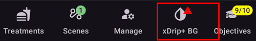
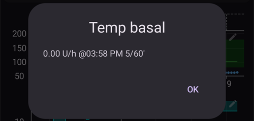
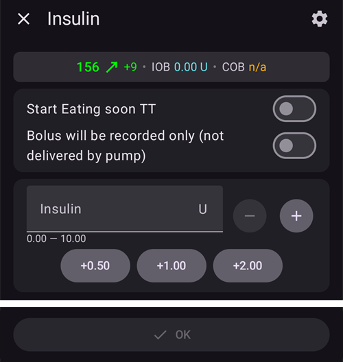
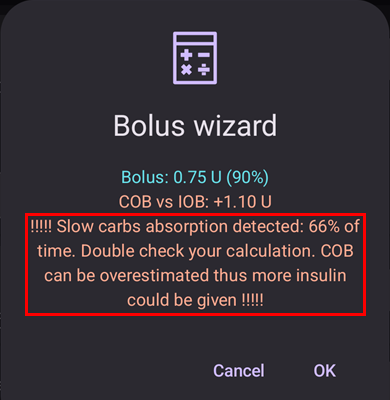

# Pantallas de AAPS

```{contents}
:backlinks: entry
:depth: 2
```

(the-homescreen)= (AapsScreens-the-homescreen)=

## La pantalla principal


Esta es la primera pantalla que verás al abrir **AAPS**, y contiene la mayor parte de la información que necesitarás cada día.

### Sección A - Barra superior

* El **menú** (☰) de la izquierda abre el panel de navegación con **Historial de tratamientos**, **Explorador de historial**, **Estadísticas**, **Ayudante de perfil**, **Mantenimiento**, **Asistente de configuración**, **Configuración** y más.
* La **barra de búsqueda** encuentra ajustes, diálogos y documentación: solo empieza a escribir (consulta [Búsqueda global](../DailyLifeWithAaps/GlobalSearch.md)).
* El icono de **Ajustes** (engranaje) de la derecha abre todos los [ajustes](../SettingUpAaps/Preferences.md).

(aaps-screens-profile--target)=

### Sección B - Bloque de estado

#### Glucosa en sangre actual

La última lectura de glucosa de tu MCG se muestra en el círculo grande de la izquierda, junto con la diferencia con la lectura anterior (delta) y la antigüedad de la lectura.

El color del valor de glucosa indica su estado respecto al [rango](#Preferences-range-for-visualization) definido.

* Verde = En rango
* Rojo = Por debajo del rango
* Amarillo = Por encima del rango

  

(loop-status)= (AapsScreens-loop-status)=

#### Estado del lazo


Junto al círculo de glucosa, un icono muestra el modo de funcionamiento del lazo (de arriba abajo en la imagen):

1. Círculo verde = [lazo cerrado](#KeyAapsFeatures-ClosedLoop), lazo funcionando
2. Círculo morado con línea de puntos = [suspensión por glucosa baja (LGS)](#KeyAapsFeatures-LGS)
3. Círculo azul con línea de puntos = [lazo abierto](#KeyAapsFeatures-OpenLoop)
4. Círculo rojo con cruz = lazo desactivado (no funciona de forma permanente)
5. Icono rojo de pausa = lazo suspendido (en pausa temporal, pero se administra la insulina basal). El tiempo restante se muestra junto al icono
6. Círculo gris con enchufe = bomba desconectada (temporalmente no se administra nada de insulina). El tiempo restante se muestra junto al icono

Pulsa el icono para abrir el diálogo del lazo. El contenido del diálogo depende del estado actual:

* Mientras el lazo está **funcionando** (cerrado, abierto o LGS), puedes cambiar el modo de funcionamiento (Lazo cerrado, Suspensión por glucosa baja (LGS), Lazo abierto o Desactivar lazo), **suspender** el lazo o **desconectar** la bomba durante el tiempo que elijas.
* Mientras el lazo está **desactivado**, puedes volver a activarlo eligiendo un modo de funcionamiento, o desconectar la bomba.
* Mientras el lazo está **suspendido**, puedes **reanudarlo**, desconectar la bomba o elegir una nueva duración en **Suspender el lazo** para alargar la suspensión.
* Mientras la bomba está **desconectada**, puedes **volver a conectar** la bomba o elegir una nueva duración en **Desconectar bomba** para alargar la desconexión.

Cuando alargas una suspensión o una desconexión, la nueva duración **empieza ahora**: sustituye al tiempo restante, no se suma a él. No tienes que reanudar ni volver a conectar antes.

El diálogo mientras el lazo funciona en lazo cerrado:


El diálogo mientras el lazo está suspendido, con **Reanudar** y las duraciones para alargar la suspensión:


El diálogo mientras la bomba está desconectada, con **Vuelve a conectar la bomba** y las duraciones para alargar la desconexión:


El diálogo en Suspensión por glucosa baja (LGS), en lazo abierto y con el lazo desactivado solo cambia en los modos de funcionamiento que ofrece:


Así se ve la pantalla principal en cada modo. La banda de color de la parte superior del gráfico cambia en el momento del cambio de modo.

Suspensión por glucosa baja (LGS):


Lazo abierto:


Lazo desactivado:


Lazo suspendido: el tiempo restante se muestra junto al icono:


Bomba desconectada: el tiempo restante se muestra junto al icono. Los botones de tratamiento siguen en la barra de Lanzamiento rápido, así que puedes seguir registrando la insulina puesta con pluma o los carbohidratos:


Después de cada selección hay que confirmar.

```{admonition} Alarma: la bomba no aceptó la basal temporal de cero :class: warning Mientras la bomba está desconectada, **AAPS** mantiene una basal temporal de cero en la bomba y la vuelve a poner si falta. Si esto sigue fallando después de 10 minutos, **AAPS** da una alarma urgente: *«La bomba no aceptó la basal temporal de cero. Es posible que aún esté administrando insulina basal. Comprueba la bomba».* La alarma se repite cada 15 minutos hasta que se pone la basal temporal de cero o termina la desconexión. Si la ves, comprueba tu bomba: puede estar administrando insulina basal aunque **AAPS** la muestre como desconectada.

    <br />Nota: los modos que se ofrecen dependen de tu progreso en los [Objetivos](../SettingUpAaps/CompletingTheObjectives.md). Lazo cerrado y LGS solo están disponibles a medida que los completas.
    
    (aaps-screens-bg-warning-sign)=
    #### Señal de aviso de glucosa
    
    Si **AAPS** detecta un problema con las lecturas de glucosa que recibe, aparece en la barra inferior de la pantalla principal un acceso directo a tu fuente de glucosa (con su nombre, por ejemplo **xDrip+ BG**), con una marca roja de aviso. Tócalo para abrir la [pantalla de la fuente de glucosa](#aaps-screens-bg-source).
    
    ##### Datos de glucosa duplicados
    
    La señal roja de aviso te indica que debes actuar de inmediato: estás recibiendo **datos de glucosa duplicados**, y esto impide que el lazo haga bien su trabajo. **AAPS** no puede calcular de forma fiable la tendencia de tu glucosa con lecturas duplicadas, así que deja de corregir.
    
    Si tu lazo estaba cerrado, **AAPS** lo cambia al modo [Suspensión por glucosa baja (LGS)](#KeyAapsFeatures-LGS): el icono del lazo se pone morado.
    
      
    
    Pulsa el icono del lazo: la tarjeta **Restricciones** de arriba te dice el motivo: «BgQualityCheck: Modo LGS debido a valores duplicados en la fuente de glucosa».
    
      
    
    ```{admonition} Tu lazo funciona en Suspensión por glucosa baja (LGS)
    :class: note
    Tu lazo sigue funcionando, pero solo para protegerte de las bajadas: **AAPS** todavía puede reducir o suspender tu basal, pero no administrará ninguna insulina de corrección hasta que resuelvas este problema.
    

Tienes que averiguar por qué recibes datos de glucosa duplicados:

* ¿Está activado Dexcom bridge en tu sitio de Nightscout? Desactiva el bridge en el panel de administración de tu instancia de Nightscout: edita la variable «enable» y quita la parte «bridge». (Para Heroku, [aquí encontrarás los detalles](https://nightscout.github.io/troubleshoot/troubleshoot/#heroku).)
* ¿Varias fuentes suben tu glucosa a Nightscout? Si usas la app BYODA, activa la subida en **AAPS**, pero no la actives en xDrip, si lo usas.
* ¿Tienes algún seguidor que recibe tu glucosa pero también la vuelve a subir a tu sitio de Nightscout?
* Último recurso: en los [ajustes de NSClient](#Preferences-nsclient), elige los ajustes de Sincronización y desactiva la opción «Recibir datos de MCG desde NS».

Para quitar el aviso de inmediato y que tu lazo vuelva a corregir, borra las entradas duplicadas en la pantalla de la fuente de glucosa: toca el acceso directo de la barra inferior. La lectura duplicada se marca en rojo. Mantén pulsada una lectura para empezar a seleccionar, marca los duplicados y toca el icono de la papelera arriba a la derecha.


Sin embargo, cuando hay muchos duplicados, puede ser más fácil

* [hacer una copia de seguridad de tus ajustes](../Maintenance/ExportImportSettings.md),
* restablecer la base de datos en el menú de mantenimiento y
* [importar tus ajustes](../Maintenance/ExportImportSettings.md) de nuevo

    {admonition} Vuelve tú a Lazo cerrado
    :class: important
    **AAPS** no vuelve solo a **Lazo cerrado** cuando ya no hay duplicados. Pulsa el icono del lazo en la pantalla principal y elige de nuevo **Lazo cerrado**.

##### Datos de glucosa planos

Con algunas fuentes de glucosa (Libre 1, AiDEX, Glutec, Medtronic y las fuentes que no informan de su tipo de sensor), **AAPS** también comprueba si hay lecturas que no cambian: si tu glucosa ha cambiado menos de 2 mg/dl (0,1 mmol/l) durante 45 minutos, los datos se consideran erróneos. Entonces el acceso directo a la fuente de glucosa muestra una marca roja de tendencia plana, y el lazo detiene cualquier basal temporal alta y no administra insulina de corrección hasta que las lecturas vuelvan a cambiar. Revisa tu sensor y la app que envía las lecturas.

##### Datos de glucosa irregulares

Cuando las lecturas llegan a intervalos irregulares o faltan algunas, **AAPS** recalcula valores cada 5 minutos a partir de las lecturas que tiene. Esto pasa, por ejemplo, después de un cambio de sensor o con los sensores Libre, cuyo horario se desplaza uno o dos minutos cada pocas horas. El lazo sigue funcionando y no tienes que hacer nada. **AAPS** 4 ya no muestra una señal amarilla de aviso por esto.

#### Perfil actual

El perfil actual se muestra junto al icono de la estrella.

Toca el nombre del perfil para abrir la [pantalla Perfil](#aaps-screens-profile), donde puedes ver los detalles del perfil y [cambiar entre distintos perfiles](../DailyLifeWithAaps/ProfileSwitch-ProfilePercentage.md).

Para **cambiar el porcentaje del perfil** (y su duración), toca el nombre del perfil y luego toca el botón redondo **▶** (Activar) abajo a la derecha de la pantalla Perfil. En **AAPS** 3.x esta pantalla se abría manteniendo pulsado el nombre del perfil; en **AAPS** 4 mantenerlo pulsado no hace nada. Paso a paso: [Cambiar el porcentaje del perfil](#ProfileSwitch-change-percentage).


1. Vista normal con la activación de un perfil estándar.
2. Cambio de perfil con un porcentaje concreto del 90 % y una duración restante de 9 minutos. El nombre del perfil se pone amarillo mientras funciona un cambio de perfil temporal.
3. Cambio de perfil con un desplazamiento horario de 1 hora y una duración restante de 9 minutos.

#### Objetivo


El nivel de glucosa objetivo actual se muestra debajo del nombre del perfil.

Pulsa brevemente el objetivo para abrir la pantalla **[Objetivo temporal](../DailyLifeWithAaps/TempTargets.md)**.

1. Vista normal: el rango objetivo definido en tu perfil.
2. Si hay un objetivo temporal, el objetivo se pone amarillo/naranja con el icono del preajuste usado, y el tiempo restante en minutos se muestra entre paréntesis.

(AapsScreens-visualization-of-dynamic-target-adjustment)=

#### Visualización del ajuste dinámico del objetivo

Cuando usas el [algoritmo SMB](#Config-Builder-aps) y la función [Autosens](#Open-APS-features-autosens), **AAPS** puede ajustar tu objetivo de forma dinámica según la sensibilidad.

Activa una o las dos opciones siguientes en los [ajustes de OpenAPS SMB](#Preferences-openaps-smb-settings):

* «La sensibilidad eleva el objetivo» y/o
* «La resistencia baja el objetivo»

Si **AAPS** detecta resistencia o sensibilidad, el objetivo cambia respecto al definido en el perfil, y el objetivo mostrado cambia de color para indicar el ajuste.

(aaps-screens-iob-cob-basal-sens)=

#### IOB, COB, basal y sensibilidad


1. **Jeringa**: insulina activa (IOB): cantidad de insulina activa dentro de tu cuerpo  
    La insulina activa sería cero si solo estuviera funcionando tu basal estándar y no quedara insulina de bolos anteriores. 
    * La IOB puede ser negativa si recientemente ha habido períodos de basal reducida.
    * Pulsa el chip para ver la división entre insulina de bolo y basal (primer diálogo de la imagen; aquí con una IOB negativa después de un período de basal reducida)
2. **Grano**: [carbohidratos activos (COB)](../DailyLifeWithAaps/CobCalculation.md): carbohidratos que comiste antes y que aún no se han absorbido
3. El botón verde azulado de la derecha muestra la **administración basal actual**: una línea plana cuando funciona la basal del perfil, y otro icono mientras está activa una tasa basal temporal
4. La **fila de porcentaje** muestra la sensibilidad actual ([Autosens](#Open-APS-features-autosens) / [DynamicISF](../DailyLifeWithAaps/DynamicISF.md)). Cuando el lazo cambia tu ISF, la fila también muestra el ISF del perfil, una flecha y el ISF que usa ahora el lazo, por ejemplo «80% 2,0 ↗ 2,5». Púlsala para ver el valor de Autosens y el ISF efectivo (segundo diálogo de la imagen). Si el lazo trabaja con un valor distinto del último resultado de Autosens (por ejemplo, porque un objetivo temporal cambia tu sensibilidad), el diálogo también muestra ese valor como **Autosens in algorithm**. Cuando Autosens está desactivado, el lazo mantiene el ISF de tu perfil y no se muestra ningún ISF efectivo.

El diálogo de IOB, que se abre al pulsar el chip de IOB:


Pulsa el botón verde azulado para ver la tasa basal temporal que está funcionando, cuándo empezó y cuánto tiempo lleva funcionando:



(aaps-screens-carbs-required)=

#### Carbohidratos requeridos


La sugerencia de carbohidratos se produce cuando el algoritmo de referencia detecta que van a ser necesarios.

Esto ocurre cuando el algoritmo oref cree que no puede protegerte con una basal temporal a cero, y necesitarás carbohidratos para corregirlo.

Las notificaciones de carbohidratos son mucho más sofisticadas que las del asistente de bolo. Puede que veas una sugerencia de carbohidratos aunque el asistente de bolo no muestre carbohidratos que faltan.

Las notificaciones de carbohidratos requeridos se pueden enviar a Nightscout si quieres. En ese caso, se mostrará y se difundirá un aviso.

### Sección C - Fila de estado


La fila de estado da un aviso visual para

* Edad de la cánula
* Edad de la insulina (días que se usa el reservorio) y nivel del reservorio (unidades)
* Edad del sensor
* Edad y nivel de la batería de la bomba (%)

Cuando se supera el umbral de advertencia, los valores se muestran en amarillo.

Cuando se supera el umbral crítico, los valores se muestran en rojo.

The age is always shown in its short form, whatever the screen size: *4h* on the first day, *3d4h* later.

Los umbrales se pueden cambiar con el pequeño icono de **Ajustes** que aparece cuando la fila de estado está **ampliada** (flecha de la derecha). Consulta [Luces de estado](#Preferences-status-lights).

El panel de estado ampliado también tiene un botón al final de algunas filas para registrar un cambio, que reinicia la edad correspondiente: **Añadir** en la fila **Sensor** registra una inserción de sensor. Si tu bomba lo permite, aparece **Cebar/Llenar** en las filas **Cánula** (o **Bomba parche**) e **Insulina**, y **Añadir** en la fila **Batería de la bomba**.


Según la bomba que uses, puede que no tengas todos estos iconos.

(screens-sensor-level-battery)=

#### Nivel del sensor (batería)

Funciona con MCG que tienen un transmisor adicional, como MiaoMiao 2. (Técnicamente, el sensor tiene que enviar a xDrip la información del nivel de batería).

Los umbrales se pueden configurar en [Luces de estado](#Preferences-status-lights).

(aaps-screens-main-graph)=

### Sección D - Gráfico principal


El gráfico muestra tu glucosa en sangre (BG) leída por tu monitor de glucosa (MCG).

Usa los gestos de desplazar y de pellizcar para hacer zoom en el gráfico y cambiar el período de tiempo visible.

El área verde muestra tu rango objetivo.

Esta información también se muestra en este gráfico:

* Bolos manuales: triángulo azul justo encima de la curva de glucosa, que apunta hacia abajo a la lectura de ese momento, con la cantidad de insulina
* Entradas de carbohidratos: triángulo naranja justo debajo de la curva de glucosa, que apunta hacia arriba a la lectura, con la cantidad de carbohidratos. Una comida introducida con su bolo se ve como una sola marca, dividida por la lectura.
* Los triángulos tienen tres tamaños (pequeño, mediano, grande), según la cantidad comparada con la mayor del día. Si no hay lectura de glucosa en ese momento (hueco del sensor), el triángulo se dibuja en la parte inferior del gráfico.
* Mediciones de glucosa y calibraciones: se dibujan en su propio valor medido, para que puedas compararlas con la curva del sensor
* Objetivo definido en el perfil o modificado por un objetivo temporal: línea verde
* Cambios de perfil: iconos de estrella en la parte superior del gráfico
* Estado del lazo: banda de color en la parte superior del gráfico cuando el [modo de funcionamiento](#AapsScreens-loop-status) no es lazo cerrado: azul = lazo abierto, morado = LGS, rojo = lazo desactivado, amarillo = lazo suspendido, gris = bomba desconectada, naranja = superbolo (en la captura: morado y luego amarillo). El historial de estos cambios aparece en [Modo de funcionamiento](#AapsScreens-running-mode)
* Los [SMB](#Open-APS-features-super-micro-bolus-smb) no se dibujan en el gráfico de glucosa (habría uno cada pocos minutos): se muestran en el [gráfico de IOB](#aaps-screens-iob).

Toca una **medición de glucosa** en el gráfico para ver su valor, y su nota si escribiste una.

(aaps-screens-graph-press-and-hold)=

#### Ver los valores de un momento concreto

**Mantén pulsado** el gráfico de glucosa un momento para ver los valores de una lectura. Un punto marca la lectura más cercana, se dibuja una línea discontinua en ese momento en todos los gráficos, y una ventana emergente en la parte superior del gráfico muestra:

* la hora y el valor de glucosa
* IOB, COB (solo cuando es mayor de 0 g) y la tasa basal en ese momento. El icono de basal muestra si había una tasa basal temporal, igual que en la pantalla principal
* cualquier bolo, SMB o carbohidratos en ese momento, con los mismos triángulos que en los gráficos

Mantén el dedo en la pantalla y muévelo a izquierda o derecha para pasar de una lectura a la siguiente. Notas una ligera vibración en cada lectura, y el gráfico no se desplaza mientras haces esto. La ventana emergente se queda 2 segundos después de levantar el dedo.

Esto funciona igual en los [gráficos adicionales](#aaps-screens-additional-graphs) debajo del gráfico de glucosa (IOB, COB...): mantén pulsado cualquiera de ellos.


(aaps-screens-graph-clock-change)=

#### Clock changes

When the clock of the phone jumped, at a daylight saving change or in a new time zone, a dashed vertical line marks that moment in the BG graph, with a small clock icon at its foot. The same dashed line runs through the [additional graphs](#aaps-screens-additional-graphs) below.


(AapsScreens-activate-optional-information)=

#### Activar información opcional

Pulsa el icono del **lápiz** en la esquina superior derecha del gráfico para abrir los ajustes del gráfico:


* **Altura del gráfico** cambia la altura con la que se dibuja el gráfico.
* **ACT** superpone la curva de actividad de la insulina: una línea continua amarillo verdosa <span style="background:#141218;color:#D3F166;padding:0 0.3em;border:1px solid #141218;border-radius:4px">━━━━</span> (no la confundas con la predicción UAM amarilla de puntos)
* **PRED** superpone las [líneas de predicción](#aaps-screens-prediction-lines) (ver más abajo)

(aaps-screens-prediction-lines)=

#### Líneas de predicción

Cuando **PRED** está activado, AAPS dibuja sus predicciones como **líneas de puntos** a la derecha de la línea de «ahora». Cada predicción tiene su propio color. El tema oscuro usa tonos más claros de los mismos colores, y una línea dentro del rango objetivo verde puede verse un poco más verde.

| Línea                     | Tema claro                                                                                                                        | Tema oscuro                                                                                                                        | Qué predice                               |
| ------------------------- | --------------------------------------------------------------------------------------------------------------------------------- | ---------------------------------------------------------------------------------------------------------------------------------- | ----------------------------------------- |
| **IOB** (azul)            | <span style="background:#FFFFFF;color:#1E88E5;padding:0 0.3em;border:1px solid #CCCCCC;border-radius:4px">●●●●</span>             | <span style="background:#141218;color:#64B5F6;padding:0 0.3em;border:1px solid #141218;border-radius:4px">●●●●</span>              | solo insulina                             |
| **COB** (naranja)         | <span style="background:#FFFFFF;color:#FB8C00;padding:0 0.3em;border:1px solid #CCCCCC;border-radius:4px">●●●●</span>             | <span style="background:#141218;color:#FFB74D;padding:0 0.3em;border:1px solid #141218;border-radius:4px">●●●●</span>              | carbohidratos activos                     |
| **UAM** (amarillo)        | <span style="background:#FFFFFF;color:#C9BD60;padding:0 0.3em;border:1px solid #CCCCCC;border-radius:4px">●●●●</span>             | <span style="background:#141218;color:#E6D39A;padding:0 0.3em;border:1px solid #141218;border-radius:4px">●●●●</span>              | comida no anunciada                       |
| **ZT** (cian)             | <span style="background:#FFFFFF;color:#00D2D2;padding:0 0.3em;border:1px solid #CCCCCC;border-radius:4px">●●●●</span>             | <span style="background:#141218;color:#4DD4D4;padding:0 0.3em;border:1px solid #141218;border-radius:4px">●●●●</span>              | basal temporal a cero (insulina detenida) |
| **aCOB** (naranja pálido) | <span style="background:#FFFFFF;color:rgba(251,140,0,0.5);padding:0 0.3em;border:1px solid #CCCCCC;border-radius:4px">●●●●</span> | <span style="background:#141218;color:rgba(255,183,77,0.5);padding:0 0.3em;border:1px solid #141218;border-radius:4px">●●●●</span> | solo el antiguo algoritmo AMA             |

Cuando dos predicciones dan los mismos valores, sus puntos se superponen y solo ves uno de los colores (por ejemplo, UAM encima de IOB cuando la glucosa está estable).

* Línea **COB** (naranja): [carbohidratos activos](CobCalculation) (en AAPS se usa siempre el naranja para COB y carbohidratos)
    
    Esta línea de predicción muestra hacia dónde irá tu glucosa (¡no los COB!) según los ajustes actuales del **Perfil**, suponiendo que las desviaciones por la absorción de carbohidratos se mantienen constantes. Esta línea sólo aparece si se conocen los carbohidratos (COB).

* Línea **IOB** (azul): insulina activa (en AAPS se usa siempre el azul para IOB e insulina)
    
    Esta línea de predicción muestra qué pasaría solo con el efecto de la insulina. Por ejemplo, si te pusiste insulina y luego no comiste carbohidratos.

* Línea **ZT** (cian): basal temporal a cero (glucosa prevista si se pusiera una tasa basal temporal del 0 %)
    
    Esta línea de predicción muestra cómo cambiaría la trayectoria de la glucosa si la bomba detuviera toda la administración de insulina (TBR del 0 %). La línea se detiene cuando sube por encima de tu objetivo.
    
    *Esta línea solo aparece cuando se usa el algoritmo [SMB](#Config-Builder-aps).*

* Línea **UAM** (amarillo): [comidas no anunciadas](#SensitivityDetectionAndCob-sensitivity-oref1)
    
    Las comidas no anunciadas significan que se detecta un aumento significativo en los niveles de glucosa, debido a las comidas, la adrenalina u otras influencias. Esta línea de predicción es parecida a la **línea naranja de COB**, pero supone que las desviaciones bajarán a un ritmo constante (prolongando el ritmo actual de reducción).
    
    *Esta línea solo aparece cuando se usa el algoritmo [SMB](#Config-Builder-aps), **Habilitar UAM** está activado en los ajustes de OpenAPS SMB y la glucosa sube más de lo que explica la insulina sola.*

* Línea **aCOB** (naranja pálido y transparente): absorción acelerada de carbohidratos
    
    Parecida a COB, pero suponiendo una absorción fija de carbohidratos de 10 mg/dl/5m (-0,555 mmol/l/5m). Obsoleto y de utilidad limitada.
    
    *Esta línea solo aparece cuando se usa el antiguo algoritmo [AMA](#Config-Builder-aps).*

Por lo general, la curva de glucosa real terminará en medio de estas líneas, o más cerca de la que hace las predicciones que más se acerquen a la situación real.

(aaps-screens-how-predictions-become-a-dosing-decision)=

#### Cómo AAPS convierte las predicciones en una decisión de dosis

AAPS no dosifica la insulina solo según tu glucosa actual. En cada ciclo del lazo (más o menos cada 5 minutos) mira todas las líneas de predicción de arriba a la vez y calcula la opción más segura.

La regla básica es **la seguridad primero**: si *cualquier* línea de predicción, en cualquier momento, baja de tu umbral de seguridad bajo, AAPS pone una basal temporal a cero (tasa basal temporal del 0 %) y no da más insulina, aunque tu glucosa actual esté alta. Solo cuando todas las líneas de predicción se quedan por encima de ese umbral, AAPS considera dar más insulina.

Cuando es seguro dar más insulina, AAPS mira dónde se prevé que termine la glucosa (la **glucosa final**, eventual BG) según las predicciones combinadas, y calcula cuánta corrección hace falta para llevar esa glucosa final de vuelta al objetivo. La administra con una tasa basal temporal más alta o (si está activado el algoritmo oref1/[SMB](#Open-APS-features-super-micro-bolus-smb)) con un pequeño bolo inmediato. Si la glucosa está alta ahora pero ya baja lo suficiente por sí sola, AAPS espera, o incluso puede reducir la tasa basal, en lugar de añadir insulina que solo haría todavía más baja una hipoglucemia posterior.

Para ver ejemplos de esta lógica de decisión con capturas reales, consulta los [escenarios de dosificación de la guía para médicos](#clinicianguide-dosing-scenarios). Se escribieron para médicos, pero sirven para cualquier usuario de AAPS.

*Para la explicación técnica completa de cómo se calculan estas predicciones y la decisión de dosis resultante, consulta la [documentación de determine-basal de OpenAPS](https://openaps.readthedocs.io/en/latest/docs/While%20You%20Wait%20For%20Gear/Understand-determine-basal.html).*

#### Basales

Una línea **azul continua** muestra la administración basal de tu bomba, y refleja la administración real a lo largo del tiempo.

La línea **azul punteada** es la tasa basal que habría si no hubiera ajustes temporales de la basal (TBR).

Cuando se administra la tasa basal estándar, el área bajo la curva se muestra en azul oscuro. Cuando la tasa basal se ajusta temporalmente (sube o baja), el área bajo la curva se muestra en azul claro.

#### Actividad

La línea **amarilla fina** muestra la actividad de la insulina.

Se basa en la bajada esperada de la glucosa por la insulina en tu cuerpo, si no hubiera otros factores (como carbohidratos).

(AapsScreens-section-g-additional-graphs)= (aaps-screens-additional-graphs)=

### Sección E - Gráficos adicionales

Puedes activar gráficos adicionales debajo del gráfico principal. En [Modo sencillo](#preferences-simple-mode), los gráficos adicionales vienen predefinidos y no se pueden cambiar. Desactiva el **Modo sencillo** si quieres configurar tú mismo los gráficos adicionales.

Los gráficos adicionales siguen al gráfico principal: cuando desplazas o haces zoom en el gráfico de glucosa, se mueven con él. Arrastrar de lado un gráfico adicional también desplaza todos los gráficos. No tienen etiquetas de hora propias: lee la hora en el gráfico de glucosa.

Para configurar un gráfico adicional, pulsa el icono del **lápiz** en su esquina superior derecha:


Selecciona los chips de los datos que quieres ver en este gráfico; el botón **Eliminar** borra el gráfico.

Para crear otro gráfico, pulsa **Añadir gráfico** debajo del último gráfico y selecciona sus chips de la misma forma:


El gráfico nuevo se añade debajo de los demás. Aquí, un segundo gráfico adicional con **SENS%** y **DEV**:


A la mayoría de usuarios les basta la siguiente configuración de gráficos adicionales:

* Gráfico 1 con IOB, COB, Cambio de sensibilidad
* Gráfico 2 con Desviaciones y BGI.

#### Insulina absoluta (ABS)

Insulina activa, incluyendo bolos **y basal**.

(aaps-screens-iob)=

#### Insulina activa (IOB)

Muestra la insulina que tienes "a bordo" (la insulina activa que tiene tu cuerpo). Esto incluye la insulina de bolos y de basales temporales (**pero quedan excluidas las tasas basales establecidas en tu perfil**).

Si no hubiera [SMB](#Open-APS-features-super-micro-bolus-smb), ni bolos, ni TBR durante el tiempo de DIA, sería cero.

Los SMB se muestran en este gráfico como triángulos azules, en tres tamaños según la cantidad comparada con el SMB más grande del día.

La IOB puede ser negativa, si no queda ningún resto de bolo previo y tenemos una basal temporal a cero o baja durante mucho tiempo.

La disminución depende de tus [ajustes de DIA y del tipo de insulina](#Config-Builder-insulin-dia).

#### Carbohidratos en cuerpo (COB)

Muestra los carbohidratos que tienes "a bordo" (los activos, que aún no han sido absorbidos en tu cuerpo).

La disminución depende de las [desviaciones que detecta el algoritmo](../DailyLifeWithAaps/CobCalculation.md).

Si se detecta una absorción de carbohidratos más alta de lo esperado, se administrará más insulina, lo que aumentará la IOB (más o menos, dependiendo de la configuración de seguridad).

#### Cambio de sensibilidad (SENS%)

Muestra la sensibilidad que ha detectado [Autosens](#Open-APS-features-autosens).

La sensibilidad es el cálculo de la sensibilidad a la insulina como resultado del ejercicio, las hormonas, etc.

Nota: necesitas estar en el [Objetivo 8](#objectives-objective8) para que la detección de sensibilidad/[Autosens](#Open-APS-features-autosens) ajuste automáticamente la cantidad de insulina administrada. Antes de llegar a ese objetivo, la línea del gráfico solo se muestra como información.

### Sensibilidad variable (VSENS)

Muestra la sensibilidad calculada por [DynamicISF](../DailyLifeWithAaps/DynamicISF.md). Solo tiene datos si usas esta función.

(screen-heart-rate-steps)=

#### Frecuencia cardíaca (RC) y pasos

Estos datos pueden estar disponibles si usas un [reloj inteligente Wear OS](../WearOS/WearOsSmartwatch.md). Actívalos en la app **AAPS** Wear y da permiso para los datos de salud.

Steps are drawn as columns, and the heart rate as a curved line that breaks where the watch sent no data.

#### Desviaciones (DEV)

* Las barras **grises** muestran una desviación debida a los carbohidratos.
* Las barras **verdes** muestran que la glucosa está más alta de lo que el algoritmo esperaba. Las barras verdes se usan para aumentar la resistencia en [Autosens](#Open-APS-features-autosens).
* Las barras **rojas** muestran que la glucosa está más baja de lo que el algoritmo esperaba. Las barras rojas se usan para aumentar la sensibilidad en [Autosens](#Open-APS-features-autosens).
* Las barras **amarillas** muestran una desviación debida a UAM.
* Las barras **negras** muestran pequeñas desviaciones que no se tienen en cuenta para la sensibilidad

#### Impacto de la glucosa en sangre (-BGI)

Esta línea muestra cuánto «debería» subir o bajar la glucosa solo por la actividad de la insulina.


Es buena idea mostrar esta línea junto con las barras de desviación. Comparten la misma escala, pero es distinta de la de los otros datos opcionales. Por eso es buena idea mostrarlas en un gráfico aparte, como se ve arriba. Comparar la línea BGI con las barras de desviación es otra forma de entender cómo varía la **glucosa**. Aquí, en el momento marcado con **1**, las barras de desviación están muy por encima de la línea BGI: la glucosa sube más de lo que explica la actividad de la insulina sola (por ejemplo, después de comer carbohidratos). En el momento marcado con **2**, las barras de desviación están por debajo de cero (rojas): la glucosa está más baja de lo que el algoritmo esperaba.

### Sección F - Barra de Lanzamiento rápido


La barra flotante de la parte inferior de la pantalla contiene tus acciones de **[Lanzamiento rápido (QuickLaunch)](../DailyLifeWithAaps/QuickLaunch.md)**. El pequeño **engranaje** abre la configuración de Lanzamiento rápido, donde eliges qué botones se muestran (tratamientos, entradas del Portal de cuidados, acciones del MCG, las pantallas del panel **Administrar**, botones de [Asistente rápido](../DailyLifeWithAaps/QuickWizards.md), [Escenas](../DailyLifeWithAaps/Scenes.md) y más).

Arriba se muestra una configuración típica: **Insulina**, **Carbohidratos** y el **Asistente de bolo**.

Mientras la bomba está **desconectada**, los botones de tratamiento siguen en la barra, por ejemplo para registrar la insulina puesta con pluma (consulta [Insulina](#aaps-screens-buttons-insulin) más abajo). Las mismas acciones también están en el [panel Tratamientos](#aaps-screens-treatments-sheet) de la navegación inferior.

(aaps-screens-buttons-insulin)=

#### Insulina



Para administrar una cantidad de insulina sin usar el [asistente de bolo](#aaps-screens-bolus-wizard).

Si activas **Iniciar OT Comiendo Pronto**, puedes iniciar automáticamente tu [objetivo temporal de comida pronto](#TempTargets-eating-soon-temp-target).

Si no quieres poner el bolo con la bomba, sino registrar una cantidad de insulina (es decir, insulina puesta con pluma), activa «**El bolo sólo se anotará**». Una fila adicional **Tiempo**, puesta en **Ahora**, te permite registrar una inyección de insulina hecha en el pasado: usa **-** / **+** para cambiarla, o toca la flecha para escribir los minutos o elegir una fecha y una hora.

 

Puedes usar los botones **+0,5 / +1,0 / +2,0** para aumentar rápidamente la cantidad de insulina. Los valores de estos incrementos se pueden cambiar en los [ajustes del asistente de bolo](#Preferences-deliver-this-part-of-bolus-wizard-result).

El diálogo de insulina también se puede usar cuando la bomba está suspendida o desconectada, por ejemplo para registrar insulina inyectada con pluma. En ese caso, «**El bolo sólo se anotará**» está siempre activado (se muestra en rojo) y aparecen campos adicionales para elegir el tipo de insulina y un desplazamiento de **Tiempo** para una inyección hecha en el pasado:


#### Carbohidratos


Permite registrar carbohidratos sin bolo.

Algunos [objetivos temporales predefinidos](#TempTargets-hypo-temp-target) (Hipo, Comiendo Pronto, Actividad) se pueden iniciar directamente con los interruptores de arriba.

**Hora de los carbohidratos**: cuándo vas a comer o has comido los carbohidratos.

**Duración**: se usa para los [«carbohidratos extendidos»](ExtendedCarbs). Esta fila está plegada para que no escribas en ella los gramos por error: usa **-** / **+** para cambiarla, o toca la flecha para abrirla y escribir un valor.

Puedes usar los botones **+5 / +10 / +20** para aumentar rápidamente la cantidad de carbohidratos.

#### Asistente rápido

Introduce fácilmente la cantidad de carbohidratos y define la base del cálculo con un solo botón preconfigurado.

Los detalles se configuran en [Asistente rápido](../DailyLifeWithAaps/QuickWizards.md).

(aaps-screens-treatments-sheet)=

### Sección G - Navegación inferior

La barra de navegación inferior da acceso a:

* **Tratamientos**: un panel de acciones rápidas con tus acciones de tratamiento:
    
    

* **Escenas**: solo se muestra si tienes al menos una [escena](../DailyLifeWithAaps/Scenes.md) o una regla de **Automatización** marcada como **Acción del usuario**. Abre un panel desde el que puedes iniciarlas; una marca muestra cuántas puedes iniciar ahora mismo. El **lápiz** de la parte superior del panel abre **Administrar → Escenas**.

* **Administrar**: el centro de todo lo que gestionas en **AAPS**: Perfil, Configuración de insulina, Objetivo temporal, Asistente rápido, Escenas, Automatización, Comida, Rotación del sitio, Bomba y Clientes autorizados. Debajo hay acciones del dispositivo y de la basal, como Inserción de sensor y Basal temporal. Algunos elementos solo aparecen si sirven para tu configuración. Por ejemplo, Cebar/Llenar y el cambio de batería dependen de tu bomba, y Basal temporal, Bolo extendido y las entradas del Portal de cuidados están ocultos en [Modo sencillo](#preferences-simple-mode):
    
    

* **Objetivos**: tu progreso en los [Objetivos](../SettingUpAaps/CompletingTheObjectives.md); una marca muestra cuántos has completado. Este elemento desaparece cuando terminas todos los objetivos, y no existe en **AAPSClient**.

(aaps-screens-notifications)=

#### Notificaciones

Puede aparecer una **burbuja de notificaciones** encima de la barra inferior, a la derecha. Reúne las notificaciones activas de **AAPS**; el número pequeño muestra cuántas hay. Su color sigue a la más importante: rojo para un mensaje urgente, verde para una simple información.


Toca la burbuja para abrir el panel de **Notificación**. Cada mensaje muestra la hora en que apareció. Pulsa **Descartar** debajo de un mensaje para quitarlo; algunos mensajes tienen otro botón en su lugar, que te lleva al ajuste que necesita tu atención.


(bolus-wizard)= (aaps-screens-bolus-wizard)=

## Asistente de bolo


Cuando quieras poner un bolo de comida, normalmente lo harás desde aquí.

### Sección I

El encabezado **Cálculo** muestra el bolo calculado. Si la cantidad de insulina a bordo (IOB) es superior al bolo calculado, entonces sólo se mostrará la cantidad de carbohidratos que son necesarios.

El asistente de bolo se puede usar sea cual sea tu **glucosa** actual, también cuando está demasiado alta o demasiado baja. Si la **glucosa** está por encima del objetivo, se añade una corrección al bolo de comida. Si la **glucosa** está por debajo del objetivo, el bolo se reduce y, si la insulina activa ya es más de la necesaria, el asistente te dice cuántos carbohidratos todavía necesitas en lugar de proponer insulina.

La fila de iconos debajo del encabezado muestra qué datos entran en el cálculo (glucosa, tendencia, IOB, objetivo temporal, COB). Al pulsar un icono, activas o desactivas ese dato en el cálculo; el icono **(i)** muestra los números detallados del cálculo.

#### Combinaciones de COB e IOB y su significado

* Por seguridad, el dato de IOB no se puede desactivar cuando COB está activado, porque podrías correr el riesgo de demasiada insulina, ya que **AAPS** no tendría en cuenta lo que ya se ha administrado.
* Si activas COB e IOB, se tienen en cuenta los carbohidratos no absorbidos que aún no están cubiertos con insulina + toda la insulina administrada como TBR o SMB.
* Si activas IOB sin COB, **AAPS** tiene en cuenta la insulina ya administrada, pero no la descuenta de los carbohidratos que aún quedan por absorber. Esto se traduce en que nos aparecerán los "carbohidratos faltantes".
* Si pones un bolo para **comida adicional** poco después de un bolo de comida (p. ej., un postre extra), puede ser útil **desactivar todas las entradas**. De esta manera, solo se añaden los nuevos carbohidratos, ya que la comida principal no necesariamente está absorbida, por lo que la IOB no coincidirá con precisión con los COB poco después de un bolo de comida.
* Por seguridad, un **objetivo temporal** solo se incluye en el cálculo si activas su dato a mano.

(AapsScreens-section-j)=

### Sección J - Campos de entrada

En el campo **Carbohidratos** pones tu estimación de la cantidad de carbohidratos, **en gramos**, para la que quieres el bolo; los botones **+** de debajo añaden carbohidratos rápidamente. **AAPS** solo trabaja con gramos: si cuentas en unidades de pan o raciones (*p. ej.* raciones «CHO» de DAFNE), conviértelas a gramos antes de introducirlas. Consulta la [nota sobre las unidades de pan](#your-aaps-profile-insulin-to-carbs-ratio) en la página del perfil.

#### Tipo de carbohidratos: pan, pastel o pizza

Debajo del campo **Carbohidratos**, los botones **Pan**, **Pastel** y **Pizza** le dicen a **AAPS** lo rápido que se absorbe la comida. Con **Pastel** y **Pizza**, el bolo cubre solo una parte de los carbohidratos ahora, y el resto se añade más tarde como eCarbs. Consulta [Tipo de carbohidratos: pan, pastel o pizza](#AapsScreens-carbs-type) en la página de carbohidratos extendidos para ver los porcentajes y los tiempos.

La fila **Corrección** sirve si quieres cambiar la dosis final por algún motivo.

Solo el campo **Carbohidratos** está siempre abierto. Las otras filas (**Corrección**, **Hora de los carbohidratos**, **Glucosa** y **Porcentaje de uso**) están plegadas: muestran su valor con botones **-** / **+**, para que puedas cambiarlo en pasos pequeños. Toca la flecha para abrir una fila y escribir un valor, y vuelve a tocarla para cerrar la fila. Así evitas escribir gramos en el campo **Corrección** por error.


Toca cualquier parte de la fila **Perfil** para abrir la lista de tus perfiles y luego toca un nombre para usar ese perfil en este cálculo.


El campo **Hora de los carbohidratos** sirve para el prebolo: así le dices al sistema que habrá un retraso antes de que lleguen los carbohidratos. Puedes poner un número negativo en este campo si pones un bolo para carbohidratos que ya comiste antes.

**Establecer alarma** (recordatorio para comer): cuando introduces una hora de carbohidratos en el futuro, aparece un interruptor «**Establecer alarma**» para que se te recuerde, a la hora indicada, que debes comer los carbohidratos que has introducido en **AAPS**:


The reminder starts when the bolus has been delivered. While it runs, a **Time to eat** bar on the main screen counts down, with **Stop** and **+5 min**. **+5 min** moves the end of the wait five minutes later, and the bar shows the total wait. When the time has come, the reminder rings with its own sound, a soft kitchen timer. Besides **Silence alarm** (the screen stays open) and **Silence and close**, the alarm screen offers **+5 min**, which starts a new five-minute wait. Once it has rung, the bar reads *The time is up* with **+5 min** and **Dismiss**; **Silence and close** removes the bar too. The bar and the alarm are also shown on **AAPSClient**, and on the [watch](#WearOsSmartwatch-wizard-carb-time). The reminder does not create a timer in your phone's clock app. If Android does not let **AAPS** set alarms, the wizard asks you to allow *Alarms and reminders* for **AAPS** in the Android settings. The bell is not offered for a carb time in the past.


El campo **Glucosa** normalmente ya contiene la última lectura de tu MCG. Si no dispones de ningún MCG o no está funcionando, el campo aparecerá en blanco. Cuando la lectura es reciente, la fila **Glucosa** se queda plegada. The field follows new readings while the wizard is open, until you change it yourself.

El botón de resultado de abajo muestra el bolo propuesto; al pulsarlo, pide confirmación antes de administrar insulina. While the confirmation is waiting, the loop gives no SMB, so the bolus you confirm is still right. If an SMB is being delivered at that moment, **OK** waits until it has finished.

Conviene saber:

* Si el bolo calculado es mayor que tu **[Bolo máximo](#Preferences-maximum-bolus)**, se reduce al bolo máximo, y la confirmación muestra el aviso «Bolus constraint applied» (restricción de bolo aplicada). En cambio, un [Asistente rápido](../DailyLifeWithAaps/QuickWizards.md) se rechaza.
* Cuando el bolo solo se registra (por ejemplo, mientras la bomba está desconectada), el aviso «**El bolo sólo se anotará**» se queda en la parte superior del diálogo, también cuando te desplazas.
* Un bolo que pones a mano tiene prioridad sobre un [SMB](#Open-APS-features-super-micro-bolus-smb) que espera para administrarse: el SMB se descarta y el lazo vuelve a calcular. Si en este momento se está administrando un SMB, tu bolo se rechaza con el mensaje «Se está administrando un microbolo (SMB) en este momento. Inténtalo de nuevo cuando haya finalizado». No se administra insulina, y los carbohidratos introducidos con ese bolo no se guardan: espera un momento y vuelve a introducirlos.

(AapsScreens-wrong-cob-detection)=

#### Detección de COB incorrectos



Si ves el aviso de arriba después de usar el asistente de bolo, **AAPS** ha detectado que el valor de COB calculado puede ser incorrecto. Así que, si quieres ponerte otro bolo después de una comida anterior con COB, ¡ten cuidado con la sobredosis!

Para más detalles, consulta los consejos de la [página Cálculo de carbohidratos (COB)](#CobCalculation-detection-of-wrong-cob-values).

¿Buscas la pestaña **Acciones** de **AAPS** 3.x? Sus funciones se movieron a la pantalla principal, al panel **Administrar** y a la barra de Lanzamiento rápido: consulta [¿Dónde está la pestaña Acciones?](#screens-action-tab).

(aaps-screens-careportal)=

## Entradas del Portal de cuidados

Las edades y los niveles que se muestran en la [fila de estado](#screens-sensor-level-battery) (sensor, insulina, cánula, batería de la bomba) se basan en entradas del Portal de cuidados: **Cebar/Llenar** (registra los cambios del sitio de la bomba y del cartucho de insulina), **Inserción de sensor** y **Cambio de batería de la bomba**.

Puedes registrarlas desde el panel de estado ampliado de la pantalla principal, desde el panel **Administrar** o con botones de [Lanzamiento rápido](../DailyLifeWithAaps/QuickLaunch.md).

**Cebar/Llenar** registra un cambio del sitio de la bomba y/o un cambio del cartucho de insulina, y puede administrar una cantidad de cebado:


**Inserción de sensor** y **Cambio de batería de la bomba** solo piden la hora del evento:


 Las entradas de ejercicio, aviso, pregunta y nota reflejan el Portal de cuidados de Nightscout y son formas especiales de notas.

En el panel **Administrar**, desplázate hacia abajo y pulsa **Portal de cuidados** para mostrar estas entradas: **Medir glucosa**, **Nota**, **Ejercicio**, **Pregunta** y **Aviso**.


**Medir glucosa**, **Pregunta** y **Aviso** te permiten introducir un valor de glucosa (de un medidor, del sensor o de otra fuente), una nota y la hora del evento. En **Pregunta** y **Aviso**, la fila de glucosa está plegada y muestra el tipo de medición junto al valor: si cambias el valor, el tipo cambia de **Sensor** a **Medidor de glucosa**.


**Nota** y **Ejercicio** te permiten introducir una duración (una fila plegada: usa **-** / **+**, o toca la flecha para escribirla), una nota y la hora del evento:


En todos estos diálogos (**Cebar/Llenar**, **Inserción de sensor**, **Cambio de batería de la bomba** y las entradas del Portal de cuidados), la hora del evento usa la misma fila **Tiempo** que el [diálogo de insulina](#aaps-screens-buttons-insulin) y el asistente de bolo: usa **-** / **+** para mover la hora en pasos de 5 minutos (hasta una semana atrás y 12 horas adelante), o toca la flecha para elegir cualquier fecha y hora.

## Rotación del sitio

**Administrar → Rotación del sitio** registra en un mapa del cuerpo dónde pusiste cada cánula y cada sensor, para que puedas rotar los sitios: consulta [Rotación del sitio](#Aapsscreens-site-rotation) en la página de bombas y cánulas.

La **TDD** (dosis diaria total) y la regla práctica de la proporción basal/bolo se explican en la [pestaña Insulina de Estadísticas](#reviewing-tdd).

(AapsScreens-insulin-profile)=

## Insulina


**Administrar → Configuración de insulina** muestra y gestiona tus configuraciones de insulina. Cada configuración se muestra en una tarjeta con su **pico de acción** y su **[DIA](#Config-Builder-insulin-dia)**; la que está en uso se marca como **ACTIVO**. Debajo de la tarjeta ves la curva de actividad. Puedes editar el nombre, el pico y la DIA de cualquier configuración excepto la activa: para cambiar la insulina que usas, [añade una configuración nueva y actívala](#Config-Builder-insulin-change-active).

Consulta [Duración de la acción de la insulina](#Config-Builder-insulin-dia) para saber más sobre qué es y cómo configurarla.

## Estado de la bomba


**Administrar → Bomba** (o **Configuración → Bomba → Abrir complemento**) muestra el estado de tu bomba: última conexión, tasa basal base, batería, reservorio...

* La información mostrada depende del modelo de bomba que utilicemos.
* Consulta la [página de bombas](../Getting-Started/CompatiblePumps.md) para más detalles.

## Lazo, AMA / SMB

**Configuración → Lazo → Abrir complemento** (y **Configuración → APS → Abrir complemento**) muestran detalles de los cálculos del algoritmo y por qué **AAPS** actúa como actúa: última ejecución, la petición resultante y las restricciones. La pantalla **Lazo** solo muestra las restricciones que de verdad limitaron la tasa basal temporal o el SMB administrados (y por qué no se permite el lazo cerrado, si es el caso); la pantalla **APS** muestra todas las restricciones que entraron en el cálculo.

Los cálculos se hacen cada vez que el sistema recibe una nueva lectura del MCG.

Para más detalles, consulta la [sección APS de la página Configuración](#Config-Builder-aps).

(aaps-screens-profile)=

## Perfil


**Administrar → Perfil** (o tocar el nombre del perfil en la pantalla principal) abre la pantalla Perfil: tus perfiles como un carrusel de tarjetas que puedes deslizar, con botones para añadir, editar, clonar, borrar y **activar** un perfil.

El perfil contiene la información de tus ajustes personales de diabetes. Para más información, consulta la página **[Tu perfil de AAPS](../SettingUpAaps/YourAapsProfile.md)**.

## Automatización


**Administrar → Automatización** muestra tus reglas de automatización. Consulta la página dedicada [aquí](../DailyLifeWithAaps/Automations.md).

## NSClient


**Configuración → Comunicación → NSClientV3 → Abrir complemento** muestra el estado de la conexión con tu sitio de Nightscout: URL, estado del websocket, cola y un registro de la actividad de sincronización.

Los ajustes se pueden cambiar en los [ajustes de NSClient](#Preferences-nsclient).

Para resolver problemas, consulta esta [página](../GettingHelp/TroubleshootingNsClient.md).

(aaps-screens-bg-source)=

## Fuente de glucosa - xDrip, BYODA...


**Configuración → Fuente de glucosa → Abrir complemento** muestra el historial de lecturas del MCG y ofrece la opción de borrar lecturas en caso de fallo (por ejemplo, bajadas falsas por compresión) o de lecturas duplicadas.

## Historial de tratamientos

Abre el **menú** (☰) y elige **Historial de tratamientos** para ver, revisar y corregir todo lo que **AAPS** ha registrado: carbohidratos y bolos, basales temporales, objetivos temporales, cambios de perfil, entradas del Portal de cuidados, cambios de modo del lazo y entradas del usuario. Consulta [Historial de tratamientos](#aaps-screens-treatments) en la página Revisar tus datos.

## Explorador de historial


Abre el **menú** (☰) y elige **Explorador de historial**.

Te permite volver atrás en el historial de **AAPS**. Consulta la página dedicada [Revisar tus datos > Explorador de historial](../Maintenance/Reviewing.md).

(aaps-screens-statistics)=

## Estadísticas


Abre el **menú** (☰) y elige **Estadísticas**.

Te da estadísticas sobre tu dosis diaria total, el tiempo en rango, tu perfil de glucosa a lo largo del día (AGP) y tu patrón del ciclo de insulina, en cuatro pestañas. Consulta la página dedicada [Revisar tus datos > Estadísticas](#reviewing-statistics).

(aaps-screens-profile-helper)=

## Ayudante de perfil

Abre el **menú** (☰) y elige **Ayudante de perfil**.


El Ayudante de perfil te permite comparar perfiles y crear perfiles iniciales para niños. Consulta [Tu perfil de AAPS](../SettingUpAaps/YourAapsProfile.md), secciones [Crear un perfil desde cero para un niño](#your-aaps-profile-profile-from-scratch-for-a-kid) y [Comparar dos perfiles](#your-aaps-profile-compare-profiles).

(aaps-screens-widgets)=

## Widgets de la pantalla de inicio

**AAPS** ofrece cinco widgets que puedes añadir a la pantalla de inicio de tu teléfono, para ver tus datos sin abrir la app. Consulta la página dedicada [Widgets de la pantalla de inicio](../DailyLifeWithAaps/Widgets.md).

