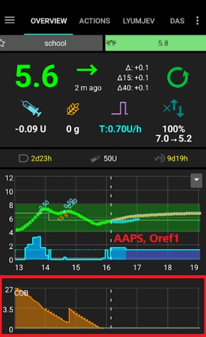

# Cálculo de carbohidratos (COB)

## ¿Cómo calcula AAPS el valor de los carbohidratos (COB)?

Cuando introduces carbohidratos como parte de una comida o de una corrección de carbohidratos, **AAPS** los suma a los carbohidratos activos actuales (**COB**). Después, **AAPS** calcula la absorción de tus carbohidratos a partir de las desviaciones observadas en tus valores de **glucosa**. La velocidad de absorción depende del factor de sensibilidad a los carbohidratos (**CSF**). No es un ajuste de tu **perfil**: **AAPS** lo calcula a partir de los valores de **ISF/I:C**, y depende de cuántos mg/dl sube tu **glucosa** 1 g de carbohidratos.

## Factor de sensibilidad a los carbohidratos

La fórmula que usa **AAPS** es:

- absorbed_carbs = deviation * ic / isf.

El efecto sobre tu **perfil** es el siguiente:

- _aumentar_ el **IC**: aumenta los carbohidratos absorbidos cada 5 minutos y así acorta el tiempo total de absorción;

- _aumentar_ el **ISF**: reduce los carbohidratos absorbidos cada 5 minutos y así alarga el tiempo total de absorción; y

- _cambiar_ el **porcentaje del perfil**: aumenta o reduce los dos valores, así que no cambia el tiempo de absorción de los carbohidratos.

Por ejemplo, si en tu **perfil** el **ISF** es 100 y el **I:C** es 5, tu factor de sensibilidad a los carbohidratos sería 20. Por cada 20 mg/dl que sube tu **glucosa**, **AAPS** calcula 1 g de carbohidratos como absorbido. La **IOB** positiva también influye en el cálculo de los **COB**. Así, si **AAPS** predice que tu **glucosa** bajará 20 mg/dl por la **IOB** y en cambio se queda estable, **AAPS** también calculará 1 g de carbohidratos como absorbido.

Los carbohidratos también se absorben según los métodos descritos abajo, en función del algoritmo de sensibilidad que hayas elegido en tu **AAPS**.

## Sensibilidad de carbohidratos - Oref1

Los carbohidratos no absorbidos se eliminarán después del tiempo especificado:




```{admonition} Older screenshot
:class: note
La captura de pantalla de arriba es de una versión anterior de **AAPS**. En **AAPS** 4 los gráficos se ven un poco distintos, pero el gráfico de **COB** muestra la misma información.
```


## Sensibilidad de carbohidratos - WeightedAverage

La absorción se calcula de forma que los COB sean 0 después del tiempo indicado:


Si se usa la absorción mínima de carbohidratos (min_5m_carbimpact) en lugar del valor calculado a partir de las desviaciones de **glucosa**, aparece un punto naranja en el gráfico de **COB**.

(CobCalculation-detection-of-wrong-cob-values)=
## Detección de valores erróneos de carbohidratos (COB)

**AAPS** te avisará si vas a administrar un bolo con **COB** de una comida anterior y el algoritmo detecta que el cálculo actual de **COB** es incorrecto. En ese caso, te dará una pista adicional en la pantalla de confirmación después de usar el asistente de bolo.

### ¿Cómo detecta AAPS los valores de carbohidratos (COB) erróneos?

Normalmente, __AAPS__ detecta la absorción de carbohidratos a través de las desviaciones de **glucosa**. Si has introducido carbohidratos pero **AAPS** no puede detectar su absorción estimada a través de las desviaciones de **glucosa**, usará el método [min_5m_carbimpact](#Preferences-min_5m_carbimpact) para calcular la absorción (el llamado «fallback» o método de respaldo). Como este método solo calcula la absorción mínima de carbohidratos sin tener en cuenta las desviaciones de **glucosa**, puede dar valores de COB incorrectos.


En la captura de pantalla de arriba, el 66 % del tiempo la absorción de carbohidratos se calculó con min_5m_carbimpact en lugar del valor detectado a partir de las desviaciones. Esto indica que es posible que tuvieras menos **COB** de lo que calculó el algoritmo.

### ¿Cómo actuar ante esta advertencia?

- Plantéate cancelar el tratamiento: pulsa «Cancelar» en lugar de OK.
- Calcula de nuevo tu próxima comida con el asistente de bolo, sin marcar **COB**.
- Si necesitas un bolo de corrección, introdúcelo manualmente.
- ¡Ten cuidado de no administrar una sobredosis ni acumular insulina!


### ¿Por qué el algoritmo no detecta correctamente los carbohidratos (COB)?

Las causas pueden ser:
- Puede que hayas sobrestimado los carbohidratos al introducirlos.
- Actividad o ejercicio después de tu comida anterior.
- El I:C necesita un ajuste.
- El valor de min_5m_carbimpact es incorrecto (el recomendado es 8 con SMB, 3 con AMA).


## Corrección manual de los carbohidratos introducidos

Si los carbohidratos se sobrestimaron o subestimaron, puedes corregirlo en la pantalla **Historial de tratamientos**, como se describe [aquí](#screens-bolus-carbs).


## Corrección de carbohidratos: cómo borrar una entrada de carbohidratos de Tratamientos


La pantalla **Historial de tratamientos** permite corregir una entrada de carbohidratos errónea borrándola. Puede deberse a que sobrestimaste o subestimaste los carbohidratos introducidos:


1. Comprueba y recuerda los valores actuales de **COB** e **IOB** en la pantalla principal de **AAPS**.
2. Abre **Historial de tratamientos** (menú lateral → *Historial de tratamientos*), pestaña **Carbohidratos y bolos**. Según la bomba, los carbohidratos pueden aparecer junto con la insulina en una sola línea o como una entrada aparte (por ejemplo, con Dana RS).
3. **Mantén pulsada** la entrada de carbohidratos errónea: la lista pasa al **modo de selección** con una casilla en cada línea, y la entrada queda marcada (marca **1** arriba). Marca también las demás entradas que quieras borrar.
4. Toca el icono **🗑 Borrar** de la barra superior (marca **2**) y confirma: el diálogo de confirmación muestra exactamente lo que se va a borrar.
5. Comprueba que los carbohidratos se han borrado bien mirando de nuevo los **COB** en la pantalla principal de **AAPS**.
6. Haz lo mismo con la **IOB** si solo hay una línea con carbohidratos e insulina.
7. Si no se borran los carbohidratos como debe ser y se añaden más carbohidratos como se explica en esta sección, el valor de **COB** será demasiado alto y esto podría hacer que **AAPS** administre demasiada insulina.
8. Introduce la cantidad correcta de carbohidratos en el diálogo **Carbohidratos** (**Tratamientos** → **Carbohidratos**) y fija la hora correcta del evento.
9. Si solo había una línea con carbohidratos e insulina, también debes volver a añadir la cantidad de insulina. Asegúrate de fijar la hora correcta del evento y de comprobar la **IOB** en la pantalla principal después de confirmar la nueva entrada.

