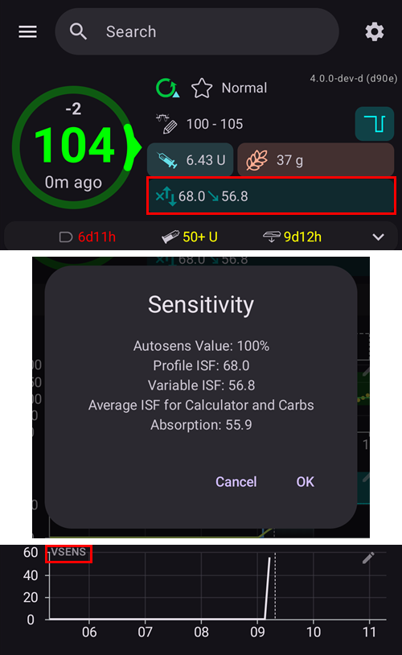

(Open-APS-features-DynamicISF)=
# ISF Dinámico (DynISF)

Hasta ahora, con **AMA** y **SMB**, el **ISF** se definía en el **perfil** y era fijo para cada periodo definido del día. Pero en realidad, el **ISF** de una persona no es tan fijo y varía según su nivel de **glucosa**: con la glucosa alta, la persona necesita más insulina para bajar su **glucosa** 50 mg/dl / 3 mmol/l que con una **glucosa** más baja. [Autosens](#Open-APS-features-autosens) fue el primer algoritmo que intentó resolver este problema, ajustando el **ISF** fuera de las horas de comida.

**ISF Dinámico** (también llamado **DynISF**) tiene el mismo objetivo, pero es más avanzado porque se puede usar en todo momento. Se recomienda solo para usuarios avanzados que dominan bien el control y el seguimiento de su **AAPS**. Lee [Qué tener en cuenta al activar ISF Dinámico](#dyn-isf-things-to-consider-when-activating-dynamicisf) más abajo antes de probarlo.

```{admonition} CAUTION - Automations or Profile Percentage change
:class: warning

Las **automatizaciones** se deben usar siempre con cuidado. Esto es especialmente importante con **ISF Dinámico**.

Cuando uses **ISF Dinámico**, desactiva cualquier cambio temporal de **perfil** que esté en una regla de **Automatización**, porque haría que **ISF Dinámico** fuera demasiado agresivo con los bolos de corrección y provocaría hipoglucemias. Este es precisamente el objetivo de **ISF Dinámico**, así que no hace falta pedir a **AAPS** con una automatización que administre más insulina cuando la **glucosa** está alta.

```

Para usar **ISF Dinámico**, la base de datos de **AAPS** necesita como mínimo 7 días de tus datos de **AAPS**.

## ¿Qué hace ISF Dinámico?

**ISF Dinámico** adapta de forma dinámica el factor de sensibilidad a la insulina (**ISF**) según:

- la dosis diaria total de insulina (**TDD**); y
- los valores de glucosa actuales y previstos.

Cuando usas **ISF Dinámico**, los valores de **ISF** introducidos en el **perfil** ya no se usan para nada, salvo como respaldo si no hay suficientes datos de TDD en la base de datos de **AAPS** (*p. ej.*, después de reinstalar la app desde cero).

**SMB/AMA**: ejemplo de un **perfil** con un **ISF** fijo, definido por el usuario y usado por **SMB** y **AMA**.


**ISF Dinámico**: ejemplo de un **ISF** que cambia según lo que determina **ISF Dinámico**.



La sección marcada con un círculo rojo muestra: `profile ISF` -> `ISF as calculated by DynISF`. <br/> Al tocar esta sección se abre un diálogo con más información, por ejemplo el **ISF** usado para la calculadora y para la absorción de carbohidratos (consulta [Otros usos del ISF](#dynisf-other-usages-of-isf) más abajo).

El valor de **DynISF** también se puede mostrar en un gráfico: toca **Añadir gráfico** debajo de los gráficos de la pantalla principal y selecciona **VSENS** (sensibilidad variable). Se muestra como una línea blanca (parte inferior de la imagen de arriba).

## ¿Cómo se calcula ISF Dinámico?

**ISF Dinámico** usa el modelo de Chris Wilson para determinar el **ISF**, en lugar del valor fijo de **ISF** que definiste en el **perfil**. Hay una explicación detallada aquí: [Chris Wilson on Insulin Sensitivity (Correction Factor) with Loop and Learn, 2/6/2022](https://www.youtube.com/watch?v=oL49FhOts3c) (en inglés).

La ecuación de **ISF Dinámico** implementada es: `ISF = 1800 / ((TDD * DynISF Adjust Factor) * Ln (( current BG / insulin divisor) + 1 ))`

Las variables de esta ecuación se explican más abajo.<br/> Nota: `Ln` es el logaritmo natural, una función matemática.

La implementación usa la ecuación anterior para calcular el **ISF** actual y en las [predicciones de oref1 para **IOB**, **ZT** (basal temporal a cero) y **UAM**](#aaps-screens-prediction-lines). También se usa para los **COB** y en el asistente de bolo (consulta [Otros usos del ISF](#dynisf-other-usages-of-isf) más abajo).

### TDD (dosis diaria total)
La TDD usa una combinación de los siguientes valores:
1.  la **TDD** media de 7 días;
2.  la **TDD** del día anterior; y
3.  una media ponderada de la insulina usada en las últimas ocho (8) horas, extrapolada a 24 horas.

En la ecuación anterior, cada uno de estos valores pesa un tercio en la **TDD** usada.

### Factor de ajuste de ISF dinámico

Se define en tus **Ajustes** y sirve para hacer **ISF Dinámico** más o menos agresivo. Consulta la sección [Preferencias](#dyn-isf-preferences) más abajo.

### Divisor de insulina
El divisor de insulina depende del pico de la insulina utilizada y es inversamente proporcional al tiempo del pico máximo. Para Lyumjev, este valor es 75, para Fiasp, 65 y para la insulina rápida regular, 55.

### ISF basado en la glucosa prevista para las decisiones de dosificación

La sensibilidad dinámica se calcula con el valor de **glucosa actual** y se muestra como tu ISF actual en **AAPS**. Pero al hacer los cálculos de dosis, el algoritmo oref1 calcula y usa en su lugar el **ISF futuro**.

Así se evita administrar demasiada insulina cuando la **glucosa** está baja o se prevé que baje.

El **ISF futuro** usa la misma fórmula descrita arriba, pero puede usar la **glucosa mínima prevista** en lugar de la **glucosa actual**. La **glucosa mínima prevista**, [tal como la calcula oref1](#aaps-screens-how-predictions-become-a-dosing-decision), es el valor más bajo al que se prevé que llegue tu glucosa durante todo el periodo de las predicciones.

* Si la **glucosa** actual está por encima del objetivo<br/> **y** los niveles de **glucosa** están estables, dentro de +/- 3 mg/dl:<br/>en la fórmula se usa la glucosa así: `average(minimum predicted BG, current BG)`.
* Si la **glucosa** final está por encima del objetivo y la glucosa está subiendo,<br/>  
  **o** la **glucosa** final está por encima de la **glucosa** actual:<br/>en la fórmula se usa la glucosa así: `current BG`.
* En los demás casos:<br/>en la fórmula se usa la glucosa así: `minimum predicted BG`.

Para una explicación más sencilla, mira la captura de pantalla de abajo, que muestra la situación descrita arriba. Los puntos naranjas usan la **glucosa prevista**, los puntos morados usan **la media (glucosa prevista, glucosa actual)** y los puntos azules usan la **glucosa actual**.


(dynisf-other-usages-of-isf)=
## Otros usos del ISF

### ISF y absorción de COB

Como se describe en la página [Cálculo de carbohidratos (COB)](../DailyLifeWithAaps/CobCalculation.md), la absorción de los COB se calcula normalmente con esta fórmula:   
`absorbed_carbs = deviation * ic / isf`  
Cuando usas **ISF Dinámico**, el **ISF** usado aquí es la media de los valores de ISF dinámico de las últimas 24 h.

### ISF en el asistente de bolo

Cuando usas el [Asistente de bolo](#aaps-screens-bolus-wizard), el **ISF** se usa para añadir una corrección si la **glucosa** está por encima del objetivo.

Cuando usas **ISF Dinámico**, el **ISF** usado aquí es la media de los valores de ISF dinámico de las últimas 24 h.

(dyn-isf-preferences)=
## Configuración

Para activarlo, marca **Usar sensibilidad dinámica** en [Ajustes > OpenAPS SMB](#Preferences-openaps-smb-settings). Al seleccionarlo, aparecen nuevos ajustes.


(dyn-isf-adjustment-factor)=
### Factor de ajuste de ISF dinámico
**ISF Dinámico** funciona con una sola regla que se supone válida para todos, lo que implica que las personas con la misma **TDD** tendrían la misma sensibilidad. Como cada persona tiene su propia sensibilidad, el **Factor de ajuste** te permite indicar si eres más o menos sensible a la insulina que una persona «estándar».

El **Factor de ajuste** es un valor entre el 1 % y el 300 %. Funciona como un multiplicador del valor de **TDD**.

* Si subes este valor por encima del 100 %, **DynISF** se vuelve más agresivo: los valores de **ISF** se hacen *más pequeños* (_es decir_, se necesita más insulina para bajar un poco la **glucosa**)
* Si bajas este valor por debajo del 100 %, **DynISF** se vuelve menos agresivo: los valores de **ISF** se hacen más grandes (_es decir_, se necesita menos insulina para bajar un poco la **glucosa**).

El **Factor de ajuste** también cambia cuando activas un [**Cambio de perfil** con porcentaje](../DailyLifeWithAaps/ProfileSwitch-ProfilePercentage.md). Un **porcentaje del perfil** más bajo reduce el **Factor de ajuste**, y un **porcentaje del perfil** más alto lo aumenta.

Por ejemplo, si tu **Factor de ajuste** es del 80 % y activas un **Cambio de perfil** al 80 %, el **Factor de ajuste** resultante será `0.8*0.8=0.64`.

Esto significa que, cuando usas **DynISF**, puedes usar el **porcentaje del perfil** para ajustar a mano tu sensibilidad de forma temporal. Esto puede ser útil para la actividad física (porcentaje más bajo), una enfermedad (porcentaje más alto), etc.

### Umbral de LGS

Valor de **glucosa** por debajo del cual se suspende la insulina (suspensión por glucosa baja). El valor por defecto usa el modelo de objetivo estándar. Puedes fijar este valor entre 60 mg/dl (3,3 mmol/l) y 100 mg/dl (5,5 mmol/l). Los valores por debajo de 65/3,6 hacen que se use el modelo por defecto.

### Ajustar sensibilidad de ISF dinámico

Este ajuste (*«Ajustar los cálculos de sensibilidad al usar ISF dinámico»*) sustituye a Autosens y usa la relación **TDD** de las últimas 24 h / **TDD** de 7 días como base para subir y bajar la dosis basal, igual que lo hace Autosens estándar. Este valor calculado también se usa para ajustar el objetivo, si están activadas las opciones para ajustar el objetivo con la sensibilidad. A diferencia de Autosens, esta opción no ajusta los valores de **ISF**.

(dyn-isf-things-to-consider-when-activating-dynamicisf)=
## Qué tener en cuenta al activar ISF Dinámico

* **ISF Dinámico** se recomienda solo para usuarios avanzados que dominan bien el control y el seguimiento de su **AAPS**. Lo ideal es que hayas logrado un buen control con **SMB** antes de pasar a **ISF Dinámico**.
* Como se dijo arriba, desactiva todas las [**automatizaciones**](../DailyLifeWithAaps/Automations.md) que activan un **porcentaje del perfil** según la **glucosa**, porque sería demasiado agresivo y podría administrar demasiada insulina. Esto ya forma parte del algoritmo de **ISF Dinámico**.
* El [porcentaje del perfil](../DailyLifeWithAaps/ProfileSwitch-ProfilePercentage.md) se tiene en cuenta en el cálculo de ISF dinámico (consulta [Factor de ajuste de ISF dinámico](#dyn-isf-adjustment-factor) arriba). No es buena práctica usar durante mucho tiempo un **porcentaje del perfil** distinto del 100 %. Si ves que tu **perfil** ha cambiado, crea un **perfil** nuevo con los valores revisados, en lugar de usar el **perfil** con un porcentaje concreto.
* **ISF Dinámico** puede no funcionar para todo el mundo. En concreto, puedes ver resultados inesperados si te ocurre alguna de estas situaciones:
  * Estilo de vida variable (horarios irregulares de comida o de actividad física)
  * TDD o sensibilidad irregular de un día a otro.
* No hay una guía precisa para fijar el valor inicial del **Factor de ajuste**. Sin embargo, como punto de partida: si los valores de tu **perfil** son correctos, cuando estás en rango y la **glucosa** está estable, el valor de **DynISF** debería ser parecido al que tenías antes en tu **perfil**.<br/>Si ves que **ISF Dinámico** es demasiado agresivo, baja el **Factor de ajuste**, y al revés.
* Aunque **DynISF** no usa en absoluto el **ISF del perfil**, si notas que tu sensibilidad es muy distinta de la que tenías guardada en tu **perfil**, deberías mantenerla actualizada. Esto puede ser útil si pierdes tus datos de **AAPS** (_p. ej._, teléfono nuevo, nueva versión de **AAPS**…), porque el **ISF del perfil** se usará como respaldo durante los 7 días siguientes.