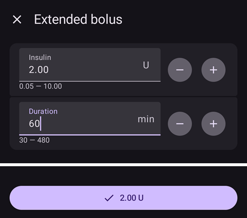

(Extended-Carbs-extended-carbs-ecarbs)=
# Carbohidratos Extendidos/eCarbs

## What are eCarbs and when are they useful?

Con una terapia de bomba normal, los bolos extendidos son una buena manera de tratar comidas grasas o de absorción lenta que aumentan la glucosa en sangre por más tiempo que el efecto de la insulina. En un contexto de lazo cerrado, sin embargo, los bolos extendidos no tienen tanto sentido (y plantean dificultades técnicas), ya que son básicamente una basal temporal alta fija, que va en contra de cómo funciona el lazo, que está ajustando la tasa basal de forma dinámica. For details see [extended bolus](#extended-bolus-and-why-they-wont-work-in-closed-loop-environment) below.

La necesidad de lidiar con tales comidas todavía existe. Which is why AAPS supports so called extended carbs or eCarbs.

eCarbs are carbs that are split up over several hours. Esto simula cómo se absorben los carbohidratos e influye en la glucosa en sangre.  Pero para las comidas de absorción más lenta en las que la entrada completa de carbohidratos por adelantado genera demasiada IOB de SMB, los eCarbs se pueden usar para simular con mayor precisión cómo los carbohidratos (y cualquier equivalente de carbohidratos que ingrese para otros macronutrientes) se absorben e influyen en la glucosa en sangre. Con esta información, el lazo puede administrar SMB para tratar esos carbohidratos, lo que se puede ver como un bolo extendido dinámico (esto también debería funcionar sin SMB, pero probablemente sea menos efectivo).

**Note:** eCarbs aren't limited to fatty / protein heavy meals: they can be also be used to help in any situation where there are influences that increase the blood sugar, e.g. other medication like corticosteroids.

## Mechanics of using eCarbs

To enter eCarbs, open the **Carbs** dialog (**Treatments** → **Carbs**), enter the total carbs, set a **Duration**, and optionally shift the start with **Carb time** (*numbers below are just examples, you will need to try your own values to arrive at satisfactory glucose response for your use-cases*):

The eCarbs on the main screen: the number in brackets in the **COB** field shows the carbs still to come, and the **COB** graph shows each future eCarbs entry as an orange marker. If you don't see a **COB** graph, add one with **Add graph** below the graphs (see [AAPS screens](../DailyLifeWithAaps/AapsScreens.md)).

(AapsScreens-carbs-type)=
## Carbs type in the Bolus wizard: bread, cake or pizza

In the [Bolus wizard](#aaps-screens-bolus-wizard), three buttons below the **Carbs** field let you choose how fast your meal is absorbed. Pick one before you confirm. Depending on the type, **AAPS** takes a part of the carbs you typed as normal carbs, and adds [extended carbs ("eCarbs")](#Extended-Carbs-extended-carbs-ecarbs) later for slow, rich meals. Press the **(i)** icon next to the buttons to see the typical foods for the selected type and what it does to your carbs.

| Type                | Typical foods (as listed in the app)                                                                 | Carbs now, used for the bolus | eCarbs added                                         |
| ------------------- | ---------------------------------------------------------------------------------------------------- | ----------------------------- | ---------------------------------------------------- |
| **Bread** (default) | Bread, savory pastries, yogurt, fruit, potatoes, rice, oatmeal, vegetables                           | 100 %                         | None                                                 |
| **Cake**            | Dumplings, pasta, Asian dishes rich in carbs and fats, sweet and yeast pastries, cereals, honey, jam | 90 %                          | 20 %, starting 60 minutes later, spread over 2 hours |
| **Pizza**           | Lasagna, pizza, hamburgers, fries, baked potatoes, chips                                             | 80 %                          | 35 %, starting 60 minutes later, spread over 3 hours |

**Example**: you type 100 g and choose **Pizza**. The bolus is calculated for 80 g, recorded now. 35 g of eCarbs start 1 hour later and are spread over 3 hours.

Good to know:
* This is not a simple split: with **Cake** and **Pizza**, the carbs recorded add up to **more than you typed** (110 % and 115 %). The extra is only in the eCarbs.
* The bolus only covers the carbs taken now. **AAPS** does not bolus up front for the eCarbs: the loop takes them into account once they start, like any other [eCarbs](#Extended-Carbs-extended-carbs-ecarbs).
* If you set a **Carb time**, the eCarbs start 60 minutes after that time.
* The confirmation dialog shows the eCarbs on their own line, _e.g._ "eCarbs 35g / 3h (+60min)".
* Grams are rounded down to whole numbers.
* The percentages, delays and durations are fixed; they can't be changed in the settings.
* The choice is not remembered: the wizard opens on **Bread** every time.

______________________________________________________________________

A way to handle fat and protein with that feature is described here: [https://adriansloop.blogspot.com/2018/04/page-margin-0.html](https://adriansloop.blogspot.com/2018/04/page-margin-0.html)

______________________________________________________________________

## Recommended setup, example scenario, and important notes

The recommended setup is to use the OpenAPS SMB APS plugin, with SMBs enabled as well as the *Enable SMB with COB* preference being enabled.

A scenario e.g. for a Pizza might be to give a (partial) bolus up front via the *Bolus wizard* and then use the *Carbs* dialog to enter the remaining carbs for a duration of 4-6 hours, starting after 1 or 2 hours.

For a quicker start, the *Bolus wizard* can add eCarbs for you: choose the [carbs type](#AapsScreens-carbs-type) **Cake** or **Pizza** below the **Carbs** field (see above). The amounts and timing are fixed, so use the *Carbs* dialog instead if you want other values.

**Important notes:** You'll need to try out and see which concrete values work for you of course. You might also carefully adjust the setting *max minutes of basal to limit SMB to* to make the algorithm more or less aggressive. Con comidas bajas en carbohidratos, altas en grasas y proteínas, puede ser suficiente usar solo eCarbs sin bolos manuales (consulte el post arriba mencionado). Cuando los eCarbs son generados, se genera una nota en el Careportal para documentar los inputs, para así hacer más fácil la iteración y mejorar los inputs.

(extended-bolus-and-why-they-wont-work-in-closed-loop-environment)=
## Extended bolus and why they won't work in closed-loop environment?

Como se ha mencionado anteriormente, los bolos extendidos o de onda múltiple no funcionan realmente en un entorno de lazo cerrado. [See below](#why-extended-boluses-wont-work-in-a-closed-loop-environment) for details

(Extended-Carbs-extended-bolus-and-switch-to-open-loop-dana-and-insight-pump-only)=
### Extended bolus and switch to open loop - Dana and Insight pump only

Some people were asking for an option to use extended bolus in AAPS anyway as they wanted to treat special foods the way they are used to.

That's why **AAPS** offers an extended bolus for users of Dana and Insight pumps: open **Manage** and select **Extended Bolus**.

**AAPS** first warns you that the closed loop will be stopped while the extended bolus runs. Tap **OK** to continue:

Enter the **Insulin** amount and the **Duration**, then tap the confirm button at the bottom and **OK**:

On the Insight pump, the extended bolus is *not available* if [TBR emulation](#Accu-Chek-Insight-Pump-settings-in-aaps) is used.

While the extended bolus is running, the loop runs in **Open Loop** mode (the loop icon on the main screen changes), and closed loop is switched on again automatically when the extended bolus ends:

The **Manage** menu shows a **Cancel** button with the rate and the elapsed / total time (for example **Cancel 2.00 U/h 1/60'**). Tap it to stop the extended bolus early:

(why-extended-boluses-won-t-work-in-a-closed-loop-environment)=
### Why extended boluses won't work in a closed loop environment

1. El lazo determina que ahora se van a entregar 1.55U/h. Si se entrega como un bolus ampliado o TBR no importa al algoritmo. De hecho, algunas de las bombas utilizan el bolo extendido. ¿Qué debería pasar entonces? Most pump drivers then stop the extended bolus -> You didn't even need to start it.

2. Si tuvieras el bolo extendido como entrada, ¿qué debería pasar en el modelo?

   1. Debe ser considerado neutral, junto con la BR y el lazo en él? Entonces, el ciclo también debería ser capaz de reducir el bolo si, por ejemplo, se baja demasiado y se quita toda la insulina "neutral"?
   2. ¿Se debe añadir simplemente el bolo extendido? ¿Entonces simplemente se debe permitir que el lazo continúe? ¿Incluso en la peor hipoglucemia? No creo que esto sea tan bueno: ¿Se ha previsto una hipoglucemia, pero no se debe evitar?

3. El IOB que se acumula del bolo ampliado se materializa después de 5 minutos en la siguiente ejecución. Por consiguiente, el lazo daría menos basal. So not much changes... except that the possibility of hypo avoidance is taken.
