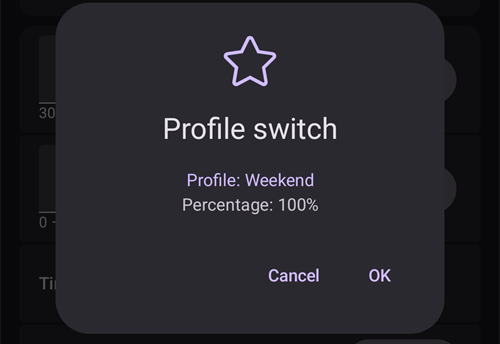
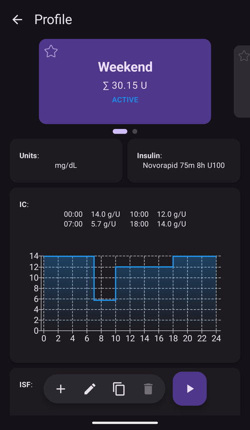

# Cambio de perfil y porcentaje del perfil

Esta sección explica qué es un **Cambio de perfil** y un **Porcentaje del perfil**. Puedes aprender a crear un **Perfil** en [Tu perfil de AAPS](#your-aaps-profile-create-and-edit-profiles).

Al empezar con **AAPS**, tienes que crear un **Perfil**, entender cómo hacer un **Cambio de perfil** y conocer el efecto de un **Porcentaje del perfil** en **AAPS**. Las funciones de **Cambio de perfil** o de **Porcentaje del perfil** pueden ser especialmente útiles para:

- el ciclo menstrual: en **Automatización** se puede configurar un ajuste de porcentaje del **Perfil**, para que **AAPS** se adapte a las distintas fases del ciclo hormonal y a la resistencia a la insulina esperada.

- el ejercicio: en **Automatización** se puede configurar un ajuste de porcentaje del **Perfil** para el ejercicio, para reducir la basal.

- el trabajo nocturno o por turnos: se puede configurar un desplazamiento de hora en el **Perfil**. Cambia el número de horas del **Perfil** según cuánto más tarde o más temprano te vas a dormir o te despiertas.

¿Por qué usar un **Porcentaje del perfil** en lugar de un ajuste temporal de la basal? Para ser más eficaz, un **Porcentaje del perfil** aplica una reducción o un aumento proporcional a: basal, ISF e I:C. Así **AAPS** calcula de forma equilibrada la insulina que administra. Reducir solo la basal en el **Perfil** de **AAPS** sirve de poco si el algoritmo sigue usando los mismos valores de ISF e I:C.

(ProfileSwitch-change-percentage)=

## Cambiar el porcentaje del perfil desde la pantalla principal

Necesitas al menos un **Perfil** guardado. Un **Porcentaje del perfil** siempre se aplica con un **Cambio de perfil**: activas otra vez un **Perfil**, esta vez con un porcentaje.

```{admonition} ¿Vienes de AAPS 3? :class: note Una pulsación larga en el nombre del perfil ya no abre el diálogo de cambio de perfil. **Toca** el nombre del perfil y luego el botón redondo **▶** abajo a la derecha: abre los mismos ajustes (porcentaje, duración, objetivo temporal de Actividad).

    <br />1. En la pantalla principal, **toca el nombre del perfil** (junto al icono de la estrella). Se abre la [pantalla de Perfil](#ProfileSwitch-manage-v4) en la tarjeta del **Perfil** en uso, marcada como **ACTIVO**.
    
       
    
    2. Para mantener el mismo **Perfil**, deja seleccionada la tarjeta **ACTIVO**. Para cambiar también de **Perfil**, desliza a otra tarjeta.
    3. Toca el botón redondo **▶** (**Activar**) abajo a la derecha. Se abre la pantalla **Activar**.
    4. Ajusta el **Porcentaje** con **−** / **+** (pasos de 5 %), o escríbelo (de 30 a 250 %). El campo siempre empieza en **100 %**: no muestra el porcentaje que está en uso ahora. Por ejemplo, escribe **80** para un 20 % menos de insulina, o **120** para un 20 % más.
    5. Ajusta la **Duración** en minutos:
       * **0** mantiene el nuevo porcentaje hasta que hagas otro **Cambio de perfil**;
       * cualquier otro valor termina el cambio después de ese tiempo, y **AAPS** vuelve al **Perfil** que estaba en uso antes.
    
       
    
    6. Toca **▶ Activar** en la parte de abajo de la pantalla. Revisa el resumen en el diálogo **Cambio de perfil** y toca **OK**.
    
       
    
    De vuelta en la pantalla principal, el nombre del perfil muestra el porcentaje y el tiempo que queda, por ejemplo *Normal (80%) (59')*, y se pone amarillo mientras está en curso un cambio con duración. Una estrella marca el cambio en el gráfico de glucosa. Consulta [la pantalla principal](#aaps-screens-profile--target).
    
    
    
    Para **volver al 100 %** antes del final, repite los pasos y deja el **Porcentaje** en 100 y la **Duración** en 0.
    
    ```{admonition} Porcentajes con un toque
    :class: tip
    Si usas a menudo el mismo porcentaje (deporte, enfermedad), añade un [acceso directo de perfil](#profile-shortcuts) a la barra de Lanzamiento rápido, o crea una [escena](Scenes.md). Ambos aplican un perfil con un porcentaje y una duración ya fijados, con un solo toque.
    

(ProfileSwitch-manage-v4)=

## Administrar y activar perfiles (Administrar → Perfil)

En **AAPS** v4 los perfiles se administran y se activan desde la pantalla **Administrar** (navegación inferior) → **Perfil** (*«Gestionar y activar perfiles»*).

La pantalla de Perfil muestra tus perfiles como un **carrusel de tarjetas que se deslizan**. La tarjeta del perfil en uso está marcada como **ACTIVO** y muestra su basal diaria total (p. ej. *∑ 30,15 U*). Debajo de la tarjeta seleccionada ves los detalles de ese perfil: **Unidades**, tipo de **Insulina** y los horarios de **IC**, **ISF**, **basal** y **objetivo**, con gráficos.



Los botones de abajo actúan sobre el perfil **seleccionado**: **➕ Añadir**, **✏️ Editar**, **⧉ Duplicar** y **‘️ Borrar**, y el botón redondo **▶ Activar** a la derecha. Para saber cómo rellenar los cuatro horarios en el editor (IC / ISF / BAS / OBJ), consulta [Crear y editar perfiles](#your-aaps-profile-create-and-edit-profiles).

**⧉ Duplicar** usa el icono de dos cuadrados que se usa a menudo para *copiar*, pero no hay nada que pegar: crea la copia en un solo paso. Confirma *¿Duplicar el perfil "Normal"?* y se añade un nuevo perfil llamado *Normal copy* al final del carrusel. Queda seleccionado y listo para **✏️ Editar** (donde también puedes cambiarle el nombre). No es lo mismo que duplicar un **Cambio de perfil** pasado desde el Historial de tratamientos, que crea un nuevo perfil *con el porcentaje y el desplazamiento de hora aplicados*. Consulta [Guardar un cambio de perfil para usarlo más tarde](#ProfileSwitch-keep-for-later).

(ProfileSwitch-read-only-mode)= **¿Solo ves el botón ▶ Activar?** Tus ajustes están protegidos, por eso la pantalla se abre en modo de solo lectura. Toca el **✏️ lápiz** en la barra superior e introduce tu contraseña de ajustes. Consulta [La protección de ajustes ahora también bloquea las pantallas de gestión](#v4changes-read-only-management).

### Reordenar perfiles

Si tienes más de un perfil, puedes elegir su orden en el carrusel: toca el icono **Reordenar** (⇅, dos flechas hacia arriba y hacia abajo) en la barra superior. El indicador de página se sustituye por **botones de mover ◀ / ▶** con una indicación *posición / total*. Mueve la tarjeta del centro hacia antes o hacia después y luego confirma con **✓** (o descarta con **✕**). El nuevo orden se guarda una sola vez, cuando confirmas.


### Activar un perfil

Selecciona un perfil y toca **▶ Activar**. La pantalla **Activar** te permite elegir cómo se aplica el **Cambio de perfil**:


- **Porcentaje** (30–250 %, empieza en 100 % cada vez): escala todo el perfil. 100 % lo usa tal cual; por ejemplo, 70 % reduce un 30 % la basal y la dosis de insulina calculada (tanto bolos de comida como correcciones). No cambia tus objetivos de glucosa ni la absorción de carbohidratos. Consulta [Porcentaje del perfil](#profile-percentage) para ver el efecto completo.
- **Duración** (0–10080 minutos, es decir, hasta 7 días): cuánto dura el cambio. **0 = sin límite** (hasta que vuelvas a cambiar); un valor distinto de cero vuelve al perfil anterior cuando termina.
- **Objetivo temporal / Actividad**: aparece solo cuando pones una **Duración** y un **Porcentaje** por debajo del 100 %. Actívalo para iniciar también un [objetivo temporal de Actividad](#TempTargets-activity-temp-target) con la misma duración, como harías antes del ejercicio.
- **Desplazamiento de hora**: muestra *0h*; toca **Cambiar** para mover el horario hacia delante o hacia atrás hasta 23 horas (útil para el trabajo por turnos o los viajes). Consulta [Desplazamiento de hora](#ProfileSwitch-ProfilePercentage-time-shift-of-the-circadian-percentage-profile).
- **Reutilizar**: aparece cuando el cambio en uso tiene un porcentaje distinto del 100 % o un desplazamiento de hora, por ejemplo **Reutilizar 80% 0h**. Tócalo para rellenar el mismo porcentaje y el mismo desplazamiento de hora, por ejemplo para alargar un cambio que está a punto de terminar.
    
    

- **Hora**: *Ahora* por defecto. Puedes elegir otra hora, hasta 24 horas antes o después de ahora. Un cambio puesto en el futuro empieza a esa hora; un objetivo temporal de Actividad puesto con él también empieza a esa hora.
    
    

- **Notas**: solo se muestra si [Mostrar notas en los diálogos](#Preferences-show-notes-field-in-treatments-dialogs) está activado.

Si las tasas basales con el porcentaje elegido no son compatibles con tu bomba, aparece un aviso arriba y **▶ Activar** queda desactivado: elige otro porcentaje.

Toca **▶ Activar** y luego **OK** en el diálogo de confirmación. El perfil en uso lleva entonces la marca **ACTIVO** en su tarjeta.

```{admonition} Tu bomba puede redondear las tasas basales :class: note Cada bomba solo puede dar tasas basales en sus propios pasos (por ejemplo 0,05 U/h), por eso redondea las tasas de tu **Perfil**. Entonces **AAPS** usa la basal que la bomba da de verdad, así la IOB y la TDD siguen siendo correctas. Si la bomba da un poco más o menos insulina al día que tu **Perfil**, el aviso *«Perfil basal actualizado en la bomba»* te dice cuánto, por ejemplo *«da 10,00 U al día en lugar de 10,12 U»*.

Si la bomba informa de una basal muy distinta de tu **Perfil**, **AAPS** mantiene la basal del **Perfil** y te pide que revises las tasas basales en la bomba.

    <br />```{admonition} Con el porcentaje y el desplazamiento de hora, un solo perfil sirve para mucho
    :class: note
    En lugar de crear muchos perfiles parecidos, ten un perfil base y aplícalo con otro **porcentaje** u otro **desplazamiento de hora** en situaciones que se repiten (enfermedad, ejercicio, viajes). Esto es justo lo que automatizan las [escenas](Scenes.md).
    

Un cambio de perfil no se limita a esta pantalla. El mismo cambio también se puede iniciar desde un **reloj Wear OS**, un **cliente** emparejado (consulta [Control máster ↔ cliente](../RemoteFeatures/ClientMasterControl.md)), una **[escena](Scenes.md)** o una regla de **Automatización**.

## Porcentaje del perfil

Es importante entender las funciones básicas del **Porcentaje del perfil**. Si aplicas un aumento o una reducción en porcentaje a un **Cambio de perfil**, los parámetros de tu **Perfil** suben o bajan en ese mismo porcentaje.

Por ejemplo: un **Cambio de perfil** al 130 % (significa que eres un 30 % más resistente a la insulina) hace que **AAPS**:

- **aumente** la basal un 30 %; 
- **baje** el **ISF**: lo divide entre 1,3;
- **baje** el **I:C**: lo divide entre 1,3.

Recuerda: bajar el **ISF** o el **I:C** significa un ratio más fuerte y más insulina administrada. Los nuevos usuarios de **AAPS** olvidan esto con facilidad.

Una vez seleccionado, **AAPS** ajusta la basal por defecto, y **AAPS** (lazo abierto o cerrado) sigue funcionando sobre el **Perfil** con el porcentaje seleccionado.

El efecto de un Porcentaje del **Perfil** se resume en la siguiente tabla:

| Porcentaje del  
cambio de perfil |    Efecto    |     I:C  
g/U     | ejemplo  
15 g |          ISF  
mmol/L/U  
mg/dL/U          | U para bajar  
2mmol/L  
40mg/dL |
|:---------------------------------:|:------------:|:-----------------:|:--------------:|:------------------------------------------:|:--------------------------------:|
|               90 %                |  Más débil   | 5/0,9  
=**5,55** |     2,7 U      | 2,2/0,9  
=**2,4**  
  
40/0,9  
=**44,4** |              0,8 U               |
|             **100 %**             | **Estándar** |       **5**       |    **3 U**     |                **2,2  
40**                |            **0,9** U             |
|               130 %               |  Más fuerte  | 5/1,3  
=**3,85** |     3,9 U      | 2,2/1,3  
=**1,7**  
  
40/1,3  
=**30,8** |              1,2 U               |

(ProfileSwitch-ProfilePercentage-time-shift-of-the-circadian-percentage-profile)=

## Desplazamiento de hora del perfil circadiano con porcentaje

Un «desplazamiento de hora» en el **Perfil** mueve los ajustes del **Perfil** en el reloj del día («circadiano») el número de horas que indiques. Esto puede ser útil para:

- **personas que trabajan de noche o por turnos**: para los turnos de noche, cambia el número de horas del **Perfil** según cuánto más tarde o más temprano te vas a dormir o te despiertas; 
- **personas que cambian de zona horaria al viajar**; o
- **niños con diabetes tipo 1**: que tienen una rutina fija para ir a dormir y una resistencia a la insulina ya prevista en su **Perfil**. Si por cualquier motivo el niño se va a acostar más tarde, el cuidador puede aplicar un «desplazamiento de hora» al **Perfil** del niño. Así **AAPS** reacciona a la resistencia a la insulina en el momento deseado.

La pregunta es siempre: ¿los ajustes del **Perfil** de qué hora deben sustituir a los ajustes de la hora actual? Esta hora se debe desplazar x horas. Por eso, ten cuidado con el sentido, como se describe en el siguiente ejemplo:

- Hora actual: 12:00
- **Positivo** desplazamiento de hora 
    - 2:00 **+10 h** -> 12:00
    - Se usarán los ajustes de las 2:00 en lugar de los ajustes que se usan normalmente a las 12:00, por el desplazamiento de hora positivo.
- **Negativo** desplazamiento de hora 
    - 22:00 **-10 h** -> 12:00
    - Se usarán los ajustes de las 22:00 (10 de la noche) en lugar de los ajustes que se usan normalmente a las 12:00, por el desplazamiento de hora negativo.


Este mecanismo de guardar copias instantáneas del **Perfil** permite un cálculo mucho más preciso del pasado y permite seguir los cambios del **Perfil**.

(ProfileSwitch-keep-for-later)=

## Guardar un cambio de perfil para usarlo más tarde

Cuando hayas hecho un cambio de perfil con porcentaje y/o desplazamiento de hora, puedes copiar este perfil temporal en un nuevo perfil.

Para hacerlo, abre el menú (☰) → **Tratamientos** y ve a la pestaña **Cambio de perfil**; consulta [Duplicar un cambio de perfil en un nuevo perfil](#your-aaps-profile-clone-profile-switch).