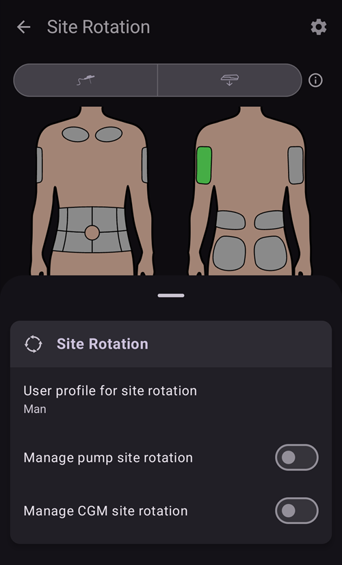

# Bombas y cánulas

## Cambio de sets de infusión: reservorios de insulina y cánulas

El procedimiento de abajo es solo para bombas con tubo y no sirve para bombas parche como Omnipod, Medtrum Nano, Accu-Chek Solo, etc. A veces este proceso se llama «cambio de set»: un cambio «completo» incluye el reservorio de insulina y la cánula, y un cambio «parcial» es solo el cambio de cánula.

Las bombas parche se llenan y se ceban solas en su propio asistente de activación, y su cánula ya está en el cuerpo. **AAPS** no ofrece cebado para ellas: **Cebar/Llenar** no aparece en el panel **Administrar** ni en Lanzamiento rápido. Consulta la página de tu bomba en [Bombas compatibles](../Getting-Started/CompatiblePumps.md).

Los cambios físicos de cartucho/reservorio no se pueden hacer con **AAPS**: hay que hacerlos directamente en la bomba. Después, hay que registrarlos a mano en **AAPS**.

(pumps-cannulas-changing-reservoir-and-cannula)=
### Guía para cambiar tanto el reservorio de la bomba como la cánula

1. En **AAPS**, desconecta la bomba: pulsa el [icono del lazo](#AapsScreens-loop-status) en la pantalla principal y selecciona **Desconectar bomba** durante 1 hora. El icono cambia a un enchufe gris, que indica que la bomba está desconectada.

2. Cambia físicamente el reservorio de insulina: desconecta físicamente la bomba del cuerpo y cambia el reservorio/cartucho y la cánula según las instrucciones del fabricante.

3. Ceba/llena el tubo y la cánula: puedes hacerlo directamente en la bomba. Asegúrate de quitar todas las burbujas del tubo.

4. Pon la nueva cánula en el cuerpo. Cuando la cánula está insertada y se ha quitado la aguja, la cánula queda con un pequeño espacio de aire que también hay que cebar. Para registrarlo en **AAPS** y cebar la cánula: abre **Cebar/Llenar** (en el panel de estado ampliado de la pantalla principal, en el panel **Administrar** o como botón de [Lanzamiento rápido](QuickLaunch.md)) y marca **Anotar el cambio de sitio de la bomba** y/o **Anotar cambio del cartucho de insulina**, según corresponda, para registrar el cambio. Ahora pulsa la cantidad de cebado de cánula por defecto (suele ser unas 0,3 U, pero comprueba que este valor es correcto para tu cánula) y selecciona **OK**. Lee el mensaje de resumen y confirma el cebado tocando **OK**.

   


5. Reconecta la bomba en **AAPS**: pulsa el icono del enchufe gris y selecciona **Reconectar bomba** para seguir con el lazo.

### Información útil sobre los cambios de insulina/cánula

* Registrar un cambio de zona de la bomba restablece Autosens al 100 %. También restablece los indicadores de estado y las edades de la cánula/insulina en la pantalla principal de **AAPS**.

* Puedes fijar o ajustar las cantidades de cebado por defecto en los ajustes de **Cebar/Llenar**: escribe «prime» en la barra de búsqueda de la pantalla principal para abrirlos (consulta [Preferencias](../SettingUpAaps/Preferences.md)). Mira en el folleto de instrucciones de la caja de cánulas cuántas unidades hay que usar para cebar tu cánula (depende de la longitud de la aguja y del tubo).

* **AAPS** no tiene en cuenta la insulina administrada con la función de cebado al calcular la insulina activa (IOB), y en el [Historial de tratamientos](#aaps-screens-treatments) aparece marcada como «Prime».

* **AAPS** tampoco tiene en cuenta la insulina que se pone como bolo desde la bomba mientras la bomba está desconectada. Si pones un bolo directamente desde la bomba mientras **AAPS** está desconectado, al reconectar la bomba puedes registrar esta insulina (sin administrarla) en el diálogo **Insulina** (consulta [Registrar insulina administrada sin poner un bolo](#pumps-cannulas-announce-insulin) más abajo).

### Problemas con la cánula, el lugar de infusión, el tubo y/o la bomba

Si estás seguro de que no has recibido insulina durante un tiempo, aunque **AAPS** registre que sí, y sabes exactamente cuándo empezó el problema (_p. ej._ quitas la cánula y ves que se dobló al insertarla), puedes corregirlo en **AAPS**. Pero ten en cuenta que quizás la insulina sí se administró y por algún motivo actúa lentamente.

```{admonition} Caution - Risk of Hypoglycemia
:class: danger
Borra insulina administrada en **AAPS** solo con EXTREMO cuidado, por si la insulina _sí_ se ha administrado, y vigila de cerca la glucosa durante las 24 h siguientes.
```

Para quitar los bolos y SMB que sabes que no se administraron, abre el **menú** (☰), selecciona [Historial de tratamientos](#aaps-screens-treatments) y, en la pestaña **Carbohidratos y bolos**, borra con prudencia los bolos registrados desde el momento en que empezó el problema. Así se corrige el valor de «insulina activa» (IOB), que es clave para los cálculos de **AAPS**; si vuelves ahora a la pantalla principal, verás que la IOB ha bajado. Ten en cuenta que no puedes borrar la insulina basal que **AAPS** calcula como administrada, así que **AAPS** la seguirá teniendo en cuenta.

En casos menos claros de problemas de administración de insulina, _p. ej._ fugas, oclusiones o insulina que sale por el canal de la cánula, en los que no sabes cuándo empezó el problema o crees que parte de la insulina sí se administró, debes tener cuidado. Puedes notar estos problemas al «oler» la insulina, al ver el adhesivo mojado, al tener valores de glucosa altos o al recibir una alarma. Como nunca sabrás cuánta insulina entró en tu piel (que puede empezar a actuar después de un rato), será difícil saber la cantidad correcta de insulina que hay que restar del valor actual de «insulina activa» (IOB). Una estrategia es pausar el lazo durante 5 horas (o la duración de acción de tu insulina) después de resolver el problema de administración de insulina, y luego reanudar el lazo. Así la IOB será correcta cuando vuelvas a iniciar el lazo.

(pumps-cannulas-disconnecting)=
## Desconectar la bomba para ducharse o realizar actividades

Si te quitas la bomba para ducharte, bañarte, nadar, hacer deportes de contacto u otras actividades, debes decirle a **AAPS** que no se está administrando insulina, para que la IOB sea correcta. La bomba se puede desconectar con el [icono del lazo](#AapsScreens-loop-status) en la pantalla principal: púlsalo y selecciona **Desconectar bomba** con la duración que necesites. Si la actividad dura más de lo previsto, abre otra vez el mismo diálogo y elige una nueva duración en **Desconectar bomba**: la desconexión se alarga y la nueva duración empieza desde ahora. No hace falta reconectar antes.

Como no estás recibiendo insulina mientras la bomba está desconectada, deberías reconectar cada dos horas para ponerte al día con la basal que te falta. Puedes hacerlo conectando la bomba y poniendo un bolo con la basal que falta (_p. ej._ la de las últimas dos horas), antes de desconectarla otra vez. Esto debería ayudar a evitar una falta grave de insulina, que podría causar cetoacidosis diabética (CAD). Si no es práctico reconectar la bomba durante la actividad (la zona de la cánula está cubierta por un traje de neopreno, _etc._), piensa en usar una inyección con pluma. Esta inyección manual se puede registrar en **AAPS**, y no hace falta hacerlo en el momento de la inyección (solo apunta la hora), porque al reconectar la bomba puedes registrar la insulina y poner la hora real en que se administró.

(pumps-cannulas-announce-insulin)=
## Para registrar insulina administrada sin poner realmente un bolo

Para registrar insulina administrada desde la bomba mientras **AAPS** estaba desconectado, o con inyecciones de pluma: abre el [diálogo Insulina](#aaps-screens-buttons-insulin) (**Tratamientos** en la navegación inferior, o un botón de Lanzamiento rápido), escribe la cantidad en unidades y activa **El bolo sólo se anotará**. Entonces aparece una fila **Tiempo** (con el valor **Ahora**) para registrar la hora real de la inyección: puedes ignorarla si la inyección fue hace poco. Si el bolo se puso hace un rato, usa **-** para mover la hora hacia atrás (_p. ej._ -30 min), o abre la fila con la flecha para elegir la fecha y la hora exactas. Entonces **AAPS** tiene en cuenta la duración de la acción de la insulina y calcula según eso la insulina que queda en el cuerpo.

Si usas **AAPS** como cuidador, puedes desconectar (y reconectar) la bomba a distancia muy fácilmente con un [comando SMS](../RemoteFeatures/SMSCommands.md), con comandos como "pump disconnect 120" y "pump connect 120". El rango de duración para la desconexión remota es de 1 a 120 min, (en este ejemplo son 120 minutos). Esto es muy útil si no te es fácil acceder al teléfono con **AAPS**: por ejemplo, está metido en un cinturón para la bomba de un niño que corre hacia la piscina, o lo tiene (o lo usa) un adolescente que no lo suelta.

## Reconectar la bomba después de la actividad

Después de una desconexión larga (1–2 horas), es bastante normal que **AAPS** calcule que ahora tienes IOB negativa. Cuando vuelvas a conectar la bomba, según tus preferencias, tu glucosa actual, la comida prevista o la actividad siguiente, puedes:

a) Simplemente reconecta la bomba en **AAPS** (de gris a verde, para lazo cerrado) y deja que **AAPS** empiece a administrar insulina otra vez

_o_

b) Si quieres ser más agresivo (por ejemplo, vas hacia una hiperglucemia), puedes abrir el [Asistente de bolo](#aaps-screens-bolus-wizard) y poner un bolo con cero carbohidratos, para administrar enseguida como bolo la insulina que falta según el cálculo.

Qué estrategia prefieres es algo muy personal, y la mejor forma de encontrarla es probando.


(Aapsscreens-site-rotation)=
## Rotación del sitio

**Administrar → Rotación del sitio** abre el diálogo de rotación del sitio en modo Ver:

- Con los dos botones de arriba (icono de cánula e icono de sensor) puedes mostrar solo las zonas de la cánula, solo las zonas del sensor, o ambas
- Están disponibles todos los eventos de cambio de cánula y de cambio de sensor de los últimos 45 días.
- Toca una zona del cuerpo, o una entrada de la lista de abajo, para filtrar la lista y ver solo las entradas de la zona seleccionada. La zona seleccionada se resalta en color verde claro.
- Toca el icono del **lápiz** junto a una entrada para abrir la vista Editar y cambiar su ubicación, flecha o nota


- El icono del **engranaje** (arriba a la derecha) abre los ajustes: **Perfil de usuario para rotación de sitios** abre un diálogo donde eliges **Hombre**, **Mujer** o **Menor**, y los interruptores **Gestionar la rotación del lugar de inserción de la bomba** y **Gestionar la rotación del sitio del MCG** eligen qué zonas gestionas.




*Nota: este ajuste decide si el diálogo de rotación del sitio (modo Editar) se abre o no de forma automática cuando se crea una nueva entrada con el botón «Cebar/Llenar» o con el botón «Inserción de sensor»*

- Para un cambio de zona hecho directamente en la bomba, tienes que abrir el modo Ver y editar la nueva entrada para elegir la ubicación y la flecha

El modo Editar te permite elegir la ubicación, la flecha y la nota de la entrada seleccionada:

- La entrada que se edita aparece debajo de las imágenes del cuerpo, con el icono de su tipo (cánula o sensor)
- Las vistas de delante y de detrás se muestran una al lado de la otra: toca la zona donde lo pusiste
- Cuando eliges una zona (resaltada en verde), en la lista de abajo ves todas las entradas hechas en esta zona en los últimos 45 días


- Puedes añadir una flecha opcional tocando el icono de flecha a la derecha de la entrada: el diálogo **Seleccionar flecha** te permite indicar una subzona o la orientación del pod


- También puedes añadir una **Nota** sobre la zona seleccionada
- Toca el icono de **guardar** (arriba a la derecha) para registrar la zona

Puedes filtrar de forma gráfica en la imagen, o tocando un evento de terapia en la lista Para quitar el filtro, toca la imagen fuera de cualquier zona


