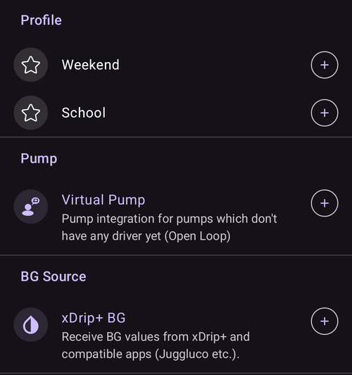

(quicklaunch)=
# Lanzamiento rápido (barra de acciones rápidas de la pantalla principal)

**Lanzamiento rápido** es la pequeña **barra de acciones rápidas** que flota en la parte de abajo de la pantalla principal de **AAPS**, justo encima de la navegación inferior. Es una fila de botones de un toque que puedes personalizar: tú decides qué acciones hay y en qué orden, así lo que haces más a menudo está siempre a un toque en la pantalla principal.

```{contents} Table of contents
:depth: 2
:local: true
```


---

## Usar la barra

La barra está en la **pantalla principal**, entre los gráficos y la navegación inferior:


- **Toca** un icono para ejecutar su acción, exactamente como si la abrieras desde su pantalla normal (un bolo o un tratamiento sigue mostrando primero su confirmación habitual).
- **Mantén pulsado** un icono para ver una **descripción emergente** con el nombre de la acción y una breve explicación.
- Si añades **más botones de los que caben** en la pantalla, los que sobran pasan a un **menú adicional** (el botón **⋮** al final de la barra).
- Cada icono mantiene el **color** de su acción (p. ej. insulina, carbohidratos, objetivo temporal), así se reconoce de un vistazo.

```{admonition} The toolbar is always there
:class: note
El último botón es siempre **Configurar Lanzamiento Rápido** (el engranaje **⚙️**). No se puede quitar, así que siempre puedes llegar a la pantalla de configuración directamente desde la barra. Por defecto la barra solo tiene dos botones: el **Asistente de bolo** y este engranaje.
```

---

## Configurar Lanzamiento rápido

Toca el engranaje **⚙️** de la barra (o abre **[Configuración](../SettingUpAaps/ConfigBuilder.md) → … → Configurar Lanzamiento Rápido**) para abrir la pantalla **Configurar Lanzamiento Rápido** (*«Personalizar botones de acción rápida en la vista general»*).


La pantalla tiene dos partes:

- **Acciones seleccionadas** (arriba): los botones que hay ahora en tu barra, en el orden de la barra.
- Un **catálogo** debajo: todas las acciones que puedes añadir, agrupadas por categoría. Cada entrada del catálogo tiene un botón **➕** para añadirla.

### Acciones seleccionadas: reordenar, editar, quitar

Cada acción seleccionada tiene:

- un **⠿ asa para arrastrar**: mantén pulsado y arrastra para **reordenar** los botones (el orden aquí es el orden en la barra),
- un botón **−**: la **quita** de la barra,
- y, solo para un acceso directo de **Perfil**, un botón **✏️** para editar su porcentaje/duración (consulta [Accesos directos de perfil](#profile-shortcuts)).

Los cambios se aplican **enseguida**: no hay un botón *Guardar* aparte. Una acción que añades se coloca al final de la barra; desde ahí puedes cambiar su orden.

---

## Las categorías de acciones

El catálogo agrupa todo lo que puedes añadir en las siguientes categorías, en este orden. Las categorías que no tienen nada que ofrecer (p. ej. no tienes escenas) simplemente no se muestran.

### Tratamiento

Los diálogos de tratamiento y de MCG de cada día:

- **Insulina**: administrar un bolo a mano.
- **Carbohidratos**: registrar carbohidratos sin insulina.
- **Asistente de bolo**: abrir la calculadora de bolo.
- **Tratamiento**: registrar insulina y carbohidratos juntos.
- **MCG**: abrir tu app de MCG (p. ej. xDrip).
- **Calibración**: calibrar el sensor del MCG.

### Portal de cuidados

Los eventos del portal de cuidados y los registros de mantenimiento de los dispositivos:

- **Medir glucosa**, **Nota**, **Ejercicio**, **Pregunta**, **Aviso**,
- **Inserción de sensor**, **Cambio de batería de la bomba**, **Cambio de zona de la bomba**, **Cebar/Llenar**, **Rotación del sitio**.

**Cebar/Llenar** y **Cambio de batería de la bomba** solo se ofrecen cuando tu bomba los usa. Las bombas parche, por ejemplo, se llenan y cambian la batería en sus propios pasos de activación, así que estas entradas no se muestran para ellas (igual que en el panel **Administrar**).


Son las mismas entradas a las que llegarías por los paneles **[Tratamientos](#v4changes-treatments)** y **[Administrar](#v4changes-manage)**; Lanzamiento rápido solo pone en la pantalla principal las que usas.

### Administrar

Las pantallas del panel **[Administrar](#v4changes-manage)**, en el mismo orden, para que puedas abrir desde la barra la que más usas:

- **Perfil**, **Configuración de insulina** (administrar y activar configuraciones de insulina; tiene a propósito un nombre distinto de **Insulina**, porque ese botón administra un bolo), **Objetivo temporal**, **Asistente rápido**, **Escenas**, **Automatización**, **Comida**,
- **Modo de funcionamiento**: cerrar o abrir el lazo, suspenderlo o desconectar la bomba,
- **Clientes autorizados**: solo en un máster o en un cliente emparejado.

Estos botones abren la pantalla; no inician nada por sí mismos. Para iniciar una escena o un Asistente rápido con un toque, añádelo desde la categoría **Escenas** o **Asistente rápido** de abajo.

 

### Asistente rápido

Cada uno de tus ajustes de **[Asistente rápido](QuickWizards.md)** se puede añadir como botón, así una comida que se repite está a un toque en la pantalla principal. El botón lleva el nombre del ajuste y muestra la cantidad de carbohidratos/insulina; al tocarlo se ejecuta el Asistente rápido con su confirmación habitual.

No se ofrecen los Asistentes rápidos configurados para mostrarse solo en el reloj. Un botón de Asistente rápido en la barra sigue las mismas reglas que en el panel **Tratamientos**: está oculto fuera de su [rango de horas válido](#quickwizard_validity) y durante un rato corto después de usarlo. Se queda en la configuración de tu barra y vuelve cuando el Asistente rápido se puede usar otra vez.

### Escenas

Cada **[escena](Scenes.md)** activada se puede añadir como botón. Al tocarlo pide confirmación y luego activa la escena (el mismo conjunto de acciones que obtendrías desde la pantalla Escenas). Esta categoría solo aparece si tienes al menos una escena.

La descripción emergente y el catálogo muestran el mismo resumen que **Administrar → Escenas**, por ejemplo *"3 actions, 2 h → Cooldown"*, donde el nombre después de la flecha es la escena siguiente.

### Automatización

Tus reglas de automatización de **acción del usuario** (las que inicias a mano) se pueden añadir como botones. Al tocar una pide confirmación y luego ejecuta las acciones de esa regla.

```{admonition} Automation buttons run on the master
:class: note
La automatización se ejecuta en el **máster**, así que los accesos directos de automatización solo se ofrecen y se ejecutan en el máster. No están disponibles en un **[cliente](../RemoteFeatures/ClientMasterControl.md)** emparejado.
```

### Ajustes de objetivos temporales

Cada uno de tus ajustes de **[Objetivo temporal](TempTargets.md)** se puede añadir como botón (se muestran su nombre, su objetivo y su duración, por ejemplo *«Comiendo Pronto — 5,0 mmol/l, 45 min»*). Al tocarlo pide confirmación y luego inicia ese objetivo temporal.


(profile-shortcuts)=
### Perfil

Cada **[perfil](ProfileSwitch-ProfilePercentage.md)** se puede añadir como **acceso directo** que hace un **cambio de perfil** con un toque. A diferencia de la mayoría de los accesos directos, un acceso directo de Perfil lleva su propio **porcentaje** y su propia **duración**, que ajustas después de añadirlo con el botón **✏️**:

- **Porcentaje** (30–250 %, en pasos de 5 %): escala el perfil cuando se aplica. 100 % lo usa tal cual.
- **Duración** (0–10080 min, es decir, hasta 7 días, en pasos de 10 min): cuánto dura el cambio. **0 = Permanente** (hasta que vuelvas a cambiar).



Así puedes tener varios botones para el **mismo** perfil con distinta fuerza, por ejemplo *«Perfil 100 %»* y *«Perfil 70 % durante 2 h»*, y aplicar cualquiera con un solo toque. (Puedes añadir el mismo perfil más de una vez con ajustes distintos.)

### Complementos


Por último, cualquier **complemento activado** que tenga su propia pantalla se puede añadir como acceso directo para abrirla directamente. Se agrupan por tipo de complemento: **Bomba**, **Fuente de glucosa**, **APS**, **Lazo**, **Detección de sensibilidad**, **Suavizado**, **Calibración**, **Restricciones**, **Comunicación** y **General**. Así puedes, por ejemplo, ir directamente desde la pantalla principal a la pantalla de tu bomba o del lazo.

---

## Lanzamiento rápido y máster/cliente

A diferencia de la mayoría de tus ajustes, la **barra de Lanzamiento rápido se configura en cada dispositivo**: se guarda **en el dispositivo y no se sincroniza** entre tu máster y los clientes emparejados, así que cada dispositivo tiene su propio conjunto de botones. (*Sí* se incluye en una **copia de seguridad/exportación** de los ajustes, así que una restauración la recupera en el mismo dispositivo.)

Lo que cada dispositivo puede poner en su barra depende de lo que tiene: los Asistentes rápidos, las escenas, los ajustes de objetivos temporales y los perfiles se sincronizan, así que el catálogo de un cliente ofrece los mismos elementos; solo los eliges en cada dispositivo. Algunos detalles que debes saber:

- Los botones cuyo destino ya no existe (un Asistente rápido, una escena o un ajuste borrados, una regla desactivada) se **omiten automáticamente**.
- Los accesos directos de **Automatización** solo se ofrecen y se ejecutan en el **máster** (la automatización se ejecuta en el máster). Los botones de escena, Asistente rápido, objetivo temporal y perfil están disponibles en un cliente.
- Cuando tocas en un cliente un botón que se debe ejecutar en el máster (un bolo, un objetivo temporal, un cambio de perfil o una escena), el **máster** lo ejecuta y emite la confirmación. Consulta [Control máster ↔ cliente](../RemoteFeatures/ClientMasterControl.md).

---


<!-- =====================================================================
     Screenshots captured from a real master device:
       - quicklaunch_toolbar.png    (cropped close-up of the overview toolbar pill)
       - quicklaunch_overview.png   (full overview showing the toolbar in place)
       - quicklaunch_config.png     (Configure QuickLaunch: Selected actions + Treatment + start of Manage)
       - quicklaunch_dynamic.png    (catalog: Quick Wizard / Scenes / Automation / Temp Target Presets)
       - quicklaunch_categories.png (catalog: Profile shortcuts + plugin categories)
     No QuickLaunch action was actually run (nothing delivered; only scrolled).
     Maintainers: relocate page + images and fix cross-links as needed.
     ===================================================================== -->
