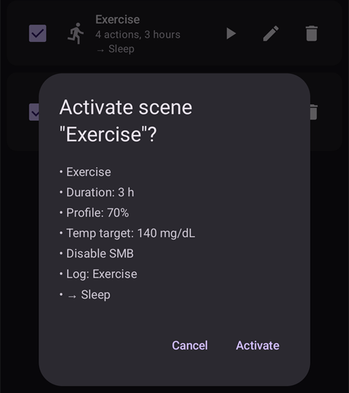
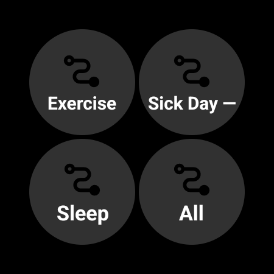

(scenes)=
# Escenas (ajustes de situación)

Una **escena** es un ajuste guardado con nombre que aplica un **conjunto de acciones a la vez**. Por ejemplo, un ajuste *Dormir*, *Ejercicio* o *Día de enfermedad* que cambia tu perfil, pone un objetivo temporal, activa o desactiva SMB y añade una nota del portal de cuidados con un solo toque, si quieres durante un tiempo fijo.

```{contents} Table of contents
:depth: 2
:local: true
```

---

## Qué es una escena

En lugar de cambiar varias cosas a mano cada vez que se repite una situación, las configuras una vez como escena y la activas con un toque. Una escena puede agrupar cualquiera de estas acciones:

- **Cambio de perfil** — cambia el perfil y/o lo ajusta por porcentaje (p. ej., 70 %).
- **Objetivo temporal** — pone un objetivo temporal (p. ej., *Actividad*, *Comiendo Pronto* o un valor propio).
- **SMB sí/no** — activa o desactiva los supermicrobolos (SMB) mientras la escena está activa.
- **Modo del lazo** — cambia el modo de funcionamiento (p. ej., a un modo más prudente).
- **Nota del portal de cuidados** — registra un evento (p. ej., *Ejercicio*, *Enfermedad*) para que se vea en el gráfico y en Nightscout.

Una escena también tiene una **duración** — un tiempo fijo (minutos/horas/días) o *Indefinido (finalización manual)* — y una **acción final** que se ejecuta cuando termina: o bien una **notificación**, o bien puede **encadenar** otra escena (por ejemplo, *Día de enfermedad → Ejercicio*).

---

## Administrar escenas

Abre **Administrar → Escenas** para ver, crear, editar, activar/desactivar y reordenar tus escenas.


Cada tarjeta de escena muestra:

- una **casilla** para activar/desactivar la escena,
- un **icono** y un **nombre**,
- un resumen — *«N acciones, duración»* — y la **→ escena encadenada**, si encadena otra,
- y tres botones: **▶ activar**, **✏️ editar**, **🗑️ borrar**.

Toca el botón **+** para crear una nueva escena.

---

## Crear o editar una escena

### Empezar desde una plantilla

Para **crear** una escena, toca el botón **+** en la pantalla Escenas. El primer paso es **Empezar desde plantilla**: elige una escena preparada para una situación común — *Ejercicio*, *Día de enfermedad*, *Día de enfermedad — Vómitos*, *Dormir*, *Noche tras ejercicio*, *Antes de comer*, *Alcohol*, *Conducción*, *Baño | Ducha*, *Fase lútea*, *Clima cálido*, *Procedimiento médico* — o empieza desde una escena *Vacío | En blanco*. Cada plantilla **rellena las acciones recomendadas** y puedes ajustarlo todo en los pasos siguientes.


Después de elegir una plantilla, se explica su propósito — *cuándo* y *por qué* usarla — antes de continuar:


### Recorre las acciones paso a paso

El resto del editor es un asistente corto **paso a paso**. Cada paso es un tipo de acción con un interruptor *«Incluir … en la escena»*. Actívalo solo para las acciones que quieres que haga esta escena y deja el resto desactivado.


Avanza por los pasos con **Siguiente**/**Atrás**: *Cambio de perfil*, *Objetivo temporal*, *SMB*, *Modo del lazo*, *Nota del portal de cuidados*, después la **duración**, la **acción final** (notificar o encadenar otra escena) y por último el **nombre y el icono** de la escena. Guarda cuando termines. (Para **editar** una escena existente, toca su botón **✏️** — entras directamente en estos pasos.)

Cada paso empieza con una breve explicación de lo que hace la acción. Los pasos se ven así, aquí con la plantilla *Ejercicio*:

**Objetivo temporal** — elige uno de tus objetivos temporales preestablecidos:


**SMB** — activa o desactiva SMB mientras la escena está activa:


**Modo de funcionamiento** — si quieres, cambia el modo del lazo:


**Portal de cuidados** — el tipo de evento y la nota que se registran:


**Duración** — cuánto tiempo sigue activa la escena; 0 significa hasta que la finalices tú:


**Escena de seguimiento** — si quieres, la escena que empieza cuando termina esta:


**Escena** — el nombre y el icono. Pulsa **Finalizar** para guardar:


---

## Activar una escena

Activa una escena desde la lista **Escenas** (el botón **▶**) o desde la entrada **Escenas** de la navegación inferior. En el panel **Escenas** de la navegación inferior, cada escena muestra el mismo resumen que en la lista de Escenas, y el **lápiz** de la parte superior del panel abre **Administrar → Escenas** para crear o editar tus escenas.


If [bolus protection](#Preferences-protection) is on, **AAPS** asks for it before a scene starts or ends. Changing a scene needs the [settings protection](#Preferences-settings-protection) instead.

Antes de aplicar nada, recibes una **confirmación** con la lista exacta de lo que hará la escena, para que puedas revisarlo:



Si la escena encadena otra, la confirmación termina con **→** y el nombre de esa escena de seguimiento, igual que se muestra en la lista de Escenas.

Cuando inicias la escena desde la entrada **Escenas** de la navegación inferior, la confirmación es un diálogo más sencillo con la misma lista de acciones. Pulsa **OK** para activar:


Después de confirmar, se aplican las acciones y la **escena activa** se muestra en la parte superior de la pantalla principal con un botón **Finalizar escena**. Si la escena encadena otra, el banner también muestra el nombre de esa escena de seguimiento:


Las acciones de la escena siguen en efecto hasta que:

- termina su **duración** (se ejecuta la **acción final** — una notificación, o encadena la siguiente escena), o
- tocas **Finalizar escena** para terminarla a mano. Si la escena encadena otra, tienes dos opciones: **Saltar a** la escena de seguimiento (la escena activa termina y la de seguimiento empieza ahora), o **Finalizar escena** (la escena activa termina y la de seguimiento no empieza).

Una escena sin seguimiento solo te pide confirmar:


Finalizar una escena **deshace** los cambios que hizo (por ejemplo, el cambio de perfil y el objetivo temporal que inició).

Mientras una escena está activa, el perfil y el objetivo en la pantalla principal llevan un pequeño icono de escena cuando los puso la escena. El panel **Escenas** de la navegación inferior sigue disponible para iniciar otra escena:


Cuando la duración termina por sí sola, los cambios se deshacen enseguida y el banner cambia a **Escena finalizada** con un botón **Descartar**. Descartar solo quita el banner de la pantalla — la escena ya ha terminado, así que las reglas de automatización y una escena encadenada continúan sin esperar.

---

## Iniciar escenas desde Automatización

No hace falta iniciar una escena a mano — la **Automatización** puede ejecutarla por ti. Cuando añades una acción a una regla de automatización (**Administrar → Automatización**), el selector de acciones tiene una categoría **Escenas**:

- **Ejecutar escena** — activa una escena cuando se cumplen los disparadores de la regla (por ejemplo, a una hora fija, al llegar a un lugar o cuando la glucosa cruza un umbral).
- **Activar escena** / **Desactivar escena** — hace que una escena esté disponible (o no disponible) sin activarla.


La automatización también puede **reaccionar a** una escena: la lista de disparadores incluye un disparador **Escena**, así que una regla puede ejecutarse solo mientras una escena concreta está activa. Junto con la **acción final** de una escena (deshacer, notificar o encadenar otra escena), esto permite que las escenas empiecen, continúen y terminen de forma automática.

---

## Escenas con máster/cliente y un reloj

La **escena activa en este momento se sincroniza** entre todos tus dispositivos emparejados — actívala en un teléfono y los demás también la muestran.

Un **cliente** emparejado (**AAPSClient**) también puede activar o finalizar una escena: la petición se envía al **máster**, que crea la confirmación y aplica la escena sobre su propio estado. Consulta [Control máster ↔ cliente](../RemoteFeatures/ClientMasterControl.md) para saber cómo funciona.

(scenes-from-watch)=
### Desde un reloj Wear OS

Las escenas están disponibles en un **reloj Wear OS** como **mosaico Escena**. Desliza hasta el mosaico **Escena** en el carrusel de mosaicos del reloj (si aún no está, añádelo primero desde la lista de mosaicos del carrusel) y toca la escena que quieres iniciar:



El mosaico tiene cuatro espacios. Por defecto, cada espacio se llena **automáticamente** con la siguiente de tus escenas activadas, en el mismo orden que en el teléfono. Para elegir tú, **mantén pulsado el mosaico** y abre sus ajustes: para cada uno de los cuatro espacios puedes dejar **Automático**, fijar una **escena concreta** o elegir **Ninguna** para dejar el espacio vacío. Un espacio fijado a una escena que después se ha borrado o desactivado muestra **No disponible** — elige otra escena para él.

Después, el reloj muestra una confirmación — toca **✓** para activar, o desliza hacia atrás para cancelar:


Igual que en un cliente, el **máster crea la confirmación y ejecuta la escena**; el reloj solo pasa la petición (a través del teléfono cliente, si el reloj está emparejado con un cliente).

Mientras una escena está en marcha — o su banner **Escena finalizada** aún se muestra en el teléfono — el mosaico muestra un botón **Fin** con el nombre de la escena debajo. Tócalo para finalizar la escena activa, o para quitar el banner que queda, desde tu muñeca.

Si la escena en marcha encadena otra, el mosaico también muestra un botón **Omitir** con el nombre de la escena de seguimiento debajo. Son las mismas dos opciones que en el teléfono:

- **Fin** — la escena activa termina. La confirmación te dice que la escena de seguimiento no empezará.
- **Omitir** — la escena activa termina y la escena de seguimiento empieza ahora. La confirmación muestra el nombre de las dos escenas.

La [pantalla Estado del lazo](#WearOsSmartwatch-loop-status) del reloj también muestra la escena activa, el tiempo que le queda y su escena de seguimiento.

---


<!-- =====================================================================
     Screenshots captured from a real master device:
       - scenes_list.png        (Manage → Scenes management list)
       - templates_picker.png   (create: "Start from template" picker)
       - template_explanation.png (create: chosen template's explanation)
       - scene_editor.png       (scene editor, Profile switch step)
       - scene_confirmation.png (scene activation confirmation — also used on the Client/Master page)
       - scene_active_banner.png (overview active-scene banner with the End Scene button)
       - automation_scene_action.png (Automation action picker — Scenes category)
       - scene_watch_tile.png    (Wear OS Scene tile)
       - scene_watch_confirm.png (Wear OS scene confirmation)
     Maintainers: relocate page + images and fix cross-links as needed.
     ===================================================================== -->
