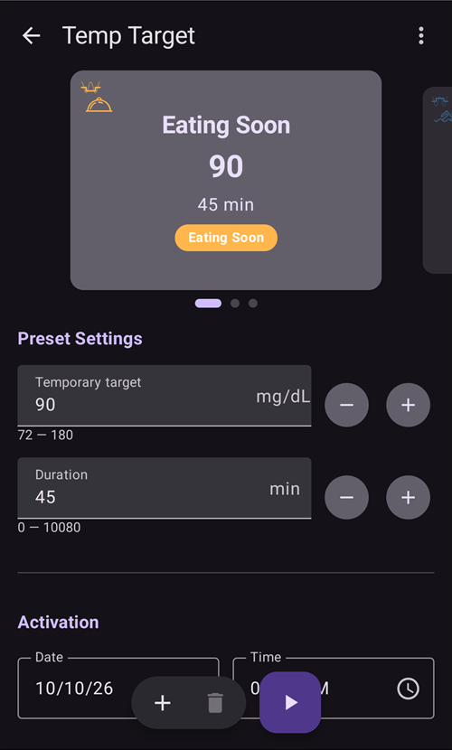

# Objetivos temporales

## ¿Qué son los objetivos temporales y cómo puedo ponerlos y configurarlos?

Un **objetivo temporal** (o, abreviado, **OT**) es una función de **AAPS** que permite al usuario cambiar su [rango objetivo de **glucosa**](#profile-glucose-targets) para actividades planificadas. **AAPS** lo consigue cambiando el uso de insulina del usuario.

Un objetivo de glucosa, sobre todo si es solo a corto plazo (menos de 4 horas), no tiene que ser el *valor real* al que esperas o quieres que llegue tu glucosa. Es más bien una buena forma de decirle a **AAPS** que sea más o menos agresivo, manteniendo tu glucosa dentro del rango.

Los objetivos temporales se pueden definir dentro de estos límites:

|        | Objetivo temporal     |
| ------ | --------------------- |
| Mínimo | 4 mmol/l o 72 mg/dl   |
| Máximo | 10 mmol/l o 180 mg/dl |

**AAPS** trae tres ajustes de **objetivo temporal** incluidos, para el ejercicio (**Actividad**), las comidas (**Comiendo Pronto**) y una hipoglucemia prevista (**Hipo**). Están en la pantalla **Objetivo temporal** (**Administrar** → **Objetivo temporal**), que también puedes abrir simplemente tocando el **chip del objetivo** en la pantalla principal.

Los usuarios deben tener expectativas realistas sobre los resultados que se pueden conseguir al elegir un **objetivo temporal** en **AAPS**. Lograr el objetivo de **glucosa** deseado depende de muchos factores, por ejemplo: la fiabilidad de los ajustes de **AAPS** del usuario, el control general de la **glucosa**, la **IOB**, la sensibilidad a la insulina, la resistencia a la insulina, el nivel de esfuerzo durante el ejercicio, etc.

Un **objetivo temporal** puede tardar unos 30 minutos o más en alcanzar el objetivo de **glucosa** deseado. **AAPS** no puede alcanzar un objetivo de **glucosa** de forma inmediata, y los usuarios deben tenerlo en cuenta al elegir un **objetivo temporal**.

The sections below summarize the features of **Temp-Target Activity**, **Temp-Target Eating soon** and **Temp-Target Hypo**. Los valores que se muestran son los predeterminados de fábrica — puedes [ajustar cada preajuste](#TempTargets-change-preset-defaults) a tus necesidades.

### OT - Actividad


**Objetivo de glucosa (preajuste predeterminado, ajustable)**

AAPS intentará llegar a 140 mg/dl o 7,8 mmol/l durante 1 h 30 min

**Otros aspectos que los usuarios pueden tener en cuenta al elegirlo**:

Según el nivel de **glucosa**, **AAPS** «reducirá» el uso de insulina para alcanzar el objetivo de **glucosa**. Si el objetivo de **glucosa** no está dentro del rango (es decir, está por encima del objetivo de **glucosa** elegido en el **perfil** del usuario), **AAPS** puede mantener la basal activa.

En modo de lazo cerrado, **SMB**:

- *puede* desactivarse (se explica más abajo); y/o
- la basal puede activarse si **AAPS** tiene **IOB** negativa, o <0.

Los usuarios también pueden considerar:

- *elegir* este **OT** 1–2 horas antes del ejercicio planificado para asegurar una IOB más baja (el momento correcto para este OT es diferente en cada persona); y
- *elegir* un perfil temporal (reducido) durante la actividad planificada para asegurar una **IOB** más baja;
- *asegurar* que el **OT** esté programado para *desactivarse* poco antes del ejercicio, porque la **IOB** ya está reducida y algunos usuarios tienen una subida rápida de la **glucosa** después del ejercicio.

### OT - Comiendo Pronto


**Objetivo de glucosa (preajuste predeterminado, ajustable)**

AAPS intentará llegar a 90 mg/dl o 5,0 mmol/l durante 45 minutos

**Otros aspectos que los usuarios pueden tener en cuenta al elegirlo**:

En modo de lazo cerrado, **SMB**:

- seguirá activado; y/o
- la basal también puede activarse según los ajustes del **perfil** del usuario.

Según el nivel de **glucosa**, **AAPS** «aumentará» el uso de insulina, dentro de los parámetros de los ajustes de **AAPS** del usuario, para alcanzar el objetivo de **glucosa** deseado.

### OT - Hipo


**Objetivo de glucosa (preajuste predeterminado, ajustable)**

AAPS intentará llegar a 160 mg/dl o 8,9 mmol/l durante 1 hora

**Otros aspectos que los usuarios pueden tener en cuenta al elegirlo**:

En modo de lazo cerrado, **SMB**:

- *puede* desactivarse (se explica más abajo); y/o
- la basal puede activarse si **AAPS** tiene **IOB** negativa, o <0.

(TempTargets-manage-v4)=

## Poner y administrar objetivos temporales (Administrar → Objetivo temporal)

En **AAPS** v4 administras tus **preajustes** de OT e inicias un objetivo temporal desde la pantalla **Administrar** (navegación inferior) → **Objetivo temporal** (*«Gestionar y establecer objetivos temporales»*).



La pantalla tiene tres partes:

1. **Carrusel de preajustes** (arriba) — desliza para pasar por tus preajustes de OT. Cada tarjeta muestra el **nombre**, el **objetivo** y la **duración** del preajuste; el OT que está en marcha se resalta.
2. **Editor** (en el centro) — el **Objetivo temporal** y la **Duración** que se aplicarán de verdad, además de una fecha/hora de **Activación**.
3. **Barra de acciones** (abajo) — **➕ añadir**, **‘️ borrar** y el botón **▶ activar**.

Al elegir una tarjeta de preajuste, su **objetivo** y su **duración** se cargan en el editor.

```{admonition} Preajustes incluidos y preajustes propios :class: note Los preajustes incluidos — **Comiendo Pronto**, **Actividad** e **Hipo** — siempre existen y **no se pueden borrar** (aunque sí puedes cambiar sus valores y guardarlos). Los preajustes que creas tú son **propios** y puedes editarlos o borrarlos libremente.

    <br />### Activar un objetivo temporal
    
    Desliza hasta el preajuste que quieres (sus valores se cargan en el editor), si quieres ajusta el **objetivo**/la **duración** en el editor y luego toca **▶ Activar**. Una confirmación muestra el objetivo, la duración y el motivo exactos antes de que empiece nada:
    
    
    
    Después de confirmar, el objetivo temporal empieza de inmediato (o a la hora de **Activación** elegida) y dura la **duración** indicada.
    
    ```{admonition} Editar los números es solo para una vez — no cambia el preajuste
    :class: important
    El **objetivo** y la **duración** del editor son los valores que **Activar** usará *ahora mismo*. Si los cambias, ese cambio es **temporal**: solo se aplica a esta activación y **no modifica el preajuste guardado**. Así puedes «ajustar y activar» un OT de una sola vez (por ejemplo, activar *Actividad* hoy con un objetivo un poco distinto) sin cambiar el preajuste para siempre.
    

### Guardar cambios en un preajuste

Si *sí* quieres conservar un valor editado, **Guárdalo**: cuando el editor es distinto del preajuste elegido, aparece un icono **Guardar** en la barra superior. Al tocarlo se guardan el **objetivo** y la **duración** actuales (y el nombre, en los preajustes propios) en el preajuste elegido. En los preajustes incluidos también aparece un botón **Restablecer valores predeterminados** (↺) en la barra de acciones: devuelve los valores predeterminados del preajuste.


Así que la regla general es:

- **Activar** → usa los números **una vez** (el preajuste no cambia).
- **Guardar** → convierte los números en los **nuevos valores predeterminados** del preajuste.

Para devolver un preajuste incluido a su estado de fábrica, elígelo y toca el botón **↺ Restablecer**. Solo aparece en la barra de acciones para un preajuste **incluido** cuyos valores son ahora distintos de los de fábrica, y restablece el **objetivo** y la **duración** originales de ese preajuste.

### Añadir y eliminar preajustes

- **➕ Añadir** — crea un **nuevo preajuste propio** con los valores actuales del editor. La nueva tarjeta aparece en el carrusel.
- **‘️ Borrar** — elimina el preajuste **propio** elegido. Los preajustes incluidos (*Comiendo Pronto*, *Actividad*, *Hipo*) no se pueden borrar.

Cuando tienes al menos dos preajustes **propios**, también puedes cambiar su orden en el carrusel: toca el icono **Reordenar** (⇅) en la barra superior, mueve la tarjeta central con los **botones de mover ◀ / ▶** y confirma con **✓**. Los preajustes incluidos mantienen su lugar — solo se pueden mover los preajustes propios. (Los controles son iguales que al [reordenar perfiles](ProfileSwitch-ProfilePercentage.md).)

Tus preajustes forman parte de la configuración sincronizada, así que se comparten entre tu máster y los clientes emparejados.

### Otras formas de poner un objetivo temporal

También puedes poner un objetivo temporal sin abrir esta pantalla:

- con los **interruptores de OT del diálogo Carbohidratos** — consulta [más abajo](#TempTargets-carbs-dialog),
- con un **botón de preajuste en la [barra de Lanzamiento rápido](QuickLaunch.md)** — la categoría *Ajustes de objetivos temporales* en *Configurar Lanzamiento Rápido* ofrece un botón de un toque para cada uno de tus preajustes,
- desde un **reloj Wear OS** (el elemento de menú / mosaico **Objetivo temporal**),
- desde un **cliente** emparejado — consulta [Control máster ↔ cliente](../RemoteFeatures/ClientMasterControl.md),
- como parte de una **[escena](Scenes.md)** (la acción *Objetivo temporal*), o
- desde una regla de **Automatización** (*Iniciar objetivo temporal* / *Detener objetivo temporal*).

* * *

(TempTargets-where-can-i-select-a-temp-target)=

## ¿Dónde puedo elegir un objetivo temporal?

La forma más rápida es tocar el **chip del objetivo** en la pantalla principal (muestra tu rango objetivo actual):


Así se abre la pantalla **Objetivo temporal** descrita arriba — desliza hasta un preajuste y toca **▶ Activar**. A la misma pantalla también se llega con **Administrar** → **Objetivo temporal**.

(TempTargets-carbs-dialog)= Al introducir carbohidratos no hace falta abrir la pantalla **Objetivo temporal**: el **diálogo Carbohidratos** (**Tratamientos** → **Carbohidratos**) tiene arriba los interruptores **Iniciar OT Hipo**, **Iniciar OT Comiendo Pronto** e **Iniciar OT Actividad**. Activa uno y el preajuste correspondiente se activa junto con la entrada de carbohidratos:


    {admonition} OT Hipo automático
    :class: note
    Si abres el **diálogo Carbohidratos** cuando tu glucosa está por debajo de 72 mg/dl (4 mmol/l), **AAPS** marca por ti el interruptor **Iniciar OT Hipo** (salvo que ya esté en marcha un objetivo temporal más alto con más tiempo restante).

(TempTargets-change-preset-defaults)=

## ¿Dónde puedo cambiar el objetivo temporal predeterminado y sustituirlo por mis propias preferencias?

El **objetivo** y la **duración** de cada preajuste se editan directamente en la pantalla **Objetivo temporal** — ya no hay una entrada aparte en las preferencias para esto:

1. Abre la pantalla **Objetivo temporal** (toca el chip del objetivo, o **Administrar** → **Objetivo temporal**).
2. Desliza hasta el preajuste que quieres cambiar.
3. Ajusta el **Objetivo temporal** y/o la **Duración** en el editor.
4. Toca el icono **Guardar** que aparece en la barra superior.


Mientras el editor es distinto de los valores de fábrica de un preajuste incluido, también aparece un botón **↺ Restablecer** en la barra de acciones — tócalo para devolver el objetivo y la duración originales del preajuste.

## ¿Cómo cancelo un objetivo temporal?

Mientras un objetivo temporal está en marcha, el chip del objetivo en la pantalla principal muestra el objetivo y el tiempo que le queda. Tócalo — en la pantalla **Objetivo temporal** el preajuste en marcha se resalta como **ACTIVO**, y aparece un botón rojo **✗ Cancelar** al final de la barra inferior, justo a la izquierda del botón **▶ Activar**. Tócalo y confirma:


Un objetivo temporal en marcha también se puede detener desde un **reloj Wear OS**, desde un **cliente** emparejado o con una regla de **Automatización** (*Detener objetivo temporal*).

(TempTargets-hypo-temp-target)=

## Objetivo temporal ante Hipoglucemia

El **objetivo temporal Hipo** permite a **AAPS** evitar que el usuario tenga una glucosa baja, reduciendo la insulina. Si el usuario prevé que su **glucosa** va a bajar: normalmente **AAPS** debería manejarlo, pero mucho depende de lo estables que sean los ajustes de **AAPS** del usuario. Un **objetivo temporal Hipo** permite al usuario adelantarse a la bajada prevista e indicar a **AAPS** que reduzca la insulina.

A veces, al comer carbohidratos para tratar una hipoglucemia, la **glucosa** del usuario puede subir rápido, y **AAPS** corregirá esa subida rápida de la **glucosa** activando **SMB**.

Algunos usuarios quieren evitar que se den **SMB** durante el **objetivo temporal Hipo**. Para ello, desactiva *'Habilitar SMB con objetivo temporal elevado'* en **Ajustes** → **OpenAPS SMB** (ver más abajo):

- Advanced, objective 9: the user can enable *“High temp target raises sensitivity”* for **Temp-Targets** of 100 mg/dL (5.6 mmol/L) or higher in OpenAPS SMB, **AAPS** will be more sensitive.

- Advanced, objective 9: the user can deactivate *“Enable SMB with high temp target”*, so that even if **AAPS** has COB > 0, “Enable SMB with low temp target” or “Enable SMB always” enabled and OpenAPS SMB active, **AAPS** will not give SMBs while high temp targets are active.

Nota: si abres el **diálogo Carbohidratos** cuando tu glucosa está por debajo de 72 mg/dl o 4 mmol/l, **AAPS** marca automáticamente el interruptor **Iniciar OT Hipo**.

(TempTargets-activity-temp-target)=

## Objetivo temporal Actividad

Antes y durante el ejercicio, el usuario puede necesitar un objetivo más alto para evitar una hipoglucemia durante la actividad.

Para simplificar el **objetivo temporal Actividad**, el usuario puede configurar un **objetivo temporal - Actividad** predeterminado que sube la **glucosa** reduciendo el uso de insulina, para frenar la bajada de la **glucosa** y evitar una hipoglucemia.

Los usuarios nuevos de **AAPS** pueden necesitar probar y personalizar los ajustes predeterminados de su **objetivo temporal Actividad** para que esta función les funcione lo mejor posible. Cada persona es diferente a la hora de conseguir un control estable de la glucosa durante el ejercicio. Consulta también la [sección de deportes en las preguntas frecuentes](#FAQ-sports).

Algunos usuarios también prefieren activar un **Cambio de perfil** (una reducción del perfil < 100 % para que **AAPS** administre menos insulina) antes y mientras el **objetivo temporal Actividad** está activo. Puedes iniciar los dos en un solo paso: toca el nombre del perfil en la pantalla principal, toca el botón redondo **▶**, pon un **Porcentaje** por debajo del 100 % y una **Duración**, y luego activa **Objetivo temporal / Actividad**. Consulta [Cambiar el porcentaje del perfil](#ProfileSwitch-change-percentage).

Avanzado, objetivo 9: los usuarios pueden activar *'Objetivo temporal alto aumenta la sensibilidad'* para **objetivos temporales** de 100 mg/dl (5,6 mmol/l) o más en OpenAPS **SMB**. Un objetivo de 99 mg/dl (5,5 mmol/l) es un objetivo normal, ni alto ni bajo. Así **AAPS** es más sensible.

Además, si *'Habilitar SMB con objetivo temporal elevado'* está desactivado, **AAPS** no administrará **SMB**, aunque haya COB > 0, *'Habilitar SMB con objetivo temporal bajo'* o *'Habilitar SMB siempre'* activados y OpenAPS **SMB** activo.

(TempTargets-eating-soon-temp-target)=

## Objetivo temporal Comiendo Pronto

**Temp-Target Eating soon** can help accomplish a gentle drive down of **BG** and ensure there is ample **IOB** before eating.

This can be an important tool for those users who do not pre bolus, however the efficacy of **Temp-Target Eating soon** will depend on a number of factors including: the user’s settings, if they eat a low carb diet and whether they are using a fast acting insulin (like Fiasp or Lyumjev) in order to eliminate the need to pre bolus. Ordinarily, until users are experienced in **AAPS** they should expect to pre bolus when using **Temp-Target Eating soon** and this is particularly so, if eating a high carb diet.

Puedes leer más sobre el «modo Eating soon» (comiendo pronto) en el artículo ['How to do “eating soon” mode'](https://diyps.org/2015/03/26/how-to-do-eating-soon-mode-diyps-lessons-learned/) (en inglés) o [aquí](https://diyps.org/tag/eating-soon-mode/).

Avanzado, [objetivo 9](#objectives-objective9): si usas OpenAPS SMB y tienes activado *'Objetivo temporal bajo reduce la sensibilidad'*, **AAPS** actúa de forma un poco más agresiva. Para esta opción, el **objetivo temporal** debe ser de 98 mg/dl (5,4 mmol/l) o menos.

## ¿Cómo desactivo SMB durante los objetivos temporales?

Para hacerlo, abre **Ajustes** → **OpenAPS SMB** y desactiva *'Habilitar SMB con objetivo temporal elevado'*.


Así **AAPS** no dará **SMB**, aunque haya COB > 0, *'Habilitar SMB con objetivo temporal bajo'* o *'Habilitar SMB siempre'* activados y OpenAPS SMB activo.