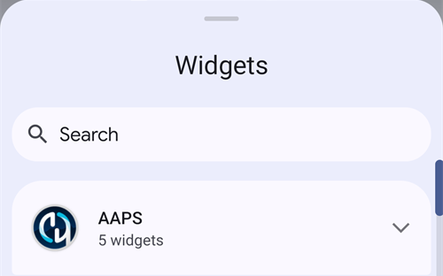

(widgets)=
# Widgets de la pantalla de inicio

**AAPS** tiene widgets que puedes añadir a la pantalla de inicio de tu teléfono. Un widget muestra tus datos actuales sin abrir la app. Toca un widget para abrir **AAPS**.

```{contents} Table of contents
:depth: 2
:local: true
```

---

## Widgets disponibles

Hay cinco widgets disponibles. Aparecen bajo **AAPS** en el selector de widgets de Android:


| Widget                                  | Tamaño por defecto | Qué muestra                                                                                                                                                                                                                                                |
| --------------------------------------- | ------------------ | ---------------------------------------------------------------------------------------------------------------------------------------------------------------------------------------------------------------------------------------------------------- |
| **Widget de AAPS**                      | 5 × 2              | The status block of the main screen: BG with trend and delta, the loop mode as an icon beside the profile name, target, sensitivity (shown as on the main screen), IOB and COB. The texts shrink to fit the size you give the widget instead of being cut. |
| **Círculo de glucosa de AAPS**          | 2 × 2              | El círculo de glucosa de la pantalla principal: un anillo del color de la glucosa, el arco de tendencia, el delta, el valor de glucosa y el tiempo desde la última lectura.                                                                                |
| **AAPS pequeño**                        | 2 × 2              | Nombre del perfil, glucosa con flecha de tendencia, tiempo desde la última lectura, delta, IOB y COB.                                                                                                                                                      |
| **AAPS Glucosa + IOB + COB (compacta)** | 4 × 1              | Una línea con la glucosa y la flecha de tendencia, IOB y COB.                                                                                                                                                                                              |
| **Gráfico de glucemia AAPS**            | 3 × 1              | El valor de glucosa con un pequeño gráfico de las últimas lecturas.                                                                                                                                                                                        |

El **Widget de AAPS**, el **Círculo de glucosa** y el widget **pequeño** en una pantalla de inicio:


El widget **compacto** y el widget **Gráfico de glucemia**:


Los valores de glucosa usan los mismos colores que en **AAPS**: verde en rango, amarillo por encima del rango, rojo por debajo del rango.

---

## Añadir un widget

Los pasos exactos dependen de tu teléfono y de su launcher (pantalla de inicio). En la mayoría de los teléfonos:

1. Mantén pulsada una zona vacía de la pantalla de inicio y selecciona **Widgets**.

   

2. Abre **AAPS** en la lista y toca el widget que quieras.
3. Pulsa **Añadir** (o arrastra el widget al lugar que quieras).

   

El widget se coloca en la pantalla de inicio. Justo después de añadirlo, aparece con unos tiradores: arrastra un tirador para **cambiar el tamaño** del widget, o arrastra el widget para moverlo. El círculo de glucosa se puede ajustar a cualquier tamaño.


Si la página de la pantalla de inicio está llena, el teléfono pone el widget en una página nueva.

---

## Configuración del Widget

Toca el botón del **lápiz** que aparece en el widget justo después de añadirlo. Más tarde, mantén pulsado el widget para que vuelvan a aparecer los tiradores y el lápiz.

El diálogo **Configuración del Widget** tiene dos ajustes:

- **Configurar la opacidad**: cuánto se ve el fondo del widget. Con un valor bajo se ve el fondo de pantalla a través del widget.
- **Usar modo oscuro**: usa un fondo negro en lugar del fondo por defecto.


Cada widget tiene su propia configuración.

---

## Conviene saber

- Un widget solo **muestra** datos. Desde un widget no puedes poner un bolo ni cambiar nada.
- **AAPS** es quien actualiza el widget. Si **AAPS** no está en marcha, o si Android lo limita en segundo plano, el widget puede mostrar datos antiguos. Revisa el tiempo desde la última lectura y asegúrate de que **AAPS** está excluido de la [optimización de batería](#SetupWizard-StoragePermission).
- Con **AAPSClient**, **AAPSClient2** y **AAPSClient3**, el fondo del widget es amarillo, azul o verde, para que puedas distinguir las apps. Si el color se ve mal, sube la opacidad en la configuración del widget. Consulta [Acerca de AAPSClient, AAPSClient2 y AAPSClient3](#remotecontrol-aapsclient-versions).
