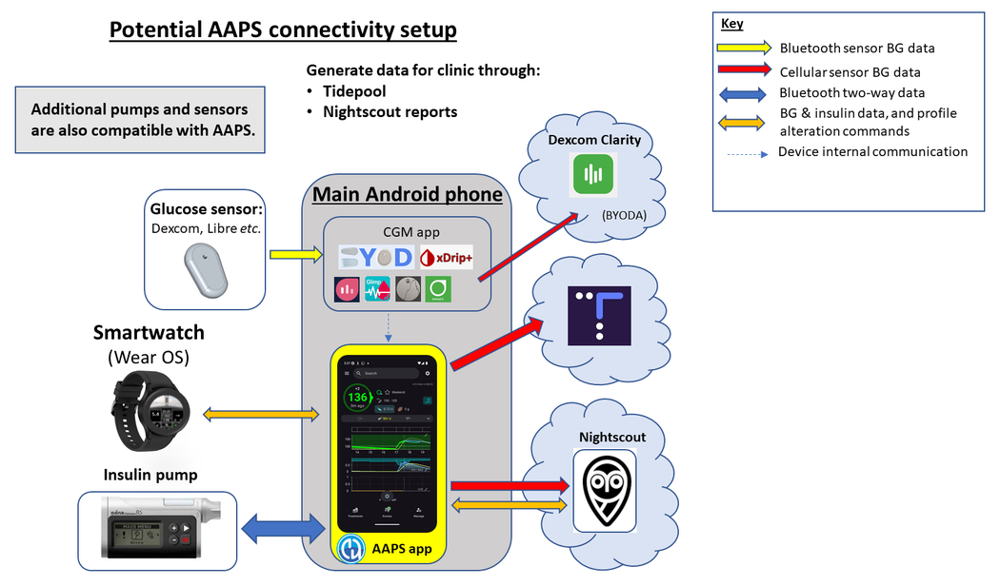

# Prepararse para empezar con AAPS

Bienvenido. Esta documentación quiere guiar a los usuarios que se preparan para configurar y empezar a usar el sistema de páncreas artificial para Android (**AAPS**).

## Cómo orientarse en la documentación

Puedes encontrar un **índice** y una explicación de la estructura de la documentación [aquí](../index.md). También puedes llegar a él haciendo clic en el símbolo de **AAPS** arriba a la izquierda de la documentación. Allí encontrarás un resumen del propósito de las distintas secciones de la documentación. También puedes usar los títulos a la izquierda de esta página para moverte por la documentación. Por último, hay una práctica función de búsqueda justo debajo del símbolo de **AAPS**.

Queremos que sea fácil conocer tanto las capacidades como los límites de **AAPS**. Puede ser decepcionante descubrir, después de dedicar tiempo a leer la documentación, que tu bomba de insulina o tu MCG no son compatibles, o que **AAPS** ofrece funciones distintas de las que esperabas.

Muchos detalles de la documentación de **AAPS** basados en la experiencia se entienden mejor cuando ya usas **AAPS** en tiempo real. Igual que es difícil aprender un deporte solo leyendo las reglas, hace falta combinar dos cosas: aprender las bases de las reglas para usar **AAPS** de forma segura y, después, aprender la mejor forma de aplicarlas cuando empieces a usar **AAPS**.

(preparing-safety-first)=

## La seguridad primero
«Un gran poder conlleva una gran responsabilidad…»

### Seguridad técnica
**AAPS** tiene un amplio conjunto de funciones de seguridad. Estas imponen restricciones que se quitan poco a poco a medida que completas por etapas una serie de [objetivos](../SettingUpAaps/CompletingTheObjectives.md), que incluyen probar parámetros concretos y responder a preguntas tipo test. Las funciones de **AAPS** se desbloquean a medida que se completan los objetivos. Este proceso permite al usuario pasar de forma segura y por etapas del lazo abierto al lazo cerrado, mientras aprende las distintas funciones de **AAPS**.

Los [objetivos](../SettingUpAaps/CompletingTheObjectives.md) se han diseñado para dar la mejor introducción posible a **AAPS**, teniendo en cuenta los errores típicos y las tendencias generales que los desarrolladores de **AAPS** han observado en los nuevos usuarios. Pueden ocurrir errores porque el principiante no tiene experiencia y tiene demasiada prisa por empezar con **AAPS**, o porque ha pasado por alto puntos clave. Los [objetivos](../SettingUpAaps/CompletingTheObjectives.md) buscan reducir al mínimo estos problemas.

### Seguridad médica
```{admonition} Avoid permanent and painful damage to your eyes and nerves
:class: danger
Se aconseja precaución con las mejoras rápidas del control de la glucosa y con la bajada de la HbA1c 
```

Una consideración de seguridad importante es que **una bajada rápida de la HbA1c y un mejor control de la glucosa en personas que han tenido la glucosa alta durante algún tiempo puede causar daños permanentes**. Muchas personas con diabetes no lo saben, y no todos los médicos informan a sus pacientes de este problema.

Estos daños pueden incluir **pérdida de visión y neuropatía permanente (dolor)**. Es posible evitar estos daños bajando los niveles medios de glucosa más despacio. Si ahora tienes una HbA1c alta y vas a empezar con **AAPS** (o cualquier otro sistema de lazo cerrado), _por favor_ habla de este posible riesgo con tu equipo médico antes de empezar, y acordad juntos un calendario con objetivos de glucosa seguros que bajen poco a poco. Al principio puedes poner fácilmente objetivos de glucosa más altos en **AAPS** (ahora mismo el objetivo más alto que puedes elegir es 11,1 mmol/l, pero si hace falta también puedes mantener a propósito un perfil débil) y después bajar el objetivo según pasan los meses.

#### ¿Con qué rapidez puedo bajar mi HbA1c sin riesgo de daño permanente?

Un [estudio](https://pubmed.ncbi.nlm.nih.gov/1464975/) retrospectivo de 76 pacientes indicó que el riesgo de avance de la retinopatía aumentaba 1,6 veces, 2,4 veces y 3,8 veces si la HbA1c bajaba un 1 %, un 2 % o un 3 %, respectivamente, en un periodo de 6 meses. Sugirieron que la **«bajada del valor de HbA1c en cualquier periodo de 6 meses debe limitarse a menos del 2 % para evitar el avance de la retinopatía... Una bajada demasiado rápida al inicio del control glucémico podría causar un empeoramiento grave o transitorio del avance de la retinopatía».**

Nota: Si usas otras unidades de HbA1c (mmol/mol en lugar de %), haz clic [aquí](https://www.diabetes.co.uk/hba1c-units-converter.html) para usar una calculadora de HbA1c.

En otra [evaluación](https://academic.oup.com/brain/article/138/1/43/337923) retrospectiva de 954 pacientes, los investigadores observaron que:

**«Con una bajada de la HbA1c de 2–3 puntos porcentuales en 3 meses hubo un riesgo absoluto del 20 % de desarrollar neuropatía diabética inducida por el tratamiento; con una bajada de la HbA1c de >4 puntos porcentuales en 3 meses, el riesgo absoluto de desarrollar neuropatía diabética inducida por el tratamiento superó el 80 %».**

Un [comentario](https://academic.oup.com/brain/article/138/1/2/340563) sobre este trabajo coincidió en que, para evitar complicaciones, **el objetivo debe ser bajar la A1c <2 % en 3 meses.** Puedes leer otras revisiones sobre el tema [aquí](https://www.ncbi.nlm.nih.gov/pmc/articles/PMC6587545/pdf/DOM-21-454.pdf) y [aquí](https://www.mdpi.com/1999-4923/15/7/1791).

En general se reconoce que las personas con diabetes tipo 1 _recién_ diagnosticadas (que a menudo tienen una HbA1c muy alta en el diagnóstico, antes de empezar con insulina) parecen poder bajar rápidamente su HbA1c justo después del diagnóstico sin correr estos riesgos en la misma medida, porque no han tenido la glucosa alta durante tanto tiempo. Aun así, es algo que debes hablar con tu médico.

(PreparingForAaps-no-sglt-2-inhibitors)=
### Sin inhibidores de SGLT-2

```{admonition} NO SGLT-2 inhibitors
:class: danger
Los inhibidores de SGLT-2, también llamados gliflozinas, impiden la reabsorción de glucosa en el riñón. Las gliflozinas bajan la glucosa de forma imposible de calcular, así que NO DEBES tomarlas mientras usas un sistema de lazo cerrado como AAPS. ¡Habría un riesgo importante de cetoacidosis y/o hipoglucemia! La combinación de este medicamento con un sistema que baja las tasas basales para subir la glucosa es especialmente peligrosa. 

En resumen:
- **Ejemplo 1: riesgo de hipoglucemia**
>En la comida usas **AAPS** para poner un bolo para 45 g de glucosa. El problema es que, sin que AAPS lo sepa, los inhibidores hacen que el cuerpo elimine parte de los carbohidratos. Así queda en tu cuerpo demasiada insulina para los carbohidratos absorbidos, y se produce una hipoglucemia.

- **Ejemplo 2: riesgo de cetoacidosis**
>Los inhibidores eliminan parte de los carbohidratos en segundo plano, lo que baja tu glucosa. **AAPS** ordenará automáticamente a la bomba que reduzca la insulina, también la basal. Con el tiempo, tu glucosa puede quedarse por debajo del objetivo, hasta el punto de que el cuerpo no tenga suficiente insulina de fondo para absorber los carbohidratos, y se produce una cetoacidosis. Normalmente, en las personas con diabetes tipo 1 la cetoacidosis aparece porque falla la bomba, lo que activaría alertas en su teléfono y se notaría por una glucosa alta. Sin embargo, el peligro de las gliflozinas es que no habría alertas de AAPS, porque la bomba sigue funcionando y la glucosa puede seguir dentro del objetivo.

Algunos nombres comerciales comunes de inhibidores de SGLT-2 son: Invokana, Farxiga, Jardiance, Glyxambi, Synjardy, Steglatro y Xigduo XR, entre otros.
```


### Principios clave del lazo con AAPS

Antes de usar **AAPS** hay que entender los principios y conceptos clave del lazo. Esto se consigue dedicando tu tiempo personal a leer la documentación de **AAPS** y a completar los objetivos, que te dan una base sólida para un uso seguro y eficaz de **AAPS**. La cantidad de documentación de **AAPS** puede parecer abrumadora al principio, pero ten paciencia y confía en el proceso; ¡con el enfoque adecuado, lo lograrás!

La velocidad de avance depende de cada persona, pero ten en cuenta que completar todos los objetivos suele llevar de 6 a 9 semanas. Mucha gente empieza a compilar, instalar y configurar **AAPS** bastante antes de empezar a usarlo. Para ayudarte, el sistema tiene una «bomba virtual» que puedes usar mientras completas los primeros objetivos. Así puedes familiarizarte con **AAPS** sin usarlo de verdad para administrar insulina. Abajo tienes un calendario detallado. Ten en cuenta que en el objetivo 7 de **AAPS** ya usas el lazo cerrado; los objetivos posteriores añaden funciones extra como **SMB** y **automatizaciones**, que son útiles para algunos usuarios, pero no esenciales para la función principal de **AAPS**.

El éxito con **AAPS** requiere un enfoque proactivo, una disposición para reflexionar sobre los datos de glucosa en sangre (BG) y flexibilidad para realizar los ajustes necesarios en **AAPS** con el fin de mejorar tus resultados. Así como es casi imposible aprender a jugar un deporte solo leyendo las reglas, lo mismo se puede decir de **AAPS**.

#### Cuenta con retrasos y pequeños problemas al configurar todo y ponerlo en marcha

En las primeras etapas con **AAPS**, puede ser difícil conseguir que todos los componentes del lazo se comuniquen bien entre sí (y con posibles seguidores), y también ajustar bien tu configuración. Algunos fallos no se pueden resolver hasta usar **AAPS** en el día a día, pero hay mucha ayuda disponible en el grupo de Facebook y en Discord. Planifícalo bien y elige momentos «buenos», como una mañana tranquila de fin de semana (es decir, no tarde por la noche, cuando estés cansado, ni antes de una reunión importante o de un viaje) para buscar y resolver problemas.

#### Compatibilidad tecnológica

**AAPS** solo es compatible con ciertos tipos de bombas de insulina, MCG y teléfonos, y alguna tecnología puede no estar disponible en algunos países. Para evitar decepciones o frustraciones, lee las secciones de [MCG](../Getting-Started/CompatiblesCgms.md), [bombas](../Getting-Started/CompatiblePumps.md) y [teléfonos](../Getting-Started/Phones.md).

#### Tiempo para compilar la app y avanzar hasta el lazo completo

El tiempo para compilar la app **AAPS** depende de tu nivel de experiencia y de tu capacidad técnica. Para usuarios sin experiencia, compilar **AAPS** puede llevar normalmente hasta medio día o un día entero (con ayuda de la comunidad). El proceso será mucho más rápido en las versiones nuevas de **AAPS**, a medida que ganes experiencia.

Varias partes de esta documentación te ayudan en el proceso de compilación:

- [Compilar AAPS](../SettingUpAaps/BuildingAaps.md) te guía paso a paso para compilar la app e instalarla en tu teléfono;

- las [preguntas frecuentes](../UsefulLinks/FAQ.md) responden a dudas comunes y explican los errores más probables; y

- la sección de [Solución de problemas](../GettingHelp/GeneralTroubleshooting.md) reúne soluciones a los problemas más frecuentes, ordenadas por tema.

El tiempo para llegar al lazo cerrado depende de cada persona; [abajo](#preparing-how-long-will-it-take) tienes un calendario aproximado para llegar al lazo completo con **AAPS**.


#### Almacén de claves (keystore) y archivo de exportación de la configuración

Un «almacén de claves» (archivo .jks) es un archivo cifrado con contraseña, único para tu propia copia de **AAPS**. Tu teléfono Android lo usa para asegurarse de que nadie más pueda actualizar tu copia sin el almacén de claves. En resumen, como parte de la compilación de **AAPS**, debes:

1.  Guardar tu archivo de almacén de claves (archivo .jks que se usa para firmar tu app) en un lugar seguro;

2.  Anotar la contraseña de tu archivo de almacén de claves.

Cómo guardar el almacén de claves depende de tu método de compilación:

- **Compilación con Android Studio (ordenador)**: el almacén de claves se crea durante la compilación. Consulta [Generate signed APK](#Building-APK-generate-signed-apk) para saber dónde guardarlo.
- **AAPS Builder**: guarda el archivo de copia de seguridad `aaps-keystore.jks` que te ofreció la página de configuración al crear tu clave, junto con su contraseña y su alias. Si subiste tu propio almacén de claves, guarda ese archivo.
- **Compilación en el navegador con un fork**: usa el workflow específico [Export keystore](#ci-keystore-export) para descargar una copia en tu Google Drive.

Así podrás usar exactamente el mismo archivo de almacén de claves cada vez que se cree una versión actualizada de **AAPS**. De media, habrá que actualizar **AAPS** 2 veces al año.

Además, **AAPS** permite [exportar toda tu configuración](../Maintenance/ExportImportSettings.md). Esto garantiza que puedas recuperar tu sistema de manera segura al cambiar de teléfono, actualizar o reinstalar la aplicación con la mínima interrupción. 

#### Solucionando problemas

No dudes en ponerte en contacto con la comunidad de AAPS si hay algo de lo que te sientes inseguro. ¡No existen preguntas tontas! Animamos a todos los usuarios, con cualquier nivel de experiencia, a hacer preguntas. Las preguntas suelen recibir respuesta rápida, gracias al gran número de usuarios de **AAPS**.

##### [pregunta en el grupo de Facebook de AAPS](https://www.facebook.com/groups/AndroidAPSUsers/)

##### [pregunta en el canal de Discord de AAPS](https://discord.gg/4fQUWHZ4Mw)


#### ¿[Dónde buscar ayuda](../GettingHelp/WhereCanIGetHelp.md)?

Esta sección quiere dar a los nuevos usuarios enlaces a recursos para obtener ayuda, incluido el apoyo de la comunidad, formada por usuarios nuevos y con experiencia que pueden aclarar dudas y resolver los problemas habituales de AAPS.

#### [Sección para médicos](../UsefulLinks/ClinicianGuideToAaps.md)

Esta es una [sección específica para médicos](../UsefulLinks/ClinicianGuideToAaps.md) que quieren saber más sobre AAPS y la tecnología de páncreas artificial de código abierto. En la Introducción también hay consejos sobre [cómo hablar con tu equipo médico](#introduction-how-can-i-approach-discussing-aaps-with-my-clinical-team).

## ¿Qué vamos a compilar e instalar?

Este diagrama da una visión general de los componentes clave (hardware y software) del sistema **AAPS**:




Además de los tres componentes básicos de hardware (teléfono, bomba, sensor de glucosa), también necesitamos: 1) La app **AAPS** 2) Un servidor de informes y 3) Una app de monitorización continua de glucosa (MCG)

### 1) Una aplicación para teléfono Android: **AAPS**

**AAPS** es una app que funciona en teléfonos y dispositivos Android. Vas a compilar tú mismo la app **AAPS** (un archivo apk) con una guía paso a paso: descargarás el código fuente de **AAPS** desde GitHub, instalarás los programas necesarios (Android Studio, GitHub desktop) en tu ordenador y compilarás tu propia copia de la app **AAPS**. Después transferirás la app **AAPS** a tu teléfono (por correo electrónico, cable USB, _etc._) y la instalarás.

### 2) Un servidor de informes: Nightscout (Tidepool*)

Para aprovechar **AAPS** al máximo, necesitas configurar un servidor de Nightscout. Puedes [hacerlo tú mismo](https://nightscout.github.io/nightscout/new_user/#free-diy) o, como alternativa, pagar una pequeña cuota por un [servicio de Nightscout gestionado](https://nightscout.github.io/#nightscout-as-a-service) que lo configure por ti. Nightscout se usa para recoger los datos de **AAPS** a lo largo del tiempo y puede generar informes detallados que relacionan los patrones del MCG y de la insulina. Los cuidadores también pueden usar Nightscout para comunicarse a distancia con la aplicación **AAPS** y supervisar el control de la diabetes de su hijo o hija. Estas funciones de comunicación a distancia incluyen el seguimiento en tiempo real de la glucosa y de la insulina, bolos de insulina a distancia (por SMS) y anuncios de comidas. Intentar analizar tu diabetes mirando los datos del MCG por separado de los datos de la bomba es como conducir un coche con un conductor ciego al que el pasajero le describe lo que ve. Tidepool también está disponible como alternativa a Nightscout.

### 3) App del sensor MCG

Según tu sensor de glucosa/MCG, necesitarás una app compatible que reciba los valores de glucosa y los envíe a **AAPS**. Abajo se muestran las distintas opciones; hay más información en la [sección de MCG compatibles](../Getting-Started/CompatiblesCgms.md):

  

### Mantenimiento del sistema **AAPS**

Tanto **Nightscout** como **AAPS** se deben actualizar aproximadamente una vez al año, cuando salen versiones mejoradas. En algunos casos la actualización puede esperar; en otros se recomienda mucho o se considera esencial para la seguridad. Estas actualizaciones se anuncian en los grupos de Facebook y en los servidores de Discord. Las notas de la versión explican claramente cuál es el caso. Es probable que, en el momento de la actualización, mucha gente haga preguntas parecidas a las tuyas, y tendrás ayuda para hacer las actualizaciones.

(preparing-how-long-will-it-take)=
## ¿Cuánto tiempo lleva configurarlo todo?

Como ya se ha dicho, usar **AAPS** es más bien un «viaje» que requiere dedicar tu tiempo personal. No es una configuración que se hace una sola vez. Según las estimaciones actuales, compilar **AAPS**, instalar y configurar el software de **AAPS** y del **MCG** y pasar del lazo abierto al lazo cerrado híbrido con **AAPS** lleva en total unos 4 a 6 meses. Por eso te sugerimos que des prioridad a compilar la app **AAPS** y a completar los primeros objetivos lo antes posible, aunque todavía uses otro sistema de administración de insulina (puedes usar una bomba virtual hasta el objetivo 5).

Algunos objetivos exigen que pase un número de días para asegurarse de que entiendes la nueva función. No es posible saltarse este tiempo de espera; estos tiempos mínimos de espera existen por tu propia seguridad.

Este es un plazo aproximado:

| Tareas                                                             |        Tiempo aprox.         |
| ------------------------------------------------------------------ |:----------------------------:|
| Primera lectura de la documentación                                |           1–2 días           |
| Configurar GitHub para permitir la compilación en el navegador     |          1–4 horas           |
| Configurar un servidor de informes                                 |            1 hora            |
| Instalar una app de MCG (xDrip, BYODA, …)                          |            1 hora            |
| Configuración inicial de MCG → xDrip → AAPS                        |            1 hora            |
| Configuración inicial de AAPS → bomba                              |            1 hora            |
| Configurar AAPS → Nightscout/Tidepool (solo informes)              |            1 hora            |
| Opcional: configurar Nightscout ↔ **AAPS** y NSFollowers           |            1 hora            |
| Objetivo 1: Configurar la visualización y la monitorización        |            1 hora            |
| Objetivo 2: Aprender a controlar AAPS                              |           2 horas            |
| Objetivo 3: Demostrar tus conocimientos                            |        Hasta 14 días         |
| Objetivo 4: Empezar con un lazo abierto                            |        Mínimo 7 días         |
| Objetivo 5: Comprender tu lazo abierto                             |            7 días            |
| Objetivo 6: Empezar a cerrar el lazo (Suspensión por glucosa baja) |   Mínimo 5, hasta 14 días    |
| Objetivo 7: Ajustar el lazo cerrado                                |  Mínimo 1 día, hasta 7 días  |
| Objetivo 8: Ajustar las basales y ratios, activar Autosens         | Mínimo 7 días, hasta 14 días |
| Objetivo 9: Activar el super micro bolo (SMB)                      |        Mínimo 28 días        |
| Objetivo 10: Automatización                                        |        Mínimo 28 días        |

Cuando **AAPS** ya funcione por completo, seguirás teniendo que ajustar tu configuración con regularidad para mejorar el control general de tu diabetes.

## Requisitos

### Consideraciones médicas

Además de las advertencias médicas de la [sección de seguridad](#preparing-safety-first), hay también parámetros distintos según la insulina que uses en la bomba.

#### Elección de la insulina

Los cálculos de **AAPS** se basan en insulinas con una concentración de 100 U/ml (igual que el estándar de las bombas). Configura tu insulina en **Administrar → Configuración de insulina**: indica su **Pico de acción** y su **DIA**, o usa **Cargar pico desde** para rellenar el tiempo de pico estándar de uno de los ajustes predefinidos:

- **Novorapid** (también para Humalog y NovoLog)
- **Fiasp**
- **Lyumjev**

Los usuarios avanzados pueden introducir directamente cualquier tiempo de pico (de 35 a 120 minutos), por ejemplo para una mezcla de insulinas. Consulta [Configuración de insulina](#Config-Builder-insulin).


### Aspectos técnicos

Esta documentación quiere reducir al mínimo absoluto los conocimientos técnicos necesarios. Para compilar la app **AAPS** tienes varias opciones. Consulta [Compilar AAPS](../SettingUpAaps/BuildingAaps.md) para ver un resumen:

- **Compilación en el navegador** (recomendada): compila la app directamente desde tu teléfono con GitHub Actions, sin necesidad de ordenador ni de Android Studio. Con [AAPS Builder](../SettingUpAaps/BrowserBuildAapsBuilder.md) solo necesitas una cuenta de GitHub: descargas la app directamente desde GitHub. El método del fork también necesita una cuenta de Google para guardar la app en tu Google Drive.
- **Compilación con Android Studio**: compila la app en tu ordenador con Android Studio. La usan sobre todo los desarrolladores que quieren hacer cambios en el código.
- **Compilación por línea de comandos**: para usuarios que prefieren compilar en su ordenador sin instalar Android Studio.

Además de compilar la app, también tienes que configurar un servidor de informes, configurar varias apps del teléfono Android y aprender a gestionar la diabetes. Esto se consigue avanzando paso a paso, con paciencia y con ayuda de la comunidad de **AAPS**. Si ya sabes moverte por internet y gestionar tu propio correo de Gmail, compilar **AAPS** es una tarea que puedes hacer. Tómate tu tiempo.

### Teléfonos

#### AAPS y las versiones de Android

La versión actual de **AAPS** (4.0) necesita un teléfono Android con Google **Android 12.0 o superior**. Si piensas comprar un teléfono nuevo (a fecha de enero de 2026), se prefiere Android 16.<br/> Por razones de seguridad, recomendamos mucho a los usuarios que mantengan su versión de **AAPS** actualizada. Sin embargo, para los usuarios que no pueden usar un dispositivo con Android 12.0 o más reciente, siguen disponibles versiones anteriores de **AAPS** compatibles con versiones antiguas de Android; consulta [Notas de la versión](#maintenance-android-version-aaps-version).

#### Elección del modelo de teléfono
El modelo exacto que compres depende de las funciones que quieras. En la [página Teléfonos](../Getting-Started/Phones.md) encontrarás recomendaciones y experiencias de usuarios sobre configuraciones que funcionan.

Recomendamos a los usuarios mantener actualizada la versión de Android de su teléfono, también los parámetros de seguridad. Sin embargo, si eres nuevo en **AAPS** o no tienes muchos conocimientos técnicos, quizá prefieras esperar a actualizar tu teléfono hasta que otros lo hayan hecho y hayan confirmado en nuestros foros que es seguro.

```{admonition} Delaying Samsung phone updates
:class: warning
Samsung, por desgracia, suele forzar actualizaciones en sus teléfonos, lo que puede causar problemas de conexión Bluetooth. Para desactivar estas actualizaciones forzadas, tienes que poner el teléfono en «modo desarrollador»:

1. Ve a **Ajustes** > **Información del teléfono** > **Información de software** y toca **Número de compilación** hasta que confirme que has activado el modo desarrollador.
2. Vuelve al menú principal de **Ajustes**, donde deberías ver una nueva opción de menú **Opciones de desarrollador**.
3. Abre **Opciones de desarrollador**, busca **Actualización automática del sistema** y desactívala.
```

```{admonition} Google Play Protect potential issue
:class: warning
Varios usuarios han informado de que Google Play Protect cierra **AAPS** sin motivo cada mañana. Si te pasa esto, tienes que ir a las opciones de Google Play y desactivar **Google Play Protect**. No todos los modelos de teléfono ni todas las versiones de Android están afectados.
```

```{admonition} Android developer verification
:class: note
Desde septiembre de 2026, Google está introduciendo poco a poco la [verificación de desarrolladores de Android](#android-developer-verification), que cambia la forma de instalar en el teléfono una app compilada por ti. La compilación de **AAPS** no se ve afectada, y siguen disponibles métodos de instalación gratuitos. Consulta la página enlazada para más detalles.
```

