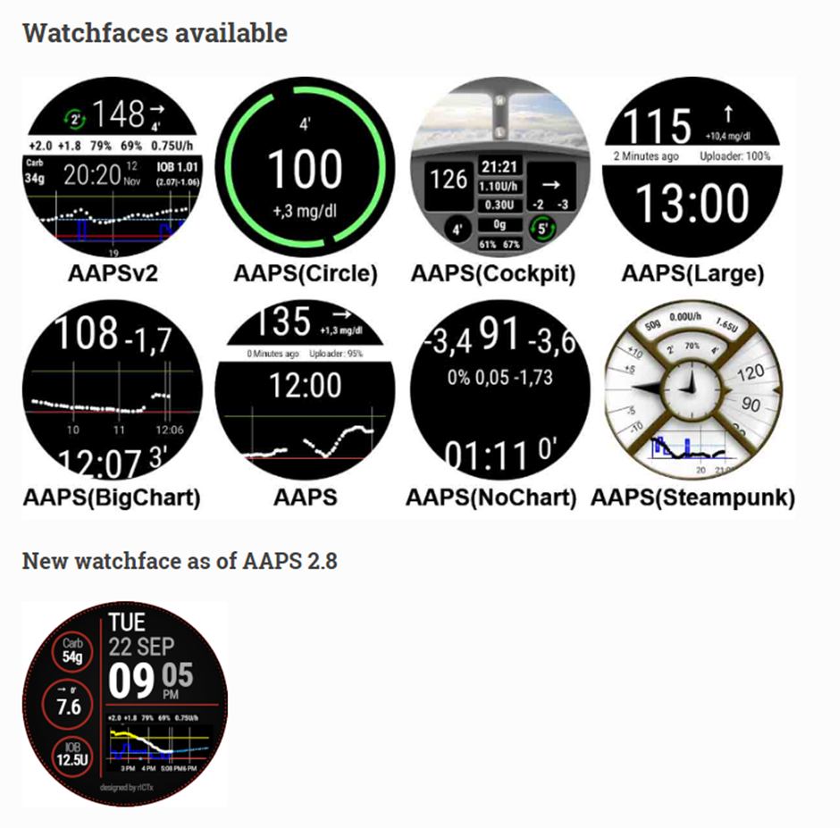
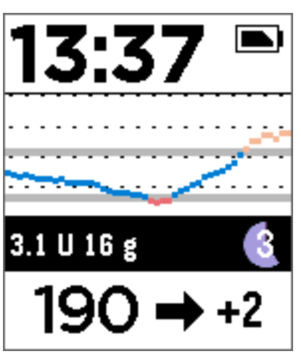

# Relojes inteligentes y AAPS

Puedes usar varios relojes inteligentes para ver parte de la información de **AAPS** o para hacer acciones a distancia.

Para controlar **AAPS** (bomba y sensor) directamente desde un reloj inteligente, se usan relojes Android completos (que son como pequeños [teléfonos inteligentes](./Phones.md)).

Algunos relojes inteligentes te permiten introducir tratamientos u otras cosas, pero el teléfono sigue gestionando **AAPS**.

Cada vez se usan más relojes inteligentes con **AAPS**, _tanto_ adultos con diabetes como cuidadores o padres de niños con diabetes.

## Ventajas generales de usar relojes inteligentes con **AAPS**


Según el modelo, los relojes inteligentes se pueden usar de muchas formas diferentes con **AAPS**. Se pueden usar para controlar **AAPS** de forma total o parcial, o solo para ver a distancia los niveles de glucosa, la insulina activa (IOB) y otros parámetros.

Usar un reloj inteligente con **AAPS** puede ser útil en muchas situaciones, por ejemplo al conducir un coche o una (moto)bicicleta y durante el ejercicio. Algunas personas creen que mirar un reloj (en una reunión, una fiesta, en la mesa, etc.) es más discreto que mirar un teléfono. Desde el punto de vista de la seguridad, un reloj inteligente también puede ser útil cuando estás fuera de casa: puedes guardar el teléfono con **AAPS** fuera de la vista (por ejemplo, dentro de una bolsa) y seguir usando el reloj para el control remoto.

## Ventajas específicas para padres o cuidadores que usan **AAPS**

En el caso de un niño, si su teléfono con **AAPS** está cerca, un cuidador puede usar un reloj inteligente para vigilar o hacer cambios sin tener que usar el teléfono con **AAPS**. Esto puede ser útil, por ejemplo, si el teléfono con **AAPS** está guardado en un cinturón para la bomba.

Puedes usar un reloj inteligente _además_ de las opciones basadas en el TELÉFONO para el control remoto o el [solo seguimiento](../RemoteFeatures/FollowingOnly.md), o como _alternativa_ a ellas.

Además, a diferencia de los teléfonos de seguimiento de padres o cuidadores (que dependen de la red móvil o de una conexión Wi-Fi), los relojes inteligentes conectados por Bluetooth pueden ser útiles en lugares remotos, como una cueva, un barco o a mitad de una montaña. Si los dos dispositivos (el teléfono con **AAPS** y el reloj inteligente) están en la misma red Wi-Fi, también pueden usar Wi-Fi.

## Tipos de interacción entre el reloj inteligente y AAPS

Ahora mismo hay cinco formas principales de usar relojes inteligentes junto con **AAPS**. Se muestran en la tabla siguiente: 

| Configuración del reloj | Funciones                                                   | Requisitos                                                                                                                                                                                                                                                                                                                                                     |
| ----------------------- | ----------------------------------------------------------- | -------------------------------------------------------------------------------------------------------------------------------------------------------------------------------------------------------------------------------------------------------------------------------------------------------------------------------------------------------------- |
| Independiente           | AAPS sin teléfono                                           | Reloj inteligente Android completo (comprueba la versión mínima de Android)</br> con **app-fullRelease**                                                                                                                                                                                                                                                       |
| Control remoto completo | La mayoría de las funciones de AAPS                         | Reloj Android **Wear OS** (comprueba Android/API)</br>con **wear-fullRelease**                                                                                                                                                                                                                                                                                 |
| Control remoto          | Funciones de AAPSClient                                     | Reloj Android **Wear OS** (comprueba Android/API)</br>con **[wear-aapsclientRelease](https://github.com/nightscout/AndroidAPS/releases)**                                                                                                                                                                                                                      |
| Control remoto          | Algunas funciones de AAPSClient                             | Relojes Garmin</br>(solo configuraciones antiguas con Samsung Tizen y Fitbit, no recomendado)</br>Ver abajo.                                                                                                                                                                                                                                                   |
| Visualización           | Glucosa, tendencia, IOB, COB, estado del lazo y de la bomba | Muchos relojes inteligentes, mediante una app complementaria en el teléfono con **AAPS** que recibe la difusión de [Aplicaciones complementarias externas](#watches-external-companion-apps): [WatchDrip+](https://bigdigital.home.blog/) (Xiaomi, Amazfit), [GlucoDataHandler](https://github.com/pachi81/GlucoDataHandler) (Wear OS), G-Watch</br>Ver abajo. |

## Antes de comprar un reloj inteligente…

El modelo exacto de reloj inteligente que compres depende de las funciones que quieras. Puedes encontrar información útil en la [página Teléfonos](#Phones-list-of-tested-phones), incluida una lista de teléfonos probados que también contiene algunos relojes inteligentes.

Algunas marcas populares de relojes son Samsung Galaxy, Garmin, Fossil y Mi Band. Las diferentes opciones resumidas en la tabla de arriba se explican con más detalle abajo, para ayudarte a decidir qué reloj inteligente es el adecuado para tu situación.

Si vas a usar un reloj inteligente con **AAPS** en un teléfono para interactuar a distancia con **AAPS**, también tienes que comprobar si los dos dispositivos son compatibles entre sí, sobre todo si tienes un teléfono antiguo o poco común.

En general, si solo quieres seguir los valores de glucosa y no interactuar con **AAPS**, hay más relojes sencillos y económicos que puedes usar.

La mejor forma de elegir un reloj inteligente es buscar publicaciones sobre «watch» en los grupos de **AAPS** en Discord o Facebook. Lee las experiencias de otras personas y publica tus preguntas concretas si las publicaciones antiguas no las responden.

## Android completo

Parece una opción atractiva, ¿verdad? Sin embargo, por ahora solo unos pocos entusiastas están probando **AAPS** en un reloj independiente. Hay pocos relojes inteligentes con una interfaz razonable que también funcionen bien con **AAPS** de forma independiente y con tu app del MCG. Algunos modelos populares son el LEMFO LEM 15 Pro y el 16. Tienes que instalar en el reloj el apk «full» de **AAPS** (el apk que normalmente se instala en un teléfono) en lugar del apk «wear» de **AAPS**.

No hay una especificación clara que te diga si un reloj funcionará bien con **AAPS** de forma independiente, pero estos parámetros te ayudarán:

1)  Android 12 o más reciente. 2)  Poder quitar el modo «cuadrado» de la esfera para que el texto sea más grande y más fácil de leer. 3)  Muy buena duración de la batería. 4)  Buen alcance de Bluetooth.

La mayoría de los problemas con los relojes independientes con **AAPS** vienen de usar una pantalla muy pequeña, y de que la interfaz actual de la app AAPS completa no está diseñada para un reloj. Por el tamaño reducido de la pantalla, quizá prefieras usar un lápiz táctil para cambiar los ajustes de **AAPS** en el reloj, y es posible que algunos botones de AAPS no se vean en la pantalla del reloj.

Otros problemas son que es difícil conseguir suficiente duración de la batería, y los relojes con suficiente batería suelen ser grandes y gruesos. Los usuarios cuentan que tienen que luchar con el sistema operativo y los ajustes de ahorro de energía, que es difícil iniciar sensores en el reloj, que el alcance de Bluetooth es pobre (para mantener la conexión con el sensor y con la bomba) y que la resistencia al agua es dudosa. Puedes ver ejemplos en las fotos de abajo.


Si te interesa configurar un reloj independiente, lee las publicaciones y comentarios del grupo de Facebook de **AAPS** (buenas búsquedas son «standalone» y «Lemfo») y de Discord para más información.

## Wear OS

El código de **AAPS** contiene una extensión de la app que se puede instalar en [relojes inteligentes **Wear OS**](https://wearos.google.com/#oem-carousel).


Comprueba que tu reloj inteligente cumple los [requisitos](#maintenance-android-version-aaps-version) de **AAPS**.

### ¿Qué _es_ Wear OS?

Las tres primeras opciones de reloj inteligente necesitan que el reloj tenga **Wear OS** instalado.

**Wear OS** es el sistema operativo que funciona en algunos relojes inteligentes Android modernos. Si la descripción del reloj inteligente solo indica _compatibilidad_ con Android e iOS, no significa que use Wear OS. Puede usar otro sistema operativo propio del fabricante que no es compatible con **AAPS**. Para instalar y usar cualquier versión de **AAPS** o **AAPSClient**, el reloj inteligente debe tener **Wear OS 3.0, 3.2 o 3.5** (Android 11, nivel de API 30) **o más reciente**. Cada versión de Wear OS sigue la versión de Android en la que se basa: **Wear OS 3** es Android 11 (nivel de API 30), **Wear OS 4** es Android 13 (nivel de API 33), **Wear OS 5** es Android 14 (nivel de API 34) y **Wear OS 6** es Android 16 (nivel de API 36). Los relojes con Wear OS 2 no pueden ejecutar **AAPS**.

Si instalas el wear.apk de **AAPS** en un reloj **Wear OS**, puedes elegir entre varias esferas personalizadas de **AAPS**. También puedes usar una esfera estándar e incluir la información de **AAPS** en pequeños recuadros llamados «complicaciones» en la esfera. Una complicación es cualquier elemento que se muestra en una esfera además de la hora.

```{note}
Los cambios recientes de **Wear OS** estropean poco a poco las esferas personalizadas de **AAPS** (cuanto más alta es la versión de Wear OS, más graves son los problemas), aunque las **complicaciones** siguen funcionando. Antes de comprar o actualizar un reloj, lee [Cambios de las esferas en Wear OS](#wearos-watchface-changes).
```


### ¿Cómo podría verse mi reloj inteligente?

Después de [instalar **AAPS** en tu reloj](../WearOS/WearOsSmartwatch.md), podrás elegir automáticamente tu esfera preferida entre estas esferas propias de **AAPS**. En la mayoría de los relojes, solo tienes que mantener pulsada la pantalla de inicio hasta que se haga más pequeña y deslizar hacia la derecha para elegir otra pantalla:



Estas son las pantallas básicas incluidas en **AAPS**; hay [más esferas](#WearOS_changing-to-AAPS-watchface) y también puedes usar [complicaciones](#Watchfaces-complications).

### ¿Cómo uso un reloj Wear OS en el día a día?

Encontrarás más detalles sobre las esferas y el uso diario, incluido cómo crear (y compartir) tu propia esfera personalizada, en la sección [Reloj inteligente Wear OS](../WearOS/WearOsSmartwatch.md).

(Watchfaces-tizen)= (watches-external-companion-apps)=

## Aplicaciones complementarias externas

**AAPS** puede difundir su estado a otras apps instaladas en el mismo teléfono: glucosa y tendencia, IOB, COB, basal y basal temporal, nombre del perfil, estado del lazo, batería del teléfono y de la bomba, nivel del reservorio y progreso del bolo. Varias apps complementarias para relojes leen esta difusión y muestran los datos en relojes que **AAPS** no admite directamente. Para enviar los datos, activa **Aplicaciones complementarias externas** en **Configuración** > **Comunicación** (ver [Aplicaciones complementarias externas](#external-companion-apps) en la página Configuración). La difusión se envía con cada nuevo valor y no se puede pedir: un botón de actualizar en la app complementaria no tiene ningún efecto en **AAPS**.


Apps complementarias que usan esta difusión:

- [WatchDrip+](https://bigdigital.home.blog/) para relojes Xiaomi y Amazfit, ver [Relojes Xiaomi y Amazfit](#watches-xiaomi-amazfit) más abajo.
- [GlucoDataHandler](https://github.com/pachi81/GlucoDataHandler) para relojes Wear OS, como complicación o como widget. Es una buena alternativa en las versiones de Wear OS en las que las esferas de **AAPS** no son fiables, ver [Configurar AAPS en tu reloj Wear OS](../WearOS/WearOsSmartwatch.md). Su app complementaria GlucoDataAuto muestra los mismos datos en el coche con Android Auto.
- [App G-Watch](https://play.google.com/store/apps/details?id=sk.trupici.g_watch) para relojes Samsung Tizen, y su versión posterior para Wear OS. En versiones anteriores de **AAPS**, el complemento se llamaba **Samsung Tizen** por esta app.

```{warning}
La **app G-Watch** y su versión para **Wear OS** ya no tienen mantenimiento, y Samsung ha cambiado sus relojes inteligentes de Tizen a Wear OS. G-Watch solo es útil para configuraciones antiguas que ya existen y no se recomienda para una instalación nueva. Consulta el [grupo de Facebook](https://www.facebook.com/groups/gwatchapp) dedicado para ver las últimas noticias.
```

(Watchfaces-garmin)=

## Garmin

Hay algunas esferas para Garmin que se integran con [AAPS](https://apps.garmin.com/search?keywords=androidaps) en la tienda Garmin ConnectIQ.


[AAPS Glucose Watch](https://apps.garmin.com/apps/3d163641-8b13-456e-84c3-470ecd781fb1) se integra directamente con **AAPS**. Muestra datos del estado del lazo (insulina activa, basal temporal) además de los valores de glucosa, y envía las lecturas de frecuencia cardiaca a **AAPS**. Está disponible en la tienda ConnectIQ; activa el complemento **Garmin** en **Configuración → Comunicación**. 

1. Valores de glucosa más alto y más bajo en el gráfico
2. Cambio de glucosa por minuto
3. Insulina activa (IOB)
4. Tiempo desde el último valor de glucosa (minutos:segundos)
5. Basal temporal, como porcentaje de la basal del perfil
6. Gráfico de glucosa de las últimas 2 horas
7. Valor de glucosa actual


## Fitbit

```{warning}
Google está pasando Fitbit a Google Health y está eliminando las apps y esferas de terceros de los relojes Fitbit en la UE. Por eso las esferas de Fitbit **ya no son una opción recomendada**, y no se recomienda comprar un Fitbit para usarlo con **AAPS**.
```

Para los relojes Fitbit que ya tienes, las [páginas web de Nightscout](https://nightscout.github.io/nightscout/wearable/#fitbit) muestran algunas opciones solo de seguimiento, como [Glance](https://glancewatchface.com/). Estas también son esferas de terceros, así que se aplica la misma restricción de la UE.

## Solo seguimiento

Estos relojes inteligentes muestran parte de la información de **AAPS**; algunos necesitan otras apps.

Hay muchos relojes inteligentes económicos que solo pueden mostrar datos. Si usas Nightscout, puedes ver un buen resumen de todas las opciones [aquí](https://nightscout.github.io/nightscout/wearable/#)

Estas son algunas opciones de relojes de solo seguimiento populares entre los usuarios de **AAPS**:

(watches-xiaomi-amazfit)=
### Relojes Xiaomi y Amazfit

**WatchDrip+** es una app complementaria creada por la comunidad que muestra los datos de glucosa y del lazo en varios modelos de relojes inteligentes, sobre todo de las marcas Xiaomi (_p. ej._ Mi Band) y Amazfit:


Desde la versión 0.5, **WatchDrip+** lee los datos directamente de **AAPS**, sin usar xDrip+ como intermediario. En el teléfono con **AAPS**:

1. Activa **Aplicaciones complementarias externas** en **Configuración** > **Comunicación**, ver [arriba](#watches-external-companion-apps). Proporciona la glucosa actual, el delta, la flecha de tendencia, la IOB y el estado de la bomba.
2. Activa el complemento **xDrip** en **Configuración** > **Comunicación** y activa **Enviar estado a xDrip+** en sus ajustes. Proporciona la línea de estado IOB/COB, y el gráfico de glucosa del reloj se completa después de unos cuantos valores.
3. Si xDrip+ está instalado en el teléfono, desactiva su **Broadcast Service API** (xDrip+ > Settings > Inter-app settings) para que el reloj no reciba los datos dos veces. Si xDrip+ solo pasaba los datos al reloj, puedes desinstalarlo.

El botón de actualizar de WatchDrip+ no tiene efecto con **AAPS**: los datos llegan con cada nuevo valor.


Puedes leer más sobre ellos, incluido cómo configurarlos, en el [sitio web de WatchDrip+](https://bigdigital.home.blog/). La ventaja de estos relojes es que son pequeños y bastante económicos. Son una opción popular, sobre todo para niños y para personas con muñecas pequeñas.

### Reloj Pebble





Los relojes Pebble ([ya no se fabrican](https://en.wikipedia.org/wiki/Pebble_(watch))) se vendieron de 2013 a 2016 y todavía se pueden encontrar de segunda mano. Fitbit compró los activos de Pebble. Los usuarios de Pebble pueden usar la esfera Urchin para ver los datos de Nightscout. Los datos que se pueden mostrar incluyen IOB, la basal temporal activa y las predicciones. Si usas el lazo abierto, puedes usar IFTTT para crear un applet que, cuando llegue una notificación de **AAPS**, envíe un SMS o una notificación de Pushover.

### [Relojes Bluejay](https://bluejay.website/)


Son dispositivos únicos que pueden recibir los datos de glucosa **directamente** del transmisor Dexcom. Poca gente sabe que los transmisores Dexcom G6/G7 en realidad envían los datos de glucosa actuales por _dos_ canales separados: un canal para el teléfono y un canal médico. Los relojes Bluejay se pueden configurar para recibir los datos de glucosa por cualquiera de los dos canales, así que si **AAPS** usa el canal del teléfono, los relojes Bluejay pueden usar el canal médico.

La gran ventaja es que el reloj no depende ni del teléfono ni del sistema de lazo. Así, por ejemplo, si te desconectas de la bomba y dejas el teléfono con **AAPS** en la playa o en un parque de atracciones, y estás fuera del alcance del teléfono con **AAPS**, puedes seguir recibiendo los valores de tu Dexcom directamente en el reloj Bluejay.

El **Bluejay GTS** original ya no se fabrica y no puede leer el Dexcom G7. Los modelos posteriores (U1 y luego el actual **U3**, que en el momento de escribir esto se vende como acceso anticipado) son relojes Android completos con xDrip, que reciben los datos directamente del Dexcom G6 y G7. El fabricante describe el reloj como una herramienta de investigación, no para uso médico. Las desventajas que cuentan los usuarios son que no siempre recibe un valor cada 5 minutos y que hay que cargar la batería a menudo. Consulta el [sitio web de Bluejay](https://bluejay.website/) para ver el modelo actual y su disponibilidad.

### Apple Watch

Consulta [Nightscout en tu reloj](https://nightscout.github.io/nightscout/wearable/#).

El Apple Watch ahora admite la conexión directa con el G7 y se puede usar al mismo tiempo que **AAPS**.

