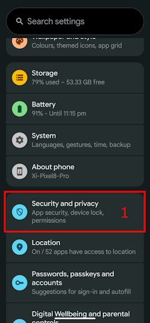

(bluetoothtroubleshooting-bluetooth-related-issues)=

# Problemas relacionados con Bluetooth

Algunos usuarios han tenido problemas con fallos al activar el Omnipod DASH, problemas de conexión con el Medtrum Nano y otros errores del pod relacionados con Bluetooth. Muchos de estos problemas tienen una de las causas siguientes.

Probablemente algunos de estos problemas también afectan a otras bombas de insulina Bluetooth; el Medtrum Nano tiene problemas conocidos con el permiso de dispositivos cercanos, igual que el Omnipod DASH.

---

(bluetoothtroubleshooting-cannot-start-omnipod-with-android-16)=

## No se puede iniciar el Omnipod con Android 16
- Android 16 necesita como mínimo la versión 3.3.2.1 de **AAPS** para que el Omnipod DASH funcione bien, porque esta versión tiene correcciones específicas para los problemas conocidos que Android 16 causa con el Omnipod.

---

(bluetoothtroubleshooting-bluetooth-battery-optimisation)=

## Optimización de batería de Bluetooth

Las versiones nuevas de Android han activado la optimización de batería para la app de Bluetooth del sistema. Se sabe que esto causa algunos problemas con bombas y MCG Bluetooth.

Si seguiste el [Asistente de configuración](../SettingUpAaps/SetupWizard.md) y los ajustes de la sección [Optimización de batería de Bluetooth](#setup-wizard-bluetooth-battery-optimisation), este ajuste debería estar bien; pero si seguiste una versión anterior de esta guía, es posible que no hayas cambiado este ajuste.

Si la bomba o el MCG se desconectan, comprueba que esto está bien configurado.

---

(bluetoothtroubleshooting-apps-using-nearby-device-permission)=

## Las apps que usan el permiso de Android «Dispositivos cercanos» pueden causar cortes de conexión y problemas al activar el pod

Android te permite controlar lo que cada app puede hacer o usar en tu teléfono mediante un sistema de permisos. Para cada app instalada puedes permitir o denegar permisos concretos, por ejemplo acceder a los archivos del dispositivo, usar Bluetooth, buscar dispositivos cercanos, etc.

**AAPS** necesita varios permisos concretos para funcionar; uno de los necesarios para que los pods funcionen es el permiso «Dispositivos cercanos». Muchas otras apps también necesitan este permiso, y la comunidad ha visto que, en algunos dispositivos, varias apps con este permiso pueden causar problemas al activar pods nuevos.

(bluetoothtroubleshooting-apps-using-nearby-device-permission-known-apps)=

### Apps que usan el permiso «Dispositivos cercanos» y que se sabe que han causado problemas:

En la comunidad se ha hablado, en uno o más lugares, de que las apps de esta lista causan problemas con los dispositivos Omnipod DASH y, en algunos casos, también con el Medtrum Nano.

```{admonition} Updating the list
:class: note
Escribe a @XiTatiON en el canal de Discord #omnipod-dash para hablar de apps que se deben añadir a esta lista.
```

- **myBMW** MyBMW interrumpió el Medtrum Nano y el Omnipod DASH. La app MyBMW pide el permiso «buscar dispositivos cercanos» solo una vez; si no lo concedes, la app sigue funcionando perfectamente.

- **Amazon Alexa**  Quitar el permiso «Dispositivos cercanos» a la app Alexa resolvió el problema para algunas personas, pero impide emparejar dispositivos IoT Matter.

- **MINI app**  Parece que la app se basa en la app myBMW y por eso podría comportarse igual.

- **BM2** App de control de baterías solares, usada en algunas autocaravanas e instalaciones solares de camping: cuando la app estaba funcionando, impedía activar un pod nuevo. Una solución temporal es forzar la detención de la app mientras activas un pod nuevo. Usar la app después no pareció afectar al funcionamiento del Dash (en un Pixel 8 Pro con Android 16).

(bluetoothtroubleshooting-revoke-nearby-device-permission)=

### Cómo quitar el permiso «Dispositivos cercanos» a otras apps:
Si tienes problemas al activar un pod nuevo y usas la versión de **AAPS** correcta para tu versión de Android, puede ser necesario quitar el permiso a otras apps mientras activas un pod nuevo.

Sigue estos pasos para quitar el permiso «Dispositivos cercanos» a todas las apps excepto a **AAPS**:

```{admonition} Menus and settings
:class: note
Las capturas de pantalla y las instrucciones de esta guía son de un Android 16 sin modificar en un Google Pixel 8 Pro. Es probable que los menús y ajustes de otros fabricantes y dispositivos no sean exactamente iguales; adapta los pasos a tu dispositivo y, si no puedes seguir, consulta la sección [Dónde obtener ayuda para el Dash](#omnipod-dash-where-to-get-help-for-dash) para saber cómo pedir ayuda a la comunidad.
```

1. Abre los ajustes de Android en tu teléfono, desplázate hacia abajo y pulsa **Seguridad y privacidad (1)**.

    

2. Desplázate hacia abajo y pulsa **Controles de privacidad (1)**.

   

3. Pulsa **Gestor de permisos (1)**.

   

3. Desplázate hacia abajo y pulsa **Dispositivos cercanos (1)**.

   

4. Busca en la lista de apps y pulsa la app a la que quieres quitar el permiso **Dispositivos cercanos**.

   En esta guía, quitaremos el permiso a la app **Android Auto (1)**.

   Para no inutilizar más pods, al principio recomendamos a todos quitar el permiso a todas las apps excepto a **AAPS**.

```{admonition} Which app to select?
:class: tip
Si no sabes qué app te causa el problema, desactívalas todas (revisa también la lista de apps con problemas conocidos y empieza por ellas). Si puedes permitirte perder algunos pods por el camino, activa el permiso en una app más antes de cada activación de un pod nuevo, hasta que encuentres qué app causa exactamente los problemas con tu pod. Si encuentras nuevas apps con problemas, avísanos en el canal de Discord #omnipod-dash.
```

   

5. Para quitar el permiso, pulsa **No permitir (1)** y luego pulsa **No permitir de todos modos (2)**. Si lo has hecho bien, verás **No permitir (3)** como la opción seleccionada. Ahora puedes volver al menú **Dispositivos cercanos** pulsando la **flecha Atrás (4)** y cambiar este ajuste en otras apps si hace falta.

      

(bluetoothtroubleshooting-re-enable-nearby-device-permission)=

### Cómo volver a activar el permiso «Dispositivos cercanos» en apps del sistema y otras apps:

1. Si hace falta, consulta la sección **«Cómo quitar el permiso "Dispositivos cercanos" a otras apps»** para saber cómo llegar a los ajustes de privacidad de las apps; cuando estés en la configuración de **Dispositivos cercanos**, ve al paso 2.

2. Busca en la lista de apps y pulsa la app a la que quieres dar el permiso **Dispositivos cercanos**.

   En esta guía, daremos el permiso a la app **Android Auto (1)**.

   Verás que **Android Auto (1)** no aparece en la lista de apps después de quitarle el permiso. Esto es porque **Android Auto** es una **app del sistema** y las apps del sistema están ocultas por defecto.

   

3. Para mostrar las apps del sistema ocultas, pulsa el **menú de tres puntos (⋮) (1)** en la esquina superior derecha y luego pulsa **«Mostrar sistema» (2)**. Ahora deberías ver en la lista la app del sistema que estaba oculta, **Android Auto (3)**.

```{admonition} Find your app
:class: tip
Si a una app se le ha quitado el permiso, tienes que desplazarte hacia abajo hasta ver la lista de apps sin permiso, más abajo en la lista.
```

     

5. Sigue los pasos de **«Cómo quitar el permiso "Dispositivos cercanos" a otras apps»** en orden inverso para volver a activar el permiso en cada app.

---

(bluetoothtroubleshooting-android-15-bluetooth-connection-problems)=

## Android 15: problemas frecuentes de conexión Bluetooth

Después de actualizar Android o de cambiar a un teléfono reciente, **AAPS** pierde a menudo la conexión Bluetooth con la bomba. El problema desaparece por un tiempo al reiniciar el teléfono. Si usas un **Omnipod DASH** y tu teléfono tiene Android 15, activar el ajuste **Vinculación Bluetooth** puede ayudar a que la conexión Bluetooth sea más estable. Para activarlo:

```{admonition} Android 16
:class: warning
Activa la **Vinculación Bluetooth** solo en Android 15, y solo si tienes problemas de conexión. NO actives la vinculación en Android 16.
```

1. Abre los [ajustes de Dash](#omnipod-dash-settings): abre la pantalla de la bomba DASH con **Administrar** > **Bomba** y pulsa el icono de **Ajustes** (engranaje) en la esquina superior derecha.

   

2. Abre la sección **Ajustes avanzados** y activa **Vinculación Bluetooth**.

   

3. Si el teléfono muestra una solicitud de emparejamiento, acéptala.

4. Reinicia tu teléfono.
