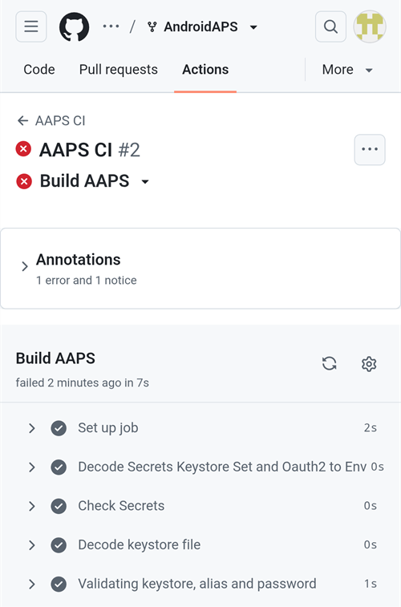
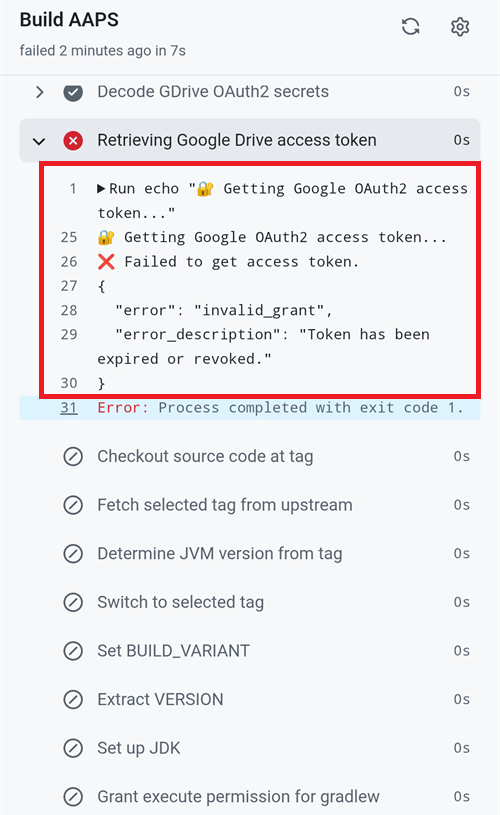
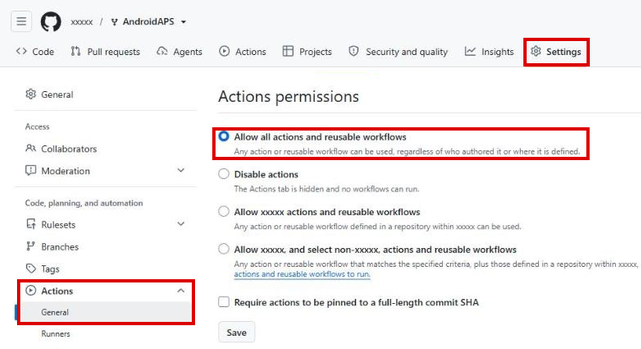

(aaps-ci-troubleshooting)=

# Compilación en el navegador: solución de problemas

```{note}
Esta página reúne consejos para resolver problemas de la [Compilación en el navegador](../SettingUpAaps/BrowserBuild.md).

¿Usas **AAPS Builder**? Empieza por su propia [sección de solución de problemas](#aaps-builder-troubleshooting). Las secciones sobre Google Drive de abajo también sirven para AAPS Builder.
```

## Solución de problemas de AAPS-CI

(aaps-ci-read-the-logs)=
### Primero: averigua qué ha fallado

Cuando una compilación falla, GitHub guarda un log de cada paso. El log te dice qué paso ha fallado y por qué. Léelo antes de probar otra cosa: el mensaje de error es lo que tienes que buscar en esta página, y lo que te pedirán quienes te ayuden.

1. En tu copia de AndroidAPS en GitHub, abre **Actions**. Una compilación fallida tiene una cruz roja. Toca su nombre.

   

2. El resumen de la ejecución muestra **Failure** y, debajo, el job que ha fallado (**Build AAPS**, con una cruz roja).

   

3. Desplázate hacia abajo hasta **Annotations** y toca la línea roja **Build AAPS**.

   

4. Se abre el job. Los pasos con una marca gris han funcionado. El paso con la cruz roja es el que ha fallado: GitHub lo abre por ti. Los pasos siguientes se han saltado (círculo gris).

   

5. Lee las líneas justo encima de `Error: Process completed with exit code 1.`: explican el problema. En este ejemplo, el paso **Retrieving Google Drive access token** ha fallado con `invalid_grant` y `Token has been expired or revoked.`, ver [El token de actualización de Google ha caducado](#aaps-ci-google-token-expired).

   

```{tip}
¿Vas a pedir ayuda? Comparte el nombre del paso que ha fallado y las líneas del error (una captura de pantalla como la de arriba está bien). Nunca compartas el contenido de tus secretos.
```

(aaps-ci-update-secret)=
#### Actualizar un secreto

Muchas soluciones consisten en cambiar el valor de un secreto. En tu copia de AndroidAPS en GitHub, ve a **Settings** → **Secrets and variables** → **Actions** y toca el lápiz junto al secreto.


Introduce o pega el nuevo valor y toca **Update secret**. GitHub nunca muestra el valor antiguo: el campo siempre está vacío.


(aaps-ci-rerun)=
#### Ejecutar de nuevo la compilación después de una corrección

Cuando hayas corregido la causa, no tienes que empezar desde cero: abre la ejecución fallida, toca **...** (arriba a la derecha) y luego **Re-run failed jobs**.


Toca **Re-run jobs**. También puedes iniciar una nueva compilación desde **Run workflow**, como siempre.


(aaps-ci-preparation-web)=
### Página web aaps-ci-preparation
  - La página de preparación la muestra un servidor local temporal (por ejemplo, Simple Web Server en un ordenador), que también recibe el token de actualización de Google.
  - Si ves la pantalla de abajo, el servidor local se ha detenido o no se puede alcanzar.
  - Cierra la página de preparación, comprueba que el servidor local está funcionando y luego vuelve a abrir aaps-ci-preparation.html de la misma forma que en el paso 2 y completa los pasos que faltan. Esto hace falta sobre todo al crear la primera conexión con Google durante la configuración.

  

(aaps-ci-google-token-expired)=
### El token de actualización de Google ha caducado
  - Los tokens de actualización de Google OAuth2 caducan si no se usan durante 6 meses, y también pueden dejar de ser válidos en otros casos (por ejemplo, si has cambiado la contraseña de tu cuenta de Google o has quitado el acceso manualmente). Para más detalles, consulta la [documentación de Google OAuth2](https://developers.google.com/identity/protocols/oauth2).
  - En el [log de compilación](#aaps-ci-read-the-logs), el paso **Retrieving Google Drive access token** falla con `invalid_grant` y `Token has been expired or revoked.`:

  

  - Si tu compilación falla porque el token de actualización de Google ha caducado o se ha revocado, tienes que repetir los pasos de [autorización de Google Drive](#aaps-ci-google-drive-auth) para obtener un nuevo token `GDRIVE_OAUTH2`, [actualizar el secreto](#aaps-ci-update-secret) en tu repositorio de GitHub y luego [volver a ejecutar la compilación](#aaps-ci-rerun).
  - Si la autorización vuelve a fallar, o Google ya no te pide tu consentimiento, primero quita el acceso de AAPS de tu cuenta de Google, ver [abajo](#aaps-ci-google-remove-access).

(aaps-ci-google-remove-access)=
### Quitar el acceso de AAPS de tu cuenta de Google y empezar de nuevo la autorización
  - Si la autorización de Google Drive sigue fallando, o quieres empezar de nuevo desde cero, primero quita el acceso que diste a AAPS y luego vuelve a hacer la autorización.
  - En tu teléfono, abre [https://myaccount.google.com](https://myaccount.google.com), toca **Security** (Seguridad), desplázate hacia abajo hasta **Your connections to third-party apps & services** (tus conexiones con aplicaciones y servicios de terceros) y abre la lista de apps vinculadas. También puedes ir directamente a [https://myaccount.google.com/connections](https://myaccount.google.com/connections).
  - Toca **AAPS** en la lista.

  

  - La página muestra el acceso que diste a AAPS (los archivos de Google Drive que usa la app). Toca **Delete all** (eliminar todo) para quitar la conexión, o toca **See details** (ver detalles) para revisarla antes.

  

  - En la página de detalles, toca **Remove all access** (quitar todo el acceso).

  

  - Toca **Confirm** (confirmar).

  

  - Google confirma que AAPS ya no tiene acceso. AAPS ya no aparece en la lista de apps vinculadas.

  

  - Ahora empieza de nuevo la autorización desde cero: cierra **tanto** la página de preparación como la app de gestión de archivos, vuelve a abrir aaps-ci-preparation.html desde el gestor de archivos y repite los pasos de [autorización de Google Drive](#aaps-ci-google-drive-auth). Google te pedirá que vuelvas a dar acceso y la página te dará un nuevo token `GDRIVE_OAUTH2`.
  - [Actualiza el secreto `GDRIVE_OAUTH2`](#aaps-ci-update-secret) en tu repositorio de GitHub con el nuevo token y luego [vuelve a ejecutar la compilación](#aaps-ci-rerun).

(aaps-ci-disable-software)=
### Desactivar el software que puede interferir con la verificación OAUTH
  - Desactiva cualquier VPN o app de seguridad (cortafuegos, antimalware, …) en el teléfono antes de intentar obtener la clave OAUTH.

(aaps-ci-actions-permission)=
### Comprobar los ajustes de permisos de GitHub Actions
  - Asegúrate de que las políticas de GitHub Actions están en «Allow all actions and reusable workflows» (Settings → Actions → General). Si lo cambias, pulsa **Save** debajo de las opciones.

  

`actions/checkout@v4` and `actions/setup-java@v4` are not allowed to be used in `xxxxx/AndroidAPS`. Actions in this workflow must be: within a repository owned by `xxxxx`

(aaps-ci-workflow-permissions)=
### Comprobar los ajustes de permisos de workflow de GitHub
  - Si la compilación falla enseguida con un error «Invalid workflow file» parecido al de abajo, los permisos de workflow por defecto de tu repositorio son demasiado restrictivos:

```
Invalid workflow file
The workflow is not valid. .github/workflows/aaps-ci.yml (Line: 361, Col: 3):
Error calling workflow 'xxxxx/AndroidAPS/.github/workflows/cleanup-workflow-runs.yml@...'.
The nested job 'cleanup' is requesting 'actions: write', but is only allowed 'actions: none'.
```

  - Asegúrate de que Workflow permissions está en «Read and write permissions» (Settings → Actions → General → Workflow permissions), luego guarda y vuelve a ejecutar el workflow de compilación.

  

(aaps-ci-password-special-characters)=
### La compilación falla al comprobar la contraseña del almacén de claves
  - En el [log de compilación](#aaps-ci-read-the-logs), el paso **Validating keystore, alias and password** falla con `Either KEYSTORE_BASE64, KEYSTORE_PASSWORD, KEY_PASSWORD, or KEY_ALIAS is incorrect`, seguido de `Keystore was tampered with, or password was incorrect`. La compilación se detiene ahí: el almacén de claves y las contraseñas se comprueban antes de compilar AAPS.

  

  - El workflow de compilación conserva todos los caracteres de tus contraseñas sin cambios. Introduce `KEYSTORE_PASSWORD` y `KEY_PASSWORD` exactamente como son, sin añadir una barra invertida ni ningún otro carácter de escape. Si añadiste barras invertidas, [actualiza los secretos](#aaps-ci-update-secret) con la contraseña exactamente como es. El ejemplo de abajo está mal: la contraseña es `Example2026`, y se ha añadido la barra invertida.

  

  - Si la compilación sigue fallando al firmar el APK aunque tu contraseña es correcta, y la contraseña contiene `$`, un acento grave (backtick), `"` o `\`, el archivo de workflow de tu fork es anterior a septiembre de 2026 y todavía interpreta estos caracteres. [Sincroniza tu fork](#Update-to-new-version-update-your-repo) con la última versión de dev y luego vuelve a ejecutar el workflow de compilación.
  - La barra vertical `|` es un caso especial. La página de preparación de la [Opción 1](#aaps-ci-option1) junta el almacén de claves, las contraseñas y el alias en un único secreto `KEYSTORE_SET` separado por `|`, y el workflow lo divide por ese carácter. La contraseña que genera la página de preparación solo tiene letras y números, así que esto no puede pasar con la Opción 1. Solo puede pasar si creaste tú mismo un secreto `KEYSTORE_SET` con una contraseña que contiene `|`. En ese caso, borra `KEYSTORE_SET` y, en su lugar, introduce los secretos separados de la [Opción 2](#aaps-ci-option2).
