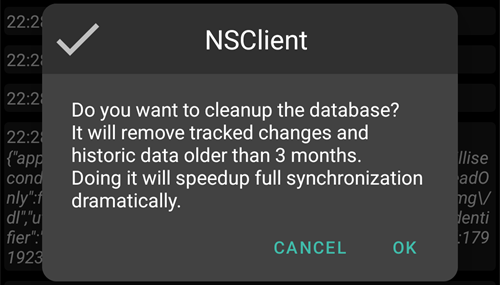

(reinstall-aaps)=
# Reinstalar AAPS con un nuevo almacén de claves

Cada apk de **AAPS** está firmado con un **almacén de claves (keystore)**. Una actualización solo se instala sobre tu **AAPS** actual si está firmada con el **mismo almacén de claves**: así se conservan todos tus ajustes y datos. Por eso se recomienda guardar el almacén de claves y su contraseña en un lugar seguro.

Si intentas instalar un apk firmado con un almacén de claves distinto del anterior, recibirás un mensaje de error que dice que la instalación ha fallado.

(reinstall-aaps-when)=
## ¿Cuándo tienes que reinstalar?

Tienes que desinstalar y volver a instalar **AAPS** cuando tu nuevo apk está firmado con un almacén de claves distinto, por ejemplo:

- No encuentras tu antiguo almacén de claves o su contraseña.
- Has creado un nuevo almacén de claves, por ejemplo con la [Opción 1 de la compilación en el navegador](../SettingUpAaps/BrowserBuildKeystore.md) o con **Create a new key** (crear una clave nueva) en [AAPS Builder](../SettingUpAaps/BrowserBuildAapsBuilder.md).
- Compilas en un ordenador nuevo y no has copiado tu almacén de claves en él.

Si todavía tienes tu almacén de claves, no necesitas esta página: úsalo de nuevo y [actualiza **AAPS**](../Maintenance/UpdateToNewVersion.md) sin desinstalar.

(reinstall-aaps-before)=
## Antes de empezar

- Desinstalar **AAPS** borra todos sus ajustes, tus [objetivos](../SettingUpAaps/CompletingTheObjectives.md) y la conexión actual con la bomba. Los recuperas al importar tu **archivo de ajustes**, así que asegúrate de tener uno reciente.
- El archivo de ajustes no contiene tu historial de tratamientos y de glucosa. Si subes los datos a [Nightscout](../SettingUpAaps/SettingUpTheReportingServer.md), puedes volver a cargarlo después de reinstalar (paso 8).
- Necesitas tu [**contraseña maestra**](#Preferences-master-password): el archivo de ajustes está cifrado con ella.
- **Usuarios de Omnipod y Medtrum:** lee primero [Bombas sin tubo](#ExportImportSettings-tubeless-pumps). Tu archivo de ajustes tiene que estar exportado durante el pod o parche que llevas ahora.
- Si hace falta, [configura el receptor de tu MCG o fuente de glucosa](../Getting-Started/CompatiblesCgms.md) antes de empezar.

(reinstall-aaps-steps)=
## Pasos

Las imágenes muestran un cambio de **AAPS** 3.4 (pasos 1 a 3) a **AAPS** 4 (pasos 6 a 8). Otras versiones se ven un poco diferentes.

(reinstall-aaps-export)=
### 1. Exporta tus ajustes

Exporta tus ajustes con el **AAPS** que tienes instalado ahora en tu teléfono. Mira [Exportación de configuraciones](#ExportImportSettings-Settings-Export) para más detalles.

En **AAPS** 3.4: abre **Mantenimiento** y toca **Export options** (opciones de exportación). En **User Settings** (ajustes de usuario), marca **Local Storage** (almacenamiento local) y toca **OK**.

*Nota: también puedes usar [Cloud Storage](#preferences-maintenance-cloud) (almacenamiento en la nube) para tener una copia de seguridad extra: es una buena idea, pero mantén Local Storage para recuperar los ajustes rápidamente.*

El botón ahora dice **Export settings (local)**. Tócalo.

**AAPS** muestra el nombre del archivo que va a crear. Toca **OK**, escribe tu contraseña maestra y toca **OK**.

En **AAPS** 4: abre **Mantenimiento**, selecciona el chip **Local** junto a **Exportar ajustes** y toca **Exportar ajustes**.

(reinstall-aaps-copy)=
### 2. Copia el archivo de ajustes fuera de tu teléfono

El archivo está en la carpeta **preferences** de tu [directorio de **AAPS**](#SetupWizard-StoragePermission), con un nombre como `2026-10-13_222735_full.json`. Cópialo o súbelo a un lugar externo (p. ej. tu ordenador, un servicio de almacenamiento en la nube...). Normalmente el archivo se queda en tu teléfono después de desinstalar, pero guarda una copia en otro lugar por si acaso.

(reinstall-aaps-nightscout-before)=
### 3. Sincroniza con Nightscout

Este paso no es obligatorio, pero se recomienda si usas [DynISF](#Open-APS-features-DynamicISF): te permite seguir directamente con los ajustes actuales en vez de esperar 5 días a que se reúnan los datos que necesita el complemento. NSClient V3 tiene que estar [activado y configurado](../SettingUpAaps/SettingUpTheReportingServer.md).

Asegúrate de que Nightscout tiene todos tus datos antes de desinstalar.

Abre **NSClient**, toca el botón **Sincronización completa** en la parte de abajo de la pantalla y después **OK**.

*Nota: el tiempo necesario depende de tu servicio de alojamiento de Nightscout.*

Después **AAPS** ofrece limpiar su base de datos. **OK** borra del teléfono los datos de más de 3 meses, lo que hace la sincronización mucho más rápida. **Cancelar** sincroniza sin limpiar. La base de datos del teléfono se borra de todas formas al desinstalar, así que las dos opciones están bien.

Deja **AAPS** en marcha hasta que termine la sincronización.

(reinstall-aaps-build)=
### 4. Compila el nuevo apk

[Compila](../SettingUpAaps/BuildingAaps.md) un nuevo apk firmado con tu nuevo almacén de claves y pásalo a tu teléfono.

(reinstall-aaps-uninstall)=
### 5. Desinstala AAPS

En **Ajustes** > **Aplicaciones** > **AAPS** de tu teléfono, toca **Desinstalar** y confirma con **Aceptar**.

(reinstall-aaps-install)=
### 6. Instala e inicia el nuevo AAPS

[Instala](../SettingUpAaps/TransferringAndInstallingAaps.md) el nuevo apk e inicia **AAPS**. El [asistente de configuración](../SettingUpAaps/SetupWizard.md) pide los permisos que **AAPS** necesita: toca **Conceder** para cada uno. Esto también vuelve a desactivar la [optimización de batería](#setup-wizard-bluetooth-battery-optimisation).

En **Directorio de AAPS**, selecciona la misma carpeta de **AAPS** que antes (la que contiene la carpeta **preferences**), toca **Usar esta carpeta** y **Permitir**.

Cuando **AAPS** encuentra tus ajustes exportados, el asistente de configuración muestra la pantalla [Configuración guardada encontrada](#setup-wizard-import-settings), donde puedes importarlos. También puedes cerrar el asistente e importar desde **Mantenimiento**, como se explica abajo.

(reinstall-aaps-import)=
### 7. Importa tus ajustes

Si el archivo de ajustes ya no está en tu teléfono, vuelve a copiarlo en la carpeta **preferences** de tu directorio de **AAPS**.

Abre el menú (☰) > **Mantenimiento**, selecciona el chip **Local** junto a **Importar ajustes** y toca **Importar ajustes**.

La lista muestra cada archivo con su versión de **AAPS** y su antigüedad. Elige el archivo que exportaste en el paso 1.

No tienes que poner antes una contraseña maestra en el nuevo **AAPS**. Escribe la contraseña maestra que usaste para la exportación en **Contraseña de descifrado** y toca **Descifrar**. El mensaje **El archivo se cifró con una contraseña diferente** es normal: el nuevo **AAPS** todavía no conoce tu contraseña. La importación la restaura junto con tus otros ajustes.

Marca **También reemplazar la configuración de la bomba**: sin esto, tu bomba y sus ajustes no se restauran. Usuarios de Omnipod y Medtrum: márcalo solo si el archivo se exportó durante tu pod o parche actual (mira [Bombas sin tubo](#ExportImportSettings-tubeless-pumps)).

Toca **Importar**, después **OK** para aplicar los ajustes y otra vez **OK** en **Configuración aplicada**.

(reinstall-aaps-nightscout-after)=
### 8. Recupera tu historial desde Nightscout

Abre el menú (☰) > [**Configuración**](../SettingUpAaps/ChangeAapsConfiguration.md) > **Comunicación** y toca **Abrir complemento** debajo de **NSClientV3**. Comprueba que el estado muestra **Conectado**. Si no es así, mira [Solución de problemas de NSClient](TroubleshootingNsClient.md).

Toca el botón **Sincronización completa** en la parte de abajo de la pantalla y **OK**. La base de datos es nueva, así que puedes responder a la pregunta de limpieza como quieras.

**AAPS** carga tus datos desde Nightscout. El registro muestra **Full sync finished** cuando termina.

(reinstall-aaps-check)=
### 9. Comprueba y sigue con el lazo

Comprueba que tu bomba está conectada y que llegan los valores de tu MCG; después sigue usando el lazo.

(reinstall-aaps-afterwards)=
## Después

A partir de ahora, usa siempre tu nuevo almacén de claves y guárdalo con su contraseña en un lugar seguro, fuera de tu teléfono. Mira [Crear copias de seguridad](../Maintenance/ExportImportSettings.md).
