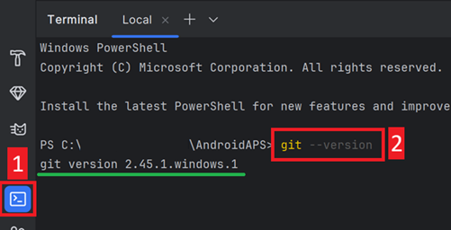
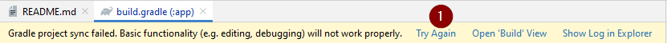

(troubleshooting_androidstudio-troubleshooting-android-studio)=

# Solución de problemas para Android Studio

```{contents} List of common issues
:depth: 2
:local: true
```

(troubleshooting_androidstudio-lost-keystore)=
## Pérdida del almacén de claves
Si perdiste tu almacén de claves o su contraseña, un apk firmado con un nuevo almacén de claves no puede actualizar tu **AAPS** actual: tienes que desinstalarlo y volver a instalarlo. Mira [Reinstalar AAPS con un nuevo almacén de claves](#reinstall-aaps).

## Gradle Sync failed (falló la sincronización de Gradle)
Gradle Sync puede fallar por varias razones. Cuando recibas un mensaje que dice 'gradle sync failed', abre la pestaña «Build» (1) en la parte de abajo de Android Studio y mira qué mensaje de error (2) aparece.


```{contents} Likely reasons for gradle sync failures are:
:depth: 1
:local: true
```

*Importante*: Después de seguir las instrucciones para tu problema concreto, tienes que volver a iniciar la [sincronización de Gradle](#gradle-resync).

(troubleshooting_androidstudio-uncommitted-changes)=
### Cambios no confirmados

Si recibes un mensaje de error como este:


```
Build file 'C:\Data\50-Android\AndroidAPS\app\build.gradle.kts' line: 243

There are uncommitted changes.
Clona de nuevo el código como se explica en la wiki y no permitas la actualización de Gradle
```

#### Paso 1: comprobar la instalación de Git
  * Abre la pestaña Terminal (1) en la parte de abajo de Android Studio, copia el texto siguiente y pégalo o escríbelo en el terminal (2).
    ```
    git --version
    ```

    

    Nota: ¡hay un espacio y dos guiones entre git y version!

  * Tienes que recibir un mensaje que dice qué versión de Git está instalada, como ves en la captura de pantalla de arriba. En ese caso, ve al [Paso 2](#troubleshooting-android-studio-check-for-uncommitted-changes).

  * Si recibes un mensaje que dice
    ```
    Git: command not found
    ```
    tu instalación de Git no está bien.

  * [Comprobar la instalación de Git](#BuildingAaps-steps-for-installing-git)

  * Si usas Windows y acabas de instalar Git, reinicia tu ordenador para que Git esté disponible en todo el sistema después de la instalación

  * Si Git está instalado, has reiniciado (si usas Windows) y Git todavía no se encuentra:

  * Busca en tu ordenador un archivo «git.exe».

    Anota en qué directorio está guardado.

  * Ve a las variables de entorno de Windows, selecciona la variable «PATH» y haz clic en editar. Añade el directorio donde has encontrado tu instalación de Git.

  * Guarda y cierra.

  * Reinicia Android Studio.

(troubleshooting-android-studio-check-for-uncommitted-changes)=
#### Paso 2: comprobar si hay cambios sin confirmar.

  * En Android Studio, abre la pestaña 'Commit' (1) en el lado izquierdo. 
  * Puedes ver «Changes» (llamado «Default changeset» en versiones antiguas de Android Studio) (2) o «Unversioned Files» (3):

    * En el caso de «Changes», probablemente actualizaste 'Gradle' o cambiaste por error el contenido de algunos archivos.

    * Haz clic derecho en «Changes» y selecciona «Rollback…» (1)

      

    * Los archivos se descargan otra vez desde el servidor de Git. Si no hay otros cambios en la pestaña Commit, ve al [Paso 3](#gradle-resync).

  * Si ves «Unversioned Files», puede que hayas guardado archivos por error en el directorio de tu código fuente. Quizás son archivos importantes, como tu archivo de almacén de claves, que hay que mover a otro lugar. Si no sabes qué son esos archivos y no los has creado tú, puedes borrarlos.

    * Usa el explorador de archivos normal de tu ordenador para mover (o cortar y pegar) ese archivo a un lugar seguro.

    * Vuelve a Android Studio y haz clic en el botón Refresh (4) de la pestaña Commit para comprobar que el archivo ya no está en el directorio de **AAPS**.

      Si no hay otros cambios en la pestaña Commit, ve al [Paso 3](#gradle-resync).


#### Paso 3: volver a sincronizar Gradle (otra vez)

Sigue las instrucciones de [Volver a sincronizar Gradle](#gradle-resync).

### Git Pull Failed - Please tell me who you are

Si ves este mensaje, Git necesita que te identifiques.


Abre el terminal y escribe los dos comandos siguientes, uno después del otro.

```
git config --global user.name "Your name here"
git config --global user.email your.email@here.com
```

Tu nombre tiene que ir entre comillas.


(troubleshooting_androidstudio-android-gradle-plugin-requires-java-11-to-run)=

(incompatible-gradle-jvm)=
### Incompatible Gradle JVM (JVM de Gradle incompatible)


```
Your build is currently configured to use incompatible Java 21.0.3 and Gradle 8.2.
Cannot sync the project.

We recommend upgrading to Gradle version 8.9.

The minimum compatible Gradle version is 8.5.

The maximum compatible Gradle JVM version is 19.
```

O:

```
Cause: error: invalid source release: 21
```

Si recibes el mensaje de error de arriba, tienes que descargar una versión correcta de JVM antes de volver a intentar la compilación:

1.  Mira en la [tabla de requisitos](#Building-APK-recommended-specification-of-computer-for-building-apk-file) qué versión de JVM necesitas para la versión de **AAPS** que compilas, y anótala.

2. Abre la vista Gradle haciendo clic en el elefante (1) del lado derecho de Android Studio, abre los ajustes (2) y selecciona **Gradle Settings** (3):


3.  En el campo **Gradle JDK**, comprueba si está seleccionada la versión correcta (1). Si no, haz clic en el campo y mira si ya está en la lista. El ejemplo de abajo muestra que JVM 21 se llama «jbr-21». Si la encuentras, solo selecciónala y ya está. Si no está disponible, selecciona **Download JDK** (2).


4. En Version (1), selecciona el JDK que necesita tu versión de **AAPS** (la que anotaste al mirar la tabla de requisitos). En Vendor (2), selecciona cualquier proveedor. Location (3): no lo cambies. Haz clic en **Download** (4).


5.  Cierra el diálogo **Settings** con **OK**.
6. Ahora tienes que volver a iniciar el Gradle Sync. Sigue las instrucciones de [Volver a sincronizar Gradle](#gradle-resync).

(incompatible-version-of-android-gradle-plugin)=
### Incompatible version of Android Gradle plugin (versión incompatible del plugin Android Gradle)

  Si recibes el siguiente mensaje de error

`The project is using an incompatible version (AGP x.x.x) of the Android Gradle plugin. Latest supported version is AGP x.x.x`

  

  Estás usando una versión antigua de Android Studio. En el menú, ve a Help > Check for updates e instala las actualizaciones de Android Studio y de sus plugins que encuentre.

(troubleshooting_androidstudio-could-not-resolve-no-cached-version)=
### Could not resolve / No cached version

  Puedes recibir este mensaje de error:


  * En el lado derecho, abre la pestaña Gradle (1).

    Asegúrate de que el botón que se ve en (2) *NO* está seleccionado.

    

  * Ahora tienes que iniciar una [nueva sincronización de Gradle](#gradle-resync)

(troubleshooting_androidstudio-unable-to-start-daemon-process)=
### No se puede iniciar el proceso daemon

  Si ves un mensaje de error como el de abajo, probablemente usas un sistema Windows 10 de 32 bits. Android Studio 3.5.1 y posteriores no lo admiten y, por desgracia, ¡los desarrolladores de **AAPS** no pueden hacer nada!

  En internet hay información sobre cómo saber si tienes un sistema operativo de 32 o de 64 bits, p. ej. [esta](https://support.microsoft.com/en-us/windows/32-bit-and-64-bit-windows-frequently-asked-questions-c6ca9541-8dce-4d48-0415-94a3faa2e13d).

  

(gradle-resync)=
### Volver a sincronizar Gradle

  Si todavía ves el mensaje de que la sincronización de Gradle falló, selecciona ahora el enlace **Try again** (1). 


  Si ya no ves el mensaje, puedes iniciarlo a mano:

  * Abre la pestaña Gradle (1) en el borde derecho de Android Studio.

    

  * Haz clic derecho en AAPS (2)

  * Haz clic en «Reload Gradle Project» (3)

## Generate Signed APK se completó correctamente con 0 variantes de compilación

Cuando generes el apk firmado, puede que recibas el aviso de que la generación terminó bien, pero que se generaron '0 build variants':


Es un aviso falso. Mira el directorio que seleccionaste como «Destination folder» para la generación (paso [Generate Signed APK](#Building-APK-generate-signed-apk)) y ahí encontrarás el apk generado.


## La app se creó con avisos del compilador/kotlin

Si tu compilación terminó correctamente pero recibes avisos del compilador o de kotlin (marcados con un signo de exclamación amarillo o azul), puedes ignorar estos avisos.

 

¡Tu apk se compiló correctamente y lo puedes pasar a tu teléfono!


## AAPS no recibe datos del MCG

* Si usas la app Dexcom G6 parcheada: esta app está obsoleta. Usa la app [BYODA](#DexcomG6-if-using-g6-with-build-your-own-dexcom-app) en su lugar.

* Si usas xDrip: identifica el receptor como se explica en la [página de ajustes de xDrip](#xdrip-identify-receiver).


## Apk no instalado


* Asegúrate de haber pasado el archivo «app-full-release.apk» a tu teléfono.
* Este error suele significar que el nuevo apk está firmado con un almacén de claves distinto del de tu **AAPS** instalado. Si todavía tienes tu almacén de claves anterior, selecciónalo y compila de nuevo. Si no, mira [Reinstalar AAPS con un nuevo almacén de claves](#reinstall-aaps).
* Si en tu teléfono aparece «App no instalada», sigue estos pasos:

1. [Exporta los ajustes](../Maintenance/ExportImportSettings.md) (en la versión de AAPS que ya tienes instalada en tu teléfono)
2. Desinstala **AAPS** de tu teléfono.
3. Activa el modo avión y desactiva el Bluetooth.
4. Instala la nueva versión («app-full-release.apk»)
5. [Importar ajustes](../Maintenance/ExportImportSettings.md)
6. Vuelve a activar el Bluetooth y desactiva el modo avión

## Apk instalado pero con la versión antigua

Si compilaste la app correctamente, la pasaste a tu teléfono y la instalaste bien, pero el número de versión sigue igual, puede que no hayas hecho el paso [actualizar tu copia local](#Update-to-new-version-update-your-local-copy)

## Nada de lo anterior funcionó

Si ninguno de los consejos anteriores te ha ayudado, puedes probar a compilar el apk desde cero:

1. [Exporta los ajustes](../Maintenance/ExportImportSettings.md) (en la versión de AAPS que ya tienes instalada en tu teléfono)

2. Ten a mano la contraseña de la clave y la contraseña del almacén de claves.

    O simplemente utiliza un almacén de claves nuevo.

3. Compila el apk desde cero como se explica [aquí](#Building-APK-download-AAPS-code).

4. Cuando hayas compilado el apk correctamente, borra el apk que hay en tu teléfono, pasa el nuevo apk a tu teléfono e instálalo.
5. [Importa los ajustes](../Maintenance/ExportImportSettings.md) otra vez para restaurar tus objetivos y ajustes.
6. Revisa tus opciones de optimización de batería y vuelve a desactivarlas.

## El peor escenario

Si lo anterior no resuelve tu problema de compilación, puedes probar a desinstalar Android Studio por completo y compilar de nuevo desde cero.  Algunos usuarios ven que esto puede resolver su problema de compilación.  Al borrar Android Studio, no borres los ajustes de usuario de Android y **asegúrate de desinstalar todos los archivos relacionados con Android Studio.** Si no eliminas por completo Android Studio con todos los archivos ocultos, la desinstalación puede causar problemas nuevos en vez de resolver los que ya tienes. Puedes encontrar en internet instrucciones para desinstalarlo por completo, p. ej.

[https://stackoverflow.com/questions/39953495/how-to-completely-uninstall-android-studio-from-windowsv10](https://stackoverflow.com/questions/39953495/how-to-completely-uninstall-android-studio-from-windowsv10).

Instala Android Studio desde cero como se explica [aquí](#Building-APK-install-android-studio).
