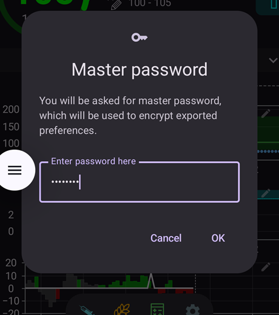

# Crear y restaurar copias de seguridad

Cuando instalas AAPS en tu teléfono, este se convierte en un «dispositivo médico» del que dependes cada día. Se recomienda mucho tener un plan de emergencia por si tu teléfono se estropea, te lo roban o lo pierdes. Por eso es esencial prepararse preguntándose: «¿Y si...?»

Para restaurar tu configuración de AAPS en un teléfono existente o nuevo, es importante guardar los siguientes elementos en un lugar seguro (es decir: no en tu teléfono). Lo mejor es guardar al menos dos copias de seguridad separadas: en un disco duro local, en una memoria USB y (mejor) en un almacenamiento en la nube como Google Drive o Microsoft 365 OneDrive. Si guardas tus copias de seguridad en la nube, siempre tendrás todo lo necesario a mano desde tu teléfono para restaurar tu configuración en cualquier lugar y momento.

Piensa en tener un segundo teléfono de reserva y practica la restauración de AAPS para comprobar que el teléfono de reserva funciona como esperas. Este paso te da la seguridad de que tu plan de emergencia funciona y de que puedes seguir usando AAPS sin problemas si tu teléfono principal deja de estar disponible.

```{admonition} Android backups and phone-transfer tools do not carry your AAPS settings
:class: warning
Since **AAPS** 4.0 the settings are kept in an encrypted store on the phone, and they are left out of the Google backup and of the phone-to-phone transfer of a new phone. A settings export, as described on this page, is the only way to carry them over.
```

Para poder restaurar, es importante tener a mano lo siguiente:

- Tu **archivo del almacén de claves de Android Studio** y su **contraseña**: necesarios para (volver a) compilar el archivo de instalación .APK de AAPS.
- Una copia reciente del **archivo de instalación .APK de AAPS**
- Un archivo reciente de **exportación de ajustes**: para restaurar los ajustes importantes (¡incluidos tus objetivos!).
- Tu **contraseña maestra de AAPS**
- Copias de seguridad de otras aplicaciones auxiliares: por ejemplo BYODA y/o xDrip.
- Notas personales sobre tu configuración.

Abajo están los elementos de los que se recomienda guardar copias de seguridad.

## Crear copias de seguridad

### Archivo del almacén de claves (keystore) del ordenador que usaste para compilar el APK
Cuando compilas tu archivo de instalación .APK con Android Studio, se usan el **archivo del almacén de claves y su contraseña para firmar el archivo de instalación .APK**. Para actualizar tu instalación actual de AAPS, el archivo de instalación .APK de la actualización debe estar firmado con el mismo almacén de claves que usaste en la primera instalación. Al actualizar, se conservan todos los ajustes y la base de datos de AAPS. Ten en cuenta que, sin él, primero tienes que desinstalar la aplicación actual y después [reinstalar](#reinstall-aaps) y volver a configurar AAPS.

Guardar el almacén de claves y su contraseña hará mucho más fácil actualizar el APK en el futuro, sobre todo si necesitas compilar la app en un ordenador nuevo. Consulta la sección [Actualizar a una nueva versión o rama](../Maintenance/UpdateToNewVersion.md) para saber cómo usar el almacén de claves al compilar un APK nuevo.

**Cuándo hacer la copia:** Haz una copia de seguridad del almacén de claves después de compilar por primera vez el archivo de instalación .APK de **AAPS**.

**Cómo hacer la copia:** Busca la ruta de tu almacén de claves. Si no la recuerdas, puedes encontrarla en Android Studio con **Build > APK > Next**. La ruta aparece en «Key store path». Con tu explorador de archivos, ve a esta ruta y haz una copia de tu archivo del almacén de claves (con la extensión `.jks`). Guárdalo en un lugar seguro en la nube, por si tu ordenador deja de estar disponible. Anota también la contraseña del almacén de claves, el alias de la clave y la contraseña de la clave.

### Copias del APK más reciente
Si pierdes o se estropea tu teléfono principal de **AAPS**, tener una copia del APK te permite volver a usar **AAPS** rápidamente en un teléfono nuevo. Nota: también necesitarás una copia de seguridad de tus preferencias, como se explica abajo.

**Cuándo hacer la copia:** Guarda siempre una copia de seguridad del APK más reciente que instalaste en tu teléfono principal de **AAPS**. También puedes guardar una versión anterior, por si necesitas volver a ella por algún motivo.

**Cómo hacer la copia:** Guarda una copia en el ordenador que usaste para compilar el APK con Android Studio. Además, se recomienda usar una plataforma en la nube para guardar una copia del APK de instalación. Asegúrate de saber dónde encontrar las dos copias cuando las necesites. Piensa en crear carpetas solo para guardar estas copias de seguridad.

### Archivo de ajustes de AAPS (también llamado «Preferencias»)

```{admonition} Where are preferences stored on my phone?
:class: tip
Encontrarás tus ajustes en el **Directorio de AAPS** que elegiste durante la [configuración de AAPS](#SetupWizard-StoragePermission).</br>
También puedes cambiar el **Directorio de AAPS** en la pantalla **Mantenimiento** (**menú** (☰) > **Mantenimiento**), ver [Configurar el directorio local de AAPS](#preferences-maintenance-logdirectory).
```

Con una copia del archivo de instalación APK (ver arriba) y tu archivo de **Ajustes**, puedes volver a usar AAPS rápidamente en un teléfono existente o nuevo.

El archivo de **Ajustes** se usa para adaptar la aplicación AAPS a tu configuración concreta. Incluyen datos como tus ajustes de **Configuración**, el estado de los objetivos, los ajustes de comunicación con otros servicios (p. ej., Nightscout, Tidepool), las automatizaciones y los perfiles.

Exportar los ajustes de AAPS a un archivo te permite restaurar su configuración tal como estaba en un momento concreto. Como se ha dicho, además de todos los ajustes de configuración, el archivo exportado también contiene el estado de tus objetivos, que necesitas restaurar al **(re)instalar** AAPS. Sin él, tendrás que volver a hacer todos los objetivos desde el principio para activar el lazo cerrado. Los archivos de ajustes también te permiten restaurar los últimos ajustes que funcionaban bien, para deshacer cambios en la configuración.

**Cuándo hacer una copia de seguridad de los ajustes de AAPS:**
* Cada vez que completes un objetivo, para no perder tu progreso. _Sin una copia de tus **Ajustes**, tendrás que completar otra vez todos los objetivos si necesitas reinstalar AAPS o cambiar de teléfono._

* Siempre que vayas a hacer cambios importantes en tu configuración (cambiar los ajustes de SMB, cambiar el tipo de insulina, cambiar de bomba, cambiar automatizaciones), debes hacer una copia de seguridad de tus **Ajustes** antes y después de los cambios. Así tienes tus ajustes más recientes y también una copia de cómo eran antes de los cambios, por si necesitas volver a ellos.

* Tubeless pumps (Such as Omnipod and Medtrum) users only: the **Settings** file contains connection details on your current pod and can be used to restore connection to that pod with a new phone. Si no tienes una copia de tus preferencias exportada después de empezar tu pod actual, tendrás que empezar un pod nuevo si necesitas cambiar tu teléfono actual.

**Cómo hacer la copia de seguridad a mano:**

1. If this is your first time importing or exporting **Settings** you will need to set a master password in [Settings > Protection](#Preferences-master-password). Pon una contraseña y anótala en un lugar seguro. _Sin esta contraseña no podrás acceder a las copias de seguridad de tus **Ajustes**._

2. En la pantalla principal de **AAPS**, abre el **menú** (☰) > **Mantenimiento**. Elige dónde guardar el archivo con los chips **Local** y **Nube** junto a **Exportar ajustes** (ver **Exportar o importar ajustes** abajo) y después toca **Exportar ajustes**. **AAPS** muestra dónde se guardará el archivo: el nombre del archivo para **Local** y **Google Drive** para **Nube**. Toca **Ok**.

   

   

   Escribe la contraseña maestra que pusiste arriba y toca **Ok**.

   

   El mensaje **Ajustes exportados** (local) o **Exportación a la nube realizada con éxito** (nube) confirma la exportación.

   

   

3. Con el explorador de archivos de tu teléfono (suele llamarse «Archivos» o «Mis archivos»), ve a Almacenamiento interno > AAPS > preferences. Aquí verás una copia de todos los archivos de preferencias exportados. El nombre del archivo debe ser `YYYY-MM-DD_Time_appname.json`. Sube este archivo a la plataforma en la nube que prefieras. Después, desde la plataforma en la nube, descarga también una copia a tu ordenador.

(ExportImportSettings-Settings-Export)=

## Exportación de configuraciones

```{admonition} Where are preferences stored on my phone?
:class: tip
Encontrarás tus ajustes en el **Directorio de AAPS** que elegiste durante la [configuración de AAPS](#SetupWizard-StoragePermission).</br>
También puedes cambiar el **Directorio de AAPS** en la pantalla **Mantenimiento** (**menú** (☰) > **Mantenimiento**), ver [Configurar el directorio local de AAPS](#preferences-maintenance-logdirectory).
```

Se recomienda exportar los ajustes con regularidad, sobre todo antes y después de hacer cambios en la configuración. Puedes exportar **a mano o (mejor) con una automatización**. Anota tu contraseña maestra de AAPS y haz una copia de seguridad de tus archivos de ajustes copiándolos fuera de tu teléfono, por ejemplo a un almacenamiento en la nube.

**Nota**: _Los ajustes exportados se cifran con tu contraseña maestra de AAPS: sin la contraseña maestra usada para exportar no podrás importar el archivo de ajustes._

### Exportar o importar ajustes
Para exportar o importar ajustes, abre el **menú** (☰) y elige **Mantenimiento**. En **Gestión de archivos**, los chips **Local** y **Nube** junto a **Exportar ajustes** e **Importar ajustes** eligen dónde se guarda o desde dónde se lee el archivo de ajustes: **Local** es el directorio de AAPS en tu teléfono; **Nube** está disponible cuando hay un [Directorio en la nube](#preferences-maintenance-cloud) configurado. Al tocar un chip, se activa o se desactiva; al menos uno queda siempre elegido, y las dos filas usan la misma elección. Después toca **Exportar ajustes** o **Importar ajustes** para empezar.


(ExportImportSettings-Automating-Settings-Export)=
### Automatizar la exportación de ajustes

To automate settings exports [(**see Automation**)](../DailyLifeWithAaps/Automations.md#automating-preference-settings-export) open [**Settings** > **Maintenance**](#preferences-maintenance-settings), expand **Unattended Settings Export** and switch on **Enable automated settings export**.

Puedes configurar una [Automatización](../DailyLifeWithAaps/Automations.md#automating-preference-settings-export) para exportar los ajustes con regularidad (_p. ej._ cada semana) o después de cambiar el pod.

_**Nota:** ¡Al importar ajustes, siempre hay que escribir la contraseña maestra de AAPS!_


(ExportImportSettings-restoring-from-your-backups-on-a-new-phone-or-fresh-installation-of-aaps)=
## Restaurar tus copias de seguridad en un teléfono nuevo o en una instalación nueva de AAPS

```{admonition} Where are preferences stored on my phone?
:class: tip
Encontrarás tus ajustes en el **Directorio de AAPS** que elegiste durante la [configuración de AAPS](#SetupWizard-StoragePermission).</br>
También puedes cambiar el **Directorio de AAPS** en la pantalla **Mantenimiento** (**menú** (☰) > **Mantenimiento**), ver [Configurar el directorio local de AAPS](#preferences-maintenance-logdirectory).</br>
Si **AAPS** pierde el acceso a ese directorio (puede pasar después de reinstalar o de borrar el almacenamiento de la app), muestra la notificación **Se perdió el acceso al directorio de AAPS** y deja de guardar ajustes en el teléfono hasta que [vuelvas a elegir el directorio](#preferences-maintenance-logdirectory).
```

Usa estas instrucciones si tienes una copia de seguridad de tu APK y de tus **Ajustes** que quieres cargar en un teléfono nuevo, o si por algún motivo tuviste que borrar y reinstalar el APK en tu teléfono actual.

_Si actualizas **AAPS** con un APK compilado con el mismo almacén de claves, no necesitas seguir este proceso. Aun así, se recomienda hacer una copia de seguridad antes de aplicar la actualización._

Si actualizas **AAPS** después de perder o cambiar tu almacén de claves original (por ejemplo, con un ordenador nuevo para compilar sin pasar a él el almacén de claves), haz una copia de seguridad de todos los ajustes como se explica arriba y después desinstala la versión actual de **AAPS** de tu teléfono. Consulta [Reinstalar AAPS con un nuevo almacén de claves](#reinstall-aaps) para ver el proceso completo.

Si es necesario, [configura el receptor de tu MCG o fuente de glucosa](../Getting-Started/CompatiblesCgms.md) antes de seguir los pasos de abajo

(ExportImportSettings-tubeless-pumps)=
```{admonition} Tubeless pumps (Omnipod and Medtrum) users
:class: warning
El archivo de **Preferencias** contiene la sesión del pod o parche que estaba activo cuando lo exportaste.
- **Exporta justo después de cada activación de pod o parche** y copia el archivo fuera de tu teléfono.
- **Mismo teléfono, el pod sigue funcionando:** deja sin marcar **También reemplazar la configuración de la bomba**. Se mantiene tu pod actual y solo se importan los demás ajustes.
- **Teléfono nuevo que se hace cargo del pod:** marca **También reemplazar la configuración de la bomba** y usa solo un archivo exportado durante el pod que llevas ahora. Un archivo de un pod anterior reemplaza la sesión de tu pod actual, y tendrás que empezar un pod nuevo.
- **Se importó por error una sesión de pod antigua:** **AAPS** sigue intentando conectar con ese pod y no puedes activar uno nuevo. Desactívalo; si no funciona, descártalo (ver, por ejemplo, [Descartar un pod](#omnipod-dash-discard-pod) para Omnipod DASH).
```

```{admonition} Pump settings are kept unless you say otherwise
:class: note
Por defecto, una importación no cambia los ajustes de tu bomba: la bomba elegida en **Configuración**, su emparejamiento y todos sus demás ajustes se quedan como están en este teléfono. Marca **También reemplazar la configuración de la bomba** en la pantalla de importación solo cuando restaures en un teléfono nuevo que deba hacerse cargo de la misma bomba. Una importación nunca borra los ajustes que no están en el archivo.
```

1. Con la copia de seguridad de tu APK de arriba, sigue las instrucciones para una [instalación nueva](../SettingUpAaps/TransferringAndInstallingAaps.md)

2. Abre **AAPS** y concede todos los permisos que pida

3. Sal del Asistente de configuración. Vamos a importar todos los ajustes necesarios desde la copia de seguridad de los **Ajustes**

4. En la pantalla principal de **AAPS**, pulsa **Conceder** y permite todos los permisos de la lista del panel **Permisos necesarios** de arriba

5. En la pantalla principal de **AAPS**, pon en [Ajustes > Protección](#Preferences-master-password) la misma contraseña maestra que usaste en tus copias de seguridad.

6. Si todavía no lo has hecho, [configura el **Directorio de AAPS**](#preferences-maintenance-logdirectory): en la pantalla principal de **AAPS**, abre el **menú** (☰) > **Mantenimiento** > **Directorio de AAPS**.

7. En la pantalla principal de **AAPS**, abre el **menú** (☰) > **Mantenimiento** > **Exportar ajustes** > escribe la contraseña maestra que pusiste arriba > **Ok**. Esto crea la carpeta de preferencias si todavía no existe en tu teléfono.

8. Descarga de tu plataforma en la nube la copia de seguridad de tu archivo de **Preferencias**.

9. Usa tu explorador de archivos (suele llamarse «Archivos» o «Mis archivos») para mover el archivo desde tus descargas a `/internal storage/AAPS/preferences` si tu **Directorio de AAPS** es `/internal storage/AAPS`

10. En la pantalla principal de **AAPS**, abre el **menú** (☰) > **Mantenimiento** y toca **Importar ajustes**. Elige el archivo de preferencias que quieres restaurar (el más nuevo está arriba). Asegúrate de elegir el archivo de preferencias correcto: se muestran todos los archivos .json de la carpeta de preferencias (o del directorio en la nube, con **Nube**).

    

    **AAPS** muestra los datos del archivo. Escribe la contraseña maestra que pusiste arriba y toca **Descifrar y revisar**.

11. Cuando el archivo esté descifrado, decide qué hacer con los ajustes de la bomba. En un teléfono nuevo que se hace cargo de la misma bomba, marca **También reemplazar la configuración de la bomba** para que el emparejamiento y los ajustes de la bomba se tomen del archivo. Deja la casilla sin marcar para mantener la bomba con la que este teléfono ya está emparejado. Después toca **Importar**.

    

12. **AAPS** pregunta **¿Aplicar la configuración importada?** y te dice cuántos ajustes van a cambiar y, si dejaste la casilla sin marcar, cuántos ajustes de la bomba se mantienen. Todavía no se ha escrito nada, así que **Cancelar** deja tu teléfono exactamente como estaba. Toca **Ok** para aplicar.

    

13. **AAPS** aplica los ajustes importados en el momento, sin reiniciarse. Solo se reinician los complementos cuyos ajustes han cambiado. Mientras tanto, **AAPS** muestra **Aplicando configuraciones...**; si la bomba está ocupada, muestra **Esperando a la bomba…** y aplica los ajustes cuando la bomba queda libre. Si la bomba sigue ocupada después de un minuto, **AAPS** ofrece volver a intentarlo. El mensaje **Configuración aplicada** confirma que los ajustes importados ya están en uso. Cualquier tratamiento que estuviera en cola durante la importación se descarta y **AAPS** te avisa de que se canceló, para que nada se envíe dos veces a la bomba.

    

Si el archivo elegía una bomba que esta versión de **AAPS** no tiene, **AAPS** pasa a la **Bomba virtual** y te lo indica. Vuelve a elegir tu bomba en **Configuración** y revisa sus ajustes.

14. Solo para usuarios de bombas sin tubo (Omnipod y Medtrum): si marcaste **También reemplazar la configuración de la bomba** y tus **Preferencias** no se guardaron durante el mismo pod que usas ahora, tendrás que empezar un pod nuevo para empezar a administrar insulina.

**Solución de problemas:** si no consigues activar un perfil desde la pantalla principal de **AAPS**, abre el **menú** (☰) arriba a la izquierda > **Configuración** > **Bomba** > cambia a **Bomba virtual** > y después vuelve a tu tipo de bomba

### Nota para usuarios de Dana RS

- Si marcaste **También reemplazar la configuración de la bomba**, también se importan los ajustes de conexión de la bomba: **AAPS** en tu teléfono nuevo ya «conoce» la bomba y por eso no empieza una búsqueda Bluetooth.
- Por favor, empareja el nuevo teléfono y la bomba manualmente.