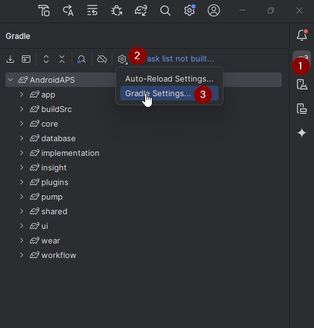
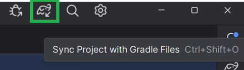

# Actualizar a AAPS 3.2.0.4

(update-aaps-3204)=

## Compílala tú en lugar de descargarla

**La app AAPS (un archivo apk) no está disponible para descargar, debido a las normas sobre dispositivos médicos. Es legal compilar la app para tu propio uso, ¡pero no debes dar una copia a otras personas!**

Consulta la página de [preguntas frecuentes](../UsefulLinks/FAQ.md) para más detalles.

## Requisitos del ordenador y del software para compilar AAPS 3.2.0.4

* Puede ser necesaria una versión concreta de **[Android Studio](https://developer.android.com/studio/)** para compilar el APK.

| Versión de AAPS         | Versión<br/>preferida de<br/>Android Studio | Versión<br/>alternativa de<br/>Android Studio | Gradle | JVM |
| ----------------------- | ------------------------------------------------------- | --------------------------------------------------------- | ------ |:--- |
| [3.2.0.4](#version3204) | Hedgehog (2023.1.1)                                     | hasta Meerkat                                             | 8.2    | 17  |

La «versión preferida» incluye la versión adecuada de JVM. La versión preferida es también la versión mínima que puedes usar para compilar **AAPS**. **NO** podrás compilar con una versión más antigua que la «preferida». Si usas otra versión, puedes tener problemas relacionados con la versión de JVM. Consulta la página [Solución de problemas para Android Studio](#incompatible-gradle-jvm) para ayudarte a resolver estos problemas. Si tu versión actual de Android Studio no está en la tabla, primero tienes que actualizarla.

La versión de Gradle está ligada al código fuente: siempre obtendrás la versión correcta de Gradle al descargar o actualizar el código fuente. Se menciona aquí solo como referencia; no tienes que hacer nada con ella.

* Android Studio no es compatible con [sistemas Windows de 32 bits](#troubleshooting_androidstudio-unable-to-start-daemon-process). Recuerda que **una CPU de 64 bits y un sistema operativo de 64 bits son condiciones obligatorias.** Si tu sistema NO cumple esta condición, tienes que cambiar el hardware o el software afectado, o todo el sistema.

<table class="tg">
<tbody>
  <tr>
    <th class="tg-baqh">SO (solo 64 bits)</th>
    <td class="tg-baqh">Windows 8 o superior</td>
    <td class="tg-baqh">Mac OS 10.14 o superior</td>
    <td class="tg-baqh">Cualquier Linux compatible con Gnome, KDE o Unity DE;&nbsp;&nbsp;GNU C Library 2.31 o posterior</td>
  </tr>
  <tr>
    <th class="tg-baqh"><p align="center">CPU (solo 64 bits)</th>
    <td class="tg-baqh">Arquitectura de CPU x86_64; Intel Core de 2.ª generación o más nuevo, o CPU AMD compatible con <br><a href="https://developer.android.com/studio/run/emulator-acceleration#vm-windows" target="_blank" rel="noopener noreferrer"><span style="text-decoration:var(--devsite-link-text-decoration,none)">Windows Hypervisor</span></a></td>
    <td class="tg-baqh">Chips basados en ARM, o Intel Core de 2.ª generación o más nuevo compatible con <br><a href="https://developer.android.com/studio/run/emulator-acceleration#vm-mac" target="_blank" rel="noopener noreferrer"><span style="text-decoration:var(--devsite-link-text-decoration,none)">Hypervisor.Framework</span></a></td>
    <td class="tg-baqh">Arquitectura de CPU x86_64; Intel Core de 2.ª generación o más nuevo, o procesador AMD compatible con AMD Virtualization (AMD-V) y SSSE3</td>
  </tr>
  <tr>
    <th class="tg-baqh"><p align="center">RAM</th>
    <td class="tg-baqh" colspan="3"><p align="center">8 GB o más</td>
  </tr>
  <tr>
    <th class="tg-baqh"><p align="center">Disco</th>
    <td class="tg-baqh" colspan="3"><p align="center">Al menos 30 GB de espacio libre. Se recomienda un SSD.</td>
  </tr>
  <tr>
    <th class="tg-baqh"><p align="center">Resolución</th>
    <td class="tg-baqh" colspan="3"><p align="center">Mínimo 1280 x 800<br></td>
  </tr>
  <tr>
    <th class="tg-baqh"><p align="center">Internet</th>
    <td class="tg-baqh" colspan="3"><p align="center">Banda ancha</td>
  </tr>
</tbody>
</table>

**Se recomienda mucho (no es obligatorio) usar un SSD (disco de estado sólido) en lugar de un HDD (disco duro), porque tardarás menos en compilar el archivo APK de AAPS.**  Aun así, puedes usar un HDD para compilar el archivo APK de **AAPS**. Si lo haces, la compilación puede tardar mucho en terminar, pero una vez que empiece, puedes dejarla funcionando sola.

## Ayuda y soporte durante la compilación de 3.2.0.4

Si tienes dificultades al compilar la app **AAPS**, hay una sección dedicada a la [**solución de problemas de Android Studio**](https://androidaps.readthedocs.io/en/3.2/GettingHelp/TroubleshootingAndroidStudio.html); consúltala primero.

Si crees que algo en las instrucciones de compilación está mal, falta o es confuso, o si sigues teniendo problemas, contacta con el grupo de usuarios de **AAPS** en [Facebook](https://www.facebook.com/groups/AndroidAPSUsers) o [Discord](https://discord.gg/4fQUWHZ4Mw). Si quieres cambiar algo tú mismo (actualizar capturas de pantalla, _etc._), envía un [pull request (PR)](../SupportingAaps/HowToEditTheDocs.md).

```{note}
Esta página muestra imágenes de ejemplo tanto de la interfaz **New** (nueva) como de la antigua (**Classic**) de Android Studio.
```

## Resumen de la actualización de 3.2.0.x a 3.2.0.4

```{contents} Steps for updating to 3.2.0.4
:depth: 1
:local: true
```

### Exporta tus ajustes actuales

Exporta tus ajustes desde la versión de **AAPS** que tienes en el teléfono. Puede que no lo necesites, pero más vale prevenir.

Consulta la página [Crear y restaurar copias de seguridad](ExportImportSettings.md) si no recuerdas cómo hacerlo.

### Actualiza tu copia local de AAPS

* Abre tu proyecto AAPS existente con Android Studio. Puede que tengas que seleccionar tu proyecto. Haz (doble) clic en el proyecto AAPS.


<br>


* En la barra de menú de Android Studio, selecciona Git -> Fetch


<br>


* Verás un mensaje en la esquina inferior derecha que indica que Fetch se ha realizado con éxito.


<br>


* Ahora, en la barra de menú, selecciona Git -> Pull


<br>


* Deja todas las opciones como están (origin/master) y selecciona Pull


<br>


* Espera mientras se descarga; lo verás como información en la barra inferior. Cuando termine, verás un mensaje de éxito.

  ```{note}
  ¡Los archivos actualizados pueden ser distintos! Esto no indica ningún problema.
  ```


<br>


* Gradle Sync se ejecutará para descargar algunas dependencias. Espera hasta que termine.


<br>


### Selecciona la versión 17 de JVM

- Abre la vista Gradle haciendo clic en el elefante (1) del lado derecho de Android Studio, abre los ajustes (2) y selecciona **Gradle Settings** (3):



<br>


- En el campo **Gradle JDK** (1), comprueba si está seleccionada la versión adecuada: **jbr-17**. Si no, haz clic en el campo y mira si ya está disponible en la lista. Si no está en la lista (la captura de abajo muestra un ordenador donde solo está disponible **jbr-21**), selecciona **Download JDK...** (2).


- En Version (1), selecciona **17**. En Vendor (2), selecciona JetBrains Runtime o cualquier proveedor. Location (3): no lo cambies.


- Cierra el diálogo **Settings** con **OK**.

### Selecciona la rama de AAPS 3.2.0.4

- Abajo a la izquierda, selecciona el símbolo de Git, haz clic derecho en 3.2.0.4 y selecciona Checkout.


<br>


### Sincroniza el proyecto con Gradle

```{admonition} WARNING!
:class: warning
**Nunca actualices Gradle.** Sincronízalo siempre con el proyecto.
```

Usa el icono del elefante y Sync Project with Gradle Files (o sigue [esto](#gradle-resync)) en la interfaz nueva.



O ([esto](https://androidaps.readthedocs.io/en/3.2/GettingHelp/TroubleshootingAndroidStudio.html#gradle-resync)) en la interfaz clásica.


### Compila el APK firmado de 3.2.0.4

Tu código fuente es ahora la versión publicada actual, y se han comprobado todos los requisitos previos. Es el momento de compilar el APK firmado como se describe en la [sección sobre compilar el APK firmado](#Building-APK-generate-signed-apk).

### Transfiere e instala el APK de 3.2.0.4

Tienes que transferir el APK a tu teléfono para poder instalarlo.

```{note}
Si has compilado con el mismo almacén de claves existente en Android Studio, no tienes que eliminar la app que ya tienes en el teléfono. Al instalar el APK, sigue las indicaciones para instalar la actualización.
En otros casos, como crear un almacén de claves nuevo en Android Studio para tu APK firmado, tienes que eliminar la app antigua antes de instalar el APK. **¡Asegúrate de exportar tus ajustes!**
```

Consulta las instrucciones para [transferir e instalar AAPS](../SettingUpAaps/TransferringAndInstallingAaps.md)

### Comprueba la versión 3.2.0.4 de AAPS en el teléfono

Después de instalar el nuevo APK, puedes comprobar la versión de AAPS en tu teléfono tocando el menú de tres puntos arriba a la derecha y luego Acerca de. Deberías ver la versión actual.

