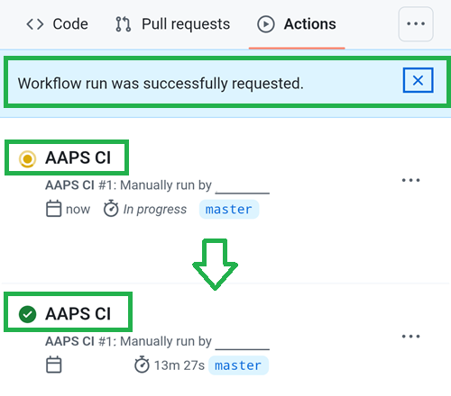

# Actualizar con un navegador (fork)

```{tip}
¿Compilaste AAPS con **AAPS Builder**? No necesitas esta página: consulta [Actualizar AAPS con AAPS Builder](#aaps-builder-updates).
```

## Compílala tú en lugar de descargarla

**AAPS** no está disponible para descargar, debido a la normativa sobre productos sanitarios. Es legal compilar la app para tu propio uso, ¡pero no debes dar una copia a otras personas! Consulta la página de [preguntas frecuentes](../UsefulLinks/FAQ.md) para más detalles.

```{note}
In case you want to upgrade **AAPS** with a browser for the first time: copy your back-up keystore file to your Google Drive. Luego sigue el [procedimiento de compilación de **AAPS** en el navegador](../SettingUpAaps/BrowserBuild.md) en lugar de esta guía. En lugar de crear un almacén de claves nuevo, debes seleccionar el que has copiado desde tu ordenador.
Este paso solo es obligatorio la primera vez; en las siguientes actualizaciones podrás seguir esta guía.
```

```{tip}
**¿Te pasas a AAPS Builder?** [AAPS Builder](../SettingUpAaps/BrowserBuildAapsBuilder.md) es la compilación en el navegador más sencilla: no hay fork que sincronizar y descargas la app directamente desde GitHub. No tienes que cambiar: esta guía sigue funcionando. Si cambias, primero obtén una copia de tu almacén de claves desde tu fork, como se explica en [Si vienes de la compilación en el navegador anterior](#aaps-builder-from-fork). Si no, la nueva compilación no podrá actualizar el AAPS de tu teléfono.
```

## Resumen de la actualización a una nueva versión de AAPS con un navegador

```{contents} Steps for updating to a new version of AAPS
:depth: 1
:local: true
```

Si tienes problemas, consulta la página aparte [Compilación en el navegador: solución de problemas](../GettingHelp/BrowserBuildTroubleshooting.md).

### Exporta tus ajustes

Exporta tus ajustes desde la versión de **AAPS** que tienes en el teléfono. Puede que no lo necesites, pero más vale prevenir.

Consulta la página [Crear y restaurar copias de seguridad](ExportImportSettings.md) si no recuerdas cómo hacerlo.

(Update-to-new-version-update-your-repo)=
### Actualiza tu repositorio de GitHub

[Inicia sesión en GitHub](https://github.com/login).

1. Selecciona Repositories.
2. Desplázate hacia abajo y selecciona tu propio repositorio de AndroidAPS.


3. Comprueba que usas tu propia copia de AndroidAPS (Forked from nightscout/AndroidAPS)
4. Toca Sync Fork para actualizarla (el número de commits de retraso puede ser distinto al de la imagen)


5. Toca Update Branch


Nota: si has modificado tu copia de AndroidAPS por error, verás esta pantalla. Descarta todos los cambios (commits) para volver a la versión publicada.


You have now synchronized (updated) your own copy with the latest release of **AAPS**. ¡Buen trabajo!


### Ejecuta el workflow para compilar el APK firmado

1. En tu copia de AndroidAPS en GitHub, selecciona Actions.
2. Despliega All Workflows.
3. Selecciona AAPS-CI


4. Desplázate hacia abajo y toca Run Workflow.


5. Keep the branch set to master. In **Select AAPS Version**, check that **4.0.0**, the newest version at the top of the list, is selected. If your fork is not up to date, the preselected version is an older one: if you run the workflow with the form as it opens, you rebuild that older version and your app is not updated. Choose the [variant](#browserbuild-variant) (fullRelease), and then tap Run workflow.

   ```{note}
   The list of versions is part of the workflow in your fork. If **4.0.0** is missing, your fork is not synchronized yet: go back to [Update your GitHub repository](#Update-to-new-version-update-your-repo).
   ```


6. Verás el mensaje Workflow run was successfully requested. Actualiza la página del navegador y podrás seguir el progreso de la compilación. Cuando la acción termine, la acción AAPS CI mostrará una marca verde. You have successfully built the updated version of **AAPS**. Esto significa que el APK del máster y el APK para Wear se guardan ahora directamente en tu Google Drive (como se ve abajo). El APK de AAPSClient se puede descargar desde Github > nightscout > AndroidAPS [aquí](https://github.com/nightscout/AndroidAPS/releases)





### Instala el APK de AAPS

1. Abre tu Google Drive
2. Entra en AAPS, selecciona la carpeta de la nueva versión y encontrarás la versión para el teléfono y la versión para Android Wear.


```{note}
Desde septiembre de 2026, la [verificación de desarrolladores de Android](#android-developer-verification) de Google puede bloquear la instalación del APK al tocar el archivo, según tu país. En esa página se explican soluciones gratuitas.
```

Continúa [aquí](#Update-to-new-version-check-aaps-version-on-phone)

(update-browser-build-troubleshooting)=

## Solucionando problemas

Si algo sale mal, no te asustes.

¡Respira hondo!

Luego comprueba si tu problema ya está documentado: consulta [Solución de problemas de AAPS Builder](#aaps-builder-troubleshooting) si compilas con **AAPS Builder**, o [Solución de problemas de la compilación en el navegador](#aaps-ci-troubleshooting) en otro caso.

Si necesitas más ayuda, contacta con otros usuarios de **AAPS** en [Facebook](https://www.facebook.com/groups/AndroidAPSUsers) o [Discord](https://discord.gg/4fQUWHZ4Mw).
