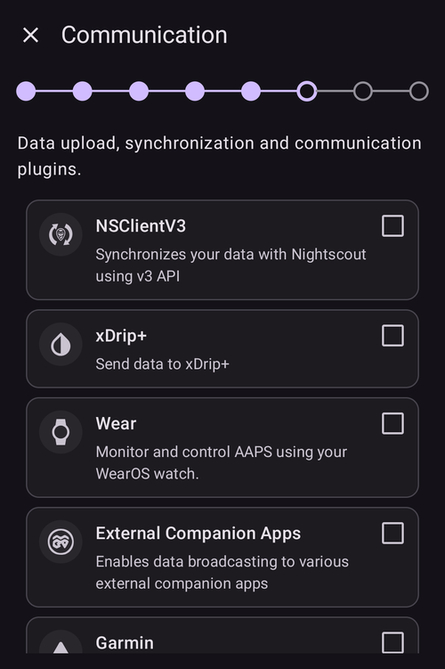
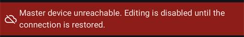

(aapsclient-app)=
# La app AAPSClient

**AAPSClient** es la app complementaria de **AAPS**: una app para un segundo teléfono (normalmente el de un cuidador) que **sigue** a la persona que usa **AAPS**. Desde la versión 4 de **AAPS**, el cuidador también puede **controlar** el lazo a distancia mediante comandos firmados. Los dos teléfonos se comunican a través de tu sitio de **Nightscout**; no hace falta una conexión directa entre los teléfonos.

```{admonition} Wording used on this page
:class: note
- **Cliente** = un teléfono con **AAPSClient**.
- **Máster** = el teléfono principal con **AAPS**, que tiene la bomba y ejecuta el lazo.
```

```{admonition} iPhone version in development
:class: note
Por ahora, **AAPSClient** funciona en teléfonos Android. Se está desarrollando una versión de **AAPSClient** para iPhone, que está en una fase temprana de pruebas. Aún no está publicada: no está en la App Store y no hay nada que descargar. Esta página se actualizará cuando esté disponible.
```

```{contents} Table of contents
:depth: 2
:local: true
```

## Qué es AAPSClient (y qué no es)

**AAPSClient** tiene el aspecto y el manejo de **AAPS**, pero **no tiene lazo propio**:

- No contiene **ningún algoritmo APS**, ni **Objetivos**, ni **drivers de bomba**: nunca administra insulina por sí solo.
- Tampoco incluye los complementos que solo usa la app principal (**Comunicador por SMS**, **Tidepool**, **Open Humans**).
- Lo que *sí* contiene: la sincronización **NSClientV3**, los complementos de fuente de glucosa, el envío a **xDrip+** y los conectores de **Wear OS** / **Garmin**; todo lo necesario para seguir y para transmitir comandos. Un reloj **Garmin** conectado a un cliente puede mostrar los datos, pero los carbohidratos que envía no se registran y no puede conectar ni desconectar la bomba: el cliente muestra un mensaje, y en su lugar los introduces en **AAPS**.

Todo lo que inicias desde **AAPSClient** lo comprueba, limita, confirma y **ejecuta el máster** (el teléfono con la bomba). La página [Control máster ↔ cliente](ClientMasterControl.md) explica cómo funciona: cómo emparejar los dos teléfonos, cómo el máster escribe el texto de confirmación que ves, cómo se administra un bolo iniciado en el cliente y qué pasa cuando el máster está desconectado.

## Versiones: AAPSClient, AAPSClient2 y AAPSClient3

En el mismo teléfono seguidor se pueden instalar hasta tres apps cliente a la vez, cada una siguiendo a una persona **distinta**: **AAPSClient** (icono de búho amarillo), **AAPSClient2** (búho azul) y, como novedad en la versión 4 de **AAPS**, **AAPSClient3** (búho verde). Funcionan exactamente igual. Solo cambian el nombre y el color (icono de la app, fondo del widget y la sección de estado de la pantalla principal), para que puedas distinguirlas. Cada app se empareja con su propio máster. Consulta [Acerca de AAPSClient, AAPSClient2 y AAPSClient3](#remotecontrol-aapsclient-versions) para más detalles.

## Obtener la app

**AAPSClient** se obtiene de la misma forma que **AAPS** (consulta [Descarga e instalación de AAPSClient](#RemoteControl_aapsclient)) y se instala como la app principal ([Transferir e instalar AAPS en tu teléfono](../SettingUpAaps/TransferringAndInstallingAaps.md)).

## Primer inicio: un Asistente de configuración más corto

En el primer inicio, **AAPSClient** ejecuta el mismo **Asistente de configuración** que conoces de **AAPS**, pero con muchos menos pasos: en un seguidor no se configura perfil, insulina, bomba, APS ni objetivos:

1. **Bienvenido**, **acuerdo de licencia**, **permisos** y **contraseña maestra**: igual que en la app principal, consulta el [Asistente de configuración](../SettingUpAaps/SetupWizard.md).
2. El cliente **no** pregunta las **unidades** ni los **límites bajo/alto**: los toma del teléfono principal en cuanto se conecta a Nightscout. Puedes verlos más tarde en **Ajustes**, donde un pequeño **icono de teléfono** indica que están [sincronizados con el teléfono principal](#client-master-config-prefs). Solo se pueden editar mientras el máster está accesible.
3. **Configurar desde el máster**: en el máster, abre **Administrar → Clientes autorizados**, añade este teléfono con un **código QR** y toca aquí **Escanea el código QR**. Un solo escaneo configura Nightscout con un token propio de este teléfono y, si el código incluye el emparejamiento, también empareja el teléfono. El teléfono también toma como nombre de instancia el nombre con el que se añadió en el máster (las letras con acento pasan a letras sin acento: «Miloš» pasa a ser «Milos»). **Después del escaneo, la configuración ha terminado**: el asistente se cierra, porque los pasos siguientes solo mostrarían lo que ya hizo el código. Si no tienes un código QR, sáltate este paso. (Solo en Android: el escáner aún no está disponible en iOS).

   

4. **Comunicación**: la lista de complementos solo ofrece lo que necesita un seguidor (NSClientV3, xDrip+, Reloj, Aplicaciones complementarias externas, Garmin). Si no escaneaste un código QR, activa **NSClientV3** e introduce la **misma URL de Nightscout** que en el teléfono principal y un token de acceso, con los **websockets** activados, tal como se describe en [Sincronización](#RemoteControl_aapsclient).

   

5. **Emparejar con el máster**: este paso existe **solo** en el cliente. Conecta este dispositivo con el máster a través del canal seguro de comandos, con el PIN, y toma el nombre con el que se añadió el teléfono en el máster, igual que con el código QR. **Después del emparejamiento, la configuración ha terminado.** También puedes saltarlo y emparejar más tarde en cualquier momento desde **Administrar → Emparejar con el máster**.

   

6. **¿Quién usa este teléfono?**: solo si no emparejaste en el asistente; el nombre de la persona que usa este teléfono. Sirve para distinguir esta instancia en los informes y en la sincronización.

(aapsclient-pairing-with-the-master)=

## Emparejar con el máster

En el **máster**, abre **Administrar → Clientes autorizados** y añade un cliente. Hay dos formas de emparejar:

- **Con un código QR** (la más rápida, si el teléfono tiene cámara): escanea el código en el paso del asistente «**Configurar desde el máster**» o desde **Administrar → Emparejar con el máster → Escanear código QR**, y confirma con «**Usar**». También configura Nightscout.
- **Con el PIN**: en el **cliente**, abre el paso del asistente de arriba (o **Administrar → Emparejar con el máster**), escribe el PIN de un solo uso que muestra el máster y pulsa «**Vincular**». Después, el cliente muestra en quién va a confiar; confirma con «**Vincular**»:


Desde el asistente, un emparejamiento correcto termina la configuración y abre la pantalla principal. En el máster, el cliente aparece como **Activo** en la lista de [Clientes autorizados](#client_master_master_setup). Después, **Administrar → Emparejar con el máster** muestra «*Ya está emparejado*», el rol del teléfono y si el modo reforzado está activado:

 El procedimiento completo de emparejamiento, los detalles de seguridad y la solución de problemas están en [Control máster ↔ cliente](#client_master_client_setup).

Después de emparejar, el cliente recibe del máster un token de Nightscout propio (si el máster tiene un token de administrador), con solo los permisos que necesita un cliente, y deja de usar el token que hayas introducido. **AAPSClient** nunca escribe tratamientos ni glucosa en Nightscout por sí mismo: todo lo que hace se envía al máster, que es quien lo escribe. Consulta [El token de Nightscout propio del cliente](#client-master-control-own-token).

El máster decide qué puede hacer este teléfono mediante su **[rol](#client-master-control-roles)** (Solo lectura, Comidas, Cuidador o Administrador). **Administrar → Emparejar con el máster** muestra el rol del teléfono.

## La pantalla principal

La pantalla principal del cliente refleja el lazo seguido:


- **La glucosa, los gráficos, la IOB/COB y el perfil** vienen de Nightscout, tal como los subió el máster.
- El **estado del lazo** que se muestra es el **del máster** (un cliente no tiene lazo propio). Hasta que el cliente recibe de Nightscout el modo de funcionamiento del máster, el chip del modo de funcionamiento muestra un **signo de interrogación** (desconocido).
- La **tarjeta de estado** muestra el reservorio y la batería de la **bomba seguida** y la batería del teléfono que sube los datos, tomados del estado del dispositivo en Nightscout; un cliente no tiene bomba, así que en la app no hay estado local de la bomba ni gestión de la bomba.
- La barra inferior ofrece **Tratamientos**, **Escenas** y **Administrar** cuando el cliente está emparejado (antes de emparejar, solo **Administrar**); no hay pestañas de bomba ni de objetivos.

## Tratamientos y acciones

Todo lo que hay en **Administrar** funciona como en la app principal, con una diferencia importante: en un cliente, las acciones que cambian el tratamiento (bolo, carbohidratos, objetivos temporales, escenas…) están **ocultas hasta que el dispositivo está emparejado**, y una vez emparejado se **envían al máster** para que las confirme y ejecute; consulta [Usar el control remoto](#client-master-control).

La excepción es la entrada **Perfil**: se muestra incluso en un cliente **no emparejado**, pero se abre **solo para ver**: el cliente muestra los perfiles que recibe a través de Nightscout (los necesita para sus propios cálculos), sin botones para editar ni activar. Cuando el cliente está **emparejado**, la lista de perfiles se sincroniza con el máster y puedes editar y activar perfiles desde el cliente como cualquier otra acción remota.

En un cliente **no emparejado**, **Administrar** solo ofrece **Perfil** y **Emparejar con el máster**:


El aviso rojo «*Dispositivo máster inaccesible. La edición está desactivada hasta que se restablezca la conexión.*» también aparece en un cliente no emparejado. Es lo esperado: todavía no hay ningún máster al que llegar. El aviso desaparece cuando el cliente está emparejado y el máster está en línea.

Cuando el cliente está emparejado, aparecen las acciones de tratamiento:


**No hay entrada Bomba**: un cliente no tiene bomba.

Si el máster no está accesible, el mismo aviso aparece en un cliente emparejado: las acciones de tratamiento aparecen en gris, y todo lo que intentes se bloquea antes de enviarse. El cliente detecta que el máster está desconectado cuando intentas una acción, y vuelve a activar las acciones cuando el máster vuelve a estar en línea.



## Ajustes sincronizados con el máster

La **configuración** de complementos activa y muchas **preferencias** se mantienen sincronizadas entre el máster y sus clientes emparejados; los elementos sincronizados llevan un pequeño **icono de teléfono** y están desactivados (con un aviso «*Dispositivo máster inaccesible*») mientras no se puede llegar al máster. Esto se describe en [Cambiar la configuración y las preferencias](#client-master-config-prefs).

## AAPSClient en un reloj inteligente

Un reloj Wear OS se puede emparejar con el teléfono **cliente**; sus acciones pasan por el cliente hasta el máster. Consulta [Reloj inteligente Wear OS](../WearOS/WearOsSmartwatch.md) y las [opciones de reloj inteligente en Control remoto](#RemoteControl_smartwatches).
