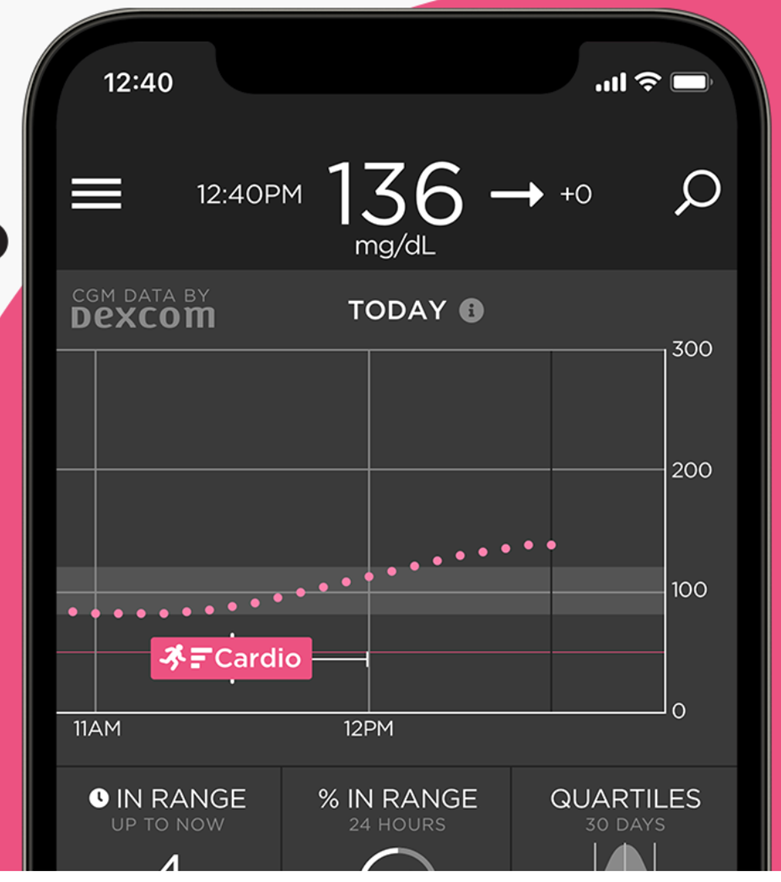
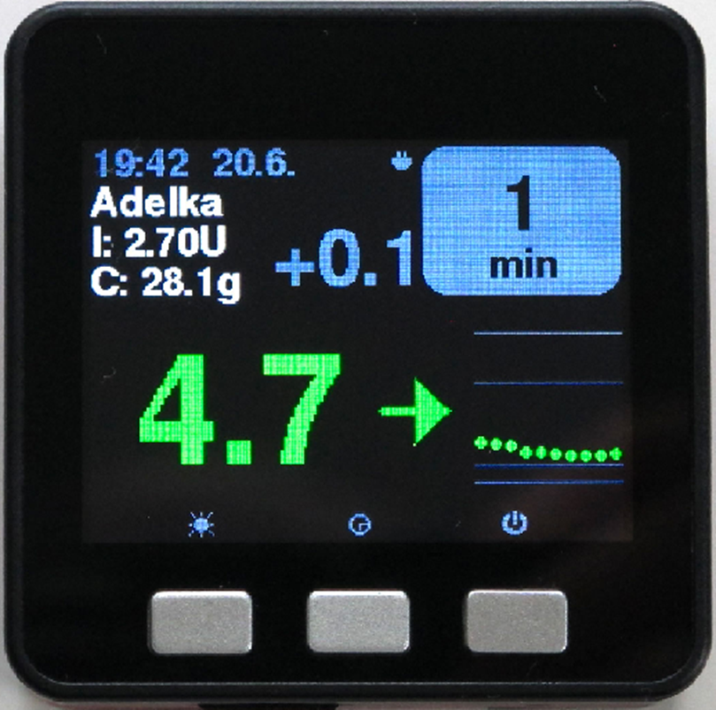

# Seguir AAPS (sin interacción con el sistema AAPS)

Además de las muchas posibilidades para controlar _y_ seguir **AAPS** a distancia, descritas en [Control remoto de AAPS](../RemoteFeatures/RemoteControl.md), la comunidad ha creado varias apps y dispositivos más para solo seguir los números (niveles de glucosa y otra información), sin interactuar con **AAPS**.

En la página web [Nightscout follower](https://nightscout.github.io/nightscout/downloaders/#) hay un buen resumen de las muchas opciones para seguir **AAPS**.

```{contents} Table of contents
:depth: 1
:local: true
```

Las estrategias más usadas junto con **AAPS** se explican con más detalle a continuación.

## Apps para teléfono

```{contents} These are some of the main “follower” apps used by **AAPS** users. All of these apps are “free”: 
:depth: 1
:local: true
```

### Dexcom Follow ([Android](https://play.google.com/store/apps/details?id=com.dexcom.follow.region2.mgdl) y [iOS](https://apps.apple.com/fr/app/dexcom-follow-mg-dl-dxcm2/id1032203080))


* Dexcom Follow es compatible con muchos teléfonos (tanto Android como iPhone). Puedes usar Dexcom Follow aunque no uses la app oficial de Dexcom para recibir los datos del sensor.

* Muchos cuidadores conocen Dexcom Follow y prefieren su interfaz clara a algo más complicado.

* Dexcom Follow es muy bueno para profesores, abuelos y personas que saben muy poco sobre la diabetes y los niveles de glucosa. Tiene alertas personalizables (nivel de glucosa, qué sonido reproducir, etc.). Las alarmas se pueden desactivar por completo si hace falta. Esto es muy útil si tienes un sensor que todavía se está estabilizando y crea muchas hipoglucemias falsas.

#### Configurar Dexcom Follow: guía paso a paso

Si usas la app no oficial de Dexcom BYODA para recibir los datos del sensor, quizá puedas enviar invitaciones a seguidores desde la app BYODA.

Ya no puedes enviar correos de invitación a seguidores de Dexcom desde apps de terceros. En xDrip, la solicitud de invitación solo mostrará el mensaje «invite not sent».

Debes instalar la app oficial de Dexcom, enviar la invitación y después desinstalar la app oficial.

Los pasos son los siguientes:

1)  Instala la app oficial «Dexcom» en _cualquier_ teléfono (Android/iPhone). Puede ser el teléfono del seguidor, si te resulta más cómodo. 2)  Inicia sesión con tu usuario y contraseña de Dexcom. Son los mismos datos de acceso que usarías para Dexcom Clarity, si ya eres cliente de Dexcom/Clarity. Si no tienes una cuenta de Dexcom, en este momento puedes crear una nueva.   
3)  Pasa las pantallas de introducción. 4)  Introduce «no code» como código del sensor. 5)  En Transmitter SN, selecciona «enter manually» e introduce un código de transmisor válido (usa el código de uno de tus transmisores caducados, si conoces alguno, para que no interfiera con tu transmisor actual. Los códigos siguen un formato concreto de números y letras: «NLNNNL», y solo se usan ciertas combinaciones, así que lo más fácil es usar uno que ya sabes que es válido). 6)  Cuando la app esté buscando el transmisor y el sensor, podrás invitar a seguidores: selecciona los tres puntos pequeños arriba a la izquierda de la app y añade un nuevo seguidor. También puedes usar esto si uno de tus seguidores ha cambiado de teléfono y necesita una nueva invitación: aquí puedes borrarlo de la lista de seguidores y volver a enviarle un correo de invitación para usarlo en su nuevo teléfono. 7)  En el teléfono del seguidor, instala Dexcom Follow desde la App Store (iPhone) o Google Play (Android). Configura la app Dexcom Follow. Te pedirá que abras tu correo para encontrar la invitación para ser seguidor.    
8)  Ahora puedes borrar la app oficial de Dexcom G6.

Para Dexcom Follow, los datos del sensor se exportan desde el teléfono con **AAPS**, directamente desde BYODA o desde xDrip, según la app que uses.


### [Nightguard](https://apps.apple.com/fr/app/nightguard/id1116430352) (iOS)


Ventajas (según los usuarios):

* Disponible en la [App Store](https://apps.apple.com/us/app/nightguard/id1116430352), con una interfaz sencilla y fácil de usar.

* Desliza el botón o agita el teléfono para posponer las alarmas durante distintos intervalos, de 5 min a 24 horas

* Alarmas personalizables (alertas de glucosa alta y baja, lecturas perdidas cuando no hay datos durante 15–45 minutos).

* Subida o bajada rápida en 2–5 lecturas seguidas (tú eliges). También puedes elegir el delta entre dos lecturas individuales

* Posponer inteligente: no avisa si los niveles van en la dirección correcta

* Hay una pestaña Care que parece permitir fijar un nuevo objetivo temporal durante cierto tiempo, borrar el objetivo temporal o introducir carbohidratos.

Desventajas (según los usuarios)

* Solo disponible para iOS

* El objetivo temporal (TT) se muestra como 5 mmol sea cual sea el nivel de TT fijado

* Nunca muestra la tasa de la basal temporal aunque muestra TB

### [Nightwatch](https://play.google.com/store/apps/details?id=se.cornixit.nightwatch) (Android)


* Nightwatch se presenta como un cliente de Nightscout y vigila los niveles de glucosa en Nightscout del usuario en un teléfono o tableta Android.

* La app se puede descargar de [Google Play](https://play.google.com/store/apps/details?id=se.cornixit.nightwatch) y muestra los datos de glucosa en tiempo real.

* El usuario puede recibir avisos con alarmas de glucosa baja y alta, personalizadas y sonoras.

* Los datos de glucosa se pueden ver en mmol/l o en mg/dl.

* Necesita Android 5.0 o superior.

* Tiene una interfaz oscura, valores y botones grandes, pensada para usarla de noche.

### xDrip (Android)

Puedes usar xDrip como seguidor.

#### Con Nightscout

Configura xDrip como seguidor de Nightscout (Nightscout Follower). Recibirás la glucosa y los tratamientos, pero no la basal.


#### Sin Nightscout: xDrip como fuente de glucosa

Si la fuente de datos de **AAPS** es xDrip (o si xDrip también puede recibir la glucosa de otra app como BYODA, Juggluco...), puedes usarlo desde el teléfono máster para compartir datos con seguidores de xDrip, que muestran la glucosa, los tratamientos y las tasas basales.


#### Sin Nightscout: xDrip con la app complementaria de glucosa

Si la fuente de datos de **AAPS** no es xDrip, pero puedes mostrar los datos de glucosa desde la fuente de datos Companion App, puedes usarlo desde el teléfono máster para compartir datos con seguidores de xDrip, que muestran la glucosa, los tratamientos y las tasas basales.


### xDrip4iOS (iOS)


xDripSwift was created from porting the original xDrip app to iOS and evolved into "xDrip for iOS", written as **xDrip4iOS**.

```{admonition} Further detail about how to attempt to obtain the original **xDrip4iOS** app
:class: dropdown
El [grupo de Facebook de xDrip4iOS](https://www.facebook.com/groups/853994615056838/announcements) es el principal lugar de ayuda de la comunidad para xDrip4iOS y Shuggah. **xDrip4iOS** se puede conectar a muchos sistemas MCG y transmisores diferentes, y muestra valores de glucosa, gráficos y estadísticas, además de dar alarmas. También puede subir datos a Nightscout o funcionar como [app seguidora de Nightscout](https://xdrip4ios.readthedocs.io/en/latest/connect/follower/). 

«¿Cómo puedo tener **xDrip4iOS** en mi iPhone?»
Hay dos opciones:

1. Si tienes un Mac y una cuenta de Apple Developer (99 EUR/USD al año), puedes compilar tu propio xDrip4iOS [siguiendo las instrucciones](https://xdrip4ios.readthedocs.io/en/latest/install/build/).

Si quieres, después puedes ser «releaser» y [compartir un Testflight personal de xDrip4iOS](https://xdrip4ios.readthedocs.io/en/latest/install/personal_testflight/) con hasta 100 personas más para ayudarlas.

2. Únete al [grupo de Facebook de xDrip4iOS](https://www.facebook.com/groups/853994615056838/announcements) y lee las publicaciones fijadas para ver las formas actuales de conseguir la app. **No debes pedir una invitación a la app** (lee las normas del grupo).
```


«¿Qué es **Shuggah**?» Un grupo de desarrolladores ucranianos copió el código del proyecto xDrip4iOS (que se comparte públicamente en GitHub) y lo publicó en la App Store con una cuenta de empresa. La versión Shuggah no está gestionada de ninguna forma por los desarrolladores de xDrip4iOS.

El [grupo de Facebook de xDrip4iOS](https://www.facebook.com/groups/853994615056838/announcements) da ayuda para xDrip4iOS y las apps de Apple Watch correspondientes.

### [Sugarmate](https://apps.apple.com/fr/app/sugarmate/id1111093108) (iOS)




[Sugarmate](https://sugarmate.io/) se puede descargar en iPhones desde la App Store. Sugarmate es compatible con:
* Apple iPhone (necesita la versión de software 13.0 o posterior)
* Apple iPad (necesita la versión de software 13.0 o posterior)
* Google Android (guarda la app web en tu pantalla de inicio)

Usuarios de Sugarmate dicen que se puede usar con Apple CarPlay en EE. UU. para mostrar los valores de glucosa mientras conduces. Todavía no se sabe si esto es posible en países fuera de EE. UU. If you know more about this, please add details in here to the documentation by completing a [pull request](../SupportingAaps/HowToEditTheDocs.md), which is quick and easy to do.


### [Spike](https://spike-app.com/) (iOS)


Spike se puede usar como receptor principal o como app seguidora. Muestra la glucosa, alarmas, IOB y más.

La web y la app ya no se desarrollan. Puedes encontrar ayuda en [Facebook](https://www.facebook.com/groups/1973791946274873) y [Gitter](https://gitter.im/SpikeiOS/Lobby).

## Relojes inteligentes para el **seguimiento de AAPS** (todos los datos del perfil, o solo la glucosa) cuando **AAPS** funciona en un teléfono.

Mira [aquí](../Getting-Started/Watches.md).


## Dispositivos para seguir AAPS

```{contents} Devices include:
:depth: 1
:local: true
```

### M5Stack



M5Stack es una caja pequeña que se puede programar para muchas aplicaciones. El proyecto de Martin [M5Stack NightscoutMon](https://github.com/mlukasek/M5_NightscoutMon/wiki) muestra los valores de glucosa del sensor y sus tendencias, IOB y COB. Está en una caja de plástico, con pantalla a color, ranura para tarjeta micro SD, 3 botones, altavoz y batería interna. Es un monitor de glucosa muy bueno y es bastante fácil de configurar si tienes una cuenta de Nightscout. Normalmente los usuarios lo usan con la Wi-Fi de casa, pero algunos dicen que lo usan como pantalla cuando van en moto, conectándolo a un punto de acceso Wi-Fi del teléfono.

### SugarPixel

SugarPixel es un dispositivo secundario de pantalla y alertas de glucosa para la monitorización continua de glucosa. Se conecta con la app de Dexcom o la app de Nightscout en el teléfono del usuario. El dispositivo muestra los valores de glucosa en tiempo real. Este monitor de MCG tiene alertas sonoras con tonos aleatorios (que son muy fuertes), alertas por vibración para personas con problemas de audición, opciones de pantalla personalizables y seguimiento multiusuario integrado.


* SugarPixel tiene varias opciones de pantalla en mg/dl y mmol/l para adaptarse al usuario, con valores de glucosa en colores.
* La pantalla estándar muestra la glucosa, la flecha de tendencia y el delta. El delta es el cambio, + o -, desde la última lectura.
* SugarPixel se puede ajustar para usarlo con poco brillo con la pantalla BG and Time, para ver la glucosa y la hora actual en la mesita de noche del usuario.
* La pantalla de color de SugarPixel usa toda la pantalla para mostrar un solo color que representa el valor de glucosa. Así el usuario puede ver los valores de glucosa a distancia a través de la ventana mientras juega fuera, en el jardín, el patio o la piscina.
* La pantalla Big BG es útil en la mesita de noche para usuarios que llevan gafas o lentillas.

### Nightscout Clock en Ulanzi TC001

**Nightscout Clock** es un software de código abierto que funciona en el dispositivo **Ulanzi TC001**. Se conecta con los servidores de Dexcom o con Nightscout y muestra los valores de glucosa en tiempo real.


* El reloj admite las unidades mmol/l y mg/dl, e incluye alarmas sonoras.
* Hay varias pantallas disponibles. Mira [Github nightscout-clock](https://github.com/ktomy/nightscout-clock?tab=readme-ov-file#more-information-for-people-who-needs-it) para ver un resumen.
* Configurar el dispositivo solo necesita unos pocos pasos sencillos. Una vez configurado, solo necesita corriente y Wi-Fi para funcionar.
* El dispositivo Ulanzi TC001 es mucho más barato que el SugarPixel.
* El software y las instrucciones de instalación están en [Github nightscout-clock](https://github.com/ktomy/nightscout-clock?tab=readme-ov-file).
* Lo desarrolla y mantiene Artiom Kenibasov, que ofrece ayuda en el [grupo de Facebook AAPS Users](https://www.facebook.com/groups/cgminthecloud/posts/8776932509094594/).

### PC (TeamViewer)
Algunos usuarios usan una herramienta completa de acceso remoto como [TeamViewer](https://www.teamviewer.com/) para resolver problemas avanzados a distancia.
