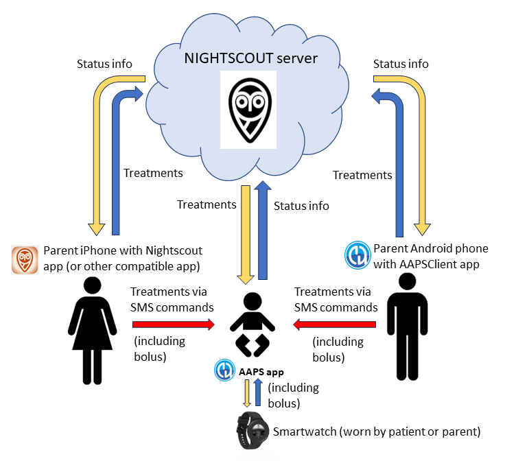
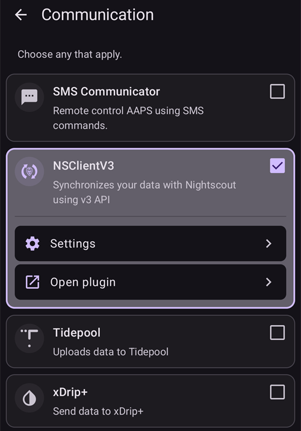
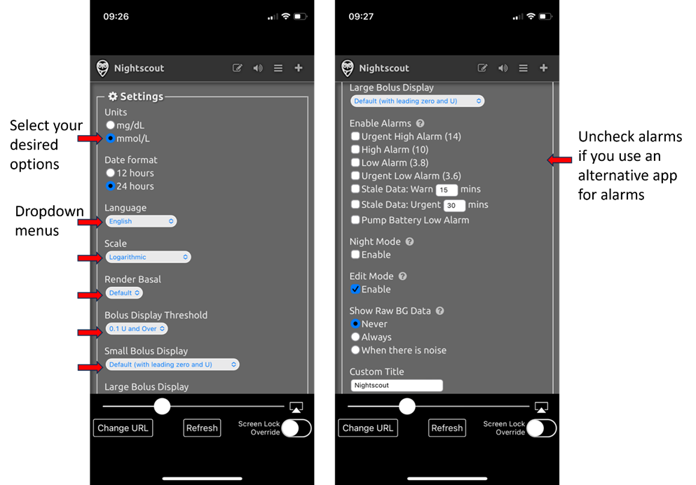

# Remote control of AAPS

```{contents} In this page
:backlinks: entry
:depth: 2
```

There are four highly effective tools for remotely managing **AAPS**:

1) [SMS commands](#RemoteControl_SMS-Commands) (follower phone can be either Android or iOS), 2) [AAPSClient](#RemoteControl_aapsclient) (follower phone is Android; an iPhone version is in development) 3) [Nightscout](#RemoteControl_nightscout) (Android, iOS or other computer/device), mainly for following: see the note on [client control](#client-master-control) in that section.  
4) [Smartwatches](#RemoteControl_smartwatches) (Android)

The first three are mostly appropriate for caregivers/parents, but smartwatches are very useful for caregivers/parents **and** for adults with diabetes themselves.



(RemoteControl_SMS-Commands)=

## 1) SMS Commands

See the dedicated [SMS Commands](../RemoteFeatures/SMSCommands.md) page.

(RemoteControl_aapsclient)=
## 2) AAPSClient

**AAPSClient** looks very similar in appearance to **AAPS** itself, offering the caregiver the same screens and buttons to send commands remotely to **AAPS**:


(remotecontrol-aapsclient-versions)=
### About AAPSClient, AAPSClient2 and AAPSClient3

There are 3 versions of the client app: **AAPSClient**, **AAPSClient2** and **AAPSClient3**. They work the same way. The only difference is that they can be installed side by side on the same follower phone.

A caregiver who follows one person needs only **AAPSClient**. To follow and remote control a second person (with their own **Nightscout** site and their own **AAPS** phone), install **AAPSClient2** as well, and **AAPSClient3** for a third person. Each app is set up and [paired](#aapsclient-pairing-with-the-master) on its own, with the **Nightscout** site and the **AAPS** phone of the person it follows.

To tell the apps apart, some elements have a different color: yellow for **AAPSClient**, blue for **AAPSClient2** and green for **AAPSClient3**. Those elements are the app icon, the widget background, and the **AAPS** status section on the home screen of the app. <br/> Note: the opacity of the widget background can be set in the widget configuration. At a low opacity the color is hard to see.


### Download and installation

**AAPSClient** can be installed on a single phone or multiple follower phones (i.e. parent 1’s follower phone and parent 2’s follower phone) in order for both caregivers to be granted access and remote control a patient's **AAPS** phone.

To download **AAPSClient**, navigate to the [Github repository](https://github.com/nightscout/AndroidAPS/releases/) and click on the asset **“app-AAPSClient-release_x.x.x.x”** (it may be a newer version to that shown in the screenshot below):


Then go to  _downloads_ on your computer. On Windows, -downloads_ will show the right hand ribbon:


Once downloaded, click _show in folder_ to locate the file.

The **AAPSClient** apk can now be either:

Transferred by a USB cable onto the follower phone; or Dragged into Google drive folder, and then added onto the follower phone by clicking on the "app-AAPSClient-release" file.

Should you be needing **AAPS** for yourself, and **AAPSClient** for monitoring someone else, you will need to build **AAPSClient** yourself instead of downloading it from the Github repository as described above. The reason is that you can't install both **AAPS** and **AAPSClient** on the same phone, signed by a different key. <br/> To build **AAPSClient** yourself, follow the same process as [regular AAPS build](../SettingUpAaps/BuildingAaps.md). On the **Generate signed App Bundle or APK** page, select **aapsclientRelease** instead of **fullRelease**.

The same rule applies when you install several client apps (**AAPSClient**, **AAPSClient2**, **AAPSClient3**) on one follower phone: they must all be signed with the **same key**. Otherwise Android refuses to install the second one (error `INSTALL_FAILED_DUPLICATE_PERMISSION`).

### Synchronization: AAPSClient and AAPS set up

Once the __AAPSClient__ apk is installed on the follower phone, make sure **NSClientV3** is set up the same way on both phones for Nightscout 15 (see the [update notes](../Maintenance/UpdateToNewVersion)). The example below shows the synchronization set-up with NSClientV3 and Nightscout 15; other data sources are available in __AAPS__ (e.g. xDrip).

In **Configuration** > **Communication**, the user synchronizes their data with Nightscout through __NSClientV3__ (using the v3 API), set up the same way for both __AAPS__ and the follower phone.



The user must ensure that __both__ the AAPS and AAPS Client phones are synched together by setting up NSClientV3 on each. On the follower phone this can be done by scanning a QR code shown by **AAPS** instead, see [Pairing AAPSClient with AAPS](#remotecontrol-pairing) below:

- Enter your **Nightscout URL** in the NSClientV3 **Settings**

- Enter your **Nightscout access token** in the same settings. Please follow the notes [here](https://nightscout.github.io/nightscout/security/#create-a-token). On the **AAPS** phone use an **admin token**: with it **AAPS** makes a token of its own for each follower phone.

- Enable **Use websockets** on **both** phones. On the **AAPS** phone websockets are **required** for remote control: without them, **AAPS** cannot receive commands from **AAPSClient**. On both phones they also make synchronization faster, at the cost of slightly higher battery use.


The user should ensure that both __AAPSClient__ and __AAPS__ are showing  ‘connected’ in the **NSClientV3** screen of each phone. At this point **AAPSClient** follows **AAPS** (BG, treatments, profile), but it cannot control it yet: pair the two phones as described below.

(remotecontrol-pairing)=
### Pairing AAPSClient with AAPS (remote control)

From **AAPS** version 4, **AAPSClient** controls **AAPS** through a secure, **paired** connection. Synchronization alone is not enough: until the phones are paired, **AAPSClient** only shows **Manage** with a view-only **Profile** and **Pair with master**.

1. On the **AAPS** phone, open **Manage → Authorized clients** and turn on **Allow client control** (it is off by default, and always on in Simple Mode).
2. Tap **+**, enter a name for the follower phone, choose how it is set up and choose its **role**:
   - **QR code: Nightscout and pairing** — **AAPS** shows a QR code that sets up Nightscout on the follower phone and pairs it, in one scan. This needs an admin token in the **AAPS** phone's NSClientV3 settings.
   - **PIN** — for a follower phone without a camera, already connected to Nightscout: note the one-time **PIN** (valid for about two minutes).
3. On the **AAPSClient** phone, scan the code (in the Setup Wizard, or **Manage → Pair with master → Scan QR code**), or open **Manage → Pair with master** and enter the PIN. Confirm.

The follower phone then appears as **Active** in the **Authorized clients** list, and **AAPSClient** shows **Treatments**, **Scenes** and **Manage**. The follower phone gets a Nightscout token of its own, with only the rights it needs. The full procedure, with screenshots and troubleshooting, is on [Master ↔ Client control](#client_master_master_setup).

Check that the set-up works: enter carbs on **AAPSClient**, confirm the amount shown, and check that the entry appears in **Treatments** on both phones.

(remotecontrol-nightscout-access-token)=

### Troubleshooting 'Nightscout access token' configuration issues

The precise 'Nightscout access token' configuration may differ depending upon whether your Nightscout provider is a paid for hosted site or not.

If you are struggling with **AAPS** to accept the 'Nightscout access token' and using a paid for hosted Nightscout site, you may wish to first liaise with your Nightscout provider on how to resolve the 'Nightscout access token' difficulties. Otherwise, please reach out to the **AAPS** group but please double check that you have correctly followed the notes before doing so [here](https://nightscout.github.io/nightscout/security/#create-a-token).

### What AAPSClient offers

Once paired, **AAPSClient** offers the caregiver almost the same screens as **AAPS** itself:

- **Treatments**: insulin bolus, carbs and the bolus wizard.
- **Scenes**: start and stop [scenes](../DailyLifeWithAaps/Scenes.md).
- **Manage**: profiles, insulin settings, temporary targets, QuickWizard, automation, food, site rotation, pairing and the running temp basal.
- **Main menu**: treatments history, history browser, statistics, maintenance, configuration.

There is no pump and no objectives on **AAPSClient**. See [The AAPSClient app](AapsClient.md) for a detailed description.

**AAPSClient** lets the caregiver make most of the adjustments allowed directly in **AAPS**, **including insulin boluses**, remotely over the mobile or internet network. Every command is signed and sent through Nightscout to the **AAPS** phone, which checks it against its own data, caps it, shows you its own confirmation, and only then executes it. **AAPSClient** _can_ be much faster than [SMS Commands](../RemoteFeatures/SMSCommands.md), especially for commands that would need authentication.

Treatments entered in Nightscout by other means (for example the Nightscout website) are not applied while client control is on: **AAPS** is then in [hardened mode](#client-master-control-hardened-mode) and takes changes only from paired clients. With client control off, they are applied only if the matching **Receive** options are enabled in the [Synchronization section of NSClient preferences](#Preferences-nsclient-synchronization).

Remote control through **AAPSClient** is only recommended if your synchronization is working well (_i.e._ you don’t see unwanted data changes like self-modification of TT, TBR etc).

### AAPSClient with smartwatch options

A smartwatch can be a very useful tool for helping to manage **AAPS** with kids. A couple of different configurations are possible. If **AAPSClient** is installed on the caregiver's phone, the [**AAPSClient WearOS** app](https://github.com/nightscout/AndroidAPS/releases/) can be downloaded and installed on a compatible smartwatch which is connected to the parent's phone. This will show current BG and loop status. Once **AAPSClient** is paired with **AAPS**, the watch actions (including boluses, carbs, temp targets and profile changes) are relayed through **AAPSClient** to **AAPS**, which confirms and executes them: see [Wear OS on a client](#clientmastercontrol-wear-os-on-a-client). You can read more about Smartwatches [here](#remotecontrol-smartwatches).

(RemoteControl_nightscout)=
## 3) Nightscout

As well as Nightscout being a server in “the Cloud”, there is also a dedicated **Nightscout** app which can be downloaded directly from the App Store on your iPhone. If you have an Android follower phone, there is not a dedicated Nightscout app and it is better to use [**AAPSClient**](#2-aapsclient), or, if you only want to follow, and not send treatments you can download and install the [Nightwatch](https://play.google.com/store/apps/details?id=se.cornixit.nightwatch) app from the Playstore.

Once you have installed the **Nightscout** app on your iPhone, open the app and follow the set-up prompts, entering your Nightscout address (see below, left). The form of this may vary depending on how your Nightscout is hosted. (_e.g._ http://youraddresshere.herokuapp.com). Then enter your Nightscout API secret (see below, right). If not prompted for your API password, then you need to enter this by clicking on the padlock at the top of the app:


More info on setup is available directly from [Nightscout](https://nightscout.github.io/nightscout/discover/)

When you first log in, you will have a very simple display. Customize the display options, by selecting the “hamburger” in the top right and scrolling down:


Scroll down through to “Settings”. You may wish to change the “scale” to “linear” as the default for the BG display is logarithmic, and under “render basal” select “default” so that the pump basal shows up.


Select your desired options. Uncheck alarms if you use an alternative app for alarms.



Continue to scroll down until you get to “show plugins”.

You need to make sure “careportal” is checked, and can also select various other metrics (most useful are: IOB, care portal, pump, cannula age, insulin age, basal profile and OpenAPS).

Importantly, you now need to click “save” at the bottom for these changes to take effect.


After pressing “save” the app will return to your main Nightscout screen which will look a little like this:

1. Current glucose value
2. Information on AAPS system status - touch the individual tabs on the screen to display more detail. Add or remove these display options using hamburger menu.
3. Recent glucose trace with treatments (carbs, boluses) displayed
4. Longer-term glucose trace
5. "Hamburger" menu for setting display options, generating reports, editing profiles and Nightscout admin tools
6. "**+**" menu for entering treatments (see [below](#RemoteControl_nightscout-treatments) for when **AAPS** applies them).
7. Select different time period to display
8. Basal insulin profile
9. Green line = historical glucose Blue lines = predicted glucose


Looking in more detail at the top left menu of the Nightscout app:

1. Careportal retrospective edit
2. Turn on/off alarms
3. Hamburger - for setting preferences
4. Careportal - Log treatment (see [below](#RemoteControl_nightscout-treatments) for when **AAPS** applies these)


There is a huge amount of information on the status of the **AAPS** system in the grey tabs (and even more information is revealed if you tap the tab) on this screen:

1. 5min glucose trend
2. Bolus wizard preview
3. Press on Basal to see your current profile and basal information
4. Time since latest CGM reading in AAPS
5. **Pump**: insulin, battery % and when AAPS last connected to it
6. Last time AAPS refreshed - if this is longer than 5 mins it can indicate a connection issue between AAPS phone and pump/CGM
7. Press on IOB to see split of basal and bolus insulin
8. Insulin age in reservoir
9. Edad de la cánula
10. Battery status of AAPS phone
11. Size of your database. If it gets too full (DIY Nightscout only - hosted services just ignore) you may start having connectivity issues. You can delete data to reduce the size of the number in the Admin tools menu (via hamburger).


Press "refresh" at the bottom of the page to close the popup.

(RemoteControl_nightscout-treatments)=
### Sending treatments through the Nightscout app to AAPS

In **AAPS** 4 the supported way to control **AAPS** remotely is a **paired AAPSClient**, see [Master ↔ Client control](#client-master-control): each client has a [role](#client-master-control-roles) that limits what it may do, and every command is signed, checked and confirmed by the **AAPS** phone. While client control is on, the **AAPS** phone is in [hardened mode](#client-master-control-hardened-mode): treatments, temporary targets and profile switches entered on the Nightscout website or in the Nightscout app are **not** applied. The Nightscout app is then a tool for following only.

```{admonition} Only when client control is off
:class: warning
If **Allow client control** is off in **Manage → Authorized clients** (and Simple Mode is off), **AAPS** applies careportal entries from Nightscout only for the data types you turned on under **Receive** in the [Synchronization section of the NSClientV3 settings](#Preferences-nsclient-synchronization): carbs, temporary targets, profile switches and the other careportal entries. Insulin is never delivered this way: a "Correction bolus" entered in Nightscout is only *announced*, and **AAPS** counts it as insulin on board without delivering it. This set-up is not recommended for remote control; use a paired **AAPSClient** instead.
```

Read more about **Nightscout** options [here](https://nightscout.github.io/)

### Tips for getting the most out of the Nightscout app

1). If you get “stuck” on a page and want to be able to see the main screen again, just click “refresh” (bottom middle) and this will take you back to the **Nightscout** homepage with the BG graph.

To see the current profile which is running on the phone, press the various icons on the screen above the graph. More info (current carb ratio, sensitivity and timezone etc.) can be seen by pressing “basal” and “OpenAPS” gives info about the profile and current target etc. Both the phone battery% and the pump battery % can also be monitored. BWP gives information on what the algorithm thinks will happen in the future, given the IOB and COB.

#### Other icons in the menu: what does the pencil (edit) mean?

You can (technically) use the edit pencil to move or delete bolus or correction treatments from the last 48h.

More about this [here](https://nightscout.github.io/nightscout/discover/#edit-mode-edit)

Although this could potentially be useful for deleting announced (but not bolused for) carbs, in practice it doesn’t currently work well with **AAPS** and we recommend making changes like this via the **AAPS** app directly.

(RemoteControl_smartwatches)= (remotecontrol-smartwatches)=

## 4) Smartwatches

### Option 1) Controlling AAPS from a Wear OS Watch


Once you have [setup **AAPS** on your watch](../WearOS/BuildingAapsWearOS.md), extensive details about the smartwatch faces and their functions can be found in [Operation of Wear AAPS on a Smartwatch](../WearOS/WearOsSmartwatch.md).

As a brief overview, the following functions can be triggered from the smartwatch:

* set a temporary target

* use the bolus calculator (calculation variables can be defined in settings on the phone)

* administer eCarbs

* administer a bolus (insulin + carbs)

* watch settings

* status

* check pump status

* check loop status

* check and change profile, CPP (Circadian Percentage Profile = time shift + percentage)

* show TDD (Total daily dose = bolus + basal per day)

* Remote bolus where the caregiver and T1D child are in different locations (this is possible for the **AAPS** watch and **AAPS** phone providing both devices are connected to the network)

#### Communication from caregivers to the watch using other apps (like WhatsApp)

It is possible to add additional apps to the watch, like WhatsApp, for messaging (for example) between caregivers and kids. It is important only to have ONE Google account associated with the phone, or the watch will not bring this data across. You need to be 13 or older to have a Samsung account, and this needs to be set up in the same email address which is used on the Android phone.

A video explaining getting WhatsApp setup for messaging on the Galaxy 4 watch (you can’t get full functionality of WhatsApp) is shown [here](https://gorilla-fitnesswatches.com/how-to-get-whatsapp-on-galaxy-watch-4/)

Making adjustments in both the **Galaxy wearable** app on the **AAPS** phone and the watch makes it possible for WhatsApp messages to announce with a slight vibration, and also for the WhatsApp message to display over the existing watchface.

### Option 2) **AAPS** on watch, for remote control of **AAPS** on a phone

Similarly to using a follower phone with **AAPSClient** or SMS commands (see the sections above), a smartwatch can be used to remotely control **AAPS** and provide full profile data. A key difference to using a follower phone is that the smartwatch to **AAPS** phone link is via Bluetooth and needs neither Nightscout nor an authentication code. As a side-note, if both smartwatch and **AAPS** phone linked by Bluetooth are also on a Wi-Fi/Cellular data network, the watch will also interact with the **AAPS** phone, giving a longer range of communication. This includes remote delivery of a bolus where the caregiver with the **AAPS** watch and T1D child (with **AAPS** phone) are in different locations, which can be useful in circumstances where the T1D child is in school.

A remote control smartwatch is therefore often useful in any situation where:

a)  **AAPSClient** or **SMS** commands cannot work; or

b)  The user wishes to avoid typing an authentication code (as required for SMS commands).

A smartwatch needs **Wear OS 3 or newer** to be able to control **AAPS**. Please check the technical specifications of the watch, and see the [Smartwatches page](../Getting-Started/Watches.md). Search, or ask in the **AAPS**  Facebook/Discord groups if unsure.

Specific How-to guides for setting up **AAPS** on the popular [Samsung Galaxy Watch 4 (40mm) is given below. The [Garmin](https://apps.garmin.com/en-US/apps/a2eebcac-d18a-4227-a143-cd333cf89b55?fbclid=IwAR0k3w3oes-OHgFdPO-cGCuTSIpqFJejHG-klBTm_rmyEJo6gdArw8Nl4Zc#0) watch is also a popular choice. If you have experience of setting up a different smartwatch which you think would be useful to others, please add it into these pages [edit the documentation](../SupportingAaps/HowToEditTheDocs.md) to share your findings with the wider **AAPS** community.

### Option 3) AAPSClient on a watch for remote control of **AAPS** on a phone


The software for the watch, **AAPSClient** Wear apk, can be downloaded directly from [Github](https://github.com/nightscout/AndroidAPS/releases/).

To download the software, click on the watch app that matches the client app on the phone: **wear-aapsclient-release_**_version_ goes with **AAPSClient**, **wear-aapsclient2-release_**_version_ goes with **AAPSClient2** (see [About AAPSClient, AAPSClient2 and AAPSClient3](#remotecontrol-aapsclient-versions)):


Then "save as" and save the file to a convenient location on your computer:


The **AAPSClient** wear apk can be transferred to your phone and side-loaded onto the watch in the same way as the **AAPS** Wear app, as detailed in [Transferring the Wear app onto your AAPS phone](#remote-control-transferring-the-aaps-wear-app-onto-your-aaps-phone)  


