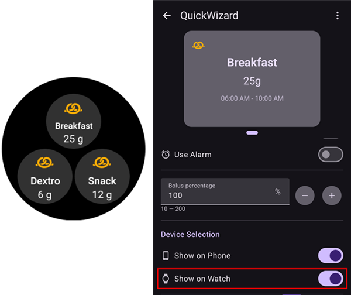
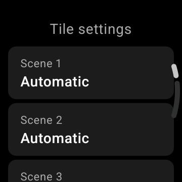

# Manejo de AAPS con tu reloj inteligente Wear OS

(Watchfaces-aaps-watchfaces)=

## Esferas de AAPS

```{warning}
Las esferas clásicas de **AAPS** solo funcionan en Wear OS 5 y anteriores, y Wear OS 5 ya las limita. En **Wear OS 6 y posteriores**, la app del reloj instala en su lugar una esfera en el formato Watch Face Format de Google: tu esfera personalizada como imagen, o la **Esfera de complicaciones**. Consulta [Cambios de las esferas en Wear OS](#wearos-watchface-changes) para ver qué deja de funcionar en cada versión de Wear OS, y [la esfera que instala AAPS](#wearos-aaps-v4-watchface) para Wear OS 6.
```

En Wear OS 5 y anteriores, la app **AAPS** del reloj incluye varias esferas clásicas. Muestran el valor de glucosa con el delta, la IOB, la tasa basal activa y un gráfico de las lecturas. En ellas funcionan dos toques:

* Toca dos veces el valor de glucosa para abrir el menú principal de **AAPS**
* Toca dos veces el gráfico para cambiar su rango de tiempo

En todas las versiones de Wear OS, las [complicaciones](#Watchfaces-complications) y los [mosaicos](#WearOsSmartwatch-wear-os-tiles) descritos en esta página funcionan con cualquier esfera que tenga espacio para ellos.

## Configuración

Activa **Reloj** en [**Configuración** > **Comunicación**](#Config-Builder-wear).

Para poner bolos o hacer otras acciones desde el reloj, activa **Control desde el reloj**. Las opciones del asistente de bolo para el reloj se ajustan en el mismo lugar: consulta [Ajustes > Reloj](#preferences-wear). Mientras **Control desde el reloj** está desactivado, el teléfono rechaza todos los tratamientos y cambios de modo enviados desde el reloj, y el reloj muestra *«El control del reloj está desactivado en la configuración de Wear del teléfono»*.

Con **Abrir complemento** en la tarjeta **Reloj** abres la pantalla Reloj:


La línea superior muestra el nombre del reloj conectado, o **(Ningún reloj conectado)**. Desde esta pantalla puedes

* Reenviar todos los datos. Puede ser útil si el reloj no estuvo conectado durante un tiempo y quieres enviar la información al reloj.
* Abre los ajustes del reloj directamente desde el teléfono.
* Elegir qué esfera instala **AAPS** en el reloj (**Esfera instalada en el reloj**: tu esfera personalizada o la esfera de complicaciones). Esta tarjeta solo se muestra mientras está conectado un reloj con **Wear OS 6** o posterior. Consulta [la esfera que instala AAPS](#wearos-aaps-v4-watchface).
* Administrar la **Esfera de reloj personalizada** (la tarjeta se muestra mientras hay un reloj conectado): **Cargar esfera** envía una esfera personalizada al reloj, **Información de esferas** muestra los detalles de la esfera cargada y los campos que contiene, **Más esferas** abre el [sitio de intercambio](../ExchangeSiteCustomWatchfaces/index.md) en el navegador y **Exportar plantilla** guarda una plantilla que puedes editar. Debajo de los botones se muestra una vista previa de la esfera cargada. Consulta [Cambiar a una esfera de AAPS](#WearOS_changing-to-AAPS-watchface).

Asegúrate de que las notificaciones de AAPS no están bloqueadas en el reloj. La confirmación de una acción (p. ej., bolo, objetivo temporal) llega mediante una notificación que debes deslizar y marcar.

## Acceso al menú principal de AAPS


Para abrir el menú principal de **AAPS**, usa una de estas opciones:

* abre **AAPS** desde la lista de apps del reloj
* toca una complicación de **AAPS** que abra el menú, consulta [Ajustes de las complicaciones](#WearOsSmartwatch-complication-settings)
* toca el mosaico **Gráfico de glucemia** con su **Acción al tocar** en **Menú principal**, consulta [Ajustes de los mosaicos](#WearOsSmartwatch-wear-os-tiles)
* en una esfera clásica de **AAPS**, toca dos veces el valor de glucosa

(WearOsSmartwatch-loop-status)=

## Pantalla Estado del lazo

La pantalla **Estado del lazo** resume lo que está haciendo el lazo, sin sacar el teléfono. Ábrela desde el menú principal de AAPS (**Estado del lazo**, o **Estado → Lazo**), o tocando la complicación **Glucosa en sangre**. El menú **Estado** también tiene una página **Bomba** y una página **TDD** con las dosis diarias totales.


La pantalla es una lista de tarjetas. Desplázate hacia abajo para verlas todas:

* **Modo de funcionamiento** — el modo actual (lazo cerrado, lazo abierto, LGS, suspendido, desconectado…) y, si es un modo temporal, cuánto tiempo le queda.
* **Resultado del lazo** — cuándo se ejecutó el lazo por última vez, y la basal temporal o el SMB que pidió.
* **Escena** — solo mientras hay una [escena](#scenes-from-watch) activa: su nombre, el tiempo que queda (o **Hasta que finalice** para una escena sin hora de fin) y la escena de **Seguimiento** que empieza cuando termina.
* **Objetivos** — tu objetivo, y el objetivo temporal si hay uno activo.
* **Perfil** — el nombre del perfil activo, con su **Porcentaje** y su **Desfase horario** cuando no tienen los valores por defecto. Un cambio de perfil temporal aparece resaltado y muestra cuánto tiempo le queda y el perfil al que vuelve cuando termina (**Volver a**).
* **Sensibilidad** — las mismas líneas que el chip de sensibilidad de la pantalla principal del teléfono: el valor de autosens y el ISF del perfil, el variable y el efectivo.

Un pequeño icono de escena junto a un modo de funcionamiento, un objetivo temporal o un cambio de perfil significa que lo ha **establecido la escena activa**. El mismo icono se muestra en el selector de **Modo de funcionamiento**.


(WearOsSmartwatch-bolus-calculator)=

## La calculadora de bolo en el reloj

Abre la **Calculadora** desde el menú principal de **AAPS**, desde el [mosaico Acciones](#WearOsSmartwatch-wear-os-tiles) o desde una complicación configurada para abrir el asistente. Tiene varias páginas; desliza de derecha a izquierda para avanzar:

| Carbohidratos                                                             | Petición                                                               | Resultado                                                              | Cálculo                                                                            | Confirmar                                                               |
| ------------------------------------------------------------------------- | ---------------------------------------------------------------------- | ---------------------------------------------------------------------- | ---------------------------------------------------------------------------------- | ----------------------------------------------------------------------- |
|  |  |  |  |  |

1. **Carbohidratos**: introduce los carbohidratos con los botones **+10**, **+5**, **−** y **+**.
2. **Petición**: la última página antes de que el teléfono tome el control. Muestra lo que has introducido: los carbohidratos y, si los usas, el tipo de comida, el tiempo de los carbohidratos y el porcentaje; consulta [Páginas opcionales](#WearOsSmartwatch-calculator-optional-pages). Toca la marca de verificación para enviarlo al teléfono, que hace el cálculo.
3. **Resultado**: el bolo que propone **AAPS**, con los carbohidratos debajo: los carbohidratos ahora y los eCarbs después, el tiempo de los carbohidratos y la campana del recordatorio para comer. Ajusta la dosis con **−** y **+**, ver más abajo. Desplázate hacia abajo hasta la tarjeta **Cálculo**: tócala para ver cada línea del cálculo, igual que en el teléfono.
4. **Confirmar**: desliza a la segunda página y toca la marca de verificación. El teléfono administra el bolo y registra los carbohidratos.

(WearOsSmartwatch-calculator-optional-pages)=

### Páginas opcionales

Tres ajustes del reloj añaden cada uno una página después de **Carbohidratos**. Están desactivados por defecto. Abre el menú principal de **AAPS**, luego **Configuración** > **Interfaz**, y activa los que quieras; si hay más de uno activado, las páginas aparecen en este orden: **Tipo de comida**, **Hora HC**, **Porcentaje**. Los puntos de la parte inferior de la calculadora muestran cuántas páginas tiene.

| Ajustes                                                                                       | Tipo de comida                                                                 | Hora HC                                                                 | Porcentaje                                                                  |
| --------------------------------------------------------------------------------------------- | ------------------------------------------------------------------------------ | ----------------------------------------------------------------------- | --------------------------------------------------------------------------- |
|  |  |  |  |

* **Tipo de comida de la calculadora**: **Pan**, **Pastel** o **Pizza**, que divide los carbohidratos de una comida lenta en carbohidratos ahora y eCarbs después; consulta [Elegir el tipo de comida](#WearOsSmartwatch-wizard-meal-type).
* **Tiempo de carbohidratos de la calculadora**: los minutos que faltan hasta que comes, con una campana **Establecer alarma** para el recordatorio para comer; consulta [Tiempo de los carbohidratos y recordatorio para comer](#WearOsSmartwatch-wizard-carb-time).
* **Porcentaje en calculadora**: un porcentaje del bolo calculado, por ejemplo 70 % cuando quieres una dosis menor. Empieza en el **Porcentaje de bolo** de los [ajustes del asistente de bolo](#Preferences-deliver-this-part-of-bolus-wizard-result) del teléfono, 100 % si no lo has cambiado. Consulta también la nota de [Ajustar el bolo en la página de resultado](#WearOsSmartwatch-wizard-result).

(WearOsSmartwatch-wizard-result)=

### Ajustar el bolo en la página de resultado

La página de resultado muestra el bolo que propone **AAPS**, junto con un botón **−** y un botón **+**. Úsalos para ajustar la dosis antes de confirmarla, sin volver al teléfono.

| Propuesto                                                                        | Más                                                                               | Menos                                                                               |
| -------------------------------------------------------------------------------- | --------------------------------------------------------------------------------- | ----------------------------------------------------------------------------------- |
|  |  |  |

* Cada pulsación cambia el bolo en **un paso de tu bomba**, así que las cantidades ofrecidas siempre coinciden con lo que tu bomba puede administrar de verdad.
* **Mantén pulsado** un botón para seguir cambiando el valor. Cuanto más tiempo lo mantienes, más rápido cambia.
* No puedes bajar de **0 U** ni subir por encima de tu ajuste de **bolo máximo**.

El total actual se muestra en la página de resultado, así siempre ves la cantidad que vas a confirmar. El cambio se muestra después de los carbohidratos, por ejemplo *(+0,20 U)*, y el botón que usaste se pone verde si es más o rojo si es menos.

Si **AAPS** tuvo que limitar la dosis, por ejemplo porque el bolo calculado supera tu ajuste de **bolo máximo**, una línea de aviso en ámbar debajo del total lo indica (por ejemplo *«Restricción de bolo aplicada»*). Lo mismo ocurre si se limita la cantidad de carbohidratos.

```{admonition} Esto no es lo mismo que Porcentaje en calculadora :class: note El ajuste **Porcentaje en calculadora** te permite introducir un *porcentaje* del bolo calculado **antes** de que aparezca la página de resultado. Los botones **−** y **+** ajustan la *cantidad final* **en** la página de resultado. Puedes usar los dos.

    <br />(WearOsSmartwatch-wizard-meal-type)=
    
    ### Elegir el tipo de comida
    
    La calculadora del reloj puede dividir los carbohidratos de una comida lenta en carbohidratos ahora y eCarbs después, como el [tipo de carbohidratos](#AapsScreens-carbs-type) del asistente del teléfono. Activa **Tipo de comida de la calculadora** en **Configuración** > **Interfaz** del reloj. El ajuste está desactivado por defecto, y entonces la página **Tipo de comida** se omite.
    
    * Después de introducir los carbohidratos, una página **Tipo de comida** muestra tres iconos: **Pan**, **Pastel** y **Pizza**. Toca un icono: debajo de los iconos aparecen su nombre y los carbohidratos que da, por ejemplo *65 g* para pan o *52+22 g* para pizza (52 g ahora y 22 g de eCarbs después). **Pan** es la opción por defecto y deja todos los carbohidratos para ahora.
    * Las páginas de petición y de confirmación muestran los carbohidratos de la misma forma (*52+22 g*). La página de resultado también muestra cuándo empiezan los eCarbs y cuánto duran.
    * El bolo se calcula solo para los carbohidratos que comes ahora. La división usa los mismos números que el asistente del teléfono.
    
    (WearOsSmartwatch-wizard-carb-time)=
    
    ### Tiempo de los carbohidratos y recordatorio para comer
    
    Con **Tiempo de carbohidratos de la calculadora** activado en **Configuración** > **Interfaz** del reloj, una página **Hora HC** sigue a los carbohidratos: los minutos que faltan hasta que comes, como la [hora de los carbohidratos](#aaps-screens-bolus-wizard) del asistente del teléfono. **Ahora** es el valor por defecto. **−** y **+** lo mueven en pasos de 5 minutos, hasta una hora antes o después de ahora. Un tiempo en el pasado es para carbohidratos que ya has comido.
    
    Con un tiempo en el futuro, aparece una campana **Establecer alarma** debajo del valor. Está activada por defecto; tócala para desactivarla. Las páginas de petición y de resultado muestran el tiempo de los carbohidratos, por ejemplo *+30 min*, y la campana. El teléfono registra los carbohidratos a esa hora, mueve con ellos los eCarbs del tipo de comida e inicia su recordatorio **Hora de comer**.
    
    | Resultado | Gráfico de glucemia | En marcha | Hora de comer |
    | --- | --- | --- | --- |
    |  |  |  |  |
    
    El recordatorio también está en el reloj, así que suena aunque el teléfono esté lejos:
    
    * La pantalla **Gráfico de glucemia**, el mosaico **Gráfico de glucemia** y el gráfico de la **Esfera de complicaciones** dibujan una línea naranja discontinua donde sonará el recordatorio, con los minutos que faltan al lado.
    * Mientras está en marcha, una notificación silenciosa **Hora de comer** con **Detener** y **+5 min** queda en la lista de notificaciones. Vuelve si la deslizas para quitarla, hasta que termina el recordatorio.
    * Cuando llega la hora, el reloj vibra, y otra vez cada medio minuto durante cinco minutos hasta que respondas. La notificación ofrece **Silencio** y **+5 min**, y deslizarla para quitarla también la silencia.
    
    **Detener**, **Silencio** y **+5 min** hacen lo mismo en el reloj, en el teléfono y en **AAPSClient**, y todos muestran el mismo recordatorio.
    
    (Watchfaces-complications)=
    
    ## Complicaciones
    
    _Complicación_ es un término de la relojería tradicional, que describe un añadido a la esfera principal, como otra ventanita o subesfera (con la fecha, el día de la semana, la fase lunar, etc.). Wear OS 2.0 trae esta idea para que proveedores de datos personalizados, como el tiempo, las notificaciones, los contadores de actividad física y más, se puedan añadir a cualquier esfera que admita complicaciones.
    
    La app AAPS para Wear OS admite complicaciones desde la versión `2.6`, y permite configurar cualquier esfera de otro fabricante que admita complicaciones para mostrar datos de AAPS (glucosa con la tendencia, IOB, COB, etc.).
    
    Las complicaciones también sirven de **acceso directo** a funciones de AAPS. Al tocarlas puedes abrir menús y diálogos de AAPS (según el tipo de complicación y la configuración).
    
    
    
    ### Tipos de complicaciones
    
    La app AAPS para Wear OS solo proporciona datos en bruto, según formatos predefinidos. La esfera de otro fabricante decide dónde y cómo dibujar las complicaciones, incluidos su diseño, borde, color y fuente. De los muchos tipos de complicaciones de Wear OS, AAPS usa:
    
    * `SHORT TEXT` - Contiene dos líneas de texto, de 7 caracteres cada una, a veces llamadas valor y etiqueta. Normalmente se dibuja dentro de un círculo o de una pequeña píldora, una debajo de otra o una al lado de otra. Es una complicación con muy poco espacio. AAPS intenta quitar los caracteres innecesarios para que quepa: redondea los valores, quita los ceros al principio y al final de los valores, etc.
    * `LONG TEXT` - Contiene dos líneas de texto, de unos 20 caracteres cada una. Normalmente se dibuja dentro de un rectángulo o de una píldora larga, una debajo de otra. Se usa para más detalles y para el estado en texto.
    * `RANGED VALUE` - Se usa para valores de un rango predefinido, como un porcentaje. Contiene un icono y una etiqueta, y normalmente se dibuja como un indicador circular de progreso.
    * `LARGE IMAGE` - Imagen de fondo personalizada que se puede usar como fondo (si la esfera lo admite).
    * `SMALL IMAGE` / `MONOCHROMATIC IMAGE` - Un icono pequeño. En un espacio `SMALL IMAGE`, AAPS lo dibuja en su propio color; en un espacio `MONOCHROMATIC IMAGE`, la esfera lo colorea.
    
    ### Configurar las complicaciones
    
    Para añadir una complicación a la esfera, configúrala con una pulsación larga y tocando el icono del engranaje de abajo. Según cómo las configure cada esfera: toca los espacios vacíos o entra en el menú de configuración de complicaciones de la esfera. Las complicaciones de AAPS están agrupadas en la entrada de menú AAPS.
    
    Al configurar complicaciones en la esfera, Wear OS muestra y filtra la lista de complicaciones que caben en el espacio elegido de la esfera. Si no encuentras una complicación en la lista, probablemente es porque su tipo no se puede usar en ese espacio.
    
    ### Complicaciones de AAPS
    
    AAPS ofrece las complicaciones siguientes. «Abre» indica lo que hace un toque con **Acción al tocar la complicación** en **Por defecto**; consulta [Ajustes de las complicaciones](#WearOsSmartwatch-complication-settings).
    
    **Glucosa**
    
    * **Glucosa en sangre** (`SHORT TEXT`, abre _Estado del lazo_): el valor de glucosa con la flecha de tendencia en la primera línea, y la antigüedad de la lectura y el delta en la segunda.
    * **Glucemia (grande)** (`SHORT TEXT`, abre _Gráfico de glucemia_): solo el valor de glucosa en la primera línea, para que la esfera lo pueda dibujar grande. La antigüedad y la flecha de tendencia están en la segunda línea.
    * **Gráfico BG** (`SMALL IMAGE` / `LARGE IMAGE`, abre _Gráfico de glucemia_): el gráfico de glucosa como imagen, para esferas con un espacio de imagen. Este es el gráfico de la **Esfera de complicaciones**.
    * **Estado completo** (`LONG TEXT`, abre _Menú_): casi todos los datos en una línea: el valor de glucosa con la flecha de tendencia, el delta y la antigüedad de la lectura, y luego los carbohidratos activos, la insulina activa y la tasa basal.
    * **Estado completo (invertido)** (`LONG TEXT`, abre _Menú_): lo mismo, con las dos líneas cambiadas, para esferas que muestran solo una de las dos líneas de un espacio `LONG TEXT`.
    
    **Insulina y carbohidratos**
    
    * **Icono IOB** (`SHORT TEXT`, abre _Bolo_): la insulina activa con un icono de jeringa.
    * **IOB detallado** (`SHORT TEXT`, abre _Bolo_): la insulina activa total en la primera línea, y las partes de bolo y de basal en la segunda.
    * **Icono COB** (`SHORT TEXT`, abre _Asistente_): los carbohidratos activos con un icono de carbohidratos.
    * **COB detallado** (`SHORT TEXT`, abre _Asistente_): los carbohidratos activos ahora en la primera línea, y los carbohidratos que aún faltan (eCarbs) en la segunda.
    * **COB & IOB** (`SHORT TEXT`, abre _Asistente_): la insulina activa en la primera línea, y los carbohidratos activos en la segunda.
    
    **Basal y objetivo**
    
    * **Tasa basal** (`SHORT TEXT`, abre _Menú_): la tasa basal actual.
    * **BR & IOB** (`SHORT TEXT`, abre _Menú_): la insulina activa en la primera línea, y la tasa basal en la segunda.
    * **Tasa basal y objetivo de glucosa** (`SHORT TEXT`, abre _Objetivo temporal_): el objetivo en la primera línea, con el tiempo que queda si hay un objetivo temporal activo, y la tasa basal en la segunda.
    * **Objetivo** (`SHORT TEXT`, abre _Objetivo temporal_): el objetivo en la primera línea y, mientras hay un objetivo temporal activo, el tiempo que le queda en la segunda.
    * **BR, COB & IOB** (`SHORT TEXT`, abre _Menú_): la tasa basal en la primera línea, y los carbohidratos activos y la insulina activa en la segunda.
    
    **Lazo y teléfono**
    
    * **Modo de funcionamiento** (`SMALL IMAGE` / `ICON`, abre _Selector de modo de funcionamiento_): el modo actual del lazo como icono: lazo cerrado, lazo abierto, suspensión por glucosa baja, suspendido, desconectado o desactivado. Un toque abre un selector con los cambios de modo permitidos en ese momento, por ejemplo **Suspender lazo**, **Desconectar bomba**, **Reanudar lazo** o **Reconectar bomba**. El mismo selector está en el menú principal de **AAPS**, en **Modo de funcionamiento**.
    * **Batería de teléfono que sube los datos** (`RANGED VALUE` / `SHORT TEXT` / `ICON`, abre _Estado_): la batería del teléfono con **AAPS**, como indicador con un icono de batería, como número o solo como icono. Se actualiza junto con los demás datos de **AAPS**, normalmente cada 5 minutos con una nueva lectura.
    
    El selector de **Modo de funcionamiento**, abierto desde la complicación, el menú principal o el mosaico Modo de funcionamiento:
    
    
    
    (WearOsSmartwatch-complication-settings)=
    
    ### Ajustes de las complicaciones
    
    En el menú principal de **AAPS** en el reloj, abre **Configuración** > **Complicaciones**:
    
    
    
    * **Acción al tocar la complicación** (por defecto `Por defecto`): lo que abre un toque en una complicación de **AAPS**, para todas las complicaciones a la vez:
      * _Por defecto_: lo que abre la propia complicación, consulta la lista de arriba
      * _Menú_: el menú principal de **AAPS**
      * _Calculadora_: la calculadora de bolo
      * _Tratamiento_: el diálogo de tratamiento, insulina y carbohidratos
      * _eCarbs_: el diálogo de eCarbs
      * _Estado_: el menú de estado
      * _Modo de funcionamiento_: el selector de modo de funcionamiento. Necesita **Control desde el reloj** activado en los ajustes de Reloj del teléfono; si no, se abre el menú principal.
      * _Ninguno_: un toque no hace nada
    * **Rango de tiempo del gráfico de glucemia** (por defecto `3 horas`): cuántas horas muestra la complicación **Gráfico BG**: 1, 3 o 6. El mosaico Gráfico de glucemia tiene su propio ajuste.
    * **Símbolos Unicode en complicaciones** (por defecto `Activado`): las complicaciones usan símbolos Unicode como `Δ` para el delta, `⁞` como separador y `⎍` para la tasa basal. Cómo se ven depende de la fuente de la esfera. Ponlo en `Desactivado` si una esfera los dibuja como cuadros o espacios en blanco.
    
    (WearOsSmartwatch-wear-os-tiles)=
    
    ## Mosaicos de Wear OS
    
    Los mosaicos son las páginas a las que llegas deslizando desde la esfera. **AAPS** trae siete, cada uno con un conjunto de hasta cuatro botones. Un toque en un botón abre el diálogo correspondiente en el reloj, o te pide confirmación, y luego el teléfono hace el trabajo. Un mosaico es un acceso directo, no una pantalla de estado: no guarda el estado de la app del teléfono.
    
    Antes de usar los mosaicos, activa **Control desde el reloj** en [Ajustes > Reloj](#preferences-wear).
    
    ### Añadir un mosaico
    
    Hay dos formas, según tu reloj y tu teléfono:
    
    1. En el reloj: desliza desde la esfera más allá del último mosaico hasta **Add tile** (añadir mosaico) y elige un mosaico de **AAPS**. En la mayoría de los relojes, una pulsación larga en un mosaico también abre la vista para añadir y quitar.
    2. En el teléfono, en la app complementaria de tu reloj (**Galaxy Wearable** para Samsung, **Wear OS** para otras marcas): abre **Tiles** (mosaicos), toca **Add** (añadir) y elige los mosaicos de **AAPS** que quieras. Puedes cambiar el orden de los mosaicos arrastrándolos.
    
    
    
    ### Ajustes de los mosaicos
    
    Los mosaicos **Acciones**, **Objetivo temporal**, **Gráfico de glucemia** y **Escena** tienen ajustes en el reloj. Abre el menú principal de **AAPS**, luego **Configuración** > **Tarjetas**, y elige el mosaico. Una pulsación larga en el mosaico también abre sus ajustes, excepto en los relojes Pixel. Los otros tres mosaicos se rellenan desde el teléfono y no tienen nada que ajustar en el reloj.
    
    | Menú principal | Configuración | Tarjetas |
    | --- | --- | --- |
    |  |  |  |
    
    Los ajustes de un mosaico son una lista de sus cuatro espacios. Toca un espacio para elegir qué muestra, o **Ninguno** para dejarlo vacío.
    
    | Pulsación larga en el mosaico | Ajustes del mosaico Objetivo temporal |
    | --- | --- |
    |  |  |
    
    Cada mosaico tiene cuatro espacios. Un mosaico con más entradas muestra las cuatro primeras.
    
    ### Mosaico Acciones
    
    
    
    Accesos directos a los diálogos de la app **AAPS** del reloj. Elige hasta cuatro de estos en los ajustes del mosaico:
    
    * **Calc**: la calculadora de bolo, con entrada de carbohidratos, un porcentaje opcional [1] y un tipo de comida opcional [2]
    * **Trata**: insulina y carbohidratos a la vez
    * **Insulina**: un bolo, introducido en unidades
    * **Carbohidratos**: carbohidratos, también carbohidratos extendidos. Se acepta una cantidad **negativa**, hasta tus COB actuales, para corregir carbohidratos que introdujiste antes. Las retiradas de carbohidratos se muestran en el gráfico de glucosa del reloj.
    * **eCarbs**: carbohidratos extendidos
    * **ObjetivoT**: un objetivo temporal con valor y duración personalizados
    * **Cambio de perfil**: un cambio de perfil con porcentaje, desfase horario y duración
    
    
    
    Los diálogos que abren los botones. Desliza de derecha a izquierda para llegar a la página siguiente de un diálogo, y toca la marca de verificación en la última página para enviar la petición al teléfono:
    
    | Trata | Insulina | Carbohidratos | eCarbs | ObjetivoT | Cambio de perfil |
    | --- | --- | --- | --- | --- | --- |
    |  |  |  |  |  |  |
    
    [1] En **Configuración** > **Interfaz** del reloj, activa **Porcentaje en calculadora** para mostrar la entrada de porcentaje en la calculadora de bolo. El porcentaje por defecto viene del ajuste del teléfono [«Administrar esta parte del resultado del asistente de bolo %»](#Preferences-deliver-this-part-of-bolus-wizard-result). Los demás ajustes de la calculadora son los del teléfono en **Ajustes** > **Ajustes del asistente de bolo**.
    
    [2] En **Configuración** > **Interfaz** del reloj, activa **Tipo de comida de la calculadora** para mostrar la página **Tipo de comida**, donde eliges **Pan**, **Pastel** o **Pizza** para dividir los carbohidratos de una comida lenta en carbohidratos ahora y eCarbs después. Consulta [Elegir el tipo de comida](#WearOsSmartwatch-wizard-meal-type).
    
    ### Mosaico Objetivo temporal
    
    
    
    Objetivos temporales de los ajustes predefinidos del teléfono. Ajusta la duración y el objetivo de cada ajuste predefinido en el teléfono, en **Ajustes** > [Objetivos temporales por defecto](#Preferences-default-temp-targets). Elige hasta cuatro de estos en los ajustes del mosaico:
    
    * **Actividad**: para hacer deporte
    * **Comiendo**: comer pronto, un objetivo más bajo para que haya más insulina activa en la comida
    * **Hipo**: un objetivo más alto durante el tratamiento de una hipoglucemia
    * **Manual**: un objetivo y una duración personalizados
    * **Cancelar**: detiene el objetivo temporal activo. El botón solo se muestra mientras hay un objetivo temporal activo.
    
    ### Mosaico Asistente rápido
    
    
    
    Las entradas de [Asistente rápido](#quickwizards) del teléfono que tienen activado **Mostrar en el reloj**, dentro de sus horas válidas. Una entrada de carbohidratos muestra sus carbohidratos en g, y una entrada de insulina su dosis fija en U. Un toque ejecuta la entrada después de una confirmación en el reloj. No hay nada que ajustar en el reloj: edita las entradas en el teléfono y activa **Mostrar en el reloj** en **Selección de dispositivo** en cada entrada que quieras en el mosaico. Fuera de las horas válidas de todas tus entradas, el mosaico muestra **No hay configuración disponible**.
    
    
    
    ### Mosaico Escena
    
    
    
    Las [escenas](#scenes-from-watch) del teléfono. Cada uno de los cuatro espacios se ajusta a **Automático**, **Ninguno** o una escena en los ajustes del mosaico. Un espacio **Automático** toma la siguiente escena de la lista del teléfono que ningún otro espacio ha cogido. Un espacio ajustado a una escena que ya no existe en el teléfono muestra **No disponible**.
    
    
    
    ### Mosaico Modo de funcionamiento
    
    
    
    Los [modos de funcionamiento](#aaps-screens-running-mode) a los que puedes cambiar desde el actual, con los mismos iconos que en el teléfono: lazo cerrado, suspensión por glucosa baja, lazo abierto, desactivar lazo, suspender lazo y desconectar bomba, o reanudar y reconectar mientras uno de ellos está activo. **Suspender lazo** y **Desconectar bomba** piden primero una duración. El teléfono decide qué modos se ofrecen; el reloj muestra los cuatro primeros y omite **Desactivar lazo** cuando **Suspender lazo** está en la lista.
    
    ### Mosaico Acción del usuario
    
    
    
    Un botón por cada [automatización](#automations-automation-triggers) del teléfono cuyo disparador es **Acción del usuario**. Un toque te pide confirmación y luego el teléfono ejecuta las acciones de la automatización. Los botones llevan el nombre de las automatizaciones, así que dales nombres cortos. No hay nada que ajustar en el reloj.
    
    ### Mosaico Gráfico de glucemia
    
    
    
    El valor de glucosa con flecha, delta y antigüedad; debajo, IOB, COB, tasa basal y objetivo, y el gráfico de glucosa con predicciones, bolos, carbohidratos y SMB. Dos ajustes en el reloj: **Intervalo de tiempo** (1, 3 o 6 horas) y **Acción al tocar**, que abre la pantalla completa **Gráfico de glucemia**, el **Menú principal** o la pantalla **Estado del lazo**.
    
    
    
    
    
    ## Siempre encendido
    
    Esta sección y la siguiente se aplican a las esferas clásicas de **AAPS** en Wear OS 5 y anteriores. En Wear OS 6, la **Esfera de complicaciones** tiene su propia pantalla siempre encendida; consulta [la esfera que instala AAPS](#wearos-aaps-v4-watchface).
    
    Conseguir una batería de larga duración en los relojes inteligentes Android Wear OS es un reto. Algunos relojes inteligentes llegan a durar 30 horas antes de recargarlos. Para ahorrar la máxima energía, la pantalla debe apagarse cuando no se usa. La mayoría de los relojes admiten la pantalla «siempre encendida».
    
    Desde la versión 3 de AAPS, puedes usar «Simplificar interfaz» en el modo siempre encendido. Esta interfaz solo muestra la glucosa, la dirección y la hora. Esta interfaz está optimizada para ahorrar energía: se actualiza con menos frecuencia, muestra menos información y enciende menos píxeles para ahorrar energía en las pantallas OLED.
    
    El modo de interfaz simplificada está disponible para las esferas «AAPS (Digital)» y «AAPS (personalizado)». La interfaz simplificada es opcional y se configura en los ajustes de la esfera (mantén pulsada la esfera y toca «editar» o el icono del engranaje). Elige la opción «Simplificar interfaz» y ponla en «Modo siempre encendido» o «Siempre encendido y cargando».
    
    ### Modo nocturno
    
    Durante la carga, sería útil que la pantalla pudiera quedarse «siempre encendida» y mostrar tu glucosa durante la noche. Sin embargo, las esferas estándar son demasiado brillantes, tienen demasiada información y los detalles son difíciles de leer con ojos de sueño. Por eso añadimos una opción para que la esfera simplifique la interfaz solo durante la carga, si está activada en la configuración.
    
    El modo de interfaz simplificada está disponible para las esferas «AAPS (Digital)» y «AAPS (personalizado)». La interfaz simplificada es opcional y se configura en los ajustes de la esfera (mantén pulsada la esfera y toca «editar» o el icono del engranaje). Elige la opción «Simplificar interfaz» y ponla en «Durante la carga» o «Siempre encendido y cargando».
    
    Las opciones de desarrollador de Android permiten que el reloj se mantenga activo durante la carga. Para activar las opciones de desarrollador, consulta la [documentación oficial](https://developer.android.com/training/wearables/get-started/debugging). En las opciones de desarrollador, activa «Stay awake when charging» (mantener activo durante la carga).
    
    Nota: no todas las pantallas soportan bien el modo siempre encendido. Puede quemar la pantalla, sobre todo en las pantallas OLED más antiguas. Los relojes suelen atenuar la pantalla para evitar que se queme; consulta el manual del usuario, al fabricante o internet para obtener consejos.
    
    
    
    
    
    (WearOsSmartwatch-phone-alarms)=
    
    ## Alarmas del teléfono en el reloj
    
    
    
    El reloj muestra las alarmas del teléfono, así ves por qué suena el teléfono y puedes responder desde la muñeca. El reloj vibra, y otra vez cada medio minuto durante cinco minutos hasta que respondas. Una notificación muestra el título y el texto de la alarma, con las mismas respuestas que el recordatorio [Hora de comer](#WearOsSmartwatch-wizard-carb-time):
    
    * **Silencio**, o deslizarla: la alarma se detiene y la pantalla de alarma del teléfono se cierra.
    * **Silenciar 5 min**: la alarma se detiene y vuelve a sonar después de cinco minutos, en el teléfono y en el reloj.
    
    Al reloj llegan dos tipos de alarma:
    
    * La pantalla de alarma del teléfono (errores de la bomba, alarmas de automatización, alarmas de glucosa): **Silencio** y **Silenciar 5 min**.
    * Notificaciones urgentes con sonido, como *Bomba no alcanzable* o una alarma de Nightscout: solo **Silencio**. El teléfono solo tiene **Descartar** para ellas, y vuelven solas mientras dure su causa.
    
    El recordatorio *Hora de comer* no se envía así: el reloj lo hace sonar por sí mismo.
    
    ## Acceso directo para silenciar alertas
    
    El reloj [muestra la alarma](#WearOsSmartwatch-phone-alarms) por sí mismo; el acceso directo es una segunda forma de silenciarla, con una sola pulsación. Puedes crear un acceso directo para silenciar las alertas/alarmas de AAPS. Silenciar el sonido desde el reloj es cómodo y más rápido que coger el teléfono. Nota: aun así tienes que revisar el mensaje de alarma en el teléfono y actuar en consecuencia, pero puedes hacerlo más tarde. Si tu reloj tiene dos botones, puedes asignar uno al programa `Silenciar alertas de AAPS`.
    
    Para asignar el botón en el Samsung Watch 4, ve a `Settings > Advanced Features > Customize Buttons > Double press > Silenciar alertas de AAPS`
    
    En una esfera con complicaciones, una complicación **App shortcut** (acceso directo a app) configurada con **Silenciar alertas de AAPS** hace lo mismo con un toque. La [configuración alternativa de la Esfera de complicaciones](#wearos-complications-watchface-setup) usa su espacio de arriba a la derecha para ello.
    
    ### Silenciar xDrip
    
    Si usas xDrip y lo tienes instalado en el reloj, el acceso directo «Silenciar alertas de AAPS» también silenciará cualquier alarma de xDrip. 
    
    
    ## Consejos de rendimiento y duración de la batería
    
    Los relojes Wear OS son dispositivos con muy poca energía disponible. El tamaño de la caja del reloj limita la capacidad de la batería que lleva dentro. Incluso con los avances recientes en hardware y software, los relojes Wear OS todavía necesitan cargarse cada día.
    
    Si la batería dura menos de un día (de la mañana a la noche), aquí tienes algunos consejos para solucionar el problema.
    
    Las principales áreas que gastan batería son:
    
    * Pantalla activa con retroiluminación encendida (en LED) o en modo de máxima intensidad (en OLED)
    * Dibujo en pantalla
    * Comunicación por radio mediante Bluetooth
    
    Como no podemos ahorrar en la comunicación (necesitamos datos actualizados) y queremos mostrar los datos más recientes, la mayoría de las optimizaciones se pueden hacer en el _tiempo de pantalla_:
    
    * Las esferas de serie suelen estar mejor optimizadas que las personalizadas descargadas de la tienda.
    * Es mejor usar esferas que limitan la cantidad de datos mostrados en modo inactivo / atenuado.
    * Ten cuidado al combinar otras complicaciones, como widgets del tiempo de otros fabricantes u otras que usan datos de fuentes externas.
    * Empieza con esferas más sencillas. Añade las complicaciones de una en una y observa cómo afectan a la duración de la batería.
    * Usa un tema oscuro en la esfera. En pantallas OLED, menos píxeles encendidos significa menos consumo y menos quemado de pantalla.
    * Comprueba qué funciona mejor en tu reloj: las esferas de serie de AAPS u otras esferas con complicaciones de AAPS.
    * Obsérvalo durante unos días, con distintos perfiles de actividad. La mayoría de los relojes encienden la pantalla al mirarlos, al moverlos y con otros gestos de uso.
    * Revisa los ajustes generales del sistema que afectan al rendimiento: notificaciones, tiempo de espera de la retroiluminación/pantalla activa, cuándo se activa el GPS.
    * Consulta la [lista de teléfonos y relojes probados](#Phones-list-of-tested-phones) y [pregunta a la comunidad](../GettingHelp/WhereCanIGetHelp.md) por las experiencias de otros usuarios y la duración de batería que indican.
    * **No podemos garantizar que los datos mostrados en la esfera o en una complicación estén actualizados**. Al final, es Wear OS quien decide cuándo actualizar una esfera o una complicación. Aunque la app AAPS pida una actualización, el sistema puede retrasarla o ignorarla para ahorrar batería. Si tienes dudas y el reloj tiene poca batería, compruébalo siempre en la app principal de AAPS en el teléfono.
    
    (Watchfaces-troubleshooting-the-wear-app)=
    
    ## Solución de problemas de la app del reloj
    
    Si el reloj no muestra datos o muestra datos antiguos, primero comprueba la conexión entre el reloj y el teléfono; consulta [Solución de problemas de la comunicación entre el reloj AAPS y el teléfono AAPS](#wear-os-watch-phone-communication). Para un reloj con Wear OS 5, consulta también las [recomendaciones generales de solución de problemas para Wear OS 5](#wear-os-5-troubleshooting). Una complicación que no se actualiza tiene las mismas causas que un mosaico o una esfera que no se actualiza, así que comprueba eso primero.
    
    ## También hay disponibles más esferas personalizadas de AAPS
    
    [Aquí](../ExchangeSiteCustomWatchfaces/index.md) puedes descargar archivos zip con esferas personalizadas hechas por otros usuarios.
    
    ## Crea tu propia esfera
    
    Si quieres crear tu propia esfera, sigue la [guía de aquí](../ExchangeSiteCustomWatchfaces/CustomWatchfaceReference.md).
    
    Cuando hayas creado una esfera personalizada, puedes compartir tu esfera personalizada de **AAPS** con otros: el archivo zip se puede subir a la carpeta "ExchangeSiteCustomWatchfaces" mediante una pull request en GitHub. Al fusionar la pull request, el equipo de documentación extraerá el archivo CustomWatchface.png y le pondrá delante el nombre del archivo zip.
    
    (WearOsSmartwatch-complications-watchface-download)=
    
    ## Crea tu propia versión de la Esfera de complicaciones
    
    La **Esfera de complicaciones** que **AAPS** instala en Wear OS 6 (consulta [la esfera que instala AAPS](#wearos-aaps-v4-watchface)) está hecha con **Watch Face Studio** de Samsung. Su archivo de proyecto se puede descargar gratis, así que puedes cambiarla a tu gusto, o usarla en un reloj con Wear OS 5 o anterior, donde **AAPS** no la instala:
    
    [Esfera de complicaciones (AAPS V4), zip](https://github.com/openaps/AndroidAPSdocs/raw/refs/heads/master/docs/_static/wearos/Complications_watchface_AAPS_V4.zip)
    
    El zip contiene cuatro archivos:
    
    * `AAPS V4_0_2.wfs`: el proyecto. Ábrelo en [Watch Face Studio](https://developer.samsung.com/watch-face-studio/download.html), cambia lo que quieras e instálalo en el reloj desde allí.
    * `com.watchfacestudio.aapsv4.apk`: la esfera tal cual, lista para instalar con [adb](https://developer.android.com/tools/releases/platform-tools): `adb install com.watchfacestudio.aapsv4.apk` con el reloj conectado mediante depuración ADB.
    * `README.txt`: las dos configuraciones de complicaciones recomendadas, las mismas que en la [página de Wear OS](#wearos-complications-watchface-setup).
    * `AAPS V4.png`: una vista previa.
    
    ```{admonition} Esto no es una esfera personalizada
    :class: note
    El zip no es una esfera personalizada para **Cargar esfera** en el complemento **Reloj**, y el teléfono no puede instalarlo. Hay que descomprimirlo e instalarlo en el reloj con Watch Face Studio o adb, como se explica arriba.