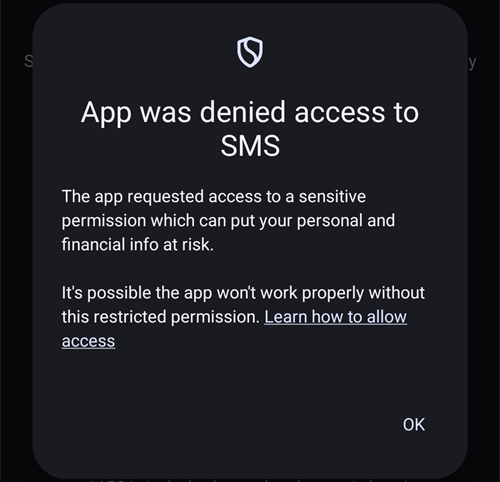
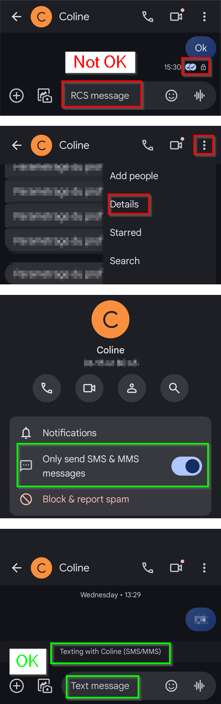

# Comandos SMS

```{contents} Table of contents
:depth: 2
```

La mayoría de los ajustes remotos (objetivos temporales, carbohidratos, cambios de perfil y, una vez emparejado el cliente, bolos) se pueden hacer con la [app **AAPSClient**](../RemoteFeatures/RemoteMonitoring.md) en un teléfono Android con conexión a internet; consulta [Control máster ↔ cliente](#client-master-control) (hay una versión de **AAPSClient** para iPhone en desarrollo, consulta [AAPSClient](AapsClient.md)). Los comandos SMS siguen siendo una alternativa que funciona sin internet, y la única opción remota si usas un iPhone como seguidor y todavía no tienes **AAPSClient**.

**Los comandos SMS son muy útiles:**
1. Para el control remoto de rutina

2. Si quieres poner un bolo de insulina a distancia sin un **AAPSClient** emparejado

3. En una zona con mala cobertura de internet, donde los mensajes de texto llegan, pero los datos/internet del teléfono son limitados. Esto es muy útil cuando vas a zonas aisladas (p. ej., de camping o a esquiar).

4. Si tu otro método de control remoto (**AAPSClient**) no funciona por un tiempo

## La seguridad primero

Si activas el **Comunicador por SMS** en **AAPS**, ten en cuenta que el teléfono configurado para dar comandos remotos puede ser robado y/o usado por otra persona. Bloquea siempre tu teléfono al menos con un PIN. Se recomienda mucho una contraseña fuerte y/o un bloqueo biométrico, y que sea distinta de la contraseña maestra de la APK (la contraseña que se necesita para exportar los ajustes de **AAPS**).

Además, se recomienda permitir un [segundo número de teléfono](#SMSCommands-authorized-phone-numbers) para los comandos SMS. Así puedes usar el segundo número para [desactivar](#SMSCommands-other) el comunicador por SMS si tu teléfono remoto principal queda comprometido.

The default minimum time delay between bolus commands is 15 minutes, counted from the moment the pump accepts a bolus. Por seguridad, tienes que añadir al menos dos números de teléfono autorizados para poder bajarlo a un tiempo más corto. Si intentas poner otro bolo remoto en los 15 minutos siguientes al bolo anterior, recibirás la respuesta «Bolo remoto no disponible. Inténtalo de nuevo más tarde»

AAPS también te avisará por mensaje de texto si tus comandos remotos, como un bolo o un cambio de perfil, se han ejecutado. Es aconsejable, por seguridad, configurar esta función para que los textos de confirmación se envíen al menos a dos números de teléfono diferentes, así si falla (o ha sido robado) uno, quedará el otro.

**¡Si pones un bolo con comandos SMS, tienes que introducir los carbohidratos por separado (segundo SMS, AAPSClient...)!** Si no lo haces, la IOB será correcta pero los COB serán demasiado bajos, y puede que no se ponga un bolo de corrección, porque **AAPS** supone que tienes demasiada insulina activa.

Para los comandos delicados, hay que usar una app de autenticación con una contraseña de un solo uso basada en el tiempo, para mayor seguridad.

Si quieres quitar a un teléfono de cuidador la posibilidad de enviar comandos SMS, usa el botón de emergencia «[Restablecer autenticadores](#sms-commands-authenticator-setup)» en **AAPS** o envía el comando SMS «[SMS stop](#SMSCommands-other)». Al restablecer los autenticadores, TODOS los teléfonos de cuidadores dejan de ser válidos. Tendrás que volver a configurarlos.

## Configurar comandos SMS

```{contents} The overall process is as follows
:depth: 1
:local: true
```

(sms-commands-authenticator-setup)=
### Configurar el Authenticator

Se utiliza una doble autenticación, para mejorar la seguridad.

En el teléfono del cuidador, descarga (de la App Store o de Google Play) e instala una app de autenticación (Authenticator). Las aplicaciones más comunes gratuitas son las siguientes:
  - [Authy](https://authy.com/download/)
  - Google Authenticator - [Android](https://play.google.com/store/apps/details?id=com.google.android.apps.authenticator2) / [iOS](https://apps.apple.com/de/app/google-authenticator/id388497605)
  - [LastPass Authenticator](https://lastpass.com/auth/)
  - [FreeOTP Authenticator](https://freeotp.github.io/)

Estas apps de autenticación generan una contraseña de un solo uso de 6 dígitos con tiempo limitado, como en la banca o las compras por móvil. Puedes usar otra app de autenticación, siempre que admita tokens TOTP RFC 6238. Microsoft Authenticator no funciona.

### Comprueba los ajustes del teléfono

En tu teléfono, ve a **Aplicaciones > AAPS > Permisos**. Asegúrate de que **SMS** y **Teléfono** estén permitidos.


```{admonition} "App was denied access to SMS"
:class: tip
Android puede bloquear el permiso de **SMS** para apps que no se instalaron desde una tienda de apps, como **AAPS**. Si ves este mensaje al conceder el permiso de **SMS**, abre en el teléfono **Ajustes > Aplicaciones > AAPS**, toca el menú **⋮** (arriba a la derecha) y selecciona **Permitir ajustes restringidos**. Después concede de nuevo el permiso de **SMS**.
```



### Sincronización de fecha y hora

La hora en ambos teléfonos tiene que estar sincronizada. La mejor práctica es configurarla de forma automática desde la red. Las diferencias de tiempo pueden causar problemas de autenticación.

Comprueba que la fecha y la hora estén sincronizadas tanto en el teléfono con **AAPS** como en el teléfono del cuidador. Cómo hacerlo depende de tu dispositivo; puede que tengas que probar distintos ajustes.

Ejemplo (para Samsung S23): **Ajustes > Administración general > Fecha y hora**: asegúrate de que **Fecha y hora automáticas** esté marcado.

Algunas opciones pueden aparecer en gris, porque necesitan un administrador de una cuenta familiar si el teléfono se ha configurado como cuenta infantil. En un iPhone de cuidador/padre o madre, este ajuste de fecha y hora se llama «Ajustar automáticamente». Si no estás seguro de haber sincronizado los teléfonos, no te preocupes: puedes configurar los comandos SMS y resolver problemas después si parece que esto los causa (pide ayuda si hace falta).

### Ajustes de AAPS

Una vez comprobados los ajustes del teléfono, en la propia app **AAPS** ve a [**Configuración** → **Comunicación**](../SettingUpAaps/ConfigBuilder.md) y activa el complemento **Comunicador por SMS**.

Abre los ajustes del **Comunicador por SMS**.

Activa **Permitir comandos remotos vía SMS**. Las opciones **PIN obligatorio adicional al finalizar el token** y **Configurar el Authenticator** solo aparecen cuando esto está activado:


(SMSCommands-authorized-phone-numbers)=
#### Números de teléfono permitidos

Introduce el número o los números de teléfono del cuidador. Incluye el código de país y quita el primer «0» del número de teléfono, como en estos ejemplos:
* Número de teléfono del Reino Unido: +447976304596
* Número de teléfono de EE. UU.: +11234567890
* Número de teléfono de Francia:  +33612344567
* _etc._

Ten en cuenta que el «+» delante del número puede ser necesario o no, según dónde vivas. Para saberlo, envía un texto de prueba, que mostrará el formato recibido en la pantalla del complemento **Comunicador por SMS** (**Configuración** → **Comunicación** → **Comunicador por SMS** → **Abrir complemento**).

Si tienes que añadir más de un número de teléfono, sepáralos con punto y coma, **SIN espacios entre los números** (¡esto es muy importante!). Selecciona **OK**:


#### Distancia mínima para bolo remoto

- Puedes definir el tiempo mínimo (en minutos) entre dos bolos enviados por SMS.
- Por razones de seguridad, hay que añadir al menos dos números de teléfono autorizados para editar este valor.

#### PIN obligatorio adicional al finalizar el token

Por seguridad, el código de respuesta debe ir seguido de un PIN. Elige un PIN que tú (y los demás cuidadores) vais a usar al final del código del autenticador cuando se envía el comando SMS.

Requisitos del PIN:

* al menos 6 dígitos
* solo dígitos

Para un PIN más seguro, no repitas el mismo dígito muchas veces (_p. ej.,_ 111111) ni uses una secuencia (_p. ej.,_ 123456).


#### Configurar el Authenticator

* Toca **Configurar el Authenticator** y sigue paso a paso las instrucciones de la pantalla.
* Abre la app de autenticación instalada en el _teléfono del cuidador_, configura una nueva conexión y
* Usa el teléfono del cuidador para escanear el código QR que aparece en **Escanea el código para configurar los códigos OTP de AAPS**.


* En **Probar la contraseña de un solo uso (OTP)**, introduce en **Código para comprobar** la contraseña de un solo uso de la app de autenticación del teléfono del cuidador, seguida de tu PIN:

Ejemplo:
* El token de la app de autenticación es 457051
* Tu PIN obligatorio es 2401
* Código para comprobar: 4570512401

Si lo introducido es correcto, el texto rojo «PIN INCORRECTO» cambiará solo a un «OK» verde. **¡No hay ningún botón que pulsar!** El proceso ya ha terminado; no hay un botón «OK» que pulsar después de introducir el código:


Ya deberías tener configurados los comandos SMS.

Usa el botón **Restablecer autenticadores** al final de la pantalla **Configurar el Authenticator** si quieres quitar los autenticadores configurados. (Al restablecer el autenticador se invalidan TODOS los autenticadores ya aprovisionados. Tendrás que volver a configurarlos.)

## Uso de los comandos SMS

### Primeros pasos con los comandos SMS

1)  Para comprobar que todo está bien configurado, prueba la conexión escribiendo «bg» en un SMS desde el teléfono del cuidador al teléfono con **AAPS**. Deberías recibir una respuesta parecida a la que se muestra aquí:


Si no recibes ninguna respuesta, consulta la sección [Solución de problemas](#SMSCommands-troubleshooting) más abajo.

2)  Ahora prueba un comando SMS que necesite el autenticador, _p. ej.,_ «target hypo». El teléfono del cuidador recibirá un mensaje de respuesta que te pide introducir la **contraseña de seis dígitos** de la app de autenticación, seguida del **PIN** secreto adicional que solo conocen los cuidadores/seguidores (en total una cadena de doce dígitos, si tu PIN tiene 6 dígitos).

La primera vez que envíes un comando SMS, hazlo junto al teléfono con **AAPS**, para ver cómo funciona:


El teléfono del cuidador recibirá un SMS de respuesta de **AAPS** que confirma si el comando SMS remoto se ha ejecutado bien.

Si tu comando se ejecuta bien, recibirás una respuesta que lo confirma. Si hay un problema, recibirás un mensaje de error. Consulta [Solución de problemas](#SMSCommands-troubleshooting) más abajo para ver los errores frecuentes.

**Sugerencia**: Puede ser útil tener SMS ilimitados en tu plan de teléfono (para cada teléfono utilizado), si se van a enviar muchos SMS.

### Poner bolos de comida con comandos SMS

Se pueden poner bolos de insulina a distancia con **Comandos SMS** o con un **AAPSClient** emparejado (consulta [Control máster ↔ cliente](#client-master-control)); no se puede hacer desde la web de Nightscout. Los carbohidratos también se pueden anunciar por SMS o con **AAPSClient**. Por SMS no es posible enviar carbohidratos e insulina en un solo mensaje SMS. Hay que enviar estos comandos por separado, así:

1)  Enviar el bolo de insulina por comandos SMS (_p. ej.,_ «bolus 2» ordena un bolo de 2 unidades) equivale a **Tratamientos** → **Insulina** en **AAPS**. 2)  Envía los carbohidratos (_p. ej.,_ «carbs 20» anuncia 20 g de carbohidratos). Esto equivale a **Tratamientos** → **Carbohidratos** en **AAPS**.

Para evitar hipoglucemias, es buena idea empezar con prudencia, poniendo un bolo con **menos insulina** de la que haría falta según tu ratio de carbohidratos, porque no tienes en cuenta la glucosa actual ni su tendencia.

**El orden en que envías estos comandos es importante**. Si anuncias una gran cantidad de carbohidratos por cualquier vía y tienes los SMB activados, **AAPS** puede responder enseguida con un bolo parcial de insulina. Así que, si después intentas enviar un bolo de insulina _después_ de anunciar los carbohidratos, puede que tengas un retraso molesto y un mensaje de «bolo en curso», y luego tendrás que comprobar qué se ha administrado como SMB. O, si no te das cuenta de que se está administrando un SMB y tu propio bolo posterior también se ejecuta, puede administrarse demasiada insulina para la comida en total. Por eso, si pones bolos de comida a distancia, envía siempre el bolo de insulina _antes_ del anuncio de carbohidratos. Si lo prefieres, puedes combinar **AAPSClient** con los comandos SMS: los carbohidratos introducidos en un **AAPSClient** emparejado no necesitan código de autenticación y por eso son más rápidos que los comandos SMS. Los carbohidratos u otros tratamientos introducidos en la web de Nightscout **no** se aplican mientras el control de clientes está activado; **AAPS** está entonces en [modo reforzado](#client-master-control-hardened-mode).

(SMSCommands-commands)=
## Comandos

```{contents} List of command groups
:depth: 1
:local: true
```

Los comandos se deben enviar en inglés; la respuesta llegará en tu idioma si el texto de la respuesta ya está [traducido](#translations-translate-strings-for-AAPS-app). Los comandos no distinguen entre mayúsculas y minúsculas; puedes usar unas u otras.


Las **tablas de comandos SMS** de abajo muestran todos los comandos SMS posibles. Se dan _valores de ejemplo_ para ayudar a entenderlos. Los comandos tienen el mismo rango de valores posibles (objetivos, porcentaje del perfil, etc.) que se permite en la propia app **AAPS**.

(authentication-or-not)=
### ¿Con autenticación o sin ella?

Algunos comandos SMS dan una respuesta inmediata, y otros necesitan una **autenticación** fuerte con la app de autenticación. Una consulta sencilla como «**BG**» (que pide la glucosa actual) es rápida de escribir, no necesita autenticación y devuelve la información de estado de **AAPS** que se muestra abajo:


Los comandos que necesitan más seguridad piden introducir un código, por ejemplo:


La columna *Aut.* de las tablas de abajo indica si cada comando necesita esta autenticación fuerte.

### Datos del MCG

| Comando    | Aut. | Función y *respuesta*                                                                                                                                                                              |
| ---------- | ---- | -------------------------------------------------------------------------------------------------------------------------------------------------------------------------------------------------- |
| BG         | No   | Devuelve: última glucosa, delta, IOB (bolo y basal), COB<br/>*Última glucemia: 5,6 hace 4 min, Delta: -0,2 mmol, IOB: 0,20U (Bolo: 0,10U Basal: 0,10U)*                                      |
| CAL 5.6/90 | Sí   | Calibra el MCG con un valor de 5.6/90<br/>(usa el valor adecuado para tus unidades de glucosa)<br/>Solo funciona si está bien configurado en **AAPS**.<br/>*Calibración enviada* |

### Bomba

| Comando              | Aut. | Función y *respuesta*                                                                                 |
| -------------------- | ---- | ----------------------------------------------------------------------------------------------------- |
| BOMBA                | No   | Last conn: 1 min ago<br/>Temp: 0.00U/h @11:38 5/30min<br/>IOB: 0.5U Reserv: 34U Batt: 100 |
| PUMP DISCONNECT *30* | Sí   | Para desconectar la bomba durante *30* minutos                                                        |
| PUMP CONNECT         | Sí   | Bomba reconectada                                                                                     |

### Basal

| Comando           | Aut. | Función y *respuesta*                            |
| ----------------- | ---- | ------------------------------------------------ |
| BASAL 0.3         | Sí   | Para iniciar una basal de 0,3 U/h durante 30 min |
| BASAL 0.3 20      | Sí   | Para iniciar una basal de 0,3 U/h durante 20 min |
| BASAL 30%         | Sí   | Para iniciar una basal del 30 % durante 30 min   |
| BASAL 30% 50      | Sí   | Para iniciar una basal del 30 % durante 50 min   |
| BASAL STOP/CANCEL | Sí   | Para parar la basal temporal                     |

Algunas bombas aceptan una basal temporal solo en porcentaje, otras solo en U/h. Si usas la otra forma, **AAPS** responde *«Esta bomba solo admite una basal temporal en porcentaje, no en U/h.»* (o al revés) y no programa nada. La duración debe ser un múltiplo del paso de duración de la basal temporal de tu bomba.


### Lazo

| Comando           | Aut. | Función y *respuesta*                                                                                                                                                                                                                                                  |
| ----------------- | ---- | ---------------------------------------------------------------------------------------------------------------------------------------------------------------------------------------------------------------------------------------------------------------------- |
| LOOP STATUS       | No   | La respuesta depende del estado real:<br/> - *El lazo está desactivado* si el lazo está desactivado o en LGS<br/> - *El lazo está activado* si el lazo está cerrado o abierto<br/> - *Suspendido (10 min)* si el lazo está desconectado o suspendido |
| LOOP STOP/DISABLE | Sí   | La bomba vuelve a la dosis basal programada.<br/>*El lazo se ha desactivado*                                                                                                                                                                                     |
| LOOP SUSPEND 20   | Sí   | *Lazo suspendido durante 20 minutos*                                                                                                                                                                                                                                   |
| LOOP RESUME       | Sí   | *Lazo reanudado*                                                                                                                                                                                                                                                       |
| LOOP CLOSED       | Sí   | *Modo de funcionamiento actual: Lazo cerrado*                                                                                                                                                                                                                          |
| LOOP LGS          | Sí   | *Modo de funcionamiento actual: Suspensión por glucosa baja (LGS)*                                                                                                                                                                                                     |

### Bolo

No se permite el bolo remoto en los próximos 15 minutos (este valor sólo es editable si se han agregado 2 números de teléfono) después del último comando de bolo o comandos remotos. En este caso, la respuesta sería *Bolo remoto no disponible. Inténtalo de nuevo más tarde.* Esta respuesta también se envía cuando la bomba está administrando un bolo.

| Comando              | Aut. | Función y *respuesta*                                                                                                                                                               |
| -------------------- | ---- | ----------------------------------------------------------------------------------------------------------------------------------------------------------------------------------- |
| BOLUS 1.2            | Sí   |                                                                                                                                                                                     |
| BOLUS 0.60 MEAL      | Sí   | Administra el bolo indicado de 0,60 U<br/>**y** pone el [objetivo temporal Comiendo Pronto](#TempTargets-eating-soon-temp-target)                                             |
| CARBS 5              | Sí   | Para introducir 5 g, sin bolo                                                                                                                                                       |
| CARBS 5 17:35/5:35PM | Sí   | Para introducir 5 g a las 17:35.<br/>El formato de hora aceptado depende<br/> del ajuste de hora (12 h/24 h) del teléfono.                                              |
| EXTENDED 2 120       | Sí   | Para iniciar un bolo extendido de 2 U durante 120 min.<br/>Solo para [bombas compatibles](#Extended-Carbs-extended-bolus-and-switch-to-open-loop-dana-and-insight-pump-only). |
| EXTENDED STOP/CANCEL | Sí   | Para parar el bolo extendido                                                                                                                                                        |

### Perfil

| Comando        | Aut. | Función y *respuesta*                                                                                                                                      |
| -------------- | ---- | ---------------------------------------------------------------------------------------------------------------------------------------------------------- |
| PROFILE STATUS | No   | Perfil actual y porcentaje                                                                                                                                 |
| PROFILE LIST   | No   | La lista actual de perfiles en **AAPS**, p. ej.:<br/>1. Profile1<br/> 2. Profile2                                                              |
| PROFILE 1      | Sí   | Para cambiar al perfil 1 de la lista.<br/>Usa los números que devuelve **PROFILE LIST**,<br/>no los nombres con los que guardaste los perfiles |
| PROFILE 2 30   | Sí   | Para cambiar al perfil Profile2 al 30 %                                                                                                                    |

El porcentaje debe estar entre 30 y 250 %, como en la app. Un valor fuera de este rango se rechaza antes de pedirte el código de autenticación.

### Objetivos temporales

| Comando                   | Aut. | Función y *respuesta*                              |
| ------------------------- | ---- | -------------------------------------------------- |
| TARGET MEAL/ACTIVITY/HYPO | Sí   | Para poner el objetivo temporal MEAL/ACTIVITY/HYPO |
| TARGET STOP/CANCEL        | Sí   | Para cancelar el objetivo temporal                 |


(SMSCommands-other)=
### Otros

| Comando          | Aut. | Función y *respuesta*                                                                                                                                                                                                                                                      |
| ---------------- | ---- | -------------------------------------------------------------------------------------------------------------------------------------------------------------------------------------------------------------------------------------------------------------------------- |
| RESTART          | Sí   | Reinicia AAPS. Útil si tienes problemas que normalmente se resuelven con un reinicio.                                                                                                                                                                                      |
| SMS DISABLE/STOP | Sí   | Para desactivar el servicio remoto por SMS, responde con el código.<br/>Ten en cuenta que solo podrás reactivarlo directamente<br/>desde el teléfono máster con **AAPS**.                                                                                      |
| HELP             | No   | Devuelve todas las funciones que se pueden consultar:<br/>BG, LOOP, PUMP, BASAL, BOLUS, EXTENDED, CAL, PROFILE, TARGET, SMS, CARBS, HELP, RESTART<br/>Envía después el comando ***HELP ***FUNCTION****** para ver<br/>todas las opciones de esa sección. |
| HELP BOLUS       |      | *BOLUS 1.2<br/>BOLUS 1.2 MEAL*                                                                                                                                                                                                                                       |

(SMSCommands-troubleshooting)=
## Solución de problemas y preguntas frecuentes

```{contents} List of questions and issues
:depth: 1
:local: true
```

### ¿Qué _no_ podemos hacer con los comandos SMS?

1)  **No puedes poner un cambio de perfil _temporal_** (por ejemplo, poner «perfil ejercicio» durante 60 minutos), aunque sí puedes cambiar de forma permanente a «perfil ejercicio». Los cambios de perfil temporales se pueden poner con **AAPSClient**.

2)  **No puedes cancelar automatizaciones** ni **poner objetivos definidos por ti**, pero hay soluciones aproximadas: Por ejemplo, imagina que el objetivo normal del perfil es 5,5. Tienes una automatización en AAPS que pone siempre un objetivo alto de 7,0 entre las 14:30 y las 15:30 por una clase de deporte en el colegio, y una condición de la automatización es que «no exista ningún objetivo temporal». Esta semana te avisan con poco tiempo de que la clase de deporte se cancela y se cambia por una sesión de pizza, pero tu hijo ya está en el colegio con el teléfono con **AAPS**. Si la automatización inicia el objetivo temporal alto de 7,0 y tú lo cancelas (en el teléfono con **AAPS** o a distancia), las condiciones de la automatización se siguen cumpliendo y **AAPS** simplemente pondrá otra vez el objetivo alto un minuto después.

**Si tuvieras acceso al teléfono con AAPS**, podrías desmarcar o cambiar la automatización o, si no quieres hacerlo, simplemente poner un nuevo objetivo temporal de 5,6 durante 60 min tocando el objetivo en la pantalla principal, o con **Administrar** → **Objetivo temporal**. Así la automatización no pondría el objetivo alto de 7,0.

**Si no tienes acceso al teléfono con AAPS**, los comandos SMS sirven como solución aproximada: por ejemplo, con el comando «target meal» para poner un objetivo de 5,0 durante 45 min (los otros objetivos predeterminados son 8,0 para actividad o hipoglucemia, consulta la tabla). Pero con los comandos SMS no puedes indicar un valor _concreto_ de objetivo (por ejemplo, 5,6 durante 60 minutos); para eso necesitarías **AAPSClient**.

### ¿Qué pasa si cambio de opinión sobre un comando que acabo de enviar?

**AAPS** solo ejecuta el comando más reciente. Así que, si escribes «bolus 1.5» y luego, sin autenticar, envías un nuevo comando «bolus 1», se ignorará el comando anterior de 1.5. **AAPS** siempre envía al teléfono del cuidador una respuesta que confirma cuál es el comando SMS antes de pedirte el código de autenticación, y también una respuesta después de la acción.

### ¿Por qué no recibí respuesta a un comando SMS?

Puede deberse a una de estas razones:

1)  El mensaje no ha llegado al teléfono (problemas de red). 2)  **AAPS** todavía está procesando la petición (_p. ej.,_ un bolo, que puede tardar un tiempo en administrarse según la velocidad de bolo). 3)  El teléfono con **AAPS** no tiene una buena conexión Bluetooth con la bomba cuando recibe el comando, y el comando ha fallado (esto suele crear una alarma en el teléfono con **AAPS**).

### No hay ninguna respuesta a los comandos SMS

En el teléfono del cuidador y/o en el teléfono con **AAPS**, prueba a desactivar estas opciones:
* **Enviar como mensaje de chat** 
* Si usas la app Mensajes de Android o Google Mensajes, desactiva los mensajes RCS:
  - Abre la conversación SMS específica en la aplicación Mensajes
  - Selecciona el menú de opciones (tres puntos) en la esquina superior derecha
  - Selecciona 'Detalles'
  - Activa «Enviar solo mensajes SMS y MMS» 

### Errores al ejecutar comandos

Hay varias razones posibles por las que el comando puede no ejecutarse:

* La configuración de los comandos SMS no está completa o no es correcta
* Enviaste un comando con un formato incorrecto (como «disconnect pump 45» en lugar de «pump disconnect 45»)
* Usaste un código de autenticación incorrecto o caducado (suele ser buena idea esperar unos segundos a un código nuevo si el actual está a punto de caducar)
* El código + PIN era correcto, pero el SMS tardó en salir o en llegar, y por eso **AAPS** calculó que el código de autenticación había caducado
* El teléfono con **AAPS** está fuera del alcance de la bomba o sin contacto con ella
* El sistema ya está ocupado administrando un bolo

Los errores frecuentes se muestran en los ejemplos de abajo:


### ¿Cómo puedo parar un comando una vez autenticado?

No puedes. Pero puedes cancelar un bolo enviado por SMS en el propio teléfono con **AAPS**, simplemente cancelándolo en la ventana emergente del bolo, si eres rápido. Muchos comandos SMS (salvo los bolos y los anuncios de carbohidratos) se pueden deshacer fácilmente, o se pueden tomar medidas para reducir los efectos no deseados si hay un error.

Para errores en bolos y anuncios de carbohidratos, también puedes hacer algo. Por ejemplo, si has anunciado 20 g de carbohidratos pero tu hijo solo come 10 g y tú (o un cuidador presente) no podéis borrar el tratamiento directamente en el teléfono con **AAPS**, puedes poner un objetivo temporal alto o un perfil reducido, para que **AAPS** sea menos agresivo.

### Múltiples SMS

Si recibes el mismo mensaje una y otra vez (_p. ej.,_ un cambio de perfil), puede que hayas creado sin querer un bucle con otras apps. Esta app podría ser xDrip, por ejemplo. En ese caso, asegúrate de que xDrip (o cualquier otra app) no suba tratamientos a Nightscout.

Si la otra aplicación está instalada en varios teléfonos, asegúrate de desactivar la subida de datos en todos ellos.

(sms-commands-too-many-messages)=
### Recibo demasiados mensajes de texto de los comandos SMS. ¿Puedo reducir la frecuencia o hacer que paren?

Usar comandos SMS puede generar muchos mensajes automáticos del teléfono con **AAPS** al teléfono del cuidador. También recibirás mensajes, por ejemplo «Perfil basal actualizado en la bomba», si tienes automatizaciones configuradas en **AAPS**. Puede ser útil tener SMS ilimitados en el plan del teléfono con **AAPS** (y en el de cada teléfono de cuidador) si se van a enviar muchos SMS, y desactivar las notificaciones, alarmas o vibraciones de SMS en todos los teléfonos. No es posible usar comandos SMS sin recibir estas actualizaciones. Por eso, quizá quieras otra forma de comunicarte directamente con tu hijo (si tiene edad suficiente) en lugar de SMS. Las apps de comunicación alternativas que más usan los cuidadores de **AAPS** son WhatsApp, LINE, Telegram y Facebook Messenger.

Es posible desactivar el SMS «Perfil cambiado» cuando el cambio de perfil viene de Nightscout. Para hacerlo, crea un archivo llamado **exactamente**  `do_not_send_sms_on_profile_change` en la carpeta `extra` de tu directorio de AAPS.
