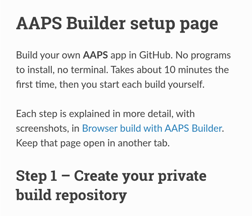
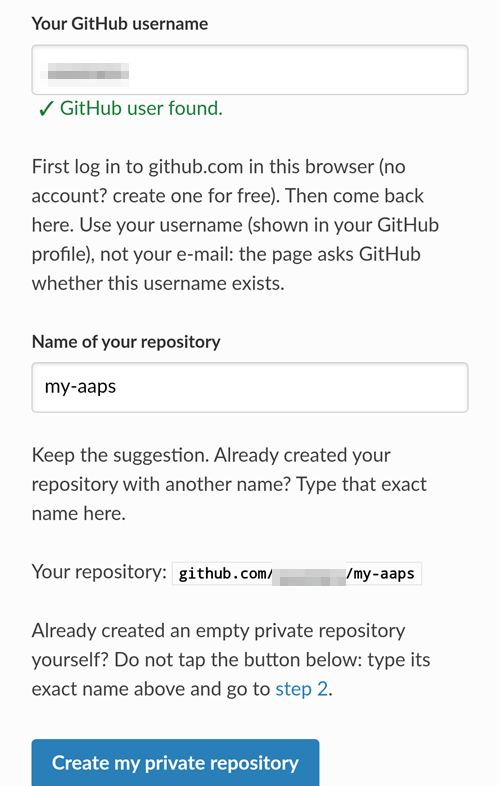
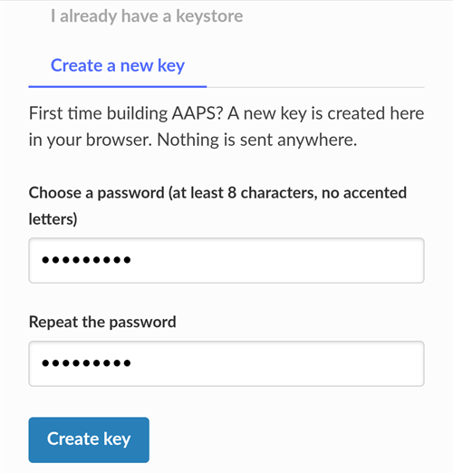
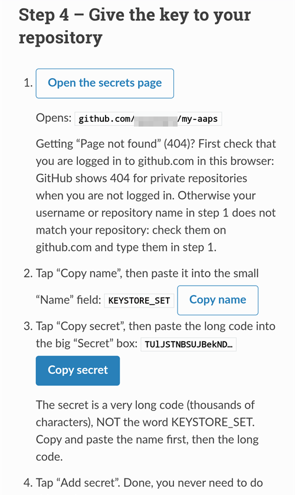

(aaps-builder)=

# Compilación en el navegador con AAPS Builder

```{note}
Esta es la forma recomendada de compilar AAPS desde un **teléfono Android**. También funciona desde el navegador de cualquier ordenador. Para las otras formas de compilar desde un ordenador o un iPhone, consulta el resumen de la [Compilación en el navegador](BrowserBuild.md).
```

```{contents} In this page
:backlinks: entry
:depth: 2
```

**AAPS Builder** compila la app AAPS por ti en GitHub, el sitio web gratuito para alojar código. No tienes que instalar nada en tu teléfono, ni abrir ningún archivo de preparación.

A setup page walks you through it. La primera vez se tarda unos 10 minutos:

1. Create your own **private copy** of AAPS Builder in your GitHub account: the setup page opens GitHub with everything filled in, you only confirm. The build workflow, the file that tells GitHub how to build AAPS, is already in it.
2. Create or upload your **signing key** (the keystore).
3. Give the key to your repository as a GitHub **secret**.
4. **Build** the app. One build takes 15 to 30 minutes.
5. **Download and install** the app on your phone.

**No** necesitas hacer un fork de AndroidAPS: el código fuente de AAPS se descarga del repositorio oficial de AndroidAPS en cada compilación. **Tampoco** necesitas Google Drive: descargas la app directamente desde GitHub.

```{admonition} Where the code comes from
:class: note

The build workflow is maintained by the AAPS developers in the [nightscout/aaps-builder](https://github.com/nightscout/aaps-builder) repository, and your repository is a copy of it. The [workflow](https://github.com/nightscout/aaps-builder/blob/main/.github/workflows/build.yml) in your copy is short: it runs the [build steps](https://github.com/nightscout/aaps-builder/blob/main/.github/workflows/aaps-builder.yml) kept in that repository, so improvements reach you without any change to your repository. You can read both files. Al compilar, el workflow solo descarga el código fuente oficial de AAPS y las herramientas de compilación de GitHub. Tu almacén de claves nunca sale de tu navegador ni de tu repositorio privado.
```

(aaps-builder-before-you-start)=

## Antes de empezar

Necesitarás:

- Una **cuenta de GitHub** (gratuita). Si no tienes una, créala primero en [github.com](https://github.com/signup).
- Un **navegador web**: Chrome en tu teléfono o cualquier navegador en un ordenador. Inicia sesión en github.com en ese navegador antes de empezar.
- **¿Tienes la app de GitHub en tu teléfono?** Puedes conservarla. Entonces algunos botones de la página de configuración abren la app en lugar de Chrome. Building works in the app, but the app **cannot download** the finished AAPS: [step 5](#aaps-builder-step5) shows how to switch to Chrome for the download.
- Tu **almacén de claves actual** (archivo `.jks`), su contraseña y su alias, si ya compilaste AAPS antes y quieres actualizarlo sin reinstalar.

```{warning}
**Tu repositorio de compilación debe seguir siendo privado.** Todo lo que produce una compilación es visible para cualquiera que pueda ver el repositorio. La página de configuración crea un repositorio privado para ti. Never change it to public, and don't **fork** AAPS Builder instead: a fork is always public.

Un repositorio privado recibe 2000 minutos gratuitos de GitHub Actions al mes, lo que basta para varias compilaciones.
```

```{warning}
**Clave nueva o clave existente: esto decide si puedes actualizar AAPS.**

- **Ya tienes AAPS en tu teléfono, compilado con un almacén de claves que todavía tienes**: elige **I already have a keystore** en la página de configuración y súbelo. Tu próxima compilación actualizará AAPS sin reinstalarlo. ¿Compilaste AAPS con la compilación en el navegador anterior (tu propio fork)? Tu almacén de claves está en tu fork: [primero obtén una copia](#aaps-builder-from-fork).
- **Compilas AAPS por primera vez, o perdiste tu almacén de claves o su contraseña**: elige **Create a new key**. Una app firmada con una clave nueva **no puede actualizar** un AAPS firmado con otra clave. Debes exportar tus ajustes, copiar el archivo fuera de tu teléfono, desinstalar el AAPS antiguo, instalar el nuevo y luego importar tus ajustes: consulta [Reinstalar AAPS con un nuevo almacén de claves](#reinstall-aaps).

Después, usa siempre la misma clave. Cuando crees una clave nueva, descarga la copia de seguridad que ofrece la página y guárdala con su contraseña y su alias (`key0`) en un lugar seguro, fuera de tu teléfono.
```

(aaps-builder-from-fork)=

## Si vienes de la compilación en el navegador anterior (fork)

Sáltate esta sección si nunca compilaste AAPS con el método anterior de compilación en el navegador (tu propia copia, o fork, de AndroidAPS en GitHub, con el archivo de preparación y Google Drive).

Tu almacén de claves está guardado como secretos en tu fork. GitHub nunca vuelve a mostrar un secreto, así que no puedes copiarlo a tu nuevo repositorio. Get a copy of your keystore first, then use it in [step 2](#aaps-builder-step2) with **I already have a keystore**.

```{warning}
No elijas **Create a new key**. Un AAPS compilado con una clave nueva no puede actualizar el AAPS de tu teléfono.
```

¿Cuál es tu caso?

- **Usaste la Opción 2** (subiste tu propio almacén de claves de Android Studio) y todavía tienes el archivo `.jks`, sus contraseñas y su alias: no tienes que hacer nada aquí. Use that file in step 2.
- **Usaste la Opción 1** (el archivo de preparación creó tu clave), o ya no tienes el archivo de tu almacén de claves: expórtalo desde tu fork como se explica abajo.

Para exportar tu almacén de claves desde tu fork:

1. En tu fork, abre **Settings** → **Secrets and variables** → **Actions** y añade un secreto llamado `ZIP_PASSWORD`. Elige una contraseña solo con letras inglesas (sin acentos ni ñ) y números. Protege el archivo que vas a crear.
2. Abre la pestaña **Actions** de tu fork, toca **CI Keystore Export** y luego **Run workflow**. Más detalles: [Exportar tu almacén de claves](#ci-keystore-export).
3. Cuando la ejecución tenga una marca verde, abre tu Google Drive: el archivo `keystore.zip` está en la carpeta **AAPS** → **KeyStore**. Si la ejecución falla en el paso de Google Drive, el acceso de tu fork a Google Drive ha caducado: consulta [El token de actualización de Google ha caducado](#aaps-ci-google-token-expired).
4. Descarga `keystore.zip` y ábrelo con tu `ZIP_PASSWORD`: en un ordenador, o en tu teléfono con una app de archivos que pueda abrir archivos ZIP protegidos con contraseña. Contiene:
   - `keystore.jks`: tu almacén de claves,
   - `keyStoreInfo.txt`: tu `KEYSTORE_PASSWORD`, `KEY_PASSWORD` y `ALIAS` (normalmente `key0`).
5. Copia `keystore.jks` a tu teléfono (o a Google Drive, para elegirlo desde allí).

In [step 2](#aaps-builder-step2) of the setup page:

1. Toca **I already have a keystore**.
2. En **Keystore file**, elige `keystore.jks`.
3. En **Keystore password**, escribe la `KEYSTORE_PASSWORD` de `keyStoreInfo.txt`.
4. En **Key alias**, elige o escribe el `ALIAS` de `keyStoreInfo.txt`.
5. Si `KEY_PASSWORD` es distinta de `KEYSTORE_PASSWORD`, desmarca **Key password is the same as the keystore password** y escribe la `KEY_PASSWORD`.

Guarda `keystore.zip` y su `ZIP_PASSWORD` en un lugar seguro, fuera de tu teléfono: es la copia de seguridad de tu clave.

To also save the builds of AAPS Builder in Google Drive, do [step 6](#aaps-builder-google-drive): the setup page gets a new `GDRIVE_OAUTH2` for you. Puedes conservar tu fork hasta que el AAPS compilado con AAPS Builder esté instalado en tu teléfono.

## Abre la página de configuración

**→ [Abre la página de configuración de AAPS Builder](#aaps-builder-setup)**

The setup page is part of this documentation, in your language. Keep this page open in another tab as well: the sections below explain each step of the setup page in more detail, with screenshots.

La página de configuración abre cada página de GitHub en una pestaña nueva de Chrome. Para volver a la página de configuración, toca el botón de pestañas junto a la barra de direcciones de Chrome (el cuadrado con un número) y elige la página de configuración de AAPS Builder.

La página de configuración funciona completamente en tu navegador: tu clave y tus contraseñas nunca se envían a ningún sitio, excepto al secreto de GitHub en el que tú mismo las pegas. Solo tu nombre de usuario de GitHub se envía a GitHub, para comprobar que existe. Recuerda tu nombre de usuario de GitHub y el nombre del repositorio, así que puedes volver a ella en cualquier momento para abrir otra vez tu página de secretos o tus compilaciones.



(aaps-builder-step1)=

## Paso 1 – Crea tu repositorio privado de compilación

This step creates your own private copy of AAPS Builder in your GitHub account, with the build workflow already in it. Solo tú puedes verlo, y también las apps que compila.

1. Asegúrate de que has iniciado sesión en github.com en este navegador.

2. En **Your GitHub username**, escribe tu nombre de usuario de GitHub, no tu correo electrónico. La página lo comprueba con GitHub: **✓ GitHub user found** significa que es correcto.

3. En **Name of your repository**, deja la sugerencia `my-aaps`. Si ya creaste tu repositorio con otro nombre, escribe exactamente ese nombre.

   ```{note}
   **Already have an AAPS Builder repository** (made with an earlier version of the setup page)? Don't create a new one: type its exact name, skip **Create my private repository**, and update its workflow once as explained in [Updating AAPS](#aaps-builder-updates). Your secrets stay as they are. If you want a new repository anyway, choose a name you don't have yet, for example `my-aaps-2`, and use the same keystore in step 2.

   Don't type the name of your fork of AndroidAPS: a fork is public, and it already builds with its own **AAPS CI** workflow.
   ```

   

4. Comprueba la línea **Your repository:** muestra `github.com/<your username>/my-aaps`. The setup page remembers the name from your last visit: check it every time before you use its buttons.

5. Toca **Create my private repository**.

   

6. GitHub opens **Create a new repository** in a new tab. Everything is already filled in: under **Start with a template**, the template `nightscout/aaps-builder` with **Include all branches** off, and under **General**, your account as **Owner** and the name you chose.

   

   Don't change anything.

7. Scroll down: under **Configuration**, **Choose visibility** is already **Private**. Tap the green **Create repository** button.

   

   GitHub shows your new repository: it contains a folder `.github` (with the build workflow) and a file `README.md`. **Vuelve a la pestaña de la página de configuración** para el paso 2: toca el botón de pestañas junto a la barra de direcciones de Chrome y elige la página de configuración.

```{warning}
**Your new repository is empty**, with no files? It was not created from the template, and it cannot build. Delete it (**Settings** → bottom of the page → **Delete this repository**), then tap **Create my private repository** on the setup page again.
```

(aaps-builder-step2)=

## Step 2 – Your signing key

La app debe estar firmada con tu propia clave. Elige una de las dos pestañas. Lee primero el [aviso sobre clave nueva o clave existente](#aaps-builder-before-you-start).


### I already have a keystore (ya tengo un almacén de claves)

1. Toca **I already have a keystore**.
2. En **Keystore file**, elige tu archivo `.jks` (o `.keystore`, `.p12`, `.pfx`). En un teléfono, copia primero el archivo a tu teléfono o a Google Drive.
3. En **Keystore password**, escribe la contraseña del almacén de claves.
4. En **Key alias**, elige tu alias de la lista, o escríbelo si no hay lista. En los almacenes de claves creados con Android Studio suele ser `key0`.
5. Si la contraseña de tu clave es distinta de la contraseña del almacén de claves, desmarca **Key password is the same as the keystore password** y escribe la contraseña de la clave.
6. Toca **Check and continue**.

La página comprueba la contraseña y el alias en tu dispositivo. **Keystore OK! Continue with step 3.** means everything is right. Si dice que la contraseña se comprobará al compilar, continúa de todos modos: la compilación te dirá si algo está mal.

### Create a new key (crear una clave nueva)

1. Toca **Create a new key**.

2. Elige una contraseña y escríbela dos veces. Reglas: al menos 8 caracteres, solo las letras a–z y A–Z, los dígitos 0–9 y símbolos como `! ? #`. Sin espacios, sin letras con acento y sin el carácter `|`.

3. Toca **Create key**. Pasan unos segundos hasta que aparece **Key created**.

   

4. Toca **Download backup (aaps-keystore.jks)**. Si Chrome pregunta **¿Volver a descargar el archivo?**, en tu teléfono ya hay una copia de seguridad anterior con el mismo nombre: toca **Volver a descargar**. Entonces Chrome guarda la clave nueva como `aaps-keystore (1).jks`: ese es el archivo de esta clave; consérvalo y no lo confundas con el anterior.

   Guarda estas tres cosas juntas, en un lugar seguro fuera de tu teléfono (por ejemplo, tu propio almacenamiento en la nube):

   - el archivo `aaps-keystore.jks`,
   - tu contraseña,
   - el alias de la clave: **`key0`**.

   Necesitas las tres cosas si alguna vez compilas AAPS de otra forma, por ejemplo con Android Studio. Las claves creadas con una versión anterior de la página de configuración tienen el alias `aaps`.

   

(aaps-builder-step3)=

## Step 3 – Give the key to your repository

Step 3 unlocks when step 2 is done. Tu clave, sus contraseñas y su alias se guardan juntos en un solo valor, el secreto `KEYSTORE_SET`.

1. Toca **Open the secrets page**.



2. GitHub abre la página **New secret** de tu repositorio. En un teléfono está debajo del menú de ajustes: desplázate hacia abajo.


3. Cambia a la pestaña de la página de configuración y toca **Copy name**. Vuelve a la pestaña de GitHub y pégalo en el campo pequeño **Name**. El nombre es `KEYSTORE_SET`.

4. Cambia a la pestaña de la página de configuración y toca **Copy secret**. Vuelve a la pestaña de GitHub y pégalo en el cuadro grande **Secret** (en un teléfono, mantén pulsado). El secreto es un código muy largo, de miles de caracteres: la página de configuración muestra sus primeros caracteres junto al botón. No pegues ahí la palabra `KEYSTORE_SET`.

5. Toca **Add secret**. `KEYSTORE_SET` aparece ahora en **Repository secrets**.


Solo tienes que hacer esto una vez.

```{tip}
¿GitHub muestra **Page not found** (404)? Primero comprueba que has iniciado sesión en github.com en este navegador: GitHub muestra 404 para los repositorios privados cuando no has iniciado sesión. Si no, el nombre de usuario o el nombre del repositorio del paso 1 no coincide con tu repositorio. Comprueba el nombre en github.com, corrígelo en el paso 1 y toca el botón otra vez.
```

(aaps-builder-step4)=

## Step 4 – Build the app

1. En la página de configuración, toca **Open the build page**. GitHub abre la página **Build AAPS** de tu repositorio.

   

   Si en su lugar se abre la **app de GitHub**: toca **RUN WORKFLOW**, comprueba la versión y la variante, y toca **RUN WORKFLOW** otra vez. La app puede seguir mostrando **Nothing to see here**: desliza la lista hacia abajo para actualizarla y ver tu compilación. Luego continúa con el paso 4 de abajo.

2. If GitHub asks, tap the green button to enable workflows.

   The list of workflows shows two entries: use **Build AAPS**. Ignore **AAPS Builder**: it holds the build steps and has no **Run workflow** button.

3. Toca **Run workflow**. Se abre un pequeño formulario:
   - **Version**: keep `latest` to build the newest AAPS release, or type a release number such as `4.0.0`.
   - **Variant**: deja `fullRelease` para el uso normal con una bomba. Las otras variantes se explican en [variantes de compilación](#browserbuild-variant). `aapsclient3Release` compila **AAPSClient3**, disponible desde la versión 4.0 de **AAPS** (consulta [Acerca de AAPSClient, AAPSClient2 y AAPSClient3](#remotecontrol-aapsclient-versions)).
   - Toca el botón verde **Run workflow**.

   

4. La compilación empieza y muestra **In progress**, con dos partes: primero **AAPS / Check** y luego **AAPS / Build AAPS**.

   

5. Espera de 15 a 30 minutos. Una marca verde significa que la compilación ha terminado. Una cruz roja significa que ha fallado: abre la compilación para leer el mensaje y luego consulta [solución de problemas](#aaps-builder-troubleshooting).

   

   ```{tip}
   **Correo electrónico cuando termina una compilación:** GitHub solo te envía un correo cuando una compilación falla. Para recibir también un correo cuando termina con éxito: en github.com, abre tu foto de perfil → **Settings** → **Notifications** → **System** → **Actions** y desmarca **Only notify for failed workflows**.
   ```

Si no hay un botón **Build AAPS** o **Run workflow**:

- Open your repository and check that it has a folder `.github` with the file `workflows/build.yml`. If the repository is empty, it was not created from the template: delete it (**Settings** → bottom of the page → **Delete this repository**) and do [step 1](#aaps-builder-step1) again with the button.
- Abre la pestaña **Actions**. Si dice que los workflows están desactivados, toca el botón verde para activarlos y luego toca **Build AAPS** en la lista.

(aaps-builder-step5)=

## Step 5 – Install the app on your phone

```{warning}
**Antes de cada actualización**, [exporta tus ajustes](#ExportImportSettings-Automating-Settings-Export) en AAPS y copia el archivo **fuera del teléfono** (Google Drive, Dropbox…). Guarda allí también varias exportaciones anteriores y los archivos APK, para poder volver atrás siempre.
```

1. En tu teléfono, abre la página de configuración en **Chrome**. Inicia sesión en github.com si te lo pide.
2. Toca **Open my builds** y luego la compilación más reciente con una marca verde.

   ```{admonition} The GitHub app opened instead of Chrome?
   :class: note

   La app de GitHub no puede descargar compilaciones. En la app, abre la compilación más reciente y luego toca **Artifacts ↗**, o toca el icono de compartir arriba y elige **Chrome** (o **Copiar enlace**, y luego pega el enlace en la barra de direcciones de Chrome). La compilación se abre en Chrome: continúa allí con el siguiente paso.

   Para que los enlaces de GitHub no se abran en la app: **Ajustes** de Android → **Aplicaciones** → **GitHub** → **Abrir de forma predeterminada** → desactiva **Abrir enlaces compatibles**.
   ```

   

3. Desplázate hacia abajo hasta el resumen de la compilación y toca el enlace **Download AAPS**.

   

   ```{tip}
   Desplázate con el dedo sobre el texto, no sobre el diagrama de los pasos de la compilación: si no, se mueve el diagrama en lugar de la página.
   ```

   También puedes bajar más hasta **Artifacts** y tocar el icono de descarga junto a `aaps-….apk`.

   

4. Cuando termine la descarga, abre el menú de Chrome **⋮** → **Descargas**, toca `aaps-….apk` y elige **Instalar**. Si te lo pide, permite instalar apps de esta fuente.

   

`aaps-wear-….apk` es la app para el reloj inteligente. Sáltala si no usas uno.

La app se guarda en la página de la compilación durante **14 días**. No aparece en **Code** de tu repositorio. Cópiala a un lugar seguro, fuera de tu teléfono, junto con tus exportaciones de ajustes.

Para más formas de instalar la app, consulta [Transferir e instalar AAPS](TransferringAndInstallingAaps.md).

```{note}
Desde septiembre de 2026, la [verificación de desarrolladores de Android](#android-developer-verification) de Google puede bloquear la instalación del APK al tocar el archivo, según tu país. En esa página se explican soluciones gratuitas.
```

(aaps-builder-google-drive)=

## Step 6 (optional) – Also save the app in Google Drive

También puedes hacer que cada compilación se guarde en tu Google Drive, en la carpeta `AAPS/<version>`. Esto es opcional: la app siempre está disponible en la página de la compilación.

Necesita un secreto más, `GDRIVE_OAUTH2`. Step 6 of the setup page gets it from Google for you, on a phone or a computer. **AAPS** can then only see and change the files it creates in your Google Drive, nothing else.

1. On the setup page, tap **Connect Google Drive**. Google opens in a new tab.
2. Choose your Google account and allow access. If Google says the app is not verified, tap **Advanced**, then **Go to …**.
3. The new tab then shows an error such as **This site can't be reached** or **127.0.0.1 refused to connect**. **This is expected:** Google's answer is in the address of that tab. Tap the address bar, select the whole address (it starts with `http://127.0.0.1:47913/`) and copy it.
4. Go back to the setup page tab within a few minutes: Google's answer is only valid for a short time, and only once. Paste the address into **Paste the copied address here** and tap **Get GDRIVE_OAUTH2**. The page shows **GDRIVE_OAUTH2 is ready**.
5. Toca **Open the secrets page**. Toca **Copy name** y luego pégalo en el campo pequeño **Name** (el nombre es `GDRIVE_OAUTH2`). Tap **Copy secret**, paste it into the big **Secret** box and tap **Add secret**.

Desde la siguiente compilación, los APK también se guardan en Google Drive.

Already have a `GDRIVE_OAUTH2` value from the preparation file of the other browser build methods? It works too: add it as the `GDRIVE_OAUTH2` secret.

Google quita el acceso si no compilas durante 6 meses o si cambias tu contraseña de Google. Entonces la compilación te lo indica: repite estos pasos. Consulta [El token de actualización de Google ha caducado](#aaps-ci-google-token-expired).

(aaps-builder-updates)=

## Actualizar AAPS

Tu repositorio nunca compila nada por sí solo: tú decides cuándo compilar, qué versión y qué variante. Cuando sale una nueva versión de AAPS:

1. [Back up your settings](#aaps-builder-step5) as explained in step 5.
2. Build the new version as in [step 4](#aaps-builder-step4). Deja `latest` o escribe el número de versión.
3. Download and install it as in [step 5](#aaps-builder-step5).

**Updates of the build steps** reach you by themselves: at every build, your repository runs the build steps released by the AAPS developers in nightscout/aaps-builder. Nothing changes in your repository, and there is no automatic build.

**Updates of your workflow file** are rare: only when the **Run workflow** form changes, for example for a new build variant, or once if your repository was made with an earlier version of the setup page (an empty repository with a short workflow file) or from the old template. The [Docs updates & changes](../Maintenance/DocumentationUpdate.md) page says so. Your `KEYSTORE_SET` secret stays as it is. On the setup page, open **Updating your copy** at the end of step 1:

1. Tap **Open the newest workflow**. On a computer, click the **copy icon** ("Copy raw file") at the top right of the file. On a phone, open the **plain-text version** instead, press and hold the text, then **Select all** and **Copy**.
2. Tap **Open my workflow file**.
3. Replace the whole text with the copied workflow (long press on a phone: **Select all**, then **Paste**).
4. Tap **Commit changes…**, then **Commit changes**.

The first line of the file shows its version.

(aaps-builder-troubleshooting)=

## Solucionando problemas

To see why a build failed, [read the build log](#aaps-ci-read-the-logs): the step names are different, but you find the error the same way. You can also [update a secret](#aaps-ci-update-secret) and [run the build again](#aaps-ci-rerun) the same way.

- **No "Build AAPS" or "Run workflow" button, or the repository is empty**: the repository was not created from the template. Delete it (**Settings** → bottom of the page → **Delete this repository**) and do [step 1](#aaps-builder-step1) again with the **Create my private repository** button.
- **La compilación se detiene con «This repository is PUBLIC»**: en tu repositorio, abre **Settings** → **General** → **Danger Zone** → **Change visibility** → **Private** y luego compila otra vez.
- **"Secret KEYSTORE_SET is missing"**: do step 3 of the setup page.
- **«The secret is too short»**, **«The secret is not a valid code»** o **«The secret does not contain a keystore»**: se pegó un texto equivocado en el secreto, a menudo la propia palabra `KEYSTORE_SET`, o solo una parte del código. In your repository, open **Settings** → **Secrets and variables** → **Actions**, edit `KEYSTORE_SET` and paste the long code from **Copy secret** again (redo step 2 of the setup page first if you closed it).
- **"Keystore, password or alias is wrong"**: check your keystore's password and alias, then redo steps 2 and 3 of the setup page.
- **«Version … does not exist»**: la versión que escribiste no es una versión publicada de AAPS. Usa `latest` o comprueba el número de versión.
- **"Variant … is not supported"**: your workflow file is an older version. Replace it as explained in [Updating AAPS](#aaps-builder-updates).
- **«Page not found» (404) cuando la página de configuración abre GitHub**: inicia sesión en github.com en el mismo navegador (GitHub muestra 404 para los repositorios privados cuando no has iniciado sesión). Si has iniciado sesión, el nombre de usuario o el nombre del repositorio del paso 1 de la página de configuración no coincide con tu repositorio. Escribe los nombres exactos.
- **«No GitHub user with this name»** en el paso 1: escribe tu nombre de usuario de GitHub, tal como aparece en tu perfil de GitHub, no tu correo electrónico.
- **No hay enlace Download, o se abrió la app de GitHub**: la app de GitHub no puede descargar compilaciones. Open the build in Chrome as explained in [step 5](#aaps-builder-step5). Para que los enlaces de GitHub no se abran en la app: **Ajustes** de Android → **Aplicaciones** → **GitHub** → **Abrir de forma predeterminada** → desactiva **Abrir enlaces compatibles**.
- **"Google Drive access has expired or was revoked"**: redo [step 6](#aaps-builder-google-drive) and update the `GDRIVE_OAUTH2` secret.

For other GitHub and Google Drive issues, see [Browser build troubleshooting](../GettingHelp/BrowserBuildTroubleshooting.md).

```{toctree}
:hidden:

AAPS Builder setup page <BrowserBuildAapsBuilderSetup.md>
```
